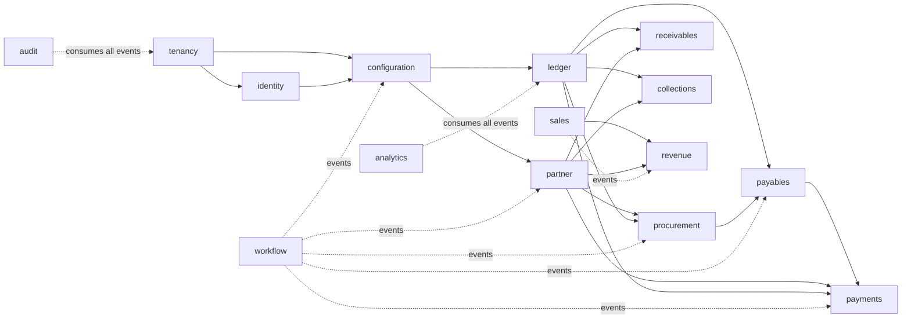

# 2. Architecture

## 2.1 Style: a modular monolith built to split

The platform is one deployable Go service made of **bounded contexts** with
hard boundaries (ADR-0001). It starts as a single binary because a small team
ships faster with one build, one deploy and in-process calls; it is built so
any context can become its own service without rewriting it.

The boundary rules that make later extraction mechanical:

1. **A context owns its tables.** Each context has its own PostgreSQL schema.
   No context reads or writes another context's tables, and there are no
   foreign keys across schemas; references across contexts are by id.
2. **Contexts talk through two channels only:** a Go interface published by
   the owning context (synchronous queries and commands), and domain events
   published through the transactional outbox (asynchronous reactions).
3. **No shared mutable state** in memory between contexts.
4. Each context has the same internal layering (ports and adapters):

```
  api (HTTP handlers, generated from OpenAPI)
     │
  application (use cases, transactions, authorization, idempotency)
     │
  domain (entities, value objects, invariants, domain events — pure Go)
     │
  ports ─── adapters: postgres repository, outbox, external connectors
```

Extracting a context later means moving its package to a new binary,
replacing its in-process Go interface with a generated API client, and
pointing its schema at a separate database. Callers do not change.

## 2.2 Bounded contexts

| Context | Owns | Examples of what it publishes |
|---|---|---|
| **tenancy** | Tenants, legal entities (company codes), org units, regions | `LegalEntityCreated` |
| **identity** | Users, agents, roles, permissions, SoD rules, company access | `RoleAssigned`, `AccessRevoked` |
| **configuration** (schema `config`) | Configuration versions, change requests, evidence | `ConfigurationActivated` |
| **partner** | Business partners, roles (supplier, customer), addresses, bank accounts, tax ids | `SupplierApproved`, `CustomerApproved`, `BankAccountChanged` |
| **ledger** | Chart of accounts, fiscal calendars, periods, currencies, exchange rates, journal entries, open items, clearing, balances, balance carry-forward runs (ADR-0060) | `JournalEntryPosted`, `PeriodClosed`, `BalanceCarriedForward` |
| **procurement** | Requisitions, purchase orders, contracts, goods receipts | `PurchaseOrderReleased`, `GoodsReceived` |
| **payables** | Supplier invoices, matching results, invoice holds | `SupplierInvoicePosted`, `InvoiceHeld` |
| **receivables** (ADR-0063) | Customer invoices entered without a sales order, with their items and the output tax calculated for them (T75a), and posted as the customer's open items with their payment terms (T75b); incoming payments on a house bank's incoming payments clearing account applied to a customer's open items in full (T75c); credit memos and the aging read planned (T75d, T75e) | `CustomerInvoiceChanged`, `CustomerInvoicePosted`, `IncomingPaymentApplied` |
| **collections** (ADR-0065, a leaf) | Dunning runs: per company and key date, one notice per customer proposing the open customer items overdue and the dunning level each would reach, from the ledger's customer open items (`ledger.OpenItems.Receivable`) and the company's dunning levels in the configuration, through the ports `OpenItems`, `Partners`, `LegalEntities` and `Settings`; nothing changes on the items (T76a); confirming a run and the collection worklist planned (T76b, T76c) | `DunningRunChanged` |
| **sales** (ADR-0067) | Quotations to customers with their items, net of tax, open then accepted or rejected once (T78a); sales orders created from an accepted quotation or directly and confirmed once, each item with its ordered, delivered and billed quantities, read by other contexts through `sales.Orders` (T78b); delivery confirmations of a confirmed order's items, by a person, on a date, up to what is open, moving no stock and posting nothing, each item's deliveries read through `sales.Orders` (T78c); billing documents for an order's delivered quantities not yet billed, at the order's prices, the last document of an item taking the remainder of its net value, created without posting (T79a); posting them planned (T79b). Posts nothing itself: billing posts through receivables | `QuotationChanged`, `SalesOrderChanged`, `SalesOrderDelivered`, `BillingDocumentChanged` |
| **revenue** (ADR-0068, a leaf) | Revenue contracts: the contract with a customer that one confirmed sales order in local currency stands for, its transaction price the order's net value without tax, with one performance obligation per order item; created once per order by the context's consumer of the sales context's `SalesOrderChanged` (the durable consumer `revenue-contracts`, the context's inbox) and on a person's request, through the ports `SalesOrders`, `Partners` and `LegalEntities` (T81a); a draft's obligations set by a person (timing, service period, stand-alone selling price) and the contract activated once, which allocates the transaction price in proportion to the stand-alone selling prices with shares that add up exactly (T81b); the recognition schedule and the recognition run planned (T81c, T81d). The person makes every judgement; the system does the arithmetic | `RevenueContractChanged` |
| **payments** | Payment proposals, payments, bank files, bank statements | `PaymentRunReleased` |
| **workflow** | Approval requests, steps, decisions | `ApprovalCompleted` |
| **audit** | Audit events (hash-chained) | — (consumes everything) |
| **integration** | Connectors, inbound/outbound messages, SAP extracts, migration runs | `MigrationRunCompleted` |
| **analytics** | Read models, semantic layer, saved reports, dataset contracts (ADR-0044) | — (consumes events) |
| **agents** | Agent sessions, tool calls, recommendations, costs | `RecommendationMade` |
| **assets** (ADR-0057, a leaf) | Asset classes' use (the classes and accounts are configuration), assets, movements, acquisitions, retirements, transfers, depreciation runs | `AssetChanged`, `AssetMovementPosted`, `DepreciationRunCompleted` |
| **closing** (ADR-0058, a leaf) | The close calendar (the close template and company weekends are configuration), period closes and their checklists, sign-offs, the variance report, accrual proposals, variance comments; year closes, their checklists, checks and sign-off locking the year (ADR-0060, T64m4-T64m6) | `PeriodCloseChanged`, `PeriodCloseSignedOff`, `AccrualProposed`, `AccrualProposalRejected`, `VarianceCommentChanged`, `YearCloseChanged`, `YearCloseSignedOff` |
| **consolidation** (ADR-0059, a leaf) | The consolidation groups and the group chart as configured (T68a: the group chart, the mapping and the groups are configuration, read through its ports); consolidation runs per group and period as the workflow `ConsolidationRun` and their translated balances (T68d, through the ports `Ledger` and `Runs`; the ledger's `ConsolidationReads`); a run's consolidated balance sheet and profit and loss from its stored rows (T68e); its intercompany differences and elimination entries (T68f); accepting differences by a person and finalizing runs on locked periods, superseding the period's previous final run, with `stale` by the periods' versions (T68g, the port `People`); the investment eliminated against each member's share capital and the acquisition figures its first final run freezes, for members the parent incorporated and holds whole, whose earlier results and reserve stay the group's (T68h, T68h2; trading partners are on the ledger's journal lines, T68b-T68c) | `ConsolidationRunChanged`, `IntercompanyDifferenceAccepted` |
| **einvoicing** (ADR-0061, a leaf) | E-invoice documents received from (and, in phase 3, sent through) the tenant's accredited provider, their statuses and the provider port; the connector is integration's (T65a: fetched on demand as the workflow `FetchEInvoices` through the port `workflows.EInvoices`, recorded `received` and acknowledged, read through the ports `Connectors`, `Companies` and `Runs`; the provider's stand-in its only adapter; T65b: fetched once per `ERP_EINVOICE_FETCH_INTERVAL` from every active connector as the workflow `ScheduledEInvoiceFetch`, a redelivery with other bytes recorded as the document's change, the original served as received; validation, entering and people's resolution planned, T65c-T65f) | `EInvoiceChanged` |

Later phases add `inventory`, `manufacturing`, `maintenance`,
`projects` and `hr` with the same rules; `receivables` is built from T75a
(ADR-0063), `collections` from T76a (ADR-0065), `sales` from T78a
(ADR-0067) and `revenue` from T81a (ADR-0068).

Dependencies between contexts point one way (no cycles):



Solid arrows are synchronous dependencies (the left context's published Go
interface is called by the right). Dotted arrows are event subscriptions.

## 2.3 Components

```mermaid
flowchart TB
  subgraph Clients
    UI[Web workspaces]
    CLI[CLI]
    AG[Claude agents]
    EXT[Partner systems / SAP connectors]
  end
  GW[API gateway<br/>TLS, rate limits, OIDC token validation]
  subgraph Platform service (Go, stateless, N replicas)
    API[HTTP API<br/>generated from OpenAPI]
    CTX[Bounded contexts<br/>application + domain]
    OUT[Outbox relay]
  end
  W[Workers<br/>Temporal workflows: payment runs, migrations, simulations]
  PG[(PostgreSQL<br/>schema per context<br/>RLS by tenant)]
  BUS[[Event bus<br/>NATS JetStream]]
  RM[(Read models<br/>Postgres replica, then columnar)]
  OBJ[(Object storage<br/>documents, bank files, extracts)]
  IDP[Tenant identity provider]
  KMS[KMS / Vault]

  UI & CLI & AG & EXT --> GW --> API --> CTX --> PG
  CTX --> OBJ
  CTX -- outbox rows --> PG
  OUT -- reads outbox --> PG
  OUT --> BUS
  BUS --> W & RM
  BUS --> AUD[Audit consumer] --> PG
  W --> API
  GW --> IDP
  CTX --> KMS
```

## 2.4 Data flow of a write

Posting a supplier invoice, as an example of every write:

1. Client sends `POST /v1/supplier-invoices/{id}:post` with an
   `Idempotency-Key` and `If-Match` (ETag).
2. Gateway validates the OIDC token; the API layer resolves tenant, actor,
   permissions and company access.
3. The application service opens **one database transaction** that:
   checks the idempotency key; loads the invoice with its version;
   runs domain rules (three-way match, tolerances from active configuration);
   asks the ledger context (in-process interface, same transaction) to post
   the journal entry; writes the invoice state change; writes
   `SupplierInvoicePosted` and `JournalEntryPosted` to the outbox; writes the
   audit record; stores the idempotent response.
4. Commit. The relay publishes outbox rows to the bus; consumers update read
   models, analytics and notifications.

While contexts share one database, cross-context writes like step 3 run in
one transaction. When a context is extracted, that step becomes a saga with
compensations (ADR-0007); the domain events already exist for it.

## 2.5 Deployment

| Tier | Runs | Scales by |
|---|---|---|
| API gateway | Managed gateway or Envoy, in front of `erp-router` (verifies the token, forwards to the tenant's cell; ADR-0022) | Replicas |
| Platform service | Stateless Go containers on Kubernetes | Horizontal pod autoscaling |
| Workers | Temporal workers (same binary, worker mode) | Replicas per task queue |
| Database | PostgreSQL 17 primary + synchronous standby + read replicas | Vertical, partitions, then cells (05-scalability) |
| Event bus | NATS JetStream cluster | Streams per context, partitions by tenant |
| Object storage | S3-compatible | Managed |

A **cell** is one complete copy of this stack (service, workers, database,
bus) serving a set of tenants. Cells are the unit of horizontal scale and of
failure isolation; the global directory and `erp-router` map tenants to cells
(05-scalability, ADR-0022).

## 2.6 Cross-cutting concerns

| Concern | Decision |
|---|---|
| Identifiers | UUIDv7 for every entity, plus human document numbers from number ranges (ADR-0004) |
| Money | Integer minor units with currency code; three currencies on ledger lines (ADR-0005) |
| Ledger integrity | Append-only entries and lines; reversal instead of update; balances derived (ADR-0006) |
| Tenancy | `tenant_id` first column of every key; RLS; cells for scale (ADR-0003) |
| Events | Transactional outbox, CloudEvents, at-least-once with idempotent consumers (ADR-0007) |
| Concurrency | Optimistic locking (version column, ETag/If-Match) (ADR-0008) |
| Idempotency | `Idempotency-Key` on every non-safe request, stored per tenant (ADR-0008) |
| Time | `timestamptz` in UTC for instants; `date` for business dates; fiscal period resolved by calendar |
| Extensibility | Typed custom fields in `jsonb`, governed by configuration schemas (ADR-0009) |
| AuthN/AuthZ | OIDC tokens of the identity providers each tenant registers, which decide the token's tenant; multi-factor and session lifetime and idle timeout per tenant (ADR-0031); permissions, company access and SoD from the identity context (ADR-0010) |
| Audit | Hash-chained audit events per tenant, written in the same transaction (ADR-0011) |
| Transport | TLS on every connection, verified; production refuses plaintext at start; TLS 1.3 between services, 1.2+ to providers; service certificates (SPIFFE IDs) authorize hops, agent tokens are bound to client certificates; encryption at rest stated and checked at start (ADR-0033) |
| Long-running work | Temporal workflows exposed as API operations (ADR-0012) |

## 2.7 What to revisit as the system grows

| Trigger | Revisit |
|---|---|
| One context dominates load or release cadence | Extract it to its own service (rules in 2.1 make this mechanical) |
| Largest tenant exceeds one database's write capacity | Distribute that cell with Citus on `tenant_id` (keys already lead with it) |
| Read models lag or analytics queries hurt OLTP | Move analytics to the columnar store of ADR-0044: DuckDB in `erp-analytics` over per-tenant Parquet, fed by incremental extracts under RLS on the replica, not CDC |
| Cross-region tenants | Per-region cells with tenant pinning; no cross-region writes |
