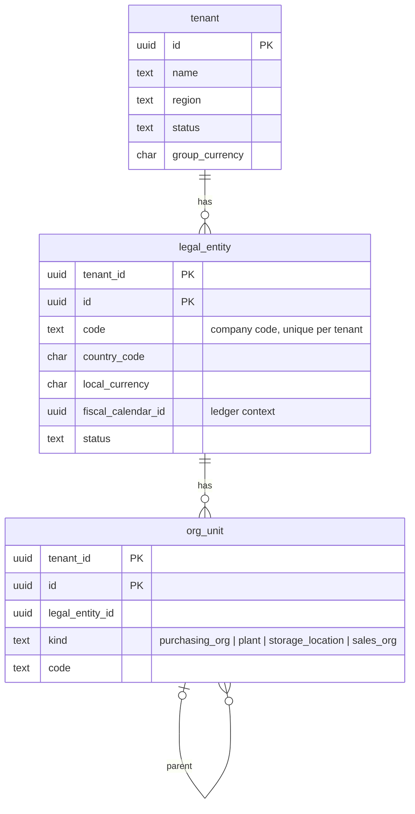
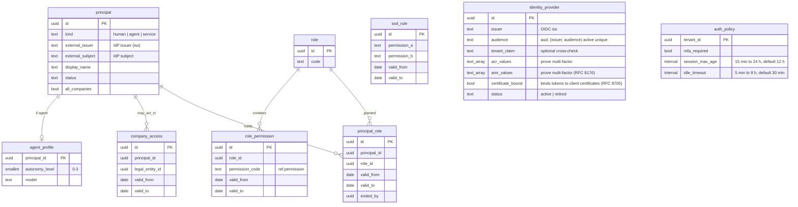
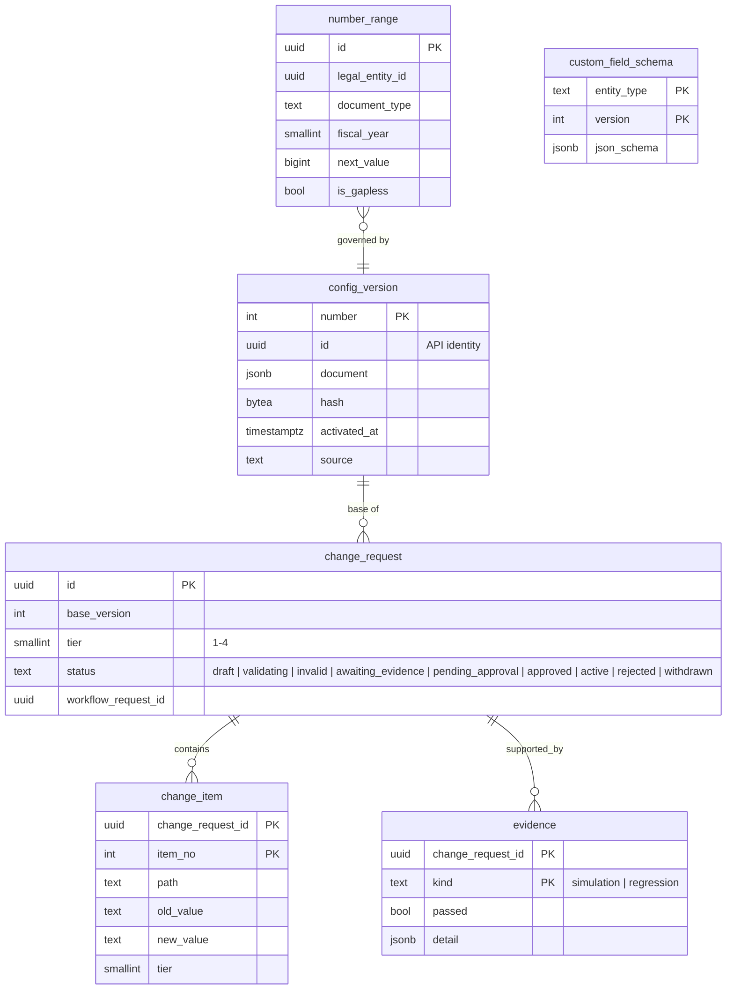
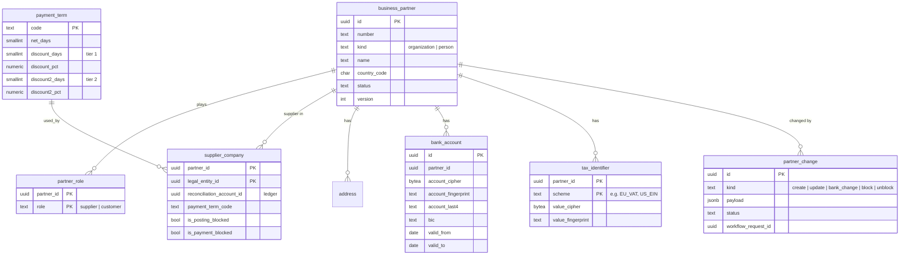
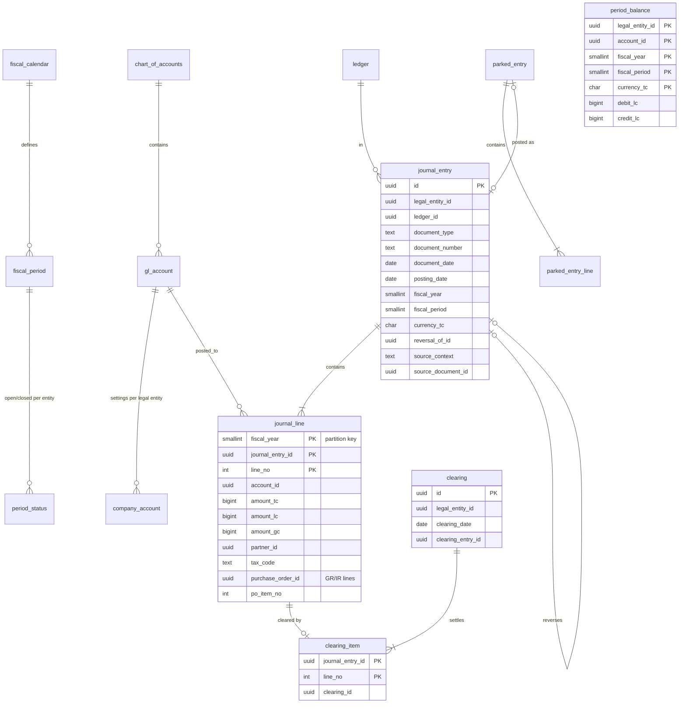
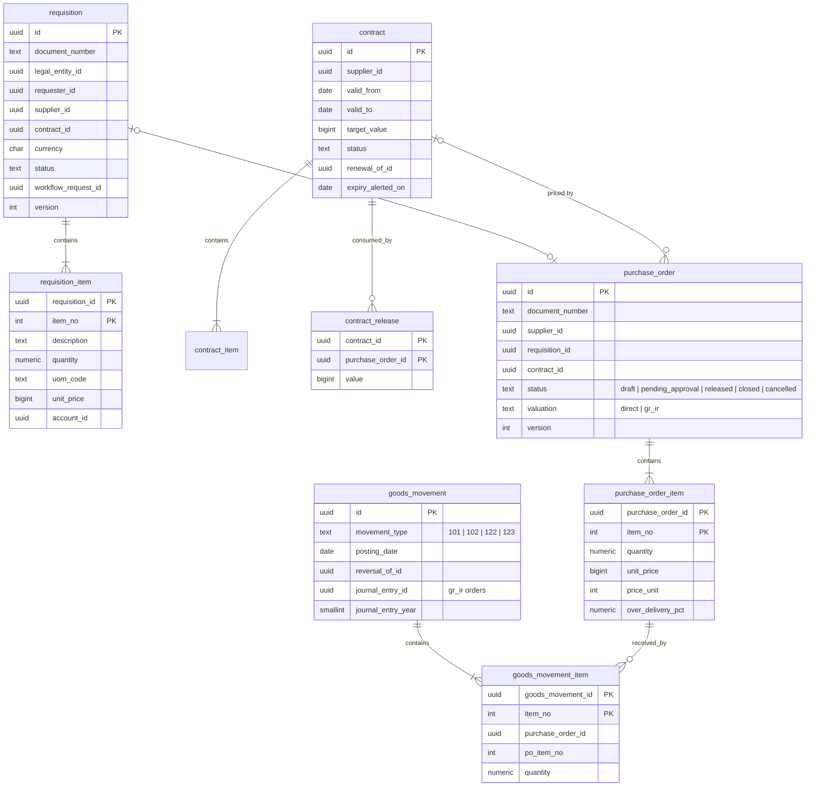
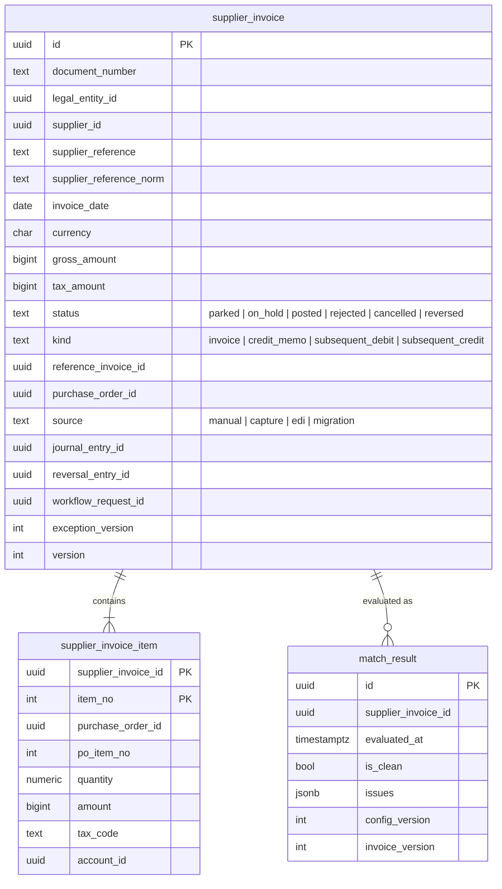
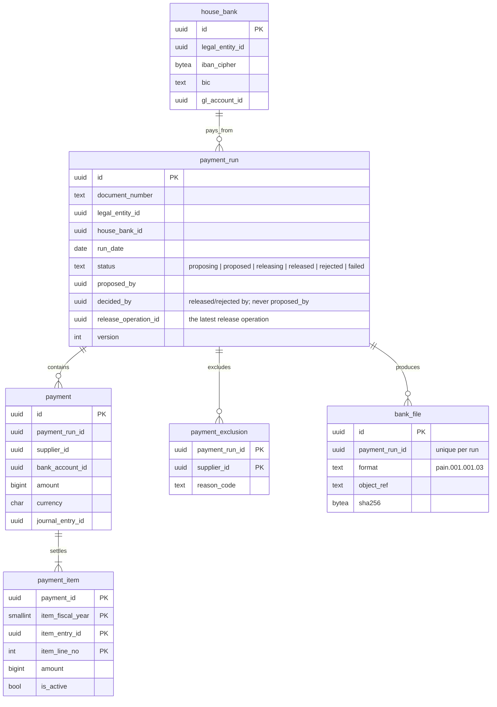
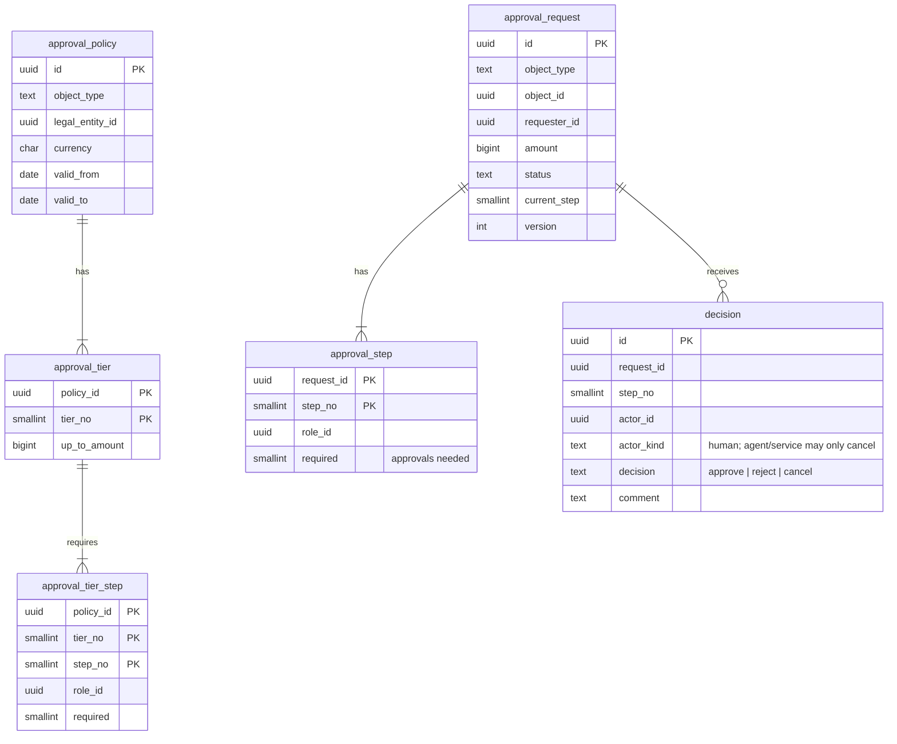

# 3. Data model

The logical model is described here; the physical model is implemented in
[`db/migrations/`](../../db/migrations/) and is authoritative for column
types. Both are reviewed together.

## 3.1 Conventions (apply to every table)

### Schemas and ownership
- One PostgreSQL schema per bounded context (`tenancy`, `identity`, `config`,
  `partner`, `ledger`, `procurement`, `payables`, `payments`, `workflow`,
  `audit`, `integration`, `agents`, `analytics`), plus:
  - `ref`: global reference data (currencies, countries, units, permissions),
    identical in every cell, read-only to the application;
  - `platform`: per-cell infrastructure (idempotency keys, operations).
- A context's tables are written only by that context. **No foreign key
  crosses a schema** (except to `ref`, which is immutable reference data).
  Cross-context references are `uuid` columns validated by the owning
  context's interface.

### Keys
- `tenant_id uuid NOT NULL` is the first column of every primary key, unique
  key and index on tenant-owned tables (ADR-0003).
- `id uuid` (UUIDv7, generated by the application) identifies entities
  (ADR-0004). Primary key: `(tenant_id, id)`.
- Child rows of a document use `(tenant_id, parent_id, line_no)`.
- Foreign keys inside a context include `tenant_id`:
  `FOREIGN KEY (tenant_id, supplier_id) REFERENCES ... (tenant_id, id)`, so a
  row can never point at another tenant's row.
- Business documents carry a human `document_number`, unique per tenant,
  legal entity, document type and fiscal year, issued from number ranges.

### Standard columns
| Column | On | Meaning |
|---|---|---|
| `created_at timestamptz`, `created_by uuid` | every table | Insert time (UTC) and acting principal |
| `updated_at timestamptz`, `updated_by uuid` | mutable tables | Last change |
| `version integer` | mutable aggregate roots | Optimistic locking, exposed as ETag (ADR-0008) |
| `extensions jsonb` | extensible entities | Governed custom fields (ADR-0009) |

Insert-only tables (journal entries and lines, clearings, goods movements,
decisions, audit events) have no `updated_*` or `version`, and the
application role is not granted UPDATE or DELETE on them.

### Types
| Kind | Type | Notes |
|---|---|---|
| Money | `bigint` minor units + `char(3)` currency | Exponent from `ref.currency` (ADR-0005) |
| Quantity | `numeric(20,6)` + unit of measure | |
| Rate, percentage | `numeric(28,12)` for FX; `numeric(9,6)` for percentages | |
| Instant | `timestamptz`, stored UTC | |
| Business date | `date` | Document, posting, due dates |
| Status, kind | `text` with `CHECK (... IN (...))` | Not PostgreSQL enums (they are hard to alter online) |
| Codes | `text` with length/format CHECKs | Configurable code lists are tables |
| Sensitive values | `bytea` ciphertext + `text` fingerprint (HMAC) + `text` last4 | Field-level encryption; fingerprint for equality and duplicates |

### Lifecycles instead of deletes
Business records are never deleted. Documents move through statuses
(`draft → released → closed`, `posted`, `cancelled` via reversal). Master data
is deactivated (`status = 'inactive'`) or end-dated (`valid_to`). Personal
data erasure (GDPR) is a governed anonymization, not a delete.

### Effective dating
Values that change over time and must be known historically use
`valid_from date NOT NULL, valid_to date` (exclusive), with an `EXCLUDE`
constraint preventing overlaps: bank accounts, role permissions, role
assignments, company access, SoD rules, tax codes, approval policies.
Assignments are ended, never rewritten: `platform.end_validity()` permits only
setting or shortening `valid_to` (not into the past) with `ended_by`, and the
application role may update only those columns. Exchange rates are
insert-only; a new rate is a new row with a later `valid_from`. A rate is
`numeric(28,12)`, and recording one refuses more than 16 integer digits or
12 decimals (422 `ledger.invalid_rate`) rather than letting the column
round a decimal away (F19).

### Naming
`snake_case`; singular table names (`purchase_order`); `<entity>_id` for
references; `_at` for instants, `_date` for dates; `is_` for booleans;
`_code` for codes; amounts end in the currency role (`amount_tc`,
`amount_lc`, `amount_gc`).

## 3.2 Reference data (`ref`, global)

| Table | Key | Purpose |
|---|---|---|
| `currency` | `code` (ISO 4217) | Name, minor-unit exponent |
| `country` | `code` (ISO 3166-1 alpha-2) | Name, IBAN length if any |
| `unit_of_measure` | `code` | Dimension (quantity, mass, time...), name |
| `permission` | `code` | Platform permission catalog; `is_approval` marks permissions agents may never hold |

## 3.3 Tenancy and organization (`tenancy`)

`tenant` is the only table without `tenant_id` (it *is* the tenant); it carries
the tenant's region and group currency, and once offboarded what became of
its data: `exported_at`, `export_ref`, `erase_after`, `erased_at`
(ADR-0021). The global tenant-to-cell directory
lives outside cell databases (05-scalability). `tenant_key` holds the
tenant's field-encryption and fingerprint keys, wrapped by a master key of
the deployment's ring; one is active, retired ones stay to open older values
(ADR-0018).

## 3.4 Identity and access (`identity`)

Agents are principals like people, with their own roles. A trigger rejects
granting an `is_approval` permission to a role held by an agent.

A token authenticates the principal whose `external_issuer` and
`external_subject` are its `iss` and `sub`, in the tenant it names: every
trusted issuer may name any tenant, so the subject alone would let one
tenant's identity provider sign in as another tenant's principal whose
subject it also issues (ADR-0010, amended 2026-10-14). People and services
carry both; agents carry an issuer only when they have a subject. Requests
name no issuer (the API reports it read-only as `external_issuer`, T30), so a
principal is bound to the issuer of the
administrator who creates it, and a new tenant's first administrator to
the cell's only tenant issuer (a cell that trusts several refuses to
provision, `provisioning.issuer_ambiguous`). `principal_issuer_subject`
(tenant, issuer, subject) is unique. Migration 000037 added the column
(expand step) and bound the principals that existed to the development
issuer `erp-dev`, the single issuer of the only installations that had any
(no record says which issuer created a principal; elsewhere it matches no
token, so such a principal is refused until re-bound). During the rolling
deploy the previous release keeps inserting people and services with a
subject and a NULL issuer, after 000037's backfill has run; the new release
never finds them (it resolves issuer and subject), so they cannot sign in
until bound. The contract step (06 §6.4, T31), run once no replica of the
previous release runs (it ships in the release after 000037's only because
there is no production data yet), is three migrations: 000046 (1) adds the
check `principal_issuer_with_subject`, that a principal with a subject has
an issuer, `NOT VALID`, so no new row can lack one, and (2) binds every
principal still `external_issuer IS NULL AND external_subject IS NOT NULL`
to the issuer of the principal that created it (`created_by`, as
`CreatePrincipal` does), following chains of unbound creators up to a bound
one, and, where none is found, to the development issuer `erp-dev`, as
000037 did. A migration cannot read which issuers the cell trusts, and
`ERP_ENV=production` refuses `erp-dev`, so outside development such a
principal is refused until an operator binds it to its real issuer (T37):
it fails closed rather than guess. The control plane lists a tenant's
unbound principals (those whose issuer is no active registered provider
of the tenant) and binds one to a provider with its subject there
(`bindPrincipal`, `erp:admin`, audited, published as `PrincipalBound`). 000047 `VALIDATE`s the check, and 000048
drops `principal_subject` (the subject alone unique per tenant)
concurrently; `principal_issuer_subject` carries uniqueness. A person or
service now always has an issuer, and the new release refuses to create one
whose issuer it cannot tell: `CreatePrincipal` answers 422
`identity.creator_without_issuer` when the creating actor (an agent, a job
acting through `uow.Act`) is bound to no issuer, and writes nothing; agents,
which have no subject, need none.

A tenant's **identity providers** (ADR-0031, T37) are registered in
`identity_provider`: the active registration holding a token's issuer and
audience decides the token's tenant, so the pair is unique across tenants
among active registrations (`identity_provider_issuer_audience`, the one key
in a tenant schema not led by `tenant_id`). Issuer and audience never change
and a retired registration stays retired (`check_identity_provider_update`),
which frees the pair; a tenant keeps at least one active provider (checked
when one is retired, its providers read `FOR UPDATE`). `auth_policy` holds the
tenant's policy, one row or none for the defaults: whether people must prove
multi-factor authentication (by a provider's `acr` or `amr` values; a policy
requiring it while an active provider can prove neither is refused), the
session lifetime and the idle timeout. A provider's `certificate_bound`
(000058, ADR-0033) says it binds its tokens to the client's certificate
(`cnf.x5t#S256`); in production agents' tokens are accepted only from a
provider that does. The control role `erp_control` reads,
across tenants, the columns that resolve a token (issuer, audience, tenant
claim, the values, status and policy) and the principals' bindings, never who
changed them nor e-mails. Migration 000056 adds both tables. A production
cell refuses to start while an active tenant has no active provider: its
people could not sign in (provisioning registers one, the last one cannot
be retired and a production import refuses a tenant without one, so a
change by hand or a tenant from before gets there); the remedy,
`erp-server register-provider`, needs no running server.

People's **sessions** are kept in `session` (T37f, migration 000057): one
row per authentication at the identity provider, keyed per principal by a
sha256 of the issuer and `sid`, or of the issuer, subject and
`auth_time` (`session_principal_key`). It starts at `auth_time` (or its first
sighting) and is touched at most once a minute per replica, in a
transaction of its own; past the tenant's session lifetime or idle timeout
it is ended (`ended_at`, `end_reason` expired, idle or revoked) and never
resumes (`check_session_update`: only `last_seen_at` and the end change).
Starts and ends are audited; a session nobody returns to is ended (idle,
audited) by the sweeper once idle longer than any tenant allows. The check
runs before the request's transaction. Sessions are ephemeral: not
exported, imported or fingerprinted; `erp_worker` deletes those ended a
week ago, or 90 days ago for one keyed by `sid` alone
(`authenticated_at` NULL), whose ended row is what refuses a refreshed
token.

Role permissions, role assignments, company access and SoD rules are
**effective-dated assignments**: each has its own id, a validity range that
cannot overlap another for the same pair (exclusion constraint), and is
ended, never deleted or rewritten. `platform.end_validity()` allows exactly
one change: setting `valid_to` (or bringing it forward), not into the past,
with `ended_by`; `ended_at` is stamped by the database. The access a
principal had on any past date can therefore be reconstructed for audit.
Partner bank accounts follow the same pattern.

## 3.5 Configuration (`config`)

Configuration is authored as a versioned document (as in Phase 1). On
activation, each owning context applies its part to its own relational tables
(chart of accounts to `ledger`, approval policies to `workflow`, payment terms
to `partner`...). Domain tables are therefore always typed and constrained,
and every change to them traces back to an approved change request.

The document's money amounts are in the company's currency: the
requisition approval thresholds (`purchasing.requisition_approval[].up_to`,
in the currency of the requisition's company), the order release
thresholds (`purchasing.order_release_approval[].up_to`, likewise in the
order's company's currency, T47c), the invoice price tolerance
(`invoice_tolerance.price_absolute`), the auto-post limit
(`auto_post_limit`) and the manual entry approval limit
(`manual_entry_approval_limit`, T35: the largest manual journal entry, by
its debits, that people post without approval; posting-relevant, so a
change is approved as one). The amounts are read with the digits of the
document's `companies[].currency`, and documents are converted into the
legal entity's `local_currency`; the two are one currency because a
configuration whose company currency differs from its legal entity's local
currency is refused when it is checked, at submission and at bootstrap
(422 `config.validation_failed`, field `proposed.companies[<code>].currency`,
reported by the ledger's section check), and a legal entity's
`local_currency` never changes after it is created (F14; the database
refuses a change, migration 000045). A document in
another currency is converted into the company's currency with the
ledger's posting lookup (the latest average
rate of the pair; when only the reverse is recorded, the amount is
divided by it exactly, never multiplied by a rounded reciprocal, F19) on the
document's date: a requisition on the day it was raised (UTC), so a
resubmission is routed at the same rate, an invoice on its invoice date
(a posting converts on the posting date instead). The converted amount is
compared with the configured one exactly, as amount × rate before any
rounding to the company's minor units (F13): a variance worth 5.004 EUR is
beyond a 5.00 tolerance, and a requisition worth 1,000.004 EUR is above an
"up to 1000.00" tier. Amounts shown to people are rounded half away from
zero to the company's minor units, as they would be posted. Without
a rate a requisition's submission and an invoice's match are refused (422
`ledger.no_exchange_rate`, naming the pair and the date; nothing is
recorded); the raw numbers of two currencies are never compared. An
invoice whose gross amount is out of range in the company's currency is
matched, and a clean match answers the decision `not_evaluable` (F12b).
Replaying history does not refuse: an invoice without a rate or out of
range is not evaluable rather than a failure for the whole tenant, a
simulation reports it as
one it cannot evaluate, and a regression suite records it as
`not_evaluable` (issue `no_exchange_rate` or `amount_too_large`). A
captured invoice that has since lost its purchase order (a parked invoice
edited onto accounts) is replayed as `not_evaluable` with the issue
`no_purchase_order` (F17).

## 3.6 Business partners (`partner`)

One business partner can be both supplier and customer (SAP business partner
model). Company-specific supplier data lives in `supplier_company`. Bank
accounts are effective-dated; a change creates a new row with `valid_from`,
which drives the payment hold after bank changes. Fingerprints detect
duplicate tax numbers and bank accounts across partners without decrypting.

A payment term grants up to two cash discount tiers before its net days,
as SAP's T052 does (ZTAG1/ZPRZ1, ZTAG2/ZPRZ2, ZTAG3; migration 000065,
T36a): a percent off for payment within so many days of the baseline date,
the second tier later and smaller than the first and both within the net
days (`payment_term_discount2_tiers`). The configuration document carries
them as `payment_terms[].discounts` (`{days, percent}`, percent a decimal
of at most three places), validated the same way; a change to them is
posting-related, since it changes what payments post. Once any term grants
a discount, every company names its cash discount account
(`account_determination.cash_discount`, a revenue account, SAP's SKE),
which payments post the discounts they take to. The SAP load reads a T052
position with a percent as a tier and the first without one as the net
days, a position of no days after a tier (empty, or zero-filled as NUMC
extracts write it) as unused, and a decimal comma as the point. A term
whose last discount runs to its net due date ("within 14 days 2%"), which
the configuration cannot hold, or that counts in months or fixed days
(ZMONA, ZFAEL), is drafted to fail validation with a note until a reviewer
sets it.

## 3.7 General ledger (`ledger`)

Rules enforced in the database:
- Journal entries and lines are insert-only; corrections are reversal entries
  (`reversal_of_id`), and an entry can be reversed at most once (unique index).
- Every entry balances to zero in local and group currency, checked by a
  deferred constraint trigger at commit; transaction-currency balance is
  checked per currency.
- Posting requires the period to be open for the legal entity and ledger.
- A period moves open <-> closed (`:close`, `:open`) and closed -> locked
  (`:lock`, permission `ledger.period.lock`, people only); the trigger
  `ledger.check_period_transition` (migration 000050, T32) refuses every
  other change of status. A locked period refuses what a closed one does and
  is not reopened by `:open`; only an approved unlock request returns it to
  closed. Locking needs a closed period, so the postings under way
  finished when it closed.
- A locked period names its pending unlock request in `unlock_request_id`
  (workflow context, no foreign key across contexts), and only a locked
  period names one (`period_status_unlock_only_locked`). The transition
  trigger lets locked -> closed through only when the update consumes the
  named request, clearing it (migration 000051, T32b). That the request was approved is checked by
  the ledger's approvals callback, which closes the period under the guard
  `unlock_request_id` = the approved request, not by the trigger: the rule
  stays within the ledger's schema (02-architecture, boundary rule 1). The
  request needs one approval by the role `controller` holding
  `ledger.period.unlock.approve`, whatever the configuration says.
- A manual entry waits in `parked_entry` (with `parked_entry_line`,
  amounts in minor units of the entry's currency, debit positive, never
  zero) until it is posted; the journal stays insert-only (ADR-0006).
  Migration 000052 (T35a) keeps its lifecycle in the trigger
  `ledger.check_parked_entry_change`: an entry is inserted `parked` and
  moves only parked -> parked (edits), pending_approval, posted (within the
  approval limit) or cancelled, and pending_approval -> posted, rejected or
  back to parked (the request withdrawn, clearing `approval_request_id`);
  posted, rejected and cancelled are final. Its content, and its lines
  (`platform.check_editable_parent`; a line also stays on its entry and
  keeps its number), change only while it is parked, so what is approved is
  what is posted; who parked it, and when, never changes. A pending or
  rejected entry names its `manual_entry` approval request (workflow
  context, no foreign key; one entry per request), an entry posted on
  approval keeps it and one posted directly names none, and it is posted
  or rejected only on the request it names; that the request was approved
  is checked by the ledger's approvals callback, as for period unlocks. A
  posted entry names the journal entry posted for it (`source_context`
  `ledger`, `source_document_id` the parked entry, its header, not its
  reversal), and only a posted one does. The ledger reads an entry
  `FOR UPDATE` before it changes the entry or its lines (ADR-0008): the
  line trigger reads the entry's status without a lock. A person owns what they park (`owner_id` =
  `created_by`); an agent's entry has no owner until a person changes or
  posts it, an entry is submitted or posted only with an owner, and the
  owner never changes: the requester an approval excludes is the one person
  who wrote the entry. People and agents park entries through
  `parked-journal-entries` (T35c), checked as a posting is except for the
  open period and the rates; nothing is posted and no number is drawn
  until the entry is posted, so cancelled and rejected entries leave no
  gaps in the journal's number ranges. The owner changes a parked entry
  (`PATCH`, lines replaced as a whole) or cancels it (`:cancel`) while it
  is parked (T35d); a person who changes or cancels an agent's proposal
  takes it on, and an agent acts only on its own unowned proposals.
  Posting it (`:post`, people only, T35e) asks the approval policy: within
  its company's `manual_entry_approval_limit` it is posted at once, above it
  a `manual_entry` request is opened, raised by the owner, who can never
  approve it. The approval posts the entry in the deciding transaction,
  checked again (a period closed meanwhile refuses the decision, which stays
  pending); the approver need not act in the legal entity, as the request
  authorises the posting. A rejection ends the entry; a withdrawal returns it
  to parked. A manual entry posted at once (`POST /v1/journal-entries`) is
  measured the same way after it is converted and refused above the limit
  (409 `ledger.approval_required`, T35f); entries other contexts post
  through `Postings` are not manual and no limit applies. Only people post
  or reverse manual entries (`x-agent: false`). Agents may hold `ledger.entry.park`;
  `ledger.entry.approve` is an approval permission (agents never hold it).
- A clearing's entry is one of the clearing's legal entity, and its date
  falls in an open period of that legal entity and the entry's ledger
  (trigger `ledger.check_clearing_period`, migration 000049, T32), as a
  posting date does. A clearing that posts its entry is held to this by the
  entry already; a migrated clearing (`Postings.Clear`) records one against
  an entry already posted, so the rule is on `ledger.clearing`, and the
  ledger checks it first (`clearingPeriod`: 422
  `ledger.invalid_clearing_entry`, 409 `ledger.period_not_open`, 422
  `ledger.no_fiscal_period`).
- A line is cleared at most once (`clearing_item` unique on the line).
- Open items are lines on reconciliation accounts without a clearing item.
- A reversal clears the original's open items against the matching lines of
  the reversal, in the same transaction, with the reversal as the clearing
  entry (as SAP does); no other clearing or settlement takes a line of a
  reversed entry or of a reversal.
- An entry posted for a document with a reversal of its own belongs to
  that document's context: today a supplier invoice's (`source_context`
  `payables`) and a goods movement's WE entry (`procurement`, T33). The
  ledger's `:reverse` refuses them (409 `ledger.entry_owned_elsewhere`,
  naming `supplier-invoices/{id}:reverse` or `goods-receipts/{id}:reverse`):
  an invoice's reversal goes through `Postings.Reverse` and also changes the
  invoice and applies its permission and checks; a receipt is reversed by a
  102 movement that posts its own entry. Manual entries, entries a
  migration run loaded (`integration`) and payment entries stay reversible
  through the ledger; entries of any other context (receivables, assets) are
  refused with the same code until a reversal path is decided for them.
- An open item another context is about to settle is reserved in
  `item_reservation` (owner context, owner document and its reference;
  migration 000034): at most one active reservation per line (partial unique
  index `item_reserved_once`), and a reservation is only ever released, once
  (trigger, `UPDATE` granted on `released_at`/`released_by` only). The ledger's
  manual clearing, migrated clearing and reversal refuse a reserved item
  (409 `ledger.item_reserved`); a settlement passes its owner
  (`Settlement.ReservedFor`), is refused items another owner holds, and ends
  the owner's reservation of what it clears. The owner reserves through
  `Postings.Reserve`, which locks the entries exclusively and refuses items
  that are not open, reversed or held, and frees through `Postings.Release`;
  the ledger never reads the owner's tables.
- A line may name the purchase order item it belongs to
  (`purchase_order_id`, `po_item_no`; procurement context, no foreign key;
  migration 000053, T33a): both or neither (`journal_line_order_item_pair`),
  and with a quantity (`journal_line_order_item_quantity`). The ledger keeps
  each order item's GR/IR position on these lines, as SAP's ACDOCA carries
  EBELN/EBELP, so the positions add up to the GR/IR account's balance.
- A line on the legal entity's GR/IR account (account determination
  `gr_ir`) names its order item (trigger `ledger.check_gr_ir_line`,
  constraint `journal_line_gr_ir_order_item`, 422 `ledger.automatic_account`):
  only goods receipts and invoices post it, never a manual entry. Entries a
  migration run loaded (`integration`) are exempt, as SAP's GR/IR lines
  arrive without their order items. The ledger's `IsPostable` answers false
  for the GR/IR account too, so no order or invoice item names it.
- An order item's GR/IR position is the sum of its lines: quantity
  (invoiced less received; a receipt's line is negative) and amounts in the
  three currencies. Goods movements and invoices move it through
  `Postings.Post` with `GRIR` items (T33b); the ledger books the GR/IR line,
  its own reading of the position under the order's lock:
  - in transaction currency the balance afterwards is the order price of the
    new quantity (`money.Scale`), so rounding never adds up across partial
    receipts and invoices;
  - in local and group currency a position that grows takes the posting's
    rates; one that shrinks keeps the value it was booked at, in the share
    its transaction balance keeps (so a position in the local currency keeps
    equal amounts; by quantity at a zero price);
    one that reaches zero clears what is left; one that crosses zero clears
    what is left and values the rest at the posting's rates;
  - a goods movement's other line, on the order item's account, mirrors the
    GR/IR line in all three currencies; an invoice item's net amount less
    the GR/IR line is its price difference, on `price_difference`, and what
    the GR/IR line's local and group amounts leave is an exchange
    difference on `fx_gain` / `fx_loss`;
  - the position is read from the lines on the GR/IR account only; a
    quantity has at most six decimals, as a line keeps;
  - an item posted in another currency than its position's is refused (422
    `ledger.gr_ir_currency_mismatch`), as is a legal entity without a
    `gr_ir` (422 `ledger.no_gr_ir_account`).
  Each position is projected into `ledger.gr_ir_position` (migration
  000054, T33f; RLS, key led by `tenant_id`), one row per legal entity and
  order item: received quantity (the procurement context's lines, negated),
  invoiced quantity (the payables context's), balance in the three
  currencies, last posting date and `is_open`. The ledger adds each posted
  entry's GR/IR lines to it in the posting's transaction, under the order's
  GR/IR lock (`project`, after a GR/IR posting or a reversal), and reads
  positions from it; the migration projected the lines posted before
  (none where it runs: GR/IR postings ship in the same release). The
  database holds a legal entity's GR/IR account once determined (trigger
  `ledger.check_gr_ir_fixed`, constraint `account_determination_gr_ir_fixed`,
  409 `ledger.gr_ir_account_fixed`), as the configuration does: a reversal
  of lines on another account would not reach their positions.
  `GET /v1/gr-ir-balances` (T33e) pages the current positions from it by an
  index range scan (partial indexes `WHERE is_open` for the default,
  open-only listing); together they are the leading ledger's GR/IR balance
  from goods receipts and invoices (lines a migration run loaded without an
  order item are on the account but in no position). A key date
  (`posting_date_to`) is a report summed from one order's lines, so it
  needs `purchase_order_id`.
  A reversal mirrors its entry; where it brings an order item's quantity to
  zero and rounding leaves a balance (the item moved since), it adds a
  GR/IR line of quantity 0 that clears it against `price_difference`, so a
  position is zero in every currency once its quantities agree.
- `period_balance` is maintained by an idempotent projector (ADR-0006).
- `journal_line` is partitioned by `fiscal_year`.
- `period_status` (one row per legal entity, ledger, year and period) has a
  uuid `id` so the API can address a posting period; its natural key stays
  the primary key.

Enforced by the ledger, not the database (T32c): `:unlock` (permission
`ledger.period.lock`, people only) opens the `period_unlock` request with
the reason in its title and names it, only on a locked period naming none
(409 `ledger.unlock_pending` otherwise). The ledger is the only writer of
`unlock_request_id`. Its approvals callbacks (`ledger.PeriodUnlocks`)
clear it when the request ends: approved, the period returns to closed
(`PeriodUnlocked`); rejected or withdrawn, it stays locked. Each acts only
while the period, locked, names that request, and fails the decision
otherwise.

Other ledger tables: `ledger` (leading 0L, parallel ledgers), `exchange_rate`
(rate type `average | bank_buying | bank_selling | planning`, currency pair,
`valid_from`; insert-only), `account_determination` (which account
automatic postings use per legal entity and key: `ap_reconciliation`,
`input_tax`, `bank`, `fx_gain`, `fx_loss`, `cash_discount` (T36a), and for
GR/IR clearing (T33) `gr_ir` and `price_difference`; the GR/IR account is a liability that no
tax code posts, starts without postings other than a migration run's, and
stays once activated (configuration validation, `ledger.Setup.Check`); order
items that named it before stay as they are, and posting them is refused),
`tax_code` (rate, account, direction).

An open item on a supplier reconciliation account keeps the payment terms
it was posted with (`open_item_terms`, migration 000066, T36b), as SAP
copies ZTERM, ZFBDT and ZBD1T..ZBD3T into the vendor line: the term's
code, the baseline date, the net days and up to two discount tiers, with
`partner.payment_term`'s rules, insert-only. The posting context passes
them with the entry (`ledger.Posting.Terms`; terms for an entry without a
supplier open item are refused). The payable items and `GET
/v1/open-items` show them, with the net due date and each discount's last
day (`payment_terms`); an item posted without them (before T36, manual,
migrated) has none and is due by its supplier's current terms.

## 3.8 Procurement (`procurement`)

Contract consumption is the sum of insert-only `contract_release` rows (no
counter updated in place).

A contract is renewed (`contracts/{id}:renew`, migration 000066, T47g) by a
draft successor naming it in `renewal_of_id`: valid from the day after it
ends, in its legal entity, with its supplier, currency and items (trigger
`contract_renewal`, constraint `contract_renewal_continues`, 422
`procurement.invalid_renewal`); an active or expired contract has one live
renewal at a time, a cancelled one not counting (`contract_renewed_once`,
409 `procurement.contract_renewed`). The successor is changed, released
and cancelled as any draft; its `ContractActivated` names the contract it
renews. `expiry_alerted_on` is the day the contract's coming expiry was
alerted (`ContractExpiring`), set once (`contract_alerted_once`).

The contract expirer (`ContractExpirer`, hourly) runs one transaction per
tenant: it expires the active contracts past their validity
(`ContractExpired`) and alerts the active ones that no live renewal
continues and that end within `purchasing.contract_expiry_notice_days`
(1 to 365, operational; 30 from the SAP generator, which has no equivalent)
by `ContractExpiring` with the days left, setting `expiry_alerted_on`. An
alert is an event only: buyers renew the contract or let it expire. A
configuration activated before the key existed reads 0: the round alerts
nothing and logs a warning until a change request adds it. Received quantity per PO item is the sum of goods
movement items (102 movements are negative). A materialized
`po_item_receipt_summary` read model can be added for speed without changing
the source of truth.

An order's `valuation` (migration 000053, T33a) says how its receipts and
invoices are booked: `direct` (invoices post the order item's account, goods
receipts do not post) or `gr_ir` (goods receipts post Dr the order item's
account / Cr GR/IR at the order price, invoices clear GR/IR). It is decided
when the order is released, from the legal entity's `gr_ir` account
determination, and fixed from then on (trigger
`procurement.check_valuation_fixed`, constraint
`purchase_order_valuation_fixed`); a draft is `direct`
(`purchase_order_draft_direct`). Orders released before GR/IR was configured
therefore keep the direct scheme to their end, and no posted invoice is
migrated. A goods movement on a `gr_ir` order names the entry it posted
(`journal_entry_id`, `journal_entry_year`: both or neither,
`goods_movement_entry_pair`): document type WE (number range `journal_we`),
on the movement's dates, through `ledger.Postings` with a GR/IR item per
item of a `gr_ir` order (T33c). The entry is posted before the movement is
written, so a receipt the ledger refuses (a period not open, no rate)
leaves none; the items of `gr_ir` orders in one movement share its one
entry and so its currency (422 `procurement.mixed_currencies`). A 102
posts its own WE entry the other way; the ledger's `:reverse` refuses a
WE entry.

A 122 returns goods received on a released or closed order to the
supplier, with its `reason` (required on a 122 and only there,
`goods_movement_return_reason`), and a 123 reverses a 122 as a 102
reverses a 101 (migration 000064, T47b): each reverses only its own kind
(trigger `goods_movement_reversal_type`), and each moves its quantity its
own way, 101 and 123 in, 102 and 122 out (`goods_movement_item_sign`).
`check_receipt` keeps the received quantity, the net of every movement,
between zero and the tolerance, so a return never exceeds what was
received (409 `procurement.return_exceeds_receipts`) and a 123 never
takes it beyond the tolerance. On a `gr_ir` order a return posts Dr GR/IR
/ Cr the order item's account at its valuation price: an item already
invoiced is left with a debit GR/IR position, which the supplier's credit
memo clears (T34); payables takes no invoice on a closed order
(`order_not_open`), so a closed order's position waits for a GR/IR
account clearing (SAP MR11), not yet built. Reversals do not check the order's status: a
mistaken receipt or return is undone on a closed order too.

An order is released by the release strategy (migration 000063, T47d)
when it has no approved requisition or its total exceeds its
requisition's (in the order's currency, the requisition's): when
`purchasing.order_release_approval` asks for approval of its total, it
waits in `pending_approval`, naming its `purchase_order` approval request
in `release_request_id` exactly while it waits
(`purchase_order_release_request_pending`); the approval releases it,
checked again, in the deciding transaction under the guard that it still
names that request, and a rejection or withdrawal returns it to draft. A
contract that does not cover the order refuses it before any approval is
asked. Its items are valued as it leaves draft, as they cannot change
while it waits. Statuses move only draft -> pending_approval -> released,
pending_approval -> draft, draft -> released, released -> closed, and to
cancelled from draft, pending_approval or released (trigger
`purchase_order_transition`); an order waiting for approval is direct
(`purchase_order_draft_direct`). A migration run's order is released as
loaded.

A released order changes only through an order change
(`purchase_order_change`, migration 000065, T47e): a draft of its header
fields (payment terms, order date, extensions) and its complete items,
with its reason and the totals before and after, based on the order's
`revision`; one open change per order (`purchase_order_one_open_change`).
A change moves draft -> pending_approval -> applied or rejected, back to
draft when its request is withdrawn, straight to applied when it needs no
approval, or to cancelled; it changes only as a draft, is decided only on
the request it names, and makes the next revision, keeping what the order
read before (`previous`). It is applied in one transaction (an order cannot commit naming it,
`purchase_order_applied_at_once`): the order names
it (`applying_change_id`, an open change of its own revision, only on a
released order), its items are written, and its header changes and its
revision moves on by one as the name is cleared (trigger
`purchase_order_revision`), which needs the change to read applied at that
revision, and a change is applied only while its order names it, so the
two move together; a change starts as a draft. Outside that, a released
order's items and header do not change, nor any order's revision; its
supplier, currency, legal entity, contract, requisition, purchasing org
and number never change once it left draft; an item of a released order
is never active without its valuation price; an item keeps its account, unit,
material and contract item, is never below what was received, nor removed
with receipts (`purchase_order_item_received`), and its valuation price
stays the one it was released at. The API (`/v1/purchase-orders/{id}/changes`,
T47f) drafts a change against the order as it reads, locked: its items
are checked as an order's are, under the order's supplier, currency and
contract, and against the same rules before anything is written (422
`procurement.invalid_change`), checked again on every patch as receipts
may have been posted since; a second open change is 409
`procurement.change_open`. An agent may draft a change; deciding one is
human (`procurement.order.approve`).

`:submit` checks the change again and applies it at once when it does not
raise the order's total; one that raises it waits for an `order_change`
approval request by amount tier on its new total (the order release tiers),
unless the tiers ask for none. The approval applies it in the deciding
transaction; a rejection ends it (`rejected`), a withdrawn request returns
it to draft, and closing or cancelling the order cancels its open change
and withdraws the request. The application locks the order, then the
change, and writes in the order the triggers require: the order names the
change, its items are written (an item added valued at its price; one
added back, as it was, keeps the valuation price it was released at), the change records what the order read before
(`previous`, a non-empty object: `purchase_order_change_previous`) and the
revision it makes, and the order takes the change's header fields as the
name is cleared. A contract order consumes the difference of its total as a
`contract_release` row, negative for a decrease; an increase must be covered
by what remains of the contract on the changed order date, checked before
approval is asked and again as it is applied (409
`procurement.contract_exceeded`). `PurchaseOrderChanged` publishes the order
as changed. Receipts posted while a change waited that it would fall below
refuse its approval (422 `procurement.invalid_change`, from
`purchase_order_item_received`), and the request stays pending.

Each item of a released order carries its `valuation_price` and
`valuation_price_unit` (migration 000061, T47a): its price when it was
released, with its order or as an order change adds it; only the release
and the change set it, never a draft's edit. Goods movements
post GR/IR at it, and invoices clear GR/IR at it, putting what they differ
from it on `price_difference`; its `unit_price` is what invoices are matched
against. The GR/IR engine values an item's whole open position at the price
a posting gives it, so a later change of the item's price must not reach
GR/IR: the valuation price never changes once set
(`purchase_order_item_valuation_fixed`); the release values the items it
releases (trigger `purchase_order_items_valued`, so an application that does
not value them yet still releases during an upgrade); an item added to a
released order carries its valuation price (`purchase_order_item_valued`);
and items of orders released before T47a were valued at their price, which
could not change after the release.

## 3.9 Accounts payable (`payables`)

A supplier invoice is of a `kind` (migration 000059, T34a), as SAP's MIRO
transactions are: `invoice`, `credit_memo`, `subsequent_debit` or
`subsequent_credit`, fixed once entered (trigger
`payables.check_kind_fixed`, constraint `supplier_invoice_kind_fixed`). Its
gross and tax amounts are not negative whatever the kind
(`supplier_invoice_amounts_not_negative`, 422 `payables.negative_amount` on
entry); the kind gives the direction when it posts (credit memos and
subsequent credits as journal type KG, number range `journal_kg`, which
configuration requires wherever a company numbers supplier invoices). A credit memo or subsequent debit/credit may name the invoice it
corrects, an invoice none (`supplier_invoice_reference_corrects`), never
itself (`supplier_invoice_not_its_own_reference`). A subsequent debit or
credit revalues order items without quantity: it is on a purchase order
(`supplier_invoice_subsequent_on_order`) and its items are order items of
quantity 0, every other kind's items have a positive quantity; a removed
item no longer counts (trigger `payables.check_item_quantity`, constraint
`supplier_invoice_item_quantity_kind`). The checks on existing rows were
added `NOT VALID` (migration 000059) and validated by the next (000060). Entry (T34b) checks the same through the
API: `kind` (default `invoice`; 422 `payables.unknown_kind`), the reference
a posted invoice of the same supplier, legal entity and currency (422
`payables.invalid_reference_invoice`; on an invoice 422
`payables.reference_not_allowed`), a subsequent debit's or credit's items
order items (422 `payables.po_item_required`) of quantity 0 (422
`payables.quantity_not_zero`); every edit checks the reference again, so a
correction whose invoice was reversed since is edited once its reference
is cleared. `SupplierInvoiceCaptured` carries the kind
and signs the gross and tax amounts by it (negative for credit memos and
subsequent credits), as `SupplierInvoicePosted` and `SupplierInvoiceReversed`
do (T34c).

Each kind is matched and posted by its kind (T34c):

- **Match**, per order item, against what other posted documents invoiced
  net of credit memos:
  - an invoice does not invoice more than received;
  - a credit memo does not credit more than invoiced
    (`quantity_exceeds_invoiced`);
  - both are within the price tolerance;
  - a subsequent debit or credit revalues an order item something is
    invoiced of (`nothing_invoiced`), at any price.

  Simulations and regression suites decide every kind the same way.
- **Post**:
  - credit memos and subsequent credits post the other way round, as KG:
    Dr supplier, Cr items and tax;
  - on an order valued through GR/IR, a credit memo credits GR/IR at the
    order price of the quantity it credits;
  - a subsequent debit or credit moves no quantity, so its amount goes to
    `price_difference` whole; its GR/IR line of 0.00 (quantity 0) is
    kept, deliberately, so the order item's position history shows the
    revaluation.
- **Corrections and their invoice**:
  - a correction naming an invoice posts only while that invoice is
    posted, read `FOR SHARE` at `:post` (409 `payables.reference_not_posted`);
  - an invoice that posted corrections name is reversed only once they
    are (409 `payables.invoice_has_corrections`);
  - the reversal locks the invoice `FOR UPDATE` and does not lock the
    corrections, so the two never wait for each other in a cycle.
- **Capture** (T34e) reads a document as an `invoice` or a `credit_memo`
  (the extraction's `document_kind`); subsequent debits and credits are
  entered by hand, since a document does not say reliably that it
  revalues without quantity. Amounts are entered unsigned: a credit memo
  may print them, and its quantities, negative, as many do, and is entered
  with their magnitudes; an invoice printing a negative amount, a credit memo
  printing both signs, or another kind of document is not captured (422
  `payables.unreadable_document`). The number of the invoice a credit memo
  prints (`credited_invoice_number`) names, as its reference, the posted
  invoice of the supplier with that supplier reference in the legal entity
  and currency; a memo printing none corrects none; one whose number is no
  such invoice is entered `on_hold` with the reason, for the reference to
  be entered by hand rather than dropped; an invoice printing one is not
  captured.
- **Payment terms** (T36b): a document posts with the payment terms SAP's
  invoice verification would give it, kept in `supplier_invoice_terms`
  (migration 000066, insert-only) and passed to the ledger for its open
  item (§3.7): a correction naming an invoice has that invoice's terms
  (none for one posted before terms were kept); a credit memo or
  subsequent credit naming none has none, as it is due at once and earns
  no discount; any other document has its order's term, else its
  supplier's in the legal entity, counted from its invoice date (422
  `payables.unknown_payment_term` for a term that is not configured). The
  invoice resource and `SupplierInvoicePosted` show them as
  `payment_terms`; a later change to the term changes neither.

A partial unique index on `(tenant_id, supplier_id, supplier_reference_norm)`
for non-rejected invoices makes duplicate invoices impossible at the database
level, not just detectable, across kinds. `match_result` keeps the history of every match
evaluation with the configuration version used and the invoice version the
match left the invoice at (`invoice_version`, migration 000040, F13; after
the hold or release the match itself causes). An invoice on a purchase
order posts only when its latest match is clean and of its current version,
or with an approved exception of its current version (409
`payables.match_required` otherwise): any change after the match (an edit of
amounts, items, order or any other field, a hold and release by hand) needs
a new match, and an edit unlinks an approved exception request, which was
decided on the invoice as it was. Matches recorded before 000040, or by the
previous release during the rollout, have no version and count for none:
such an invoice is matched again before it posts. The column is the expand
step of 06 §6.4 (nullable, its positive check `NOT VALID`, no backfill:
nothing records which version an old match evaluated); 000044 validates the
check (T31).

The invoice likewise records the version the approval of its exception left
it at (`exception_version`, migration 000041, F16), and the linked approved
request authorises posting only that version. The unlinking edit is not
enough on its own: the edit before 000040, and the previous release's
during the rollout, kept the request linked, so an invoice edited there
would post on an approval of different amounts. An invoice changed after
its approval is matched clean, or held and approved again, before it posts.
Approvals before 000041, or by the previous release, have no version and
count for none. A match of an invoice parked on an approval of its current
version leaves it parked rather than holding it for a new request (F18).
The column is again the expand step (nullable, its check of
`0 < exception_version <= version` `NOT VALID`, validated by 000044, no
backfill); it is not tied
to `workflow_request_id` by a rule, as the previous release unlinks requests
without clearing it, and a stale value is always below the invoice's
version.

The match compares an item's price variance with the company's tolerances:
within the percentage of the expected amount (in the invoice's currency),
or within the absolute tolerance once converted into the company's currency
at the average rate of the invoice date (§3.5). The converted variance is
compared exactly, as amount × rate before any rounding to the company's
minor units (F13): a variance worth 5.004 EUR is beyond a tolerance of 5.00
EUR. The auto-post limit is compared with the gross amount's exact value the
same way; the amounts shown in messages and reasons are rounded. An invoice
without a rate on its date is not matched at all. Simulations and regression
suites decide the auto-post limit the same way, and the amounts a changed
posting rule moves are each converted into the company's currency before
they are added up. One function (`payables.decide`) takes the decision for
all three: not evaluable, an exception when the match has issues, else
`auto_post` within the auto-post limit and `review` above it. An invoice
whose purchase order or legal entity its context does not have (the
references cross contexts, so no foreign key holds them, but neither is
ever deleted) is broken data, not a case to decide: the match, a
simulation and a suite refuse it alike (422 `payables.order_not_found`,
`payables.legal_entity_not_found`, F16) rather than deciding it against an
empty order. The match
returns it (`decision`, F12b) without storing it, as the limit and the rate
may change before the invoice is posted, and `erp invoices` acts on it
instead of comparing amounts itself.

Posting (document type KR) books Dr input tax and Cr the supplier's
reconciliation account. Each item is booked by its order's valuation
(T33d):

- On an order valued directly, or without an order, the item is Dr its
  account.
- On an order valued through GR/IR, an item on an order item clears GR/IR
  through a GR/IR item of `ledger.Postings`: GR/IR is debited at the order
  price of the invoiced quantity, and what the item's net amount differs
  from it goes to `price_difference`. An invoice beyond the receipts (an
  approved exception) leaves a debit position that a later receipt clears.
  An item whose order item the order no longer has is refused (422
  `payables.order_item_missing`).

A reversal mirrors the entry, and the ledger clears a rounding residue
(§3.7). A simulation counts a changed `price_difference` against the order
items of GR/IR orders.

`upload` (ADR-0020) records a direct upload of a document above the
request limit: purpose, content type, size limit, the object key the bytes
go to, until when, and its status (`open`, `received` through the API,
`used` by the invoice in `used_by`, with size and hash once known).

## 3.10 Payments (`payments`)

A proposal pays each supplier its open items due by the run's due date,
netted in one payment: an invoice is due on the net due date of the terms
it was posted with (T36b), or, posted without them (before T36, manual,
migrated), its supplier's net days after its document date; every debit on the supplier account (a credit memo, whether
or not it names an invoice, a subsequent credit, a manual or migrated
debit) on its document date (T34d), so it nets with the next run that pays
the supplier. SAP has a credit memo without an invoice reference due at
once and gives one naming an invoice that invoice's due date; netting
earlier never pays more than is owed. A
supplier whose due items net to zero or a debit is excluded
(`debit_balance`) and paid nothing: a credit memo never pays out alone,
and stays open for a later run.

A run takes cash discount by the payment terms each item was posted with
(T36c): the tier its run date falls in (the first whose last day is on or
after it), and it also pays an item not yet due when paying it on the
due-by date instead would earn less discount, as SAP's payment run pays an
item whose discount lapses before the next run. The discount base is the
item's gross amount, tax included. A credit memo naming an invoice carries
that invoice's terms, so it takes the invoice's discount off its credit
(an invoice of 100 and its memo of 30 at 2% pay 68.60); a memo naming none
takes none. **Rounding:** each item's discount is its tier's percent of the
item, computed exactly and rounded half away from zero to the currency's
minor unit, item by item; one that would round to the whole item is a
minor unit less, so an item always pays something. `payment_item` keeps
each item's discount (`discount_amount`, of the item's sign and smaller
than it, migration 000067), `payment` their total (derived when the
proposal writes both), and a payment's amount
is what it pays after them: the bank file pays it, and a supplier whose
items net to nothing after their discounts is excluded (`debit_balance`).
At release the settlement credits the bank with what is paid and the
discounts to the legal entity's `cash_discount` account, both at the
posting date's rates, so the items clear at their original amounts and
what is left in local and group currency is the exchange difference
(`ledger.Settle`; 422 `ledger.no_cash_discount_account` without one).

A partial unique index on active `payment_item (tenant_id, item_fiscal_year,
item_entry_id, item_line_no)` guarantees an open item is in at most one live run; rejecting a run
deactivates its items. The run also reserves its items in the ledger
(`ledger.item_reservation`, owner the run, §3.7) in the proposal's
transaction, and frees them there when it is rejected; posting a payment
ends the reservation of the items it settles. So the ledger reservations
are the items of live runs not paid yet, and a manual clearing or reversal
of one is refused while the run holds it. A reservation left behind (an
application version from before 000034 rejecting a run during the rollout)
only keeps its item out of proposals (`OpenItems.Payable` leaves reserved
items out), and refuses its manual clearing and reversal, until a
reconciliation releases the reservations no live run holds and adds those
missing. That reconciliation is the contract step (06 §6.4) 000042 (F5b,
T31), a migration of its own, run once no replica of a release from before
000034 runs (it ships in the release after 000034's only because there is
no production data yet). It locks the runs, payments and reservations
against writers while it runs, and fails rather than reconcile nothing
under row-level security: a reservation no live item matches is released in the name of
whoever last decided or changed its run, and a live item without one is
reserved for its run in the proposer's name, as 000034 did. A live item its
run already released cannot be reserved for that run again (a reservation is
released once and keyed by owner and item), so the migration stops and
counts them rather than leave one unreserved; such a run is rejected and
proposed again before the migration is retried.

Entry locks (clearing, reversal, settlement, reservation) are advisory
locks on 64 buckets per tenant (`'ledger.journal_entry:' || tenant || ':'
|| bucket`, the bucket from the entry id's random low bits; the tenant from
`platform.require_tenant()` (migration 000039), which fails a transaction
without one where a NULL key would take no lock), each set
taken once per transaction in bucket order and before any posting period or
number range (posting takes those). GR/IR locks (T33b) are advisory locks
per purchase order (`'ledger.gr_ir:' || tenant || ':' || order`), taken in
one sorted call by every posting that moves a GR/IR position and by a
reversal of one, after its entry bucket. The lock order is entry buckets,
then GR/IR orders, then the `period_status` row of each period posted into
(`FOR SHARE`), then the number range.

Every posting (manual entries, the ports other contexts post through,
clearings, settlements, reversals and the migration load) reads its
period's status `FOR SHARE` (`postingPeriod`), in a query of its own since
the lock cannot take the nullable side of an outer join. A close or reopen
locks the row `FOR UPDATE` and takes no other lock until the audit chain
head at its commit (which no transaction holds while it waits), so a
posting waits for a close under way and then reads the committed status
(409 `ledger.period_not_open`), and a close waits for the postings under
way: no entry lands in a period whose close committed first. The order
stays acyclic: a close waits only for postings, and a posting waits for a
close that holds nothing else. The migration load holds the share locks of
every period it posts into until it commits, so a close of one of them
waits for the load (and fails after `lock_timeout` with 409
`request.in_progress`); the load holds no lock a close would take. A new
`FOR SHARE` does not queue behind a waiting `FOR UPDATE`, so under steady
overlapping postings in one period a close may keep failing with 409 and
be retried; closes come after posting stops, so this is accepted. The
trigger `ledger.check_entry_period` reads the status `FOR SHARE` too
(migration 000043, F8b), so an insert into `journal_entry` that did not go
through `postingPeriod` would still hold its period against a close. On the
one insert path there is, the lock is already held by `postingPeriod` in the
same transaction, so the trigger adds no step to the lock order. A
migrated clearing takes its period's row `FOR SHARE` in `clearingPeriod`
after the entry buckets `loadItems` takes, and the clearing trigger reads it
`FOR SHARE` again, so a close waits for a migrated clearing as it does for a
posting, in the same order.

A transaction that would otherwise lock in several
steps or after posting, the migration load (it posts every document, then
clears one SAP clearing at a time), takes all 64 buckets shared first
(`Postings.LockAllEntries`), so its later locks are ones it holds and it
cannot deadlock with a reservation or reversal; those wait for the load. A
proposal or release check over 100,000 items holds at most 64 locks, within
`max_locks_per_transaction`'s default, and never holds another tenant's
entries up.

Within a tenant the buckets are coarse, which is an accepted trade-off: a
reversal may wait for a clearing of another entry in its bucket, and a large
proposal holds nearly all of the tenant's buckets exclusively from its
`Reserve` to its commit. That is the end of the build (the items are
reserved after they are chosen and inserted, and the run is moved to
proposed and recorded in the same transaction), so the window is short; but
a clearing, settlement or reversal of any legal entity of the tenant that
waits in it longer than `lock_timeout` (5 s) fails with 409
`request.in_progress` and is retried. A migration load holds the buckets
shared for its whole transaction, so reservations and reversals of the
tenant wait for it the same way.

Proposals of a legal entity serialise on the advisory lock
`payments.propose.<legal entity id>` (`hashtextextended`, transaction
scoped). An invoice reversal takes the same lock before it asks whether the
invoice is in a live run (`Reservations.RunOf`): a reversal waits for a
proposal under way and then finds the invoice in it (409
`payables.invoice_in_payment_run`), and a proposal that starts while a
reversal is under way waits for it and no longer finds the item open. Bank files are stored in object storage, referenced by
key and content hash.

The release (ADR-0012) moves the run to `releasing` under a release
operation, `release_operation_id`, and posts one payment per transaction;
the run is `released` when its bank file is written. Its rules, each held by
the database or by a row lock:

- **One bank file per run.** A unique index on `bank_file (tenant_id,
  payment_run_id)` (migration 000033, built concurrently) refuses a second
  file, so a release step run again or two overlapping releases cannot pay
  the suppliers twice. In object storage the file is kept under the run's
  key (`tenants/<tenant>/bank-files/<run id>.xml`, write-once), so a
  FinishRelease retried after the store took the file but its transaction
  was lost writes no second object: it finds the key taken, checks that the
  stored file is the run's file as rendered at the creation time it carries,
  and records that file and time (anything else under the key is 409
  `payments.bank_file_changed`). The store not answering is the machinery's
  failure (503), retried by the release. The release steps of a run also serialise on it:
  each reads the run `FOR UPDATE`.
- **The current operation only.** A release step acts only when the run's
  `release_operation_id` is the operation it was started for; a step of a
  cancelled or failed release that a later `:release` took over does
  nothing.
- **A cancelled release stays cancelled.** Cancelling the operation does not
  undo or stop postings already made: posted payments stand, the operation
  stays `cancelled` (it is never finished or reported on again), no bank
  file is written, and the run stays `releasing` until `:release` resumes it
  under a new operation. A run whose release fails with nothing posted goes
  back to `proposed`.
- **Items stay reserved while releasing.** An item of a `releasing` run whose
  payment is not posted yet counts as in a live run, as in a proposal, so
  its invoice cannot be reversed (409 `payables.invoice_in_payment_run`)
  and a resumed release never pays a reversed invoice. Once the payment is
  posted the item is cleared, and the payment is reversed first.
- **A payment that can never post is dropped, not retried.** Before posting
  a payment the release asks the ledger whether its items can still be
  settled (`OpenItems.Unpayable`). One reversed, or no longer open, since the
  proposal (both lasting; possible only for runs proposed before the ledger
  reservations, or by a direct change) makes the payment unpostable: the
  release excludes its supplier with `item_reversed` or `item_not_open`
  (exclusion reasons widened by migrations 000035/000036), deactivates its
  items and ends their ledger reservation, takes its amount out of the run's
  total, audits `payments.payment_run.drop_payment` and publishes
  `payment_excluded`, and goes on; the bank file and `payment_count` cover
  the payments left. A dropped payment is one whose supplier has an
  exclusion in the run, and every later release step skips it. A release
  that drops every payment fails with `payments.nothing_to_pay`, which
  returns the run (nothing posted) to `proposed`, to be rejected. Without
  this a releasing run with a posted payment and one that can never post
  stayed releasing for good: `:reject` needs `proposed`, and every resumed
  release failed again. `:release` of a proposed run re-checks the items as
  well as the suppliers (409 `payments.proposal_outdated`).

## 3.11 Workflow (`workflow`)

Database rules: one approval per actor per request (partial unique index);
the requester cannot decide (check against `approval_request.requester_id` in
the decision trigger); decisions are insert-only.

A `manual_entry` request (T35) is opened for a parked manual journal entry
whose debits, converted exactly into its company's currency at the average
rate of its posting date, exceed the company's `manual_entry_approval_limit`;
within the limit the policy has no steps and the entry posts at once
(`Approvals.Required` answers the same question without opening a request,
for direct posts). A company without a limit has a limit of 0. Above it,
one approval by the role `controller` with `ledger.entry.approve`, whatever
the configuration says, as for period unlocks.

The release of a purchase order without an approved requisition (object
type `purchase_order`) and a change that raises a released order's total
(`order_change`) are routed by the order's total, converted exactly into
its company's currency, through `purchasing.order_release_approval` tiers,
as requisitions are through theirs (T47c), decided by holders of the
tier's roles with `procurement.order.approve`. A document without those
tiers routes nothing and refuses the order (422 `workflow.no_policy`). The key
is required from T47c on: a tenant whose active document predates it has
its next change request refused (422 `config.validation_failed`, field
`proposed.purchasing.order_release_approval`) until the proposal adds the
tiers, an operational-tier change; change requests approved before still
activate, and orders under them are refused.

## 3.12 Audit (`audit`)

| Table | Key | Notes |
|---|---|---|
| `audit_event` | `(tenant_id, occurred_at, seq)` | Insert-only, monthly partitions, `prev_hash`/`hash` chain per tenant |
| `chain_head` | `tenant_id` | Last sequence and hash per tenant |
| `anchor` | `(tenant_id, seq)` | Chain heads written to write-once storage |
| `verification` | `(tenant_id, verified_at)` | Insert-only; one row per scheduled verification round: head, events and anchors checked, the first broken sequence (ADR-0025) |

## 3.13 Integration (`integration`)

| Table | Purpose |
|---|---|
| `external_ref` | Maps any entity to its key in an external system (SAP object and key); unique per system/object/key |
| `connector` | Configured connections (SAP OData, bank SFTP, EDI VAN, email); secrets by reference to the vault |
| `message` | Inbound and outbound messages with status, attempts, payload reference |
| `output_message` | Business output (purchase orders to suppliers) per channel |
| `migration_run` | Migration scope, mode, status, reconciliation report |

## 3.14 Agents (`agents`)

| Table | Purpose |
|---|---|
| `session` | One agent run: agent principal, purpose, model, tokens, cost, linked operation |
| `tool_call` | Every tool call with input, result summary, error flag (insert-only) |
| `recommendation` | What the agent proposed, on which object, and what people decided |

## 3.15 Platform (`platform`) and per-context outbox

| Table | Purpose |
|---|---|
| `platform.idempotency_key` | Key, request hash, stored response; kept 7 days (ADR-0008), expired by a batched cleanup job on `expires_at` (partition by day if delete volume ever hurts; the key does not change) |
| `platform.operation` | Long-running operations (ADR-0012): kind, status, `progress_done` / `progress_total` (null while unknown), `resource` path, result or error. Only a `queued` or `running` operation finishes or takes progress; a succeeded, failed or cancelled one is final |
| `<context>.outbox` | Domain events awaiting publication, one table per context schema |
| `<context>.inbox` | Event ids already processed by that context's consumers |

## 3.16 Later contexts

`sales`, `receivables`, `inventory`, `manufacturing`, `maintenance`,
`projects`, `hr`, `controlling`, `assets` follow the same patterns:

- documents as header + items with `document_number` from number ranges;
- financial effects only through `ledger` postings (`source_context`,
  `source_document_id` on the journal entry);
- partners via `partner` roles (`customer` joins `supplier`);
- a shared `material` master in a future `product` context, referenced by id
  from procurement, inventory, sales and manufacturing;
- controlling dimensions (cost center, profit center, internal order, WBS
  element) added to `journal_line` as nullable `uuid` columns, so ledger and
  controlling stay one table, as in SAP's Universal Journal.

## 3.17 Mapping from SAP

| SAP | This model |
|---|---|
| T001 company code | `tenancy.legal_entity` |
| SKA1/SKB1 | `ledger.gl_account`, `ledger.company_account` |
| ACDOCA | `ledger.journal_entry` + `ledger.journal_line` (TC/LC/GC amounts) |
| BSEG clearing (AUGBL) | `ledger.clearing` + `ledger.clearing_item` |
| LFA1/LFB1/LFBK, BUT000 | `partner.business_partner`, `supplier_company`, `bank_account`, `tax_identifier` |
| EBAN | `procurement.requisition` |
| EKKO/EKPO | `procurement.purchase_order` + items |
| Outline agreements (EKKO BSTYP K) | `procurement.contract` |
| MKPF/MSEG, MATDOC | `procurement.goods_movement` + items |
| RBKP/RSEG | `payables.supplier_invoice` + items |
| REGUH/REGUP (F110) | `payments.payment_run`, `payment`, `payment_item` |
| T012K | `payments.house_bank` |
| T052 | `partner.payment_term` |
| T007A | `ledger.tax_code` |
| T030 | `ledger.account_determination` (VST, BNK, WRX, PRD, SKE) |
| AGR_* | `identity.role`, `role_permission`, `principal_role` |
| NRIV | `config.number_range` |
