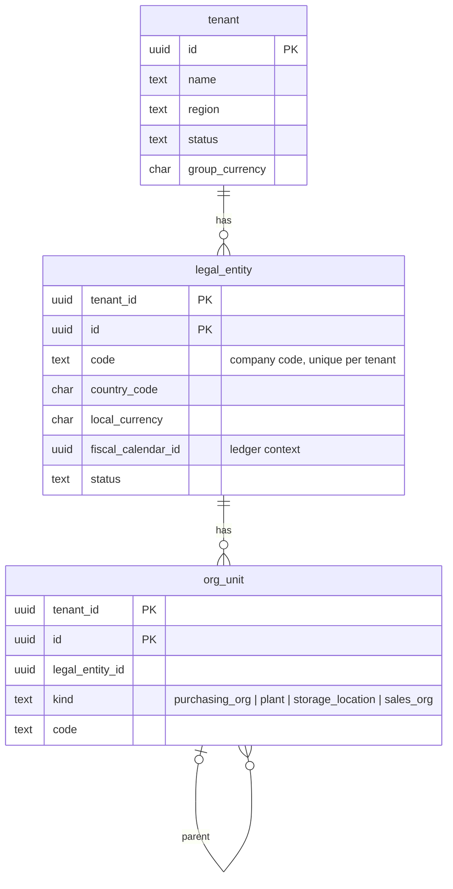
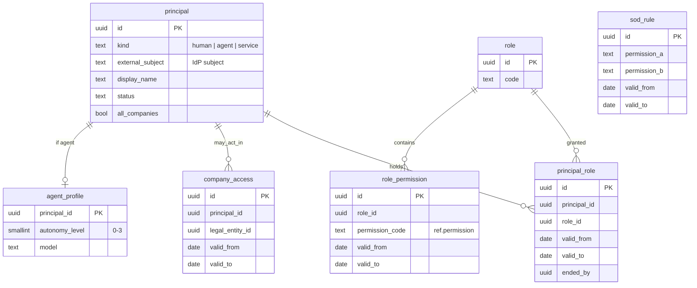
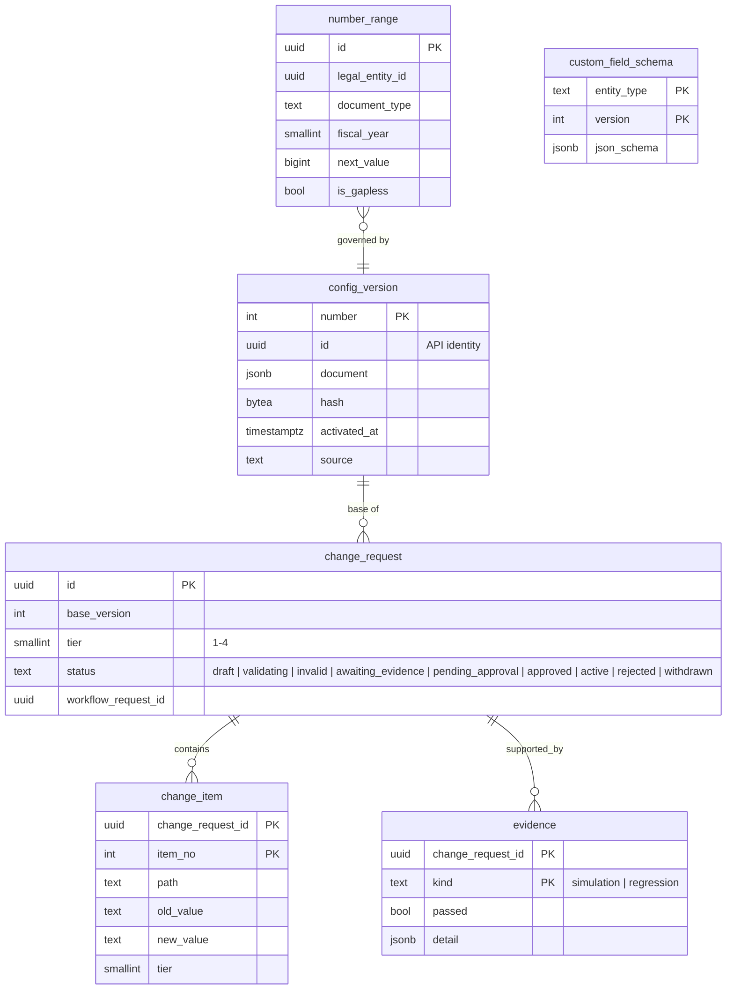
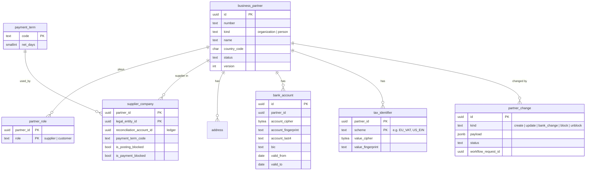
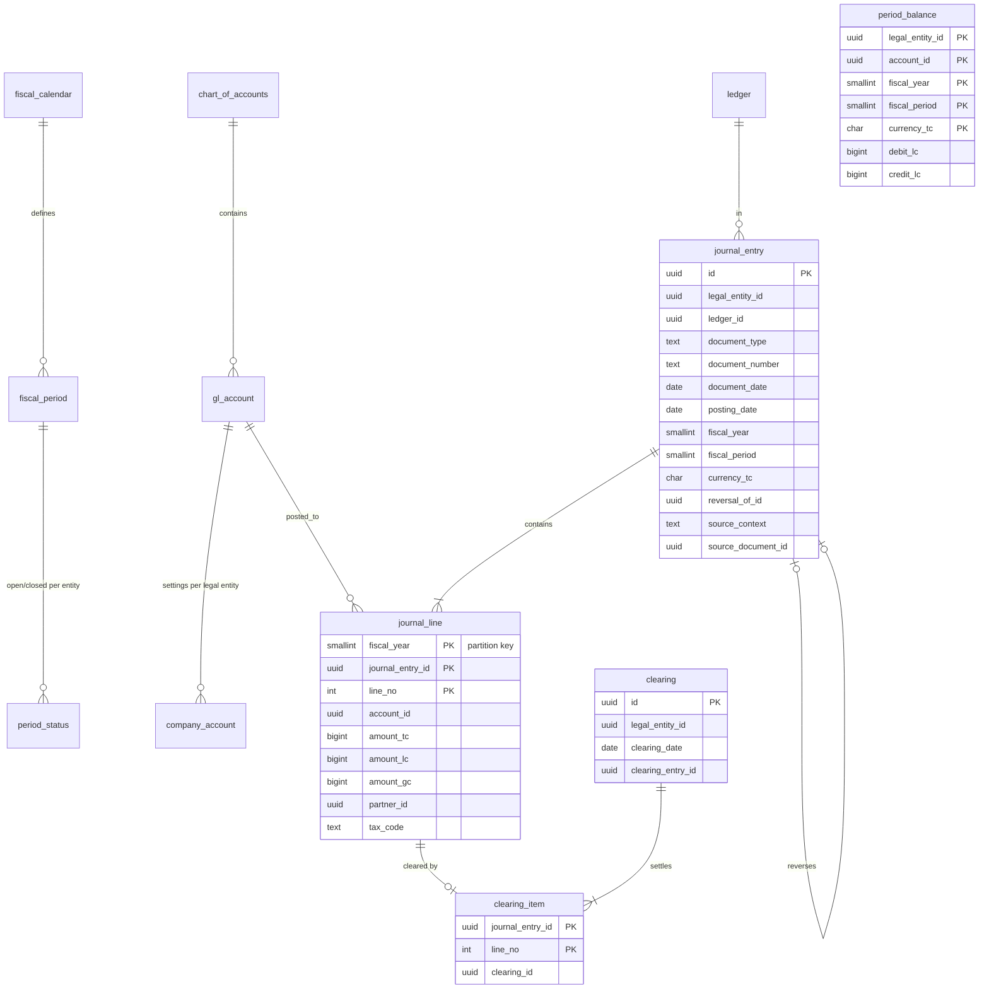
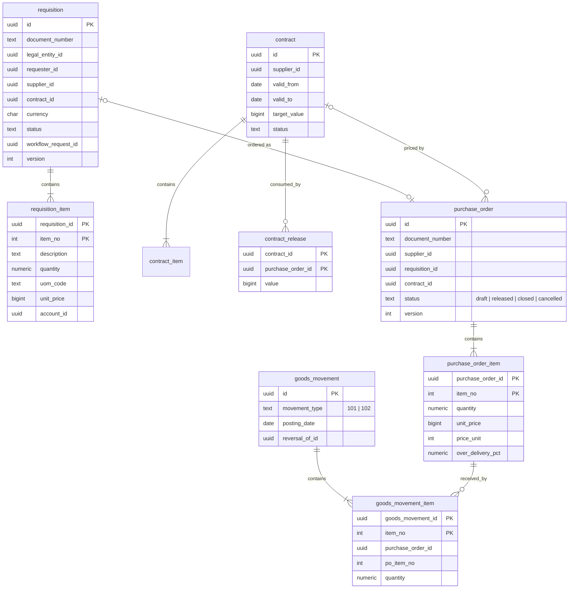
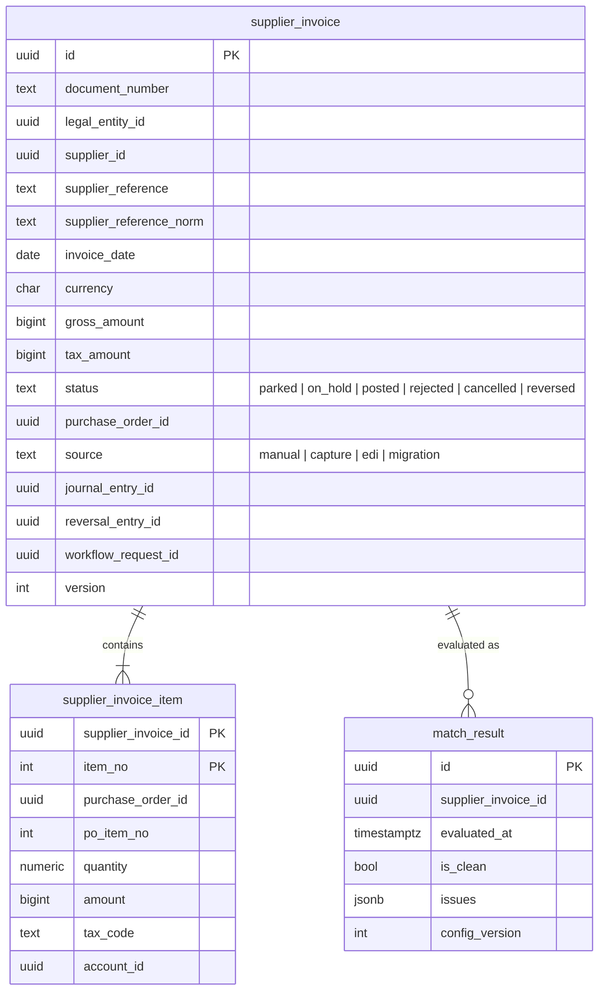
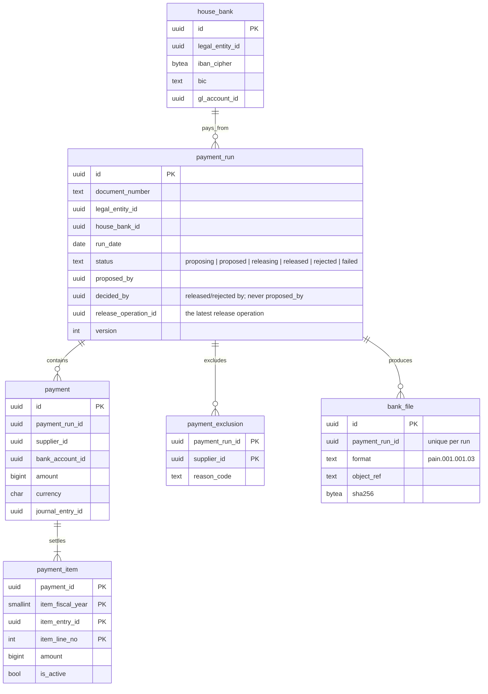
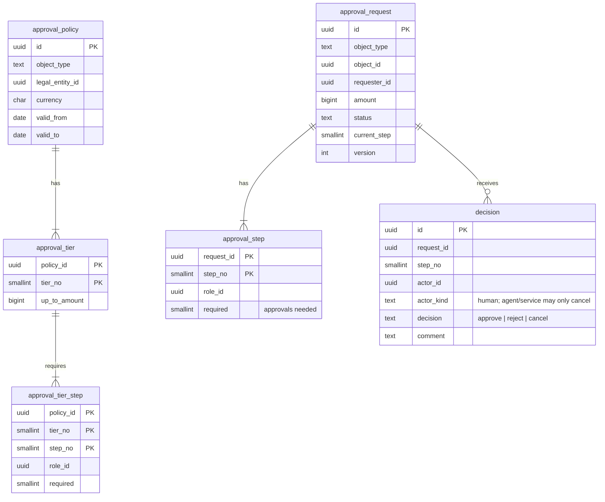

# 3. Data model

The logical model is described here; the physical model is implemented in
[`db/migrations/`](../../db/migrations/) and is authoritative for column
types. Both are reviewed together.

## 3.1 Conventions (apply to every table)

### Schemas and ownership
- One PostgreSQL schema per bounded context (`tenancy`, `identity`, `config`,
  `partner`, `ledger`, `procurement`, `payables`, `payments`, `workflow`,
  `audit`, `integration`, `agents`, `analytics`), plus:
  - `ref`: global reference data (currencies, countries, units, permissions),
    identical in every cell, read-only to the application;
  - `platform`: per-cell infrastructure (idempotency keys, operations).
- A context's tables are written only by that context. **No foreign key
  crosses a schema** (except to `ref`, which is immutable reference data).
  Cross-context references are `uuid` columns validated by the owning
  context's interface.

### Keys
- `tenant_id uuid NOT NULL` is the first column of every primary key, unique
  key and index on tenant-owned tables (ADR-0003).
- `id uuid` (UUIDv7, generated by the application) identifies entities
  (ADR-0004). Primary key: `(tenant_id, id)`.
- Child rows of a document use `(tenant_id, parent_id, line_no)`.
- Foreign keys inside a context include `tenant_id`:
  `FOREIGN KEY (tenant_id, supplier_id) REFERENCES ... (tenant_id, id)`, so a
  row can never point at another tenant's row.
- Business documents carry a human `document_number`, unique per tenant,
  legal entity, document type and fiscal year, issued from number ranges.

### Standard columns
| Column | On | Meaning |
|---|---|---|
| `created_at timestamptz`, `created_by uuid` | every table | Insert time (UTC) and acting principal |
| `updated_at timestamptz`, `updated_by uuid` | mutable tables | Last change |
| `version integer` | mutable aggregate roots | Optimistic locking, exposed as ETag (ADR-0008) |
| `extensions jsonb` | extensible entities | Governed custom fields (ADR-0009) |

Insert-only tables (journal entries and lines, clearings, goods movements,
decisions, audit events) have no `updated_*` or `version`, and the
application role is not granted UPDATE or DELETE on them.

### Types
| Kind | Type | Notes |
|---|---|---|
| Money | `bigint` minor units + `char(3)` currency | Exponent from `ref.currency` (ADR-0005) |
| Quantity | `numeric(20,6)` + unit of measure | |
| Rate, percentage | `numeric(28,12)` for FX; `numeric(9,6)` for percentages | |
| Instant | `timestamptz`, stored UTC | |
| Business date | `date` | Document, posting, due dates |
| Status, kind | `text` with `CHECK (... IN (...))` | Not PostgreSQL enums (they are hard to alter online) |
| Codes | `text` with length/format CHECKs | Configurable code lists are tables |
| Sensitive values | `bytea` ciphertext + `text` fingerprint (HMAC) + `text` last4 | Field-level encryption; fingerprint for equality and duplicates |

### Lifecycles instead of deletes
Business records are never deleted. Documents move through statuses
(`draft → released → closed`, `posted`, `cancelled` via reversal). Master data
is deactivated (`status = 'inactive'`) or end-dated (`valid_to`). Personal
data erasure (GDPR) is a governed anonymization, not a delete.

### Effective dating
Values that change over time and must be known historically use
`valid_from date NOT NULL, valid_to date` (exclusive), with an `EXCLUDE`
constraint preventing overlaps: bank accounts, role permissions, role
assignments, company access, SoD rules, tax codes, approval policies.
Assignments are ended, never rewritten: `platform.end_validity()` permits only
setting or shortening `valid_to` (not into the past) with `ended_by`, and the
application role may update only those columns. Exchange rates are
insert-only; a new rate is a new row with a later `valid_from`.

### Naming
`snake_case`; singular table names (`purchase_order`); `<entity>_id` for
references; `_at` for instants, `_date` for dates; `is_` for booleans;
`_code` for codes; amounts end in the currency role (`amount_tc`,
`amount_lc`, `amount_gc`).

## 3.2 Reference data (`ref`, global)

| Table | Key | Purpose |
|---|---|---|
| `currency` | `code` (ISO 4217) | Name, minor-unit exponent |
| `country` | `code` (ISO 3166-1 alpha-2) | Name, IBAN length if any |
| `unit_of_measure` | `code` | Dimension (quantity, mass, time...), name |
| `permission` | `code` | Platform permission catalog; `is_approval` marks permissions agents may never hold |

## 3.3 Tenancy and organization (`tenancy`)

`tenant` is the only table without `tenant_id` (it *is* the tenant); it carries
the tenant's region and group currency, and once offboarded what became of
its data: `exported_at`, `export_ref`, `erase_after`, `erased_at`
(ADR-0021). The global tenant-to-cell directory
lives outside cell databases (05-scalability). `tenant_key` holds the
tenant's field-encryption and fingerprint keys, wrapped by a master key of
the deployment's ring; one is active, retired ones stay to open older values
(ADR-0018).

## 3.4 Identity and access (`identity`)

Agents are principals like people, with their own roles. A trigger rejects
granting an `is_approval` permission to a role held by an agent.

Role permissions, role assignments, company access and SoD rules are
**effective-dated assignments**: each has its own id, a validity range that
cannot overlap another for the same pair (exclusion constraint), and is
ended, never deleted or rewritten. `platform.end_validity()` allows exactly
one change: setting `valid_to` (or bringing it forward), not into the past,
with `ended_by`; `ended_at` is stamped by the database. The access a
principal had on any past date can therefore be reconstructed for audit.
Partner bank accounts follow the same pattern.

## 3.5 Configuration (`config`)

Configuration is authored as a versioned document (as in Phase 1). On
activation, each owning context applies its part to its own relational tables
(chart of accounts to `ledger`, approval policies to `workflow`, payment terms
to `partner`...). Domain tables are therefore always typed and constrained,
and every change to them traces back to an approved change request.

## 3.6 Business partners (`partner`)

One business partner can be both supplier and customer (SAP business partner
model). Company-specific supplier data lives in `supplier_company`. Bank
accounts are effective-dated; a change creates a new row with `valid_from`,
which drives the payment hold after bank changes. Fingerprints detect
duplicate tax numbers and bank accounts across partners without decrypting.

## 3.7 General ledger (`ledger`)

Rules enforced in the database:
- Journal entries and lines are insert-only; corrections are reversal entries
  (`reversal_of_id`), and an entry can be reversed at most once (unique index).
- Every entry balances to zero in local and group currency, checked by a
  deferred constraint trigger at commit; transaction-currency balance is
  checked per currency.
- Posting requires the period to be open for the legal entity and ledger.
- A line is cleared at most once (`clearing_item` unique on the line).
- Open items are lines on reconciliation accounts without a clearing item.
- `period_balance` is maintained by an idempotent projector (ADR-0006).
- `journal_line` is partitioned by `fiscal_year`.
- `period_status` (one row per legal entity, ledger, year and period) has a
  uuid `id` so the API can address a posting period; its natural key stays
  the primary key.

Other ledger tables: `ledger` (leading 0L, parallel ledgers), `exchange_rate`
(rate type `average | bank_buying | bank_selling | planning`, currency pair,
`valid_from`; insert-only), `account_determination` (which account
automatic postings use per legal entity and key), `tax_code` (rate, account,
direction).

## 3.8 Procurement (`procurement`)

Contract consumption is the sum of insert-only `contract_release` rows (no
counter updated in place). Received quantity per PO item is the sum of goods
movement items (102 movements are negative). A materialized
`po_item_receipt_summary` read model can be added for speed without changing
the source of truth.

## 3.9 Accounts payable (`payables`)

A partial unique index on `(tenant_id, supplier_id, supplier_reference_norm)`
for non-rejected invoices makes duplicate invoices impossible at the database
level, not just detectable. `match_result` keeps the history of every match
evaluation with the configuration version used.

`upload` (ADR-0020) records a direct upload of a document above the
request limit: purpose, content type, size limit, the object key the bytes
go to, until when, and its status (`open`, `received` through the API,
`used` by the invoice in `used_by`, with size and hash once known).

## 3.10 Payments (`payments`)

A partial unique index on active `payment_item (tenant_id, item_fiscal_year,
item_entry_id, item_line_no)` guarantees an open item is in at most one live run; rejecting a run
deactivates its items. Bank files are stored in object storage, referenced by
key and content hash.

The release (ADR-0012) moves the run to `releasing` under a release
operation, `release_operation_id`, and posts one payment per transaction;
the run is `released` when its bank file is written. Its rules, each held by
the database or by a row lock:

- **One bank file per run.** A unique index on `bank_file (tenant_id,
  payment_run_id)` (migration 000033, built concurrently) refuses a second
  file, so a release step run again or two overlapping releases cannot pay
  the suppliers twice. The release steps of a run also serialise on it:
  each reads the run `FOR UPDATE`.
- **The current operation only.** A release step acts only when the run's
  `release_operation_id` is the operation it was started for; a step of a
  cancelled or failed release that a later `:release` took over does
  nothing.
- **A cancelled release stays cancelled.** Cancelling the operation does not
  undo or stop postings already made: posted payments stand, the operation
  stays `cancelled` (it is never finished or reported on again), no bank
  file is written, and the run stays `releasing` until `:release` resumes it
  under a new operation. A run whose release fails with nothing posted goes
  back to `proposed`.
- **Items stay reserved while releasing.** An item of a `releasing` run whose
  payment is not posted yet counts as in a live run, as in a proposal, so
  its invoice cannot be reversed (409 `payables.invoice_in_payment_run`)
  and a resumed release never pays a reversed invoice. Once the payment is
  posted the item is cleared, and the payment is reversed first.

## 3.11 Workflow (`workflow`)

Database rules: one approval per actor per request (partial unique index);
the requester cannot decide (check against `approval_request.requester_id` in
the decision trigger); decisions are insert-only.

## 3.12 Audit (`audit`)

| Table | Key | Notes |
|---|---|---|
| `audit_event` | `(tenant_id, occurred_at, seq)` | Insert-only, monthly partitions, `prev_hash`/`hash` chain per tenant |
| `chain_head` | `tenant_id` | Last sequence and hash per tenant |
| `anchor` | `(tenant_id, seq)` | Chain heads written to write-once storage |
| `verification` | `(tenant_id, verified_at)` | Insert-only; one row per scheduled verification round: head, events and anchors checked, the first broken sequence (ADR-0025) |

## 3.13 Integration (`integration`)

| Table | Purpose |
|---|---|
| `external_ref` | Maps any entity to its key in an external system (SAP object and key); unique per system/object/key |
| `connector` | Configured connections (SAP OData, bank SFTP, EDI VAN, email); secrets by reference to the vault |
| `message` | Inbound and outbound messages with status, attempts, payload reference |
| `output_message` | Business output (purchase orders to suppliers) per channel |
| `migration_run` | Migration scope, mode, status, reconciliation report |

## 3.14 Agents (`agents`)

| Table | Purpose |
|---|---|
| `session` | One agent run: agent principal, purpose, model, tokens, cost, linked operation |
| `tool_call` | Every tool call with input, result summary, error flag (insert-only) |
| `recommendation` | What the agent proposed, on which object, and what people decided |

## 3.15 Platform (`platform`) and per-context outbox

| Table | Purpose |
|---|---|
| `platform.idempotency_key` | Key, request hash, stored response; kept 7 days (ADR-0008), expired by a batched cleanup job on `expires_at` (partition by day if delete volume ever hurts; the key does not change) |
| `platform.operation` | Long-running operations (ADR-0012): kind, status, `progress_done` / `progress_total` (null while unknown), `resource` path, result or error. Only a `queued` or `running` operation finishes or takes progress; a succeeded, failed or cancelled one is final |
| `<context>.outbox` | Domain events awaiting publication, one table per context schema |
| `<context>.inbox` | Event ids already processed by that context's consumers |

## 3.16 Later contexts

`sales`, `receivables`, `inventory`, `manufacturing`, `maintenance`,
`projects`, `hr`, `controlling`, `assets` follow the same patterns:

- documents as header + items with `document_number` from number ranges;
- financial effects only through `ledger` postings (`source_context`,
  `source_document_id` on the journal entry);
- partners via `partner` roles (`customer` joins `supplier`);
- a shared `material` master in a future `product` context, referenced by id
  from procurement, inventory, sales and manufacturing;
- controlling dimensions (cost center, profit center, internal order, WBS
  element) added to `journal_line` as nullable `uuid` columns, so ledger and
  controlling stay one table, as in SAP's Universal Journal.

## 3.17 Mapping from SAP

| SAP | This model |
|---|---|
| T001 company code | `tenancy.legal_entity` |
| SKA1/SKB1 | `ledger.gl_account`, `ledger.company_account` |
| ACDOCA | `ledger.journal_entry` + `ledger.journal_line` (TC/LC/GC amounts) |
| BSEG clearing (AUGBL) | `ledger.clearing` + `ledger.clearing_item` |
| LFA1/LFB1/LFBK, BUT000 | `partner.business_partner`, `supplier_company`, `bank_account`, `tax_identifier` |
| EBAN | `procurement.requisition` |
| EKKO/EKPO | `procurement.purchase_order` + items |
| Outline agreements (EKKO BSTYP K) | `procurement.contract` |
| MKPF/MSEG, MATDOC | `procurement.goods_movement` + items |
| RBKP/RSEG | `payables.supplier_invoice` + items |
| REGUH/REGUP (F110) | `payments.payment_run`, `payment`, `payment_item` |
| T012K | `payments.house_bank` |
| T052 | `partner.payment_term` |
| T007A | `ledger.tax_code` |
| T030 | `ledger.account_determination` |
| AGR_* | `identity.role`, `role_permission`, `principal_role` |
| NRIV | `config.number_range` |
