# 3. Data model

The logical model is described here; the physical model is implemented in
[`db/migrations/`](../../db/migrations/) and is authoritative for column
types. Both are reviewed together.

## 3.1 Conventions (apply to every table)

### Schemas and ownership
- One PostgreSQL schema per bounded context (`tenancy`, `identity`, `config`,
  `partner`, `ledger`, `procurement`, `payables`, `payments`, `workflow`,
  `audit`, `integration`, `agents`, `analytics`, `cash`, `controlling`,
  `tax`), plus:
  - `ref`: global reference data (currencies, countries, units, permissions),
    identical in every cell, read-only to the application;
  - `platform`: per-cell infrastructure (idempotency keys, operations).
- A context's tables are written only by that context. **No foreign key
  crosses a schema** (except to `ref`, which is immutable reference data).
  Cross-context references are `uuid` columns validated by the owning
  context's interface.

### Keys
- `tenant_id uuid NOT NULL` is the first column of every primary key, unique
  key and index on tenant-owned tables (ADR-0003).
- `id uuid` (UUIDv7, generated by the application) identifies entities
  (ADR-0004). Primary key: `(tenant_id, id)`.
- Child rows of a document use `(tenant_id, parent_id, line_no)`.
- Foreign keys inside a context include `tenant_id`:
  `FOREIGN KEY (tenant_id, supplier_id) REFERENCES ... (tenant_id, id)`, so a
  row can never point at another tenant's row.
- Business documents carry a human `document_number`, issued from number
  ranges per fiscal year: a journal entry's is unique per fiscal year, every
  other document's per tenant and legal entity across years, so a range never
  repeats another year's numbers (ADR-0004 As built).

### Standard columns
| Column | On | Meaning |
|---|---|---|
| `created_at timestamptz`, `created_by uuid` | every table | Insert time (UTC) and acting principal |
| `updated_at timestamptz`, `updated_by uuid` | mutable tables | Last change |
| `version integer` | mutable aggregate roots | Optimistic locking, exposed as ETag (ADR-0008) |
| `extensions jsonb` | extensible entities | Governed custom fields (ADR-0009) |
| `extensions_schema integer` | entities with a custom field schema | The schema version the extensions were validated against; NULL without a schema (ADR-0046) |

Insert-only tables (journal entries and lines, clearings, goods movements,
decisions, audit events) have no `updated_*` or `version`, and the
application role is not granted UPDATE or DELETE on them.

### Types
| Kind | Type | Notes |
|---|---|---|
| Money | `bigint` minor units + `char(3)` currency | Exponent from `ref.currency` (ADR-0005) |
| Quantity | `numeric(20,6)` + unit of measure | |
| Rate, percentage | `numeric(28,12)` for FX; `numeric(9,6)` for percentages | |
| Instant | `timestamptz`, stored UTC | |
| Business date | `date` | Document, posting, due dates |
| Status, kind | `text` with `CHECK (... IN (...))` | Not PostgreSQL enums (they are hard to alter online) |
| Codes | `text` with length/format CHECKs | Configurable code lists are tables |
| Sensitive values | `bytea` ciphertext + `text` fingerprint (HMAC) + `text` last4 | Field-level encryption; fingerprint for equality and duplicates |

### Lifecycles instead of deletes
Business records are never deleted. Documents move through statuses
(`draft → released → closed`, `posted`, `cancelled` via reversal). Master data
is deactivated (`status = 'inactive'`) or end-dated (`valid_to`). Personal
data erasure (GDPR) is a governed anonymization, not a delete.

### Effective dating
Values that change over time and must be known historically use
`valid_from date NOT NULL, valid_to date` (exclusive), with an `EXCLUDE`
constraint preventing overlaps: bank accounts, role permissions, role
assignments, company access, SoD rules, tax codes, approval policies.
Assignments are ended, never rewritten: `platform.end_validity()` permits only
setting or shortening `valid_to` (not into the past) with `ended_by`, and the
application role may update only those columns. Exchange rates are
insert-only; a new rate is a new row with a later `valid_from`. A rate is
`numeric(28,12)`, and recording one refuses more than 16 integer digits or
12 decimals (422 `ledger.invalid_rate`) rather than letting the column
round a decimal away (F19).

### Naming
`snake_case`; singular table names (`purchase_order`); `<entity>_id` for
references; `_at` for instants, `_date` for dates; `is_` for booleans;
`_code` for codes; amounts end in the currency role (`amount_tc`,
`amount_lc`, `amount_gc`).

## 3.2 Reference data (`ref`, global)

| Table | Key | Purpose |
|---|---|---|
| `currency` | `code` (ISO 4217) | Name, minor-unit exponent |
| `country` | `code` (ISO 3166-1 alpha-2) | Name, IBAN length if any |
| `unit_of_measure` | `code` | Dimension (quantity, mass, time...), name |
| `permission` | `code` | Platform permission catalog; `is_approval` marks permissions agents may never hold |

## 3.3 Tenancy and organization (`tenancy`)

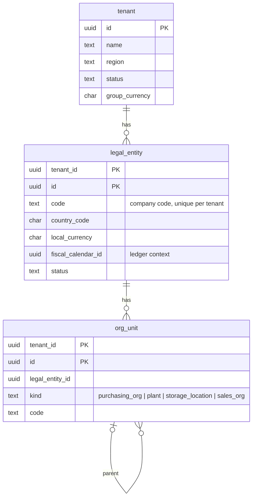

`tenant` is the only table without `tenant_id` (it *is* the tenant); it carries
the tenant's region and group currency, and once offboarded what became of
its data: `exported_at`, `export_ref`, `erase_after`, `erased_at`
(ADR-0021). The global tenant-to-cell directory
lives outside cell databases (05-scalability). `tenant_key` holds the
tenant's field-encryption and fingerprint keys, wrapped by a master key of
the deployment's ring; one is active, retired ones stay to open older values
(ADR-0018).

## 3.4 Identity and access (`identity`)

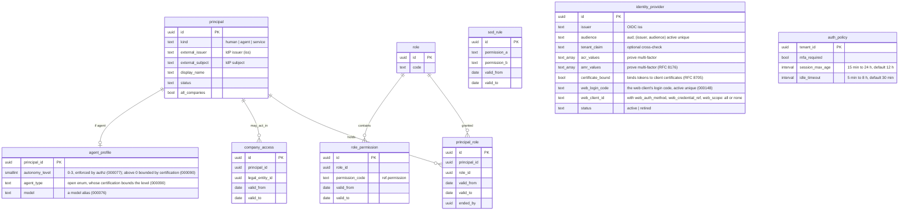

Agents are principals like people, with their own roles. A trigger rejects
granting an `is_approval` permission to a role held by an agent.

A token authenticates the principal whose `external_issuer` and
`external_subject` are its `iss` and `sub`, in the tenant it names: every
trusted issuer may name any tenant, so the subject alone would let one
tenant's identity provider sign in as another tenant's principal whose
subject it also issues (ADR-0010, amended 2026-10-14). People and services
carry both; agents carry an issuer only when they have a subject. Requests
name no issuer (the API reports it read-only as `external_issuer`, T30), so a
principal is bound to the issuer of the
administrator who creates it, and a new tenant's first administrator to
the cell's only tenant issuer (a cell that trusts several refuses to
provision, `provisioning.issuer_ambiguous`). `principal_issuer_subject`
(tenant, issuer, subject) is unique. Migration 000037 added the column
(expand step) and bound the principals that existed to the development
issuer `erp-dev`, the single issuer of the only installations that had any
(no record says which issuer created a principal; elsewhere it matches no
token, so such a principal is refused until re-bound). During the rolling
deploy the previous release keeps inserting people and services with a
subject and a NULL issuer, after 000037's backfill has run; the new release
never finds them (it resolves issuer and subject), so they cannot sign in
until bound. The contract step (06 §6.4, T31), run once no replica of the
previous release runs (it ships in the release after 000037's only because
there is no production data yet), is three migrations: 000046 (1) adds the
check `principal_issuer_with_subject`, that a principal with a subject has
an issuer, `NOT VALID`, so no new row can lack one, and (2) binds every
principal still `external_issuer IS NULL AND external_subject IS NOT NULL`
to the issuer of the principal that created it (`created_by`, as
`CreatePrincipal` does), following chains of unbound creators up to a bound
one, and, where none is found, to the development issuer `erp-dev`, as
000037 did. A migration cannot read which issuers the cell trusts, and
`ERP_ENV=production` refuses `erp-dev`, so outside development such a
principal is refused until an operator binds it to its real issuer (T37):
it fails closed rather than guess. The control plane lists a tenant's
unbound principals (those whose issuer is no active registered provider
of the tenant) and binds one to a provider with its subject there
(`bindPrincipal`, `erp:admin`, audited, published as `PrincipalBound`). 000047 `VALIDATE`s the check, and 000048
drops `principal_subject` (the subject alone unique per tenant)
concurrently; `principal_issuer_subject` carries uniqueness. A person or
service now always has an issuer, and the new release refuses to create one
whose issuer it cannot tell: `CreatePrincipal` answers 422
`identity.creator_without_issuer` when the creating actor (an agent, a job
acting through `uow.Act`) is bound to no issuer, and writes nothing; agents,
which have no subject, need none.

A tenant's **identity providers** (ADR-0031, T37) are registered in
`identity_provider`: the active registration holding a token's issuer and
audience decides the token's tenant, so the pair is unique across tenants
among active registrations (`identity_provider_issuer_audience`, the one key
in a tenant schema not led by `tenant_id`). Issuer and audience never change
and a retired registration stays retired (`check_identity_provider_update`),
which frees the pair; a tenant keeps at least one active provider (checked
when one is retired, its providers read `FOR UPDATE`). `auth_policy` holds the
tenant's policy, one row or none for the defaults: whether people must prove
multi-factor authentication (by a provider's `acr` or `amr` values; a policy
requiring it while an active provider can prove neither is refused), the
session lifetime and the idle timeout. A provider's `certificate_bound`
(000058, ADR-0033) says it binds its tokens to the client's certificate
(`cnf.x5t#S256`); in production agents' tokens are accepted only from a
provider that does. The control role `erp_control` reads,
across tenants, the columns that resolve a token (issuer, audience, tenant
claim, the values, status and policy) and the principals' bindings, never who
changed them nor e-mails. Migration 000056 adds both tables. A production
cell refuses to start while an active tenant has no active provider: its
people could not sign in (provisioning registers one, the last one cannot
be retired and a production import refuses a tenant without one, so a
change by hand or a tenant from before gets there); the remedy,
`erp-server register-provider`, needs no running server.

A provider may carry the **web workspace's client** there (ADR-0052 G8,
T73b, migration 000148): its client id, how erp-web authenticates at the
token endpoint (`private_key_jwt` or `client_secret_basic`), a secret
reference to the credential (never the value), the login code people
sign in with and the scope; all five or none
(`identity_provider_web_client`). Like the issuer and audience, a login
code names a tenant, so it is unique among active registrations across
tenants (`identity_provider_login_code`, also not led by `tenant_id`);
`erp_control` reads it to project it into the global directory, whose
`directory.issuer` keeps it with the issuer's claim, unique across cells.
The directory database's `web` schema (`directory.WebSchema`) holds
erp-web's sessions (`web.session`: the session id's SHA-256, tenant,
issuer, subject, login code, times, and the tokens and CSRF secret sealed
with AES-256-GCM) and the view `web.login_client` of the web clients by
login code, which the role `erp_web` alone reads and writes; it sees no
other table of the directory. Nothing in it is business data, exported or
fingerprinted.

People's **sessions** are kept in `session` (T37f, migration 000057): one
row per authentication at the identity provider, keyed per principal by a
sha256 of the issuer and `sid`, or of the issuer, subject and
`auth_time` (`session_principal_key`). It starts at `auth_time` (or its first
sighting) and is touched at most once a minute per replica, in a
transaction of its own; past the tenant's session lifetime or idle timeout
it is ended (`ended_at`, `end_reason` expired, idle or revoked) and never
resumes (`check_session_update`: only `last_seen_at` and the end change).
Starts and ends are audited; a session nobody returns to is ended (idle,
audited) by the sweeper once idle longer than any tenant allows. The check
runs before the request's transaction. Sessions are ephemeral: not
exported, imported or fingerprinted; `erp_worker` deletes those ended a
week ago, or 90 days ago for one keyed by `sid` alone
(`authenticated_at` NULL), whose ended row is what refuses a refreshed
token.

Role permissions, role assignments, company access and SoD rules are
**effective-dated assignments**: each has its own id, a validity range that
cannot overlap another for the same pair (exclusion constraint), and is
ended, never deleted or rewritten. `platform.end_validity()` allows exactly
one change: setting `valid_to` (or bringing it forward), not into the past,
with `ended_by`; `ended_at` is stamped by the database. The access a
principal had on any past date can therefore be reconstructed for audit.
Partner bank accounts follow the same pattern.

## 3.5 Configuration (`config`)

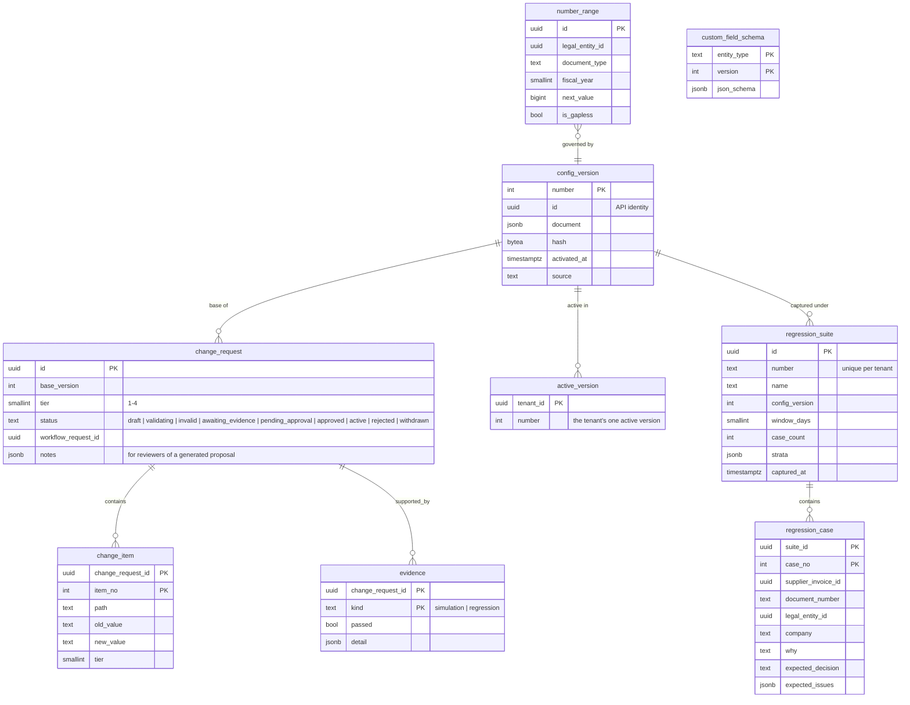

`active_version` holds each tenant's active version, exactly one per
tenant (000003). A regression suite (T10, 000018) is a stratified sample
of real supplier invoices with the decision each got under a
configuration version; the simulation of a change request replays the
latest suite of its base version and records the result as regression
evidence. A suite's cases are its record and are never rewritten
(`regression_case_immutable`).

Configuration is authored as a versioned document (as in Phase 1). On
activation, each owning context applies its part to its own relational tables
(chart of accounts to `ledger`, approval policies to `workflow`, payment terms
to `partner`...). Domain tables are therefore always typed and constrained,
and every change to them traces back to an approved change request.

Country packs (ADR-0048) enter the document the same way: applying one
(`internal/countrypack`) yields a draft document and notes for a change
request, merged three-way from the version the company adopted. The
document's `packs` section records, per company, the country, the pack
version and the date it was applied on (`packs[company]`, an operational-
tier change); validation requires a company of that country, one adoption
per company, a `YYYY.N` version and a date. The `calendars` section holds
each company's holidays (`calendars[company].holidays[date]`, T62c): one
calendar per company of the document, each holiday a `YYYY-MM-DD` date
once, with a name; applying a pack merges its holidays by date. A change
is operational, a holiday's name cosmetic. No context owns a table for it:
readers use the active document (`config.Config.Holiday`). A calendar also
names the company's weekend (`calendars[company].weekend`, T64a, ADR-0058
§3): lower-case weekday names, each once, not all seven; none given means
Saturday and Sunday. A business day is neither a weekend day nor a holiday
(`config.Config.BusinessDay`), the one rule the cash position and the close
calendar count days by. The `close` section is the close template
(`close.tasks`, T64a; §3.22) and its year tasks (`close.year_tasks`, T64m4;
§3.22); a company's `close.variance` its variance
report's settings (T64h; §3.22) and its `close.accrual_account` the
liability its accruals are credited to (T64e, tier 3; §3.22).
`POST /v1/country-pack-applications` (T62d) stores the draft as a change
request in status `draft` on the active version, with the merge's notes in
`change_request.notes` (an array of path and message, `[]` for requests
proposed by hand), recorded when it is created; the request then goes the
usual way, and nothing is activated by applying.

A change request's simulation replays the invoices of a window as long as
the one the base version's latest regression suite was captured over
(`window_days`, the suite named by `window_suite`; 90 days when no suite is
captured), ending when the simulation runs: both kinds of evidence look
back as far, each from its own day. It replays
the invoices of every company, so
that its verdict covers the whole change, but each reader is shown the
invoices of the companies they may access alone, and the detail's and
summary's counts over those (04-api-design §4.9). The evidence is recorded
by company (`invoices_by_company`) with a summary that carries no count,
since the summary also reaches the operation's result and the audit trail;
reading the change request (`payables.Disclosure`) fails closed: a reader
of no company is shown no invoice and counts of zero, and a replay of no
legal entity is shown only to a reader of every company. A simulation
recorded before this rule, with counts over every company, is shown only
to readers of every company. The verdict (`passed`) is the change's and is
shown to every reader, as the request's status shows it anyway.

Regression suites and regression evidence are limited the same way. A
suite samples the invoices of every company; each reader of
`/v1/regression-suites` is shown the cases of the companies they may
access alone, with their count (`case_count`) and the strata that selected
them, numbered among those (`case_no` from 1, in the suite's order, so that
gaps tell nothing of other companies' cases; the regression evidence numbers
them the same way), and a case of no legal entity only to a reader of every
company. The
regression evidence is recorded by company (`cases_by_company`: each
company's number of cases and its cases decided differently, `stale`,
`changed` or `regressions`) with a summary that carries no count, as it
too reaches the operation's result (`regression_summary`) and the audit
trail; the capture's audit entry counts no cases either. Each reader of the
change request is shown the cases of their companies and the summary's
counts over those (`configuration.regressionShown`), failing closed as the
simulation does. The verdict stays the change's, over every company: a
reader of one company may see a failed regression with no case of theirs
decided differently, since the request's status would show the verdict
anyway. Regression evidence recorded before this rule, with counts over
every company, is shown whole only to readers of every company, and to any
other reader without its cases. The reader's company access is read once
per request, however many change requests and pieces of evidence it
returns.

A suite captured with `allow_empty` on a window without invoices (a new
tenant's) holds no case of any company (`case_count` 0, strata `[]`). Its
regression evidence passes with `detail.no_cases` true, the suite's number
and no counts, and is shown as it is: it holds no case of anyone. Each
approval of a change request whose latest regression evidence is such
needs a comment acknowledging it (`approvals.Acknowledger`, 422
`workflow.acknowledgement_required`), so the approvers decide knowing
that nothing was replayed (T72l).

A company's business dates are in its `companies[].time_zone`, an IANA
zone name (`America/Toronto`, `Asia/Dubai`) that validation loads from the
zone database built into the binary, host-only names (`Local`,
`posix/…`) and offsets refused. It is required of a new or changed
document (product owner 2026-10-31); a document activated before then
may lack it and is read as UTC. A change is tier 3. The cash position's
read date is the company's date in it (ADR-0051 as built, T72n1), and so
are a memo record's status (T72n2), a payment run's discount lapse (T72n3),
a requisition's date (T72n5), purchasing contracts' expiry and its
notice (T72n6) and the fiscal year a contract is numbered in. A center change's check that a
default cost or profit center stays usable from today, the setup's check
of the controlling rules, and a requisition's account assignments at
submission judge on the company's date in it too, the refusal naming the
date and zone (T72n4, ADR-0050 §11 as built). The posting date a caller
leaves out is the company's date in it too: a supplier invoice's when it
is posted (after the invoice's own) and reversed, and a goods movement
reversal's, so the date and its period are the company's; and a tax
setup's activation judges the rate in force, and starts a changed
single-rate code's new rate, on the company's date, a refusal naming it
(product owner 2026-10-31, ADR-0051 and ADR-0049 as built). Purchasing
contracts' expiry and its notice (T72n6) and a contract's number are
judged on the company's date too. Judged in UTC by decision: the
suppliers a migration run creates, whose date is their bank account's
`valid_from`, one UTC rule for the whole supplier (product owner
2026-10-31, ADR-0051 as built); the day the run chooses a vendor's
central address by, the cutover date, is the company's date
(review:batch63, ADR-0051 as built).

A company's postal address is its `companies[].postal_address`, in a
business partner address's shape without purpose or validity (`line1`,
`city` and `country_code` required, `line2`, `postal_code` and `region`
optional, the contract's `Address` lengths; the configuration versions
are its history). It is optional, and a change is tier 2: it posts
nothing and routes deliveries. The purchase order document prints it as
the buyer's address and as the address to deliver to, no order item
naming one of its own; without it the document says that none is
configured (product owner 2026-11-04, ADR-0054 As built).

The document's money amounts are in the company's currency: the
requisition approval thresholds (`purchasing.requisition_approval[].up_to`,
in the currency of the requisition's company), the order release
thresholds (`purchasing.order_release_approval[].up_to`, likewise in the
order's company's currency, T47c), the invoice price tolerance
(`invoice_tolerance.price_absolute`; the tax tolerance,
`invoice_tolerance.tax_units_per_code`, is in minor units of the invoice's
currency per tax code, T61d), the auto-post limit
(`auto_post_limit`) and the manual entry approval limit
(`manual_entry_approval_limit`, T35: the largest manual journal entry, by
its debits, that people post without approval; posting-relevant, so a
change is approved as one) and the release dual limit
(`release_dual_limit`, optional, ADR-0038: the largest payment run, by its
total at the run date's rate, that one releaser releases; above it a second
person approves the release first; posting-relevant too) and the service
posting limit (`service_posting_limit`, optional, T61n: the largest journal
entry, by its debits, a service principal posts; above it the entry is
parked for a person; without it the manual entry approval limit; posting-relevant) and its dunning levels
(`dunning.levels`, optional, ADR-0065 §2: each a `level` numbered from 1 and
the `days_overdue` an item must have reached for it, ascending, at most
nine; operational, tier 2; a company without any has no dunning, §3.27). The amounts are read with the digits of the
document's `companies[].currency`, and documents are converted into the
legal entity's `local_currency`; the two are one currency because a
configuration whose company currency differs from its legal entity's local
currency is refused when it is checked, at submission and at bootstrap
(422 `config.validation_failed`, field `proposed.companies[<code>].currency`,
reported by the ledger's section check), and a legal entity's
`local_currency` never changes after it is created (F14; the database
refuses a change, migration 000045). A document in
another currency is converted into the company's currency with the
ledger's posting lookup (the latest average
rate of the pair; when only the reverse is recorded, the amount is
divided by it exactly, never multiplied by a rounded reciprocal, F19) on the
document's date: a requisition on its `requisition_date`, the company's
date in its time zone when it was raised (stored, so a later change of the
zone does not move it; its number is drawn for that day too; T72n5,
product owner 2026-10-31; requisitions raised before migration 000170 keep
the UTC date they were routed at), so a
resubmission is routed at the same rate, an invoice on its invoice date
(a posting converts on the posting date instead). The converted amount is
compared with the configured one exactly, as amount × rate before any
rounding to the company's minor units (F13): a variance worth 5.004 EUR is
beyond a 5.00 tolerance, and a requisition worth 1,000.004 EUR is above an
"up to 1000.00" tier. Amounts shown to people are rounded half away from
zero to the company's minor units, as they would be posted. Without
a rate a requisition's submission and an invoice's match are refused (422
`ledger.no_exchange_rate`, naming the pair and the date; nothing is
recorded); the raw numbers of two currencies are never compared. An
invoice whose gross amount is out of range in the company's currency is
matched, and a clean match answers the decision `not_evaluable` (F12b).
Replaying history does not refuse: an invoice without a rate or out of
range is not evaluable rather than a failure for the whole tenant, a
simulation reports it as
one it cannot evaluate, and a regression suite records it as
`not_evaluable` (issue `no_exchange_rate` or `amount_too_large`). A
captured invoice that has since lost its purchase order (a parked invoice
edited onto accounts) is replayed as `not_evaluable` with the issue
`no_purchase_order` (F17).

`config.replica` (000181, ADR-0038 rollout) is the cell's running
replicas, not a tenant's: per replica its id, its version and revision
(`buildinfo`), the configuration keys its binary knows (`config_keys`,
`config.Keys()`: every key path of the document type, such as
`companies[].release_dual_limit`) and when it was last sighted
(`seen_at`, the database's clock). Each replica records itself at start
and every 30 seconds as `erp_worker` (`configuration.Replica`) and deletes
its row when it stops; a row older than 5 minutes no longer counts and is
removed by the next record. Row-level security is on with a policy that
lets `erp_app` read every row and write none, so that each tenant's
activation can compare the keys its document sets (`Config.Used`) with
every running replica's (409 `config.replica_lacks_key`); its primary key
is not led by `tenant_id`, as it has none.

## 3.6 Business partners (`partner`)

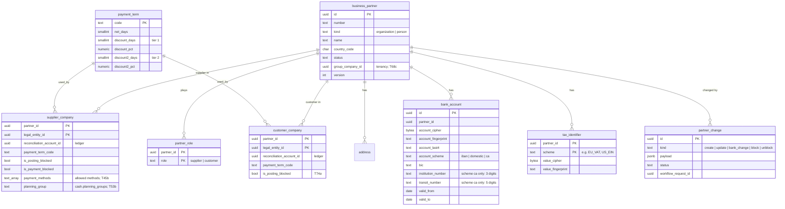

`business_partner.group_company_id` (T68c, ADR-0059 §4, migration 000222)
is the tenant's legal entity a partner is, when it is one of the group's
companies (SAP's trading partner on the business partner), from which the
ledger derives the trading partner of the lines naming the partner. A
legal entity id without a foreign key (02 §2.1), nullable, NULL on
partners created before; partner checks it is a legal entity of the tenant
when it is set on creation or an update change is requested (422
`partner.group_company_unknown`).

One business partner can be both supplier and customer (SAP business partner
model). Company-specific supplier data lives in `supplier_company`, and a
customer's in `customer_company` (below). Bank
accounts are effective-dated; a change creates a new row with `valid_from`,
which drives the payment hold after bank changes. "Today" for a bank
account is UTC's day, one rule for the whole partner, which serves
companies in several time zones, not any one company's: partner refuses a
`valid_from` before it as backdated (product owner 2026-10-31, ADR-0051
as built). There is one exemption. A partner a migration run creates
(`partner.Migration.Create`) may have its bank accounts start the day
before, and the run dates them so: on a cutover evening in a zone behind
UTC, a payment run dated on the company's day must find them. Two days
before is refused there too. No request can set that date: only a
migration run (`integration.migration.run`) reaches it, for the suppliers
it creates. Every other request, and a later change to an existing
partner, keeps the control (product owner 2026-11-02, ADR-0051 as built). Fingerprints detect
duplicate tax numbers and bank accounts across partners without decrypting.

A payment term grants up to two cash discount tiers before its net days,
as SAP's T052 does (ZTAG1/ZPRZ1, ZTAG2/ZPRZ2, ZTAG3; migration 000067,
T36a): a percent off for payment within so many days of the baseline date,
the second tier later and smaller than the first and both within the net
days (`payment_term_discount2_tiers`). The configuration document carries
them as `payment_terms[].discounts` (`{days, percent}`, percent a decimal
of at most three places), validated the same way; a change to them is
posting-related, since it changes what payments post. Once any term grants
a discount, every company names its cash discount account
(`account_determination.cash_discount`, a revenue account, SAP's SKE),
which payments post the discounts they take to. The SAP load reads a T052
position with a percent as a tier and the first without one as the net
days, a position of no days after a tier (empty, or zero-filled as NUMC
extracts write it) as unused, and a decimal comma as the point. A term
whose last discount runs to its net due date ("within 14 days 2%"), which
the configuration cannot hold, or that counts in months or fixed days
(ZMONA, ZFAEL), is drafted to fail validation with a note until a reviewer
sets it.

A supplier's company data names the withholding taxes deducted from it in
that legal entity (`supplier_withholding`, SAP LFBW; T46e): active codes of
the legal entity's `ledger.withholding_tax_code`, each once, replaced as a
whole by a partner change (codes taken off are deactivated, never deleted).
A configuration that takes a code away from a company while a supplier has
it is refused (`partner.WithholdingCodes`).

A supplier's company data may name its planning group (`planning_group`,
SAP LFB1-FDGRV; migrations 000142-000143, T53b): an active code of the
configuration's `cash.planning_groups`, which the cash context keeps and
partner asks about through its own port (`partner.PlanningGroups`, wired by
the composition root, §3.18). A configuration taking away a group a
supplier has, or a pending change gives, is refused
(`partner.PlanningGroupCodes`, under the planning group lock).

**Customers' company data (T74a, migration 000266; as built).** A customer
is a business partner with the role `customer`; its data in a company is a
row of `partner.customer_company` per legal entity, as a supplier's is of
`supplier_company`, so a partner that is both has a row of each, each on
its own reconciliation account. The row holds the reconciliation account
its receivables post to, its payment term and whether postings to it are
blocked there. The database requires the
customer role (a foreign key to `partner_role` through `role_customer`,
as `role_supplier` does for suppliers) and a payment term of the tenant;
the legal entity and the account are other contexts' and are checked by
partner when the data is requested: a legal entity the caller may act in,
an active customer reconciliation account set up in it
(`Accounts.IsReconciliationAccount` with kind `customer`, 422
`partner.invalid_reconciliation_account`) and a configured payment term
(422 `partner.unknown_payment_term`), each refusal naming the request's
own field (`customer_companies[n]…`, under `payload.` in a change).
Payment terms have no status: a configured term is never removed
(`partner.PaymentTerms`), so every configured term is usable.

The data is given as `customer_companies[]` on `createBusinessPartner` and
in an `update` partner change (`createPartnerChange`), and applies as
supplier data does: written with the pending partner on creation, by the
approved change on an update. An entry replaces the customer's data in its
legal entity as a whole, the posting block included (`is_posting_blocked`,
false when left out), so a block is set and lifted by an approved change;
legal entities the change does not name keep their data, and none is
deleted. The partner's representation returns `customer_companies` of the
legal entities the caller may act in, ordered by legal entity id, each
with its reconciliation account's number beside the id (read from the
ledger through `Accounts.AccountNumbers`, once per page). Approval
of a customer's creation publishes `CustomerApproved` (the partner, its
number and the legal entities it has customer data in), beside
`SupplierApproved` for a partner that is both; an applied update names
`customer_company.<legal_entity_id>` among BusinessPartnerUpdated's
`changed_fields`. Both are audited as every partner change is.

Other contexts read a customer through `partner.Customers.Customer`
(partner, legal entity): its number, name, status, whether it plays the
role, and its company data when it is set up there; `Customer.Usable` says
why a receivables document cannot name it (not active, no customer, not
set up in the company, blocked for posting). The ledger asks
`partner.Postings.PostingBlock`, which refuses a line naming a customer
blocked for posting in the line's company (422
`ledger.partner_not_postable`). A customer without company data stays
postable by manual journal entries, as before; receivables documents
require the company data (plan-breadth-week1, default 2).

A customer reconciliation account is an account of the configuration's
chart flagged `customer_reconciliation` (SAP SKB1-MITKZ D, as
`internal/sap` reads the field), as
`vendor_reconciliation` flags a supplier's: an asset that reconciles
nothing else, which the ledger creates with `reconciliation_kind =
'customer'`, open-item managed, each line naming its customer (§3.7). The
flag is structural (tier 4) and, like the other kinds, cannot change once
the account is activated; no other use of an account (account
determination, tax, statement rules, asset accounts, FX adjustment,
withholding, retained earnings, accruals) may name such an account, and it
is not revalued as a balance. Decided by default (07 §7.7): nothing but the
configuration creates accounts, and the ledger has known the kind since
000005, so the flag details what T74a needs. A customer reconciliation
account's open items in a foreign currency are revalued as a supplier's
are: the account is named in `fx_valuation.accounts` with its adjustment
account (ADR-0042), and a run refuses one that is not. The SAP
configuration draft does not yet map MITKZ D, since customers are not
taken over from SAP in the first version: until it does, a drafted chart's
receivables accounts must be flagged by the reviewer before the first
activation, because an activated account's kind cannot change.

Not built in the first version (plan-breadth-week1, "Later"): sales-area
data and partner functions, contact persons, customer payment methods and
direct debit mandates, a planning group, custom fields on the company
data, and taking customers over from SAP.

## 3.7 General ledger (`ledger`)

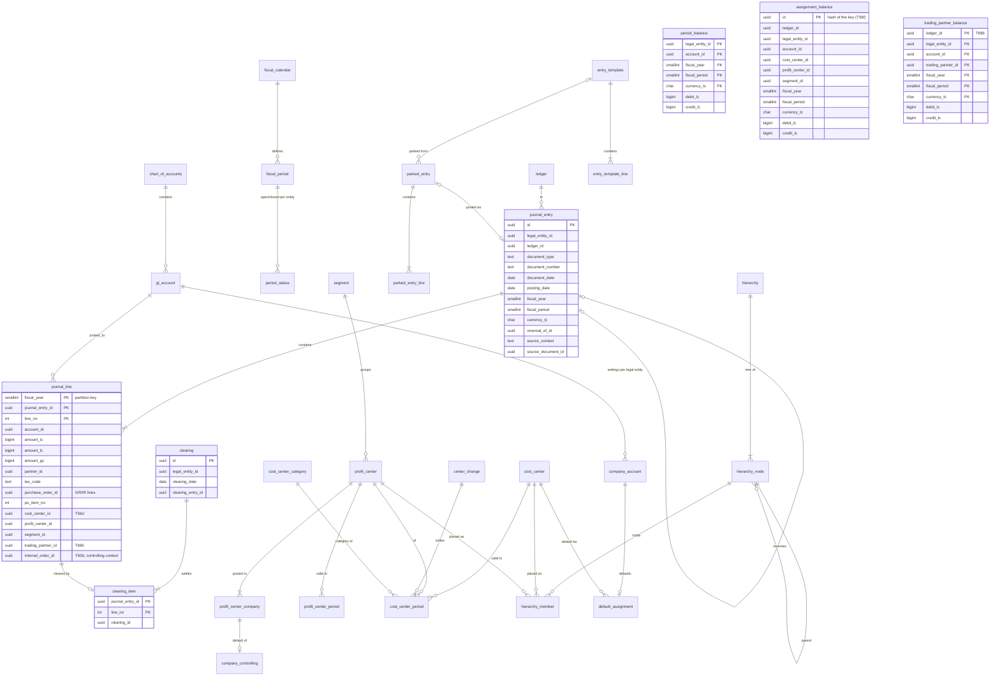

Rules enforced in the database:
- Journal entries and lines are insert-only; corrections are reversal entries
  (`reversal_of_id`), and an entry can be reversed at most once (unique index).
- Every entry balances to zero in local and group currency, checked by a
  deferred constraint trigger at commit; transaction-currency balance is
  checked per currency.
- Posting requires the period to be open for the legal entity and ledger.
- A period moves open <-> closed (`:close`, `:open`) and closed -> locked
  (`:lock`, permission `ledger.period.lock`, people only); the trigger
  `ledger.check_period_transition` (migration 000050, T32) refuses every
  other change of status. A locked period refuses what a closed one does and
  is not reopened by `:open`; only an approved unlock request returns it to
  closed. Locking needs a closed period, so the postings under way
  finished when it closed.
- A locked period names its pending unlock request in `unlock_request_id`
  (workflow context, no foreign key across contexts), and only a locked
  period names one (`period_status_unlock_only_locked`). The transition
  trigger lets locked -> closed through only when the update consumes the
  named request, clearing it (migration 000051, T32b). That the request was approved is checked by
  the ledger's approvals callback, which closes the period under the guard
  `unlock_request_id` = the approved request, not by the trigger: the rule
  stays within the ledger's schema (02-architecture, boundary rule 1). The
  request needs one approval by the role `controller` holding
  `ledger.period.unlock.approve`, whatever the configuration says.
- A manual entry waits in `parked_entry` (with `parked_entry_line`,
  amounts in minor units of the entry's currency, debit positive, never
  zero) until it is posted; the journal stays insert-only (ADR-0006).
  Migration 000052 (T35a) keeps its lifecycle in the trigger
  `ledger.check_parked_entry_change`: an entry is inserted `parked` and
  moves only parked -> parked (edits), pending_approval, posted (within the
  approval limit) or cancelled, and pending_approval -> posted, rejected or
  back to parked (the request withdrawn, clearing `approval_request_id`);
  posted, rejected and cancelled are final. Its content, and its lines
  (`platform.check_editable_parent`; a line also stays on its entry and
  keeps its number), change only while it is parked, so what is approved is
  what is posted; who parked it, and when, never changes. A pending or
  rejected entry names its `manual_entry` approval request (workflow
  context, no foreign key; one entry per request), an entry posted on
  approval keeps it and one posted directly names none, and it is posted
  or rejected only on the request it names; that the request was approved
  is checked by the ledger's approvals callback, as for period unlocks. A
  posted entry names the journal entry posted for it (`source_context`
  `ledger`, `source_document_id` the parked entry, its header, not its
  reversal), and only a posted one does. The ledger reads an entry
  `FOR UPDATE` before it changes the entry or its lines (ADR-0008): the
  line trigger reads the entry's status without a lock. A person owns what they park (`owner_id` =
  `created_by`); an agent's entry has no owner until a person changes or
  posts it, an entry is submitted or posted only with an owner, and the
  owner never changes: the requester an approval excludes is the one person
  who wrote the entry. People and agents park entries through
  `parked-journal-entries` (T35c), checked as a posting is except for the
  open period and the rates; nothing is posted and no number is drawn
  until the entry is posted, so cancelled and rejected entries leave no
  gaps in the journal's number ranges. The owner changes a parked entry
  (`PATCH`, lines replaced as a whole) or cancels it (`:cancel`) while it
  is parked (T35d); a person who changes or cancels an agent's proposal
  takes it on, and an agent acts only on its own unowned proposals.
  Posting it (`:post`, people only, T35e) asks the approval policy: within
  its company's `manual_entry_approval_limit` it is posted at once, above it
  a `manual_entry` request is opened, raised by the owner, who can never
  approve it. The approval posts the entry in the deciding transaction,
  checked again (a period closed meanwhile refuses the decision, which stays
  pending); the approver need not act in the legal entity, as the request
  authorises the posting. A rejection ends the entry; a withdrawal returns it
  to parked. A manual entry posted at once (`POST /v1/journal-entries`) is
  measured the same way after it is converted and refused above the limit
  (409 `ledger.approval_required`, T35f); entries other contexts post
  through `Postings` are not manual and no limit applies. A service
  principal's entry posted at once (an integration's, T61n, ADR-0049 §7)
  is measured the same way against its company's `service_posting_limit`
  (the manual limit when it has none) and, above it, parked for a person
  instead of refused: `created_by_kind` `service`, no owner, and the limit
  it exceeded with the debits as measured, each in its currency
  (`limit_kind`, `limit_debits`, `limit_debits_currency`, `limit_amount`,
  `limit_currency`; all or none, `service_posting_limit` only, a service's
  entry only, never rewritten: `parked_entry_limit_figures`,
  `parked_entry_limit_by_service`, trigger `parked_entry_keep_limit`,
  000175-000176). Only people post parked entries or reverse manual
  entries (`x-agent: false`); people and service principals post them at
  once, agents never. Agents may hold `ledger.entry.park`;
  `ledger.entry.approve` is an approval permission (agents never hold it).
- An entry template (`entry_template`, `entry_template_line`, ADR-0056,
  migrations 000184-000185) is a parked entry's header and lines without
  dates, its name unique per legal entity (`entry_template_name_once`),
  `active` then `retired` for good (trigger
  `ledger.check_entry_template_change`, which also keeps its creator,
  company and ledgers, and its owner once set); its lines change only while
  it is active. Its optional schedule (`frequency` monthly, quarterly or
  yearly, `day_of_month`, `starts_on`, `ends_on` or `occurrences`) is all
  or nothing (`entry_template_schedule`); the ERP keeps `next_due_on`,
  `last_occurrence_on` and the latest refusal (`refused_on`,
  `refusal_code`, `refusal_detail`, all or none). A parked entry made from
  it names it (`template_id`); one the ERP parked for a due date names the
  date (`occurrence_date`), is a system principal's (`created_by_kind`
  `system`) and has an owner (`parked_entry_occurrence`), once per template
  and date (`parked_entry_occurrence_once`); neither changes (trigger
  `parked_entry_keep_template`).
- A clearing's entry is one of the clearing's legal entity, and its date
  falls in an open period of that legal entity and the entry's ledger
  (trigger `ledger.check_clearing_period`, migration 000049, T32), as a
  posting date does. A clearing that posts its entry is held to this by the
  entry already; a migrated clearing (`Postings.Clear`) records one against
  an entry already posted, so the rule is on `ledger.clearing`, and the
  ledger checks it first (`clearingPeriod`: 422
  `ledger.invalid_clearing_entry`, 409 `ledger.period_not_open`, 422
  `ledger.no_fiscal_period`).
- A clearing that posts its entry is dated on or after the latest posting
  date of the items it clears (422 `ledger.clearing_before_item`; the
  ledger's `notBeforeItems`, in every path that posts a clearing entry).
  The database does not enforce it: a migrated clearing keeps the source
  system's date and a reversal its own (ADR-0006 As built).
- A line is cleared at most once (`clearing_item` unique on the line).
- Open items are lines on reconciliation accounts without a clearing item.
- A reversal clears the original's open items against the matching lines of
  the reversal, in the same transaction, with the reversal as the clearing
  entry (as SAP does); no other clearing or settlement takes a line of a
  reversed entry or of a reversal.
- An entry posted for a document with a reversal of its own belongs to
  that document's context: today a supplier invoice's (`source_context`
  `payables`) and a goods movement's WE entry (`procurement`, T33). The
  ledger's `:reverse` refuses them (409 `ledger.entry_owned_elsewhere`,
  naming `supplier-invoices/{id}:reverse` or `goods-receipts/{id}:reverse`):
  an invoice's reversal goes through `Postings.Reverse` and also changes the
  invoice and applies its permission and checks; a receipt is reversed by a
  102 movement that posts its own entry. Manual entries, entries a
  migration run loaded (`integration`) and payment entries stay reversible
  through the ledger; entries of any other context (receivables, assets) are
  refused with the same code until a reversal path is decided for them.
- An open item another context is about to settle is reserved in
  `item_reservation` (owner context, owner document and its reference;
  migration 000034): at most one active reservation per line (partial unique
  index `item_reserved_once`), and a reservation is only ever released, once
  (trigger, `UPDATE` granted on `released_at`/`released_by` only). The ledger's
  manual clearing, migrated clearing and reversal refuse a reserved item
  (409 `ledger.item_reserved`); a settlement passes its owner
  (`Settlement.ReservedFor`), is refused items another owner holds, and ends
  the owner's reservation of what it clears. The owner reserves through
  `Postings.Reserve`, which locks the entries exclusively and refuses items
  that are not open, reversed or held, and frees through `Postings.Release`;
  the ledger never reads the owner's tables.
- A line may name the purchase order item it belongs to
  (`purchase_order_id`, `po_item_no`; procurement context, no foreign key;
  migration 000053, T33a): both or neither (`journal_line_order_item_pair`),
  and with a quantity (`journal_line_order_item_quantity`). The ledger keeps
  each order item's GR/IR position on these lines, as SAP's ACDOCA carries
  EBELN/EBELP, so the positions add up to the GR/IR account's balance.
- A line on the legal entity's GR/IR account (account determination
  `gr_ir`) names its order item (trigger `ledger.check_gr_ir_line`,
  constraint `journal_line_gr_ir_order_item`, 422 `ledger.automatic_account`):
  only goods receipts and invoices post it, never a manual entry. Entries a
  migration run loaded (`integration`) are exempt, as SAP's documents'
  GR/IR lines load without their order items; the run takes each open
  position over onto its order item (below). The ledger's `IsPostable` answers false
  for the GR/IR account too, so no order or invoice item names it.
- An order item's GR/IR position is the sum of its lines: quantity
  (invoiced plus cleared less received; a receipt's line is negative) and
  amounts in the three currencies. Goods movements and invoices move it through
  `Postings.Post` with `GRIR` items (T33b); the ledger books the GR/IR line,
  its own reading of the position under the order's lock:
  - in transaction currency the balance afterwards is the order price of the
    new quantity (`money.Scale`), so rounding never adds up across partial
    receipts and invoices;
  - in local and group currency a position that grows takes the posting's
    rates; one that shrinks keeps the value it was booked at, in the share
    its transaction balance keeps (so a position in the local currency keeps
    equal amounts; by quantity at a zero price);
    one that reaches zero clears what is left; one that crosses zero clears
    what is left and values the rest at the posting's rates;
  - a goods movement's other line, on the order item's account, mirrors the
    GR/IR line in all three currencies; an invoice item's net amount less
    the GR/IR line is its price difference, on `price_difference` or, for
    an order item on an asset clearing account of the company (an
    asset's, ADR-0057 §6 and As built B10 step 3), on that account, as
    part of the asset's cost, without a cost center; and what
    the GR/IR line's local and group amounts leave is an exchange
    difference on `fx_gain` / `fx_loss`;
  - the position is read from the lines on the GR/IR account only; a
    quantity has at most six decimals, as a line keeps;
  - an item posted in another currency than its position's is refused (422
    `ledger.gr_ir_currency_mismatch`), as is a legal entity without a
    `gr_ir` (422 `ledger.no_gr_ir_account`).
  Each position is projected into `ledger.gr_ir_position` (migration
  000054, T33f; RLS, key led by `tenant_id`), one row per legal entity and
  order item: received quantity (the procurement context's lines, negated),
  invoiced quantity (the payables context's), balance in the three
  currencies, last posting date and `is_open`. The ledger adds each posted
  entry's GR/IR lines to it in the posting's transaction, under the order's
  GR/IR lock (`project`, after a GR/IR posting or a reversal), and reads
  positions from it; the migration projected the lines posted before
  (none where it runs: GR/IR postings ship in the same release). The
  database holds a legal entity's GR/IR account once determined (trigger
  `ledger.check_gr_ir_fixed`, constraint `account_determination_gr_ir_fixed`,
  409 `ledger.gr_ir_account_fixed`), as the configuration does: a reversal
  of lines on another account would not reach their positions.
  A GR/IR clearing's entry (T72e, SAP MR11; procurement below) is recorded
  in `ledger.gr_ir_clearing_entry` (insert-only, migration 000165) before
  it is projected, and its GR/IR lines' quantities go to the position's
  `cleared` rather than to received or invoiced; `is_open` is received
  <> invoiced + cleared or any balance not zero, and the key-date report
  reads clearings from the same record. Its items (`GRIRItem.Clears`)
  bring each position to zero against `price_difference` (with the item's
  cost center when that is a primary cost account, as an invoice's price
  difference) or, for an asset's order item (`GRIRItem.ItemAccountID` an
  asset clearing account, ADR-0057 As built B10 step 3), against that
  account, and are refused (409 `ledger.gr_ir_clearing_outdated`)
  unless the position still holds the quantity and transaction balance,
  and the item still clears against the account, that were approved. A
  clearing entry is procurement's (WE), so the ledger's `:reverse`
  refuses it; no path reverses one yet.
  A migration run takes the GR/IR positions SAP holds open over (T72f,
  migration 000167, ADR-0034 As built): an integration entry per order of
  `GRIRItem.TakesOver` items, each the item's GR/IR line with SAP's balance
  and open quantity (what SAP invoiced less what it received) against a
  line on the GR/IR account without an order item, which offsets SAP's
  documents' lines there. A later run tops a position up: the item's line
  moves what earlier take-overs took over of it (their integration lines,
  reversals included) to SAP's position now, refused (409
  `ledger.gr_ir_position_exists`) unless what was taken over is what the
  run read (`GRIRItem.TakenOver`); what the platform posted on the item
  stays beside it (review:batch21). The projection adds an integration entry's
  quantities to the position's `migrated`, neither received nor invoiced
  (and the key-date report likewise), so a position's quantity is invoiced
  + cleared + migrated - received and `is_open` reads all four.
  `GET /v1/gr-ir-balances` (T33e) pages the current positions from it by an
  index range scan (partial indexes `WHERE is_open` for the default,
  open-only listing); together they are the leading ledger's GR/IR balance
  from goods receipts and invoices (lines a migration run loaded without an
  order item are on the account but in no position; once the run has taken
  SAP's open positions over, they net to zero). A key date
  (`posting_date_to`) is a report: one order's positions summed from its
  lines, or, without `purchase_order_id` (T73i2, a period's close checks
  them as at its end), every order's, the projected positions except the
  order items posted after the key date, whose positions are summed from
  their lines up to it. The lines after the key date are read from the
  fiscal years that end after it, so an item untouched since costs no
  line read; an item posted since costs its own history.
  TestGRIRBalancesBudget measures the case without lines after the key
  date only.
  A reversal mirrors its entry; where it brings an order item's quantity to
  zero and rounding leaves a balance (the item moved since), it adds a
  GR/IR line of quantity 0 that clears it against `price_difference`, so a
  position is zero in every currency once its quantities agree.
- `price_difference_item` (insert-only, migration 000263; B10,
  po:2026-11-10; ADR-0057 As built) records, beside an invoiced order
  item's difference line (on `price_difference` or, for an asset's item,
  on its asset clearing account), the order item it belongs to
  (`purchase_order_id`, `po_item_no`; the line itself names none, since a
  line's order item marks a GR/IR line) and the input tax borne in it
  (`tax_borne_tc`, `tax_borne_lc` at the entry's rate, debit positive as
  the document, whatever the line's sign): the line's amount less the tax is the price difference. Keyed as
  the line, with a foreign key to it; a GR/IR line is refused, and the
  tax has one sign in both currencies. A reversal's lines record their
  originals' with the tax negated. Lines posted before the migration, a
  reversal's rounding residue and a GR/IR clearing's line have no row.
- `period_balance` is maintained by an idempotent projector (ADR-0006).
- `journal_line` is partitioned by `fiscal_year`.
- `period_status` (one row per legal entity, ledger, year and period) has a
  uuid `id` so the API can address a posting period; its natural key stays
  the primary key.
- Parallel ledgers (ADR-0045, T52a): `ledger` (0L is the leading ledger,
  `ledger_leading_is_0l`), `company_ledger` (the ledgers a legal entity
  keeps, insert-only; exactly one leading per legal entity:
  `company_ledger_one_leading` and the commit-time
  `company_ledger_leading_required`), `ledger_group` and
  `ledger_group_member` (insert-only; the representative is a member,
  `ledger_group_representative_member`, the leading ledger when it is one,
  `ledger_group_leading_represents`, and only the name changes,
  `ledger_group_fixed`). All from the configuration's `ledgers`,
  `companies[].ledgers` and `ledger_groups`; `period_status` has rows for
  every ledger the legal entity keeps.
- Posting groups (ADR-0045, T52b): a posting is written once per ledger
  it goes to, as `journal_entry` rows sharing `posting_group_id` (the
  first entry's id, the representative ledger's) and the document number,
  now unique per ledger (`journal_entry_document`, built per partition;
  the constraint without the ledger is dropped). The insert trigger
  `journal_entry_ledger` holds an entry to a ledger its company keeps
  (`ledger.company_keeps`: its `company_ledger` rows, or the leading
  ledger alone before any are assigned), to a member of the
  `ledger_group_id` it names, and a copy to its group's first entry's
  header in another ledger. `parked_entry` keeps what it posts to
  (`ledger_specific`, `ledger_group_id`, not both, fixed once parked).
- Clearing in every ledger (ADR-0045, T52c): a clearing writes one
  `clearing` per ledger where its clearing entry has a copy, by that copy,
  with `clearing_item` rows for the copies of the cleared lines (an item
  with its offset, only where both have a copy); the leading ledger's is
  the one read and announced.
- Ledger reconciliation (ADR-0045, T52e) needs no table: it reads the
  balances the trial balance reads (`period_balance` plus the lines not
  yet projected) for two ledgers, and finds the entries behind a
  difference as those whose `posting_group_id` has no entry in the other
  ledger (`journal_entry_posting_group`). The contract step of T52b's
  expand is empty: the old document number constraint went in 000136, and
  `posting_group_id` stays nullable, entries posted before T52b having
  none.

Enforced by the ledger, not the database (T32c): `:unlock` (permission
`ledger.period.lock`, people only) opens the `period_unlock` request with
the reason in its title and names it, only on a locked period naming none
(409 `ledger.unlock_pending` otherwise). The ledger is the only writer of
`unlock_request_id`. Its approvals callbacks (`ledger.PeriodUnlocks`)
clear it when the request ends: approved, the period returns to closed
(`PeriodUnlocked`); rejected or withdrawn, it stays locked. Each acts only
while the period, locked, names that request, and fails the decision
otherwise.

Other ledger tables: `ledger` (leading 0L, parallel ledgers), `exchange_rate`
(rate type `average | bank_buying | bank_selling | planning`, currency pair,
`valid_from`; insert-only), `account_determination` (which account
automatic postings use per legal entity and key: `ap_reconciliation`,
`input_tax`, `bank`, `fx_gain`, `fx_loss`, `cash_discount` (T36a), and for
GR/IR clearing (T33) `gr_ir` and `price_difference`; the GR/IR account is a liability that no
tax code posts, starts without postings other than a migration run's, and
stays once activated (configuration validation, `ledger.Setup.Check`); order
items that named it before stay as they are, and posting them is refused;
and for down payments (T46, ADR-0037) `down_payment`, the alternative
reconciliation account of special G/L items: an asset that is a vendor
reconciliation account, fixed once determined),
the tax codes (T61a, ADR-0049 §3; migration 000124): `tax_code_definition`
(direction, never changed; kind; UN/CEFACT category), `tax_component` (one
per tax a code levies: jurisdiction, account key, never changed;
recoverable share; account, none when non-deductible, and the former
accounts) and `tax_rate` (a component's dated rates, a GiST exclusion over
the live ones; a rate's value and start never change, a rate no posting
used is withdrawn rather than deleted, and the database refuses withdrawing
or re-dating a rate past a posting of its code or adding one over posted
dates, `ledger.tax_rate_in_use`, read from the tax items by tax date since
T61c); the former `tax_code` (one rate and account per validity) was copied
into them and is dropped (000145, T61c), `withholding_tax_code` (T46e: the
configuration's `companies[].withholding_tax_codes`, SAP T059P/T059Z, kept
by the setup per legal entity: a rate above 0 and below 100% of the
invoice's net, the default, or gross, deducted at invoice or at payment, to
a liability that reconciles no supplier, the withholding tax payable; a code
the document no longer has is deactivated).

A journal line of an output code may name the subdivision its tax is
levied in (`tax_jurisdiction`, ISO 3166-2; migration 000150, T61f,
ADR-0049 §7), exactly where a component of its code levies its lines'
(`tax_component.jurisdiction_on_line`, its jurisdiction then a country,
`tax_component_jurisdiction_on_line`); only with a tax code
(`journal_line_tax_jurisdiction`), one of the component's country (trigger
`journal_line_tax_jurisdiction_code`, passed by reversals) and, where that
component lists the subdivisions it accepts (`tax_component.subdivisions`,
migration 000245, the emirate guard: only on a component levying its
lines', each a subdivision of its country, `tax_component_subdivisions`;
null accepts any), one of them. The items are
per jurisdiction. A parked line keeps it (`parked_entry_line.tax_jurisdiction`).

A journal line may declare a tax base (`tax_base_tc`, `tax_base_lc`;
migration 000147, T61e, ADR-0049 §9): a tax line of an `import` code posted
from a customs declaration, whose base, the declared value, no line of the
entry carries; both or neither, only with a tax code
(`journal_line_tax_base`), only on a component's account of an import code
(trigger `journal_line_tax_base_import`); the component's item takes it. A
parked line keeps it as `parked_entry_line.tax_base`
(`parked_entry_line_tax_base`).

Tax items (T61c, ADR-0049 §5; migrations 000144-000145): `tax_item`, one per
entry of the leading ledger (a parallel ledger's copies and entries have
none, `tax_item_leading`; a parallel ledger's entry that is no copy of a
leading ledger's carries no tax code, `tax_code_off_leading`), tax code, component and tax line account, written with every entry
that carries a tax code in its transaction (from its lines, or a reversal's
and a down payment transfer's negated from the entries they reverse, a cash
discount's from its items' at their rates): the tax date, the rate row and
percentage applied, the recoverable share, base, tax and recoverable part in
transaction and local currency, and `reported_in`, the return that reports
it, set once (`tax_item_fixed`; nothing else changes and nothing is
deleted). Output tax recovers nothing, input tax at most itself
(`tax_item_recoverable`). When the entry commits, its tax lines and items
agree (`tax_item_missing`, `tax_item_entity`, `tax_item_lines`, deferred
like the balance; not for an entry without a tax date, which an instance of
the release before writes during the rollout, nor for a code that posts to
no account). `journal_entry.tax_date` and `parked_entry.tax_date` are
the entry's tax date, none on entries posted before, whose items carry their
posting date. Indexed by legal entity, code and tax date, what a return and
the rate check read.

An open item on a supplier reconciliation account keeps the payment terms
it was posted with (`open_item_terms`, migration 000068, T36b), as SAP
copies ZTERM, ZFBDT and ZBD1T..ZBD3T into the vendor line: the term's
code, the baseline date, the net days and up to two discount tiers, with
`partner.payment_term`'s rules, insert-only. The posting context passes
them with the entry (`ledger.Posting.Terms`; terms for an entry without a
supplier open item are refused). The payable items and `GET
/v1/open-items` show them, with the net due date and each discount's last
day (`payment_terms`); an item posted without them (before T36, manual,
migrated) has none and is due by its supplier's current terms. The net
due date is computed (baseline date plus net days), never stored or
indexed: `GET /v1/open-items` filters by it (`due_date_to`, leaving out
the items without terms) and ages the items it selects on a key date
(`aging_key_date`, `aging_days`), summed per local currency on its first
page (ADR-0052 G4, T73j).

It keeps the payment method its document fixed, when it fixed one
(`open_item_payment_method`, migration 000253; ADR-0038 As built, an
item's fixed payment method; SAP BSEG-ZLSCH): one row per supplier open
item of the entry, insert-only, the code as the payables context checked
it against the company's active methods; a migration run keeps the method
SAP fixed on an open vendor item the same way, per line, checked by its
quality gate (ADR-0038 As built, a migrated item's fixed payment method).
A payment run pays such an item
by that method alone; `GET /v1/open-items` shows it (`payment_method`).

It keeps its supplier's withholding taxes too (`open_item_withholding`,
migration 000088, T46f, ADR-0037; SAP WITH_ITEM), one row per code of the
supplier in the legal entity when it posted: the code, its rate and
account then, the base (the invoice's net or gross, in the sign the item
is paid in) and, for a code deducted at invoice, the amount withheld (of
the base's sign and less than it; none for a code deducted at payment),
insert-only. An invoice posts what its codes deducted at invoice withhold
to their accounts and owes the supplier the rest; what all its codes
withhold is less than its gross (`payables.withholding_exceeds_invoice`).
The payable items carry the codes deducted at payment.

Special G/L items (T46, ADR-0037). `journal_line.special_gl` marks a
supplier line as a special G/L item; `A` (down payment) is the only
indicator. A line carries `A` exactly when it is on the legal entity's
`down_payment` account (trigger `journal_line_special_gl_account`), and it
has a partner (`journal_line_special_gl`). Special items are open items of
their supplier, shown with their indicator in the open-items listing,
journal entries and `JournalEntryPosted`, but `OpenItems.Payable` leaves
them out, so they never net in a payment run or count towards a debit
balance, and clearing, settlement and reservation refuse them
(`ledger.special_gl_item`): they leave the account only by clearing against
the supplier's invoice (T46d) or by a reversal, which keeps the indicator.
Listing the `down_payment` account's open items (`account_id`), or the
items with indicator `A` (`special_gl`, T73e4), lists the supplier's down
payments. A down payment migrated open from SAP (ACDOCA UMSKZ A,
T72c) is posted as its SAP document, the special item on its tax code
beside its tax lines, and recorded as a `paid` `down_payment_request`
naming that entry, its reference the source document, so it behaves as one
a run paid (ADR-0037, As built).

Asset reconciliation accounts (T57a, ADR-0057 §3, migration 000190).
`gl_account.reconciliation_kind = 'asset'` marks an asset account whose
balance is the assets' acquisition cost or accumulated depreciation
(`chart_of_accounts[].asset_reconciliation`). A line on one posts only in
an entry whose `source_context` is `assets`, or `integration` (a migration's
balances): `ledger.check_line` refuses every other
(`journal_line_asset_reconciliation`, 422
`ledger.asset_reconciliation_account`), and the posting paths refuse it
first, naming the line. Only an account the activation creates becomes
one, and it never stops being one (`ledger.Setup`);
it is not open-item managed: `company_account.is_open_item_managed` starts
true for supplier and customer reconciliation accounts only. The asset
classes and each company's asset accounts are configuration
(`asset_classes`, `companies[].asset_accounts`), read by
`GET /v1/asset-classes`.

Foreign-currency revaluation (T48, ADR-0042, migration 000107). The
document currency is the entry's `currency_tc`; lines carry no currency of
their own. `company_account.revalue_foreign_currency` flags an asset or
liability that reconciles no partner whose balance per currency is revalued
(`company_account_revalue_foreign_currency`; the flag stays while an
active valuation names it). `fx_valuation` holds the legal entity's one
valuation rate type (default `average`); `fx_valuation_account`, per legal
entity and revalued account, the unrealised gain (a revenue) and loss (an
expense) and, exactly for a supplier or customer reconciliation account, a
balance-sheet adjustment account that reconciles nothing
(`fx_valuation_account_revalued`, `_adjustment`, `_gain`, `_loss`); both
from `companies[].fx_valuation`, deactivated when removed.
`revaluation_run` is one run of a legal entity and ledger at a key date:
its rate type, status `posted` then `cancelled`, and its valuation entry
(dated the key date) and reversal entry (the next day), both or neither,
of its legal entity and ledger and no other run's (`revaluation_run_entries`,
`revaluation_run_entry_dates`, `revaluation_run_valuation_entry`, `revaluation_run_reversal_entry`), fixed once posted
(`revaluation_run_lifecycle`, `revaluation_run_fixed`); one posted run per
key date (`revaluation_run_posted`). `revaluation_item`, insert-only, is
what a run valued: an open item (a journal line, with its partner) or a
flagged account's balance in one currency (`revaluation_item_kind`), each
with its trading partner (an open item's is its line's; a balance is one
per currency and trading partner, none being one of them; T68b2,
migrations 000240–000242, ADR-0059 §4), each once per run
(`revaluation_item_line`, `revaluation_item_balance_by_partner`), with its transaction and booked local and group amounts and,
for local and for group currency each, the rate, its validity (none for
the group's own currency) and the amount at that rate: group currency is
valued on its own. An open item has a transaction-currency amount; a
balance may be zero in it while its local or group balance is not, the
residual a run corrects (`revaluation_item_amount`), and is worth zero at
any rate, so it is valued without rates, every other item with both
(`revaluation_item_rates`); a group rate without its validity is 1
(`revaluation_item_rate_gc`). Cancelling a run (T48d) reverses both its
entries through the ledger's reversal path (`ledger.reversal`) and sets
`cancelled`, under the entries' bucket locks and the run read `FOR UPDATE`;
the key date is then free for another posted run.

Cost centers, profit centers and segments (T56a, ADR-0050, migration
000128) are the ledger's master data, which journal lines carry from T56d.
`segment` (IFRS 8) and `profit_center` are tenant-wide, `cost_center`
belongs to one legal entity, fixed; codes are SAP's (`^[0-9A-Z_-]{1,10}$`),
unique per tenant (per legal entity for cost centers) among centers not
rejected. `profit_center_company` assigns a profit center to the legal
entities it may be posted in, insert-only. A center's texts (name,
description, person responsible) are on it and change without approval;
what postings read is in effective-dated periods (`valid_to` exclusive,
NULL open): `cost_center_period` (category, profit center, locks for actual
costs, actual revenue and plan) and `profit_center_period` (lock), whose
active periods never overlap (`*_period_overlap`, EXCLUDE where not
retired). A cost center period names the cost center with its legal entity
(`cost_center_period_company`) and a profit center assigned to it
(`cost_center_period_profit_center_company`). Periods are written once: a
change retires the periods it replaces (`retired_by_change_id`, once) and
inserts new ones (`check_center_period_fixed`). `center_change` is a
requested change of one center (`center_change_one_center`; `assign` only
for a profit center): create, redate, lock, move, assign, with its payload
fixed, decided once from `pending` on its `center_change` approval request
(`check_center_change_decision`), one pending per center
(`center_change_one_pending`). A center goes `pending` to `active` or
`rejected` only, its code and a cost center's legal entity fixed
(`check_center_change`).

Revaluation per ledger (T52f, ADR-0045, migrations 000137-000138). A run
values its ledger's own lines (a parallel ledger's copies of the open items, which
T52c clears with the leading ledger's, and its ledger-specific postings)
and posts and reverses its entries in that ledger alone; the posted-run
index already keys runs by ledger, so each ledger has its run per key
date. `fx_valuation_ledger` is the rate type a parallel ledger values at of
its own (its valuation area, from `companies[].fx_valuation.ledgers`),
deactivated when removed; a ledger without an active one values at the
legal entity's `fx_valuation`. Its foreign keys hold it to a ledger the
legal entity keeps (`company_ledger`) and not the leading one (`is_leading`,
always false, against `ledger.ledger`'s role key). The valuation accounts
stay per legal entity: the ledgers keep their amounts apart on them. A run's
ledger is one its legal entity keeps (`revaluation_run_ledger_kept`,
migration 000138, checked on insert).

Hierarchies of cost and profit centers (T56b, migration 000139) are trees
not dated (decision P7). `hierarchy` has a kind, a code unique per kind
(`hierarchy_code_once`) and at most one standard per kind
(`hierarchy_one_standard`), all fixed (`check_hierarchy_fixed`).
`hierarchy_node` has one root per hierarchy (`hierarchy_one_root`,
never moved or removed: `hierarchy_node_root_kept`), a parent in the same
hierarchy (`hierarchy_node_parent`) and a code unique among its nodes
(`hierarchy_node_code_once`); `check_hierarchy_node` locks the hierarchy
and refuses a cycle, more than 12 levels, a removed parent, and removing a
node with children or centers. `hierarchy_member` places a center of the
hierarchy's kind (`hierarchy_member_kind`, `hierarchy_member_center`) once
per hierarchy (`hierarchy_member_once`) at a node not removed
(`check_hierarchy_member`); a move changes `node_id`. A node may hold
centers and child nodes alike, as SAP's groups do (migration 000247,
ADR-0050 §3 as amended; 000139 kept centers at leaves). Hierarchy and node
codes hold up to 24 of 0-9, A-Z, _ and - (`hierarchy_code_check`,
`hierarchy_node_code_check`; migration 000248, as SAP's SETHEADER-SETNAME;
000139 held 15).
Nodes and places are not deleted but removed by the change that removes
them (`removed_by_change_id`). Every active center is in the standard
hierarchy of its kind at commit (`check_center_placed`, deferred).
`center_change` gains `hierarchy_id` and the kinds `node_create`,
`node_rename`, `node_move`, `node_remove` (no center) and `place` (a center
and a hierarchy): `center_change_one_center`, `center_change_hierarchy`.

The configuration's controlling rules (T56c, ADR-0050 §4, migration 000140)
are kept by the ledger's setup. `gl_account.cost_element` is the account's
cost element category: `none`, `primary_cost` only on an expense, `revenue`
only on a revenue (`gl_account_cost_element`); accounts set up before took
their type's default. Since T60g (ADR-0064 §4, migration 000284) it may be
`secondary`, on an expense account alone: an account only the controlling
context's entries post lines to (`journal_line_secondary_account`, in
`ledger.check_line`), and one from its creation for good
(`gl_account_secondary_kept`, a trigger on updates of the cost element). `cost_center_category` (code as a period's category,
name, `revenue_allowed`, the lock defaults of a new cost center,
`is_active`) is the tenant's categories, deactivated rather than deleted;
a cost center period's category is one of them
(`cost_center_period_category`). `company_controlling` is per legal entity
the fiscal year cost and profit center accounting apply from (NULL off;
once set fixed: `company_controlling_stays_on`) and the default profit
center, assigned to the legal entity
(`company_controlling_default_profit_center`), required with profit center
accounting (`company_controlling_needs_default`). `default_assignment` is
the cost center lines on an account take when none is given (SAP OKB9),
per legal entity and account set up there, a cost center of that legal
entity (`default_assignment_cost_center_company`), deactivated when the
configuration drops it.

Account assignment on the journal line (T56d, ADR-0050 §5, migrations
000155-000158). `journal_line` carries `cost_center_id`, `profit_center_id`
and `segment_id`, nullable, NULL on lines posted before. The cost center is
one of the line's legal entity (`journal_line_cost_center_fkey` to
`cost_center (tenant_id, id, legal_entity_id)`), the profit center one
assigned to it (`journal_line_profit_center_fkey` to
`profit_center_company`), the segment a segment
(`journal_line_segment_fkey`); added `NOT VALID` per partition and
validated per partition before the parent took them over. Partial indexes
`journal_line_cost_center` and `journal_line_profit_center` (company,
center, year, period). The ledger derives and validates every line's
centers before writing it; the database check of ADR-0050 §5's table at
commit comes with T56d3, in the release after (06 §6.4). A parked entry's
lines keep the centers entered on them (T56d2, migrations 000159-000160:
`parked_entry_line.cost_center_id`, `profit_center_id`, `segment_id`,
foreign keys `parked_entry_line_cost_center_fkey`,
`parked_entry_line_profit_center_fkey` and `parked_entry_line_segment_fkey`
to the tenant's centers, added `NOT VALID` and validated); the rest is
derived when the entry is posted. A center change is checked against the
lines carrying the center (ADR-0050 §3, T56d2: the
`journal_line_cost_center` index serves the cost center's ranges of
posting dates).

A journal entry's period in the page order (T73j2, migration 000186):
`journal_entry_page_period` (company, period, posting date, id, per
year's partition) gives a period's first page of entries, as the page
indexes of 000055 give a year's; with `journal_line_account` it serves the
journal list's `account_id` and `fiscal_period` filters, a trial
balance's row drilled down to its entries.

Balances by account assignment (T56f, ADR-0050 §7, migration 000163).
`assignment_balance` holds, per ledger, company, account, cost center,
profit center, segment, year, period and transaction currency, the totals
of the lines that carry any center (`assignment_balance_assigned`); the
centers are nullable, so the primary key is `id`, a hash of the whole key
(as `gr_ir_position`'s). It is written only by the projection
(`erp_projector`; the application reads it): the trigger
`balance_projection_assignment` on `balance_projection` adds an entry's
assigned lines when the projector marks it projected, in the statement
that adds it to `period_balance`, so both count each entry once and every
release's projector keeps it. The migration added the lines projected
before it. The two center reports read it with the lines still pending,
as the trial balance reads `period_balance`, through the partial indexes
`assignment_balance_cost_center` and `assignment_balance_profit_center`
(company, ledger, year, period, center).

The internal order on the journal line (T60b, ADR-0064 §2, migrations
000268-000270). `journal_line.internal_order_id` is the internal order a
primary cost line's cost is posted to, the second real cost object beside
the cost center, nullable, NULL on lines posted before; an order id
without a foreign key (the order master is the controlling context's,
§3.19), which the ledger checks through its port `ledger.CostObjects`
before it posts a line naming it: the order is known, of the line's
company and released, the account a primary cost account, and the line
names no cost center (422 `ledger.internal_order_invalid`, naming the line
and why). The posting holds the orders it names `FOR SHARE` until its
transaction ends. The line takes its profit center and segment from the
order's responsible cost center in its period on the posting date and
keeps `cost_center_id` empty. The database holds the other half: a line
carries a cost center or an order, never both
(`journal_line_one_cost_object`, added `NOT VALID` and validated partition
by partition; a partition created later gets it validated). The partial
index `journal_line_by_internal_order` (company, order, year, period)
serves the order's actual costs. A reversal copies each line's order. A
parked entry's and a template's lines keep no order in the first version:
one naming an order is refused (422 `ledger.internal_order_not_parkable`).

The trading partner on the journal line (T68b, ADR-0059 §4, migrations
000219-000221). `journal_line.trading_partner_id` is the tenant's company
on the other side of an intercompany line (SAP's RASSC), nullable, NULL on
lines posted before; a legal entity id without a foreign key (tenancy is
another context, 02 §2.1), which the ledger checks is a legal entity of the
tenant before it posts or parks a line naming it (422
`ledger.trading_partner_invalid`). The database holds the other half: a
line's trading partner is never its own company
(`journal_line_trading_partner`, added `NOT VALID` and validated partition
by partition; a partition created later gets it validated). The partial
index `journal_line_by_trading_partner` (company, trading partner, year,
period) serves the journal list's `trading_partner_id` filter. A parked
entry's and a template's lines keep the trading partner entered
(`parked_entry_line.trading_partner_id`, `entry_template_line.trading_partner_id`),
checked again when the entry is posted. A reversal copies each line's; a
clearing's lines take the items they offset, and a settlement's or bank
posting's exchange difference and cash discount lines the items' when they
all name the same one. Since T68c the ledger also derives it, in the one
place every posting but a reversal passes: a line naming a partner linked
to a group company (`partner.business_partner.group_company_id`) takes that
company (none when it is the posting company), a line naming another is
refused (422 `ledger.trading_partner_conflict`), the entry's other lines
take the one all its partner lines share, and lines offsetting open items
keep their items'. `trading_partner_balance` holds, per ledger,
company, account, trading partner, year, period and transaction currency,
the totals of the lines that name one, never the company's own
(`trading_partner_balance_partner`); like `assignment_balance` it is
written only by the projection (`erp_projector`), by the trigger
`balance_projection_trading_partner` in the statement that marks an entry
projected, and consolidation reads it with the lines still pending
(ADR-0059 §4a, T68d). No line carried a trading partner before, so nothing
was backfilled.

Year-end close, special-period postings (ADR-0060 §3, T64m1, migrations
000225 and 000226): special periods 13-16 take manual and parked entries
and the API's reversals, dated in the year's last regular period, whose
dates they share. A parked entry keeps the special period it names in a
nullable `parked_entry.fiscal_period`, 13 to 16 or null
(`parked_entry_fiscal_period_special`; null: the regular period of its
posting date). `ledger.check_entry_period`, the journal entry's period
trigger, refuses an entry in a special period dated outside its dates (as
in any period) and one that is neither a manual entry (`source_context`
`ledger`) nor a reversal; the ledger answers both first with problems
(`ledger.special_period_date`; no other context's posting names a special
period), and refuses a tax code on a special-period line
(`ledger.special_period_tax_code`, application only) unless the entry is a
UAE company's and names the tax invoice or tax credit note its VAT rests
on (ADR-0060 As built, C10; migrations 000258 and 000259):
`tax_document_kind`, `tax_document_number` and `tax_document_date` on
`journal_entry` and `parked_entry`, all three or none, the kind
`tax_invoice` or `tax_credit_note`, the number 1 to 64 characters, and the
entry's `tax_date` the document's date, a parked entry's when it has one
(`journal_entry_tax_document`, `parked_entry_tax_document`). A period close's
parked-entry check (`ledger.CloseChecks.Parked`) leaves out entries naming
a special period.

The balance carry-forward (ADR-0060 §4-§6, T64m2, migrations 000227 and
000228) stores the opening balances of the next fiscal year as balances,
never as journal lines. `period_status.opened_count` counts a period's
openings: the trigger `period_status_opened_count` starts it at 0 and adds
one on every change of the status to `open`, whoever writes it, and
refuses any other change (`period_status_opened_count_set`); locking and
unlocking do not move it. An import (ADR-0029) keeps the exported count
while `app.importing` names the tenant (migration 000229); a carry-forward run is
inserted superseded then, and deleted only by its tenant's erasure (000230). The retained earnings account is the account
determination key `retained_earnings`, applied from
`companies[].year_end.retained_earnings_account` (tier 3; changed but not
removed once activated). A run (`carry_forward_run`) of a company, ledger
and year Y carries into Y+1 (`carry_forward_run_years`), `chained` from
the previous year's run of its company and ledger
(`carry_forward_run_basis`, `carry_forward_run_chain`) or `all_years`,
to an equity account (`carry_forward_run_retained_earnings`); one is
`current` per company, ledger and year (`carry_forward_run_current`), and
a later run of the year sets it `superseded`, naming its successor
(`carry_forward_run_superseded`; the successor's foreign key is checked at
commit); nothing else of it changes and it is never deleted
(`carry_forward_run_lifecycle`, `carry_forward_run_fixed`). Its rows
(`carry_forward_balance`, insert-only) are per account, kind and
transaction currency, in transaction, local and group currency, debit
positive: `balance` for a balance sheet account, `result` (the year's
profit or loss per currency) only on the run's retained earnings account
(`carry_forward_balance_result`). `carry_forward_period` (insert-only)
records the opened count of every period of its ledger in Y and earlier
when it ran: a run is stale when one of them is open or its count moved,
or a period of those years it did not record is open or has been opened.

## 3.8 Procurement (`procurement`)

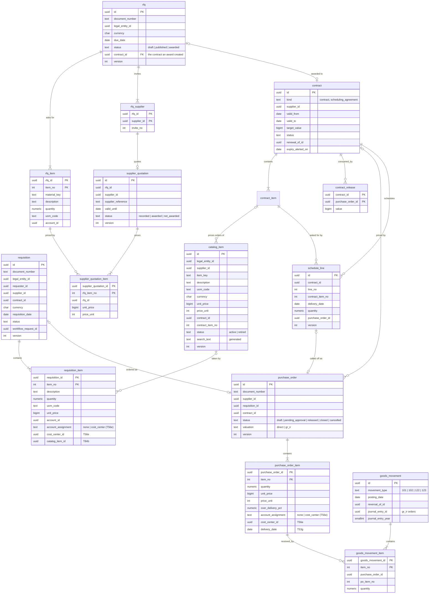

Contract consumption is the sum of insert-only `contract_release` rows (no
counter updated in place).

A contract is renewed (`contracts/{id}:renew`, migration 000066, T47g) by a
draft successor naming it in `renewal_of_id`: valid from the day after it
ends, in its legal entity, with its supplier, currency and items (trigger
`contract_renewal`, constraint `contract_renewal_continues`, 422
`procurement.invalid_renewal`); an active or expired contract has one live
renewal at a time, a cancelled one not counting (`contract_renewed_once`,
409 `procurement.contract_renewed`). The successor is changed, released
and cancelled as any draft; its `ContractActivated` names the contract it
renews. `expiry_alerted_on` is the day the contract's coming expiry was
alerted (`ContractExpiring`), set once (`contract_alerted_once`).

The contract expirer (`ContractExpirer`, hourly) runs one transaction per
tenant: it expires the active contracts past their validity
(`ContractExpired`) and alerts the active ones that no live renewal
continues and that end within `purchasing.contract_expiry_notice_days`
(1 to 365, operational; 30 from the SAP generator, which has no equivalent)
by `ContractExpiring` with the days left, setting `expiry_alerted_on`.
Both judge on the contract's company's date in its time zone at the round
(T72n6), which the events give with the zone (`expired_on`, `alerted_on`,
`time_zone`). Both name the company by `legal_entity_code` and the supplier
by `supplier_number` and `supplier_name` beside their ids (ADR-0034 as
built, review:batch27). Each is written twice: `.v1` as described, and
`.v2` without `supplier_name`, the one offered to webhooks, since a
supplier's name never goes to a webhook (product owner 2026-11-05;
ADR-0041 as built); `.v1` is published until 2027-11-05. An
alert is an event only: buyers renew the contract or let it expire. A
configuration activated before the key existed reads 0: the round alerts
nothing and logs a warning until a change request adds it. Received quantity per PO item is the sum of goods
movement items (102 movements are negative). A materialized
`po_item_receipt_summary` read model can be added for speed without changing
the source of truth.

An order's `valuation` (migration 000053, T33a) says how its receipts and
invoices are booked: `direct` (invoices post the order item's account, goods
receipts do not post) or `gr_ir` (goods receipts post Dr the order item's
account / Cr GR/IR at the order price, invoices clear GR/IR). It is decided
when the order is released, from the legal entity's `gr_ir` account
determination, and fixed from then on (trigger
`procurement.check_valuation_fixed`, constraint
`purchase_order_valuation_fixed`); a draft is `direct`
(`purchase_order_draft_direct`). Orders released before GR/IR was configured
therefore keep the direct scheme to their end, and no posted invoice is
migrated. A goods movement on a `gr_ir` order names the entry it posted
(`journal_entry_id`, `journal_entry_year`: both or neither,
`goods_movement_entry_pair`): document type WE (number range `journal_we`),
on the movement's dates, through `ledger.Postings` with a GR/IR item per
item of a `gr_ir` order (T33c). The entry is posted before the movement is
written, so a receipt the ledger refuses (a period not open, no rate)
leaves none; the items of `gr_ir` orders in one movement share its one
entry and so its currency (422 `procurement.mixed_currencies`). A 102
posts its own WE entry the other way; the ledger's `:reverse` refuses a
WE entry.

A 122 returns goods received on a released or closed order to the
supplier, with its `reason` (required on a 122 and only there,
`goods_movement_return_reason`), and a 123 reverses a 122 as a 102
reverses a 101 (migration 000064, T47b): each reverses only its own kind
(trigger `goods_movement_reversal_type`), and each moves its quantity its
own way, 101 and 123 in, 102 and 122 out (`goods_movement_item_sign`).
`check_receipt` keeps the received quantity, the net of every movement,
between zero and the tolerance, so a return never exceeds what was
received (409 `procurement.return_exceeds_receipts`) and a 123 never
takes it beyond the tolerance. On a `gr_ir` order a return posts Dr GR/IR
/ Cr the order item's account at its valuation price: an item already
invoiced is left with a debit GR/IR position, which the supplier's credit
memo clears (T34); payables takes no invoice on a closed order
(`order_not_open`), so a closed order's position waits for a GR/IR
clearing (SAP MR11, below). Reversals do not check the order's status: a
mistaken receipt or return is undone on a closed order too.

A GR/IR clearing (`gr_ir_clearing`, migration 000165, T72e; ADR-0034 As
built) clears the positions a closed order valued through GR/IR is left
with: received and invoiced quantities that no receipt or invoice will
make agree. `POST /v1/purchase-orders/{id}/gr-ir-clearings` (permission
`procurement.gr_ir.clear`, human-only) takes each open position of the
order's items, or of the items named, as it stands (`gr_ir_clearing_item`,
insert-only: the position's quantity, invoiced plus cleared less received,
and its balance in the order's currency; and, since migration 000264,
the account the item clears against where that is not the clearing's
own: an asset's order item's asset clearing account, nullable
`offset_account_id`, `_number`, `_name`, named whole or not at all),
with the legal entity's
`price_difference` account as shown then (id, number, name), and opens a
`gr_ir_clearing` approval request, whose object is the clearing (`GET
/v1/gr-ir-clearings/{id}`; the order's are listed under it), which a controller holding
`procurement.gr_ir.clear.approve` decides, never its requester (fixed role,
`approvals.DefaultGRIRClearingRole`). It is refused unless the order is
`closed` (409 `procurement.invalid_status`), with a reason (422
`procurement.reason_required`), and has an open position (409
`procurement.nothing_to_clear`); one is pending per order
(`gr_ir_clearing_one_pending`, 409 `procurement.gr_ir_clearing_pending`).
Approved, it posts a WE entry dated its `posting_date` through
`ledger.Postings`, a clearing item per position at the item's valuation
price, names the entry (`journal_entry_id`, year and number:
`gr_ir_clearing_posted`) and publishes `GrIrCleared`; rejected or
withdrawn, it ends `rejected` or `cancelled` with the decision's comment
and the positions stay open. A position that moved since the proposal (a
receipt reversed on the closed order) refuses the approval and the request
stays pending. A clearing starts `pending` and is decided once, and what it
clears never changes (`gr_ir_clearing_transition`, `gr_ir_clearing_fixed`).

An order is released by the release strategy (migration 000063, T47d)
when it has no approved requisition or its total exceeds its
requisition's (in the order's currency, the requisition's): when
`purchasing.order_release_approval` asks for approval of its total, it
waits in `pending_approval`, naming its `purchase_order` approval request
in `release_request_id` exactly while it waits
(`purchase_order_release_request_pending`); the approval releases it,
checked again, in the deciding transaction under the guard that it still
names that request, and a rejection or withdrawal returns it to draft. A
contract that does not cover the order refuses it before any approval is
asked. Its items are valued as it leaves draft, as they cannot change
while it waits. Statuses move only draft -> pending_approval -> released,
pending_approval -> draft, draft -> released, released -> closed, and to
cancelled from draft, pending_approval or released (trigger
`purchase_order_transition`); an order waiting for approval is direct
(`purchase_order_draft_direct`). A migration run's order is released as
loaded, valued as SAP valued it: `gr_ir` when a line on SAP's GR/IR account
names it (T72f), `direct` otherwise; its receipts are recorded without a WE
entry, as the migrated journal carries their value.

The lifecycle of a released order (valuation price, release strategy,
order changes, returns, contract renewal and alerts) is ADR-0034.

A released order changes only through an order change
(`purchase_order_change`, migration 000065, T47e): a draft of its header
fields (payment terms, order date, extensions) and its complete items,
with its reason and the totals before and after, based on the order's
`revision`; one open change per order (`purchase_order_one_open_change`).
A change moves draft -> pending_approval -> applied or rejected, back to
draft when its request is withdrawn, straight to applied when it needs no
approval, or to cancelled; it changes only as a draft, is decided only on
the request it names, and makes the next revision, keeping what the order
read before (`previous`). It is applied in one transaction (an order cannot commit naming it,
`purchase_order_applied_at_once`): the order names
it (`applying_change_id`, an open change of its own revision, only on a
released order), its items are written, and its header changes and its
revision moves on by one as the name is cleared (trigger
`purchase_order_revision`), which needs the change to read applied at that
revision, and a change is applied only while its order names it, so the
two move together; a change starts as a draft. Outside that, a released
order's items and header do not change, nor any order's revision; its
supplier, currency, legal entity, contract, requisition, purchasing org
and number never change once it left draft; an item of a released order
is never active without its valuation price; an item keeps its account, unit,
material and contract item, is never below what was received, nor removed
with receipts (`purchase_order_item_received`), and its valuation price
stays the one it was released at. The API (`/v1/purchase-orders/{id}/changes`,
T47f) drafts a change against the order as it reads, locked: its items
are checked as an order's are, under the order's supplier, currency and
contract, and against the same rules before anything is written (422
`procurement.invalid_change`), checked again on every patch as receipts
may have been posted since; a second open change is 409
`procurement.change_open`. An agent may draft a change; deciding one is
human (`procurement.order.approve`).

`:submit` checks the change again and applies it at once when it does not
raise the order's total; one that raises it waits for an `order_change`
approval request by amount tier on its new total (the order release tiers),
unless the tiers ask for none. The approval applies it in the deciding
transaction; a rejection ends it (`rejected`), a withdrawn request returns
it to draft, and closing or cancelling the order cancels its open change
and withdraws the request. The application locks the order, then the
change, and writes in the order the triggers require: the order names the
change, its items are written (an item added valued at its price; one
added back, as it was, keeps the valuation price it was released at), the change records what the order read before
(`previous`, a non-empty object: `purchase_order_change_previous`) and the
revision it makes, and the order takes the change's header fields as the
name is cleared. A contract order consumes the difference of its total as a
`contract_release` row, negative for a decrease; an increase must be covered
by what remains of the contract on the changed order date, checked before
approval is asked and again as it is applied (409
`procurement.contract_exceeded`). `PurchaseOrderChanged` publishes the order
as changed. Receipts posted while a change waited that it would fall below
refuse its approval (422 `procurement.invalid_change`, from
`purchase_order_item_received`), and the request stays pending.

Each item of a released order carries its `valuation_price` and
`valuation_price_unit` (migration 000061, T47a): its price when it was
released, with its order or as an order change adds it; only the release
and the change set it, never a draft's edit. Goods movements
post GR/IR at it, and invoices clear GR/IR at it, putting what they differ
from it on `price_difference`; its `unit_price` is what invoices are matched
against. The GR/IR engine values an item's whole open position at the price
a posting gives it, so a later change of the item's price must not reach
GR/IR: the valuation price never changes once set
(`purchase_order_item_valuation_fixed`); the release values the items it
releases (trigger `purchase_order_items_valued`, so an application that does
not value them yet still releases during an upgrade); an item added to a
released order carries its valuation price (`purchase_order_item_valued`);
and items of orders released before T47a were valued at their price, which
could not change after the release.

Requisition and order items carry their account assignment (migrations
000161-000162, T56e, ADR-0050 §6): `account_assignment` (`none` or
`cost_center`, default `none`) and `cost_center_id`, a cost center
assignment naming its cost center and only it naming one
(`requisition_item_account_assignment`,
`purchase_order_item_account_assignment`, added `NOT VALID` and validated
by 000162). The cost center is the ledger's, checked through its published
API as the document is released, with no foreign key across schemas. A
released order's item keeps its assignment as it keeps its account
(`purchase_order_item_identity`, 000161), and its goods movements post the
item's account with its cost center.

A request for quotation (migration 000285, T82a, ADR-0069) asks the
suppliers invited for prices of items a company wants to buy, without a
requisition. `rfq` is numbered per company (`rfq_number_once`, from the
`rfq` number range), names the currency quotations are given in and the
date they are due, starts as a draft and is published once: it keeps its
company, number, currency and due date and stays published (trigger
`rfq_lifecycle`). `rfq_item` names what is bought as a contract item does,
by a description and a material key that appears once per RFQ
(`rfq_item_material_key`), with the quantity asked for (above zero), its
unit and the account it is bought on, and no price. `rfq_supplier` is a
supplier invited, once per RFQ (`rfq_supplier_once`), with its place in
the invitation (`invite_no`). Items and suppliers are written while the
RFQ is a draft (trigger function `check_rfq_is_draft`) and are never
changed or deleted. `supplier_id` is the partner context's and
`account_id` the ledger's, checked through their published APIs with no
foreign key across schemas: each supplier must be one an order could be
placed with in the company, when the RFQ is created and when it is
published.

A supplier quotation (migration 000286, T82b, ADR-0069 §7) is what an
invited supplier quoted for a published RFQ, as the buyer recorded it:
`supplier_quotation` names its RFQ and one of the suppliers the RFQ
invites (`supplier_quotation_invited`, a foreign key to `rfq_supplier`),
once per supplier (`supplier_quotation_once`, 409
`procurement.quotation_exists`), with the supplier's reference and the
last day it is valid; only a published RFQ takes one (trigger
`supplier_quotation_of_published`). `supplier_quotation_item` prices one
item of that RFQ, once per quotation, at a price above zero in minor units
of the RFQ's currency per `price_unit` of the RFQ item's unit; a quotation
may leave RFQ items out. Neither table is changed or deleted. The
quotation's total, the sum of quantity × unit price ÷ price unit over its
items, is computed on read from its prices and the RFQ's quantities, which
never change.

An award (migration 000297, T82d, ADR-0069 §7) moves a published RFQ to
`awarded`, once, and gives it `contract_id`, the draft contract the award
created: an awarded RFQ names a contract and no other does
(`rfq_awarded_to_contract`), a contract comes from one RFQ at most
(`rfq_contract_once`, whose index also finds a contract's RFQ: the
contract carries no column for it), and an awarded RFQ stays awarded to
its contract (`rfq_lifecycle`). The trigger lets an RFQ be awarded only
from `published`, with one of its quotations marked `awarded` and a
contract of its company, in its currency, with that quotation's supplier.
A quotation is written as `recorded` and its outcome, `awarded` or
`not_awarded`, is set once, while its RFQ is still published (triggers
`supplier_quotation_outcome` and `supplier_quotation_outcome_of_published`);
one quotation of an RFQ is awarded (`supplier_quotation_one_awarded`). The
application may update a quotation's status, version and `updated_by`
and nothing else of it. Permission `procurement.rfq.award`.

A contract has a kind (migration 000301, T83a, ADR-0070 §1): `contract`,
the default, or `scheduling_agreement`, given when it is created and kept
(trigger `contract_kind_kept`). A scheduling agreement is a contract in
every other respect and has a delivery schedule: `schedule_line` asks for
a quantity above zero of one of the agreement's items (a foreign key to
`contract_item`), in that item's unit, due on a date. Trigger
`schedule_line_checked` reads the contract `FOR SHARE` and takes a line
only for a scheduling agreement that is `active`, for a live item, on a
date within the agreement's validity, numbered after the agreement's last
(`line_no` 1 to n, unique per contract). A line is not deleted, and what
it asks for is not changed. Its value, quantity × the item's unit price ÷
price unit, is computed on read: an active contract's items do not
change. A line is called off once (migration 000302, T83b, ADR-0070 §4):
`purchase_order_id` names the draft purchase order the call-off created
against the agreement, one order per line (`schedule_line_order_once`);
trigger `schedule_line_call_off` lets a line be entered only not called
off and be called off once, to an order whose contract is the line's
agreement. The order is any purchase order: receipts, GR/IR and invoices
do not read schedule lines.

An order item carries its expected delivery date (`delivery_date`, optional,
SAP's EKET-EINDT; migration 000205, T53g, ADR-0051 §5): the one it is
given, else, on an order created from a requisition, the requisition's
`needed_by`; a released order's item changes it through an order change
(`check_order_item_editable` leaves it free, as quantity and price). The
liquidity forecast expects the item's open value invoiced on it.

A company's catalog is `procurement.catalog_item` (migration 000287, T84a,
ADR-0071): a supplier's item in a legal entity with an `item_key` (1 to 40
characters, no white space around it, `catalog_item_item_key_check`), a
`description` (up to 200 characters, not white space alone), a unit of the
reference data, a known currency, a positive `unit_price` in minor units
per `price_unit` and a status, `active` or `retired`. The key is the
supplier's once among the company's active items
(`catalog_item_active_key`, a partial unique index, so a retired item
frees its key). `contract_id` and `contract_item_no` name the contract
item that prices an order of it, both or neither
(`catalog_item_contract_item_both`), an item the contract has
(`catalog_item_contract_item_fkey`); that the contract is active, of the
same company and supplier and in the item's currency and unit, and that
its price is the item's (the same amount per the same price unit, T84c),
is checked when the item is loaded; neither price changes afterwards, so
they stay equal. `search_text` is the key and the description in
lower case, generated, which the search matches a text in;
`catalog_item_by_key` is the order the search's pages are read in. The
legal entity is tenancy's and the supplier the partner context's, with no
foreign key across schemas. The application inserts an item and
afterwards updates its `status`, `version`, `updated_by` and `updated_at`
alone (column privileges): what an item offers is not changed, and an
item is never deleted.

A requisition item taken from the catalog names its catalog item
(`requisition_item.catalog_item_id`, nullable; migrations 000288-000289,
T84b, ADR-0071 §6; `requisition_item_catalog_item_fkey`, added `NOT VALID`
and validated by 000289) and holds a copy of the description, unit and
price it took, so a catalog item retired later changes nothing on it.
An update that changes the description, unit, price or price unit and
leaves `catalog_item_id` as it was sets it to null (trigger
`requisition_item_unlink_catalog`, 000288): the previous release's upsert
of a draft's items does not name the column, and would otherwise leave a
described item naming the catalog item of the row it replaced.

## 3.9 Accounts payable (`payables`)

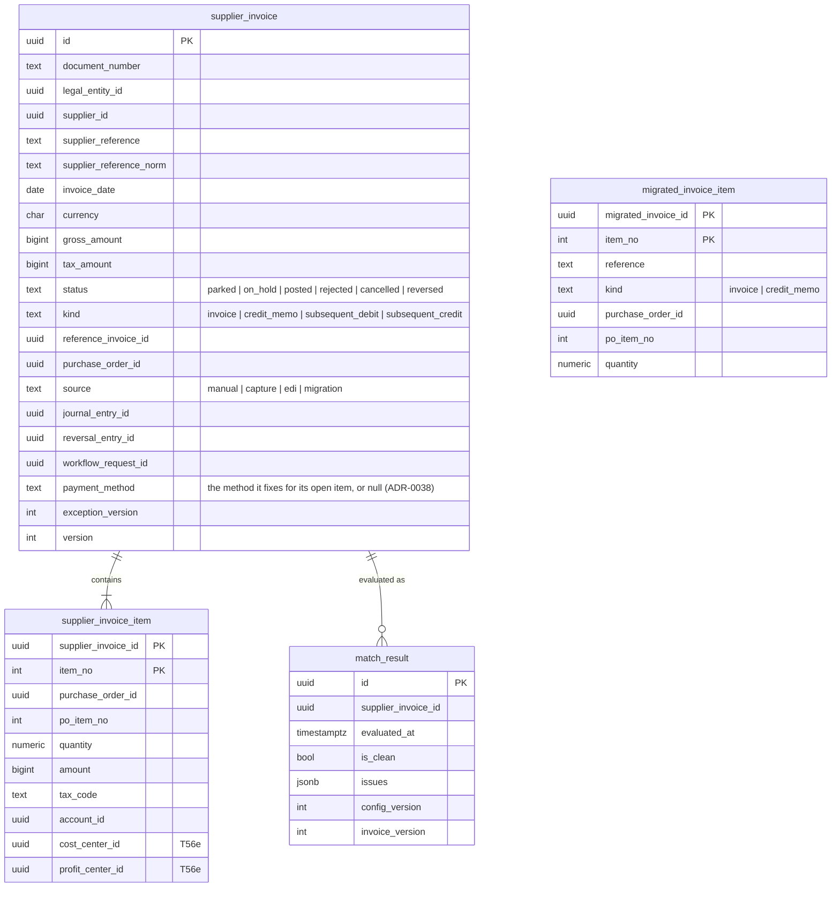

A supplier invoice item carries `cost_center_id` and `profit_center_id`
(migration 000161, T56e): as entered on an item without an order, the
order item's cost center on one with; its line posts with them, and an
invoice on GR/IR posts the order item's cost center on the price
difference when the price difference account is a primary cost account.

A supplier invoice's `tax_date` (migration 000146, T61d, ADR-0049 §4) is
the date its codes' rates apply on and its tax is reported in, set by a
person only; none: the invoice date, or for a correction naming an invoice
that invoice's. Its tax is calculated per item code when it posts, held to
the stated tax within `invoice_tolerance.tax_units_per_code` (ADR-0049 §6).
The column is nullable and the previous release names its columns, so the
migration runs ahead of the code; invoices are not posted during the
rollout, as the previous release posts them with the first item's code at
the invoice date.

A posted invoice's `documentary_warnings` (migration 000182, ADR-0049 §6,
a JSON array, empty by default and before posting) are what its document
may lack for its input tax to be recovered, recorded when it posts from
the company's `tax_settings.documentary_requirements` (from the country
pack): each requirement (`supplier_tax_id`, the supplier's partner holding
a tax identifier of the company's country; `item_descriptions`) of a tier its gross amount, in the
company's currency at the tax date's rate of `tax_settings.rate_type`,
reaches (all tiers, marked unassessed, when no rate converts it).
Warnings, never refusals. The column has a default and the
previous release names its columns, so the migration runs ahead.

A supplier invoice is of a `kind` (migration 000059, T34a), as SAP's MIRO
transactions are: `invoice`, `credit_memo`, `subsequent_debit` or
`subsequent_credit`, fixed once entered (trigger
`payables.check_kind_fixed`, constraint `supplier_invoice_kind_fixed`). Its
gross and tax amounts are not negative whatever the kind
(`supplier_invoice_amounts_not_negative`, 422 `payables.negative_amount` on
entry); the kind gives the direction when it posts (credit memos and
subsequent credits as journal type KG, number range `journal_kg`, which
configuration requires wherever a company numbers supplier invoices). A credit memo or subsequent debit/credit may name the invoice it
corrects, an invoice none (`supplier_invoice_reference_corrects`), never
itself (`supplier_invoice_not_its_own_reference`). A subsequent debit or
credit revalues order items without quantity: it is on a purchase order
(`supplier_invoice_subsequent_on_order`) and its items are order items of
quantity 0, every other kind's items have a positive quantity; a removed
item no longer counts (trigger `payables.check_item_quantity`, constraint
`supplier_invoice_item_quantity_kind`). The checks on existing rows were
added `NOT VALID` (migration 000059) and validated by the next (000060). Entry (T34b) checks the same through the
API: `kind` (default `invoice`; 422 `payables.unknown_kind`), the reference
a posted invoice of the same supplier, legal entity and currency (422
`payables.invalid_reference_invoice`; on an invoice 422
`payables.reference_not_allowed`), a subsequent debit's or credit's items
order items (422 `payables.po_item_required`) of quantity 0 (422
`payables.quantity_not_zero`); every edit checks the reference again, so a
correction whose invoice was reversed since is edited once its reference
is cleared. `SupplierInvoiceCaptured` carries the kind
and signs the gross and tax amounts by it (negative for credit memos and
subsequent credits), as `SupplierInvoicePosted` and `SupplierInvoiceReversed`
do (T34c).

Each kind is matched and posted by its kind (T34c):

- **Match**, per order item, against what other posted documents invoiced
  net of credit memos, and what SAP's posted documents invoiced before
  migration (`migrated_invoice_item`, below):
  - an invoice does not invoice more than received;
  - a credit memo does not credit more than invoiced
    (`quantity_exceeds_invoiced`);
  - both are within the price tolerance;
  - a subsequent debit or credit revalues an order item something is
    invoiced of (`nothing_invoiced`), at any price.

  Simulations and regression suites decide every kind the same way.
- **Post**:
  - credit memos and subsequent credits post the other way round, as KG:
    Dr supplier, Cr items and tax;
  - on an order valued through GR/IR, a credit memo credits GR/IR at the
    order price of the quantity it credits;
  - a subsequent debit or credit moves no quantity, so its amount goes to
    `price_difference` whole; its GR/IR line of 0.00 (quantity 0) is
    kept, deliberately, so the order item's position history shows the
    revaluation.
- **Corrections and their invoice**:
  - a correction naming an invoice posts only while that invoice is
    posted, read `FOR UPDATE` at `:post` (409 `payables.reference_not_posted`);
  - an invoice that posted corrections name is reversed only once they
    are (409 `payables.invoice_has_corrections`);
  - the reversal locks the invoice `FOR UPDATE` and does not lock the
    corrections, and a correction's posting locks the correction before
    its invoice, so the two never wait for each other in a cycle.
- **Credits stay within their invoice** (product owner 2026-11-10;
  ADR-0034 As built):
  - the gross amounts of the posted credit memos and subsequent credits
    naming an invoice, plus that of the one being posted, may not exceed
    that invoice's gross amount; otherwise `:post` is refused (422
    `payables.credit_exceeds_invoice`, the document left parked), the
    problem's `credit_limit` giving the invoice, its gross, the amount
    already credited and the amount refused;
  - it is checked at `:post` under the invoice's `FOR UPDATE` lock
    (ADR-0008), so two credits posted at once cannot both pass;
  - only posted credits count: a parked, held or approval-pending one
    counts when it posts, where the check runs again; a reversed one
    frees its amount; a subsequent debit naming the invoice neither
    counts nor raises the limit;
  - the limit is the gross, not the open amount: a paid invoice is
    credited up to its gross;
  - it holds for every credit naming an invoice, on a purchase order or
    not; the order's quantity rules above are unchanged and apply in
    addition;
  - **a credit naming no invoice has no amount limit**, deliberately: it
    is held only by its order's quantity rules, if it is on one;
  - the amounts compare in one currency, since a correction is in its
    invoice's; a document loaded from SAP parked is a supplier invoice
    like any other and counts once posted here, while SAP's posted
    documents come over as journal entries, name no invoice here and
    count against none;
  - an application rule only: no database constraint, so credits posted
    past their invoice before this rule stand as they are and count
    against it, and nothing further posts against that invoice.
- **Capture** (T34e) reads a document as an `invoice` or a `credit_memo`
  (the extraction's `document_kind`); subsequent debits and credits are
  entered by hand, since a document does not say reliably that it
  revalues without quantity. Amounts are entered unsigned: a credit memo
  may print them, and its quantities, negative, as many do, and is entered
  with their magnitudes; an invoice printing a negative amount, a credit memo
  printing both signs, or another kind of document is not captured (422
  `payables.unreadable_document`). The number of the invoice a credit memo
  prints (`credited_invoice_number`) names, as its reference, the posted
  invoice of the supplier with that supplier reference in the legal entity
  and currency; a memo printing none corrects none; one whose number is no
  such invoice is entered `on_hold` with the reason, for the reference to
  be entered by hand rather than dropped; an invoice printing one is not
  captured.
- **Payment terms** (T36b): a document posts with the payment terms SAP's
  invoice verification would give it, kept in `supplier_invoice_terms`
  (migration 000068, insert-only) and passed to the ledger for its open
  item (§3.7): a correction naming an invoice has that invoice's terms
  (none for one posted before terms were kept); a credit memo or
  subsequent credit naming none has none, as it is due at once and earns
  no discount; any other document has its order's term, else its
  supplier's in the legal entity, counted from its invoice date (422
  `payables.unknown_payment_term` for a term that is not configured). The
  invoice resource and `SupplierInvoicePosted` show them as
  `payment_terms`; a later change to the term changes neither.

**Quantities invoiced before migration** (migration 000166, T72b2). SAP's
posted invoice documents come over as journal entries, not as supplier
invoices, so the match saw nothing invoiced on a migrated order and held
every migrated credit memo (`quantity_exceeds_invoiced`) and subsequent
debit or credit (`nothing_invoiced`). The migration load takes over, through
`Endpoints.TakeOverInvoiced`, what each posted document (RBKP RBSTAT 5)
invoiced or credited: `payables.migrated_invoice_item`, one row per ordinary
item (RSEG-TBTKZ blank; a subsequent debit/credit item moves no quantity and
is left out), its `kind` the document's direction (RBKP-XRECH: `invoice` or
`credit_memo`), a positive `quantity`, the source document as `reference`
(the connector's source system and BELNR/GJAHR, "SAP_PRD 5100000001/2026",
as its external references name it) and the item's place in it as `item_no`. Rows are
insert-only and taken over once per document and item
(`migrated_invoice_item_once`, 409 `payables.already_taken_over`); the order
item is checked through procurement's published API, with no foreign key,
and its order's items are locked as a posting locks them, so a posting on
the order waits for the take-over and counts it. The match, `:post`,
simulations and regression suites count the rows as they count documents
posted here, so a migrated correction matches when SAP's quantities allow
it and is still held when they do not, and an invoice entered after
cutover counts what SAP invoiced against the received quantity. The
migration's reconciliation compares them per order item
(`Invoices.MigratedQuantities`, docs/migration.md).

A partial unique index on `(tenant_id, supplier_id, supplier_reference_norm)`
for non-rejected invoices makes duplicate invoices impossible at the database
level, not just detectable, across kinds. `match_result` keeps the history of every match
evaluation with the configuration version used and the invoice version the
match left the invoice at (`invoice_version`, migration 000040, F13; after
the hold or release the match itself causes). An invoice on a purchase
order posts only when its latest match is clean and of its current version,
or with an approved exception of its current version (409
`payables.match_required` otherwise): any change after the match (an edit of
amounts, items, order or any other field, a hold and release by hand) needs
a new match, and an edit unlinks an approved exception request, which was
decided on the invoice as it was. Matches recorded before 000040, or by the
previous release during the rollout, have no version and count for none:
such an invoice is matched again before it posts. The column is the expand
step of 06 §6.4 (nullable, its positive check `NOT VALID`, no backfill:
nothing records which version an old match evaluated); 000044 validates the
check (T31).

A clean match holds only for the documents posted on the order before it,
so `:post` matches an invoice again, as `:match` would match it now (the
order, its receipts, the documents posted on it and the active
tolerances), under the locks of the order items it names
(`procurement.Orders.LockItems`: `FOR UPDATE` in item order, after the
invoice's row and before the ledger's GR/IR lock, as goods movements take
them before it), and refuses it with 409 `payables.match_outdated`, leaving
it parked, if that finds an issue its basis did not show: on a clean match
any issue; on an approved exception an issue the approvers did not see, one
not in the latest match before `exception_version` with the same message
(its figures: the quantities invoiced and received, the amounts and the
tolerance), as they decided on those issues and not on documents posted
since (F16 authorises the invoice's version, not the
order's later state). Two invoices on one order item, each matched clean
before either posted, would otherwise both post past the received quantity
(two credit memos past the invoiced quantity, a subsequent debit matched
before its invoice was reversed), and an order change, an order closed, or
tolerances tightened since would go unseen. The second posting waits for
the first's locks and then reads it posted; a goods receipt, return or
reversal on the items waits too, so the received quantities and the other
postings the check read hold until the posting commits. An approved issue
that has grown since (more invoiced past the same receipt) counts as new, as
does one whose figures moved otherwise (more received); `:match` then holds
the invoice for a new exception request rather than leaving it parked on
the approval (F18 holds only while the issues are those approved). The
issue messages are therefore part of what an approval covers: rewording
one makes invoices approved before it count as having new issues (refused
at `:post`, held again at `:match`), which fails safe but is a change to
roll out with care. `:match` takes no lock: its
verdict is advice the posting checks again under the lock, so reading the
received quantities `FOR SHARE` there would only make receipts wait for
matches.

Reversals are held to the same quantities, under the same item locks
(apqty): a reversal is refused when the documents left standing would not
pass the match's quantity checks, and its refusal names the document, the
order item and the quantities. It is held to the plain quantities: there is
no exception to approve for a reversal, so on an item invoiced past what was
received on an approved exception, a receipt's or credit memo's reversal is
refused until the documents agree again.

- A goods receipt's reversal (102) may not leave an order item received
  less than the documents posted on it invoice, net of credit memos and
  with what SAP invoiced before migration (409
  `procurement.reversal_below_invoiced`). Procurement reads the invoiced
  quantities through its `Invoices` port (`Invoiced`, payables'
  `invoicedQuantities`) after locking the order items, as every goods
  movement does. A return (122) is not held to them: goods sent back after
  their invoice are what the supplier's credit memo credits (ADR-0034), and
  until it posts the position shows the difference.
- A credit memo's reversal may not invoice an order item past what was
  received (409 `payables.reversal_exceeds_received`), as a receipt's
  reversal since the memo may have left it.
- An invoice's reversal may not leave credit memos crediting more than
  remains invoiced (409 `payables.reversal_exceeds_invoiced`), nor a
  subsequent debit or credit revaluing an item nothing remains invoiced of
  (409 `payables.reversal_leaves_revaluation`), whichever other invoice it
  names, as the match holds it (`nothing_invoiced`); one naming the
  invoice is refused before (`payables.invoice_has_corrections`).
- A subsequent debit's or credit's reversal moves no quantity and is not
  checked.

A document's reversal locks the order items it names
(`procurement.Orders.LockItems`) after its own row and before the ledger's
GR/IR lock, as its posting does, so a reversal, a posting and a goods
movement on one item wait for each other and the second reads what the
first committed (`TestConcurrentReversalsSerialize`). An order change
writes the items it changes, so a posting waits for it too and is matched
against the order as changed. The quantities are read through
`supplier_invoice_item_by_order` (migration 000173, on `(tenant_id,
purchase_order_id, po_item_no)` for items on an order, built
concurrently), as they are at `:match` and under the locks at `:post`.

The invoice likewise records the version the approval of its exception left
it at (`exception_version`, migration 000041, F16), and the linked approved
request authorises posting only that version. The unlinking edit is not
enough on its own: the edit before 000040, and the previous release's
during the rollout, kept the request linked, so an invoice edited there
would post on an approval of different amounts. An invoice changed after
its approval is matched clean, or held and approved again, before it posts.
Approvals before 000041, or by the previous release, have no version and
count for none. A match of an invoice parked on an approval of its current
version leaves it parked rather than holding it for a new request (F18),
while its issues are those the approvers saw (below).
The column is again the expand step (nullable, its check of
`0 < exception_version <= version` `NOT VALID`, validated by 000044, no
backfill); it is not tied
to `workflow_request_id` by a rule, as the previous release unlinks requests
without clearing it, and a stale value is always below the invoice's
version.

The match compares an item's price variance with the company's tolerances:
within the percentage of the expected amount (in the invoice's currency),
or within the absolute tolerance once converted into the company's currency
at the average rate of the invoice date (§3.5). The converted variance is
compared exactly, as amount × rate before any rounding to the company's
minor units (F13): a variance worth 5.004 EUR is beyond a tolerance of 5.00
EUR. The auto-post limit is compared with the gross amount's exact value the
same way; the amounts shown in messages and reasons are rounded. An invoice
without a rate on its date is not matched at all. Simulations and regression
suites decide the auto-post limit the same way, and the amounts a changed
posting rule moves are each converted into the company's currency before
they are added up. One function (`payables.decide`) takes the decision for
all three: not evaluable, an exception when the match has issues, else
`auto_post` within the auto-post limit and `review` above it. An invoice
whose purchase order or legal entity its context does not have (the
references cross contexts, so no foreign key holds them, but neither is
ever deleted) is broken data, not a case to decide: the match, a
simulation and a suite refuse it alike (422 `payables.order_not_found`,
`payables.legal_entity_not_found`, F16) rather than deciding it against an
empty order. The match
returns it (`decision`, F12b) without storing it, as the limit and the rate
may change before the invoice is posted, and `erp invoices` acts on it
instead of comparing amounts itself.

Posting (document type KR) books Dr input tax and Cr the supplier's
reconciliation account. Each item is booked by its order's valuation
(T33d):

- On an order valued directly, or without an order, the item is Dr its
  account.
- On an order valued through GR/IR, an item on an order item clears GR/IR
  through a GR/IR item of `ledger.Postings`: GR/IR is debited at the order
  price of the invoiced quantity, and what the item's net amount differs
  from it goes to `price_difference`. An invoice beyond the receipts (an
  approved exception) leaves a debit position that a later receipt clears.
  An item whose order item the order no longer has is refused (422
  `payables.order_item_missing`).

A reversal mirrors the entry, and the ledger clears a rounding residue
(§3.7). A simulation counts a changed `price_difference` against the order
items of GR/IR orders.

`upload` (ADR-0020) records a direct upload of a document above the
request limit: purpose, content type, size limit, the object key the bytes
go to, where its URL sends them (`via`: `store`, a presigned URL of the
store, or `api`, the API's own signed path, which streams them into the
store; migration 000188, ADR-0020 As built 2026-11-01), until when, and its
status (`open`, `received` through the API, `used` by the invoice in
`used_by`, with size and hash once known).

`down_payment_request` (T46b, ADR-0037) is a request to pay a supplier in
advance of an invoice still to come (SAP F-47, special G/L F, a noted
item). It is a payables document, not a ledger posting: it moves no value
until a payment run pays it (T46c), which posts the special G/L item A on
the down payment account (§3.7). It holds a document number, from the
legal entity's `down_payment_request` number range of the fiscal year its
due date falls in, the legal entity, the supplier,
an optional released order of the supplier in the same currency, the
amount to pay (tax included, more than zero), an optional input tax code
with the tax the amount includes (amount × rate / (100 + rate), rounded
half away from zero, valid on the due date), the due date and a
reference. It is created `open` and moves to `paid` when a released
payment run's payment posts it (§3.10, naming that `journal_entry_id`) or
to `cancelled`, with a reason (`:cancel`); what was requested never changes, and an open request
is not edited (trigger `down_payment_request_change`). Entering and
cancelling need their own permission, `payables.down_payment.request` (a
request pays a supplier before any invoice backs it), and are audited and
publish `DownPaymentRequested` and `DownPaymentRequestCancelled`.

A paid request's down payment is cleared against the supplier's final
invoice (`supplier-invoices/{id}:clearDownPayments`, SAP F-54; T46d):
a posted invoice (kind `invoice`) of the request's supplier, legal entity
and currency, on the request's purchase order when it names one; whole
down payments only, so those cleared against an invoice add up to at most
its gross amount (422 `payables.down_payments_exceed_invoice`). The
transfer (`ledger.Postings.ClearDownPayments`, document type AB) credits
each down payment on the down payment account, which clears it, reverses
the input tax its payment claimed (refused when that entry's tax is shared
with a down payment not cleared with it), and debits the supplier's
payables account with their total, at the amounts already booked, so with
no exchange difference. That debit keeps the invoice's payment terms, so
the next run nets it against the invoice and takes a cash discount only on
the remainder. The requests move to `cleared`, naming the invoice and the
transfer (`down_payment_request_cleared`); the invoice is not reversed
while they stand (409 `payables.down_payments_cleared`). The clearing is
audited and publishes `DownPaymentsCleared`. Special G/L items keep no
payment terms (`open_item_terms` is kept for the other supplier lines).

## 3.10 Payments (`payments`)

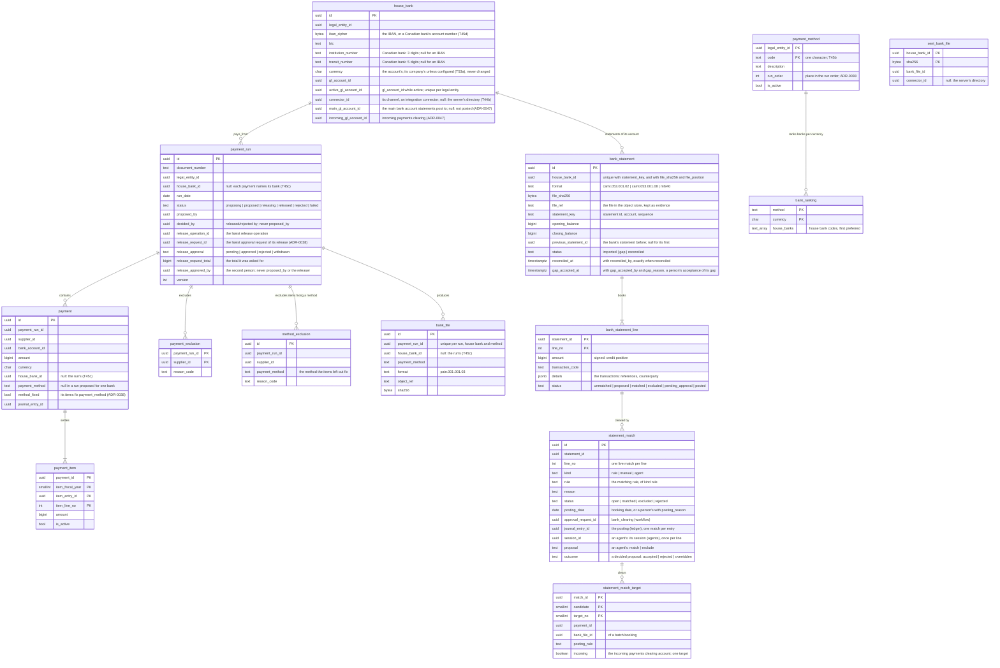

A company has a main house bank and further ones (ADR-0038), each on its
own ledger account, a bank clearing account no other house bank of the
company uses; a house bank the configuration no longer lists becomes
inactive, and its code never takes other bank details. A house bank may
name the bank connector its files are transmitted through
(`connector_id`, the integration context's, so no foreign key; T44b);
without one they go to the server's directory. Each file a house bank
accepted is recorded by its content hash (`payments.sent_bank_file`,
insert-only, unique per house bank and hash; T44c, 000100), in the
transaction that marks the file transmitted after the upload: a file whose
hash its bank already took counts as sent and is not uploaded again.
Transmission runs outside the request (T44e, 000102-000104): a file asked
for is `to_send` with its operation (`transmit_operation_id`), who asked
(`transmit_requested_by`), its `attempts` and when it is due
(`next_attempt_at`); the transmitter claims it as `sending`, its
`next_attempt_at` then when the claim lapses, and ends it `transmitted` or
`failed` (`last_error`, the problem code). A file to send or in flight
names its request and due time (`bank_file_transmission`); the partial
index `bank_file_due` holds the queue, and `erp_worker` reads only a
file's tenant, status and due time.
EBICS connectors (`integration.connector` of kind `bank_ebics`) are refused
in production until EBICS is certified with a bank (T44d): the control role
`erp_control` reads every tenant's connectors' kind and status, never their
settings or secret reference (000101), and a production cell refuses to
start while one is active; disabling it is the remedy.

Bank statements (ADR-0047, T49c, 000120) are imported per house bank from
the bank's camt.053 or MT940 file: `payments.bank_statement` once per
house bank and statement key (`bank_statement_key_once`) and once per file
hash and position (`bank_statement_file_once`), so the same file again is
the first import; its lines (`bank_statement_line`, signed minor units,
the transactions in `details`) and the lines' matches
(`statement_match`, T49e, 000123: one live match per line, made by a rule
(naming it), a person or an agent, `open` with candidates for a person or
`matched`, `excluded` only by a person, `rejected` when a person's decision
replaces it; its targets in `statement_match_target`, per candidate a
payment, with the bank file of a batch booking, or a posting rule). A
matched line is posted (T49f, 000126): its match records the posting date
(the booking date, or one a person gives with `posting_reason`), the
latest `bank_clearing` approval request (kept when rejected or withdrawn)
and the journal entry (`statement_match_journal_entry`: one match per
entry; `statement_match_posted`: a posted match stays `matched`); the
line becomes `pending_approval`, then `posted`, or `matched` again when
the request is rejected or withdrawn. The reconciliation agent proposes
(T49g, 000127) for a line the rules left unmatched or open a match of kind
`agent`, `open`, that names its agent session (`session_id`, agents
context) and what it proposes (`proposal`: `match`, with one candidate's
targets, or `exclude`); a session proposes once per line
(`statement_match_session`), an agent's match never posts
(`statement_match_agent_open`), and once a person decides it, it is
`rejected` with the `outcome` (`accepted`: the person's own match by it
follows; `rejected`: the line is unmatched again; `overridden`). The
posting debits the bank's
clearing account and clears each payment's line on it (an open-item
managed account, `ledger.company_account`), or posts a posting rule's
account, or (T49h, 000129) the incoming payments clearing account for an
incoming payment a person matched there (`statement_match_target.incoming`;
a target is one of a payment, a posting rule or it), against the main bank
account. A statement becomes `reconciled` (T49h; checks added `NOT VALID`
in 000129 and validated in 000130, the index in 000131) once every line of it and
of the bank's statements before it is posted or excluded and its closing
balance, less the lines excluded and those posted after its closing date,
is the ledger's balance of the main bank account on that date; it records
when and by whom (`bank_statement_reconciled`: both exactly when
reconciled) and is never set back. `statement_match_line` indexes a line's
matches, live and rejected, for the reconciliation report's latest
proposal outcome. The payments a person may match a line to by hand
(`listBankStatementPayments`, T73g2) are read through
`payment_posted_by_bank (tenant_id, house_bank_id, created_at, id) WHERE
journal_entry_id IS NOT NULL` (000187) for a payment naming its bank, and
through its run's payments for one leaving the bank to its run. A bank
file records its pain.001 message id (`bank_file.message_id`, 000123), which
a batch booking carries. A
statement whose opening balance is not the closing balance of the bank's
statement before it (`previous_statement_id`) is in `gap`; a statement
imported between two others becomes the next one's previous statement,
which is compared again (its gap closes, or one opens). A person may
accept a gap without the missing statement (000177, its check validated in
000178): the statement becomes `imported` and records when, by whom and
why (`bank_statement_gap_accepted`: all three or none, never on a
statement in `gap`, only on one with a previous statement); a gap found
again when its previous statement changes drops them. The file itself is
accounting evidence: it is kept in the object store under the tenant and
its hash (`file_ref`, `tenants/<id>/bank-statements/<sha256>`), written
once, encrypted by the store and locked for the retention of financial
records.
Statement files fetched from a house bank's SFTP channel (T49d, 000121,
000122) are recorded once per house bank and content
(`payments.statement_fetch`, `statement_fetch_file_once`): `imported`, then
`archived` once moved to the archive directory, `refused` with the
import's reason, or `changed_after_import` with the content the file holds
now when it was rewritten before its move (`statement_fetch_reason`: a
reason exactly for these two), so a fetch cut short never imports a file
twice and a refused or changed file is reported once.

A company's payment methods (`payments.payment_method`, SAP T042Z) rank,
per currency, the house banks that pay with them, first preferred
(`payments.bank_ranking.house_banks`, codes of the company's house banks;
SAP T042A, generated with the methods of T042E/T042Z: ADR-0038 As built). Each method has its place in the order a payment run tries the
company's methods in (`payment_method.run_order`, from the configuration's
`order`, else the order it lists them in; null, tried last by code, for a
method a replica of the release before 000251 wrote). A supplier's company
data lists the methods it may be
paid by (`partner.supplier_company.payment_methods`, SAP
LFB1-ZWELS; its order decides nothing): active methods of its company, which the configuration cannot
take away while a supplier, or a pending partner change, has them (T45b).

A run is proposed for one house bank, which pays every supplier, or without
one in a currency (T45c): then each supplier, its items and its down
payment requests, is paid through the first method of the company's run
order that the supplier may be paid by and whose ranking for the currency
names an active house bank, the first such bank (SAP's payment run takes
the order from its own parameters, not from LFB1-ZWELS: SAP specialist
2026-11-09, A4(c), ADR-0038 As built); a
supplier none can pay is excluded with `no_house_bank`. The payment names
the bank and method (`payment.house_bank_id`, `payment_method`; null in a
run proposed for one bank, whose bank pays), posts to that bank's account,
and the release writes one bank file per house bank and method.

A supplier invoice may fix the payment method its open item is paid by
(`payables.supplier_invoice.payment_method`, kept with the item at
posting; ADR-0038 As built, an item's fixed payment method; product owner
2026-11-10). A proposal splits a supplier's due items by the method they
fix: those that fix none are one payment by the run order, as before, and
each fixed method's items a payment of their own by that method
(`payment.method_fixed`), a credit memo netting within its own group
alone. One items payment per run and supplier for the items that fix none
(`payment_items_once_unfixed`) and one per fixed method
(`payment_items_once_per_method`) replace `payment_items_once`
(000254-000257). A fixed method need not be among the supplier's methods,
which restrict the run order alone (product owner 2026-11-10). A group
whose fixed method cannot pay it (not an active method of the company, no
ranked house bank, or a run proposed for one house bank, which pays by no
method) is left out with the reason, as is one a release drops, in
`payments.method_exclusion` (one row per run, supplier and method),
beside `payment_exclusion`, which keeps the supplier's items that fix
none; a payment counts as dropped when its own group has an exclusion.
At most one
active house bank of a legal entity is on a ledger account
(`house_bank_account_once`, a deferrable unique constraint on
`active_gl_account_id`, checked at commit so banks may swap accounts;
000093-000098).

A proposal pays each supplier its open items due by the run's due date,
netted in one payment: an invoice is due on the net due date of the terms
it was posted with (T36b), or, posted without them (before T36, manual,
migrated), its supplier's net days after its document date; every debit on the supplier account (a credit memo, whether
or not it names an invoice, a subsequent credit, a manual or migrated
debit) on its document date (T34d), so it nets with the next run that pays
the supplier. SAP has a credit memo without an invoice reference due at
once and gives one naming an invoice that invoice's due date; netting
earlier never pays more than is owed. A
supplier whose due items net to zero or a debit is excluded
(`debit_balance`) and paid nothing: a credit memo never pays out alone,
and stays open for a later run.

A run takes cash discount by the payment terms each item was posted with
(T36c): the tier its run date falls in (the first whose last day is on or
after it), and it also pays an item not yet due when paying it on the
due-by date instead would earn less discount, as SAP's payment run pays an
item whose discount lapses before the next run. The discount base is the
item's gross amount, tax included. A credit memo naming an invoice carries
that invoice's terms, so it takes the invoice's discount off its credit
(an invoice of 100 and its memo of 30 at 2% pay 68.60); a memo naming none
takes none. **Rounding:** each item's discount is its tier's percent of the
item, computed exactly and rounded half away from zero to the currency's
minor unit, item by item; one that would round to the whole item is a
minor unit less, so an item always pays something. `payment_item` keeps
each item's discount (`discount_amount`, of the item's sign and smaller
than it, migration 000069), `payment` their total (derived when the
proposal writes both), and a payment's amount
is what it pays after them: the bank file pays it, and a supplier whose
items net to nothing after their discounts is excluded (`debit_balance`).
At release the settlement credits the bank with what is paid and the
discounts to the legal entity's `cash_discount` account, both at the
posting date's rates, so the items clear at their original amounts and
what is left in local and group currency is the exchange difference
(`ledger.Settle`). A run withholds the taxes deducted at payment (T46f,
ADR-0037): each code's rate of its base less the discount's share of it
(the base times what the item pays after its discount over what it owes),
rounded once, half away from zero, item by item; `payment_item` keeps it
(`withholding_amount`, of the item's sign, and with the discount less than
the item, migration 000088), `payment` the total, and the payment's amount
is what is left; the settlement credits it to the codes' accounts, a line
per account and code. The release posts only what the run withheld (409
`ledger.withholding_changed` otherwise), and a withholding that would take
all the item owes fails the proposal (422 `payments.withholding_too_large`)
rather than the item's check. Down payments withhold nothing, and manual clearing
takes no withholding.
The discount is taken off the gross amount, so its tax
share corrects the input tax (T36d, SAP's tax adjustment, §17 UStG): each
item's discount is split by its entry's tax lines (a line with a tax code
on that code's account) in proportion to the gross the entry owes the
supplier, the tax share rounded half away from zero and divided among the
tax lines by largest remainder, so net and tax add up to the discount; the
net goes to `cash_discount`, each tax share to its tax line's account with
its tax code, so the VAT return sees it; the tax share is converted at
the payment date's rate, like the rest of the payment. An entry without
tax lines (a manual entry, or tax posted without a tax code), one whose
tax lines do not all run in its payment's direction (§13b and intra-EU
pairs, whose input and output tax corrections would net to zero), or
one whose tax is at least what it owes the supplier, puts all its
discount on `cash_discount`; the net line carries no tax code, so a VAT
report driven by bases does not see the base reduction (input tax, as
UStVA reports it, is corrected). A run that takes a
discount fails at proposal without a `cash_discount` account (422
`payments.no_cash_discount_account`). A payment records the last day its
discounts are earned (`discount_until`, migration 000070, shown on the
payment so the approver knows the release-by date), and the release
of a proposed run after it is refused (409 `payments.discount_lapsed`,
judged on the paying company's date in its `time_zone`, T72n3, which the
problem's detail names): the run is rejected and proposed again, at the discount then
earned; a release being resumed is not refused, since some of its
payments may have posted.

Down payment requests (T46c, ADR-0037). A `payment` has a `kind`: `items`,
the supplier's open items netted, at most one per supplier and run for its
items that fix no payment method and one per method its items fix
(`payment_items_once_unfixed`, `payment_items_once_per_method`; first
`payment_items_once`, one per supplier and run), or `down_payment`, one down payment request
(`down_payment_request_id`, `payment_request_once`), paid whole and never
netted with the supplier's items, as SAP pays special G/L items
separately. A proposal pays every open request of the legal entity due by
the due-by date in the run's currency that no live run pays (a run
proposing or proposed, or releasing with the payment not posted). A
supplier that cannot be paid (blocked, no bank account, a bank change) is
excluded with its requests; one whose items are a debit balance still has
its requests paid. A request whose input tax code is not valid on the run
date is left out with reason `tax_code_invalid`, and the supplier's items
are still paid. A request left out has an exclusion of its own, in
`payments.request_exclusion` (key run and request, its supplier, reason and
amount), beside `payment_exclusion`, which keeps one row per run and
supplier for the items that fix no payment method (the release's drop and
the dropped check use it for a payment of those, and
`payments.method_exclusion` for a payment of items fixing a method); the
listing returns all three. During the upgrade an application
version from before T46c must not release a run a newer one proposed with
request payments, which it would settle as items payments without items. A
proposed run whose
request's tax code ended since is refused at release (409
`payments.proposal_outdated`). Since the T61d follow-up (ADR-0049 §4) a
request whose stated tax differs from the tax its amount includes at the
run date's rate is left out with `tax_code_invalid` too, and refused at
release when the rate changed after the proposal; the exclusion names the
code and both rates (`request_exclusion.tax_code`, `request_tax_rate`, the
code's rate on the request's due date, and `run_tax_rate`, absent when the
code is not valid on the run date; migration 000182, a check that only
that reason names a code, rates only with a code, each 0 to below 100). The release posts a
request's payment through `ledger.Postings.PayDownPayment`: Dr the down
payment account as the supplier's special G/L item A, net of tax; Dr input
tax on the request's tax code; Cr bank, with the payment as its source
document, so posting it again returns its entry; in the same transaction
the payment records the entry and the request moves to `paid`, naming it
(`DownPaymentRequestPaid`).
A down payment's payment is never dropped by a release (it has no items to
fall out of being open), and its bank file remittance is the request's
number and reference. The payments context reads and records requests
through a port of its own (`payments.DownPayments`), adapted from
`payables.DownPaymentRequests` in `internal/app`; a request a live run pays
is not cancelled (409 `payables.request_in_payment_run`), which asks
through `payments.Reservations.RequestRunOf` under the proposals lock.

A partial unique index on active `payment_item (tenant_id, item_fiscal_year,
item_entry_id, item_line_no)` guarantees an open item is in at most one live run; rejecting a run
deactivates its items. The run also reserves its items in the ledger
(`ledger.item_reservation`, owner the run, §3.7) in the proposal's
transaction, and frees them there when it is rejected; posting a payment
ends the reservation of the items it settles. So the ledger reservations
are the items of live runs not paid yet, and a manual clearing or reversal
of one is refused while the run holds it. A reservation left behind (an
application version from before 000034 rejecting a run during the rollout)
only keeps its item out of proposals (`OpenItems.Payable` leaves reserved
items out), and refuses its manual clearing and reversal, until a
reconciliation releases the reservations no live run holds and adds those
missing. That reconciliation is the contract step (06 §6.4) 000042 (F5b,
T31), a migration of its own, run once no replica of a release from before
000034 runs (it ships in the release after 000034's only because there is
no production data yet). It locks the runs, payments and reservations
against writers while it runs, and fails rather than reconcile nothing
under row-level security: a reservation no live item matches is released in the name of
whoever last decided or changed its run, and a live item without one is
reserved for its run in the proposer's name, as 000034 did. A live item its
run already released cannot be reserved for that run again (a reservation is
released once and keyed by owner and item), so the migration stops and
counts them rather than leave one unreserved; such a run is rejected and
proposed again before the migration is retried.

Entry locks (clearing, reversal, settlement, reservation) are advisory
locks on 64 buckets per tenant (`'ledger.journal_entry:' || tenant || ':' ||
bucket`, the bucket from the entry id's random low bits; the tenant from
`platform.require_tenant()` (migration 000039), which fails a transaction
without one where a NULL key would take no lock), each set
taken once per transaction in bucket order and before any posting period or
number range (posting takes those). A revaluation run (T48c, ADR-0042)
takes all 64 exclusively before it reads, so the tenant's clearings and
reversals wait for it. GR/IR locks (T33b) are advisory locks
per purchase order (`'ledger.gr_ir:' || tenant || ':' || order`), taken in
one sorted call by every posting that moves a GR/IR position and by a
reversal of one, after its entry bucket. The lock order is entry buckets,
then GR/IR orders, then the `period_status` row of each period posted into
(`FOR SHARE`), then the internal orders the lines name
(`controlling.internal_order`, `FOR SHARE` through `ledger.CostObjects`;
a reversal holds the orders its lines carry over), then the lines' centers,
then the number range. An order's settlement (ADR-0064 As built, T60e)
takes its order `FOR UPDATE` before it posts, and its close takes it and
nothing after; a posting holds only its period statuses, `FOR SHARE`,
while it waits for an order, which the settlement's entry takes `FOR
SHARE` too, so the order stays acyclic.

Every posting (manual entries, the ports other contexts post through,
clearings, settlements, reversals and the migration load) reads its
period's status `FOR SHARE` (`postingPeriod`), in a query of its own since
the lock cannot take the nullable side of an outer join. A close or reopen
locks the row `FOR UPDATE` and takes no other lock until the audit chain
head at its commit (which no transaction holds while it waits), so a
posting waits for a close under way and then reads the committed status
(409 `ledger.period_not_open`), and a close waits for the postings under
way: no entry lands in a period whose close committed first. The order
stays acyclic: a close waits only for postings, and a posting waits for a
close that holds nothing else. The migration load holds the share locks of
every period it posts into until it commits, so a close of one of them
waits for the load (and fails after `lock_timeout` with 409
`request.in_progress`); the load holds no lock a close would take. A new
`FOR SHARE` does not queue behind a waiting `FOR UPDATE`, so under steady
overlapping postings in one period a close may keep failing with 409 and
be retried; closes come after posting stops, so this is accepted. The
trigger `ledger.check_entry_period` reads the status `FOR SHARE` too
(migration 000043, F8b), so an insert into `journal_entry` that did not go
through `postingPeriod` would still hold its period against a close. On the
one insert path there is, the lock is already held by `postingPeriod` in the
same transaction, so the trigger adds no step to the lock order. A
migrated clearing takes its period's row `FOR SHARE` in `clearingPeriod`
after the entry buckets `loadItems` takes, and the clearing trigger reads it
`FOR SHARE` again, so a close waits for a migrated clearing as it does for a
posting, in the same order.

A period close's sign-off (T64d, ADR-0058 §5, §7) is the one lock of
several periods: under its close's row lock (`closing.period_close`
`FOR UPDATE`, which no posting takes) it locks each covered ledger's
closed period through `LockPeriod`, one `FOR UPDATE` at a time, the
leading ledger's first, then by ledger code. A posting to several ledgers
takes their periods `FOR SHARE` in that same order: `postingPeriod`'s
ledgers come from a subquery ordered leading first, then by code, which
its `ORDER BY` keeps from being pulled up, so the lateral lock runs in that
order whatever the order of the ledgers' rows or ids (before T64d it ran in
the rows' order, and a posting and a sign-off on a company whose ledgers
were created out of code order deadlocked; `TestSignOffAndPostingLockInOneOrder`).
A single posting (one `postingPeriod` call) therefore waits for the first
period the sign-off holds while holding none the sign-off needs next, then
reads the committed `locked` status and is refused. A year close's
sign-off (T64m6, ADR-0060 §8) reads every period of the year of its covered
ledgers `FOR UPDATE` in one statement (`ClosePeriods.LockYear`: by period,
then the leading ledger first, then by code) under its close's row lock,
before its checks, and then locks each closed special period through
`LockPeriod` in that order (`TestYearSignOffAndPostingLockInOneOrder`). Every statement that
locks the `period_status` rows of several ledgers or periods takes them in
that one order, extended: by legal entity, fiscal year and period, then the
leading ledger first, then by ledger code, sorted in the statement (an
`ORDER BY` under the lock, or a lateral over an ordered subquery), never
in the order a scan finds the rows. A migrated clearing's
`clearingPeriods` locks its entry's and its copies' periods so (before,
it followed the scan of `journal_entry`, and a clearing whose entry's row
the heap stored behind its copies' deadlocked with a sign-off;
`TestMigratedClearingAndSignOffLockInOneOrder`), as does the controlling
switch's lock of a company's periods from the current year on (before, it
had no `ORDER BY` and deadlocked with a posting on a company whose
ledgers' rows sort out of code order;
`TestControllingSwitchAndPostingLockInOneOrder`); a filed tax return locks
the leading ledger's periods by legal entity, year and period through
`LockPeriod`. A transaction that takes period locks over several
statements (the migration load) is not covered by this. No write takes a
period lock before a close's lock, so close-then-period never crosses
either. A balance carry-forward (ADR-0060 §5, T64m2) first takes an
advisory lock per ledger run (`'ledger.carry_forward:' || tenant || ':' ||
company || ':' || ledger || ':' || year`), in one call in the ledgers'
order (leading first, then by code), so runs of the same company, ledger
and year wait for each other; then every period of the year and of every
earlier year of its ledgers `FOR SHARE`, in one statement in the one
order above. A posting into one of them needs it open, which waits for
the run (`OpenPeriod`'s `FOR UPDATE`); the run takes no entry bucket and
no number range, so it adds no cycle.

A transaction that would otherwise lock in several
steps or after posting, the migration load (it posts every document, then
clears one SAP clearing at a time), takes all 64 buckets shared first
(`Postings.LockAllEntries`), so its later locks are ones it holds and it
cannot deadlock with a reservation or reversal; those wait for the load. A
proposal or release check over 100,000 items holds at most 64 locks, within
`max_locks_per_transaction`'s default, and never holds another tenant's
entries up.

Within a tenant the buckets are coarse, which is an accepted trade-off: a
reversal may wait for a clearing of another entry in its bucket, and a large
proposal holds nearly all of the tenant's buckets exclusively from its
`Reserve` to its commit. That is the end of the build (the items are
reserved after they are chosen and inserted, and the run is moved to
proposed and recorded in the same transaction), so the window is short; but
a clearing, settlement or reversal of any legal entity of the tenant that
waits in it longer than `lock_timeout` (5 s) fails with 409
`request.in_progress` and is retried. A migration load holds the buckets
shared for its whole transaction, so reservations and reversals of the
tenant wait for it the same way.

Proposals of a legal entity serialise on the advisory lock
`payments.propose.<legal entity id>` (`hashtextextended`, transaction
scoped). An invoice reversal takes the same lock before it asks whether the
invoice is in a live run (`Reservations.RunOf`): a reversal waits for a
proposal under way and then finds the invoice in it (409
`payables.invoice_in_payment_run`), and a proposal that starts while a
reversal is under way waits for it and no longer finds the item open. Bank files are stored in object storage, referenced by
key and content hash.

The release (ADR-0012) moves the run to `releasing` under a release
operation, `release_operation_id`, and posts one payment per transaction;
the run is `released` when its bank file is written. Its rules, each held by
the database or by a row lock:

- **One bank file per run, house bank and method.** A unique index on
  `bank_file (tenant_id, payment_run_id, house_bank_id, payment_method)
  NULLS NOT DISTINCT` (000095, built concurrently; it replaced 000033's per
  run) refuses a second file, so a release step run again or two
  overlapping releases cannot pay the suppliers twice. In object storage the
  file is kept under its key (`tenants/<tenant>/bank-files/<run id>.xml`,
  with `-<bank>-<method>` for a run proposed without a bank; write-once), so a
  FinishRelease retried after the store took the file but its transaction
  was lost writes no second object: it finds the key taken, checks that the
  stored file is the run's file as rendered at the creation time it carries,
  and records that file and time (anything else under the key is 409
  `payments.bank_file_changed`). The store not answering is the machinery's
  failure (503), retried by the release. The release steps of a run also serialise on it:
  each reads the run `FOR UPDATE`.
- **The current operation only.** A release step acts only when the run's
  `release_operation_id` is the operation it was started for; a step of a
  cancelled or failed release that a later `:release` took over does
  nothing.
- **A cancelled release stays cancelled.** Cancelling the operation does not
  undo or stop postings already made: posted payments stand, the operation
  stays `cancelled` (it is never finished or reported on again), no bank
  file is written, and the run stays `releasing` until `:release` resumes it
  under a new operation. A run whose release fails with nothing posted goes
  back to `proposed`.
- **Items stay reserved while releasing.** An item of a `releasing` run whose
  payment is not posted yet counts as in a live run, as in a proposal, so
  its invoice cannot be reversed (409 `payables.invoice_in_payment_run`)
  and a resumed release never pays a reversed invoice. Once the payment is
  posted the item is cleared, and the payment is reversed first.
- **A payment that can never post is dropped, not retried.** Before posting
  a payment the release asks the ledger whether its items can still be
  settled (`OpenItems.Unpayable`). One reversed, or no longer open, since the
  proposal (both lasting; possible only for runs proposed before the ledger
  reservations, or by a direct change) makes the payment unpostable: the
  release excludes its supplier with `item_reversed` or `item_not_open`
  (exclusion reasons widened by migrations 000035/000036), deactivates its
  items and ends their ledger reservation, takes its amount out of the run's
  total, audits `payments.payment_run.drop_payment` and publishes
  `payment_excluded`, and goes on; the bank file and `payment_count` cover
  the payments left. A dropped payment is one whose supplier has an
  exclusion in the run, and every later release step skips it. A release
  that drops every payment fails with `payments.nothing_to_pay`, which
  returns the run (nothing posted) to `proposed`, to be rejected. Without
  this a releasing run with a posted payment and one that can never post
  stayed releasing for good: `:reject` needs `proposed`, and every resumed
  release failed again. `:release` of a proposed run re-checks the items as
  well as the suppliers (409 `payments.proposal_outdated`).

## 3.11 Workflow (`workflow`)

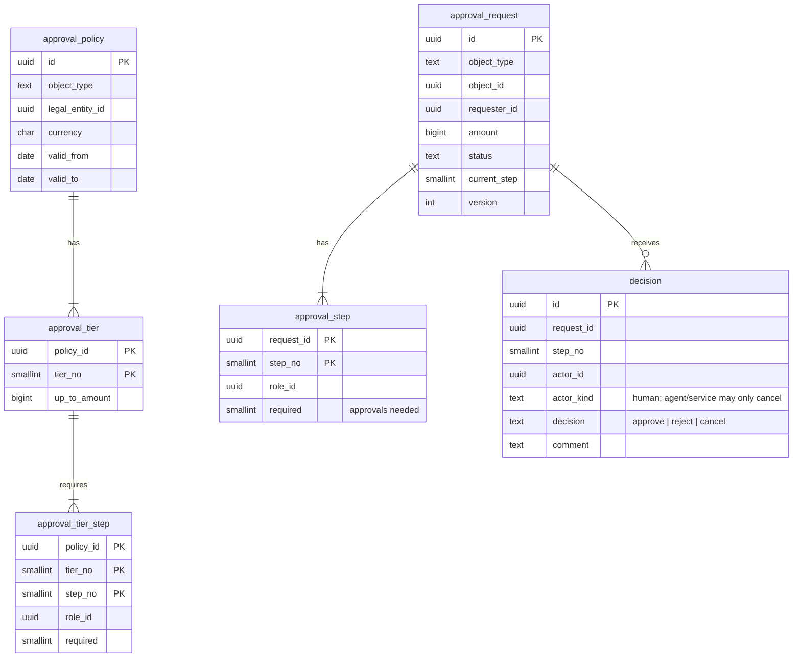

Database rules: one approval per actor per request (partial unique index);
the requester cannot decide (check against `approval_request.requester_id` in
the decision trigger); decisions are insert-only. The inbox
(`decidable_by=me`, ADR-0052 G1) reads the pending requests newest first
through the partial index `approval_request_pending (tenant_id,
created_at, id) WHERE status = 'pending'` (000151); a principal's own
requests (`requested_by=me`, T73d2) through `approval_request_by_requester
(tenant_id, requester_id, created_at, id)` (000183).

A `manual_entry` request (T35) is opened for a parked manual journal entry
whose debits, converted exactly into its company's currency at the average
rate of its posting date, exceed the company's `manual_entry_approval_limit`;
within the limit the policy has no steps and the entry posts at once
(`Approvals.Required` answers the same question without opening a request,
for direct posts). A company without a limit has a limit of 0. Above it,
one approval by the role `controller` with `ledger.entry.approve`, whatever
the configuration says, as for period unlocks.

A change of a cost or profit center (object type `center_change`, T56a,
ADR-0050 §11) needs one approval by the role `controller` with
`ledger.cost_center.approve`, whatever the configuration says; the ledger
applies, rejects or cancels the change in the deciding transaction.

The release of a purchase order without an approved requisition (object
type `purchase_order`) and a change that raises a released order's total
(`order_change`) are routed by the order's total, converted exactly into
its company's currency, through `purchasing.order_release_approval` tiers,
as requisitions are through theirs (T47c), decided by holders of the
tier's roles with `procurement.order.approve`. A document without those
tiers routes nothing and refuses the order (422 `workflow.no_policy`). The key
is required from T47c on: a tenant whose active document predates it has
its next change request refused (422 `config.validation_failed`, field
`proposed.purchasing.order_release_approval`) until the proposal adds the
tiers, an operational-tier change; change requests approved before still
activate, and orders under them are refused.

## 3.12 Audit (`audit`)

| Table | Key | Notes |
|---|---|---|
| `audit_event` | `(tenant_id, occurred_at, seq)` | Insert-only, monthly partitions, `prev_hash`/`hash` chain per tenant; `client_address` (inet, 000151) where the request came from, outside the chain, which the tenant's erasure alone may blank (`audit.event_immutable`, ADR-0011 amended) |
| `chain_head` | `tenant_id` | Last sequence and hash per tenant |
| `anchor` | `(tenant_id, seq)` | Chain heads written to write-once storage |
| `verification` | `(tenant_id, verified_at)` | Insert-only; one row per scheduled verification round: head, events and anchors checked, the first broken sequence (ADR-0025) |

## 3.13 Integration (`integration`)

| Table | Purpose |
|---|---|
| `external_ref` | Maps any entity to its key in an external system (SAP object and key); unique per system/object/key; names the migration run that loaded it (`migration_run_id`, NULL for references recorded before 000168) |
| `connector` | Configured connections (SAP OData, bank SFTP, EDI VAN, email, a treasury system's SFTP directory, `treasury_export` since 000209); secrets by reference to the vault |
| `message` | Inbound and outbound messages with status, attempts, payload reference |
| `output_message` | Business output (purchase orders to suppliers) per channel, written when it is transmitted (post-pilot); not written yet. The printed form, `GET /v1/purchase-orders/{id}/document`, is rendered on read and not stored (ADR-0054) |
| `migration_run` | Migration scope, mode, status, reconciliation report |
| `webhook_subscription` | A tenant's webhook endpoint (https), its event types or `<context>.*`, status (`active`, `paused`, `disabled` with a reason, `deleted`), its sealed `whsec_` secret and, during a rotation, the previous one with its expiry (ADR-0041) |
| `webhook_delivery` | One delivery of an event to a subscription, unique per (subscription, event): body, the event's `occurred_at` (the order a resource's deliveries are sent in), status (`pending` while an attempt is due, `delivered`, `dead`, `dropped` when its subscription was disabled), attempts, last HTTP status and error; kept 30 days. A paused subscription's stay pending until it resumes; the dispatcher leases one it sends by moving `next_attempt_at` (ADR-0041, T50f). Redelivery and replay reset deliveries to `pending` with no attempts; a ping is a delivery of type `webhook.ping` about its subscription, attempted once (T50g) |

## 3.14 Agents (`agents`)

| Table | Purpose |
|---|---|
| `session` | One agent run: agent principal, purpose, model, tokens, cost (the sum of its model calls', exact in `cost_micro`), linked operation |
| `tool_call` | Every tool call with input, result summary, error flag (insert-only) |
| `recommendation` | What the agent proposed, on which object, and what people decided |
| `model_call` | One row per call through the model gateway (ADR-0036): principal, session, alias, the model that answered, tokens, cost in millionths of the minor unit, outcome, duration, the number of redactions made in its text (000074); never content (insert-only, 000071; indexed by principal and by time, 000075) |
| `spend` | A model budget line's month: the tenant's (`principal_id` NULL; its cap is the AI policy's) or an agent's (`agent_profile.monthly_budget`); what it has spent in millionths of the minor unit, in USD, and the highest threshold announced, 80 or 100 (000072) |
| `ai_policy` | A tenant's AI policy, one row created on its first change (absent: the defaults): the kill switch's two hands, `enabled` (the tenant's administrators) and `suspended` with its reason (operators, which wins), the monthly cap in USD, alias routes over the platform's, the models allowed (empty: any priced model) and `documents_to_models` (000073) |
| `model_reservation` | The most a call in flight may cost, held against each of its lines from before it is forwarded until it is settled; it lapses at its expiry, the call's time and its margin later, so a call that never settles frees its line (000072) |

`ref.model_price` (000071) holds each model's prices per million tokens
(input, output, cache write, cache read) in millionths of the minor unit,
versioned by `effective_from`; a call is priced at the version in force
when it was made. It starts empty: an operator records published prices
(`erp-server prices load`); a recorded price stands, and the rows with who
recorded them are the prices' trail. Prices are in USD alone, so costs add
up; the gateway refuses a model without a price.

`ref.agent_certification` (000090, ADR-0039) holds, per agent type and
concrete model, the autonomy level an evaluation run certified (1 or 2),
with the suite's version, the report's SHA-256 and the operator who loaded
it (`erp-server certify load`); a loaded row stands, and the latest load
for a type and model is its certification. Keyed by the concrete model, a
certification lapses when an alias routes elsewhere. An agent's profile
names its `agent_type`; identity refuses a level above what the type is
certified for on the model its alias routes to, and the AI policy refuses
moving an alias onto a model on which an agent on it is not certified.
Agents with no type, from before certification, keep their level but are
raised by none.

A call is held against its budget lines before it is forwarded: each
line, read `FOR UPDATE` (ADR-0008), must fit what it has spent, what its
unexpired, unsettled reservations hold and what the call may cost (all
of `max_tokens` in output and its input estimated from its size), or the
call is refused (429, audited). Lines are locked tenant first, then
agent. Settling the call marks its reservations settled and adds its
actual cost, which may pass the estimate; the application deletes no
line or reservation. An agent's budget is identity's
(`identity.AgentBudget`); agents reads no identity table.

## 3.15 Platform (`platform`) and per-context outbox

| Table | Purpose |
|---|---|
| `platform.idempotency_key` | Key, request hash, stored response; kept 7 days (ADR-0008), expired by a batched cleanup job on `expires_at` (partition by day if delete volume ever hurts; the key does not change) |
| `platform.operation` | Long-running operations (ADR-0012): kind, status, `progress_done` / `progress_total` (null while unknown), `resource` path, result or error. Only a `queued` or `running` operation finishes or takes progress; a succeeded, failed or cancelled one is final |
| `<context>.outbox` | Domain events awaiting publication, one table per context schema |
| `<context>.inbox` | Event ids already processed by that context's consumers |

## 3.16 Later contexts

`sales`, `receivables`, `revenue` (§3.30), `inventory`, `manufacturing`, `maintenance`,
`projects`, `hr`, `controlling` (plan values from T56g, §3.19), `assets` (the asset master from T57b, §3.21) follow the same patterns:

- documents as header + items with `document_number` from number ranges;
- financial effects only through `ledger` postings (`source_context`,
  `source_document_id` on the journal entry);
- partners via `partner` roles (`customer` joins `supplier`);
- a shared `material` master in a future `product` context, referenced by id
  from procurement, inventory, sales and manufacturing;
- controlling dimensions (cost center, profit center, internal order, WBS
  element) added to `journal_line` as nullable `uuid` columns, so ledger and
  controlling stay one table, as in SAP's Universal Journal.

## 3.17 Mapping from SAP

| SAP | This model |
|---|---|
| T001 company code | `tenancy.legal_entity` |
| SKA1/SKB1 | `ledger.gl_account`, `ledger.company_account` |
| ACDOCA | `ledger.journal_entry` + `ledger.journal_line` (TC/LC/GC amounts); migrated lines post HSL in company code currency, so an open item (vendor item, down payment, GR/IR position line) whose RWCUR is not the company's currency, or is absent, stops the load until foreign-currency open items are migrated (WSL is carried, not yet read) |
| BSEG clearing (AUGBL) | `ledger.clearing` + `ledger.clearing_item` |
| ACDOCA lines on the GR/IR account (T030 WRX) with EBELN/EBELP | the order valued `gr_ir`; per open order item, SAP's balance and open quantity (posted RSEG invoiced less MSEG 101 received) taken over onto `ledger.gr_ir_position` (`migrated`) by an integration entry of `GRIRItem.TakesOver` items (T72f) |
| LFA1/LFB1/LFBK, BUT000 | `partner.business_partner`, `supplier_company`, `bank_account`, `tax_identifier`; a Canadian LFBK (BANKS CA) as scheme `ca`, its institution and transit from BANKL as 0 + institution + transit (T72d); the vendor's central address (ADRC by LFA1-ADRNR, the international row valid on the run's day; STREET with HOUSE_NUM1 and HOUSE_NUM2, STR_SUPPL1-3 and LOCATION, CITY1, POST_CODE1, REGION, COUNTRY; po:2026-11-09) as its `legal` `partner.address` when street and city are both given (ADR-0054 As built) |
| FLQLITEM/FLQLITEMT liquidity items, T035 planning groups, LFB1-FDGRV | `cash.liquidity_item`, `cash.planning_group`, `supplier_company.planning_group` (T53b) |
| EBAN | `procurement.requisition` |
| EKKO/EKPO | `procurement.purchase_order` + items |
| EKET-EINDT (schedule line delivery date) | `purchase_order_item.delivery_date` (T53g); a migration run loads none yet |
| Outline agreements (EKKO BSTYP K) | `procurement.contract` |
| MKPF/MSEG, MATDOC | `procurement.goods_movement` + items |
| MSEG BWART 122/123, reason (MSEG-GRUND, T157D) | `goods_movement.movement_type` 122/123, `goods_movement.reason` (T47b) |
| GR valuation at the PO price (EKBE, EKPO-NETPR at release) | `purchase_order_item.valuation_price`, `valuation_price_unit` (T47a) |
| Purchase order release strategy (T16FS/T16FC, EKKO-FRGKE/FRGZU) | `purchasing.order_release_approval` tiers, `purchase_order.status` `pending_approval`, `workflow.approval_request` (`purchase_order`) (T47c/d) |
| PO change documents and versions (CDHDR/CDPOS EINKBELEG, EREV, EKKO-REVNO) | `procurement.purchase_order_change` (`proposed`, `previous`, `revision`), `purchase_order.revision`; increases approved as `order_change` (T47e/f) |
| Outline agreement validity end and follow-on contract (EKKO-KDATE, reference agreement) | `contract.valid_to`, `contract.renewal_of_id`, `expiry_alerted_on` and `ContractExpiring` (T47g) |
| RBKP/RSEG | `payables.supplier_invoice` + items; parked documents (RBSTAT A) by kind (T72b): RBKP-XRECH "X" an invoice, blank a credit memo; all items RSEG-TBTKZ "X" a subsequent debit (XRECH "X") or credit (blank), their items of quantity 0. An absent or unknown indicator stops the load; a document mixing subsequent and ordinary items is not migrated (warning). Posted documents (RBSTAT 5): the quantities of their ordinary items, by XRECH, as `payables.migrated_invoice_item` for matching (T72b2); one whose XRECH, an item's TBTKZ or an ordinary item's quantity cannot be read stops the load |
| REGUH/REGUP (F110) | `payments.payment_run`, `payment`, `payment_item` |
| T012K | `payments.house_bank`; a Canadian one, without an IBAN, by `institution_number`, `transit_number` (from the bank key, as for LFBK) and `account_number` (BANKN) (T72d); `currency` from WAERS, empty for the company's, refused when missing (ADR-0038 As built, T53a review) |
| T042Z/T042E (payment methods per country and company code), T042A (bank selection) | configuration `companies[].payment_methods` and their `ranking`, `payments.payment_method`, `bank_ranking`; T042E amount limits and T042I bank subaccounts noted for the reviewers (ADR-0038 As built) |
| LFB1-ZWELS | `supplier_company.payment_methods`, the methods allowed (its letter order is not a preference: A4(c)); a method the company does not have stops the load (ADR-0038 As built) |
| T052 | `partner.payment_term` |
| T007A, KONP/A003 (tax rates per condition), T030K (account keys MWS, VST, NVV, ESA/ESE) | `ledger.tax_code_definition`, `tax_component`, `tax_rate` (T61a) |
| T030 | `ledger.account_determination` (VST, BNK, WRX, PRD, SKE) |
| AGR_* | `identity.role`, `role_permission`, `principal_role` |
| NRIV | `config.number_range` |
| Group Reporting FS items, consolidation groups and units (from memory, for an SAP specialist) (planned, ADR-0059) | configuration `consolidation.accounts`, `consolidation.groups`, `companies[].chart_of_accounts[].group_account` (not built) |
| Trading partner (LFA1-VBUND, ACDOCA-RASSC, the SAP specialist's A2, po:2026-11-09; the company ID's company code from T001-RCOMP, from memory, for the specialist) (ADR-0059 As built) | `partner.business_partner.group_company_id` of the migrated supplier (T68c), from which the ledger derives `ledger.journal_line.trading_partner_id` (T68b); RASSC is read for the quality gate only |
| ACDOCU consolidation journal (from memory, for an SAP specialist) (planned, ADR-0059) | `consolidation.run_entry` + `run_entry_line` (not built) |

## 3.18 Cash management (`cash`)

A leaf context (ADR-0051 §2): it reads the ledger, payments, payables and
procurement through ports they publish and owns only what it adds; no
context imports it (`internal/layout`). Migration 000141 (T53b) creates the
schema with the configuration it keeps; memo records follow in T53d
(000152), snapshots of the forecast in T53f (000198), variance comments in
T53f4 (000201), exports of snapshots to treasury systems in T53h (000209).

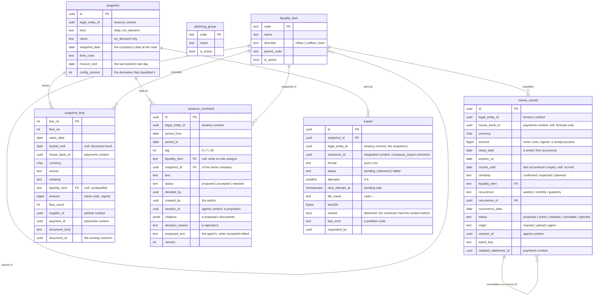

| Table | Purpose |
|---|---|
| `cash.liquidity_item` | The configuration's `cash.liquidity_items` (SAP FLQLITEM), kept by `cash.Setup`: cash by purpose in one tree, a code of upper-case letters, digits and underscores, a direction, a parent of the tenant (never itself). One the document drops becomes inactive, never deleted, since memo records, snapshots and variance comments name items; the configuration's validation keeps the tree acyclic, at most four levels, children of their parent's direction or of one for both |
| `cash.planning_group` | The configuration's `cash.planning_groups` (SAP T035), kept by `cash.Setup`, inactive once dropped; suppliers name one per company (`partner.supplier_company.planning_group`, §3.6) |
| `cash.memo_record` | An expected receipt or payment (SAP's memo records, ADR-0051 §7; T53d): a signed, non-zero amount in minor units of its currency, a value date and an expiry date on or after it, a certainty, an active liquidity item of the amount's direction (`cash.check_memo_item`, when the item or amount is written; `cash.Setup` refuses taking away an item an open record names), a house bank or none (forecast only), optionally a series (`weekly`, `monthly` on the value date's day, `quarterly`; until a day or a count of 2-520, or neither) expanded at read time, `counts_until` the last occurrence's expiry (a one-off record's `expires_on`, null for a series without end; an active record past it is shown `expired`). An override (`recurrence_of`, `occurrence_date`) replaces one occurrence of a series, once per occurrence (`memo_record_override_once`). `origin` `agent` records carry their session and reason and are the only ones `proposed` or `rejected`; `upload` ones carry their batch key and a reference unique per company and key (`memo_record_batch_reference`). Realised by a statement line or by a person; a series only through an override of an occurrence. Changes are versions; never deleted |
| `cash.snapshot` | A snapshot of a company's liquidity forecast (ADR-0051 §6, T53f, 000198): `daily` (the TakeCashSnapshot workflow's, one per company and date, `snapshot_daily`) or `on_demand` (a person's, named, `snapshot_name`), its date and zone, the last day of its buckets and the configuration version that classified it. Insert-only (no version, no update or delete granted); deleted with its lines 25 months after its date by the workflow through `cash.delete_expired_snapshots`, which computes the 25 months and refuses a day after UTC's tomorrow, unless a variance comment refers to it (000201) |
| `cash.snapshot_flow` | A snapshot's lines in transaction currency: within 31 days of its date, what one forecast flow (`flow_no`) pays of one document under one liquidity item, with its day at the bank, house bank, source, certainty, lateness, supplier and payment (`flow_count` 1, `snapshot_flow_count`); beyond, a bucket's sum (`bucket_end`) per currency, source, certainty, item and house bank, naming no document, supplier or payment and never late (`snapshot_flow_bucket`). A document is named whole (`snapshot_flow_document`); an item is the tenant's (null: unclassified). Insert-only |
| `cash.variance_comment` | A comment on one row of a company's forecast variance (ADR-0051 §11, T53f4, 000201): its period (`variance_comment_period`), lag (0, 7 or 30), liquidity item (the tenant's, active or not; null: what no rule assigns) and the snapshot that variance compares with, of the same company (`variance_comment_snapshot`, which keeps the snapshot past its retention); a text of 1 to 2,000 characters, not blank; `proposed` (an agent's, T53i), `accepted` or `rejected`, decided exactly when not proposed (`variance_comment_decided`; a person's is accepted as written, decided by its author). The forecast agent's proposal (T53i, 000218) names its session and cites 1 to 50 documents its variance's attribution lists (checked by the application; `variance_comment_session`, `variance_comment_citations`); a person decides it once, from `proposed`, by another than its author, raising its `version` (`cash.check_variance_comment_decision`), with a reason exactly when rejected (`variance_comment_rejected`), its text changed only by an accepted edit that keeps the agent's as `proposed_text` (`variance_comment_edited`); the application may update only the status, who decided, when, why, the text, the proposed text and the version. Never deleted |
| `cash.export` | An export of a snapshot to a treasury system (ADR-0051 §14, T53h, 000209) through a `treasury_export` connector, in the cash export schema v1 (`api/schemas/cash-export.v1.json`) and the connector's format: queued with the snapshot for every active such connector naming its company, or by a person; `pending` until the exporter (`cash.Exporter`) delivers it, waiting `next_attempt_at` between attempts (at most six, `export_pending`), then `delivered` (`delivered_at` and `resend` set, `export_delivered`) or `failed` with the last attempt's problem code. Its file is named by company, snapshot date and content hash (`export_file`, which ties the name to the hash's form and the format), so the same snapshot exported again is the same file, `resend` when its connector was delivered that hash before. Of the snapshot's company (`export_snapshot`), deleted with it by retention (ON DELETE CASCADE); never deleted otherwise. `erp_worker` reads `tenant_id`, `status` and `next_attempt_at` to find the tenants with exports due |
| `cash.outbox`, `cash.inbox` | The context's events (`MemoRecordChanged`, `CashSnapshotTaken`, offered to webhooks since T53h, `VarianceCommentDecided`, `CashExportDelivered`), relayed as every context's (000152, `outbox.Contexts`) |

What is not stored, and read from the active document when a position or
forecast is computed: the derivation rules (`cash.derivation`: account
ranges first, compared as SAP's ALPHA conversion keeps numbers and split in
proportion over a document's offsetting lines, then planning groups, then
posting rules by transaction code, then a default per direction;
`cash.Derive`) and each company's `cash` settings (`take_discounts`,
`payment_days`, `value_days` per house bank and method, `buckets`,
`rate_type` default `planning`, `rate_max_age_days`, `order_lead_days`,
`credit_lines` in the bank's currency, `snapshot_time`). All of them post
nothing: names and the hierarchy are tier 1, the rest tier 2.

The daily cash position (T53c, `GET /v1/cash-position`) stores nothing
either: it is computed at the read, in one repeatable-read snapshot, from
the payments context's house banks, statements (the latest closing before
the first day, `gap` up to it, the reconciliation figures on its date) and
payments (posted ones whose line on the bank's clearing account is still
open, and unposted ones of runs `proposed` or `releasing`), and from the
ledger's open lines on the clearing accounts (`ledger.Accounts.OpenLines`,
leading ledger, neither cleared nor reversed; only lines an entry posted
for a payment count, never a revaluation's) and rates of a type
(`ledger.Rates.OfType`). Migration 000149 seeds its permission,
`cash.position.read`. Its one stored source is the context's own: the
active memo records on the banks not expired at the read (T53d), each
occurrence on its value date moved to the next working day. Migration
000152 seeds `cash.memo.read`, `cash.memo.write` and `cash.memo.propose`.

The liquidity forecast (T53e, `GET /v1/liquidity-forecast`) stores nothing
either: it is computed at the read from the ledger's open supplier items in
every currency (`ledger.OpenItems.Owed`: leading ledger, not special G/L,
neither cleared, reversed nor held by an item reservation) with the terms
and withholding kept beside them (`open_item_terms`,
`open_item_withholding`), less the items a live run's active payment items
hold (`payments.payment_item`), whose run's payment counts instead, and the
suppliers' blocks, net days and payment methods (`partner.Payees`). Due
dates and discount tiers are computed by `ledger.ItemTerms`, as the payment
proposer computes them; nothing is indexed for them yet (the budget at
100,000 open items is T53e4's). Migration 000189 seeds its permission,
`cash.forecast.read`.

T53e2 adds what is not posted yet, still stored nowhere new: the invoices
`parked` or `on_hold` (`payables.supplier_invoice`), each as the open item
its posting would give, with the terms posting would keep in
`supplier_invoice_terms` (the order's term, else the supplier's, from the
invoice date) and the supplier's withholding tax codes (read from
`partner.supplier_withholding`, each resolved against the legal entity's
withholding tax codes the ledger keeps); the `open` down payment requests
(`payables.down_payment_request`) less those a live run's
`down_payment` payment pays (`payments.payment.down_payment_request_id`);
and the items of suppliers no run pays (`partner.supplier_company`'s
blocks, or not set up in the company) shown apart. No migration.

T53e3 classifies the forecast's flows by liquidity item, still storing
nothing: a posted item's offsetting lines are its entry's lines in the
leading ledger (`ledger.journal_line`) but those on supplier or customer
reconciliation accounts and on a withholding tax withheld at invoice
(`open_item_withholding`, `posting = 'invoice'`), a tax line known by the
entry's tax items (`ledger.tax_item.account_key`, self-assessed pairs left
out); an unposted invoice's are its items
(`payables.supplier_invoice_item`); a run's payment's are its active
`payments.payment_item`s' items' lines; the supplier's planning group is
`partner.supplier_company.planning_group`. The derivation rules are read
from the active document (`cash.derivation`). No migration.

T53e4 adds the opening, the payments in transit and the memo records,
still storing nothing: each currency opens at its active house banks'
latest `payments.bank_statement.closing_balance` before the read date,
as the cash position opens; the payments in transit are the position's
(open lines of `payments.payment`'s postings on the bank's clearing
account, `ledger.journal_line`, not matched by a statement line up to the
opening statement); the memo records are every `active`
`cash.memo_record` of the legal entity, with a house bank or none. The
drill-down (`GET /v1/liquidity-forecast-flows`) names the documents a flow
pays by their ids and numbers in their own schemas: a posted item's
`ledger.journal_entry` (`document_number`, read with the open item), a
parked or held `payables.supplier_invoice`, a
`payables.down_payment_request`, the `payments.payment_run`
(`document_number`, read with the payment) and the `cash.memo_record`
(`reference`); suppliers by `partner.business_partner` number and name.
Conversion reads `ledger.exchange_rate` through the rate service. No
migration.

T53e5 sums the forecast across companies, still storing nothing
(`GET /v1/group-liquidity-forecast`): the companies are the
`tenancy.legal_entity` rows the caller may act in
(`identity.company_access`, or `identity.principal.all_companies`), each
read as its own forecast reads it, and the group currency is
`tenancy.tenant.group_currency`. No migration.

T53f stores the forecast as it was (000198, `cash.snapshot`,
`cash.snapshot_flow` above): read in a read-only repeatable-read
transaction (the workflow activity's first, a request's on a pool of its
own, `uow.Consistent`) and written in a read-committed one. The dispatcher finds the tenants that manage cash
as the worker role, from their active `cash.liquidity_item` rows (000198
grants `erp_worker` those two columns), and asks each, in its own scope,
which companies are due. Migration 000198 seeds `cash.snapshot.take`;
reading a snapshot is `cash.forecast.read`.

T53f2 reads the actuals, storing nothing: the legal entity's
`payments.bank_statement_line`s by `value_date`, their statements' house
bank and currency (`payments.bank_statement`), and each line's live
`payments.statement_match` that is `matched` or `excluded` with its
`statement_match_target`s (payments, a posting rule's transaction code,
or the incoming payments clearing account), through the payments
context's port; a matched payment's settled items as T53e3 reads a run's
payment's. No migration; reading the actuals is `cash.forecast.read`.

T53f3 compares a snapshot with the actuals, storing nothing: the
`cash.snapshot` of the legal entity and date (`daily` first, else the
last `on_demand`) and its `cash.snapshot_flow`s but `payable_blocked`;
the actuals' lines as T53f2 reads them, each matched payment's settled
items with their `ledger.journal_entry` and that entry's
`source_document_id` when `payables` posted it (the supplier invoice), a
down payment payment's `payments.payment.down_payment_request_id`; and
the `cash.memo_record`s the snapshot names (whether each is a series) or
a line realised (`realised_statement_id`, `realised_line_no`, an
override's `recurrence_of` and `occurrence_date`). No migration; reading
the variance is `cash.forecast.read`.

T53g adds the released purchase orders' open values, storing nothing:
each released `procurement.purchase_order`'s live items (through
procurement's published orders port) less what the order's
`payables.supplier_invoice_item`s of posted, parked and held documents
invoice (credit memos negative) and `payables.migrated_invoice_item`s,
at the item's price, with the tax its `tax_code` gives on the read date
(`ledger.tax_code_definition`, `tax_rate`), expected on the item's
`delivery_date`, else `order_date` plus `cash.order_lead_days`, by the
order's `payment_term_code` (`partner.payment_term`). A snapshot's line
names an order as `document_kind` `purchase_order` (000205 widens
`snapshot_flow_document_kind_check` `NOT VALID`, 000206 validates it); the
variance knows a payment of an invoice entered on an order
(`payables.supplier_invoice.purchase_order_id`) as that order.

T53j1 copies the actuals into the analytical store (ADR-0044 As built
T53j1), storing nothing in PostgreSQL: dataset `cash_actuals`, one row
per statement line and liquidity item, as T53f2 reads and classifies
them, for the legal entities that have a `payments.bank_statement`. No
migration; querying them is `analytics.query.run` and
`cash.forecast.read`.

T53j2 copies the forecast into the analytical store (ADR-0044 As built
T53j2), storing nothing in PostgreSQL either: dataset `cash_snapshots`,
one row per `cash.snapshot_flow` line at document level (`bucket_end`
null) of each legal entity's snapshot of each date the variance would
compare against, with `lag_days` (`value_date` less the snapshot's
`snapshot_date`). No migration; querying it is `analytics.query.run` and
`cash.forecast.read`.

T53j3 compares the two in the analytical store (ADR-0044 As built T53j3),
storing nothing in PostgreSQL: dataset `cash_accuracy`, three rows
(`figure` `variance`, `absolute_variance`, `absolute_forecast`) per cell of
a legal entity's value date compared at a lag of 0, 7 or 30 days (on or
before the company's date, with the snapshot of the date the lag before
taken, whose `horizon_end` reaches it), currency and liquidity item. No
migration; querying it is `analytics.query.run` and `cash.forecast.read`.

T53f4 stores people's comments on the variance (000201,
`cash.variance_comment` above), each naming the `cash.snapshot` its
variance compares with, found as T53f3 finds it; 000201 replaces
`cash.delete_expired_snapshots` with one that skips a snapshot a comment
refers to, adds `snapshot_company` (unique on `tenant_id`, `id`,
`legal_entity_id`) for the comment's foreign key, and seeds
`cash.variance.comment`; reading comments is `cash.forecast.read`.

## 3.19 Controlling (`controlling`)

Plan values and plan against actual (ADR-0050 §2, §8, decision P5; T56g),
internal orders with their budgets, settlement rules and settlements
(ADR-0064; T60a-T60e), and allocation cycles with their runs (ADR-0064 §5;
T60f, T60g).
Cost centers, profit centers, hierarchies and the actuals by assignment are
the ledger's (§3.7); controlling reads them only through the ledger's
published port `ledger.AssignmentBalances` (what a plan may name, the cost
centers of a hierarchy node, the actuals by cost center and account), with
no foreign key into the ledger's schema. Migration 000164 creates the schema,
its outbox and the permissions `controlling.plan.read`,
`controlling.plan.write` and `controlling.plan.lock` (an approval
permission, which agents cannot hold). Migration 000267 adds the order
master and the permissions `controlling.order.read`,
`controlling.order.write` and `controlling.order.release` (an approval
permission). Migration 000274 adds the order's budget and the permission
`controlling.order.budget`; migration 000275 the order's settlement rule;
migration 000282 the order's settlements, the status `closed` and the
permission `controlling.order.settle` (000280 and 000281 let the journal
take entries whose `source_context` is `controlling`). Migration 000283
adds allocation cycles, their receivers and runs and the permissions
`controlling.allocation.read`, `.write` and `.run`. Migration 000284 adds
the cycle's kind `assessment` with its assessment account, and in the
ledger the secondary cost element and its two rules (§3.7).

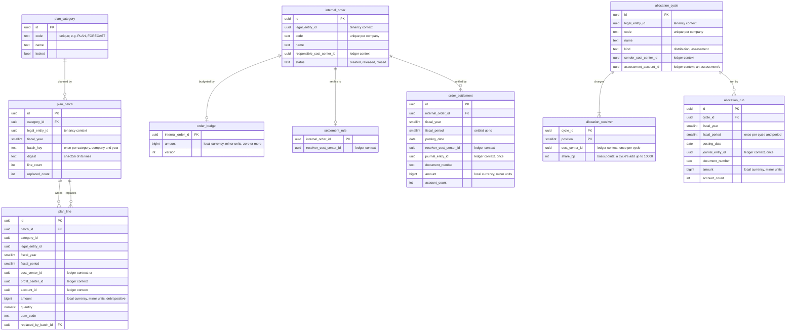

| Table | Purpose |
|---|---|
| `controlling.plan_category` | A plan category (SAP's category for planning): code (`^[0-9A-Z_]{1,10}$`, unique), name, and `locked`; locked and unlocked by a person (`controlling.plan.lock`) with the caller's version, read FOR UPDATE; never deleted |
| `controlling.plan_batch` | A batch applied, insert-only: its key once per category, company and year (`plan_batch_key_once`) and the digest of its lines, so the same batch again is recognised and changes nothing and the key with other lines is refused; at least one line; refused on a locked category (`plan_category_open`) |
| `controlling.plan_line` | A line of a batch: one center (`plan_line_one_center`), a period 1-16, a P&L account, the amount in the company's local currency, an optional positive quantity with its unit (`plan_line_quantity_unit`); of its batch's category, company and year (foreign key). Never deleted: a later batch of the same category, company and year naming its center sets `replaced_by_batch_id` once (`plan_line_replaced_once`, `plan_line_replaced_later`), so the plan is the lines not replaced, one per category, company, year, center, account and period (`plan_line_once`, a partial unique index), and every earlier plan stays readable. Nothing is written or replaced on a locked category (`plan_category_open`, the category read FOR SHARE). A batch that would write or replace a cost center's line in a period sharing a day with a period of the center whose `ledger.cost_center_period.lock_plan` is set is refused (T56g2; checked in the service through the ledger's port, the centers held FOR KEY SHARE; no trigger reads across the context boundary) |
| `controlling.internal_order` | An internal order (ADR-0064 §1, T60a): a cost object of one company with a code unique in it (`^[0-9A-Z_-]{1,12}$`, `internal_order_code_once`), a name, a responsible cost center (the ledger's; no foreign key crosses the schema: checked through `ledger.AssignmentBalances.CostCenterRefs` to be an active cost center of the company) and a status, `created` then `released` (`controlling.order.release`, read FOR UPDATE with the caller's version). It starts as `created`, keeps its company and code and stays released (`internal_order_lifecycle`, a trigger); never deleted. Journal lines name it (`ledger.journal_line.internal_order_id`, §3.7, T60b) without a foreign key: the ledger asks `controlling.CostObjects` (its port `ledger.CostObjects`) for the orders a posting names, which holds them `FOR SHARE`; the order's actual costs are those lines, read through `ledger.AssignmentBalances.OrderActuals` and stored nowhere else |
| `controlling.order_budget` | An order's budget (ADR-0064 §3, T60c): at most one row per order (the primary key; `order_budget_order`, a foreign key to the order), one overall amount of zero or more (`order_budget_not_negative`) in minor units of the order's company's local currency, which a company keeps (000045). An order without a row has no budget. Replaced with the version its reader saw (`controlling.order.budget`; the order read FOR UPDATE, the version one more with every change, `platform.touch`), each change audited with the amounts before and after; never deleted. Nothing is refused for a budget: `GET /v1/internal-orders/{id}/budget` compares it with the order's balance in the leading ledger over every year (`ledger.AssignmentBalances.OrderBalance`) |
| `controlling.settlement_rule` | An order's settlement rule (ADR-0064 §3, T60d): at most one row per order (the primary key; `settlement_rule_order`, a foreign key to the order) naming its one receiver, a cost center (the ledger's; no foreign key crosses the schema: checked when the rule is set, through `ledger.AssignmentBalances.CostCenterRefs` and `CostCenterValidOn`, to be an active cost center of the order's company valid on the company's date), which takes the whole. An order without a row has no rule. Replaced with the order's version (`controlling.order.write`; the order read FOR UPDATE and its version moved with the rule), each change audited with the receivers before and after; the row's own `version` counts its replacements (`platform.touch`); never deleted |
| `controlling.order_settlement` | A settlement of an order (ADR-0064 §3, T60e), insert-only (no `UPDATE` or `DELETE` granted): the order (`order_settlement_order`), its company, the fiscal year and regular period settled up to, the posting date (the period's last day), the receiving cost center and the journal entry (the ledger's; no foreign key crosses the schema; an entry is one settlement's, `order_settlement_entry_once`) with its document number, the amount moved in minor units of the company's local currency (the total of the accounts' balances, negative for a credit balance) and the number of accounts. The entry is posted through `ledger.Postings.Post` with `source_context` `controlling` and the settlement as its source document: per account the order credited and the receiver debited, so each account's balance is unchanged. The order is read FOR UPDATE from before its balance is read (`ledger.AssignmentBalances.OrderAccountBalances`) until the entry is posted; with nothing unsettled no row is written. A settled order, its balance zero on every account, is closed (`controlling.internal_order.status` `closed`, from `released` alone and for good, `internal_order_lifecycle`): a closed order takes no posting, and the entries that posted to it are no longer reversed |
| `controlling.allocation_cycle` | An allocation cycle (ADR-0064 §5, T60f): a company's cycle with a code unique in it (`^[0-9A-Z_-]{1,12}$`, `allocation_cycle_code_once`), a name, a `kind` (`distribution` or, since T60g, `assessment`), its sender cost center (the ledger's; no foreign key crosses the schema: sender and receivers are checked through `ledger.AssignmentBalances.CostCenterRefs` to be active cost centers of the company) and, exactly for an assessment, its `assessment_account_id` (`allocation_cycle_assessment_account`; the ledger's, checked through `ledger.AssignmentBalances.CostAccounts` to be an active secondary cost element of the company). It keeps its company, code, kind, sender and assessment account (`allocation_cycle_identity`, a trigger); never deleted. A run holds every cycle of its sender FOR UPDATE, in id order, before it reads the sender's costs, so the runs of one sender follow one another whichever of its cycles they are |
| `controlling.allocation_receiver` | A receiver of a cycle, insert-only: its place in the cycle's list, the cost center, once per cycle (`allocation_receiver_once`), and its share in basis points, 1 to 10,000 (a percentage with two decimals). A cycle's shares add up to 10,000 and no receiver is its sender, held when the transaction that wrote the cycle or a receiver commits (`allocation_receiver_shares_whole`, `allocation_receiver_not_sender`, raised by deferred constraint triggers on both tables) |
| `controlling.allocation_run` | A run of a cycle for a fiscal period, insert-only: the cycle with its company (foreign key), the fiscal year and regular period, the posting date (the period's last day), the journal entry (the ledger's; once, `allocation_run_entry_once`) with its document number, the amount moved off the sender in minor units of the company's local currency and the number of accounts. One run per cycle and period (`allocation_run_once`). A distribution's entry is posted through `ledger.Postings.Post` with `source_context` `controlling` and the run as its source document: per account the sender credited with its cost of the period (the ledger's actuals of the center on primary cost accounts) and each receiver debited with its share, split by `money.Allocate` so the shares add up to the cost to the minor unit. A sender without costs in the period posts nothing and no row is written |
| `controlling.outbox`, `controlling.inbox` | The context's events (`PlanCategoryChanged`, `PlanBatchApplied`, `InternalOrderChanged`, `InternalOrderBudgetChanged`, `InternalOrderSettled`, `AllocationCycleChanged`, `AllocationRunPosted`), relayed as every context's (`outbox.Contexts`) |

Plan against actual (`GET /v1/cost-center-plan-actual`, and `GET
/v1/profit-center-plan-actual`, T56g3) stores nothing: the category's
current lines are summed per cost center (or profit center) and account
over the periods asked for and merged with the leading ledger's actuals,
which the ledger reads as its cost center (or profit center) report does
(§3.7, exact at the read; by profit center on profit and loss accounts
only, the segments summed).

## 3.20 Tax filing (`tax`)

The companies' registrations with tax authorities and their filing periods
(ADR-0049 §10, T61g), owned by the tax filing context
(`internal/taxfiling`); the returns of T61h-T61i join them. Migration
000172 creates the schema and the permission `tax.registration.read`. The
registrant and a tax group's members are the tenancy context's legal
entities, by id, with no foreign key across the schema.

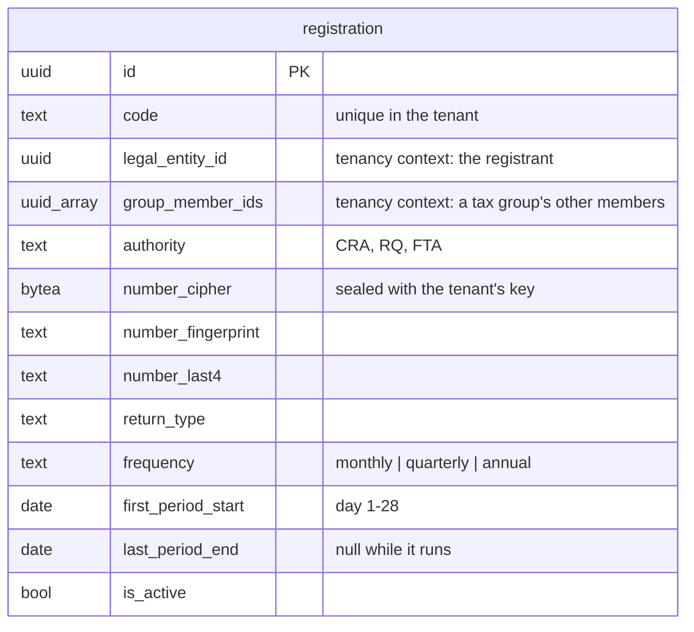

| Table | Purpose |
|---|---|
| `tax.registration` | A registration from the configuration's `companies[].tax_registrations`, kept by `taxfiling.Setup`: its code once in the tenant (`registration_code_once`), the authority, return type and frequency of their forms, a first period starting on day 1-28 of a month and an end after it, the registrant not among the group's members (`registration_members`). The number is sealed (fieldcrypt, re-sealed on key rotation), fingerprinted and shown by its last four characters. Company, members, authority, return type, frequency and first period never change under the code (`registration_fixed`, a trigger; the number is compared by the application, which opens it); the end and the active flag change by versions; one the configuration no longer lists becomes inactive, never deleted |

A registration's periods are not stored: they follow from its fixed
settings (`config.TaxPeriods`: the first starts on `first_period_start`,
each lasts one, three or twelve months, none after `last_period_end`) and
are computed on read by `GET /v1/tax-registrations/{id}/periods`. The first
period is the first the ERP files (its cutover); returns are prepared in
period order from it (ADR-0049 §11 As built, period order).

A draft return (ADR-0049 §11, T61h) is not stored either: `GET
/v1/tax-registrations/{id}/draft-return` computes it from
`ledger.tax_item`, the items no return has reported (`reported_in` null)
of the registration's companies dated on or before the period's end, by
the boxes of the country pack's `returns.yaml`. Migration 000174 adds the
partial index `ledger.tax_item_unreported` (`tenant_id`, `legal_entity_id`,
`tax_date` where `reported_in` is null) the selection reads, and the
permission `tax.return.read`.

A prepared return is stored (ADR-0049 §11 As built, T61i; migration
000179, which also creates the context's outbox, `tax.outbox`, and the
permissions `tax.return.prepare`, `tax.return.approve` and
`tax.return.file`):

| Table | Purpose |
|---|---|
| `tax.tax_return` | A return of a registration's period: `original`, or `amendment` of the period's filed return (`amends_id`, `tax_return_amends`, `tax_return_amends_filed`); its status `prepared` -> `approved` -> `filed`, or `withdrawn` or `rejected` before filing (`tax_return_transition`, each move setting its own fields alone, `tax_return_fixed`); the definition and pack version its boxes follow, its currency, item count and `items_hash` (SHA-256 of its items' keys and local amounts), the prior-period figures; its `tax_return` approval request (workflow context), the approver, never its creator (`tax_return_four_eyes`), the filing's confirmation number and date, after the period's end (`tax_return_filed`), and who withdrew or rejected it and why (`tax_return_ended`). One return of a period in progress (`tax_return_in_progress`) and one original that stands (`tax_return_one_original`) |
| `tax.tax_return_box` | The snapshot's boxes in the definition's order: amount, prior-period part, the period's corrected amount and a selection box's item count (`tax_return_box_items`); written while the return is prepared (`tax_return_snapshot`), insert-only |
| `tax.tax_return_item` | The keys of the ledger's tax items the return claimed (no foreign key across the schema); written while it is prepared, insert-only |

The items' `ledger.tax_item.reported_in` names the return while it stands:
set from null when it is prepared and released to null when it is withdrawn
or rejected, never moved to another (`tax_item_fixed`), and held at commit to
a standing return whose snapshot claims the item, of a company its
registration covers, dated by its period's end, or released by one ended
(`tax_item_reported`, a deferred trigger of the tax filing context, served
by `ledger.tax_item_reported_in`, built concurrently by migration 000180).

Planned, not built (ADR-0061 §10, T65g): `tax.audit_file`, an FTA Audit
File generated by a person as an Operation: what it covers (as the FTA's
specification, still to be supplied, asks), its status (`queued`,
`running`, `ready`, `failed`), the file's hash and size in object
storage, its format version and who asked.

## 3.21 Asset accounting (`assets`)

The asset master (ADR-0057 §5, §7, §8, T57b), its acquisitions and
their reversals (§6, T57c, T57d), its depreciation schedule, read from
them (§7, T57e, no table of its own), the depreciation runs that post
it (§7, T57f, migration 000200), its retirements (§8, T57g, migration
000203), its transfers (§8, T57h, migration 000204) and the year totals
the asset history sheet reads (§5, §9, T57i, migration 000207), owned by the assets context
(`internal/assets`, a leaf). Migration 000191 creates the schema, its
outbox (`assets.outbox`, AssetChanged) and the permission
`assets.asset.change` (`assets.asset.read` came with T57a). The classes and
each company's asset accounts are configuration (ADR-0057 §3, §3.7 above);
the legal entity is the tenancy context's and the ledgers and centers are
the ledger's, by id, with no foreign key across the schema.

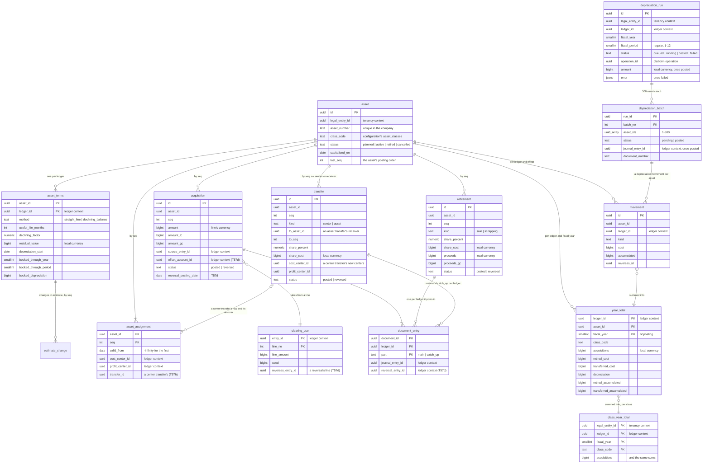

| Table | Purpose |
|---|---|
| `assets.asset` | An asset (SAP ANLA): its company, number from the company's `asset` range in the fiscal year it is created (`asset_number_once`), class, description, status and capitalisation date. It starts `planned` and moves planned -> active -> retired, back by reversals (retired -> active, active -> planned), or planned -> cancelled, which is final (`asset_transition`, a trigger); capitalised exactly while active or retired (`asset_capitalised`). Its company, number, class and creation never change (`asset_fixed`) and `last_seq` never goes back (`asset_seq_forward`): every posting, reversal and assignment touching the asset takes the next `seq` under the asset's lock, so posting order is `seq` order, never id order (ADR-0057 §5). Its version moves with every change of its master, terms or assignments |
| `assets.asset_terms` | Its depreciation terms per ledger the company keeps (one depreciation area each, ADR-0057 §7), copied from the class when it is created and changeable until depreciation is posted in that ledger (`booked_through_*` set; `asset_terms_in_use`, a trigger), then only by a change in estimate, the update counting it (`estimate_changes`) taking exactly the latest change's terms, the depreciation start unchanged (T57j, migration 000249); classified as held for sale from a regular period (`held_for_sale_year`, `_period`, `_from`, all or none, `asset_terms_held_for_sale`) after the one booked through, moved only while its period is unbooked and never cleared (`asset_terms_held_for_sale_prospective`; T57k, migration 000250): a method, a useful life of 1-1200 months, a declining factor above 1 and at most 10 with declining balance alone (`asset_terms_declining_factor`), a residual value of zero or more in minor units of local currency, and an optional depreciation start (null: the capitalisation date). `booked_depreciation` is the depreciation booked in the ledger, minus the sum of the asset's `depreciation` movements there (positive while depreciation is posted), kept by every posting that writes movements in its own transaction, as the year totals are (T57f3, migration 000211, backfilled) |
| `assets.estimate_change` | A change in estimate of an asset's terms in one ledger (T57j, migration 000249; ADR-0057 §7; IAS 8.36-38), insert-only: the regular period it applies from (`fiscal_year`, `fiscal_period`, its first day `effective_from`), the method, useful life, declining factor and residual value from then on and those before it, under the asset's current `seq`. It is from a period after the one the ledger is booked through and not before the latest change's, and records the terms as they stand (`estimate_change_prospective`, a trigger); the schedule walks each period on the terms in force in it |
| `assets.asset_assignment` | Its cost center (optional) and profit center from `valid_from` on, insert-only (`platform.forbid_mutation`): the first row at creation, valid from `-infinity`, each later one from a center transfer or its reversal (T57h, `transfer_id`). A row takes the asset's current `last_seq`, raised first (`asset_assignment_seq`), and only the first is valid from `-infinity` (`asset_assignment_valid_from`), except a row a center transfer's reversal writes to restore the previous one (`restores_seq`, migration 000204), which repeats that row's centers and `valid_from`, `-infinity` included (`asset_assignment_restores`), so the row with the highest `seq` is the latest and names the asset's centers. The profit center is the cost center's on the row's date, derived by the ledger (`ledger.AssetReads.Assignment`) |
| `assets.acquisition` | An acquisition (T57c, migration 000192; ADR-0057 §6): an asset's cost from a posted line on its class's clearing account (`source_*`, with the entry's document number, source context and document as posted) or, from T57d, against an offset account (`offset_account_id`), never both (`acquisition_source`); in the line's (or the manual amount's) currency with its local and group amounts (`amount_lc`, `amount_gc`, a manual one's as the ledger converted its cost line), its value and posting dates and the asset's `seq` (`acquisition_seq_once`). It starts `posted` and is reversed at most once, keeping what it posted (`acquisition_transition`, `acquisition_fixed`); it is `reversed` exactly when its reversal's posting date and reason are recorded (`acquisition_reversal`, T57d, migration 000195), never dated before its own posting date (`acquisition_reversal_date`), and keeps them |
| `assets.clearing_use` | What acquisitions used of a capitalised line, keyed by the line: its amounts in its currency, local and group currency, and what is used of each, which stays between zero and the line's amount (the mirror for a credit line, `clearing_use_within_line`); the line's amounts never change (`clearing_use_line_fixed`). Read FOR UPDATE by every acquisition from the line, and given back by its reversal. A reversal's line names the line it reverses (`reverses_entry_year`, `reverses_entry_id`, both or neither, `clearing_use_reverses`; T57d), which never changes, so an asset's take-off through it is bounded by what it holds from that line |
| `assets.movement` | The subledger (ADR-0057 §5): one append-only row per asset, ledger and effect (`acquisition`, `depreciation`, `retirement`, `transfer_out`, `transfer_in`) with the signed change of cost and accumulated depreciation in local and group currency, of residual value (negative when a retirement or transfer out took it, positive when a transfer in brought it, T57e), proceeds and share, its document and journal entry. The depreciation schedule and a run's preview (T57e) are computed from these rows and `asset_terms` at the read, never stored (ADR-0057 §7), and `GET /v1/assets/{id}/movements` lists them. A reversal row has its original's kind, asset and ledger and exactly the negated amounts (`movement_reversal`), each original is reversed at most once (`movement_reversed_once`), and depreciation changes accumulated depreciation alone (`movement_depreciation`). A run's batches, its preview and a catch-up read an asset's movements other than depreciation from the partial covering index `movement_moves_covering` alone (T57f3, migrations 000212 and 000213, replacing T57f2's `movement_moves_by_asset`) and what is booked from `asset_terms.booked_depreciation`; the schedule, which shows it by period, reads every row |
| `assets.document_entry` | The journal entry of each assets document per ledger and part (`main`, or a center transfer's `catch_up`), with its document number; the reversal records its reversal entry and that entry's number once (`document_entry_reversal`, `document_entry_reversal_number`, `document_entry_reversed_once`; T57d), the only update granted |
| `assets.retirement` | A retirement (T57g, migration 000203; ADR-0057 §8): a `sale` with proceeds in local currency, zero or more, or a `scrapping` without (`retirement_proceeds`, which also keeps the proceeds' group amount zero without proceeds), of a share given as a percent above 0 and at most 100 or a positive cost, not both (`retirement_share`; neither: all of it), valued in its posting date's month on or before it (`retirement_value_date`: not backdated, decided by default 13), with the asset's `seq` (`retirement_seq_once`). It starts `posted` and is reversed at most once, keeping what it posted (`retirement_transition`, `retirement_fixed`); it is `reversed` exactly when its reversal's posting date and reason are recorded (`retirement_reversal`), never dated before its own (`retirement_reversal_date`). Per ledger it writes a `depreciation` movement (its catch-up, with `booked_through_before_*`) and a `retirement` movement (cost, accumulated depreciation and residual value taken, proceeds, `share`, above 0 and at most 1: `movement_share`), and a `document_entry` where the ledger posted an entry |
| `assets.transfer` | A transfer (T57h, migration 000204; ADR-0057 §8): `center`, to the cost center (its profit center derived) or profit center named, with the centers it moved from (`from_*`), valued on its posting period's first day; or `asset`, of a share given as a percent above 0 and at most 100 or a positive cost, not both (`transfer_share`; neither: all of it), to another asset (`to_asset_id` with that asset's `seq`, `to_seq`, `transfer_to_seq_once`; not itself, `transfer_same_asset`), valued in its posting date's month on or before it (`transfer_kind`, `transfer_value_date`: not backdated, decided by default 13 and 17), with the asset's `seq` (`transfer_seq_once`). It starts `posted` and is reversed at most once, keeping what it posted (`transfer_transition`, `transfer_fixed`); it is `reversed` exactly when its reversal's posting date and reason are recorded (`transfer_reversal`), never dated before its own (`transfer_reversal_date`). Per ledger it writes the asset's `depreciation` movement (its catch-up, with `booked_through_before_*`), an asset transfer also the asset's `transfer_out` and the receiver's `transfer_in`, and a `document_entry` per part it posted (`main`, and a center transfer's `catch_up` dated the period before's last day). An asset is capitalised from its earliest posted acquisition or asset transfer in (`transfer_by_receiver`) |
| `assets.depreciation_run` | A depreciation run (T57f, migration 000200; ADR-0057 §7) of a company, ledger and regular period (`depreciation_run_fiscal_period_check`), dated the period's last day, with its Operation. It starts `queued` and moves queued -> running -> posted, or to failed from queued or running; posted and failed are final (`depreciation_run_transition`), and what it runs never changes, nor its plan once running nor its outcome once ended (`depreciation_run_fixed`). It is planned (`assets_planned`) once running (`depreciation_run_planned`), has its totals (`amount`, `assets_posted`, `assets_skipped`) exactly when posted (`depreciation_run_totals`) and its problem exactly when failed (`depreciation_run_error`). One run of a company and ledger is queued or running at a time (`depreciation_run_one_at_a_time`, a partial unique index; 409 `assets.run_in_progress`) |
| `assets.year_total` | The history sheet's totals of one asset in one ledger and fiscal year of posting (T57i, migration 000207; ADR-0057 §5, §9), keyed ledger, asset, year so the sheet by asset reads an asset's years in one index range: the sums of its movements' cost by kind (acquisitions; retirements; transfers in and out) and accumulated depreciation by kind (depreciation, runs' and catch-ups'; retirements; transfers), in local currency, with the asset's company and class. The posting that writes movements adds them in its own transaction, after them, the class rows first and then the asset rows, each in key order (`assets.keepTotals`), so postings touching the same classes in any order never deadlock; the migration totalled the movements before it. The application may add to the sums only (no update of the key, no delete) |
| `assets.class_year_total` | The same sums per company, ledger, fiscal year and class: what the history sheet by class, and every sheet's totals, read (at most classes × years rows) |
| `assets.depreciation_batch` | A run's batch of 1-500 assets by asset number (`depreciation_batch_asset_ids_check`), `pending` until posted once in one transaction (`depreciation_batch_transition`, which keeps its assets), with its totals exactly when posted (`depreciation_batch_posted`) and its journal entry and document number only then, all or none (`depreciation_batch_entry`; none when no asset of it had a difference). A run's depreciation movements (`document_kind` `depreciation_run`) carry the batch's entry, whose document number the movements list reads from here |

## 3.22 Financial close (`closing`)

The financial close (ADR-0058) is a leaf context: it reads the
configuration, tenancy and the ledger through ports the composition root
adapts, and no context reads it. Its template is configuration (T64a):
`close.tasks`, at most 200 tasks, each with a unique `code`
(`[A-Z0-9_]{1,30}`), a `name` (cosmetic), a `kind` (`manual` or `check`,
with a `check` this build runs exactly when the kind is `check`; each
slice that builds a check adds it: `no_parked_entries` and
`revaluation_posted` from T64c, `variances_explained` from T64i,
`depreciation_posted` from T64k), a `due_day` (business days after the
period's last day, -31 to 31, 0 that day itself), `depends_on` (other
tasks of the template, each once, without a cycle, and given to every
company the dependent task is) and optional `companies` (only these
companies' closes get the task). A change is operational, a task's name
cosmetic.

`GET /v1/close-calendar` (T64a) computes the calendar of a company's
fiscal year from the leading ledger's regular periods
(`ledger.period_status` with `ledger.fiscal_period`, special periods left
out) and the active template: each period's planned first and last due
dates, each task due `due_day` business days of the company from the
period's `end_date`. Nothing is stored; migration 000193 adds the
permission `closing.close.read`. The schema `closing` (period closes,
their ledgers and tasks, sign-offs, accrual proposals and evidence,
variance comments and citations) is created by the slices that write it,
from T64b (ADR-0058 §5).

The period close (T64b, migration 000194) is stored in the schema
`closing`, with its outbox (`PeriodCloseChanged`):

```
closing.period_close  (tenant_id, id, legal_entity_id, fiscal_year, fiscal_period 1-12, period_end,
                       config_version, status open|signed_off, version, created_*, updated_*)
                       PK (tenant_id, id); UNIQUE (tenant_id, legal_entity_id, fiscal_year, fiscal_period)
closing.close_ledger  (tenant_id, close_id, ledger_id, period_id)      PK (tenant_id, close_id, ledger_id)
closing.close_task    (tenant_id, close_id, code, seq, name, kind manual|check, check_kind, due_on,
                       depends_on text[], assignee_id, status open|done, completed_by, completed_at,
                       note, version, created_*, updated_*)
                       PK (tenant_id, close_id, code); UNIQUE (tenant_id, close_id, seq)
```

A close is one per company and regular period (`period_close_once`,
`period_close_regular`), its `period_end` the leading ledger's last day
of the period, from which its tasks' `due_on` were counted when it was
opened, and `config_version` the configuration whose template was
copied. It starts `open`; its company, period, end and version of the
template never change (`closing.check_period_close`). `close_ledger`
names the ledgers it covers with each one's posting period
(`ledger.period_status`), written once. A task starts `open` and moves
`open` <-> `done`; `completed_by` and `completed_at` are set exactly while
it is done and its `note` only then (`close_task_completed`), a check task
names its `check_kind` and a manual one none (`close_task_check_kind`), it
never depends on itself (`close_task_depends_on`), and what the template
gave it never changes, nor its completion while it stands
(`closing.check_close_task`). Every change of a task moves the close's
`version` too, under a lock on the close, which is the ETag its task
actions take. The worklist reads tasks by `(tenant_id, due_on, close_id,
code)` and by assignee. The legal entity, ledgers, periods and principals
are other contexts', by id, without foreign keys. The close calendar's
row of a period shows its close and its tasks' due dates once it has one.
Schema tests: `db/closing_test.go`.

A check task's latest result (T64c, migrations 000196 and 000197) is kept
on the task:

```
closing.close_task    + checked_at, checked_by, check_passed, check_result jsonb
```

`:check` records when the check ran, who ran it, whether it passed and
what it found (`check_result`: its summary and, for `no_parked_entries`,
the count and the first 20 parked entries with who parked them; for
`revaluation_posted`, each covered ledger with its key date and posted
run; for `depreciation_posted` (T64k), each covered ledger with its
latest posted depreciation run of the period or, without one, how many
assets a run would select and the latest posted run of a later period;
for any check, its warnings, counted, the first 20 named: from T64l,
`depreciation_catch_up` for each asset a run of the period would select
in a ledger whose later period's run posted, with its catch-up), names included as they were then. The four are set together, on a
check task only (`close_task_checked`), never when the task is created,
and once recorded are replaced by the next check, never removed
(`closing.check_close_task`). A check task is `done` only while its latest
check passed (`close_task_check_passed`): a pass sets it done (who ran it
and when become its completion, unless it was done already) and a failure
open; reopening it keeps the result. The checks read the ledger through
its port (`ledger.CloseChecks`): parked entries of the company by posting
date in the leading ledger's period (`ledger.parked_entry`), those naming a
special period left out (ADR-0060 §3, T64m1), and posted
revaluation runs per ledger and key date (`ledger.revaluation_run`);
the depreciation check reads the assets context through its port
(`assets.CloseChecks`): the latest `posted` run of the company, ledger,
fiscal year and period (`assets.depreciation_run`,
`depreciation_run_by_company`) and, without one, the assets a run would
select (the run's and the preview's selection over `assets.asset`,
`asset_terms`, `asset_assignment` and `movement`, ADR-0057 §7) and the
latest `posted` run of a later period, with the selected assets'
`booked_through` and movements for their catch-up (T64l).

A close's sign-offs (T64d, migration 000199):

```
closing.sign_off      (tenant_id, id, close_id, signed_by, signed_at, note, locked jsonb)
                      PK (tenant_id, id); FK (tenant_id, close_id) -> period_close
```

`:signOff` writes one row per sign-off: who signed off, when, the note
(1-2,000 characters, optional) and `locked`, a list of 1-20 covered
ledgers (`sign_off_locked`), each with its code and name as they were then,
its period (`ledger.period_status`) and whether this sign-off locked it.
A row is never updated or deleted (`platform.forbid_mutation`, no grant
beyond `SELECT` and `INSERT`). The close is `signed_off` after it; while it
is, its latest row is the close's signer. A covered period unlocked later
(T32) lets the close's next write set it `open` again, and a close signed
off again has a second row. Read by close, oldest first
(`sign_off_by_close`). Schema tests: `db/closing_test.go`
(`TestCloseSignOffRules`).

The year close (T64m4, migration 000237; ADR-0060 §8), with the closing
outbox (`YearCloseChanged`), is stored apart from period closes:

```
closing.year_close        (tenant_id, id, legal_entity_id, fiscal_year, year_end, config_version,
                           status open|signed_off, version, created_*, updated_*)
                           PK (tenant_id, id); UNIQUE (tenant_id, legal_entity_id, fiscal_year)
closing.year_close_ledger (tenant_id, close_id, ledger_id)                PK (tenant_id, close_id, ledger_id)
closing.year_close_task   (as closing.close_task, its check result columns included)
                           PK (tenant_id, close_id, code); UNIQUE (tenant_id, close_id, seq)
```

A year close is one per company and fiscal year (`year_close_once`), its
`year_end` the leading ledger's last day of its last regular period, from
which its tasks' `due_on` were counted from the configuration's year tasks
(`close.year_tasks`, the same shape as `close.tasks`, validated alike;
its checks `config.YearCloseChecks`, T64m5, each recorded in the task's
check result columns as a period close's). Its ledgers carry no period: the
close reads each covered ledger's periods of the year (`ledger.period_status`)
through the ledger's port. Its rows follow the period close's rules
through the same trigger functions (`closing.check_period_close`,
`closing.check_close_task`, which name the table they guard), with the
constraints `year_close_task_check_kind`, `year_close_task_completed`,
`year_close_task_depends_on`, `year_close_task_checked` and
`year_close_task_check_passed`; the ledgers are written once. Schema
tests: `db/closing_test.go` (`TestYearCloseRules`).

A year close's sign-offs (T64m6, migration 000244; ADR-0060 §8):

```
closing.year_sign_off (tenant_id, id, close_id, signed_by, signed_by_name, signed_at, note, locked jsonb)
                      PK (tenant_id, id); FK (tenant_id, close_id) -> year_close
```

As `closing.sign_off`, with the signer's name as it was then
(`signed_by_name`, not blank) and `locked` a list of 1-20 covered ledgers
(`year_sign_off_locked`), each with its code and name as they were then and
its special periods of the year (`ledger.period_status`, period 13-16),
each with whether this sign-off locked it; the regular periods were all
locked already. Insert-only (`platform.forbid_mutation`), read by close,
oldest first (`year_sign_off_by_close`); the year close is `signed_off`
after it, and its latest row is the close's signer. Schema tests:
`db/closing_test.go` (`TestYearSignOffRules`).

Accrual proposals (T64e, migration 000216), with the closing outbox
(`AccrualProposed`):

```
closing.accrual_proposal (tenant_id, id, close_id, session_id, agent_id, account_id, account_number, account_name,
                          accrual_account_id, accrual_account_number, accrual_account_name,
                          cost_center_id, cost_center_code, cost_center_name, profit_center_id, profit_center_code,
                          profit_center_name, supplier_id, currency, amount, description, reason, parked_entry_id,
                          posting_date, status proposed|rejected, decided_by, decided_at, decision_reason, version,
                          created_*, updated_*)
                          PK (tenant_id, id); FK (tenant_id, close_id) -> period_close; UNIQUE (tenant_id, parked_entry_id)
closing.accrual_evidence (tenant_id, proposal_id, seq 1-10, kind supplier_invoice|purchase_order|journal_entry,
                          document_id, document_number, fiscal_year, supplier_id)
                          PK (tenant_id, proposal_id, seq); UNIQUE (tenant_id, proposal_id, kind, document_id)
```

A proposal is one expense of its close's period that the close agent
proposed in its session: `amount` in minor units of the company's local
`currency`, more than zero (`accrual_proposal_amount`), debited to the
expense account and credited to the company's accrual account
(`companies[].close.accrual_account`), each kept with its number and name
as they were then, and the centers with their codes (never blank) and
names exactly when given (`accrual_proposal_centers`,
`accrual_proposal_cost_center_code`, `accrual_proposal_profit_center_code`).
`parked_entry_id` is the journal entry the ledger parked for it as the
agent (`ledger.parked_entry`), one per proposal
(`accrual_proposal_parked_once`), dated `posting_date`, the period's last
day. It starts `proposed` and moves only to `rejected` (T64f), with
`decided_by`, `decided_at` and `decision_reason` set exactly then
(`accrual_proposal_decided`); nothing else of it changes and it is never
deleted (`closing.check_accrual_proposal`). Its evidence, 1-10 documents
each once in the order given, is a supplier invoice or a purchase order
with its supplier, or a journal entry with its fiscal year
(`accrual_evidence_kind_keys`), each with its document number as cited,
never updated or deleted (`platform.forbid_mutation`). Every write reads
the close `FOR UPDATE` first; the duplicate rule (one proposal of a
close per expense account, cost center and supplier that is not
rejected) is the application's under that lock (`accrual_proposal_by_close`),
since a proposal whose entry the ledger cancelled counts as rejected
(T64f). The list pages by creation (`accrual_proposal_by_created`) and
filters by session (`accrual_proposal_by_session`). The accounts, centers,
supplier, documents, parked entry, session and principals are other
contexts', by id, without foreign keys. Schema tests:
`db/closing_test.go` (`TestAccrualProposalRules`).

Deciding them (T64f, migration 000217: the permission
`closing.accrual.decide`; `AccrualProposalRejected`) stores nothing new.
`status` keeps what the closing context decided (`rejected` by
`:reject`, with who, when and why); every other status is derived at the
read from the parked entry through the ledger's port
(`ledger.ParkedEntries.Statuses`, one statement per read over
`ledger.parked_entry`, `ledger.journal_entry` and `ledger.reversal`):
`proposed` while it is parked, `pending_approval`, `posted` with its
journal entry and the debit total posted in local currency (`modified`
when it differs from `amount`), `reversed` once that entry is reversed,
and `rejected` too when the ledger cancelled the entry or rejected its
approval. The duplicate rule reads the close's proposals of the key under
the close's lock (`accrual_proposal_by_close`) and skips those whose
derived status is `rejected`, so a proposal whose entry was cancelled in
the ledger no longer blocks a new one. A list's totals per status and
currency read the whole filtered set's proposals and their entries' status
in two statements. Schema test: `db/closing_test.go`
(`TestClosePermissions`).

The variance report (T64h) stores nothing. A company's settings are
configuration (`companies[].close.variance`: bases, amount and percent
thresholds, the plan category and its kind of center; tier 2), and
`GET /v1/period-closes/{id}/variances` reads, per profit and loss account
(`ledger.gl_account.is_balance_sheet` false), the leading ledger's local
net of the close's period and of the comparison period from the trial
balance's rows (`ledger.period_balance` and the entries still queued,
through `ledger.CloseAccounts`), or the plan category's current lines of
the period (`controlling.plan_line`, `replaced_by_batch_id IS NULL`, on cost
centers or on profit centers, through `controlling.Plans`).

Variance comments (T64i, migration 000202), with the closing outbox
(`VarianceCommentChanged`):

```
closing.variance_comment  (tenant_id, id, close_id, basis, account_id, account_number, account_name,
                           text, proposed_text, author_kind human|agent, author_id, session_id,
                           currency, actual, comparison, status proposed|accepted|rejected|superseded,
                           decided_by, decided_at, decision_reason, version, created_*, updated_*)
                           PK (tenant_id, id); FK (tenant_id, close_id) -> period_close
closing.variance_citation (tenant_id, comment_id, seq 1-20, journal_entry_year, journal_entry_id,
                           document_number, posting_date)
                           PK (tenant_id, comment_id, seq); UNIQUE (tenant_id, comment_id, journal_entry_id)
```

A comment explains one row (`account_id`) of one basis of its close's
variance report, with the row's `actual` and `comparison` in minor units
of `currency` when it was written, and the account's number and name as
they were then; it is stale once the row's figures differ, judged at the
read. An agent's comment starts `proposed`, in its session
(`variance_comment_session`), and a person's `accepted`; a proposal moves
to `accepted` (its text then replaceable, the proposal's kept as
`proposed_text`, `variance_comment_edited`) or `rejected` with a reason,
an accepted comment to `superseded`, and nothing else of it changes
(`closing.check_variance_comment`). `decided_by` and `decided_at` are set
exactly once it is decided, the reason exactly when it was rejected
(`close_variance_comment_decided`). A row has at most one accepted comment
(`variance_comment_accepted_once`, partial unique) and a session one
proposal per row (`variance_comment_proposed_once`). A citation is a
journal entry (`ledger.journal_entry` by year and id, its document number
and posting date as cited), each once, never updated or deleted
(`platform.forbid_mutation`). Every write reads the close `FOR UPDATE`
first. The report and the check read a close's comments of a basis
(`variance_comment_by_row`), the list by creation
(`variance_comment_by_created`). The account, entries, session and
principals are other contexts', by id, without foreign keys. Schema
tests: `db/closing_test.go` (`TestVarianceCommentRules`).

The year close (ADR-0060 §8, T64m4-T64m6) is built as described above: a
company's close of a fiscal year, stored apart from period closes in
`year_close` (unique per company and year), `year_close_ledger`,
`year_close_task` and `year_sign_off`, with the same columns and rules as
`period_close`, `close_ledger`, `close_task` and `sign_off` but for the
period; its template is the configuration's `close.year_tasks`. Its
sign-off needs every regular period of each covered ledger locked and
locks the special periods.

## 3.23 Analytics (`analytics`)

Saved reports, and the analytical store's bookkeeping in PostgreSQL
(ADR-0044); the store's datasets and manifests are files, not tables.

| Table | Purpose |
|---|---|
| `analytics.report` | A saved report (000010): its title, the question it answers, its `spec` and `queries`, and its owner |
| `analytics.snapshot` | The pointer to a tenant's current manifest (T55b, 000114), one row per tenant, so all of its datasets are swapped together and a reader never sees two runs mixed: the manifest's key, named by its watermark and a digest of what it lists (`snapshot_manifest_key_check`, T55c, 000115), the watermark (the cutoff of the run that wrote the manifest), `as_of`, `published_at`, and `checked_at` (T55c, 000115): the snapshot time of the last run that read every dataset and left no journal entry above its watermark, on which freshness is judged. A run publishes by moving the pointer, guarded by the manifest it read. Derived data: rebuilt after a restore or a move |
| `analytics.extract_due` | The tenants due an extract (T55c, 000115), one row per tenant: the outbox relay marks a tenant changed (`changed_at`) in the transaction that publishes its events, once per batch; the scheduler claims a due tenant at most once per interval (`started_at`) and records the start of the last run that finished (`done_at`, never after the claim: `extract_due_done_at_claim`), so a change after it is still due; `claimed_lsn` (T55f, 000116) is the primary's WAL position at the claim, and the run reads on the replica only once it has replayed past it |
| `analytics.superseded` | The manifests a publication replaced (T55f, 000116), kept seven days so a running query never loses a file, each with the keys it listed that its successor does not (`dropped`), which the lifecycle then deletes, but for what the current manifest or a later supersession lists, without reading other manifests. Bookkeeping of derived data: no audit record |

T91a copies the sales documents into the analytical store (ADR-0044 As
built T91a), storing nothing in PostgreSQL: dataset `sales_lines`, one row
per `sales.sales_order_item` of a confirmed `sales.sales_order`, dated its
`order_date`, and per `sales.billing_document_item` of a posted
`sales.billing_document`, dated its `billing_date`, each at its
`net_amount` in the document's `currency`, naming the customer
(`partner.business_partner`) by number and name and the order item's
`item_key`. No migration; querying it is `analytics.query.run`,
`sales.order.read`, `sales.billing.read` and `partner.supplier.read`.

T91b copies the supplier invoices' items into the analytical store
(ADR-0044 As built T91b), storing nothing in PostgreSQL: dataset
`spend_lines`, one row per `payables.supplier_invoice_item` of a posted
`payables.supplier_invoice` of any kind, dated its `posting_date`, at its
`amount` in the document's `currency` (negative for the kinds
`credit_memo` and `subsequent_credit`), naming the supplier
(`partner.business_partner`), the account (`ledger.gl_account`) and cost
center (`ledger.cost_center`) of the item or, for an item on an order, of
its `procurement.purchase_order_item`, and the `procurement.contract` the
order names (`purchase_order.contract_id`). No migration; querying it is
`analytics.query.run`, `payables.invoice.read`, `procurement.order.read`,
`procurement.contract.read`, `ledger.cost_center.read`,
`ledger.account.read` and `partner.supplier.read`.

## 3.24 Consolidation (`consolidation`)

ADR-0059, T68a-T68h. Consolidation is a leaf context: it reads tenancy,
the configuration and the ledger through ports the composition root
adapts, and no context reads it. The group chart (`consolidation.accounts`,
with the roles `cta`, `retained_earnings`, `nci` and `goodwill`), the
mapping of each company's accounts (`companies[].chart_of_accounts[].group_account`,
required on every account of a company in a group), the eliminations
(`consolidation.eliminations`) and the groups (`consolidation.groups`:
parent, members with ownership, origin (T68h), first period and
investment account) are
configuration, built in T68a (ADR-0059 §3, As built T68a): they keep no
table, and migration 000223 adds the permission `consolidation.read`.
T68b-T68g are built (T68e, the consolidated
statements, reads `run_balance` and, since T68f, `run_entry_line`, and
keeps no table); migration 000238 adds `run_difference`, `run_entry` and
`run_entry_line` (T68f, As built T68f); migration 000239 adds a
difference's acceptance (`accepted`, `accepted_by`, `accepted_at`,
`reason`, `version`; its one transition, open -> accepted while the run
is computed, kept by the trigger `run_difference_transition`) and the
permissions `consolidation.difference.accept` and
`consolidation.run.finalize` (T68g, As built T68g; finalization uses
`run`'s columns and one-final index of 000224); migration 000243 adds
the tables marked T68h below and `run_entry_line.component` (T68h, As
built T68h); migration 000246 holds an incorporated member's goodwill at
zero and an acquired member's to the residual (T68h2, As built T68h2);
migration 000260 adds `run.opening_run_id`, the group's final run of the
previous fiscal year's period 12 when the run started running, which its
translation reserve opens from for other comprehensive income (no
foreign key, as `superseded_by`; named once, as the run starts, and then
that final run, by the trigger `run_opening`, but by an import; As built:
other comprehensive income); migration 000261 adds
`run_member.revaluation_translation_gc`, the translation part of the
fiscal year's group-currency revaluation differences a run moved from the
company's profit to its translation reserve, in the group currency's
minor units, debit positive, zero by default, recorded with the
company's translation and not before (`run_member_revaluation_translation`;
As built: the group-currency revaluation's translation part)); migration 000262
adds `run_member.net_investment_gc` beside it, the rest of the fiscal
year's exchange differences on the company's monetary items designated as
part of a net investment in a foreign operation (the configuration's
`consolidation.groups[].net_investments[]`), which the run moved there
too, under the same rule (`run_member_net_investment`; As built: a net
investment's exchange differences).
The ledger gained, in T68b, `journal_line.trading_partner_id` (the legal
entity on the other side of an intercompany line, nullable, no foreign key)
and the projection `ledger.trading_partner_balance`, maintained as
`assignment_balance` is (§3.7); partner gained `business_partner.group_company_id`
in T68c, from which the ledger derives it (ADR-0059 §4). Migration 000224
creates the schema `consolidation` (with its outbox, for
`ConsolidationRunChanged`), its first three tables below and the permission
`consolidation.run.manage` (T68d, ADR-0059 §5, As built T68d):

| Table | Purpose |
|---|---|
| `consolidation.run` | A run of a group, fiscal year and regular period (T68d): its parent and every company of its group as its configuration version has them (`companies`, which a caller must all be allowed to act in to see the run), the parent's period dates, its configuration version, group currency and rate type, status (queued, running, computed, failed, final, superseded, discarded; a trigger keeps the transitions and what the run consolidates), its Operation, problem when failed (kept when discarded), when computed, finalizer and the final run superseding it. One run of a group queued or running at a time and one final per group and period (partial unique indexes `consolidation_run_one_at_a_time`, `consolidation_run_one_final`) |
| `consolidation.run_member` | Each company a run consolidates (T68d), written when it starts running: its code as read, parent or member, ownership and first period (a member's), local currency, closing rate (numeric(28,12)) and the date it is valid from (none in the group currency), the status and version of the run's period in its leading ledger when the run read its figures, and when it was translated, recorded once (a trigger; the only columns `erp_app` may update) |
| `consolidation.run_balance` | A company's translated figures (T68d, insert-only, written while the run runs): per company account and trading partner (`balance`), the local, booked group and translated amounts on its group account, plus the earlier results (`prior_results`, on the retained earnings account) and translation difference (`cta`, a group amount alone) rows, which make each company's rows sum to zero; numbered per company by group account, company account, trading partner code and kind |
| `consolidation.run_entry`, `consolidation.run_entry_line` | The run's eliminations (T68f; insert-only, written while it runs): intercompany entries per elimination and pair of the run's companies (one per pair, an index), investment and non-controlling interest entries (T68h); each line, never zero, on a group account with the company, company account and trading partner of the row it reverses, or none (a pair's difference), and its component (T68h); each entry has two lines or more summing to zero (`run_entry_balanced`, a deferred constraint trigger) |
| `consolidation.run_difference` | The intercompany pairs a run matched (T68f; insert-only, written while it runs): per elimination and pair of the run's companies, both amounts, the difference and the tolerance in the group currency's minor units, its status checked against them (matched, within tolerance, open); outside the group (per company and partner) or without a trading partner (per company), the amount alone; numbered in list order (`line_no`), one per elimination, company and partner, none included; an open one accepted by a person while the run is computed (T68g: `accepted` with who, when and why, the reason not blank, its `version` one up; the only change, and the only columns `erp_app` may update; never written accepted but by an import) |
| `consolidation.run_acquisition` | A member's acquisition figures as a run's elimination step measured them at the period before its first, or read them frozen (T68h; insert-only, written while the run runs): its origin and the parent's investment account, net assets in local currency and translated at that period's closing rate (numeric(28,12)) and its validity, the investment, goodwill and the non-controlling interest (zero while a run consolidates only members incorporated and held whole, whose investment is their share capital; goodwill is zero for an incorporated member and investment - net assets + the interest for an acquired one, `run_acquisition_goodwill`, T68h2, migration 000246), and whether they were frozen |
| `consolidation.acquisition`, `consolidation.acquisition_equity` | A member's acquisition frozen by its group's first final run including it (T68h; insert-only, one per group and member, inserted only for a final run of the group, `acquisition_frozen_by_final_run`, but by an import): what `run_acquisition` holds, with the origin, ownership, first period, local currency and the run; and its acquisition equity per group account (never zero, credit negative), from the run's investment entry: an incorporated member's share capital (T68h2); later runs read them and refuse a changed origin, ownership, first period, investment account or investment |

## 3.25 E-invoicing (`einvoicing`)

ADR-0061, T65a-T65f. A leaf context: it reads integration's connectors,
tenancy, tax filing's registrations and partner's tax identifier
fingerprints through ports, and enters supplier invoices through
payables' published API; no context reads it. T65a (migrations 000231,
000232) builds `einvoicing.einvoice` with what a fetch records: the
connector, the provider's message id (unique per tenant and connector,
`einvoice_message_once`), the participant it was listed for and the
connector's company of it (none when it names none), the SHA-256, size
and object key of the bytes, the fetch's Operation, `received_at`,
`acknowledged_at` (set once, never before receipt) and the version; the
status `received` alone, which a trigger holds, with what was recorded
fixed and only the acknowledgement written after (column grants and the
trigger); the connector kind check widened to `einvoice_provider`. T65b
(migrations 000233-000236) adds `changed_hash`, `changed_at` and
`changed_fetch_operation_id`: other bytes the provider delivered later
under the id, set together, never to the bytes kept, never before
receipt and never undone (`einvoice_changed`, the trigger), the first
bytes staying the original; the worker role reads `received_at` and
`acknowledged_at` for the gauge `erp_einvoices_unacknowledged`, served
by the cell-wide partial index `einvoice_unacknowledged`; the list's
fetch filter also matches `changed_fetch_operation_id`
(`einvoice_by_changed_fetch`). The other
columns below arrive with the slices that write them (T65c-T65f).

| Table | Purpose |
|---|---|
| `einvoicing.einvoice` | A document received from the tenant's accredited provider (and, in phase 3, one sent): its company and connector, the provider's message id (unique per tenant and connector), the fetch operation that recorded it, direction, format (`pint_ae`), kind (invoice or credit note), the hash and size of the bytes kept write-once in object storage (null for a document refused as too large, which is not kept), `received_at` and `acknowledged_at`, `changed_hash` when the provider redelivered other bytes under the id, the fields read (number, issue date, currency, totals, lines, the seller's TRN fingerprint and last four characters, the supplier once found), its status (`received` → `entered`, `held` or `refused`; `held` → `entered`, `held` again on a retry with the new problem, or `dismissed`) with the problem code and detail exactly when held or refused and the reason exactly when dismissed, the supplier invoice once entered or linked (at most one document per invoice, a partial unique index), and its version |

## 3.26 Accounts receivable (`receivables`)

ADR-0063, T75a-T75e. Built as payables is: it reads the ledger, the
partner context, tenancy and the configuration through its ports, posts
only through the ledger (§3.16) and keeps no foreign key out of its schema
(02 §2.1). T75a (migration 000265) builds the schema with its outbox and
inbox and the customer invoice, the accounting record of an invoice the
company issued, entered as a draft. T75b (migration 000271) posts it,
once: the invoice names its journal entry, whose debit line on the
customer's reconciliation account is the customer's open item (§3.7).
T75c (migration 000272) applies an incoming payment waiting on a house
bank's incoming payments clearing account (ADR-0047) to a customer's open
items, in full and exactly: a document written once, naming the receipt's
entry and the ledger's clearing entry that cleared receipt and items.
T75d (migration 000276) adds the kind `credit_memo` and
`reference_invoice_id`, the posted invoice a credit memo credits: only a
credit memo names one, a document of the tenant and never itself
(`customer_invoice_reference_on_credit`, `_reference_fkey`,
`_reference_not_itself`). That the invoice named is a posted invoice of the
same company, customer and currency is checked at entry, and that the
posted credit memos naming it stay within its gross amount at posting,
under that invoice's row lock (ADR-0063 §7). T75e's AR aging
(`GET /v1/receivables-aging`) keeps no table: it is computed on read from
the ledger's customer open items (§3.7, `ledger.OpenItems.Receivable`)
with the ledger's aging buckets (ADR-0063 §10).

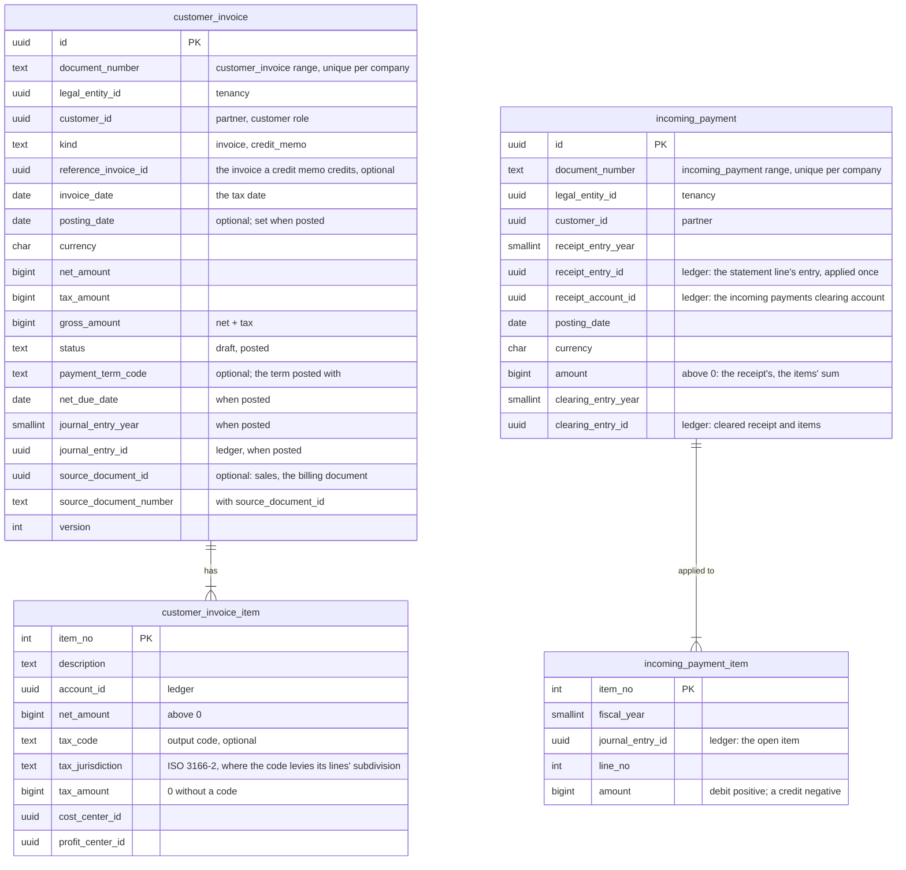

- `receivables.customer_invoice`: amounts are minor units of `currency`,
  never negative (`customer_invoice_amounts_not_negative`); the kind gives
  their direction. `gross_amount = net_amount + tax_amount`
  (`customer_invoice_totals`). The number is unique per company
  (`customer_invoice_number_once`). The kind is `invoice` alone
  (`customer_invoice_kind_check`), which T75d widens (`credit_memo`); the
  status is `draft` or `posted` (`customer_invoice_status_check`). A
  posted invoice names its journal entry with its year, its posting
  date, the payment term it posted with and its net due date, and a
  draft names no entry (`customer_invoice_posted`); an entry is one
  invoice's (`customer_invoice_entry_once`). Posting is the only change:
  the application may update the columns posting sets, and the trigger
  `customer_invoice_posted_once` refuses a change of anything but a
  draft being posted. Nothing deletes an invoice. An invoice another
  context entered names the document it came from by id and number, both
  or neither (`customer_invoice_source`; T79b, migration 000296: a
  billing document of sales), and a document is invoiced once
  (`customer_invoice_source_once`); the source is written with the
  invoice and not among the columns the application may update.
- `receivables.customer_invoice_item`: a net amount above zero
  (`customer_invoice_item_net_positive`) on an account, with the tax its
  output tax code gave at the invoice date, never negative and 0 without a
  code (`customer_invoice_item_tax_not_negative`,
  `customer_invoice_item_tax_needs_code`); the subdivision its tax is
  levied in (000303: the emirate, `AE-DU`), only under a tax code and in
  the form of an ISO 3166-2 subdivision
  (`customer_invoice_item_tax_jurisdiction`); insert-only
  (`platform.forbid_mutation`). The items' net and tax add up to the
  header's, which the context writes in one transaction.
- `receivables.incoming_payment` (T75c): an incoming payment applied.
  The number is unique per company (`incoming_payment_number_once`); the
  amount is above zero (`incoming_payment_amount_positive`); a receipt is
  applied once (`incoming_payment_receipt_once`) and a clearing entry is
  one application's (`incoming_payment_entry_once`). Insert-only
  (`platform.forbid_mutation`, no update or delete grant): an application
  is not undone in the first version.
- `receivables.incoming_payment_item`: the open items it was applied to,
  each with the amount it stood at in the payment's currency, never zero
  (`incoming_payment_item_amount_not_zero`), a credit of the customer's
  negative; an open item is applied once (`incoming_payment_item_once`).
  Insert-only. The items add up to the payment's amount, which the ledger
  holds the application to (`ledger.Postings.ApplyReceipt`).
- `receivables.outbox`, `receivables.inbox`: the context's events
  (`CustomerInvoiceChanged`, `CustomerInvoicePosted`,
  `IncomingPaymentApplied`).
- Permissions `receivables.invoice.read`, `.write` and `.post`, and
  `receivables.payment.apply`.
- In the ledger, `ledger.open_item_terms` keeps the terms of a customer
  open item as of a supplier's (T75b), and `ledger.OpenItems.Receivable`
  reads the customer open items of a company for the aging, dunning, the
  collection worklist and the credit exposure (ADR-0063 As built).
  `ledger.Postings.ApplyReceipt` posts the entry that clears a receipt on
  an incoming payments clearing account with a customer's open items, and
  `ledger.OpenItems.Receipts` reads the receipts not yet applied (T75c;
  §3.7's clearing, `ledger.clearing` and `ledger.clearing_item`, with no
  new table).

## 3.27 Dunning and collections (`collections`)

ADR-0065, T76a-T76c. A leaf: it reads the ledger's customer open items
(§3.7, `ledger.OpenItems.Receivable`), the partner context's names,
tenancy and the configuration through its ports, posts nothing and keeps
no foreign key out of its schema (02 §2.1). T76a (migration 000273)
builds the schema with its outbox and inbox and the dunning run: a
proposal of the customer items of a company overdue on a key date, one
notice per customer. Nothing changes on the items, which stay the
ledger's. T76b (migration 000277) confirms a run: the run's status
changes, and each item's level and dunning date are recorded in
`dunned_item`, which the next run reads.

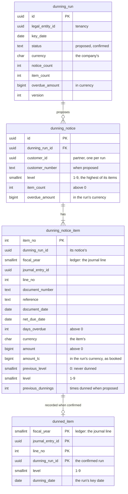

- `collections.dunning_run`: the status is `proposed` or `confirmed`
  (`dunning_run_status_check`); the
  totals are not negative and a run has at least an item per notice
  (`dunning_run_notice_count_check`, `dunning_run_item_count_check`,
  `dunning_run_overdue_amount_check`). `overdue_amount` is minor units
  of `currency`, the company's. The list reads the tenant's runs by key
  date (`dunning_run_by_key_date`). Confirming is the only change: a
  proposed run moves to confirmed, once (the trigger
  `dunning_run_confirmed_once`), and the application may set its status,
  version and `updated_by` alone, so its company, key date and totals
  stay; it may not delete a run.
- `collections.dunning_notice`: one per customer in a run
  (`dunning_notice_customer_once`), at a level from 1 to 9
  (`dunning_notice_level_check`), with at least one item
  (`dunning_notice_item_count_check`) and its customer's number
  (`dunning_notice_customer_number_check`); insert-only
  (`platform.forbid_mutation`). The list reads a run's notices by
  customer number (`dunning_notice_by_customer_number`).
- `collections.dunning_notice_item`: an open item of the ledger, named
  by its journal line and proposed once in a run
  (`dunning_notice_item_once_per_run`), in its notice's run
  (`dunning_notice_item_notice_fkey`); overdue by at least a day
  (`dunning_notice_item_overdue`); a debit, above zero in its own
  currency (`dunning_notice_item_amount_positive`: credit items are not
  dunned) and not negative in the run's
  (`dunning_notice_item_amount_lc_check`); at a level from 1 to 9
  (`dunning_notice_item_level_check`) that is its previous level or one
  above (`dunning_notice_item_one_level`); insert-only. `previous_level`
  is the highest level `dunned_item` holds for the item when the run is
  started, 0 for one never dunned, and `previous_dunnings` (T76b) the
  number of its rows there then, which a confirmation compares with the
  number as it is to tell that another confirmed run dunned the item
  since; it is at least the previous level and 0 exactly when that is
  (`dunning_notice_item_dunnings_check`).
- `collections.dunned_item` (T76b): an item at the level a confirmed run
  dunned it at, on the run's key date; one of the items that run proposed
  (`dunned_item_proposed_fkey`, into `dunning_notice_item`), once per run
  (the primary key, which leads with the item: the next run, a
  confirmation and the worklist read by item), at a level from 1 to 9
  (`dunned_item_level_check`); insert-only. An item's level is the
  highest among its rows and its last dunning date the latest; an item at
  the highest level gets a row per confirmed run that took it.
- `collections.outbox`, `collections.inbox`: the context's events
  (`DunningRunChanged`, `DunningNoticeIssued`).
- Permissions `collections.dunning.read` and `.run`, and
  `collections.worklist.read` (T76c, migration 000278). The collection
  worklist has no table: it is computed on read from the ledger's open
  customer items and `dunned_item` (ADR-0065 §9).

## 3.28 Credit management (`credit`)

ADR-0066, T77a (migration 000279). A leaf: it reads the ledger's customer
open items (§3.7, `ledger.OpenItems.Receivable`), the partner context's
customers and names and tenancy through its ports, posts nothing and
keeps no foreign key out of its schema (02 §2.1). It stores a customer's
credit limit in a company and nothing else: the credit exposure, what
the customer's open items add up to, is computed from the ledger when it
is read (ADR-0066 §3), and the check of an amount against the limit
writes nothing (ADR-0066 §4). From T77b the exposure has a second part,
the customer's confirmed sales orders not yet billed, read from the
sales context (§3.29) through a port and stored nowhere either; the
check a sales order's confirmation asks reads the limit's row
`FOR UPDATE` under an advisory lock on the customer in the company,
which setting a limit takes too, so two orders of one customer are
checked one after the other (ADR-0066, As built T77b). T77b adds no table and no column
here.

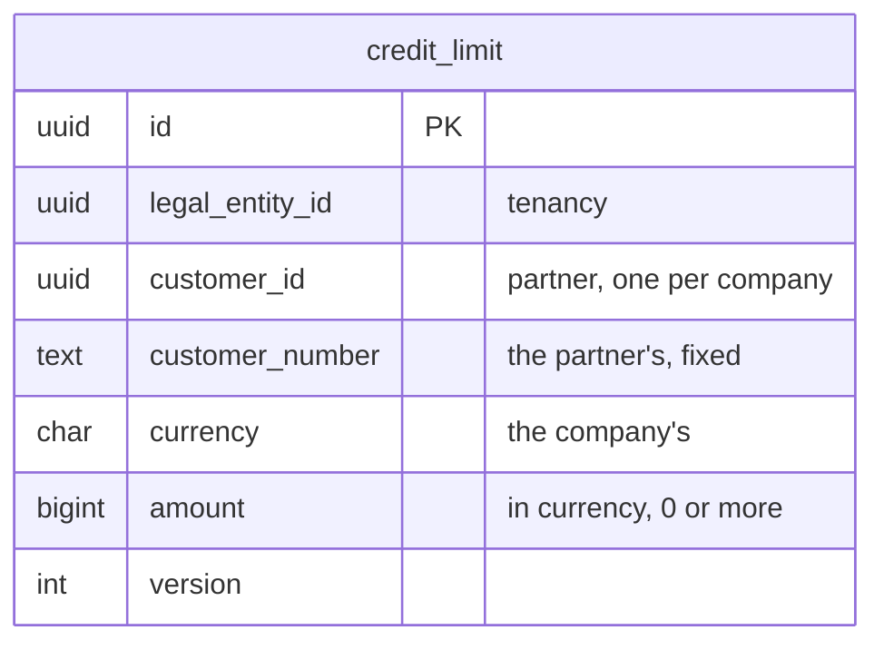

- `credit.credit_limit`: the most a customer may owe a company, an
  amount of zero or more (`credit_limit_amount_check`) in a known
  currency (`credit_limit_currency_fkey`), the company's when the limit
  was set; one per customer and company (`credit_limit_once`, which the
  API answers 409 `credit.limit_exists`); with the customer's business
  partner number (`credit_limit_customer_number_check`), by which the
  limits are listed (`credit_limit_by_customer_number`). A change sets
  the amount with the next version (`platform.touch`, which also moves
  `updated_at`): the application is granted the update of `amount`,
  `version` and `updated_by` alone, so a limit's customer, company and
  currency stay, and it is granted no delete. A customer without a row
  has no limit and is not restricted; a limit of zero is a limit.
- `credit.outbox`, `credit.inbox`: the context's events
  (`CreditLimitChanged`).
- Permissions `credit.limit.read` (limits and the exposure) and
  `credit.limit.write`.

## 3.29 Sales (`sales`)

ADR-0067, T78a-T79b. Built as receivables is: it reads the ledger, the
partner context, tenancy and the configuration through its ports, keeps no
foreign key out of its schema (02 §2.1) and posts nothing itself (billing
posts through receivables, §3.26). T78a (migration 000290) builds the
schema with its outbox and inbox and the quotation: what the company
offers a customer, valid until a date, net of tax. T78b (migration
000291) adds the sales order, T78c (migration 000292) the delivery
confirmation, which moves no stock (stock is outside the required
scope), T79a (migration 000293) the billing document, which posts
nothing until T79b, T80a (migration 000294) the price
records an item without a price is priced from, and T80b (migration
000295) discounts among them and the conditions applied to an item.
There is no material
master (§3.16's shared `material` joins the items when it is built): an
item names what is sold by a description and an optional free-text
`item_key`.

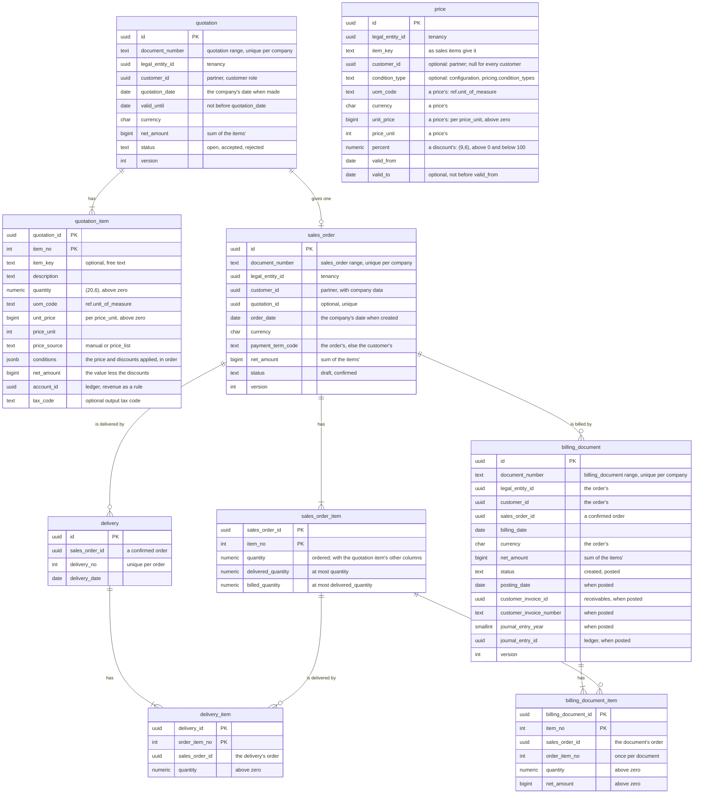

- `sales.quotation`: numbered once per company
  (`quotation_number_once`); valid until a day not before its date
  (`quotation_validity`); a net value above zero
  (`quotation_net_positive`), minor units of `currency`; the status is
  `open`, `accepted` or `rejected` (`quotation_status_check`). The
  customer's answer is its one change: an open quotation becomes accepted
  or rejected, once (`quotation_answered_once`), and the application may
  update `status`, `version` and `updated_by` alone and delete nothing.
  The list reads a company's quotations by date and a customer's
  (`quotation_by_date`, `quotation_by_customer`).
- `sales.quotation_item`: a description, and an item key when it has
  one, that are not white space alone
  (`quotation_item_description_check`, `quotation_item_item_key_check`);
  a quantity above zero
  (`quotation_item_quantity_positive`) in a unit of the reference data, a
  unit price above zero per a price unit above zero
  (`quotation_item_price_positive`, `quotation_item_price_unit_positive`)
  and a net value above zero (`quotation_item_net_positive`);
  insert-only (`platform.forbid_mutation`). `price_source` (T80a) says
  where the unit price came from: `manual`, entered with the item, the
  default, or `price_list`, a price record's
  (`quotation_item_price_source_check`; on an order item
  `sales_order_item_price_source_check`).
- `sales.sales_order` (T78b, migration 000291): numbered once per
  company (`sales_order_number_once`), with a payment term and a net
  value above zero (`sales_order_net_positive`); the status is `draft` or
  `confirmed` (`sales_order_status_check`). `quotation_id` names the
  quotation it was created from, null for an order created directly: an
  accepted quotation of its company, customer and currency
  (`sales_order_quotation_accepted`), and one order per quotation
  (`sales_order_one_per_quotation`). Confirming is its one change, once
  (`sales_order_confirmed_once`); the application may update `status`,
  `version` and `updated_by` alone and delete nothing. The list reads a
  company's orders by date and a customer's (`sales_order_by_date`,
  `sales_order_by_customer`). T77b (migration 000300) adds the credit
  block: `credit_block` is `none`, `blocked` or `released`
  (`sales_order_credit_block_check`), `none` for a draft
  (`sales_order_credit_block_confirmed`); `credit_released_by`,
  `credit_released_by_name` (the principal's display name then, as
  identity holds it, with no rule of its own) and
  `credit_released_at` are set exactly when it is `released`
  (`sales_order_credit_release`). The change rule
  (`sales_order_confirmed_once`) admits a draft confirmed with `none` or
  `blocked`, and a blocked order released, once; the application may
  also update these four columns. The credit exposure reads a
  customer's confirmed, unblocked orders by `sales_order_by_customer`.
- `sales.sales_order_item`: a quotation item's columns and rules, with
  `delivered_quantity` and `billed_quantity`, 0 when created:
  `0 <= billed_quantity <= delivered_quantity <= quantity`
  (`sales_order_item_quantities`). The application may not change or
  delete an item: `delivered_quantity` is moved by the delivery's
  trigger alone (T78c) and `billed_quantity` by the billing document's
  (T79a).
- `sales.delivery` (T78c, migration 000292): a confirmation that
  quantities of an order's items were delivered on `delivery_date`,
  numbered within its order (`delivery_no_positive`, `delivery_no_once`).
  Only a confirmed order that is not blocked for credit (T77b) takes
  one (`delivery_order_confirmed`, a trigger
  that also moves the order's `version` once per delivery and sets its
  `updated_by`, running as the table's owner: the application itself
  still changes a confirmed order in nothing, and
  `sales.check_sales_order_change` admits a confirmed order's version
  moved from a trigger alone). Insert-only (`platform.forbid_mutation`);
  the list reads an order's deliveries by date (`delivery_by_date`).
- `sales.delivery_item`: a quantity above zero
  (`delivery_item_quantity_positive`) of an item of the delivery's own
  order (`delivery_item_delivery_fkey`, `delivery_item_order_item_fkey`),
  an order item at most once per delivery (the primary key). Each insert
  adds its quantity to the order item's `delivered_quantity`
  (`delivery_item_delivered`, a trigger running as the table's owner),
  so that quantity is the sum of the item's deliveries and never above
  what was ordered (`sales_order_item_quantities`). Insert-only;
  `delivery_item_by_order_item` serves an order item's deliveries
  (`sales.Orders`).
- `sales.billing_document` (T79a, migration 000293): what is billed of
  one order, numbered once per company
  (`billing_document_number_once`), with its billing date and a net
  value above zero (`billing_document_net_positive`); the status is
  `created` or `posted` (`billing_document_status_check`). It is
  of a confirmed order of its company, customer and currency
  (`billing_document_order_confirmed`, a trigger running as the table's
  owner that also moves the order's `version` once per document and sets
  its `updated_by`). A posted document (T79b, migration 000296) names
  the customer invoice it posted as, by id and number, its posting date
  and the invoice's journal entry with its year, and a created one none
  of them (`billing_document_posted`); a customer invoice is one
  document's (`billing_document_invoice_once`). Posting is the only
  change: the application may update the columns posting sets, and the
  trigger `billing_document_posted_once` refuses a change of anything
  but a created document being posted. Nothing deletes one. The list reads a company's
  documents by date, a customer's and an order's
  (`billing_document_by_date`, `billing_document_by_customer`,
  `billing_document_by_order`).
- `sales.billing_document_item`: a quantity and an amount above zero
  (`billing_document_item_quantity_positive`,
  `billing_document_item_net_positive`) of an item of the document's own
  order (`billing_document_item_document_fkey`,
  `billing_document_item_order_item_fkey`), an order item at most once
  per document (`billing_document_item_once`). Each insert adds its
  quantity to the order item's `billed_quantity`
  (`billing_document_item_billed`, a trigger running as the table's
  owner), so that quantity is the sum of the item's billing documents
  and never above what is delivered (`sales_order_item_quantities`); the
  amounts billed of an order item never exceed its net value and are its
  net value once it is billed in full (`billing_document_item_amounts`).
  What an item names, its unit price, account and tax code are read from
  the order's item, which nothing changes. Insert-only
  (`platform.forbid_mutation`); `billing_document_item_by_order_item`
  serves what earlier documents billed of an order item.
- `sales.price` (T80a, migration 000294; ADR-0067 §10): the net price of
  an item key (`price_item_key_check`) in a company, for every customer
  (`customer_id` null) or for one, above zero (`price_positive`) per a
  price unit above zero (`price_unit_positive`) of a unit of the
  reference data, in a currency, valid from a day and, when `valid_to`
  is set, until a day not before it (`price_validity`). Insert-only
  (`platform.forbid_mutation`; the application may not update or delete):
  a new price is a new record, and the same key may have several. An
  item without a price takes the record of its key valid on the
  document's date in its unit and the document's currency: the
  customer's before the general one, then the latest `valid_from`, then
  the latest `created_at` and `id`. The determination and the list read a
  company's records of a key (`price_by_item_key`) and a customer's
  (`price_by_customer`).
  From T80b (migration 000295; ADR-0067 §11) a record may name a
  `condition_type` of the configuration (`price_condition_type_check`,
  a short code; the configuration is another context's, so there is no
  foreign key, and a type is never removed once activated), and a record
  is a price or a discount, never a mix (`price_or_percent`): a price
  has its unit, currency, price and price unit and no percent; a
  discount has a condition type and a `percent` above 0 and below 100
  (`price_percent_range`) and none of a price's columns. The discounts
  of a key are read by their type (`price_by_condition`).
- `conditions` on `sales.quotation_item` and `sales.sales_order_item`
  (T80b): a JSON array (`quotation_item_conditions_array`,
  `sales_order_item_conditions_array`), empty by default, of the
  conditions the pricing procedure applied when the item was created, in
  its order. Each has `condition_type`, `name`, `kind` and `amount`
  (minor units of the document's currency, a discount's negative); a
  price its `unit_price` and `price_unit`, a discount its `percent`. The
  amounts add up to the item's `net_amount`. An item whose price was
  entered (`price_source` `manual`) has its price alone: an entered
  price is the final net price (T80c, product owner 2026-11-12).
- `sales.outbox`, `sales.inbox`: the context's events
  (`QuotationChanged`, `SalesOrderChanged`, `SalesOrderDelivered`,
  `BillingDocumentChanged`, `BillingDocumentPosted`, `SalesPriceChanged`,
  `SalesOrderCreditBlocked`, `SalesOrderCreditReleased`).
- Permissions `sales.quotation.read` and `.write`; `sales.order.read`,
  `.write`, `.confirm` and `.credit_release` (T77b);
  `sales.delivery.confirm`; `sales.billing.read`,
  `.write` and `.post` (posting comes with T79b); `sales.price.read` and
  `.write`.

## 3.30 Revenue recognition (`revenue`)

ADR-0068, T81a-T81d. A leaf: it reads the sales context's orders (§3.29,
`sales.Orders`), the partner context's names and tenancy through its
ports and keeps no foreign key out of its schema (02 §2.1). T81a
(migration 000298) builds the schema with its outbox and inbox and the
revenue contract: the contract with a customer that one confirmed sales
order stands for, with one performance obligation per order item. The
inbox is in use: the context consumes the sales context's
`SalesOrderChanged` and creates a confirmed order's contract, once
(ADR-0068 §4). T81b (migration 000299) lets a person set a draft's
obligations and activate the contract, which allocates its transaction
price to them and fixes it. Nothing is posted before T81d.

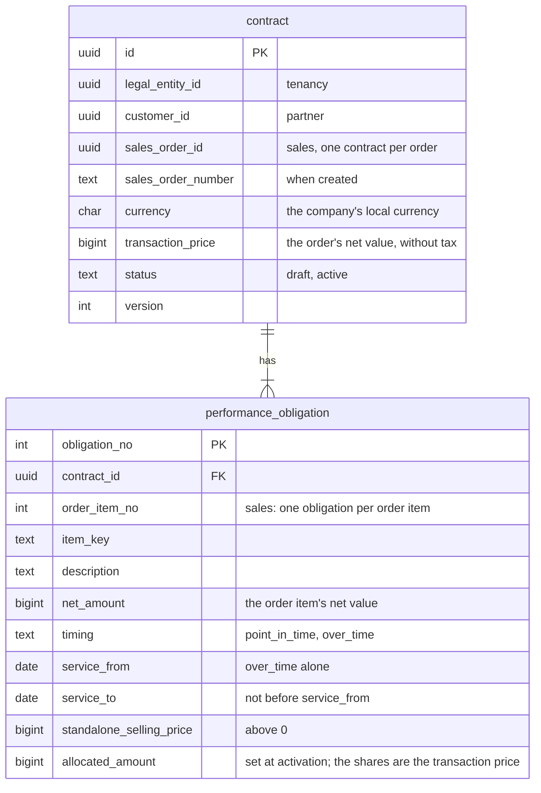

- `revenue.contract`: one per sales order
  (`contract_one_per_sales_order`: the consumer's insert and a person's
  request leave an existing one as it is); the status is `draft` or
  `active` (`contract_status_check`); `transaction_price` is
  above zero (`contract_transaction_price_positive`), minor units of
  `currency`; it keeps its order's number
  (`contract_sales_order_number_check`), which the list reads the
  tenant's contracts by (`contract_by_order_number`,
  `contract_by_customer`). A contract changes only while it is a draft
  (`contract_fixed_once_active`: its version moves with each change of
  its obligations, and activating it is its last change), and becomes
  active only when every obligation holds its allocated amount and the
  amounts add up to the transaction price
  (`contract_allocated_in_full`). The application may set its status,
  version and `updated_by` alone, and deletes nothing.
- `revenue.performance_obligation`: numbered from 1 within its contract,
  one per order item (`performance_obligation_one_per_order_item`), with
  the item's key and description
  (`performance_obligation_item_key_check`,
  `performance_obligation_description_check`) and net value
  (`performance_obligation_net_positive`); `timing` is `point_in_time`
  or `over_time` (`performance_obligation_timing_check`) and
  `standalone_selling_price` is above zero
  (`performance_obligation_price_positive`): both are a person's
  judgement, and start as point in time and the item's net value
  (ADR-0068 §2). An over-time obligation has a service period, from not
  after to, and a point-in-time obligation none
  (`performance_obligation_service_period`); `allocated_amount` is not
  negative (`performance_obligation_allocated_check`); the application
  leaves it absent until it activates the contract (the database holds
  the activation to the amounts, not a draft to their absence). An obligation is written and changed only
  while its contract is a draft
  (`performance_obligation_fixed_once_active`, which locks the
  contract's row, so a change and the activation wait for one another).
  The application may set its timing, service period, stand-alone
  selling price and allocated amount alone, and deletes nothing.
- `revenue.outbox`, `revenue.inbox`: the context's events
  (`RevenueContractChanged`), and the events its consumer
  `revenue-contracts` has read (the sales context's
  `SalesOrderChanged`), each recorded in the transaction of what the
  reading did.
- Permissions `revenue.contract.read`, `.write` and `.activate`.

## 3.31 Governance, risk and compliance (`grc`)

ADR-0078, T98a (migration 000304) and T98b (migration 000305). A leaf: it
reads the identity context (principals, the permission catalog,
segregation-of-duties rules) and the active configuration version through
its ports, in types of its own, imports no other context, posts nothing
and keeps no foreign key out of its schema (02 §2.1). It stores the
tenant's control library, the results of testing its controls and each
control's links to what enforces it. The library is the tenant's own: no
control is shipped. The control matrix has no table: whether a link holds
is computed on read (ADR-0078 §8).

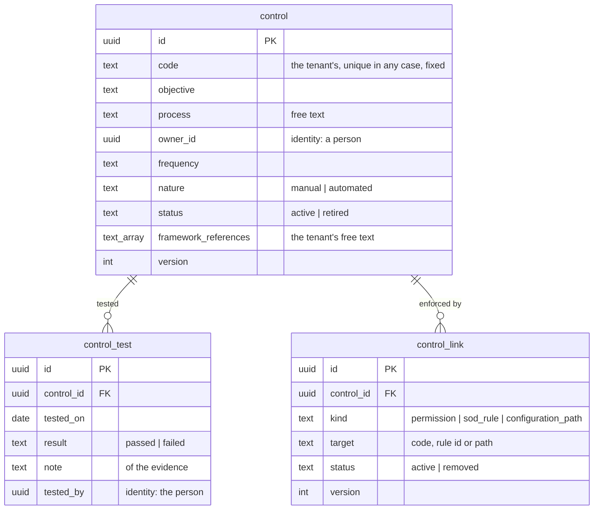

- `grc.control`: a control of the library. Its code is 1 to 40 letters,
  digits, dots, dashes and underscores (`control_code_check`), unique in
  the tenant whatever its case (`control_code_once`, which the API
  answers 409 `grc.control_code_taken`) and never changed: the
  application is granted the update of what a control says, its status,
  `version` and `updated_by`, not of `code`, and no delete. The
  objective is a text of up to 1,000 characters
  (`control_objective_check`), the process one of up to 100 without
  white space around it (`control_process_check`), the frequency one of
  `continuous`, `daily`, `weekly`, `monthly`, `quarterly`, `yearly`,
  `ad_hoc` (`control_frequency_check`) and the nature `manual` or
  `automated` (`control_nature_check`). A change moves the version by
  one (`platform.touch`, which also moves `updated_at`). The status is
  `active` or `retired` (`control_status_check`); a retired row is fixed
  (`control_retired_fixed`). The library is listed by code
  (`control_by_code`). `owner_id` is the identity context's; that the
  owner is an active person is the application's check when it is
  named.
- `grc.control_test`: the result of testing a control once, `passed` or
  `failed` (`control_test_result_check`) on a date, with a note of the
  evidence of up to 2,000 characters (`control_test_note_check`) and the
  person who tested. It belongs to a control of the tenant
  (`control_test_control_fkey`) and is insert-only
  (`control_test_immutable`, `platform.forbid_mutation`; no update or
  delete grant). A control's last test is the one with the latest
  `tested_on` and, among those of one date, the latest `id` (a UUIDv7),
  which `control_test_latest` reads first; it is computed on read and
  not stored on the control. That the date is not after today and that
  the control is active are the application's checks, under the
  control's row lock.
- `framework_references` on `grc.control` (T98b): the tenant's references
  to a framework it names, at most 50 texts of 1 to 200 characters
  without white space around them, none twice
  (`control_framework_references_check`,
  `grc.framework_references_valid`), in the order given; empty by
  default. Nothing checks a reference against a framework: none is
  shipped.
- `grc.control_link` (T98b): a link from a control
  (`control_link_control_fkey`) to what enforces it, by `kind`
  (`control_link_kind_check`): a permission's code, a
  segregation-of-duties rule's id or a configuration path of up to 500
  characters, each in the form of its kind (`control_link_target_check`).
  What it names is the platform's permission catalog's, identity's or
  the configuration's, so there is no foreign key: a link whose target
  is gone stays and the matrix shows it as broken. A control has one
  active link to a target (`control_link_once`, which the API answers
  409 `grc.control_link_exists`). A link is `active` or `removed`
  (`control_link_status_check`); removing it is its only change (the
  application is granted the update of `status`, `version` and
  `updated_by`, and no delete), with the next version
  (`platform.touch`), and a removed row is fixed
  (`control_link_removed_fixed`). A control's links are read in the
  order they were made (`control_link_by_control`). That the target is
  there when the link is made, and that the control is active, are the
  application's checks, under the control's row lock.
- `grc.outbox`, `grc.inbox`: the context's events (`ControlChanged`).
- Permissions `grc.control.read`, `grc.control.write` and
  `grc.control.test`.
