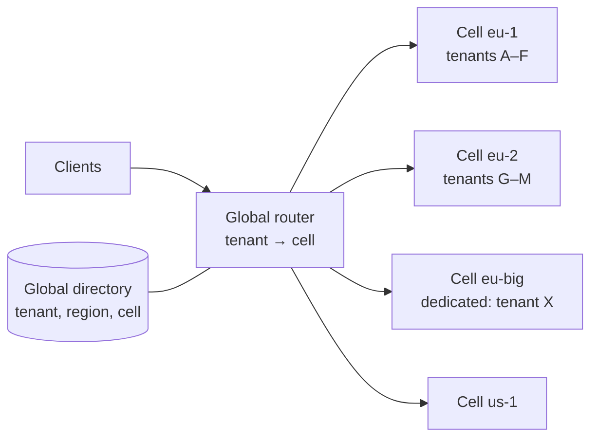

# 5. Scalability

This document shows how the design reaches the targets in
[01-requirements.md §1.3](01-requirements.md#13-non-functional-requirements)
by **adding capacity**, not by changing the architecture. Every step on the
evolution path in §5.6 uses keys, boundaries and contracts that exist from
day one.

## 5.1 Load model

Estimates for sizing, to be replaced by measurements from load tests.

| Quantity | Largest tenant | Region (all tenants) | Basis |
|---|---|---|---|
| Journal lines / year | 500 M | 10 B | Requirement |
| Average line inserts / s | ~16 | ~320 | ÷ 31.5 M s/year |
| Month-end peak line inserts / s | ~500 | ~10,000 | ×30 peak factor (close, payment runs, batch imports) |
| Storage per journal line incl. indexes | ~1 KB | | ~300 B row + PK + 4 secondary indexes |
| Ledger storage / year | ~0.5 TB | ~10 TB | lines × 1 KB |
| Ledger storage, 10 years online | ~5 TB | ~100 TB | Spread over cells (§5.4) |
| API requests / s | 2,000 sustained, 10,000 peak | 50,000 peak | Requirement |
| Reads : writes | ~10 : 1 | | Typical ERP mix; agents read heavily |

What follows from these numbers:

- **One PostgreSQL primary can carry the largest tenant.** ~500 line inserts/s
  at peak, plus document writes, is well inside a single well-provisioned
  primary (tens of thousands of simple inserts/s). Validating this with the
  load suite is the first scalability gate.
- **One primary cannot carry the region.** 100 TB and ~10,000 line inserts/s
  at peak need horizontal partitioning of tenants: cells (§5.4).
- **The application tier is not the bottleneck.** It is stateless; at an
  assumed ~1,000 requests/s per replica, 50,000/s is ~50 replicas across cells.

## 5.2 Stateless application tier

- The service keeps no session or cache state that matters for correctness.
  Any replica serves any request for its cell; Kubernetes scales replicas on
  CPU and request latency.
- Database connections go through PgBouncer in transaction mode. Because the
  tenant is set with `SET LOCAL` inside each transaction (ADR-0003), pooled
  connections never leak tenant context between requests.
- Workers (Temporal) scale per task queue independently of the API.
- Caches are optional accelerators with short TTLs and keys that include
  `tenant_id` and the resource `version`; a cache miss is always correct.
  Candidates: active configuration version, permissions per principal,
  reference data.

## 5.3 Database inside one cell

### Keys and indexes

- Every primary key, unique key and index leads with `tenant_id`
  (ADR-0003, verified by `db/schema_test.go`). Every tenant query is an index
  range scan inside one tenant, so query cost depends on that tenant's data,
  not on how many tenants share the database.
- UUIDv7 ids are time-ordered, so inserts append to the right of B-tree
  indexes instead of splitting random pages (ADR-0004).
- API filters are offered only where an index backs them (04 §4.5). Cursor
  pagination keeps every page a bounded index scan; there is no `OFFSET`.

### Partitioning

| Table | Partitioned by | Why | Maintenance |
|---|---|---|---|
| `ledger.journal_entry`, `ledger.journal_line` | `fiscal_year` (range) | Highest volume; queries name a year; old years detach to cheaper storage | Partitions exist 2015–2035; a yearly job adds the next year |
| `audit.audit_event` | `occurred_at` (monthly range) | High volume, append-only, time-bounded queries | A monthly job keeps 3 months of future partitions; the job's absence fails a health check |
| Future: `journal_line` year partitions | sub-partition by hash of `tenant_id` | Cells with very large tenants | New years are created sub-partitioned; past years stay as they are (no rewrite) |

Partition keys are part of every primary key on partitioned tables (for
example `(tenant_id, fiscal_year, id)`), which PostgreSQL requires and which
also routes every lookup to one partition.

### Avoiding contention

| Hot spot in a naive design | What this design does |
|---|---|
| Account balance row updated by every posting | Balances are derived by a projector from events; posting only inserts (ADR-0006) |
| Marking open items as cleared | Clearing is a separate insert-only table; a line is cleared once by a unique key |
| Payment item reservation | Partial unique index on active items; no table locks |
| Document numbering | Only gapless ranges lock their range row, and only for the transaction's remaining duration; non-gapless ranges can allocate numbers in blocks per replica |
| Optimistic concurrency | Version check on update; no locks held across user think time (ADR-0008) |
| Goods receipt quantities | Row lock on one purchase order item, not on the order or the table |

### Reads

- **Read replicas** serve list and report queries that tolerate replica lag
  (lag is exposed in a header). Reads that must see the caller's own write
  use the primary.
- **Trial balance and reports** read `ledger.period_balance` plus entries not
  yet projected, so they stay fast as history grows (target p95 1 s).
- **Analytics** reads a separate read model fed from events (later: CDC into a
  columnar store), never ad-hoc scans on the OLTP primary.

## 5.4 Cells: horizontal scale and isolation

A **cell** is a complete copy of the stack (service, workers, PostgreSQL
primary with standbys, NATS, object storage bucket) serving a set of tenants.

- The **global directory** maps tenant to region and cell. It is small, read
  mostly and cached at the router. It holds no business data. Built in T18:
  `internal/directory` (its own database, written by the cells, ADR-0022).
  It also maps each active identity provider's issuer and audience to its
  tenant (`directory.issuer`, ADR-0031): a cell claims the pair before a
  registration commits, so it belongs to one tenant across cells, gives it
  up when the provider is retired, and replaces its claims every round,
  never giving up a claim younger than five minutes, which may belong to a
  registration still committing (T37c); the router will resolve a token's
  tenant from it (T37d). The server reads the cell's providers for the
  rounds from the identity context, so the directory does not import it.
- The router resolves the cell from the token's tenant claim and forwards
  the request; clients may also call `https://{cell}.api.example.com` directly
  (the `servers` entry in the OpenAPI contract). Built in T18: `erp-router`.
- **Cell size is capped** (initial guideline: about 1 B journal lines per
  year, 10 TB, 5,000 requests/s). A full cell takes no new tenants; new cells
  are added by automation.
- **Failure isolation:** an incident in one cell affects only its tenants.
- **Residency:** cells belong to a region; a tenant's data never leaves its
  home region (assumption 6).
- **Dedicated cells** for very large or regulated tenants use the same
  schema and the same code.

### Moving a tenant between cells

Because every row carries `tenant_id` and no key spans tenants, moving a
tenant is a filtered copy: (1) copy all rows `WHERE tenant_id = X`
(logical replication with a row filter keeps the copy current); (2) put the
tenant briefly into read-only mode at the router; (3) let replication catch
up and verify row counts and the audit hash chain; (4) switch the directory
entry; (5) remove the old rows after a retention period. There are no
sequences to remap because ids are UUIDs. Step (2) is the directory's
`read_only` status (the router lets reads through and refuses writes with a
retry); step (1) is an export and an import (ADR-0029); step (3) is
`verifyTenant` on the global control plane, which compares the two cells'
fingerprints (ADR-0030); step (4) is an upsert of the entry's cell and API
URL, visible to the router within its cache period; step (5) is the erasure
of ADR-0021.

## 5.5 Events and asynchronous work

- The outbox relay publishes per context; NATS JetStream streams are per
  context, with subjects that include the tenant so consumers can scale out
  with ordering per tenant and resource.
- Consumers are idempotent (inbox tables), so they can be scaled, restarted
  and replayed freely.
- Long-running work (payment proposals over 100,000 items, migrations,
  simulations) runs in Temporal workers, chunked and resumable, and is
  exposed as API operations (ADR-0012).

## 5.6 Evolution path without rewrites

Each step is triggered by a measurement, uses structures that already exist,
and changes no API contract.

| Step | Trigger | Change | Why no rewrite is needed |
|---|---|---|---|
| 1. One cell, one primary, read replicas | Launch | — | Starting point |
| 2. More cells | A cell reaches its size cap | Provision another cell; route new tenants to it | Tenants are independent; directory already exists |
| 3. Move tenants | A tenant outgrows a shared cell | Copy rows by `tenant_id` into a dedicated cell (§5.4) | Every row and key carries `tenant_id`; UUID ids |
| 4. Sub-partition the ledger | Year partitions too big in a cell | Create new years hash-sub-partitioned by `tenant_id` | Partition keys are already in every PK |
| 5. Distribute a cell | One tenant exceeds one primary | Citus distributes tables by `tenant_id`; `ref` tables become reference tables | Keys and FKs already lead with `tenant_id`, so tables are co-located (see risks) |
| 6. Extract a context | A context dominates load or release cadence | Move its package to its own service and its schema to its own database | No cross-schema FKs; contexts talk through interfaces and events (ADR-0001) |
| 7. Columnar analytics | Read models lag or analytics hurts OLTP | Feed a columnar store by CDC from the outbox | Analytics already consumes events only |

## 5.7 Risks and how they are retired

| Risk | Retired by |
|---|---|
| Single-primary write throughput is lower than estimated | Load test of the posting path at 3× the largest-tenant peak before Phase 1 goes live |
| RLS adds measurable latency | Benchmark with and without RLS on the posting and list paths; policies are simple equality on the leading key column |
| Citus restrictions on triggers, RLS and deferred constraints (step 5) | A spike that runs `db/schema_test.go` against a Citus cluster before any tenant needs step 5; triggers already filter by `tenant_id`, which keeps them on one node |
| Projector lag makes balances stale | Reports add unprojected entries; lag is a monitored metric with an alert |
| Partition maintenance job not run | Health check fails when fewer than 3 future audit partitions or 2 future fiscal years exist |
| Hot tenant starves others in a shared cell | Per-tenant rate limits (04 §4.11), per-tenant connection limits in PgBouncer, move to a dedicated cell |

## 5.8 Verification

| Suite | What it proves | When |
|---|---|---|
| `db/schema_test.go` | Keys lead with `tenant_id`, RLS everywhere, no cross-context FKs, database rules hold | Every commit |
| Load test (posting, list, approval, trial balance) | p95/p99 targets at the largest-tenant peak in one cell | Before each phase goes live, then weekly |
| Soak test (24 h at sustained load) | No leaks, stable latency, projector keeps up | Before each release |
| Resilience tests (primary failover, NATS node loss, worker kill) | RPO/RTO targets; operations resume | Quarterly and before go-live |
| Tenant move rehearsal | §5.4 procedure works with verified counts and hash chain | Before the first shared cell exceeds 50% of its cap |
