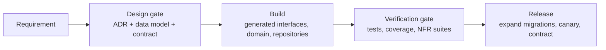

# 6. Engineering process

How work moves from an idea to production. The aim is that design, contract
and data model are agreed **before** code is written, and that every rule in
this design is checked by a machine, not by memory.

## 6.1 Gates



| Gate | Required to pass | Who signs off |
|---|---|---|
| **Design** | Problem statement and acceptance criteria; ADR for any significant or hard-to-reverse decision; data model change in `03-data-model.md` and a migration; API change in `openapi.yaml` / `asyncapi.yaml`, linted, no breaking changes | Tech lead + one domain (finance/SAP) reviewer + one API consumer for contract changes |
| **Verification** | CI green (§6.5); acceptance criteria demonstrated by tests; NFR budgets met for touched paths | Code reviewer |
| **Release** | Migration is backward compatible with the running version; feature flag or dark launch for risky changes; runbook updated | On-call owner of the context |

A change that touches only the inside of one context (no data model, contract
or ADR impact) skips the design gate and goes straight to review.

Since 2026-10-28 (ADR-0053 c) agents fill the design and verification roles
on the product owner's behalf: `go-reviewer` signs off those two gates and is
the API consumer's review under `REVIEW.md`'s API-consumer classes; the product
owner is not a gate. The release gate and the release approval of §6.9 are
unchanged.

## 6.2 Decision records

- One ADR per significant decision in `docs/design/adr/`, numbered, with
  context, decision, alternatives and consequences.
- Statuses: proposed → accepted → (superseded by ADR-NNNN). Accepted ADRs are
  never edited except to mark them superseded; a change of mind is a new ADR.
  When nothing settles a choice, the agent writes a new ADR, accepted once
  `go-reviewer` has no blocking finding on it, and the digest lists it the same
  way (ADR-0053 d). The one addition to an accepted ADR is an "As built"
  section, where an agent records a choice it took by default because the ADR,
  a design document or existing behaviour settled it (ADR-0053 d); it details
  the decision and never changes it, and the batch's digest lists it for the
  product owner to overrule after the fact.
- Write an ADR when a decision is expensive to reverse, crosses contexts, adds
  a runtime dependency, or relaxes a rule in this design.

## 6.3 Contract-first API workflow

1. Change `api/openapi.yaml` (and `api/asyncapi.yaml` for events) on a branch.
2. CI lints the contracts, runs `api/spec_test.go` (permissions, idempotency,
   `If-Match`, no deletes, problem responses) and diffs against `main` for
   breaking changes.
3. Review by a consumer (UI or integration) and the context owner: since
   2026-10-28 `go-reviewer`, under `REVIEW.md`'s API-consumer classes
   (ADR-0053 c).
4. Merge; server interfaces and clients are regenerated (`make generate`)
   and checked in. Handlers that do not implement the new interface fail to
   compile.
5. Contract tests replay the spec's examples against the running service.

## 6.4 Schema change rules

The database is the foundation, so changes to it are the most controlled.

**Every migration**

- Is a numbered pair `NNNNNN_name.up.sql` / `.down.sql` in `db/migrations/`,
  immutable once merged (fix forward with a new migration).
- Keeps the conventions of 03-data-model §3.1, checked by `TestDesignRules`:
  `tenant_id` leads every key, RLS on every table, no cross-context foreign
  keys, no floating-point money, no DELETE grant to the application.
- Comes with a schema test for every new database-enforced rule
  (`db/schema_test.go`): the valid case passes, the invalid case fails with
  the expected error.

**Zero-downtime (expand / migrate / contract)**

Releases are rolling, so the previous and the new application version run
against the same schema at the same time.

| Change | How |
|---|---|
| Add a column | Nullable or with a constant default (no table rewrite); backfill in batches; add `NOT NULL` later via a `NOT VALID` check, then `VALIDATE` |
| Rename a column or table | Never in place. Add the new one, write both, backfill, switch reads, stop writing the old one, drop it in a later release |
| Add an index | `CREATE INDEX CONCURRENTLY` in its own migration file (the runner applies such files outside a transaction) |
| Add an index to a partitioned table | PostgreSQL cannot build one concurrently on the parent. A migration starting `-- migrate:partitioned-index` holds one `CREATE [UNIQUE] INDEX name ON schema.table (...)`; the runner creates it `ON ONLY` the parent, then per partition `CREATE INDEX CONCURRENTLY` and `ATTACH PARTITION`, the parent's lock waits under a `lock_timeout`, and a failed run is picked up where it stopped (000134, T52b). Partitions created later inherit the index. 000055 predates it and built in a transaction |
| Add a foreign key or check | `NOT VALID` first, `VALIDATE CONSTRAINT` in a later migration |
| Change a type | New column + backfill + switch, as for a rename |
| Drop anything | Only after no running version reads it, at least one release later |
| Add a partition | Ahead of need, by the maintenance job; never on the request path |

Long backfills run as operations in batches with progress, not inside a
migration.

**Configuration keys (the tenant's configuration document)**

The document is versioned with the code, and during a rolling upgrade a
newer replica can activate a document with a key the previous version does
not know. So:

- Reading the active document for use (the settings other contexts read,
  the regression capture) tolerates unknown keys (`config.ParseActive`):
  they are ignored, each logged once per process, and the rest of the
  document is used. A document that does not read even so fails the call;
  a reader is never handed a missing document.
- Assessing and storing a change is strict. A submitted proposal is
  validated with `config.Parse`. A change based on a version with a key
  this replica does not know, or a stored proposal with one, is refused
  with 503 `config.unknown_keys` (retry: an upgraded replica takes it),
  because this replica would assess the change without the key, or store
  it without it. Its simulation fails the operation with that problem; the
  user simulates again once the replica is upgraded.
- A key is added before it is required. The release that adds it reads it
  as optional, with a defined meaning when absent (e.g. "no alerts"), and
  only a later release, once every replica knows it, may make validation
  require it. A key required from its first release (T47c's order release
  tiers, T47g's contract expiry notice) works in a mixed cell only because
  older replicas read such documents tolerantly and refuse to change them;
  configuration changes wait until the upgrade completes.
- A key that is a control older replicas would ignore is not activated in
  a mixed cell: an older replica reading the document tolerantly drops the
  control with the key. `companies[].release_dual_limit` (ADR-0038, T72m)
  is one: an older replica's `:release` has no approval check, so a change
  setting or lowering it is activated only after every replica runs the
  version that knows it. Refusing such activations automatically is
  tracked.

Migrations run as an administrative login that bypasses row-level security
(the superuser in development). `erp_owner` owns the objects but is subject
to it (every tenant table forces it), so a migration that reads or changes
tenant rows begins with `SET LOCAL row_security = off`: under a role that
does not bypass row-level security it then fails, rather than see no rows
and change nothing (000042, 000046).

## 6.5 Continuous integration

Every change passes, before it is merged:

| Step | Tool |
|---|---|
| Format, vet, static analysis | `gofmt`, `go vet`, `staticcheck` |
| Security | `govulncheck`, secret scanning (`gitleaks`), static analysis (`gosec`, with G104, G115, G304 and G107 excluded by decision: errors ignored on purpose carry a comment, integer conversions are of bounded domain values, paths and URLs come from settings and flags; the generated server excluded; the rest annotated where a finding is a false positive, each with its reason) |
| Contract lint and breaking-change check | `vacuum` (Go), `oasdiff` (Go) |
| Schema tests on PostgreSQL 17 | `go test ./db` against a CI service container |
| Unit, functional and non-functional tests with the race detector | `go test -race ./...` (locally three times in random order) |
| Performance budgets | `scripts/budgets.sh`: every package's `Test…Budget` and `Test…Perf`, found rather than listed, one package at a time |
| Coverage gate | `scripts/coverage.sh`, 100% of production statements |
| Fuzz targets | Every target's seed corpus with the tests on PRs; `make fuzz` 30 s per target on `main`, 5 minutes weekly |
| Image signing round trip | `make signing-roundtrip` against a registry service: push, sign and attest (SBOM, provenance) with a key pair made for the job, verify, and the refusals (another key, another commit, a tag, no signature, attestations without a signature, uncommitted changes) (ADR-0032). When signing or image inputs change, and weekly |
| Release scripts | `scripts/test-release-scripts.sh`: the version rules and the changelog's grouping on throwaway repositories, with the pinned git-cliff (ADR-0032). When those scripts or their inputs change, and weekly |
| Build and container images | `make build`; `make image-scan`: grype on each SBOM and the pinned base, failing on a fixable high or critical vulnerability; `make images-reproducible` (the four ko images, erp-temporal (ko, from `temporal/`) and erp-analytics built twice, with private caches, and their digests compared; one build at a time, as the three ko binaries that import `api/gen` and erp-analytics each compile it: measured cold, ko peaks at 3843 MiB and erp-analytics's buildx builder at 3784 MiB) when image inputs change, and weekly (ADR-0032) |
| Infrastructure (when the deploy workflow's paths change: `deploy/` but promotions, its scripts, `temporal/`, `scripts/lib/`, any workflow) | `scripts/deploy-checks.sh`: actionlint on the workflows, `terraform fmt`, `validate` and `test` in every module with tests (mock provider, no credentials), tflint, and the encryption-at-rest policy with conftest: unit tests, every root and module, and a fixture it must refuse (ADR-0035) |
| Cluster content (the same paths) | `scripts/helm-checks.sh`: the pinned add-ons, the charts and their policies with helm, kubeconform, promtool and conftest, then `scripts/admission-checks.sh` (Kyverno's CLI against images signed in a local zot registry); `scripts/test-mirror-images.sh` (the upstream images' copy, a dry run of the real list, and the copies signed and verified as the release does, with their refusals, ADR-0032 amendment of 2026-10-28; it also runs when `sign-images.sh`, `verify-image.sh` or `provenance.sh` change); `scripts/nats-checks.sh` (NATS authorization by SPIFFE identity); `scripts/temporal-checks.sh` (the temporal module's vet, lint, `-race` tests and 100% coverage) |
| Promotion checks' own tests (when they change) | `scripts/test-promotion-checks.sh`, `test-promotion-approvals.sh`, `test-rollback-drill.sh`, `test-restore-drill.sh` |

The checks are split between the author's machine and GitHub (the hybrid
check, since 2026-10-18; since 2026-10-21 every check runs once before a
merge, locally, and GitHub's pull request check is light — PO decision of
2026-10-21; since 2026-10-26 the full suite runs on `main` on demand rather
than on every push — PO decisions of 2026-10-26 and 2026-10-27), so runner
minutes go to the second line on `main` rather than to repeating the slow
gates on each pull request:

- **Lanes and batches (ADR-0053, PO decision of 2026-10-28):** a lane runs a
  fast loop on each step (a slice), and the full gates run once per batch. The
  lane's loop: `gofmt`, the build, `go vet`, the lint of changed code,
  staticcheck, gosec, gitleaks, `make generate` leaving no diff, the contract
  lint and the breaking-change check when the contract changes, the tests of
  the changed packages and of the packages that import them directly against
  real PostgreSQL with `-race` once, 100% statement coverage of the changed
  packages, and the reviewer. The whole-suite race run three times in random
  order, the whole-repository coverage gate, fuzzing, the budgets, the images,
  the signing round trip and the infrastructure checks run in `make ci-local`
  below, unchanged, on the batch before every pull request; `make ci-local` has
  the machine to itself, and three lanes run beside each other otherwise. The
  pilot walkthrough (`cmd/erp`'s `TestWalkthrough`, in `make ci-local`) runs on
  every batch and is each slice's acceptance evidence: the slice's step is
  among the steps the summary lists as passed, not skipped, which the
  coordinator reads from a `make walkthrough` run on the batch for the digest
  (the test prints the summary only when it fails). The coordinator records the
  cause of every `make ci-local` failure; if more than one batch in three fails
  on something the full lane gates would have caught, the lanes return to them.
- **Locally, before a pull request is merged:** `make ci-local`
  (`scripts/ci-local.sh`) runs every step of the table — every check
  GitHub runs on `main`, on demand or on a push, the deploy workflow's
  included — at the versions the workflows pin, with the race suite
  three times in random order (07 §7.7), on a committed tree rebased on
  the latest `main`. The path-conditional steps (the image reproducibility
  gate, the signing round trip, the release scripts, the deploy workflow's
  jobs, the promotion self-test) run on the classes `scripts/ci-changes.sh`
  gives GitHub, so a change skips locally exactly what `main`'s push run
  skips, except the image reproducibility gate: no push run holds it
  (`main`'s manual runs build twice every time, as does `weekly.yml`'s
  images job, on Sundays and on a dispatch of `all` or `images`), so
  locally it runs on the same classes; the report lists every step as
  ok, skip or FAIL, with the classes it used, and is named after the tree
  it tested in the repository's git directory. The Go tools come from
  `scripts/ci-tools.sh`; the released binaries (terraform,
  actionlint, helm, kubeconform, kyverno, zot, syft, promtool, git-cliff)
  and the deploy workflow's Go-built ones (tflint, conftest, cosign,
  crane) from `scripts/ci-local-tools.sh`, which reads their versions from
  the workflows and checks each archive against a hash recorded per
  platform. What a laptop does differently from a runner: the images are
  built for linux/amd64 alone (cross-compiled, as pull requests always
  built them; the weekly run builds and signs both platforms), the signing
  round trip's registry is a local `registry:2` container and PostgreSQL
  and Temporal are local rather than service containers, and
  `scripts/free-disk.sh` (a runner's disk) does not apply. Measured on
  2026-10-21 under load: a change to image inputs adds the double image
  build (445 s), the scan (29 s) and the signing round trip (255 s),
  about 12 minutes; other code changes build once and scan (not yet
  measured); a change to the deploy
  workflow's paths adds about 5 minutes (infrastructure 72 s, Helm and
  admission 100 s, temporal 111 s, mirroring and NATS seconds).
- **On GitHub, for a pull request (light, about 10 minutes):** the
  `changes` job (secret scan, the skip rules' tests, the classes) and the
  `short` job: format, vet, the whole-tree lint, the generated code, the
  contract lint and the breaking-change check against `main`, the build
  and the suite in short mode without the race detector, on a clean Linux
  runner. The deploy workflow does not run on pull requests; the promotion
  workflows do, as before.
- **Merging:** `scripts/merge-pr.sh <n>` merges with a merge commit only
  when `ci-ok` succeeded on the head commit, a passing local report exists
  for the head's tree, and the head contains `origin/main` as it is now.
  Since the slow gates run only locally, on the head's tree rather than on
  GitHub's merge of it into `main`, that rule makes the merge's tree the
  tested one, checked by `main`'s latest gates; a pull request is rebased
  and `make ci-local` re-run whenever `main` moves before it merges. Run
  `merge-pr.sh` from an up-to-date `main` checkout, as its own rules are
  the copy run. It posts the report on the pull request as the record. It stands in for branch
  protection, which a private repository on the current plan does not
  enforce: the product owner approved branch protection on 2026-10-28 and
  GitHub refused it, as it needs GitHub Pro or a public repository, so
  `merge-pr.sh` enforces `ci-ok` by convention (ADR-0053).
- **On GitHub, for a push to `main`:** fuzzing, and the signing round
  trip and the release scripts when their inputs changed, and the deploy
  workflow when its paths changed. A newer push cancels a running `ci`
  run, so merges in quick succession pay for one run; the deploy
  workflow's runs are not cancelled.
- **On GitHub, on demand on `main` after each batch of merges (the full
  suite, the second line; PO decisions of 2026-10-26 and 2026-10-27):** the
  `test` job — the static checks (staticcheck, govulncheck and gosec as
  well), the schema tests, the race detector, the performance budgets, the
  coverage gate, the images on both platforms built twice and their scan —
  with fuzzing, the signing round trip and the release scripts, on the tree
  `main` really holds. It runs only when started by hand
  (`workflow_dispatch`): the coordinator starts it on `main` after each
  batch of merges, and on any other branch a change to the jobs is tried
  before it reaches `main`. A manual run runs everything, whatever changed
  (`scripts/ci-changes.sh`). It no longer runs on every push: run
  40334507190 (2026-10-26, on the private repository's 2-CPU, 7.9 GB
  runner) was cancelled at its 120-minute limit with no test failed and the
  race step unfinished, and the whole job takes about three hours, so its
  limit is 240 minutes. Nor does it run nightly (PO decision of
  2026-10-27, after the Actions budget ran out): the run is about 190
  billable job-minutes, so a nightly run alone would cost about $35-45 a
  month. A manual and a push run on `main` do not cancel each other. After
  every merge the coordinator reads `main`'s latest push run, and after
  each batch its latest manual full run (coordinator/status.py), not only
  the pull request's light check: from 2026-10-21 to 2026-10-25 the runner
  stopped every run on `main`, unseen.
- **A red `main`** (PO decisions, 2026-10-21, 2026-10-26 and 2026-10-27):
  `main` is red while its latest push run, or its latest manual full run,
  is red. The merge that turned it red is reverted at once, or fixed
  forward within the hour when the fix is clear and small; nothing else
  merges meanwhile, and a release is cut only from a green `main`. A
  manual full run covers every merge of the batch before it, so the merge
  to blame is found among them. The local gates are the first line; the
  full suite on `main` is the second, which catches what a laptop cannot
  (a clean runner's timing, disk and platform), so a failure there is also
  a gap to close in `ci-local.sh`.
- **A gap in the gates** (PO decision, 2026-10-26): when something broke
  that a gate should have stopped, the note below records which layer should
  have caught it and what changed, so the same gap is not left open twice.
  - 2026-10-21: main's full suite failed on every push from 2026-10-21 (the
    runner stopped it; tracker, Quality engineering) and nobody saw it until
    2026-10-25, as the merge queue waited only for the pull request's short
    check. Layer: the merge queue, which should have read main's full run
    after each merge. Changed: `coordinator/status.py` prints main's runs,
    and the red-main rule above has been followed again since batch14.
  - 2026-10-27: main's manual full runs 40460447291 and 40547406558 were
    stopped by the runner 6 minutes into the image reproducibility gate,
    after every test had passed. ko ran as many builds as CPUs (two on the
    2-CPU, 7938 MiB runner), so erp-server compiled `api/gen` cold for
    both platforms at once: ko alone measured 6484 MiB at its peak that
    way, 3843 MiB one at a time. Layer: the machine checks, which did not
    hold the build's concurrency; `ci-local.sh` builds one platform on a
    machine with more memory, and the runner's memory was logged only in
    the race step. Changed: `scripts/images.sh` runs ko with `--jobs=1`,
    which `scripts/test-images.sh` holds, and the image step logs memory
    every 30 s too.
  - 2026-10-28 (apinames): new required response fields (`supplier_name`,
    `account_number`, `account_name`) passed oasdiff, which treats a new
    required response field as non-breaking, rightly for consumers; but the
    strict generated client rejects a stub response that lacks one, so
    `internal/web`'s stubs failed. Layer: the contract check lets it through
    by design, so `internal/web`'s tests are the layer that catches it, and
    a lane that adds required response fields runs them. Changed: no gate;
    the stubs answer the new fields.
  - 2026-10-28 (T72c): `make walkthrough` does not check the step headings
    that cmd/erp's TestWalkthrough asserts. Layer: the lane fast loop.
    Changed: a step that renumbers walkthrough steps runs
    `go test ./cmd/erp -run TestWalkthrough`.
  - 2026-10-29 (T72i follow-ups): the release tooling had no test that the
    registry the release pushes to is the one promotion accepts, nor that
    every image `release/release.json` names is built. Layer: the machine
    checks (the release scripts' own tests). Changed:
    `scripts/test-images.sh`'s consistency check holds the release's push
    target and built images, `modules/ecr`'s repositories and
    `release.json`'s names to each other; the registries admission accepts
    are per-environment values (`deploy/helm/erp-cluster`), which it does
    not hold.
  - 2026-10-29 (T72i follow-ups, batch21): adding erp-temporal to
    `modules/ecr` left `envs/tooling`'s `terraform test` expecting seven
    repositories, as the lane did not run `scripts/deploy-checks.sh` (the
    `terraform test` of the roots that use the module). Layer: the lane
    fast loop. Changed: a lane that changes infrastructure runs
    `scripts/deploy-checks.sh`, or `terraform test` on every root and
    module that uses a changed module; the test now names the
    repositories rather than counting them.
  - 2026-10-29 (T72f, batch21): T72f's new required field
    `GrIrBalance.migrated_quantity` and its new problems
    (`ledger.gr_ir_position_exists`, `procurement.no_gr_ir_account`) passed
    the lane, but `internal/web`'s stubs lacked the field and seven
    operations' `x-problem-codes` lacked the problems, so `internal/web` and
    `api`'s TestProblemCodes failed on the batch. Layer: the lane fast loop.
    `api` imports no context, so it is never a direct importer:
    TestProblemCodes loads the server's call graph at run time. And the
    apinames rule above, that a lane adding required response fields runs
    `internal/web`'s tests, was not followed. Changed: the fast loop
    (07 §7.7) now names both: a step that adds, removes or moves a
    `problem.*` code or changes a handler runs
    `go test ./api -run TestProblemCodes`, and a step that regenerates
    `api/gen` runs `internal/web`'s tests; a lane that changes
    infrastructure runs `scripts/deploy-checks.sh` (the entry above). The
    stubs answer the field and the codes were rewritten with
    `go test ./api -run TestProblemCodes -update`.
  - 2026-10-29 (T72i follow-ups, batch21): `make ci-local`'s images gate
    stopped with "images: ko listed no erp-temporal image". ko lists each
    image of a multi-platform index as `repo/name@sha256:…`, but one image
    (one platform) as `repo/name:tag@sha256:…` when it does not push it
    (its no-op publisher, which the reproducibility gate and the scan use)
    or pushes it under one tag other than latest; `images.sh`'s check of
    the second ko run accepted only the first form. Layer: the lane fast loop and the
    machine checks. The lane tested erp-temporal's build only with
    `PUSH=true` against a local registry, and `scripts/test-images.sh`'s
    fake ko listed every build as an index by digest, so the local
    one-platform listing was never exercised. Changed: the check accepts
    both forms; the fake ko lists as ko v0.19.1 does (one platform, one
    image, under its tag unless pushed under latest or several tags), and
    the test requires the five ko images, erp-temporal among them, listed
    from a local one-platform build with their SBOMs, and a ko run that
    lists no erp-temporal image refused.
- Secret scanning and the tracker check run on every event. Everything
  else is skipped when `scripts/ci-changes.sh` finds that only
  documentation changed (`docs/`, Markdown) since the base: a pull
  request's base, or for a push to `main` the last commit whose run there
  passed, as a cancelled run proves nothing. Whatever it cannot establish
  runs.
- `scripts/merge-pr.sh` requires one check, `ci-ok`: it fails unless the
  `changes` job (the secret scan and the skip decision) and the `tracker`
  job succeeded and no job failed or was cancelled; on a pull request that
  is `changes`, `tracker` and `short`, the others skipped; on a push to
  `main`, `test` is skipped too and the run passes without it; on a manual
  run every job but `short` runs, so a failed `test` turns that run's
  `ci-ok` red. Jobs skipped on purpose pass; requiring them directly would
  let a failed `changes` skip them into a pass.
- A newer push cancels the running check of the same pull request or of
  `main`, and a newer manual run an older one on the same branch; the
  older commit then shows `ci-ok` failed, which is expected.
- In `ci-local.sh`, the image reproducibility gate and the signing round
  trip run when their inputs change: the paths of the `images` class in
  `scripts/ci-changes.sh`, which is the rule (`go.mod`, `go.sum`,
  `.ko.yaml`, `.dockerignore`, `deploy/images/`, `Makefile`, `cmd/`,
  `temporal/go.mod`, `temporal/go.sum`, `temporal/cmd/`, `release/`, `scripts/image*`, `scripts/test-images*`,
  `scripts/lib/sbom-root*`, `scripts/sign*`, `scripts/verify-image*`,
  `scripts/provenance*`, `scripts/free-disk*`, `ci.yml`, `weekly.yml`);
  otherwise the images are built once and scanned. On a push to `main` the signing
  round trip runs on the same rule; a manual run runs everything
  (`scripts/ci-changes.sh`), so it runs both every time. `ci-local.sh` builds and signs linux/amd64
  only, as pull requests did on the runner; `main`'s
  test job builds both platforms and its signing job linux/amd64, to fit
  the runner's disk (`scripts/free-disk.sh` clears unused toolchains
  first); both platforms are built twice and signed weekly. The release
  scripts' tests run when those scripts, `cliff.toml`, the `Makefile` or a
  workflow that uses them change, on every manual run and weekly.
- The tools run at pinned versions (`scripts/ci-tools.sh`), built once in
  the job that uses them and cached until that file or the Go version
  changes. They are saved to the cache right after they are built
  (`actions/cache/restore` and `actions/cache/save`), not in the action's
  post step, which runs only when the whole job succeeds: from 2026-10-21
  to 2026-10-26 no run of `main` finished, so each one rebuilt them, about
  14 minutes. The `changes` job builds nothing: it gates every other job and
  stays within a few minutes, with gitleaks as its released binary checked
  by hash.

Weekly (Sundays) and on demand before a release: the load and soak suites
(05 §5.8), the whole suite three times in random order, longer fuzzing, the
reproducibility gate, the signing round trip, the image scan of `main` again
and a check that the pinned base image is still its tag's digest (ADR-0032),
dependency updates. Latency budgets on the shared runner are scaled by `ERP_BUDGET_SCALE`
(docs/testing.md); the budgets at scale 1 are checked in a cell-sized
environment.

## 6.6 Testing strategy

| Level | Scope | Runs against |
|---|---|---|
| Domain unit tests | Pure Go rules: matching, tolerances, tax, payment proposals | Nothing external |
| Schema tests | Database-enforced invariants and design rules | Real PostgreSQL |
| Repository tests | Mapping between domain and tables; error translation to API codes | Real PostgreSQL |
| Application tests | Use cases with transactions, authorization, idempotency, outbox | Real PostgreSQL, fake clock |
| Contract tests | Handlers against `openapi.yaml` examples and schemas | Running service |
| End-to-end | Procure-to-pay through the public API, as UI and agents use it | Full stack in containers |
| Non-functional | Performance budgets, load, soak, resilience, security (authz matrix, tenant isolation) | Full stack |
| Agent evaluations | Suites per agent (ADR-0039): cases on throwaway tenants with deterministic checks, replayed with the scripted model in CI and run live on demand (`make eval AGENT=…`), never per change | `internal/eval`, `llmtest` / the cell's gateway |

Tests never use mocks for PostgreSQL. A rule enforced by the database is
tested against the database.

## 6.7 Code layout for contexts

Each bounded context is one flat Go package, `internal/<context>`, holding the
layers of 02-architecture §2.1 as files rather than sub-packages: its types and
invariants, its use cases (each in the unit of work: transaction, authorization,
idempotency, outbox, audit), the SQL against its own schema, and `api.go`, the
handlers of its part of the generated OpenAPI interface. What other contexts may
call is the package's exported Go API, usually a small interface the caller declares
and the context satisfies (for example `payables` declares the `Payments` it
needs and `payments.Reservations` satisfies it), wired together in one place:
`internal/app`.

```
internal/<context>/      one context: types, use cases, SQL, api.go handlers
internal/delivery/<agent>/  each delivery agent stands alone
internal/money/          shared kernel every context may import
internal/tax/            shared kernel: the pure tax calculator (ADR-0049)
internal/platform/<pkg>/ technical services the contexts use (database, uow,
                         outbox, audit, authn, problem, ...) and test support
internal/platform/httpapi/  the request pipeline around the generated server
                         (authentication, quotas, unit of work, problems);
                         names no context
internal/app/            the composition root: builds the API from every
                         context's handlers and wires their ports together;
                         cmd/erp-server's workers use the same wiring
internal/app/apitest/    test support: the real API on the test database
```

Import rules, checked by `internal/layout`'s test, which parses the imports of
every production file under `internal/` and `cmd/`:

- A platform package imports no context. The one exception is named in the
  test: `platform/fixture`, test support that builds a configured tenant.
- Any package may import the platform and the shared kernel (`money`, `tax`,
  which imports only `money`: a shared package imports only shared ones); the
  composition root `app` and a command under `cmd/` may import any context,
  since they wire them together.
- A context imports another context only where the test's allowlist says so.
  The list is exact: a new dependency fails the test until it is added there,
  in the same change as the interface it uses (and an ADR if it reverses a
  dependency direction), and an entry no longer used fails it too.
- A leaf context (today `cash`, ADR-0051 §2) is imported by no context,
  whatever the allowlist says: it reads others through ports, and another
  context that must ask it something declares a port of its own, which the
  composition root wires (as `partner.PlanningGroups` is).
- Tests are not checked: a test may import whatever it needs.

The test also refuses a production import of test support (`pgtest`,
`fixture`, `apitest`, the fake servers, `nfr`).

The test checks Go imports only; the same rule holds for SQL by review. A
context's SQL names its own schema; another context's rows are read and
written through that context's Go API, in the caller's transaction. So
`tenancy` owns the tenant row (the control plane, provisioning, offboarding
and the directory go through it), `identity` answers who deferred work acts
as (`identity.Actors`) and creates a tenant's first administrator, and each
context lists its own operations waiting for a workflow
(`operations.Waiting`) for the workflows dispatcher. Platform packages
own technical tables that sit in context schemas: `fieldcrypt` the tenant
keys (`tenancy.tenant_key`), `platform/audit` the hash chain
(`audit.audit_event`, `audit.chain_head`); `uow` and `authz` read
`tenancy.tenant` and identity's grants to admit a request. Accepted
exceptions, each named at its query:

- The `platform` schema (the outbox, idempotency keys, `platform.operation`)
  is shared technical state. Contexts whose work runs as an operation join
  `platform.operation` to their own rows to find and claim it, locking both
  in one statement; provisioning and the control plane store and replay
  their idempotency keys in it.
- The `ref` schema (currencies, permissions) is reference data every
  context reads.
- Offboarding's export, import and fingerprint read and write every tenant
  table through the catalog (ADR-0021, ADR-0030): they move the tenant's
  data as data.
- `cmd/erp-server`'s backlog gauges count queues across schemas as the role
  that drains each: the operators' read-only view of the cell.
- nfr, test support, reads several schemas to check its load runs.

## 6.8 Definition of done

A change is done when:

- [ ] A change that adds or changes a capability is a slice (ADR-0053): a
      capability a named user or API consumer can use end to end, with at least
      one new or extended step of the pilot walkthrough
      (`scripts/walkthrough.sh`) exercising it through the public API, which
      passes, not skipped, in the batch's run. A fix, refactoring, CI, process
      or documentation change needs no walkthrough step.
- [ ] Acceptance criteria are covered by tests at the right level (§6.6).
- [ ] The lane's fast loop (§6.5) passed and the reviewer has no blocking
      finding, the API-consumer classes of `REVIEW.md` included.
- [ ] Contract, data model and ADRs match what was built.
- [ ] CI is green, including 100% coverage and schema tests: `make ci-local`
      passes on the batch before it merges, and GitHub's `ci-ok`.
- [ ] New permissions are seeded and mapped to roles; new rules have audit
      records and events.
- [ ] Metrics, traces and structured logs exist for new operations, with
      `tenant_id`, `principal_id` and `trace_id`.
- [ ] Migration follows §6.4 and was applied to a copy of production-sized data
      when it touches large tables.
- [ ] The tracker (`docs/tracker.json`) is updated.

## 6.9 Branching, review and release

- Trunk-based: short-lived branches, pull requests into `main`, at least one
  reviewer; two for migrations, contracts and security-sensitive code.
- Review follows `REVIEW.md` (PO decision, 2026-10-26). A finding is
  labelled Blocking (correctness, money, tenancy, authorization,
  concurrency, idempotency, a contract break, an API-consumer class of
  `REVIEW.md` (ADR-0053), a `CLAUDE.md` convention), Nit
  (never blocking, at most three a round) or Pre-existing (not introduced by
  the diff: never held against the step, tracked as `review:<step>` or
  `review:batch<N>`). It
  cites `path:line` and names its bug class, and the author fixes every
  instance of the class in the diff. After the first round a round reviews
  only the changes since the previous one; after three rounds on one step
  with a blocking finding left, the author reconsiders the approach and
  tells the coordinator.
- Commit subjects are a sentence naming the tracker item, prefixed `Fix:`,
  `Refactor:`, `Tests:` (older history also `Test:`), `CI:`, `Plan:`,
  `Tracker:`, `Process:` or `Release:` where they are one of those; the
  version and the changelog are computed from them (ADR-0032). The pull
  request links its tracker item.
- `main` is always releasable. A release is cut by dispatching the release
  workflow from a green `main` commit; a second person approves it in the
  `release` environment. The workflow computes the version
  (`scripts/next-version.sh`) unless one is given, builds and scans the
  images, pushes them tagged with the version to the release registry
  (tooling's ECR, the only one: ADR-0032 amendment of 2026-10-29), copies
  the pinned upstream images (PgBouncer, NATS) into it, signs and verifies
  them all,
  tags the built commit, publishes the GitHub Release with the generated
  notes, and opens, as the release GitHub App so that CI runs on it, the
  pull request that adds them to `CHANGELOG.md`. The environment's
  settings (reviewers, the signing key, the AWS role, the App) are listed in
  `.github/workflows/release.yml`. A run that failed after it pushed the tag
  is dispatched again with the same version, which resumes from the tag.
  Releases are container images promoted through dev → staging → canary
  cell → all cells.
- Feature flags (per tenant) hide incomplete features; flags are removed once
  a feature is fully rolled out.
