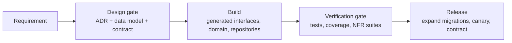

# 6. Engineering process

How work moves from an idea to production. The aim is that design, contract
and data model are agreed **before** code is written, and that every rule in
this design is checked by a machine, not by memory.

## 6.1 Gates



| Gate | Required to pass | Who signs off |
|---|---|---|
| **Design** | Problem statement and acceptance criteria; ADR for any significant or hard-to-reverse decision; data model change in `03-data-model.md` and a migration; API change in `openapi.yaml` / `asyncapi.yaml`, linted, no breaking changes | Tech lead + one domain (finance/SAP) reviewer + one API consumer for contract changes |
| **Verification** | CI green (§6.5); acceptance criteria demonstrated by tests; NFR budgets met for touched paths | Code reviewer |
| **Release** | Migration is backward compatible with the running version; feature flag or dark launch for risky changes; runbook updated | On-call owner of the context |

A change that touches only the inside of one context (no data model, contract
or ADR impact) skips the design gate and goes straight to review.

## 6.2 Decision records

- One ADR per significant decision in `docs/design/adr/`, numbered, with
  context, decision, alternatives and consequences.
- Statuses: proposed → accepted → (superseded by ADR-NNNN). Accepted ADRs are
  never edited except to mark them superseded; a change of mind is a new ADR.
- Write an ADR when a decision is expensive to reverse, crosses contexts, adds
  a runtime dependency, or relaxes a rule in this design.

## 6.3 Contract-first API workflow

1. Change `api/openapi.yaml` (and `api/asyncapi.yaml` for events) on a branch.
2. CI lints the contracts, runs `api/spec_test.go` (permissions, idempotency,
   `If-Match`, no deletes, problem responses) and diffs against `main` for
   breaking changes.
3. Review by a consumer (UI or integration) and the context owner.
4. Merge; server interfaces and clients are regenerated (`make generate`)
   and checked in. Handlers that do not implement the new interface fail to
   compile.
5. Contract tests replay the spec's examples against the running service.

## 6.4 Schema change rules

The database is the foundation, so changes to it are the most controlled.

**Every migration**

- Is a numbered pair `NNNNNN_name.up.sql` / `.down.sql` in `db/migrations/`,
  immutable once merged (fix forward with a new migration).
- Keeps the conventions of 03-data-model §3.1, checked by `TestDesignRules`:
  `tenant_id` leads every key, RLS on every table, no cross-context foreign
  keys, no floating-point money, no DELETE grant to the application.
- Comes with a schema test for every new database-enforced rule
  (`db/schema_test.go`): the valid case passes, the invalid case fails with
  the expected error.

**Zero-downtime (expand / migrate / contract)**

Releases are rolling, so the previous and the new application version run
against the same schema at the same time.

| Change | How |
|---|---|
| Add a column | Nullable or with a constant default (no table rewrite); backfill in batches; add `NOT NULL` later via a `NOT VALID` check, then `VALIDATE` |
| Rename a column or table | Never in place. Add the new one, write both, backfill, switch reads, stop writing the old one, drop it in a later release |
| Add an index | `CREATE INDEX CONCURRENTLY` in its own migration file (the runner applies such files outside a transaction) |
| Add an index to a partitioned table | PostgreSQL cannot build one concurrently on the parent. Before the pilot: a plain `CREATE INDEX` in a transaction, with the reason in the migration (000055); writes to the table wait while it builds, reads do not, and partitions created later inherit the index. Before production-sized data, the runner gains the per-partition build (index `ON ONLY` the parent, `CREATE INDEX CONCURRENTLY` per partition, `ATTACH PARTITION`, under a `lock_timeout`); tracked |
| Add a foreign key or check | `NOT VALID` first, `VALIDATE CONSTRAINT` in a later migration |
| Change a type | New column + backfill + switch, as for a rename |
| Drop anything | Only after no running version reads it, at least one release later |
| Add a partition | Ahead of need, by the maintenance job; never on the request path |

Long backfills run as operations in batches with progress, not inside a
migration.

**Configuration keys (the tenant's configuration document)**

The document is versioned with the code, and during a rolling upgrade a
newer replica can activate a document with a key the previous version does
not know. So:

- Reading the active document tolerates unknown keys (`config.ParseActive`):
  they are ignored, each logged once per process, and the rest of the
  document is used. A document that does not read even so fails the call;
  a reader is never handed a missing document.
- Submitting, validating, simulating and activating stay strict
  (`config.Parse`): a proposal with a key this replica does not know is
  refused here (simulation leaves it queued for a replica that knows it,
  activation answers 422), because reading it without the key would drop it.
- A key is added before it is required. The release that adds it reads it
  as optional, with a defined meaning when absent (e.g. "no alerts"), and
  only a later release, once every replica knows it, may make validation
  require it. A key that is required from its first release (T47c's order
  release tiers, T47g's contract expiry notice) is safe only because of the
  tolerant read above: an older replica keeps working with the documents
  activated by a newer one.

Migrations run as an administrative login that bypasses row-level security
(the superuser in development). `erp_owner` owns the objects but is subject
to it (every tenant table forces it), so a migration that reads or changes
tenant rows begins with `SET LOCAL row_security = off`: under a role that
does not bypass row-level security it then fails, rather than see no rows
and change nothing (000042, 000046).

## 6.5 Continuous integration

Every change passes, before it is merged:

| Step | Tool |
|---|---|
| Format, vet, static analysis | `gofmt`, `go vet`, `staticcheck` |
| Security | `govulncheck`, secret scanning (`gitleaks`), static analysis (`gosec`, with G104, G115, G304 and G107 excluded by decision: errors ignored on purpose carry a comment, integer conversions are of bounded domain values, paths and URLs come from settings and flags; the generated server excluded; the rest annotated where a finding is a false positive, each with its reason) |
| Contract lint and breaking-change check | `vacuum` (Go), `oasdiff` (Go) |
| Schema tests on PostgreSQL 17 | `go test ./db` against a CI service container |
| Unit, functional and non-functional tests with the race detector | `go test -race ./...` (locally three times in random order) |
| Performance budgets | `-run Budget`, `-run Perf` |
| Coverage gate | `scripts/coverage.sh`, 100% of production statements |
| Fuzz targets | Every target's seed corpus with the tests on PRs; `make fuzz` 30 s per target on `main`, 5 minutes weekly |
| Build and container image | `go build`, image scan |

The checks are split between the author's machine and GitHub (the hybrid
check, since 2026-10-18), so runner minutes go to the independent second
opinion rather than to repeating the slow gates:

- **Locally, before a pull request is merged:** `make ci-local`
  (`scripts/ci-local.sh`) runs every step of the table at CI's pinned tool
  versions, with the race suite three times in random order (07 §7.7), on
  a committed tree rebased on the latest `main`. It records a report named
  after the tree it tested in the repository's git directory.
- **On GitHub, for a pull request:** the static checks (format, vet, whole
  tree lint, staticcheck, govulncheck, gosec, the generated server, the
  contract lint and the breaking-change check against `main`), the schema
  tests, the whole suite in short mode without the race detector, and the
  build: about 15 minutes on a clean Linux runner, which has caught what a
  laptop did not (timing, disk, platform).
- **Merging:** `scripts/merge-pr.sh <n>` merges with a merge commit only
  when `ci-ok` succeeded on the head commit and a passing local report
  exists for the head's tree, and posts that report on the pull request as
  the record. It stands in for branch protection, which a private
  repository on the current plan does not enforce.
- **On GitHub, for a push to `main`:** everything above but the
  breaking-change check (a pull request's), plus the race detector, the
  performance budgets, the coverage gate and fuzzing, on the tree `main`
  really holds. A newer push cancels a running one, so merges
  in quick succession pay for one run. A red `main` stops merging until it
  is fixed forward, and a release is cut only from a green `main`.
- Secret scanning runs on every event. Everything else is skipped when
  `scripts/ci-changes.sh` finds that only documentation changed (`docs/`,
  Markdown) since the base: a pull request's base, or for a push to `main`
  the last commit whose run there passed, as a cancelled run proves
  nothing. Whatever it cannot establish runs.
- `scripts/merge-pr.sh` requires one check, `ci-ok`: it fails unless the
  `changes` job (the secret scan and the skip decision) succeeded and no
  job failed or was cancelled. Jobs skipped on purpose pass; requiring
  them directly would let a failed `changes` skip them into a pass.
- A newer push cancels the running check of the same pull request or of
  `main`; the older commit then shows `ci-ok` failed, which is expected.
- The tools run at pinned versions (`scripts/ci-tools.sh`), built once in
  the job that uses them and cached until that file or the Go version
  changes. The `changes` job builds nothing: it gates every other job and
  stays within a few minutes, with gitleaks as its released binary checked
  by hash.

Weekly (Sundays) and on demand before a release: the load and soak suites
(05 §5.8), the whole suite three times in random order, longer fuzzing,
dependency updates. Latency budgets on the shared runner are scaled by `ERP_BUDGET_SCALE`
(docs/testing.md); the budgets at scale 1 are checked in a cell-sized
environment.

## 6.6 Testing strategy

| Level | Scope | Runs against |
|---|---|---|
| Domain unit tests | Pure Go rules: matching, tolerances, tax, payment proposals | Nothing external |
| Schema tests | Database-enforced invariants and design rules | Real PostgreSQL |
| Repository tests | Mapping between domain and tables; error translation to API codes | Real PostgreSQL |
| Application tests | Use cases with transactions, authorization, idempotency, outbox | Real PostgreSQL, fake clock |
| Contract tests | Handlers against `openapi.yaml` examples and schemas | Running service |
| End-to-end | Procure-to-pay through the public API, as UI and agents use it | Full stack in containers |
| Non-functional | Performance budgets, load, soak, resilience, security (authz matrix, tenant isolation) | Full stack |
| Agent evaluations | Agent behaviour on recorded scenarios, with the LLM stubbed in CI and live in nightly evals | `llmtest` stubs / Claude API |

Tests never use mocks for PostgreSQL. A rule enforced by the database is
tested against the database.

## 6.7 Code layout for contexts

Each bounded context is one flat Go package, `internal/<context>`, holding the
layers of 02-architecture §2.1 as files rather than sub-packages: its types and
invariants, its use cases (each in the unit of work: transaction, authorization,
idempotency, outbox, audit), the SQL against its own schema, and `api.go`, the
handlers of its part of the generated OpenAPI interface. What other contexts may
call is the package's exported Go API, usually a small interface the caller declares
and the context satisfies (for example `payables` declares the `Payments` it
needs and `payments.Reservations` satisfies it), wired together in one place:
`internal/app`.

```
internal/<context>/      one context: types, use cases, SQL, api.go handlers
internal/delivery/<agent>/  each delivery agent stands alone
internal/money/          shared kernel every context may import
internal/platform/<pkg>/ technical services the contexts use (database, uow,
                         outbox, audit, authn, problem, ...) and test support
internal/platform/httpapi/  the request pipeline around the generated server
                         (authentication, quotas, unit of work, problems);
                         names no context
internal/app/            the composition root: builds the API from every
                         context's handlers and wires their ports together;
                         cmd/erp-server's workers use the same wiring
internal/app/apitest/    test support: the real API on the test database
```

Import rules, checked by `internal/layout`'s test, which parses the imports of
every production file under `internal/` and `cmd/`:

- A platform package imports no context. The one exception is named in the
  test: `platform/fixture`, test support that builds a configured tenant.
- Any package may import the platform and the shared kernel (`money`); the
  composition root `app` and a command under `cmd/` may import any context,
  since they wire them together.
- A context imports another context only where the test's allowlist says so.
  The list is exact: a new dependency fails the test until it is added there,
  in the same change as the interface it uses (and an ADR if it reverses a
  dependency direction), and an entry no longer used fails it too.
- Tests are not checked: a test may import whatever it needs.

The test also refuses a production import of test support (`pgtest`,
`fixture`, `apitest`, the fake servers, `nfr`).

The test checks Go imports only; the same rule holds for SQL by review. A
context's SQL names its own schema; another context's rows are read and
written through that context's Go API, in the caller's transaction. So
`tenancy` owns the tenant row (the control plane, provisioning, offboarding
and the directory go through it), `identity` answers who deferred work acts
as (`identity.Actors`) and creates a tenant's first administrator, and each
context lists its own operations waiting for a workflow
(`operations.Waiting`) for the workflows dispatcher. Platform packages
own technical tables that sit in context schemas: `fieldcrypt` the tenant
keys (`tenancy.tenant_key`), `platform/audit` the hash chain
(`audit.audit_event`, `audit.chain_head`); `uow` and `authz` read
`tenancy.tenant` and identity's grants to admit a request. Accepted
exceptions, each named at its query:

- The `platform` schema (the outbox, idempotency keys, `platform.operation`)
  is shared technical state. Contexts whose work runs as an operation join
  `platform.operation` to their own rows to find and claim it, locking both
  in one statement; provisioning and the control plane store and replay
  their idempotency keys in it.
- The `ref` schema (currencies, permissions) is reference data every
  context reads.
- Offboarding's export, import and fingerprint read and write every tenant
  table through the catalog (ADR-0021, ADR-0030): they move the tenant's
  data as data.
- `cmd/erp-server`'s backlog gauges count queues across schemas as the role
  that drains each: the operators' read-only view of the cell.
- nfr, test support, reads several schemas to check its load runs.

## 6.8 Definition of done

A change is done when:

- [ ] Acceptance criteria are covered by tests at the right level (§6.6).
- [ ] Contract, data model and ADRs match what was built.
- [ ] CI is green, including 100% coverage and schema tests.
- [ ] New permissions are seeded and mapped to roles; new rules have audit
      records and events.
- [ ] Metrics, traces and structured logs exist for new operations, with
      `tenant_id`, `principal_id` and `trace_id`.
- [ ] Migration follows §6.4 and was applied to a copy of production-sized data
      when it touches large tables.
- [ ] The tracker (`docs/tracker.json`) is updated.

## 6.9 Branching, review and release

- Trunk-based: short-lived branches, pull requests into `main`, at least one
  reviewer; two for migrations, contracts and security-sensitive code.
- Conventional commit messages; the pull request links its tracker item.
- `main` is always releasable. Releases are container images promoted
  through dev → staging → canary cell → all cells.
- Feature flags (per tenant) hide incomplete features; flags are removed once
  a feature is fully rolled out.
