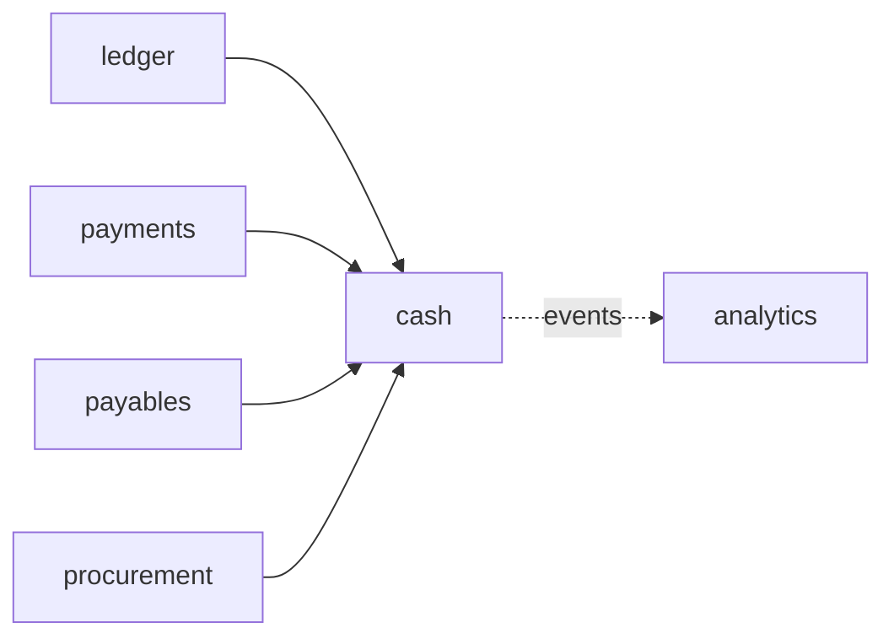

# ADR-0051: Cash position and liquidity forecast

**Status:** accepted (T53, product owner 2026-10-21: P1-P8 as recommended,
see "Decisions taken"). The steps T53a-T53l are in the tracker.

## Context
T53 is "Cash position and liquidity forecast" (07 §7.6): "A daily cash
position and a liquidity forecast from open items and orders; an agent
explains the variance between forecast and actual; the treasury connector
exports position and forecast only (deals are phase 9). Lane S." The
tracker holds four items for it: "Daily cash position", "Liquidity
forecast from open items and orders", "Forecast agent with variance
explanations" (module Cash management and liquidity forecast) and
"Treasury system connector" (module Treasury and risk management). The
pilots are a Canadian and a UAE company. Nothing in the code speaks of
cash, liquidity or a forecast; what a forecast can read exists, spread
over four contexts:

- **Bank balances** (payments, ADR-0047, 000120): each imported statement
  (`payments.bank_statement`) carries its currency, `opening_balance`,
  `closing_balance` and `closing_date`, signed minor units; a statement
  whose lines do not take the opening to the closing balance is refused,
  and one whose opening balance differs from the previous closing balance
  is `gap`. Lines (`bank_statement_line`) carry a signed amount, the
  booking date and the **value date**, the bank transaction code, the
  counterparty, and a status; a posted line names its match, which names
  the payments or the posting rule it cleared. Only booked entries are
  read (no intraday camt.052, no available balance).
- **House banks** (payments, ADR-0038): several per company, each with its
  bank clearing account (outgoing payments credit it), main bank account
  and incoming clearing account (ADR-0047; nothing posts to the incoming
  one yet). **A house bank's currency is
  always the company's local currency** (`payments.HouseBanks.upsert`
  writes `co.Currency`; `HouseBank` in the configuration has no currency),
  so a Canadian company's USD account or a UAE company's USD account
  cannot be a house bank today: its statements would be refused as not of
  the bank's currency. The routing and the statement import already
  compare currencies per bank, so the gap is the configuration and its
  validation.
- **Supplier open items** (ledger): open items on the supplier
  reconciliation accounts with their payment terms kept beside them
  (`ledger.open_item_terms`, T36b: term code, baseline date, net days, up
  to two discount tiers; `ItemTerms.NetDueDate`, `Until`), withholding
  (`open_item_withholding`, T46f), special G/L items for down payments
  (ADR-0037). Due dates are computed, not stored or indexed; the payment
  proposer's `dueDate` (`internal/payments/propose.go`) and the discount
  helpers (`payments/discount.go`) decide when a run takes an item. Items
  are in the entry's transaction currency with local and group amounts
  (ADR-0042). No journal line carries a value date or due date.
- **Supplier invoices and blocks** (payables): invoices that are `parked`
  or `on_hold` are not yet open items; their terms are kept beside them
  (`payables.supplier_invoice_terms`). A payment block exists only per
  supplier and company (`partner.supplier_company.is_payment_blocked`),
  not per invoice. Down payment requests (`payables.down_payment_request`,
  000079) carry an amount, currency and `due_date` and are `open` until
  paid.
- **Payment runs** (payments): runs `proposing | proposed | releasing |
  released | rejected | failed` with a run date, payments per supplier,
  house bank and method, bank files with their transmission status (no
  run or payment status says "sent" or "cleared"). A released payment
  credits its bank's clearing account on the run date; the statement's
  posting clears that line (ADR-0047). The open items of the clearing
  accounts are therefore exactly the **payments in transit**.
- **Purchase orders and requisitions** (procurement): released orders with
  currency, order date, payment term, items with quantity, price, tax code
  and account; received quantities from goods movements, invoiced ones
  from payables' invoice items (and `ledger.gr_ir_position` for GR/IR
  valued orders, T33); no stored "not yet invoiced" value. Requisitions
  have a header `needed_by` date and estimated prices. **Order items have
  no delivery date** (`procurement.purchase_order_item`, 000006), so there
  is no date on which an order's cash out could be expected.
- **Receivables**: none. Sales and receivables are phase 3 (07 §7.6);
  the configuration cannot even create a customer reconciliation account.
  Incoming payments post to the incoming clearing account and stay there
  until accounts receivable clears them (ADR-0047). A forecast built from
  documents alone shows outflows only.
- **Exchange rates** (ledger): rate types `average`, `bank_buying`,
  `bank_selling`, `planning`, loaded through `/v1/exchange-rates`; the
  latest valid rate of a type is looked up as revaluation does (ADR-0042).
  No forward rates.
- **Analytics** (ADR-0044): per-tenant Parquet extracts within fifteen
  minutes (p95), datasets `gl_lines`, `po_lines`, `ap_invoices`,
  `accounts`, `partners`, `open_items`; the semantic layer falls back to
  PostgreSQL. No statement or cash dataset, and the relay does not mark a
  tenant due for payments' events.
- **Calendars**: the configuration's calendars and `Config.Holiday`
  (ADR-0048) tell a company's working days, holidays included.
- **Contexts** import each other only along the allow-list of
  `internal/layout/layout_test.go` (`TestImportRules`); the integration
  context's connector kinds are a fixed list (`bank_sftp`, `bank_ebics`,
  `sap_odata`, ...), with no treasury kind.
- **Tax returns** (T61, ADR-0049) will compute a payable per return with a
  filing due date; not built yet.

### What SAP does (the parity target)
Sources at the end; where I rely on memory it says so. SAP Help pages are
partly rendered by script, and the facts below come from the pages'
indexed text; field and table names marked "from memory" need checking
against the pilot's release.

- **Cash position and liquidity forecast are one view over flows of
  different certainty.** Classic Cash Management (FF7A cash position,
  FF7B liquidity forecast) shows bank account movements in the cash
  position and subledger movements (payables, receivables) in the
  liquidity forecast, by value date, with a grouping that selects what to
  show, a display currency and a delta or cumulative presentation; an item
  planned on a public holiday is moved to the next working day. S/4HANA's
  Cash Management keeps both: the cash position covers bank accounts and
  bank clearing accounts, the medium-term forecast cards cover 90 days,
  and a **balance profile** (a set of planning levels) chooses the sources
  shown.
- **Planning levels** say what kind of transaction a flow comes from (a
  bank posting, a payment advice, a supplier item) and so how reliable it
  is; **planning groups** classify customers and suppliers by behaviour or
  risk (from memory: the supplier's planning group is `LFB1-FDGRV`, and
  each G/L account names its planning level, `SKB1-FDLEV`). In S/4HANA,
  **flow types** carry the lifecycle of a flow and a **certainty level**
  (actual, forecast, the sources such as purchase or sales orders).
- **Liquidity items** say where cash comes from or goes to (source and
  use), with a direction and a hierarchy. They are derived by **query
  sequences** at posting from the offsetting account and other
  characteristics, with a default when none hits; the **Flow Builder**
  traces a bank posting back through clearings to the original
  documents and splits the actual cash flow over their liquidity items
  (as far as I know, proportionally to the offsetting lines). Bank
  statement items not traced get default liquidity items (incoming or
  outgoing cash transfer).
- **One Exposure from Operations** (table `FQM_FLOW`) is the hub for
  forecast flows from operational sources: purchase requisitions, orders
  and scheduling agreements (forecasts revised as invoices arrive), sales
  orders (transaction date from the expected billing date and the payment
  terms), FI-CA, and **memo records**. Memo records are entered by hand
  (Manage Memo Records) with a planning level, an amount, a value date,
  an expiry date (from memory) and either a bank account (bank-related
  levels) or a planning group; they appear in the cash position and the
  forecast until they expire or are archived.
- **Bank Account Management** keeps bank accounts as master data with
  dual control for sensitive fields (the submitter cannot activate their
  own change), overdraft limits, signatories, bank account groups and
  cash pools.
- **Liquidity planning, cash pooling, in-house bank, hedging and exposure
  management** are separate products or components (SAP Analytics Cloud
  liquidity planning, In-House Cash/In-House Banking, Treasury and Risk
  Management with Hedge Management and Exposure Management 2.0). They are
  phase 9 here (§12).

## Decision

### 1. Scope of T53
In: house banks in a foreign currency (P2); a **daily cash position** per
house bank, currency and value date from statement balances, payments in
transit, payment runs and memo records; a **liquidity forecast** over
configurable horizons from supplier open items (with cash discount and
blocks), down payment requests, payment runs, purchase orders and, if
chosen, requisitions, and memo records (manual, recurring, uploaded);
classification by source, certainty and tenant-defined liquidity items;
conversion to a display currency; daily **snapshots** of the forecast and
the **variance** between a snapshot and the actual statement flows; the
analytics datasets; the **forecast agent** explaining variances and
proposing memo records; the **treasury connector** exporting position and
forecast; the SAP migration of liquidity items, planning groups and open
memo records (if the pilot uses them).

Out (and where it goes, §12): receivables and sales orders as sources
(phase 3 adds them as sources of this model); tax payables from returns
(added when T61's returns exist); payroll (phase 8); intraday statements
(camt.052) and available balances; bank calendars of their own; bank account management with signatories and dual control
beyond the configuration's change control; cash pooling, cash
concentration and in-house bank; money market, debt and investment deals;
FX exposure management and hedging; liquidity planning with versions and
plan/actual (phase 9 planning); bank fee analysis; payment factories. No
posting: T53 never moves money or writes the journal.

### 2. Ownership: a new `cash` context (decision P1)
A new context **`cash`** (schema `cash`, package `internal/cash`) owns
liquidity items, memo records, snapshots, variance comments and the
treasury export. It is a **leaf**: it reads through published ports of
the ledger (open items, account balances, rates), payments (statements,
house banks, runs, payments in transit), payables (blocks, down payment
requests) and procurement (open order values); nothing depends on it.



Reasons:
- The forecast reads four contexts; put in payments it would make payments
  depend on procurement, a new and backwards direction (procurement →
  payables → payments today). A leaf adds arrows only into itself, so no
  existing direction changes (CLAUDE.md: a new cross-context import needs
  the callee's published interface; this ADR is the record of the new
  arrows).
- Its data has its own lifecycle (memo records expire, snapshots age out)
  and its own users (treasurer, controller), unlike payments' runs.
- Phase 3 (receivables, sales orders), T61 (tax returns) and phase 9
  (deals, cash pools) become new sources of the same context without
  touching payments.

The ports are read-only, take the legal entity and a horizon, and run in
the request's transaction under RLS (ADR-0003), as `ledger.Partners` and
the other ports do. They return flows in the shape of §4, so `cash` never
reads another schema's tables.

### 3. House banks in a foreign currency (T53a, decision P2)
`companies[].house_bank(s)[].currency` (ISO 4217, default the company's
currency) is stored on `payments.house_bank.currency`, which exists and
is today always local. Validation (configuration, tier 3 posting-related):
- a foreign-currency bank's clearing, main and incoming accounts are
  flagged `revalue_foreign_currency` (ADR-0042), so period-end valuation
  covers them, and none of them is shared with a bank of another currency;
- a currency never changes under a house bank's code (a new account is a
  new code, as IBANs are, ADR-0038);
- the ranking (`payment_methods[].ranking[].currency`) may name the bank
  only for its currency; the routing already skips banks of another
  currency.
A run in USD then pays from the USD bank in USD (document currency,
ADR-0042), its statement in USD is accepted, and the posting converts at
the posting date's rate with realised differences, all of which T48 and
T49f built. Without this step a pilot's foreign-currency accounts are
outside the cash position, which is why it comes first (facts at the
end).

As built (T53a): no migration (the column existed); the currency never
changes under a code, checked as the IBAN is; the bank file names the
debtor account's currency (`DbtrAcct/Ccy`) for a foreign-currency bank;
the reconciliation report (T49h) compares the statement with the
ledger's balance of the bank account in the bank's currency (the
transaction amounts of the entries in it), so exchange differences and
valuations are not unexplained. ADR-0038's amendment has the details.

### 4. The flow model: sources, certainty, liquidity items
Every figure is a sum of **flows**: (company, house bank or none,
currency, value date, signed amount in minor units of the currency
(`money.Minor`, ADR-0005), source, certainty, liquidity item, reference to
the document). Flows are computed from their sources at read time (§6);
only memo records and snapshots are stored by `cash`.

**Sources** (SAP's planning levels, fixed by the code because each is a
reader of its own):

| Source | Read from | Certainty | Value date | Bank |
|---|---|---|---|---|
| `bank_balance` | latest statement's closing balance per house bank | actual | statement closing date | yes |
| `in_transit` | released payments whose line on the bank clearing account is still open | confirmed | run date + the bank's value days | yes |
| `payment_run` | payments of runs `proposed` or `releasing` | confirmed | run date + value days | yes |
| `payable` | supplier open items, not special G/L, not in a run | expected | expected payment date (§5) | the supplier's ranked bank if one fits, else none |
| `payable_blocked` | supplier open items of a supplier blocked for payment in the company | expected, shown apart | net due date | none |
| `invoice_unposted` | supplier invoices `parked` or `on_hold`, by their kept terms | planned | as `payable` | none |
| `down_payment` | down payment requests not yet paid (ADR-0037) | expected | the request's due date | none |
| `purchase_order` | released orders' open value, not invoiced (§5) | planned | expected invoice date + payment terms | none |
| `requisition` | released requisitions not ordered (P7) | planned | need date + terms, if chosen | none |
| `memo` | memo records (§7) | as entered: confirmed, expected or planned | as entered | optional |
| `unapplied_receipt` | the incoming clearing accounts' open balance | actual (already in the bank; shown for information, not added) | — | yes |

Phase 3 adds `receivable` and `sales_order`; T61's returns add
`tax_payable`; each is a new reader and a new row, nothing else.

**Certainty** (SAP's flow levels): `actual` (in the bank), `confirmed` (the
money is committed: released or proposed payments, confirmed memos),
`expected` (a posted document owes or is owed), `planned` (an order or a
plan). Reports show certainty as a dimension and can be cut at a level
("confirmed and above"), which is SAP's balance profile in one parameter.

**Liquidity items** (SAP's liquidity items, decision P4) are the tenant's
classification of cash by purpose, in the configuration:
```yaml
cash:
  liquidity_items:
    - {code: OP_SUPPLIERS, name: Supplier payments, direction: outflow, parent: OPERATING}
    - {code: OP_RENT, name: Rent, direction: outflow, parent: OPERATING}
    - {code: TAX, name: Taxes, direction: outflow, parent: OPERATING}
    - {code: CAPEX, name: Capital expenditure, direction: outflow, parent: INVESTING}
    - {code: FIN_LOAN, name: Loan repayment, direction: outflow, parent: FINANCING}
    - {code: REC_CUSTOMERS, name: Customer receipts, direction: inflow, parent: OPERATING}
    - {code: BANK_CHARGES, name: Bank charges and interest, direction: both, parent: OPERATING}
  derivation:                    # first hit wins, in this order
    accounts:                    # by the offsetting G/L account (SAP query sequence, origin C/D)
      - {from: "1500", to: "1599", item: CAPEX}
      - {from: "6100", to: "6100", item: OP_RENT}
    planning_groups:             # by the supplier's planning group (SAP FDGRV)
      - {group: TAX_AUTHORITY, item: TAX}
    posting_rules:               # statement lines posted by a posting rule (ADR-0047)
      - {rule: CHARGES, item: BANK_CHARGES}
    defaults: {outflow: OP_SUPPLIERS, inflow: REC_CUSTOMERS}
```
- A **document flow** (supplier item, order item, payment) takes its item
  from the **offsetting lines** of its document: a supplier invoice's
  expense and asset lines (tax lines follow their base line), an order
  item's account; a document with several offsetting accounts is split
  over their items in proportion to their amounts (`money.Allocate`), as
  SAP's Flow Builder splits a cash flow. Then the supplier's planning
  group, then the default for the direction.
- A **memo record** names its item.
- A **statement line** (an actual) takes the items of what its match
  cleared: the payments' supplier items (each with the split above), the
  posting rule's item, or for a line not posted the default of its
  direction (SAP's default items for untraced bank items).
- The supplier's **planning group** is a new optional field of the
  partner's company data (`planning_group`, a code from
  `cash.planning_groups`), added in T53b.
- Items form one hierarchy (parent codes, a tree, depth at most 4). The
  three top nodes OPERATING, INVESTING and FINANCING are suggested by the
  packs (ADR-0048), not required.
- Tiers: names and hierarchy cosmetic (1); derivation rules tier 2 (they
  change classification, never postings), with a simulation that lists
  the open flows whose item would change. Snapshots keep the item they
  were taken with; a rule change does not restate history (as P7 of
  ADR-0050).

As built (T53b):
- **Context and imports.** `internal/cash` imports only `config` (and the
  platform and `money`); `internal/layout` lists it with `config` and adds
  a rule that no context imports a **leaf** (`cash`), whatever the
  allowlist says. Its ports into the ledger, payments, payables and
  procurement are interfaces it declares and the composition root wires
  (T53c, T53e add them), so the four contexts gain no import either. The
  one question another context asks it, whether a planning group exists,
  goes through a port partner declares (`partner.PlanningGroups`,
  implemented by `cash.PlanningGroups`, wired in `app`), the way partner
  asks payments about payment methods: no context imports `cash`.
- **Stored or read.** Migration 000141 creates the `cash` schema (RLS,
  `tenant_id` first) with `liquidity_item` (code, name, direction, parent
  of the tenant) and `planning_group`, kept from the document by
  `cash.Setup` (inactive when dropped, never deleted). The derivation
  rules and the companies' settings are not copied: position, forecast and
  the snapshot workflow read them from the active document, as payments
  reads `bank_statements`.
- **Document.** `cash` at the top level (`liquidity_items`,
  `planning_groups`, `derivation` with `accounts` in order, then
  `planning_groups`, `posting_rules` naming a company's posting rule by
  its transaction code, and `defaults`) and `companies[].cash`
  (`take_discounts` default true, `payment_days` mon-sun, `value_days`
  per house bank and optional method 0-30, `buckets` of `day` (≤ 92),
  `week` (≤ 104) and `month` (≤ 36) in that order, default 14 days, 11
  weeks and 9 months, `rate_type` default `planning`, `rate_max_age_days`
  1-365 default 7, `order_lead_days` 0-365 default 30, `credit_lines` a
  positive amount in the bank's currency, `snapshot_time` HH:MM default
  07:00). Account ranges compare as SAP's ALPHA conversion keeps numbers
  (all-digit numbers zero-padded to ten). Rules name items without
  children; a default names an item of its direction or of both, and a
  planning group's rule one for outflows or both; missing
  defaults are a warning (a flow no rule assigns then has no item, shown
  unclassified), so a pack can bring a tree alone. The account rules are
  diffed by position, their order being a setting.
- **Derivation.** `cash.Derive` gives each offsetting line the first
  covering account rule's item, else the fallback (planning group, then
  posting rule, then default), and shares the amount out over the items
  in proportion to the lines' signed amounts with `money.Allocate`, so a
  credit line (a discount on its own account) takes its item's share
  down; lines that cancel out give the whole amount to the fallback.
- **Partner.** `planning_group` on supplier company data (migrations
  000142-000143, `SupplierCompany(Input).planning_group` in the contract,
  `partner.Supplier.PlanningGroup` in the port), checked against active
  groups (422 `partner.unknown_planning_group`); a document dropping a
  group a supplier has, or a pending change gives, is refused
  (`partner.PlanningGroupCodes`, 409 `partner.planning_group_in_use`).
- **Packs.** A pack may carry an optional `cash.yaml` of liquidity items,
  merged into the tenant's by code; the Canada pack 2026.2 (2026.1 plus
  that file and IAS 7 as a source) suggests OPERATING, INVESTING and
  FINANCING, each for both directions.
- **For T53e (batch 6 review, T61e):** a supplier invoice's
  self-assessed tax (T61e's `self_output`/`self_input` pair, reverse charge)
  posts an offsetting +x/−x that moves no cash; if the two accounts derive
  to different liquidity items, the flow would be split into a positive and
  a negative share. The forecast reader nets self-assessment pairs out of
  the offsetting lines before `cash.Derive`, so they classify nothing.
- **Deferred to T53e:** the derivation simulation (the open flows whose
  item a rule change moves) needs the flow readers T53e builds; until then
  a rule change is approved on its diff alone, at tier 2.

### 5. Dates and amounts of document flows
**Supplier open items** (decision P5). The expected payment date of an
item is:
1. if a discount tier is still open on the read date and the company takes
   discounts (`cash.take_discounts`, default true, which is what the
   proposer does when a run pays within a tier, T36), the last day of the
   earliest open tier, at the gross amount less the discount;
2. otherwise the net due date, at the gross amount;
3. moved back to the company's last **payment day** on or before that
   date (`cash.payment_days`, weekdays the company runs payments, e.g.
   `[tue, thu]`; none configured: the date itself), not before the read
   date; an overdue item is expected on the next payment day;
4. plus the value days of the bank the supplier's first method ranks for
   the item's currency (`cash.value_days` per house bank and method,
   default 0), and moved to the next working day of the company's
   calendar (`Config.Holiday`, ADR-0048: weekends and holidays).
The rule reuses the proposer's due-date and discount-tier logic, moved
to a shared place (the ledger's `ItemTerms`, beside `NetDueDate` and
`Until`) rather than copied (CLAUDE.md). Withholding at payment (T46) is deducted from the supplier flow; its
remittance to the authority is not forecast until the tax payable source
exists (a memo record covers it meanwhile). Credit memos are negative
flows on the same date rule, so a supplier nets as the run nets it.
Items in a payment run are the run's flows, not the item's (never twice).
Items of a blocked supplier are shown apart on their net due date and are
not in the totals unless asked (`include_blocked`); a per-invoice block
does not exist and is not added by T53.

**Down payment requests**: their due date and amount, until paid.

**Purchase orders** (decision P7): the open value of a released order
item is (ordered quantity − invoiced quantity) × price (the invoiced
quantity read from payables per order item, so `cash` reads both
contexts and procurement gains no dependency), plus the tax its
tax code gives at the read date's rate (T61's engine port once it is
there; until then the code's rate), in the order's currency. Its expected
invoice date is the item's **delivery date** (a new optional
`delivery_date` on order items, SAP `EKET-EINDT`, added in T53g as an
additive contract change, copied from the requisition's need date), else
the order date plus the company's `cash.order_lead_days` (default 30);
the cash date then follows the order's payment terms from that date as
for an item (net, or the discount tier if taken), then payment days and
value days. Received but not invoiced quantities are in GR/IR and still
here (they are not yet open items). Orders closed, cancelled or fully
invoiced add nothing. Requisitions, if chosen, are at their estimated
value, the header's `needed_by` plus terms, certainty `planned`.

**Payment runs and in-transit payments**: each payment's amount in its
currency on its bank, value date the run date plus value days (a run
date in the past with the payment still unmatched: tomorrow, flagged
`late`).

### 6. Where it is computed, and freshness (decision P3)
**Position and forecast are computed at read time from PostgreSQL**
through the ports of §2, in one `REPEATABLE READ` read-only transaction,
so position, items, runs and orders are of one database state and exact
at the read (as the trial balance is). The ports are bounded per company
and horizon; the open items read gains a functional index on the net due
date (`baseline_date + net_days`) if the performance budget needs it
(T53e measures against 05: a company with 100,000 open items answers
within 2 s p95, a budget to confirm).

**Snapshots** are stored: once a day per company, after the statements of
the day are usually in (`cash.snapshot_time`, local time, default 07:00),
a workflow `TakeCashSnapshot` (id from company and date, so replicas and
retries start it once; ADR-0012's dispatcher pattern, as the statement
fetch) writes the forecast as it is then:
- `cash.snapshot (tenant_id, id, legal_entity_id, snapshot_date, taken_at,
  horizon_end, status)`, unique per company and date, insert-only;
- `cash.snapshot_flow (tenant_id, snapshot_id, line_no, house_bank_id,
  currency, value_date, source, certainty, liquidity_item, amount,
  document_ref)`: **at document level for value dates within 31 days**
  (what explains a variance), aggregated per bucket beyond.
Taking it twice for the same company and date finds the first and writes
nothing (run-twice test, CLAUDE.md). A person may take an extra snapshot
(`POST /v1/cash-snapshots`, e.g. before a board meeting), named and kept
like the daily ones. Retention: 25 months (two years of comparison), then
deleted by the workflow that takes them; a snapshot referenced by a
variance comment is kept with it.

**The analytical store** (ADR-0044) gets the snapshots and the classified
actuals as datasets (T53j): history, accuracy trends, dashboards (T59)
and the agent's ad-hoc questions go there, with its fifteen-minute
freshness and PostgreSQL fallback. The position a treasurer acts on is
never read from the store: a payment released ten minutes ago must be in
it.

Rejected for now: a stored flow table maintained from events (SAP's
`FQM_FLOW`, decision P3 b). It would make reads cheap at any size, at the
cost of a second copy of every open item and order kept in step by event
handlers, with its own reconciliation; it is the path if the read budget
fails at a larger tenant, and the flow shape of §4 is its schema.

### 7. Memo records
`cash.memo_record (tenant_id, id, legal_entity_id, house_bank_id NULL,
currency, amount, value_date, expires_on, certainty, liquidity_item,
description, reference, recurrence, status, origin, session_id NULL,
batch_key NULL, version, created_by, ...)`:
- **Kinds**: a one-off expected receipt or payment (a customer's receipt
  before receivables exist, a loan instalment, a tax payment, payroll), on
  a house bank (it then counts in the cash position) or not (forecast
  only).
- **Recurrence** (`monthly` on a day, `weekly` on a weekday, `quarterly`,
  with an end date or a count) is expanded at read time over the
  horizon; an occurrence can be overridden or skipped by a child record
  for that date (`recurrence_of`, `occurrence_date`).
- **Expiry**: a record stops counting the day after `expires_on` (default
  its value date + 7 days, SAP's expiry), so a forgotten receipt does
  not stay forecast forever; expired records are listed for a person to
  confirm, move or cancel. **Actualisation**: a person (or the agent's
  proposal, accepted) marks a record `realised` by a statement line,
  which makes it stop counting at once and feeds variance.
- **Upload**: CSV or XLSX through T63's import or the API, idempotent by
  `batch_key` (a batch replaces the records of its key that are not
  realised), so the pilot can load expected receipts from the system that
  issues its invoices until phase 3.
- Statuses: `active`, `proposed` (an agent's, not counted until a person
  accepts it), `realised`, `expired`, `cancelled`. Changes are versions
  (ETag, If-Match, ADR-0008), audited; no approval (they post nothing), a
  decision the product owner may revisit for large amounts (facts).
- Permissions: `cash.memo.write` (people, integrations), `cash.memo.propose`
  (agents, `x-autonomy: propose`), `cash.memo.read`.

As built (T53d):
- **Table.** Migration 000152 creates
  `cash.memo_record` with the columns above, and `cash.outbox`/`inbox`
  (`cash` joins `outbox.Contexts`, a NATS stream and the event contract's
  `cash` channel). `expired` is never stored: an `active` record whose
  `counts_until` (its last occurrence's expiry; a one-off record's
  `expires_on`; null for a series without end) is before the read date is
  shown and listed `expired`, and counts nowhere until a person moves,
  extends or cancels it. `rejected` is the status of a proposal a person
  turned down. The database checks every rule of the table
  (`TestMemoRecordRules`), and a trigger (`cash.check_memo_item`) that the
  item is active and of the amount's direction when the item or amount is
  written; the item's row is locked, so a configuration deactivating it
  waits; the trigger fires too when a cancelled record becomes active again
  (an upload's row again). `cash.Setup` refuses a document that takes away
  an item an open (proposed or active) record names, or turns it against
  such a record's direction (finding, 409 `cash.liquidity_item_in_use`). No foreign key crosses a schema: the legal
  entity, house bank, statement lines and session are checked through
  ports (`Payments.HouseBanks`, `Payments.StatementLine` adapted from
  `payments.CashPosition`, `agents.Sessions`), and a record's house bank is
  an active one of its company in the record's currency.
- **The house bank's code (review:batch24).** A memo record gives
  `house_bank_code` beside `house_bank_id`, present exactly when it is,
  read through the port's `HouseBankCodes` (by id, active or not) once per
  page or single read (ADR-0038 As built, "every resource that names a
  house bank gives its code").
- **Series.** `recurrence` is `weekly`, `monthly` on the value date's day
  (the month's last day when shorter: 31 January, 28 February, 31 March) or
  `quarterly`, until a day or for 2-520 occurrences, or neither (expanded
  at most 1,040 occurrences). Each occurrence expires as many days after
  its own date as the first after the value date. An override is a one-off
  record naming the series and occurrence (`POST /v1/memo-records` with
  `recurrence_of`, `occurrence_date`), once per occurrence; `:cancel` or
  `:realise` with `occurrence_date` closes one occurrence by such an
  override (201), and a series is realised only that way. While a series
  has overrides its value date, rule and currency stay (409
  `cash.series_has_overrides`), so an override's occurrence stays one and
  counts once; an override keeps its series' currency. Cancelling a whole
  series leaves its overrides, records of their own, as they are.
- **Operations.** `listMemoRecords` (filters legal entity, status as of the
  read date, house bank, batch key, value dates; sorted by `value_date` or
  `created_at`), `createMemoRecord`, `getMemoRecord`, `updateMemoRecord`
  (merge patch on a proposed or active record, checked as a new one; a new
  value date keeps the days to the expiry), `cancelMemoRecord`,
  `realiseMemoRecord` (by a statement line of the record's company,
  currency, bank if any, and direction, or by the person),
  `proposeMemoRecord` (`POST /v1/memo-record-proposals`, `x-autonomy:
  propose`, in the agent's running session as T49g's proposals, with its
  reason and up to 50 statement lines of the company as evidence),
  `acceptMemoRecordProposal` (checked again) and `rejectMemoRecordProposal`
  (with a reason), and `uploadMemoRecords` (`POST /v1/memo-record-uploads`).
  Every write but the proposal is `x-agent: false`: an agent never creates,
  changes, accepts or closes a memo record; an uploaded record's reference
  does not change. Writes take If-Match on a
  record (ADR-0008, rows read `FOR UPDATE`) and an Idempotency-Key, are
  audited (`cash.memo_record.<verb>`) and publish `MemoRecordChanged`
  (`created`, `proposed`, `updated`, `accepted`, `rejected`, `realised`,
  `cancelled`). A legal entity the caller cannot act in is 404 (fail
  closed). The contract's collection custom methods start operations
  (202), so the proposal and the upload are collections of their own
  rather than `:propose`/`:upload`.
- **Upload.** A UTF-8 CSV of at most 1 MB and 5,000 rows with a header row
  (`reference`, `value_date`, `amount` signed with the currency's digits,
  `currency`, `liquidity_item`; optional `certainty`, `house_bank` by code,
  `expires_on`, `description`), by legal entity and `batch_key`, under the
  key's lock. Every row is checked before anything is written; one wrong
  row refuses the batch (422 `cash.memo_upload_invalid`, each wrong field
  as `rows[N].column`, N the file's line, at most 100). A reference new to
  the key is created, one whose record differs is changed (a cancelled one
  made active again), one the same is left, a realised one kept, and an
  active record of the key whose reference the file no longer has is
  cancelled, so the same file again writes and publishes nothing. XLSX and
  T63's import channel are T63's.
- **Position.** `GET /v1/cash-position` adds source `memo` at each record's
  certainty: the active records on the company's banks not expired at the
  read, each occurrence up to the last day once (an occurrence an override
  replaces left to the override, whatever its status), on its value date
  moved to the next working day; one dated before the read date is `late`,
  on the working day after it, as a late payment is. Records without a
  bank are the forecast's (T53e).
- **Approval.** None, as above: a memo record posts nothing. Whether large
  memo records should need approval stays the product owner's question
  (facts); the conservative default the ADR states is none.

### 8. Cash position (the daily view)
`GET /v1/cash-position?company=…&from=…&days=…` (`cash.position.read`;
days ≤ 31, default 14):
- per house bank (its currency) and day: the **opening balance** (the
  latest statement's closing balance before the day, with its date and
  whether the bank has a `gap`), the flows of the day by source and
  certainty (in transit, runs, bank memo records, and if asked
  `include_forecast` the `payable`/`purchase_order` flows assigned to the
  bank), and the **closing balance**; the first day's opening is flagged
  stale if the latest statement is older than one working day;
- per currency: the sum of its banks;
- a **book balance** check per bank: the main bank account's G/L balance
  plus the clearing accounts' open items against the statement balance,
  showing what is posted and not yet on the statement and the reverse
  (the reconciliation report of ADR-0047 is the detail);
- optional **credit lines** (`cash.credit_lines` per house bank, an
  amount in the bank's currency) to show available liquidity; no limits
  are enforced (Bank Account Management's overdraft limits are
  information here too).

As built (T53c):
- **Request.** `GET /v1/cash-position?legal_entity_id=…&from=…&days=…&display_currency=…`
  (`cash.position.read`, migration 000149; `x-slo-class: report`; agents
  read it as people do, banks by code and last four characters). `from`
  defaults to the read date, the company's date in its time zone (T72n1,
  below; the clock's date in UTC when T53c was built), and is never before
  it (422): past days are actuals,
  whose balances come from the statements of those days (T53f), not from
  what is open now, `days` 1-31 default 14, the display currency the
  company's. A legal entity the caller cannot act in is 404 (fail closed).
  No paging: a company has a handful of banks and at most 31 days.
- **One snapshot.** The contract marks the operation `x-snapshot: true`;
  the unit of work runs such a `GET` at REPEATABLE READ (read-only), so the
  payments, the ledger and the configuration are read as of one state
  (`uow.Middleware.Snapshot`, `api.Operation.Snapshot`, 04 §4.7). A
  separate transaction was rejected: it would hold a second connection
  per request.
- **Ports.** `cash` declares `Payments` (house banks with their opening
  statement, posted payments by id, payments of runs not posted),
  `Ledger` (open lines on accounts, a rate of a type), `LegalEntities` and
  `Settings`; the composition root adapts `payments.CashPosition`,
  `ledger.Accounts.OpenLines`, `ledger.Rates.OfType` and
  `tenancy.Directory` to them (`internal/app/cash.go`), so `cash` still
  imports only `config` (and `api/gen`, the platform, `money`) and the
  layout allow-list is unchanged.
- **Opening.** The latest statement closing before the first day, its
  `gap` (a statement of the bank up to it in `gap`), and `stale` when it
  closes before the working day before the read date, or the bank has
  none (opening zero). Working days are the
  company's calendar: weekends and its holidays (ADR-0048). The flows
  dated before the first day are added to it.
- **In transit** (`in_transit`, `confirmed`): the leading ledger's open
  lines (neither cleared nor reversed) on each bank's clearing account
  whose entry was posted by payments for a payment
  (`source_context = payments`, the payment as source document), at the
  line's amount in its currency, which must be the bank's. A
  revaluation's valuation and reset lines there name the ledger as source
  and never count (ADR-0038, T53a); parallel ledgers' copies are never
  read (ADR-0045). A payment a statement line up to the opening statement
  is matched to (`statement_match.status = matched`, its posting perhaps
  waiting for approval) is already in the opening balance and left out.
- **Runs** (`payment_run`, `confirmed`): the unposted payments of runs
  `proposed` or `releasing`, paid by the payment's bank or the run's.
- **Dates.** A payment's day at the bank is its run date plus the bank's
  `cash.value_days` for its method, moved to the next working day; one
  before the read date is `late`, on the working day after the read date.
- **Book balance check.** The reconciliation report's figures on the
  opening statement's date (`payments.Figures`: the main bank account's
  balance through `ledger.Accounts.Balances` in the bank's currency, the
  statement lines not posted, excluded or posted later, and what is left
  unexplained), beside the payments in transit: booked and not yet at the
  bank. Absent without a statement.
- **Credit lines** are parsed in the bank's currency and added to each
  day's closing balance as `available`.
- **Conversion.** Per currency first (the banks summed), then each
  currency's days in the display currency at one rate: the latest of the
  company's `cash.rate_type` valid on the read date, or, where that type is
  `planning` and there is no planning rate, the latest `average` rate
  (the rate type used is shown); `stale` beyond `cash.rate_max_age_days`;
  a currency with no rate is listed in `incomplete_currencies` and left
  out. A sum out of the range of an amount refuses the position (422
  `cash.amount_too_large`); an unknown display currency is 422
  `cash.unknown_currency`.
- **Budget.** `TestCashPositionBudget`: p95 2 s (§6's number) for 100,000
  payments posted to two ledgers, 2,000 of them in transit, 1,000 in
  proposed runs and a statement a day, over 31 days; measured about
  0.5 s median, 0.9 s p95 on a laptop. The open-line read scans the
  clearing accounts' history (index `journal_line_account`); a partial
  index of open lines, or the flow table of §6, is the path if it grows.
- **Not yet.** With `include_forecast`, the forecast's flows assigned to a
  bank (T53e) join the days as a further source (memo records on a bank
  did in T53d, §7); drill-down to the payments of a day is through payments' own
  API (`GET /v1/payment-runs`).

As built (T72n1, the company's time zone; Pilot readiness "Company time
zone", split into T72n1-T72n6):
- **Where the zone lives.** `companies[].time_zone` in the configuration
  document, an IANA zone name (`America/Toronto`, `Asia/Dubai`), beside the
  company's `country`, `currency` and `fiscal_year_start_month` and the
  calendar of its working days (ADR-0048), which are configuration too: the
  existing behaviour settles it, so no new ADR. Not the legal entity row:
  the business-date rules (working days, value days) are read from the
  document already, and a change to the zone is approved and versioned as
  they are. Not derived from `country`: Canada spans six zones.
- **Validation.** A name `time.LoadLocation` loads; the zone database is
  built into the binary (`time/tzdata`), so the standard names load on any
  host, an image without zoneinfo included. LoadLocation tries the host's
  zoneinfo first, so the names only some hosts accept are refused: `Local`
  (the reading host's zone) and any name not in IANA form (every part
  starting with a capital), so `localtime`, `posixrules`, the `posix/` and
  `right/` trees and a lower-case name a case-insensitive filesystem would
  open; offsets such as `-05:00` do not load
  (`companies[<code>].time_zone`). Empty is UTC, as every date was before:
  documents activated earlier keep their meaning (tolerant read), and the
  response says which zone was used. Since 2026-10-31 a new or changed
  document must set it (see "the zone required" below). A change is tier 3
  (posting-relevant): it moves which day is today for the company by up
  to a day, and the later slices date checks by it.
- **The read date.** The cash position's read date is the clock's instant
  in the company's zone, as a date (`clock.DayIn`): at 22:00 on 17 April
  in Toronto (02:00 UTC on the 18th) and at 01:00 on 17 April in Dubai
  (21:00 UTC on the 16th) it is the 17th. Everything judged by the read
  date follows it: the default and earliest `from`, `stale` (the working
  day before the read date), `late` payments and memo records, and the
  conversion rate's validity and age. The response gives `time_zone`
  beside `read_date` (UTC when the company has none), so a consumer knows
  which day "today" was. A stored zone the binary cannot load (only a
  zone database that lost it) fails the read rather than falling back to
  UTC.
- **Memo records' status (T72n2).** A memo record's `expired` is judged
  on its legal entity's date at the read in its company's zone, the
  date the position reads that company on (one function,
  `companyDay`), so a record the position counts at 22:00 in Toronto is
  listed `active`, not `expired` by the next UTC day. Every response
  carrying a record (create, read, change, the closing and proposal
  decisions, the list) gives `read_date` and `time_zone` beside `status`,
  so a consumer knows which day judged it. The list judges each record by
  its own legal entity's date in the `status` filter and in the items
  alike, from one instant: the dates of the companies with a zone are
  read once per list (their legal entities found by company code through
  the tenancy port, `LegalEntities.ByCode`; a tenant without zones reads
  none, and a list filtered by legal entity reads only its), and every
  other legal entity is judged by UTC's date, as before. The upload's
  response gives counts, not statuses, and an upload judges nothing by
  date (it compares values, and realised and cancelled are stored), so
  nothing in it changes. A stored zone that does not load fails the read
  and the list, as it fails the position.
- **Kept in UTC** (product owner 2026-10-31, as recommended): the
  suppliers a migration run creates are dated by UTC's day. The date is
  their payments bank account's `valid_from`, which partner refuses
  before its own UTC day (the backdating control,
  `partner.backdated_bank_account`) and payments read to choose the
  account a payment goes to; a supplier serves companies in several
  zones, so a bank account's days are judged by one rule for the whole
  supplier, UTC's, not by any one company's zone. No code changes: the
  run passed `database.Today` as before (amended by the product owner
  on 2026-11-02: the migration's bank accounts start the day before;
  see "the migration's bank accounts on a cutover evening" below). Every other
  document is dated by its caller, or by the company's date where the
  caller leaves the date out (the posting dates and the tax activation
  day, below). The payment release's discount check (T72n3), center
  changes' effective day (T72n4, ADR-0050 §11) and purchasing contracts'
  expiry and its notice (T72n6) are built: see below.

As built (T72n5, a requisition's date; product owner 2026-10-31: a
requisition is routed at the rate of the day it was raised in its
company's time zone):
- **The date.** `procurement.requisition.requisition_date` (migration
  000170) is the company's date when the requisition is created: the
  clock's instant in the zone of the legal entity's company
  (`config.CompanyLocation`, `clock.DayIn`; UTC when the company has
  none), so at 22:00 on 31 December in Toronto (03:00 UTC on 1 January) it
  is the 31st and at 01:00 on 17 April in Dubai (21:00 UTC on the 16th) it
  is the 17th. Stored, not derived from `created_at` on each submission: a
  later change of the zone (tier 3) would otherwise move the day a
  requisition already raised, and resubmitted, is routed at. The response
  gives it (`requisition_date`, read-only), so a consumer sees which day's
  rate routed it. A stored zone the binary cannot load fails the creation
  rather than dating it in UTC.
- **What follows it.** Submission converts the amount into the company's
  currency at the average rate of that day (03-data-model, F12, F19), and the
  requisition's number is drawn from that day's fiscal year's range: the
  same document date, so a Toronto requisition of 31 December is numbered
  in the year it is dated in.
- **Earlier requisitions.** 000170 dates the rows raised before it as they
  were routed, `created_at`'s date in UTC, without touching their version
  or `updated_at`; the previous release's inserts in a mixed cell take the
  column's default, its own UTC rule; the not-null rule is validated in
  000171.
- **Not this rule.** Procurement's other dates are different decisions,
  each read on the company's date by its own step: a goods movement
  reversal's default posting date since 2026-10-31 (below), and a
  contract's number since T72n6's step (see below). The account
  assignment check at a
  requisition's submission judges on the submission day, not the
  requisition's, in the company's zone since T72n4.
  Contracts' expiry and its notice are judged on the company's date
  since T72n6.

As built (T72n3, a payment run's cash discount judged on the company's
date; product owner 2026-10-31):
- **The rule.** The release of a proposed run refuses a payment whose cash
  discount's last day (`discount_until`) is before the paying company's
  date at the release, in its `time_zone` (UTC when it sets none): 409
  `payments.discount_lapsed`. At 22:00 on the last day in Toronto (02:00
  UTC the next day) the discount is still earned; at 01:00 the next day in
  Dubai (21:00 UTC on the last day) it has lapsed. ADR-0038 records it
  with the release.
- **Every place a lapse is judged.** Only the release reads a today for a
  discount. The proposal judges each item's tier, and whether it would
  lose its discount by the due-by date, on the run's `run_date`, the date
  the payments post and are executed on, which the proposer chooses: no
  clock and no zone are involved, so nothing there changes.
- **The shared helper.** `config.(*Config).CompanyLocation(code)` is a
  company's zone by its code, UTC when the document has no such company
  or the company sets none; payments' `companyDay` takes it with
  `clock.DayIn`, as procurement's `today` (T72n5, T72n4), the ledger's
  center checks (T72n4) and, since batch 26's integration, the cash
  position's and memo records' `companyDay` (T72n1, T72n2) do.
- **What the consumer sees.** The problem's `detail` names the discount's
  last day, the company's date that judged it and the zone (`… earned
  until 2026-03-15; it is 2026-03-16 in Asia/Dubai, the time zone the
  paying company's date is judged in …`; UTC when the company sets none);
  the problem schema has no extension members, so the date
  and zone are in the detail, as other payments problems give their
  facts.
- **Determinism.** The check runs in the `:release` request
  (`StartRelease`), before the operation is queued; the release workflow
  and its activities do not judge the discount, so no workflow code reads
  a clock.

As built (T72n6, purchasing contracts' expiry and its notice on the
company's date; Pilot readiness "Company time zone"):
- **The rule.** The contract expirer judges each active contract on its
  legal entity's company's date at the round, in the company's
  `time_zone` (`config.CompanyLocation`, `clock.DayIn`; UTC when the
  company sets none or the tenant has no configuration yet): a contract
  expires once that date is after `valid_to`, and is alerted once
  `valid_to` is within `purchasing.contract_expiry_notice_days` of it,
  `days_left` counted from it and `expiry_alerted_on` set to it. At 22:00
  on 17 April in Toronto (02:00 UTC on the 18th) a contract whose last
  day is the 17th is still active; at 01:00 on 18 April in Dubai (21:00
  UTC on the 17th) it has expired. The decision is the one the dates
  already made (ADR-0051 as built, T72n1: business dates are the
  company's), so no new ADR; the database's `current_date` is no longer
  read.
- **One round, one instant.** The round's instant comes from the
  expirer's clock (`Now`), not the database: the dates of the legal
  entities holding active contracts are told once per tenant round
  (their company codes through the tenancy port, as the requisition's
  date reads them) and joined to the statements that pick the contracts,
  so the expiry and the alert of one round judge on the same date. The
  cell's list of tenants, read by the worker role that can read neither
  the zones nor the notice, is a superset: a contract ending on UTC's
  date (no zone is more than a day ahead of UTC) or within 366 days of
  it.
- **What the consumer sees.** `ContractExpired` gives `expired_on`, the
  company's date that judged the contract past `valid_to`, and
  `time_zone`; `ContractExpiring` gives `alerted_on` (the contract's
  `expiry_alerted_on`) and `time_zone`, the day `days_left` counts from.
  Both are added as optional properties (a producer that always sends
  them; `eventcompat` refuses newly required ones within a version), and
  the audit entries record the same two. The contract's
  `expiry_alerted_on` is described as the company's date.
- **Failure.** A stored zone the binary cannot load, or a contract's
  legal entity the directory does not know, fails the tenant's round, so
  nothing is expired or alerted on a UTC date; the round is retried at
  the next interval and the failure logged. The other tenants' rounds go
  on: the cell's round collects each tenant's failure and returns them
  all (`errors.Join`), as the audit anchorer and the key rotator do, so
  one tenant's zone cannot stop expiry for the rest.
- **Determinism.** The expirer is a scheduled job, not a workflow, and
  takes its instant from an injected clock, as before.
- **A contract's number** (review:batch26) is drawn from the range of
  the fiscal year the company's date is in at its creation, procurement's
  `today` as for a requisition (T72n5), and so is a renewal's (the same
  draft path): a Toronto contract created at 22:00 on 31 December takes
  that year's range, not the next. The contract stores no document date
  (its validity is the caller's), so the number is what the consumer
  sees of it; nothing in the contract changes. A zone that does not load
  fails the creation, as it fails the requisition's.

As built (the zone required; product owner 2026-10-31, Pilot readiness
"Company time zone"):
- **Strict write, tolerant read** (06 §6.4). `config.Validate` refuses a
  company without `time_zone` (`companies[<code>].time_zone`: "time zone
  is required: the IANA name of the zone the company's business dates
  are in, such as America/Toronto or Asia/Dubai, as the company states
  it"). Validate runs on a change request's submission and a tenant's
  bootstrap (the
  control plane's `createTenant`, `erp-server provision`), and offline in
  `erp config validate` and `erp config generate`; the consumer gets 422
  `config.validation_failed` with one error per company on
  `proposed.companies[<code>].time_zone` (on a bootstrap,
  `configuration.companies[<code>].time_zone`: each field error is under
  the request's own field that carries the document, createTenant's
  `configuration`; review:batch26), the code already declared on
  `submitChangeRequest`, so the contract gains no code. Reading the
  active document (`config.ParseActive`) does not validate: a document
  activated before the rule keeps its meaning, its companies' dates in
  UTC, and the cash position and the release still name `UTC` as the
  zone used. The first change to such a document must set every
  company's zone, since the proposal is validated whole, and is tier 3
  (posting-relevant) like any change to the zone, `""` to `UTC` included;
  no data migration rewrites the stored versions, which are immutable.
  Activation does not validate again, so a change request submitted
  before the rule and approved after it activates without a zone, read
  as UTC like any older document.
- **The configuration agent** (review:batch26). Its prompt says every
  company needs its zone and that a zone the request does not give is
  asked of the person, never guessed from the country, nothing filed
  until they answer. Evidence: `configagent`'s test reads the
  instruction in the prompt the model is sent, and the configuration
  suite's replays still reach level 2 (`TestEvalSuites`); replays script
  the model's calls, so the agent's behaviour on a request without a zone
  is shown only by a live run of `evals/configuration` (ADR-0039), left
  to the operator.
- **The pilots.** Canada in the company's own zone (`America/Toronto` in
  the walkthrough; Canada spans six zones, so none is derived from the
  country), the UAE in `Asia/Dubai`.
- **SAP drafts.** `erp config generate -time-zone CODE=ZONE,…`
  (`sapconfig.Options.TimeZones`) gives each company's zone; the draft
  notes it as given. The extract carries no time zone for a company code
  (its T001 rows hold `BUKRS`, `BUTXT`, `WAERS`, `LAND1`), so a company
  given none is drafted without one, with a note, and the draft does not
  validate until a reviewer sets it. Whether the company code's address
  in SAP carries a time zone that could be extracted reliably is not
  settled here (no primary source checked); it is listed for an SAP
  specialist rather than assumed.
- **Shipped documents.** The test fixture's companies
  (`internal/config/testdata/valid.yaml`) are in `UTC`, as their dates
  were judged before; the evaluation configurations' German and French
  companies are in `Europe/Berlin` and `Europe/Paris`; the walkthrough
  generates its pilot company with `-time-zone 3000=America/Toronto` and
  shows the draft without it refused.

As built (posting dates the caller leaves out, and the tax activation
day, on the company's date; product owner 2026-10-31, "yes, as
recommended"):
- **The rule.** A posting date the caller leaves out is the company's
  date at the request in its `time_zone` (UTC in a document activated
  before 2026-10-31 that sets none), no longer the database's UTC
  `current_date`: a supplier invoice's at `:post` (after the date the
  request gives, then the invoice's own), its reversal's at `:reverse`,
  and a goods movement reversal's (`reverseGoodsReceipt`, posting and
  document date alike). At 22:00 on 31 March in Toronto (02:00 UTC on 1
  April) each is the 31st and posts in March's period; at 01:00 on 1
  April in Dubai (21:00 UTC on 31 March) the 1st, in April's. The date
  decides the period and the rate a foreign-currency amount posts at (the
  tax rates follow the tax date, the invoice date unless set), so it is
  the posting day the people posting see. The tax setup's activation day follows the same rule (ADR-0049 as
  built, the activation day is the company's date).
- **Every place in the API.** A sweep of the API's posting paths for a
  date defaulting to a UTC today (`database.Today`, `current_date`, `clock.Day`) found only
  these three and the tax activation day; a journal entry's reversal
  defaults to the original entry's date, a statement line's posting to
  its booking date, and every other posting (manual and parked entries,
  receipts, payment runs, GR/IR clearings) takes the caller's date, which
  the contract requires. A
  migration run's suppliers are dated in UTC, a supplier's bank account
  days being one UTC rule for the whole supplier (product owner
  2026-10-31, above); a contract's number is on the company's date (T72n6's
  section above); master-data validity defaults (role and
  company access grants, partner changes, `valid_from` today) are not
  posting dates and are not this rule. The web workspace's forms
  pre-filled their dates (a manual entry's, a payment run's, a report's
  key date) from its server's clock, UTC, found in batch 27's review;
  since the step webdates they are the company's date as the API tells
  it (`getLegalEntityToday`, below).
- **The helpers.** Payables' `companyDay` (the invoice's legal entity,
  `config.CompanyLocation`, `clock.DayIn` on `Endpoints.Now`, the API's
  clock) and procurement's `todayOf` (the legal entity's code, then
  `today`, T72n5), which the requisition's submission check (T72n4) now
  shares.
- **What the consumer sees.** The invoice returned by `:post` and the
  goods movement reversal returned carry the `posting_date` used; an
  invoice's reversal names its entry (`reversal_entry_id`), whose
  `posting_date` and period are the reversal's, and its
  `SupplierInvoiceReversed` event carries `reversal_posting_date`. The
  contract's descriptions say which day "today" is.
- **Failure.** A stored zone the binary cannot load fails the post or
  the reversal rather than dating it in UTC. No workflow posts these
  documents without a date, so no workflow code reads a clock.

As built (one company-date helper; review:batch27, Pilot readiness
"Company time zone"; a refactoring, no new decision of the product owner):
- **One helper.** Every company date is told by `internal/config`
  (`companyday.go`): `(*Config).CompanyDay(code, instant)` is a company's
  date and zone by its code (`CompanyLocation`, `clock.DayIn`), and
  `config.EntityDay(ctx, documents, codeOf, legal entity, instant)` a legal
  entity's: its company code through the context's port, then the active
  configuration, then `CompanyDay`; `(*Config).EntityDay` is the same for a
  caller that has read the document already. Six lookups had grown, one per
  context (procurement's `todayOf` and the contract expirer's
  `companyDays`, the ledger's `companyDays.of`, payments' `companyDay`,
  cash's `readDaysOf`, payables' `companyDay`), differing on a legal entity
  the directory does not know. It lives in `config`, whose published API
  every context already imports and which holds `CompanyLocation`: in
  `internal/platform` it would make the platform depend on a context, a
  new dependency direction (ADR-0001). The configuration knows companies
  by code, not legal entities, so each context hands in its port as
  `config.EntityCode`; `tenancy.CompanyCode` adapts a tenancy
  `EntityReader`, which the procurement, ledger, payments and payables
  ports are, and cash adapts its own `Company` port. Neither `config` nor
  `tenancy` imports the other (the adapter returns a plain function type).
- **One rule for a legal entity not found.** Refused, never dated in UTC:
  its company, and so its zone, cannot be told, and UTC's date may be
  another day. Legal entities are never deleted and every caller passes
  one that a request or a stored row names, so the refusal reports broken
  data: 422 `request.reference_not_found` naming the legal entity (a code
  in the document's common list; every operation that can give it lists
  the 422 status, `getMemoRecord` since batch 28's integration, which found
  it by the operations whose call graph reaches `config.EntityDay`;
  `listMemoRecords` reaches it only through the filter, which never
  refuses, below), with no field error, and
  `config.ErrNoLegalEntity` as its cause for `errors.Is`. Before, the
  release's discount check, the ledger's center checks, procurement's
  dates and payables' posting dates failed with a 500, and a memo record
  read alone (create, read, change, the closing and proposal decisions)
  was judged on UTC's date; each now gives the 422. The contract expirer's
  round fails, as before, with the refusal in its log.
- **The memo list keeps its answer, explicitly.** A memo-record list
  filtered by a legal entity the directory does not know reads no date for
  it: it matches no record, so nothing is judged on a date, and the list
  answers an empty page, as for a legal entity the caller cannot access, so
  whether one exists does not leak (`tenancy.Accessible`'s rule). Refusing
  the filter would tell a caller which ids exist. Every other legal entity
  of the list without a zone of its own is judged by UTC's date, the rule
  for a company that sets none (above).
- **Unchanged.** Every date for a known legal entity: the same zone, the
  same instant, the same errors for a zone that does not load or a
  configuration that cannot be read (their wording now the helper's). The
  ledger's tax setup and controlling settings judge a proposed document's
  company (`dayOfCompany`, `config.(*Company).Location`), not a legal
  entity looked up, so they keep that path.

### 9. Liquidity forecast
`GET /v1/liquidity-forecast?company=…&horizon=…` (`cash.forecast.read`):
- **Buckets** from the company's configuration (`cash.buckets`, default:
  daily for 14 days, weekly to 13 weeks, monthly to 12 months, the
  "13-week cash flow" practice with a year's tail); a request can ask for
  one grain over a range;
- rows by liquidity item (and its hierarchy), source and certainty;
  columns per bucket; an opening position (§8's cash position total of
  the first day) and a cumulative closing balance per bucket;
- `min_certainty` cuts the sources (SAP's balance profile);
- **drill-down**: a bucket and item to its flows and documents (open
  items, runs, order items, memo records), through the owning contexts'
  APIs;
- per currency always; a converted total in a display currency (§10) on
  request; across companies the caller has, in group currency.

As built (T53e, the first slice: supplier open items and runs; split
into T53e and T53e2-T53e4 in the tracker, src `split:T53e`):
- **Request.** `GET /v1/liquidity-forecast?legal_entity_id=…&min_certainty=…`
  (`cash.forecast.read`, migration 000189; `x-slo-class: report`,
  `x-snapshot: true`, so it reads one database state as the cash position
  does). A treasurer, or an agent holding the permission, reads the flows
  per currency, never converted, in the company's `cash.buckets` from the
  read date (the company's date in its time zone, T72n1). A legal entity
  the caller cannot act in is 404. `min_certainty` is an open enumeration
  (`actual`, `confirmed`, `expected`, `planned`, default `planned`);
  another value is 422 `request.validation_failed`.
- **Buckets.** Consecutive from the read date, each grain's periods after
  the previous grain's: a day, seven days, or a month running to the same
  day of the next month (its last day when shorter, the memo records'
  `addMonths`). Each currency gives its flows per bucket by source,
  certainty and lateness with the bucket's total (the cash position's
  `CashFlowTotal`, its source list gaining `payable`), the total over the
  horizon, and what is expected after the last bucket (`beyond`, amount
  and count, in no bucket and not in the total), so nothing owed drops out
  unseen.
- **Sources built.** `payable` (`expected`): the ledger's open supplier
  items in every currency (`ledger.OpenItems.Owed`, read as the proposer's
  `Payable` reads them: leading ledger, not special G/L, not reversed, not
  held by an item reservation), less those a live run's active payment
  items hold. `payment_run` (`confirmed`): the unposted payments of runs
  `proposed` or `releasing` (`payments.CashPosition.Pending`), on the run
  date plus the paying bank's value days, `late` before the read date, as
  in the cash position (one `valueDate`). An item is never counted twice:
  the run's payment counts instead of the items it holds. The payments in
  transit and memo records join with the opening position (T53e4).
- **One rule with the proposer.** The proposer's discount-tier and
  due-date logic moved to the ledger (`ItemTerms.TierOn`, `LosesDiscount`,
  `DiscountOn`, `PayableItem.DueDate`), the discount and withholding at
  payment to one payments helper (`deductionsOn`), and the reserved items,
  the bank ranking and the supplier blocks to shared functions
  (`reservedItems`, `rankedRouter`, `blockedReason`); the proposer calls
  them unchanged in behaviour, its tests green, the tier tests moved to
  the ledger with the rule. `payments.CashPosition.Payables` gives each
  item its due date, its supplier's block, and the bank and method a run
  proposed without a house bank would route it through;
  `CashPayable.Dates` and `Pays` say when and what. The composition root
  adapts it to `cash.Payments.Payables`, so `cash` still imports only
  `config` and the layout allow-list is unchanged.
- **Expected date** (§5, decided by default where §5 leaves it open).
  The days tried are an invoice's discount tiers' last days, earliest
  first, while the company takes discounts, then its net due date; each
  is moved back to the company's last payment day on or before it, and
  the first not before the read date is taken, so a tier whose payment
  day has passed gives way to the next tier or the net due date; when
  none is left (overdue, or due before the next payment day) the item is
  expected on the next payment day on or after the read date, the read
  date itself when it is one. No payment days: any day. A credit memo
  (a debit on the supplier account) tries its due date only, its document
  date, so it is due at the next payment day, as the proposer takes it
  (T34d). Then the value days of the house
  bank the supplier's first payment method ranks for the item's currency
  (`cash.value_days` by bank and method; none ranked: 0), and the next
  working day of the company's calendar; the payment day itself is not
  moved off a holiday, only the day at the bank, as §5 step 4 reads.
- **Netting as the run nets** (review round 1). A run pays a supplier one
  payment per currency, of every item it takes netted, and pays nothing
  to a supplier whose items owe nothing net (`DebitBalance`). So the
  forecast nets per supplier and currency: on each of its payment days, the
  items due then and those carried from earlier days are summed, each at
  what a run that day pays for it; a day that nets to nothing or less pays
  nothing and its items are carried to the supplier's next day; what is
  still a debit balance after its last day is no cash flow and is left
  out. A credit memo alone is therefore never forecast as money coming in,
  and one beside an invoice in a discount tier nets on the tier's day, as
  the run that takes the invoice nets it. A flow is one supplier payment
  (`count` counts payments).
- **Amount.** What a run on that payment day pays the supplier: what each
  item owes less the cash discount of the tier open that day and the
  withholding tax deducted at payment (`ledger.PaymentWithholding` after
  the discount), netted as above, negative in the forecast. The
  proposer's refusal of a withholding that takes all of an item
  (`payments.withholding_too_large`) is a run's, not the forecast's.
- **Blocked suppliers.** A supplier not set up in the company, inactive,
  blocked for posting or for payment (the proposer's `SupplierBlocked` and
  `PaymentBlocked`, `blockedReason`) is left out of the totals in this
  slice; showing its items apart (`payable_blocked`, `include_blocked`) is
  T53e2 (below).
- **Not yet** (T53e3, T53e4): liquidity items, the
  self-assessment netting and the derivation simulation; converted totals,
  the opening position and cumulative closing, memo records and payments
  in transit, one grain over a range, drill-down, and the budget at
  100,000 open items (no index added: the due date is computed, as §6
  allows until the budget asks for one).
- **Evidence.** `cash.TestLiquidityForecast*` (Maple Inc: a tier taken,
  a tier passed over, an overdue item and a credit memo netted on the next
  payment day, a debit balance paying nothing and a credit carried to the
  supplier's discount day, a USD item a value day later, an item held by a proposed
  run counted as the run's payment, a blocked supplier left out, an item
  beyond the horizon, the certainty cut, a company taking no discounts and
  its own buckets, a late run, refusals and every database failure);
  `payments.TestCashPayable`; `ledger.TestDiscountRounding`, `TestDueDate`;
  the walkthrough's step 13 reads Maple's forecast through the API.

As built (T53e2, parked and held invoices, down payment requests and
blocked suppliers; decided by default where §4 and §5 leave it open):
- **Request and response.** `GET /v1/liquidity-forecast` takes
  `include_blocked` (default false) and echoes it; each currency gains
  `blocked` (amount and count of its `payable_blocked` flows, in the buckets
  and after the last, whether counted or not). `CashFlowTotal.source` gains
  `payable_blocked`, `invoice_unposted` and `down_payment` (an open
  enumeration, additive). No migration: `cash.forecast.read` covers it.
- **One port.** The payments context's `CashPosition.Payables` gives every
  document a run would pay, each with its kind (`CashItem`, `CashUnposted`,
  `CashDownPayment`): the posted items as before, the unposted invoices
  from payables (`payables.Endpoints.Unposted`) and the open requests
  (`payables.DownPaymentRequests.Open`), through two ports payments declares
  (`Unposted`, `Requests`) and the composition root wires, so the routing,
  the supplier blocks, `Dates` and `Pays` are the run's for all three. The
  query of the requests a live run pays moved to one helper
  (`heldRequests`) the proposer uses too. No context gains an import.
- **Unposted invoices** (`invoice_unposted`, `planned`). §4's "kept terms"
  do not exist before posting: `supplier_invoice_terms` is written when an
  invoice posts. So an invoice, credit memo or subsequent debit or credit
  parked or on hold is read as the open item posting it now would give,
  by posting's own functions (`invoiceTerms`: the order's term, else the
  supplier's, from the invoice date, a correction naming an invoice that
  invoice's, a credit memo none; `withholding`: the supplier's codes, what
  is withheld at invoice off what it owes, the rest deducted at payment).
  What would refuse the posting (a 422: a term or withholding code not
  configured, withholding of the whole invoice) does not refuse the
  forecast: the item is then without terms (due on its supplier's net
  days) or without withholding; a database failure fails the read. The
  contract's `x-problem-codes` of the forecast list those three payables
  codes all the same: `TestProblemCodes` derives codes from the call graph
  without branch conditions, a superset by ADR-0052 G7 as built, so a
  consumer may see them listed but never answered. Their
  expected day and amount follow `payable`'s rule (tiers, payment days, the
  ranked bank's value days). They net per supplier and currency among
  themselves, not with the posted items: a different certainty is a
  different row, and a run cannot net them before they post. A parked
  credit memo alone is therefore no flow. Matching, approvals and the
  match tolerance are not judged: a held invoice is forecast as if it
  posts. T53g must count an order's open value net of the quantities of
  its unposted invoices, as of its posted ones, so an order and its parked
  invoice are not counted twice.
- **Down payment requests** (`down_payment`, `expected`). The open requests
  in every currency less those a live run's payment pays (the run's
  payment counts instead, `payment_run`), each whole and never netted, as
  the run pays a request in a payment of its own (T46c), on its due date
  moved to the next working day, `late` before the read date (expected the
  working day after it, as a late payment is). A request's day is not
  moved to the payment days: §4 names the due date, and a run pays every
  request due by its due-by date. Its amount includes the tax it claims
  (T46c).
- **Blocked suppliers** (`payable_blocked`). Everything a supplier no run
  pays is owed (its items, unposted invoices and requests) is shown apart,
  each keeping its own certainty (`expected`, or `planned` for unposted
  invoices), on its net due date (a request's due date), the read date when
  overdue, not moved to a payment or working day (no run pays it), at what
  it owes on that day (after its withholding at payment; its discount
  tiers have lapsed by then), netted per supplier, currency and certainty
  as a run would net it once the block is lifted (a request alone). Its
  flows are listed in their buckets and summed in `blocked`; the buckets'
  totals, the currency's total and `beyond` count them only with
  `include_blocked=true`. `late` is not set on them: an overdue blocked
  item is not expected at the bank the next working day.
- **Evidence.** `cash.TestLiquidityForecastSources` (an invoice on an order
  in its discount tier netted with a held one; a parked credit memo alone;
  withholding at payment; a term and a withholding code not configured; a
  supplier not set up in the company; requests on time, late, held by a
  proposed run and cancelled; a blocked vendor's item, parked invoice and
  request, one after the last bucket; `include_blocked`; the certainty
  cut), `TestLiquidityForecastSourcesFailures` (every database failure),
  `TestLiquidityForecastUnpostedFailure` (an order not found fails the
  read), `payables.TestDownPaymentRequestPorts`; the walkthrough's step 13
  parks an invoice and requests a down payment, reads them and Massive
  Dynamic's blocked items, with and without `include_blocked`, then cancels
  both.

### 10. Currency conversion
Amounts are kept and shown in their own currency first: a bank's balance
is never converted in its own row. Totals in a display currency (the
company's local currency by default, group currency across companies,
or any currency asked for) convert each currency's bucket at the
**latest rate of `cash.rate_type`** (default `planning`, falling back to
`average` if the company sets none) valid on the read date, the same
rate for every bucket: no forward rates, which a treasury system or the
phase 9 exposure management supplies. A rate older than
`cash.rate_max_age_days` (default 7) is used and flagged; a missing rate
leaves that currency unconverted and the total marked incomplete
(`incomplete_currencies`), rather than refused, since the per-currency
figures stand without it. Snapshots store transaction-currency amounts,
so a later conversion uses the rate of its own read.

### 11. Actuals and variance
**Actual flows** are the posted and unposted statement lines by **value
date**, per house bank and currency, classified as in §4 (a line not yet
matched takes its direction's default item and is shown as
`unclassified`, so variance is visible before reconciliation finishes).
`GET /v1/cash-actuals` lists them by item and bucket.

**Variance** (`GET /v1/liquidity-forecast-variance?company=…&from=…&to=…&lag=…`):
for a period, the forecast of the snapshot taken `lag` days before the
period's start (default 7; 0, 7 and 30 offered) against the actual
flows, per liquidity item, currency and bucket: forecast, actual,
variance, and absolute percentage. Within the 31 days kept at document
level, the variance is **attributed**:
- `timing`: a forecast document paid in another bucket (a run moved, a
  discount not taken);
- `amount`: paid in the bucket at another amount (discount, partial
  payment, FX on a foreign-currency payment from a local bank);
- `new`: an actual flow whose document did not exist or was not forecast
  at the snapshot (an invoice posted after it, an unforecast receipt);
- `missing`: a forecast flow not paid (blocked later, cancelled order,
  memo record not realised);
- `unclassified`: unmatched statement lines.
Beyond 31 days the variance is per item only. A **forecast accuracy**
measure per item and lag over the last periods comes from the analytical
store (T53j).

**Variance comments** (`cash.variance_comment`: company, period, item,
lag, text, status `proposed | accepted | rejected`, author, session) are
written by people or proposed by the agent (§13); T64's close can ask for
them on variances above a threshold.

### 12. Out of scope, and where it goes
- **Receivables and sales orders** as sources: phase 3, as readers of §4;
  until then expected receipts are memo records (decision P6).
- **Tax payables** from T61's returns: a `tax_payable` reader once returns
  are filed with a due date (a small step after T61's returns).
- **Intraday statements** (camt.052) and available balances: a later
  step if the pilot's banks send them; the parser model of ADR-0047
  takes them.
- **Bank calendars** distinct from the company's: the company's calendar
  (ADR-0048) is used for every date; a bank's own calendar is later.
- **Bank Account Management** (signatories, opening and closing workflow,
  dual control): house banks remain configuration under its change
  control (tier 3, a second approver), which is the dual control we have.
- **Cash pooling, concentration and in-house bank**, **money market,
  debt and investment deals**, **FX exposure management and hedging**
  (hedge accounting under IFRS 9): phase 9 (treasury), in a `treasury`
  context next to `cash`, reading its positions; the connector of §14
  exports to a treasury system meanwhile. No hedge designation, no deal
  capture, no forward rates in T53.
- **Liquidity planning** (versions, plan against actual by item, rolling
  plans): phase 9 planning; T53's snapshots and items are its actuals
  and structure.

### 13. Agent
The **forecast agent** (agent type `cash_forecast`, `erp agent
cash-variance -company CODE -period …`) runs on read-only tools
(`getLiquidityForecast`, `getLiquidityForecastVariance`, `getCashActuals`,
`getCashSnapshot`, `listMemoRecords`, `listPaymentRuns`, supplier open
items, `getBankStatement` masked as ADR-0047 shows it to agents,
`listPurchaseOrders`, the semantic layer) and two that propose:
- `POST /v1/liquidity-forecast-variance/comments` (`cash.variance.propose`,
  `x-autonomy: propose`): an explanation per item and period naming the
  documents behind the attributed variance ("supplier X's invoices of
  CAD 120,000 paid on the 14th, forecast on the 7th: the run of the 7th
  was released a week late"), checked against the attribution: every
  document it cites must be one the variance lists;
- `POST /v1/memo-records` with status `proposed`: expected flows it sees
  in history and not in the forecast (a monthly receipt from a customer,
  quarterly tax instalments), with the evidence (statement lines).
A person accepts, edits or rejects each (`cash.variance.comment`,
`cash.memo.write`, `x-agent: false`). The agent never confirms a memo
record, changes configuration, releases or proposes a payment run,
blocks an item or moves money. Its evaluation suite `evals/cash`
(ADR-0039): a late run, a discount not taken, an unforecast receipt, an
instruction planted in a statement's text ignored, a variance it cannot
explain left as "not explained". Model calls go through the gateway
(ADR-0036) with IBANs redacted.

### 14. Treasury connector (decision P8)
Export only, as 07 says: no deals, no positions or payments come back.
- **Content**: per snapshot (and on demand), the cash position per bank
  and day and the forecast per item, bucket, source, certainty and
  currency, in a documented, versioned schema
  (`api/schemas/cash-export.v1.json`, JSON lines and a CSV of the same
  columns), bank accounts by house bank code and last four characters.
- **Channels**: pull through the API (the reads above), push through an
  integration connector of kind `treasury_export` (the SFTP transport of
  ADR-0038, a directory of the treasury system's choice; the file named by
  company, snapshot date and content hash so a resend is recognised), and
  a new connector kind added to `integration.connector.kind` by an
  expand migration; and the webhook event `CashSnapshotTaken` (ADR-0041) pointing at the
  snapshot for systems that pull.
- A format of a named treasury system (Kyriba, SAP TRM's memo record
  import, others) is a mapping on top of this schema, built when the pilot
  names one (facts).

### 15. Access, audit and events
- Company-level access as everywhere (ADR-0010); permissions
  `cash.position.read`, `cash.forecast.read` (agents too),
  `cash.memo.read|write|propose`, `cash.variance.comment|propose`,
  `cash.snapshot.take`, `cash.export.read`. Bank accounts appear by code
  and last four; full account numbers are payments' and never in `cash`.
- Every write (memo records, comments, snapshots, exports) is audited
  (ADR-0011) and publishes through the outbox (ADR-0007):
  `MemoRecordChanged`, `CashSnapshotTaken`, `VarianceCommentDecided`,
  `CashExportDelivered`.
- Cross-company views (group cash position) need the caller's access to
  each company; they sum in group currency (§10).

### 16. SAP migration (T53k, if the pilot uses SAP Cash Management)
From memory, to check against the pilot's release: liquidity items and
their hierarchy (`FLQLITEM`/`FLQLITEMT` or the S/4 liquidity item master),
planning levels (`T036`) and groups (`T035`) mapped to our certainty and
planning groups by the migration lead, the supplier's planning group
(`LFB1-FDGRV`) onto partner company data, the G/L accounts' planning
levels (`SKB1-FDLEV`) as derivation hints, and open memo records (classic
`FDES` or the S/4 memo flows in `FQM_FLOW`) with a value date after the
cutover as memo records with origin `migration`. Liquidity item query
sequences are not migrated: they are rebuilt as §4's rules and reviewed.
Snapshots and history are not migrated; variance starts at go-live.

As built (a legal entity's date today for clients; review:batch27, step
webdates; Pilot readiness "Company time zone"):
- **The operation.** `GET /v1/legal-entities/{id}/today`
  (`getLegalEntityToday`, `tenancy.org.read`, as reading the legal entity
  is) gives the company's date at the API's clock in its time zone and
  the zone (`date`, `time_zone`; UTC when the active configuration has no
  company of the legal entity's code, or one activated before the zone
  was required that sets none, as `CompanyLocation` reads it for every
  date the API judges), the day the API defaults a posting
  date left out to. A client that pre-fills a date (the web workspace,
  ADR-0052) asks it rather than its own clock, so the form and the API
  agree. A legal entity the caller cannot act in is 404, as every
  tenancy read; without an active configuration, 409
  `config.not_bootstrapped`, as the tax periods' read answers.
- **Where it lives.** The tenancy context serves it (the legal entity's
  path and access rule); the date comes from the configuration context
  through a port, `tenancy.Days`, which `configuration.Settings`
  implements (`CompanyDay`: the active document's
  `(*config.Config).CompanyDay`). The configuration context already
  imports tenancy; tenancy imports nothing of it, so no dependency
  direction changes and no new ADR is needed. The smallest contract
  addition: the cash position and memo records name a date and zone
  already, but only for readers of cash; the legal entity's
  representation would carry a value its `version` and ETag do not
  cover.

As built (the migration's bank accounts on a cutover evening; product
owner 2026-11-02, option A, review:batch37):
- **The gap.** A migration run dated each supplier's first payments bank
  account on UTC's day (`database.Today`). On a cutover evening in
  Toronto UTC is already tomorrow, so a payment run dated on the
  company's day found no migrated account (`no_bank_account`). The
  walkthrough therefore dated its runs on UTC's day and stopped on New
  Year's Eve.
- **The exemption.** Partner accepts a bank account that starts on UTC's
  day minus one in one case only: from `partner.Migration.Create`, for
  the partner that call creates. It applies in both places the control
  judges: the request check (`sealBanks`) and the apply clamp
  (`insertBank`, for the create change that call made). It is carried by
  an unexported type, `partner.backdating`, that no input type holds.
  `CreatePartner`, `RequestBankAccount` and `ApplyChange` always pass
  `noBackdating`; the API, agents (through the API) and the approval
  workflow call them. Two days before is refused even from the migration
  (`partner.backdated_bank_account`, "yesterday (UTC) or later").
- **Who reaches it.** No request can set the date. The one route is a
  migration run (`startMigrationRun`, permission
  `integration.migration.run`, open to a person or an agent holding it):
  the suppliers that run creates start on the server's `database.Today`
  minus one, computed by the run, never read from the extract.
- **What it does not cover.** Every other request by people, agents and
  the API keeps the control unchanged (today or later). So does a migration's later change
  to an existing partner: `Migration.AddCompanies` is an update, which
  carries no bank account. Every bank change has its own request
  (`RequestBankAccount`), which is never exempt. Addresses stay dated on
  UTC's day: the create check is unchanged, and an update's address is
  still refused before it (`partner.backdated_address`).
- **The migration.** `integration.supplierBank` dates the account
  `database.Today` minus one. That is never later than the company's day
  in any zone (offsets run from UTC-12 to UTC+14). No migration file: the
  date is data.
- **What stays.** The create change's payload and the
  `bank_account_changed` event (published with the apply's audit record)
  give the date the migration sent. The audit records are the same
  actions with the same details. The reconciliation still compares the
  account in force on `current_date`, which starts on or before it. The
  payment hold depends on `BankChanged` (the account came from a bank
  change), not on the date, so a migrated first account starts no hold.
  `extendSupplier` (a vendor a run sees again) touches no bank account.
- **Evidence.** `partner.TestMigrationBackdating`: the migration's
  yesterday is accepted; two days before is refused; the API's create
  and bank change, and `CreatePartner` called directly, are refused
  yesterday; every database failure of `Migration.Create` is reported.
  `integration.TestCutoverEveningBankAccount`: a migrated supplier is
  found by the payment run's payee lookup on the Toronto company's day at
  23:30, and the test fails on the old code. `cmd/erp.TestWalkthroughDates`
  covers winter, summer and New Year's Eve. The walkthrough dates its
  payment runs on the company's day and no longer stops on 31 December.

## Alternatives
- **Cash position and forecast inside payments.** Fewer packages, but
  payments would read procurement against today's direction, and phase 3
  and 9 would pile receivables and deals into it. Rejected (P1).
- **A stored flow hub fed by events** (One Exposure's `FQM_FLOW`). Cheap
  reads and SAP's shape, but a second copy of every document's cash
  effect to keep in step and reconcile. Deferred as the scaling path (P3).
- **Forecast from the analytical store only.** No new read paths in the
  operational database, but a position fifteen minutes behind a payment
  release, and no document-level variance. Rejected (P3).
- **No liquidity items, sources only.** Simpler, but a treasurer reads
  cash by purpose (operating, investing, financing; rent, payroll, tax),
  and the agent's explanations need it. Rejected (P4).
- **A statistical or learned forecast now** (time series over statement
  history). Useful for receipts before receivables exist, but opaque and
  untestable as a figure; the agent proposes memo records from history
  instead, and a person accepts them (P6).

## Consequences
- A new context and schema with ports into four contexts; payments gains a
  configuration field (currency), partner company data a planning group,
  procurement an optional delivery date on order items, all additive.
- The pilot sees outflows from documents and inflows only as memo records
  until phase 3; the forecast is only as good as the receipts someone
  records, which the variance makes visible within a week.
- Variance needs history: the first meaningful variance is a week (lag 7)
  after go-live, and accuracy trends a quarter after.
- Every statement imported and every run released changes the position
  at once; snapshots fix what was forecast, so explanations are about a
  forecast as it was, not as recomputed.
- T64 (close) can require variance comments; T59 dashboards show the
  position and accuracy from the store; phase 3 and T61 add readers;
  phase 9 builds treasury on these positions.

## Boundaries with the other steps
- **T49 (bank statements)**: T53 reads statements, matches and the
  reconciliation; it never matches or posts. Statement lines' value date
  is the actual's date; their classification follows their match.
- **T45/T44 (house banks, transmission)**: T53a adds the currency; the
  connector of §14 reuses the SFTP transport.
- **T48 (FX)**: rates and rate types; revaluation of foreign-currency bank
  accounts is ADR-0042's, T53 only requires the flag.
- **T52 (parallel ledgers)**: cash is ledger-independent; book balances
  read the leading ledger.
- **T55/T59 (analytics, dashboards)**: datasets and semantic metrics of
  T53j; dashboards are T59's.
- **T56 (centers)**: none needed; a forecast by profit center is a later
  question (documents carry centers since T56d if the pilot asks).
- **T61 (tax)**: tax on order values through the engine port; tax
  payables a later reader.
- **T63 (delivery)**: CSV/XLSX upload of memo records, scheduled delivery
  of the forecast report.
- **T64 (close)**: variance comments as a close task.

## Steps
Ordered so the pilot's must-haves come first; each ends green (lint,
tests, coverage 100%, reviewer). Lane S. T53a touches payments and the
configuration; T53g touches procurement; the rest is the new context.

| Step | Work | Acceptance criteria |
|---|---|---|
| T53a | **Foreign-currency house banks** (P2) | `currency` on house banks in configuration and `payments.house_bank`; validation (accounts flagged for revaluation, one currency per code, ranking only in the bank's currency); a USD run paid from a USD bank of a CAD company, its file, its USD statement imported, matched and posted with the realised difference; revaluation at period end covers the bank accounts; ADR-0038 amended |
| T53b | **Cash context and configuration** | `cash` schema and package with its imports added to `TestImportRules`, RLS, `tenant_id` first; `cash.liquidity_items` (tree, direction), `derivation` (accounts, planning groups, posting rules, defaults), `planning_groups`, per company `take_discounts`, `payment_days`, `value_days`, `buckets`, `rate_type`, `rate_max_age_days`, `order_lead_days`, `credit_lines`, `snapshot_time`; tiers and the derivation simulation; `planning_group` on partner company data; packs suggest the operating/investing/financing tree |
| T53c | **Cash position** | Ports from payments (statement balances, in-transit payments, runs) and ledger (book balances, rates); `GET /v1/cash-position` per bank, currency and day with opening, flows by source and certainty, closing, staleness and gap flags, book balance check, credit lines; converted totals with incomplete currencies; one-snapshot read; `FailingTx` on every path |
| T53d | **Memo records** | Table, API (create, change with If-Match, cancel, realise by a statement line, list), recurrence expanded at read with overrides, expiry, upload idempotent by batch key, agent proposals not counted until accepted; audit and events; schema tests for each database rule |
| T53e | **Forecast from payables and payments** (P5) | Ports for supplier open items (terms, discount tiers, supplier blocks, withholding, credit memos, items in runs excluded), parked and held invoices, down payment requests; the proposer's due-date and tier logic moved to `ledger.ItemTerms` and used by both; expected-date rule of §5 with payment days, value days and the company calendar; liquidity item derivation with proportional split; `GET /v1/liquidity-forecast` with buckets, certainty cut, per currency and converted, drill-down; performance budget measured at 100,000 open items |
| T53f | **Snapshots, actuals and variance** | `TakeCashSnapshot` workflow per company and day (run-twice test, document level within 31 days), on-demand snapshots, retention; `GET /v1/cash-actuals` classifying statement lines by their matches; `GET /v1/liquidity-forecast-variance` with lag and attribution (timing, amount, new, missing, unclassified); variance comments by people |
| T53g | **Forecast from procurement** (P7) | Optional `delivery_date` on order items (contract first, additive, copied from requisitions' need date), open value net of invoiced quantity plus tax, expected dates from delivery or lead days and the order's terms; requisitions if chosen; ADR-0034 note |
| T53h | **Treasury connector** (P8) | Export schema v1 (JSON lines, CSV); `treasury_export` connector on the SFTP transport, files named by company, date and hash, resend recognised; `CashSnapshotTaken` webhook; export audited |
| T53i | **Forecast agent** | Agent type, read tools, variance comment and memo proposals (`x-autonomy: propose`), citations checked against the attribution; `evals/cash` with the cases of §13; never confirms or posts |
| T53j | **Analytics** | Datasets `cash_snapshots` and `cash_actuals` (contract files, extraction in the tenant's run; the relay marks a tenant due for payments' and cash's events), semantic dimensions (liquidity item, source, certainty, house bank) and metrics (forecast, actual, variance, accuracy); isolation tests passing |
| T53k | **SAP migration** (if the pilot uses SAP Cash Management) | Liquidity items, planning groups, supplier planning groups, open memo records extracted and loaded through the services; quality-gate issues for items with no mapping |
| T53l | **Deferred** | Intraday camt.052, bank-specific calendars, tax payable reader (after T61 returns), receivables reader (phase 3): each its own step when its trigger arrives |

T53a-T53f are the pilot's must-haves (a daily position and a forecast
from what is posted, with variance from the first week); T53g follows as
soon as orders carry delivery dates; T53h and T53i complete the exit
criterion; T53j and T53k can follow the pilot's first month.

## Decisions taken (product owner, 2026-10-21)
All eight as recommended:
- **P1** (a): a new leaf context `cash` reads ledger, payments, payables
  and procurement through their published ports; nothing depends on it.
- **P2** (a): house banks may hold a currency other than the company's,
  built first (T53a), before the cash position.
- **P3** (a): position and forecast are computed on read from PostgreSQL,
  plus a stored daily snapshot; a stored flow table kept from events only
  if a larger tenant breaks the read budget.
- **P4** (a): fixed sources and certainty levels plus the tenant's
  liquidity items, derived by rules from the offsetting account, the
  supplier's planning group and posting rules.
- **P5** (a): a supplier item is expected on the last day of its earliest
  open discount tier while the company takes discounts, else on its net
  due date, moved to the company's payment days, plus the bank's value
  days.
- **P6** (a): inflows before receivables exist are memo records (manual,
  recurring, uploaded), with agent proposals from statement history.
- **P7** (a): purchase order items gain an optional delivery date;
  requisitions are not a source.
- **P8** (a): our own versioned export schema by API pull, SFTP push and a
  webhook; a named treasury system's format is a mapping when the pilot
  names one.

The options as proposed:

| # | Decision | Options | Recommendation |
|---|---|---|---|
| P1 | Where cash management lives | (a) a new leaf context `cash` reading four contexts through ports; (b) inside payments | (a): payments would otherwise depend on procurement against today's direction, and receivables (phase 3) and treasury (phase 9) join `cash`, not payments |
| P2 | Foreign-currency bank accounts | (a) house banks in any currency, in T53a before the position; (b) local currency only, other accounts outside the system | (a), if the pilots hold USD (or other) accounts, which Canadian and UAE companies usually do: without it those balances are not in the cash position |
| P3 | Where position and forecast are computed | (a) on read from PostgreSQL through ports, exact, plus stored daily snapshots, the store for history; (b) a stored flow table kept from events (SAP `FQM_FLOW`); (c) the analytical store only | (a): exact at the read with no second copy to reconcile; (b) stays the path if the read budget fails at a larger tenant |
| P4 | Classification of cash | (a) fixed sources and certainty levels plus tenant liquidity items derived by rules from the offsetting account, the supplier's planning group and posting rules; (b) sources and certainty only | (a): cash by purpose is what a treasurer and the variance explanations need; rules are tier 2, posting nothing |
| P5 | When a supplier item is expected to be paid | (a) the discount date while a tier is open (if the company takes discounts), else the net due date, moved to the company's payment days, plus value days; (b) the net due date only; (c) learned from each supplier's payment history | (a): it is what the payment run will do; (c) is the agent's to suggest as memo records or rule changes later |
| P6 | Inflows before receivables exist (phase 3) | (a) memo records, one-off, recurring and uploaded, with agent proposals from statement history; (b) a statistical forecast of receipts; (c) outflows only until phase 3 | (a): a forecast without receipts misleads; people own the figures and the agent helps fill them |
| P7 | Purchase orders and requisitions | (a) order items gain an optional delivery date (else order date + lead days), requisitions not included; (b) as (a) with requisitions at `planned`; (c) orders by order date + lead days only, no contract change | (a): delivery dates are what make order outflows land in the right week, and requisitions add noise before approval; (b) if the pilot's purchasing approves requisitions long before ordering |
| P8 | Treasury connector | (a) our versioned export schema (JSON lines, CSV) by API pull, SFTP push per snapshot and a webhook; a named system's format as a mapping when the pilot names one; (b) build to one treasury system's import format now | (a): no pilot treasury system is named, and 07 limits the connector to export |

Information needed from the pilot (not decisions): which bank accounts
each company holds, in which currencies, and whether each bank sends
statements daily (camt.053 or MT940) and intraday (camt.052); whether
the companies use a treasury system today (which, and what it imports);
whether SAP Cash Management (FF7A/FF7B, liquidity items, memo records,
One Exposure) is used in the source and with what planning levels,
groups and items; how receipts are forecast today (spreadsheet, CRM,
SAP SD) and from which system expected receipts could be uploaded; the
payment run days and the banks' value days; whether the companies' calendars in the packs
hold the bank holidays that matter; credit lines or overdraft
facilities per account; the forecast horizon and grain the treasurer
works in (13 weeks? 12 months?) and the display currency (CAD, AED, USD
or group currency); whether purchase orders carry delivery dates in the
source; whether large memo records should need approval.

## Sources
- SAP Help, Cash Management (S/4HANA Cloud; cash position over bank
  accounts and bank clearing accounts, 90-day forecast cards, balance
  profile as a set of planning levels):
  https://help.sap.com/docs/SAP_S4HANA_CLOUD/6b39bd1d0e5e4099a5b65d835c29c696/b54be33ef65c45a6be2dbb67487e432e.html
- SAP Help, Cash Position:
  https://help.sap.com/docs/SAP_S4HANA_ON-PREMISE/ac319d8fa4ea4624b40a58d23e3c4627/f07b8854c46ee75ee10000000a44176d.html
- SAP Help, Cash Flow Analyzer (Basic Cash Management: cash position,
  medium- and long-term forecast and actual flows; memo records from One
  Exposure; no liquidity items in basic):
  https://help.sap.com/docs/SAP_S4HANA_ON-PREMISE/ac319d8fa4ea4624b40a58d23e3c4627/1eb9cfdc987742b993b5045cafbe5227.html
- SAP Help, Planning Levels and Planning Groups:
  https://help.sap.com/docs/SAP_S4HANA_ON-PREMISE/ac319d8fa4ea4624b40a58d23e3c4627/12106156c4b61e58e10000000a4450e5.html
- SAP Help, Flow Type (certainty levels):
  https://help.sap.com/docs/SAP_S4HANA_CLOUD/186460fdc35a4b64a713da9bb00deb1e/6b02798d81064337abb6bc738914f30c.html
- SAP Help, Liquidity Item; Liquidity Item Hierarchy; Configuration Tips
  for SAP Liquidity Planner Customers (query sequences, origins C/D/X,
  default liquidity item, default items for bank statement items):
  https://help.sap.com/docs/SAP_S4HANA_ON-PREMISE/48b1ed26c54c440abd913f4a174d7b4d/70491a523ec59e60e10000000a44176d.html ;
  https://help.sap.com/docs/SAP_S4HANA_CLOUD/186460fdc35a4b64a713da9bb00deb1e/53648a542f2b0165e10000000a44538d.html ;
  https://help.sap.com/docs/SAP_S4HANA_ON-PREMISE/ac319d8fa4ea4624b40a58d23e3c4627/d2566556f2441d58e10000000a4450e5.html
- SAP Help, Flow Builder (tracing bank flows to original documents; MM
  flows from requisition to invoice):
  https://help.sap.com/docs/SAP_S4HANA_CLOUD/186460fdc35a4b64a713da9bb00deb1e/835cc0f9ff554154bf06245b70c4c79b.html
- SAP Help, One Exposure from Operations; Sales and Distribution in One
  Exposure (dates from billing date and payment terms):
  https://help.sap.com/docs/SAP_S4HANA_CLOUD/186460fdc35a4b64a713da9bb00deb1e/abd32554225fea6fe10000000a423f68.html ;
  https://help.sap.com/docs/SAP_S4HANA_ON-PREMISE/ac319d8fa4ea4624b40a58d23e3c4627/b57e3b57bd2b3b70e10000000a44147b.html
- SAP Help, Memo Records; Manually Created Memo Records; Manage Memo
  Records (stored in One Exposure, `FQM_FLOW`; planning level; bank
  account for bank-related levels):
  https://help.sap.com/docs/SAP_S4HANA_ON-PREMISE/ac319d8fa4ea4624b40a58d23e3c4627/0ad7bd57f103122be10000000a441470.html ;
  https://help.sap.com/docs/SAP_S4HANA_ON-PREMISE/ac319d8fa4ea4624b40a58d23e3c4627/095440df66294129bf044b8016039bec.html ;
  https://help.sap.com/docs/SAP_S4HANA_CLOUD/186460fdc35a4b64a713da9bb00deb1e/92cd53859b23418eb6bfc4b95c773878.html
- SAP Help (SAP ERP), SAP Cash Management (cash position for bank
  accounts, liquidity forecast for subledgers; FF7B grouping, display
  currency, value date moved off holidays):
  https://help.sap.com/docs/SAP_ERP/495b05f6dbb24b1da46e4027d3a28fef/8a3102521aa53c3ae10000000a441470.html
- SAP Help, Manage Bank Accounts; Configuration for Dual Control (the
  submitter cannot activate their own change):
  https://help.sap.com/docs/SAP_S4HANA_CLOUD/186460fdc35a4b64a713da9bb00deb1e/fd6073c2b5db4e8fa19e4efce7629a96.html ;
  https://help.sap.com/docs/SAP_S4HANA_ON-PREMISE/ac319d8fa4ea4624b40a58d23e3c4627/b643769c27fa47f79e070c1e86b9949b.html

**From memory, to check against the pilot's release:** FF7A as the cash
position transaction (only FF7B was confirmed); `LFB1-FDGRV` and
`SKB1-FDLEV`; tables `T035`, `T036`, `FDES`, `FLQLITEM`/`FLQLITEMT`; memo
records' expiry date; the Flow Builder's proportional split over
offsetting lines; the product names of phase 9's components (In-House
Banking, Exposure Management 2.0, Hedge Management). The Flow Type,
Planning Levels and Memo Records pages render by script and were read
from their indexed text only.
