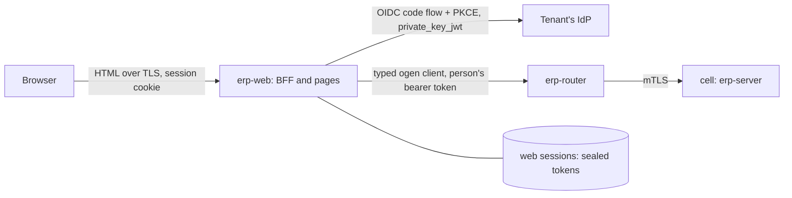

# ADR-0052: Web workspace for pilot finance users

**Status:** accepted (T73, product owner 2026-10-21: P1-P3 and P5-P8 as
recommended, P4 as recommended and accepted by the coordinator, see
"Decisions taken"). The steps T73a-T73m are in the tracker. The tracker's
pilot readiness item T72k ("Web UI for pilot finance users") is built by
T73.

## Context
The product owner decided on 2026-10-21 that **the pilot's finance users
need a web user interface**. The pilots are a Canadian and a UAE company
moving from SAP. People can reach the ERP today in three ways:

- **The API** (`api/openapi.yaml`, 254 operations in 14 tags on this
  branch). It is the product: "the web UI, agents, CLI, SAP connectors and
  partner integrations are all clients of the same public API; there are
  no private endpoints and no direct database access" (04 intro,
  ADR-0013). The API's rules are what a user interface has to respect:
  - every operation declares `x-permission`, and 48 declare
    `x-agent: false` (approval decisions, payment release, posting manual
    entries, user administration);
  - 37 operations are `x-autonomy: propose`, the writes an agent at level 1
    may make for a person to decide, and 5 are `x-autonomy: read`;
  - `ETag`/`If-Match` on every change (412 on a stale version, 428 when
    missing), and an `Idempotency-Key` on every `POST` and `PATCH`, kept
    for 7 days (04 §4.7);
  - RFC 9457 problems with a stable `code` that clients branch on (04 §4.6);
  - cursor pages of at most 500, no total counts, exports above about
    10,000 rows (04 §4.5);
  - 202 `Operation`s for long work such as payment proposals and releases
    (04 §4.8);
  - money as decimal strings (04 §4.4), and 404 for resources of a company
    the caller cannot see (04 §4.9).
- **The `erp` CLI** (`cmd/erp`): `erp call OPERATION` reads the contract
  at run time through `internal/apitools`, which also builds the agents'
  tools. `erp invoices`, `erp migrate` and `erp agent …` cover a few jobs
  end to end. A finance clerk will not use a command line.
- **Agents** (ADR-0036, ADR-0039): sessions, recommendations
  (`listRecommendations`, `decideRecommendation`, `x-agent: false`) and
  domain proposals that a person accepts or rejects, for example
  `proposeBankStatementLine` with `acceptBankStatementLineProposal`.

What the repository already says about a user interface:

- `docs/architecture.md`, under "Planned": "Web UI | Server-rendered Go:
  templ + HTMX | Stays in Go; no TypeScript". It also names an experience
  layer of "role-based web workspaces · on-demand reports and dashboards ·
  approval and review queues · configuration change reviews · chat · CLI".
- The tracker's module "User interface" (SAP "Fiori", phase 1) has the
  planned item "Server-rendered web workspaces (templ + HTMX)" with no
  step. Two more items wait on a workspace: "Dashboards in the web
  workspace" (T59) and "Anomaly alerts in workspaces".
- 01 §1.4 has a product-owner constraint: "Go for all services; no
  scripting languages in the platform".
- `docs/analytics.md`: dashboards are "self-contained HTML with inline SVG
  charts, drawn in Go; no scripts" (`internal/analytics/render.go`,
  `html/template`), and the planned version is "same spec rendered in the
  web workspace".
- 06 §6.3 has the API reviewed by "a consumer (UI or integration)", and the
  end-to-end tier runs "procure-to-pay through the public API, as UI and
  agents use it".

The parts of the platform a browser client meets:

- **Identity** (ADR-0010, ADR-0031). Tenants bring OIDC providers,
  registered per tenant on the control plane (`identity.identity_provider`:
  issuer, audience, tenant claim, `acr`/`amr` values, certificate binding).
  The token's issuer and audience decide its tenant. Multi-factor is proven
  by `acr`/`amr`, and a token that does not prove it gets the RFC 9470
  step-up challenge (401, `insufficient_user_authentication`).
  - Sessions are per authentication (`sid` or subject and `auth_time`).
    The absolute lifetime (default 12 h) and idle timeout (default 30 min)
    are enforced server-side, and an ended session never resumes.
  - The registry holds **no OAuth client** (no client id, redirect URI or
    client credential). The CLI uses bearer tokens obtained elsewhere
    (`erp token` in development). Session revocation through the API was
    deferred (ADR-0031, Alternatives).
  - People are provisioned "via SCIM or just-in-time" (ADR-0010), but
    neither is built. Principals are created through `createPrincipal` by
    an administrator.
- **Router and transport** (ADR-0022, ADR-0033, ADR-0035).
  - One `erp-router` per environment sits behind an internet-facing
    Network Load Balancer that passes TLS through. The router terminates
    TLS with a public CA's certificate, **asks every public client for a
    client certificate** (for agents' RFC 8705 binding), finds the cell by
    the token's issuer and forwards the request.
  - A cell's API accepts only the router's SPIFFE identity.
  - When a server requests a client certificate and the user has
    certificates installed (common on managed corporate machines),
    browsers show a certificate picker (verified in T73b, Sources). That
    makes the router's hostname a poor place for a browser to land.
- **Images** (ADR-0032). One ko-built, reproducible, distroless, cosign-
  signed image per pure-Go binary (`CGO_ENABLED=0`). The only exception is
  `erp-analytics`, which has a scoped Dockerfile. There is no Node.js
  toolchain anywhere in the build.
- **Tests and gates** (CLAUDE.md, 06). Coverage is 100% of production Go
  statements (`scripts/coverage.sh`, excluding `api/gen` and test
  support). Tests run against real PostgreSQL (`pgtest`) and an in-process
  API (`internal/app/apitest`). `authntest` is a minimal OIDC issuer: it
  serves discovery and keys and mints tokens, but has no authorization
  endpoint. The layout test (`internal/layout`) enforces the import rules.
- **The generated Go client**. ogen writes a typed client
  (`api/gen/oas_client_gen.go`) next to the server interfaces. Production
  code does not use it today: the CLI and agents go through `apitools`.

### What SAP gives these users (the parity target)
The pilot's users work in SAP GUI transactions or Fiori apps today. The app
names below are **from memory, not checked**, and the list has to be
confirmed against the pilot's release and launchpad: My Inbox (approvals);
Manage Supplier Line Items and Supplier Invoices List (AP); Manage Payment
Proposals / Manage Automatic Payments and Approve Bank Payments (payments);
Manage Bank Statements and Reprocess Bank Statement Items (bank
reconciliation); Post General Journal Entries, Manage Journal Entries and
Verify General Journal Entries (manual entries with approval); Manage
Posting Periods (close); Trial Balance, Display Line Items in General Ledger
and GR/IR account monitoring (reports); Manage Business Partner Master Data
and Manage Cost Centers (master data). Fiori runs on SAPUI5 behind the
Fiori launchpad, with role-based catalogs. **Parity means the same jobs,
not the same screens.** What users will expect is a role-based home with
work queues, list-detail views with filters and variants, document
attachments next to the document, and drill-down from figures to line
items.

## Decision

### 1. Scope of T73
In:
- a **web workspace** for the pilot's finance and AP users, served by a
  new binary `erp-web`;
- sign-in through the tenant's own identity provider;
- the pilot jobs of §2 with their screens, and the API additions those
  screens need (§3);
- English, plus French and Arabic as decided (P5); WCAG 2.2 AA;
- the build, image, deployment and quality gates of §§9-11.

Out (where each goes):
- dashboards and follow-up questions: T59, which renders into this
  workspace once it exists;
- a chat with agents: T59 and T67;
- report scheduling, sharing and Excel/PDF export: T63;
- the close checklist: T64. T73i shows periods and their states only;
- procurement buyers' screens (requisitions and orders beyond approving
  them), operators' screens (the control and directory planes stay
  operator tooling and CLI) and tenant administration (roles, SoD,
  principals): after the pilot, unless P6 says otherwise;
- mobile apps, offline use and notifications by e-mail or chat (§12).

**Never in the UI:** anything the API does not offer. There are no private
endpoints, no database access and no service credential of the UI's own
(§7).

### 2. Users and jobs in the pilot, mapped to the API
Roles are the pilot's to confirm (facts at the end). They map to permissions
that already exist. Each row is a job a screen serves, and the operations it
calls. **Gaps** are numbered G1-G9 and described in §3.

| Job (who) | Screens | Operations it uses |
|---|---|---|
| **Approvals inbox**: requisitions, POs, order changes, partner and bank-account changes, invoice exceptions, manual entries, bank clearings, period unlocks, center changes, configuration changes (approvers, controller) | Inbox (pending, decidable by me), request detail with the object's summary and steps, approve/reject with a reason | `listApprovalRequests` (status, object_type), `getApprovalRequest`, `approveApprovalRequest`, `rejectApprovalRequest`, `cancelApprovalRequest` (own requests); per object type its `get…` (`getRequisition`, `getPurchaseOrder`, `getPurchaseOrderChange`, `getPartnerChange`, `getSupplierInvoice`, `getParkedJournalEntry`, `getBankStatement`, `getFiscalPeriod`, `getCenterChange`, `getChangeRequest`). **G1** (decidable by me), **G2** (who am I), **G3** (names) |
| **Payment run release** (treasurer, AP lead; SoD: not the proposer) | Runs list, run detail with payments, exclusions and bank file; release or reject; operation progress | `listPaymentRuns`, `getPaymentRun`, `listPayments`, `listPaymentExclusions`, `releasePaymentRun` (202), `rejectPaymentRun`, `getOperation`, `cancelOperation`, `listBankFiles`, `getBankFile`, `transmitBankFile`; propose: `proposePaymentRun` (202) |
| **Invoice review and the AP exception queue** (AP clerk, AP lead) | Queue by status (`parked`, `on_hold`, exception pending), invoice detail beside its document (PDF), match results, the agent's recommendation; hold/release/post/cancel/reverse; capture by upload | `listSupplierInvoices` (status, supplier, PO, dates, kind), `getSupplierInvoice` (`expand`), `getSupplierInvoiceDocument`, `listMatchResults`, `getMatchResult`, `matchSupplierInvoice`, `holdSupplierInvoice`, `releaseSupplierInvoice`, `postSupplierInvoice`, `cancelSupplierInvoice`, `reverseSupplierInvoice`, `updateSupplierInvoice`, `createUpload`, `getUpload`, `captureSupplierInvoice`, `clearSupplierInvoiceDownPayments`; `listRecommendations` (object), `decideRecommendation`; `getPurchaseOrder`, `listGoodsReceipts` for the match context |
| **Bank statement reconciliation** (treasury, GL accountant; whoever matched cannot approve its clearing) | Statements per house bank, statement detail with lines and status, the agent's proposal per line (accept/reject), manual match, exclude, post; reconciliation report | `listHouseBanks`, `listBankStatements`, `getBankStatement`, `importBankStatements` (upload), `getBankStatementFile`, `matchBankStatement`, `listBankStatementMatches`, `getBankStatementRules`, `matchBankStatementLine`, `excludeBankStatementLine`, `postBankStatementLine`, `acceptBankStatementLineProposal`, `rejectBankStatementLineProposal`, `getBankReconciliation`; `listOpenItems` (clearing accounts) and `listPayments` to choose a match |
| **Manual journal entries** (GL accountant; approval above the company's limit) | Entry form with lines (accounts, centers, partner, tax code), park, post, withdraw; parked list including agents' proposals; journal browse; reverse | `parkJournalEntry`, `updateParkedJournalEntry`, `postParkedJournalEntry`, `cancelParkedJournalEntry`, `listParkedJournalEntries` (`created_by_kind`), `getParkedJournalEntry`, `postJournalEntry` (within the limit), `listJournalEntries`, `getJournalEntry`, `reverseJournalEntry`; pickers: `listAccounts`, `listCostCenters`, `listProfitCenters`, `listBusinessPartners` (`name_prefix`), `listLedgers`, `listLedgerGroups`, `listExchangeRates` |
| **Period close** (GL accountant, controller) | Periods per company and ledger with status; open/close; lock; request unlock; FX revaluation preview and post; pre-close checks: GR/IR, ledger reconciliation, unreconciled statements | `listFiscalPeriods`, `getFiscalPeriod`, `openFiscalPeriod`, `closeFiscalPeriod`, `lockFiscalPeriod`, `unlockFiscalPeriod`, `previewRevaluation`, `postRevaluationRun`, `listRevaluationRuns`, `getRevaluationRun`, `cancelRevaluationRun`, `listGrIrBalances`, `listLedgerReconciliation`, `listLedgerReconciliationEntries`, `listBankStatements` (status) |
| **Master data changes and change requests** (master data steward; bank accounts under dual control) | Supplier list and detail with company data and bank accounts (last four); request a bank account change or end; partner change requests; cost/profit centers and their change requests | `listBusinessPartners`, `getBusinessPartner`, `createBusinessPartner`, `blockBusinessPartner`, `unblockBusinessPartner`, `listBankAccounts`, `getBankAccount`, `requestBankAccountChange`, `requestBankAccountEnd`, `createPartnerChange`, `listPartnerChanges`, `getPartnerChange`; `listCostCenters`, `getCostCenter`, `createCostCenter`, `updateCostCenter`, `moveCostCenter`, `redateCostCenter`, `lockCostCenter`, the profit-center and segment equivalents, `listCenterChanges`, `getCenterChange` |
| **Configuration change requests** (finance owner reviews; implementation team or the configuration agent drafts) | Change requests by status, detail with the document diff, simulation and regression evidence; simulate, submit, withdraw; activate after approval; versions | `listChangeRequests`, `getChangeRequest`, `createChangeRequest`, `updateChangeRequest`, `simulateChangeRequest`, `submitChangeRequest`, `withdrawChangeRequest`, `activateChangeRequest`, `listConfigVersions`, `getConfigVersion`, `listRegressionSuites`, `getRegressionSuite`, `listCountryPacks`, `applyCountryPack` |
| **Reports** (all finance roles, auditors read-only) | Trial balance per company, ledger, year and period; supplier open items; GR/IR; bank reconciliation; ledger reconciliation; a document's audit history; download as CSV | `listBalances`, `listOpenItems`, `listGrIrBalances`, `getBankReconciliation`, `listLedgerReconciliation`, `listAuditEvents` (object), `getJournalEntry` (drill-down), `runAnalyticsQuery`, `getAnalyticsModel`. **G4** (due dates and aging), **G5** (export) |
| **Agents' work, seen by people** (all of the above) | On every object: an "Agent proposal" panel (recommendation, proposal or agent-drafted document), with the agent, its session and tool calls, and accept / override / ignore | `listRecommendations`, `getRecommendation`, `decideRecommendation`, `getAgentSession`, `listAgentToolCalls`; the domain accept/reject operations; agent-drafted parked entries, change requests, partner changes and requisitions are ordinary documents that a person posts or submits |
| **Context everywhere** | Company switcher, document search by number, "who did this" | `listLegalEntities`, the `document_number` filter of each list; **G2**, **G3**, **G6** (search) |

Jobs the API has no operations for yet, so the pilot UI does not have them
either:
- tax returns (T61, ADR-0049 accepted, not built here);
- the cash position and forecast (T53, ADR-0051 accepted);
- the close checklist (T64);
- exports above a page (T63);
- receivables (phase 3).

Each of these gets its screen in the step that builds its API, against
the conventions of this ADR. That is a line in each future step's
acceptance criteria, "screens in the workspace", once T73 exists.

### 3. API gaps a UI needs
Each gap traces to a job in §2 and is a contract-first, additive change in
`/v1` (04 §4.10). Nothing here is a private endpoint: CLI, agents and
partners get the same operations.

- **G1: "decidable by me" on approval requests.** An approval step names a
  role (`ApprovalStep.role_id`), and deciding needs that role plus the
  object type's approval permission (`x-object-permissions`). A person
  cannot list their own role assignments without `identity.access.read`,
  which approvers do not hold. So the inbox cannot tell "waiting for me"
  from "waiting for someone".
  - **Proposal:** `listApprovalRequests?decidable_by=me`. It returns
    pending requests whose current step's role the caller holds, with the
    object type's approval permission, that the caller did not request and
    has not decided.
  - The server computes it, so it never disagrees with what `:approve`
    accepts.
  - An index-backed filter (04 §4.5) on (tenant, status, current step role).
- **G2: who am I, and what may I do.** The UI needs the signed-in person's
  name, kind, companies and effective permissions, to build navigation and
  to hide actions the person can never take. It is **advisory**: the API
  still decides every call (§7).
  - **Proposal:** `getCurrentPrincipal` (`GET /v1/me`), readable by any
    authenticated person (permission `identity.self.read`, granted to
    every role by a migration). It returns the principal, the companies
    with access, the effective permissions (with their companies where
    scoped), the autonomy level for agents, and a locale preference (P5).
  - `x-autonomy: read`.
- **G3: names for ids.** Documents, approvals and decisions carry principal
  ids (`created_by`, `requester_id`, `decisions[].actor_id`,
  `decided_by`). An approver must see who asked, and whether that was an
  agent. Reading principals needs `identity.access.read`.
  - **Proposal:** `listPrincipalNames?ids=…` (at most 100 ids), readable
    with `identity.self.read`. It returns only id, display name and kind
    (`person | agent | service`) of principals in the caller's tenant,
    never e-mail or roles.
  - The UI caches it per session for five minutes.
  - Alternative considered: `expand=created_by` on every document, which
    touches every list operation.
- **G4: due dates on open items.** AP clerks ask "what is due or overdue",
  and close asks for supplier aging. Open items carry their terms
  (`open_item_terms`), but the net due date is computed and not exposed or
  filterable (ADR-0051 §5 found the same).
  - **Proposal:** `net_due_date` and `discount_due_date` on the open item
    representation, and `due_date_to` with an aging bucket list on
    `listOpenItems`, backed by the functional index ADR-0051 T53e may add.
  - If T53e builds the shared due-date helper first, G4 reuses it rather
    than computing the date twice.
- **G5: exports of report pages.** A trial balance or open-item list of
  more than a few pages is downloaded, not paged on screen. Up to 10,000
  rows, the UI streams the pages it reads into a CSV (§8). Above that, the
  export operation of T63 is needed. **No new endpoint in T73.** The UI
  says when a report is over the limit.
- **G6: document search.** "Find 5100000123" spans invoices, journal
  entries, payment runs, goods receipts and orders, each of which has a
  `document_number` filter.
  - **Proposal:** none for the pilot. The UI queries the five lists in
    parallel, within the principal's rate limit (04 §4.11: 50/s).
  - A cross-document search operation is a later question, if the pilot
    asks for free-text search.
- **G7: problem codes in the contract.** The UI shows each problem in the
  user's language by its `code`, and clients "branch on `code`, never on
  `detail`" (04 §4.6). The codes an operation can answer are named only in
  description prose today.
  - **Proposal:** `x-problem-codes` per operation, listing the stable
    codes. A spec test checks that the handlers' registered codes
    (`problem.RegisterConstraint` and the packages' problem constructors)
    are a subset of them. A UI test checks every listed code has a
    message in each shipped language, falling back to the problem's
    English `title` otherwise.
  - This is contract metadata, not an endpoint. It also documents the API
    for partners (T50).
- **G8: a web client per identity provider.** To sign people in, the BFF
  of §5 needs an OAuth client at the tenant's provider: a client id, a
  redirect URI, and a client credential, preferably a key
  (`private_key_jwt`) over a secret. None of these is registered.
  - **Proposal (control plane, `api/control.yaml`):** each identity
    provider registration gains an optional `web_client`:
    - `client_id`;
    - `auth_method` (`private_key_jwt` | `client_secret_basic`);
    - a secret reference to the key or secret (ADR-0017), never the value;
    - `login_code` (§5);
    - the `scope` that yields a token for the registered audience.
  - The router's directory projection (`directory.issuer`) gains the login
    code, so `erp-web` can find the provider before anyone has signed in.
  - `erp:admin`, and audited in the tenant as `updateIdentityProvider`
    changes are today.
- **G9: ending the ERP session at sign-out.** ADR-0031 deferred session
  revocation through the API. A person who signs out on a shared machine
  expects the session to be over, not only the BFF's cookie.
  - **Proposal:** `endCurrentSession` (`POST /v1/sessions/current:end`),
    any authenticated person, which ends the token's `identity.session` as
    `revoked`. A token of that session then gets 401 as an ended session
    does.
  - `erp-web` calls it before the provider's RP-initiated logout.

Not gaps: the approval list already carries `title` and `amount`, so the
inbox needs no per-row fetch. Long-running operations already have
`getOperation`. Optimistic locking and idempotency already make a form safe
to submit twice (§8).

### 4. Rendering: server-rendered Go with templ and htmx (decision P1)
`erp-web` renders HTML on the server in Go, with **templ** components
(type-checked templates compiled to Go). It uses **htmx** for partial page
updates: filters, paging, inline actions, polling an operation. It is a new
pure-Go binary, `cmd/erp-web`, with its code in `internal/web`. It holds no
business logic and no data of its own beyond sessions (§6).

Reasons:
- **It is the plan of record, and it fits the constraint.**
  `docs/architecture.md` and the tracker already say templ + HTMX, and the
  product owner's constraint is Go for all services. A TypeScript SPA
  would bring a second language, a Node.js toolchain and an npm
  dependency tree into the build, which this repository has avoided.
- **The contract stays the single source, checked by the compiler.**
  `erp-web` calls the API only through the ogen-generated Go client
  (`api/gen`). A change to `api/openapi.yaml` that breaks a screen breaks
  `go build`, and the breaking-change check already guards `/v1` for
  partners. A TypeScript client generated from the same spec
  (openapi-typescript or similar) would give the same check in a second
  type system.
- **One quality bar.** Go handlers, view models and templ's generated Go
  are production statements under the existing 100% gate, golangci-lint,
  gosec, govulncheck and `-race`. There is no second coverage tool, linter
  or vulnerability scanner to keep (§10).
- **It is a BFF by construction.** The server already holds the session,
  so tokens never reach the browser (§5).
- **Safe output by default.** templ escapes expressions by context:
  - text is escaped;
  - `href` values must be `templ.SafeURL` and are sanitized of
    `javascript:` URLs;
  - `<script>` and `<style>` blocks cannot hold variables;
  - CSS expressions go through `templ.SanitizeCSS`;
  - inline scripts take a nonce through `templ.WithNonce`.

  This matters because agents' text and suppliers' invoice fields are
  untrusted (§7).
- **Images and deployment are unchanged.** `erp-web` is one more
  `CGO_ENABLED=0` binary in `.ko.yaml`, reproducible, scanned and signed
  like the others (ADR-0032).
- **Accessible by default.** Server-rendered semantic HTML (forms, tables,
  links, buttons) works with assistive technology and the browser's own
  history, where an SPA must rebuild focus management and routing.

Costs, accepted:
- Spreadsheet-like entry (a journal entry with many lines, keyboard-first)
  and a PDF beside a form are harder without a client framework.
  - Lines are rows of a server-rendered form; htmx adds and removes rows.
  - An upload of lines (CSV) covers bulk entry, and the API's 10,000-line
    limit applies.
  - If pilot users find this too slow, a small, separately gated
    component is the escape hatch (a P1 option, needing an ADR amendment),
    not a rewrite.
- htmx is JavaScript. It is a single vendored, version-pinned file
  checked by SHA-256 in a test, served from `erp-web`'s own origin, with
  no build step. **No hand-written JavaScript** is allowed without
  amending this ADR (§10).
- Every interaction is a round trip to `erp-web` and on to the API.
  Budgets are in §10.

**templ rather than `html/template`.** `html/template` (used by
`internal/analytics/render.go`) has the same contextual escaping, but it
checks a template's data only at run time. templ fails the build on a
missing field. That is the same reason the API uses generated types. The
analytics renderer stays as it is, and T59 embeds its output.

Alternatives in P1:
- **(b) A SPA** (React or another framework, TypeScript, generated client)
  served as a static bundle, by `erp-web` or a CDN. It gives richer
  interaction and a large hiring pool. It costs a Node.js toolchain and
  npm supply chain in the build (lockfile, audit, reproducible bundle), a
  second test and coverage stack, and either tokens in the browser or a
  BFF anyway (§5).
- **(c) An admin framework or low-code tool** (React-admin or Refine over
  the OpenAPI, or a hosted builder such as Retool). Generic list-detail
  screens come fast. But finance jobs are workflows (match, hold, release,
  approve with SoD), not tables. Hosted builders keep tokens and data in
  a third party's service, which conflicts with ADR-0003 and residency.
  And it still brings the SPA's toolchain.

### 5. Sign-in: a backend-for-frontend, tokens never in the browser (decision P2)
`erp-web` is a **confidential OAuth client** of the tenant's identity
provider, and the browser holds only a session cookie. RFC 10017 (OAuth
2.0 for Browser-Based Applications, BCP 212, August 2026) ranks the BFF
pattern first of its three architectures. It is "strongly recommended for
business applications, sensitive applications" and applications handling
personal data, because "since tokens are only available to the BFF, there
are no tokens available to extract from the browser". A finance
application that releases payments is that case.

**Flow.**
1. **Login code.** The person opens `https://app.<domain>/login/<code>`, or
   types the code once. The code is the tenant's `login_code` (G8), not a
   secret. `erp-web` remembers it in a cookie so the next visit skips the
   step.
2. **Provider lookup.** `erp-web` resolves the code through the
   directory's projection to the provider's issuer, client id and scope,
   cached for 30 s like the router.
3. **Authorization code flow with PKCE** (RFC 7636; RFC 9700 makes PKCE
   mandatory for public clients and recommended for confidential ones, and
   advises against the implicit grant). `state` and `nonce` are checked,
   and `prompt`/`max_age` are passed when re-authentication is needed. The
   code is exchanged with `private_key_jwt` (OIDC Core §9), with the key
   from the secret store and rotated as ADR-0028 rotates keys. A client
   secret is accepted only where the provider offers nothing else (P2).
4. **Token and session.** The ID token is validated with the same verifier
   and key cache as the API (`internal/platform/authn`, ADR-0031). The
   access token's issuer and audience must be the registered ones. A new
   session is created with a fresh random id (no fixation), and the
   transaction cookie is deleted.
5. **API calls.** Every call to the API carries the person's access token,
   unchanged. The cell checks the token, the session, multi-factor and
   every permission exactly as for the CLI. `erp-web` refreshes the access
   token with the refresh token when the provider issues one. The cell's
   session (by `sid`, or by `auth_time`) is unaffected by a refresh
   (ADR-0031), so the tenant's lifetime and idle timeout still apply.
6. **The API's 401 decides.**
   - When a call is answered 401 as an ended session, `erp-web` ends its
     own session and sends the person to sign in again, keeping the page
     they were on as a relative return path (open-redirect safe: a path,
     never a URL).
   - When the answer is the RFC 9470 step-up challenge, `erp-web` runs the
     code flow again with the challenge's `acr_values`.

   `erp-web` never decides a timeout more generous than the API's. Its own
   limits are the maxima any tenant may set (24 h absolute, 8 h idle), so
   the cell's stricter policy is what people see.
7. **Sign-out.** `endCurrentSession` (G9), then the session is deleted,
   then OIDC RP-Initiated Logout at the provider where it offers it
   (`end_session_endpoint`).

**Cookies** follow RFC 10017 §6.1.3.2:
- the session cookie is `__Host-Http-erp-session`, with `Secure`,
  `HttpOnly`, `Path=/`, no `Domain` and `SameSite=Strict`, holding only a
  random 256-bit id;
- the login transaction cookie (state, nonce, PKCE verifier, return path)
  is `SameSite=Lax`, because the provider's redirect back is a cross-site
  navigation. It lives 10 minutes and is used once;
- a cross-site arrival (a link in an e-mail) carries no Strict cookie, so
  it gets a same-site continue page that navigates again with it.

**CSRF.** RFC 10017 requires a proper CSRF defence from a BFF. There are
three layers:
1. Go's `net/http.CrossOriginProtection` (Go 1.25+) refuses non-safe
   cross-origin requests by `Sec-Fetch-Site`, or by `Origin` against
   `Host`. It allows `GET`, `HEAD` and `OPTIONS`, so no handler changes
   state on those methods, and a test walks the routes to prove it.
2. Every form carries a synchronizer token bound to the session (OWASP:
   "stateful software should use the synchronizer token pattern"). htmx
   sends it as a header, set with `hx-headers` on an element htmx replaces.
3. `SameSite=Strict` is defence in depth, which OWASP says it is and no
   more.

**Rejected: tokens in the browser** (P2 b and c). With a browser-based
public client, or a token-mediating backend, the access token is in
JavaScript's reach. RFC 10017 calls the browser-only architecture
"vulnerable to all attack scenarios discussed earlier", and ranks the
token-mediating backend below the BFF. The router would also ask the
browser for a client certificate (§Context). It would also need CORS on
the router for a SPA on another origin, a surface the API does not have
today.

### 6. Where `erp-web` runs, and its sessions (decision P3)
`erp-web` runs in the **`erp-global` chart next to the router**:
- three replicas, the restricted profile, no service account token, the
  same network policy pattern as the router (T40c5);
- its **own hostname** `app.<domain>`, on a second internet-facing Network
  Load Balancer passing TLS through to `erp-web`;
- a public CA's certificate loaded by operators, as the router's is
  (ADR-0035: no ACME).

It calls the API **through the router's public listener**, as every other
client does. It presents no client certificate and holds no SPIFFE
identity a cell would accept. A cell's API keeps accepting only the router
(ADR-0033), and the router stays the one address that survives a tenant
moving (ADR-0022).

Reasons:
- **The browser never meets the router's certificate request**
  (§Context), and the API's hostname stays an API.
- **Global like the router.** The router is one per environment, so a
  per-cell `erp-web` would need a per-cell hostname and a cell chosen
  before sign-in. It would lose the router's move handling. Its traffic
  already reaches cells through the router, so a global `erp-web` adds no
  new path for business data.
- **Sessions must outlive a replica.** They are stored in a `web` schema
  of the **global directory's database**, with a login of their own that
  sees only that schema. The directory holds no business data (ADR-0022),
  and the web store holds none either:
  - session id hash, tenant id, principal id, created, last seen, expires;
  - the sealed access, refresh and ID tokens (AES-256-GCM under a key
    from the secret store, the field-encryption pattern of ADR-0018);
  - the CSRF secret.
  - Sessions are deleted at their end and swept hourly. Nothing about
    sessions is exported or fingerprinted (ADR-0031's rule for sessions).
- **Rejected for the pilot: stateless sealed cookies.** Tokens from
  enterprise providers (Entra ID with groups, for example) can exceed a
  cookie's 4 KB, so a session would span several cookies. Revocation
  would need a deny-list anyway, so the store comes back.

Residency: the UAE and Canadian tenants' pages are rendered in the
environment's home region, as their API calls are already routed there.
`erp-web` caches no business data: each request reads the API, and
responses carry `Cache-Control: no-store`. If the pilot's residency rules
require the UAE tenant to be served from a UAE region end to end, that
requires a router and a web per region, which goes beyond this ADR (facts).

### 7. Never letting the UI do what the API forbids
- **The API is the only authority.** `erp-web` has no token of its own and
  no service principal. Every read and write is the person's own call,
  under their permissions, company access, SoD, autonomy and audit. The
  audit trail records the person, never `erp-web`.
- **Advisory hiding only.** Actions the person can never take, by G2's
  effective permissions or the object's state, are not offered, so
  screens stay clear. An action offered is still refused by the API when
  it should be (SoD, a stale version, a period closed meanwhile), and the
  UI shows the problem. A test runs each screen as a person without the
  permission and checks the API's 403 is what they see, not a server
  error.
- **Imports.** `internal/web` may import `api/gen`, `internal/platform`
  packages that hold no database or tenant scope (`problem`, `etag`,
  `money` formatting, `tlsconf`, `authn`, `secrets`, `telemetry`), and its
  own session store. It may not import any context, `uow`, `reqctx` or the
  database packages. The layout test (`TestImportRules`) gets these rules,
  so the BFF cannot become a second backend.
- **Forms follow the API's rules.**
  - The resource's `ETag` travels in the form and is sent as `If-Match`,
    and a 412 shows "changed since you opened it", with the new version
    and the user's input kept.
  - Each rendered form carries a fresh `Idempotency-Key`, so a double
    click or a resubmit after "back" replays the first answer
    (`Idempotent-Replayed: true`) instead of acting twice.
  - Money fields stay decimal strings end to end and are validated for
    the currency's minor units before sending. Floats are never used,
    following the linter's ban.
  - Open enumerations show unknown values as they are, never as an error.
- **Agents' proposals are shown, not applied.**
  - Anything an agent made carries an "Agent" badge with the agent's name
    (G3), its session, and its tool calls on request. This covers
    recommendations, bank line proposals, parked entries
    (`created_by_kind=agent`), change requests and partner changes.
  - Accepting is the domain operation the person performs (accept the
    proposal, post the parked entry, submit the change request), followed
    by `decideRecommendation` for a free-text recommendation.
  - Where the two are separate calls and the second fails, the UI shows
    the recommendation as still open and offers the decision again. The
    domain operation's idempotency key makes retrying it safe.
  - Agents' text is **untrusted**: it may carry instructions planted in an
    invoice (ADR-0039's suites test exactly this). It is rendered as
    escaped plain text, with line breaks kept. Links are not made
    clickable, nor is markdown rendered, so a planted link cannot pose as
    the ERP's own.
  - The same holds for supplier-supplied fields and bank statement
    remittance text.
  - `erp-web` calls no model and runs no agent.
- **Approvals.** `x-agent: false` operations are people's anyway. The UI
  asks for a reason on every reject, shows the request's steps and
  decisions, and never pre-fills or batches decisions: one decision, one
  click, one request. A "select several and approve" action is a later
  question for the product owner, since SoD is per request.
- **Documents from outside.** `getSupplierInvoiceDocument` and statement
  files are untrusted bytes. They are served by `erp-web` with their
  stored media type, `X-Content-Type-Options: nosniff`,
  `Content-Disposition: inline` for PDFs and images only (attachment
  otherwise), and `Content-Security-Policy: sandbox`, so a hostile PDF or
  HTML cannot script the workspace's origin. Uploads go through the API's
  signed path variant (ADR-0020), relayed by `erp-web`, not as a browser
  `PUT` to the bucket. That keeps the bucket off the CSP and without CORS.

### 8. Pages, headers and conventions
- **Content Security Policy:** `default-src 'self'; script-src
  'nonce-…'; style-src 'self'; img-src 'self' data:; object-src 'none';
  base-uri 'none'; form-action 'self'; frame-ancestors 'none'`, plus
  `connect-src 'self'` and a `frame-src 'self'` for document previews.
  - htmx is configured with `allowEval: false` (no `hx-on:` handlers,
    event filters or `js:` values) and `allowScriptTags: false`.
    `selfRequestsOnly` stays true, its default.
  - Untrusted HTML never reaches a page, and fields that hold outside text
    sit inside `hx-disable`, which "cannot be disabled by injecting
    further content" (htmx docs).
  - Other headers: `Strict-Transport-Security`,
    `Referrer-Policy: same-origin`, `Cross-Origin-Opener-Policy:
    same-origin`, `Permissions-Policy` denying what is unused.
- **Progressive enhancement.** Every action is a real form or link that
  works without htmx, and htmx replaces fragments when present. Tests can
  therefore drive the server without a browser (§10), and assistive
  technology sees plain HTML.
- **Lists** map the API's cursor pages one to one. The page token is kept
  in the URL, so back, bookmarks and "open in a new tab" work. Filters are
  query parameters and only the API's own filters are offered.
  "Showing 50, more…" replaces totals (04 §4.5). Saved filter variants per
  person are a later step.
- **Long operations** (proposal, release, transmission, revaluation) show
  the 202 `Operation`, polled every two seconds with `hx-trigger`, stopping
  when final. Cancel is offered where the API offers it.
- **Errors.** A problem is shown by `code` in the user's language (G7),
  with field errors next to their fields (`errors[]`) and the `trace_id`
  for support. A raw `detail` is shown only as the English fallback. A 404
  is "not found or not yours", as the API means it. 429 and 503 honour
  `Retry-After`.
- **Company context.** A person with several companies picks one, kept in
  the URL as `legal_entity_id`, never in the session, so two tabs can show
  two companies. It is a filter, as the API's rule says.
- **CSV download** of a report (G5) streams the API's pages through
  `encoding/csv` up to 10,000 rows, with the filters in a header line, the
  amounts as the API's decimal strings and the person's own call. Above
  that the UI says so and points to T63's export.
- **Observability** (ADR-0043). Request metrics carry bounded labels only
  (route pattern, status class), never a tenant or a person. Traces
  propagate to the API with the request's trace id, and logs carry no
  tokens, cookies or form values.

### 9. Languages and accessibility (decision P5)
**Languages.**
- Every string goes through a message catalog from the first step:
  `golang.org/x/text/message` with CLDR plural rules, catalogs as files in
  the repository and a test that every key exists in every shipped
  language.
- Numbers, amounts and dates are formatted for the person's locale
  (CLDR via `x/text`) from the API's decimal strings, never through
  floats, and parsed back strictly per locale. Business dates stay ISO in
  the API.
- The locale comes from G2's preference, then `Accept-Language`, then the
  company's.
- Problems are translated by `code` (G7).
- Master data texts (account and center names) are shown as the API
  returns them. ADR-0050 already keeps "texts in the tenant's language".

Which languages ship at the pilot is P5:
- **French (Canada).** If the Canadian pilot company has employees in
  Québec, the Charter of the French Language makes French work tools,
  including software installed on computers, the rule there. Under
  s. 52.1 software must be available in French unless no French version
  exists, and bilingual interfaces are allowed. **These are secondary
  sources, not the consolidated text.** Counsel or the pilot must confirm
  whether the company is in scope (facts).
- **Arabic, right to left (UAE).** Arabic is the UAE's official language.
  Whether the UAE pilot's finance staff need an Arabic interface, rather
  than English, is the pilot's to say. From memory, English is the usual
  working language of UAE finance teams, which needs checking.
  - Either way the layout is **RTL-ready from the first step**: CSS
    logical properties only (`margin-inline-start`, never `margin-left`),
    `dir` set from the locale, icons that mirror where direction matters,
    and amounts and codes isolated with `<bdi>`/`dir="ltr"` so an IBAN's
    last four or a document number never reorders.
  - A pseudo-locale (accented, 30% longer) and an RTL pseudo-locale run in
    the end-to-end suite from T73a. Adding Arabic is then translation and
    review, not a rework.

**Accessibility: WCAG 2.2 level AA** (W3C Recommendation, current version
dated 12 December 2024), as a requirement, not a decision. That includes
the criteria new in 2.2 at A and AA:
- 2.4.11 Focus Not Obscured (Minimum): sticky table headers and toolbars
  must not hide the focused row;
- 2.5.7 Dragging Movements: no drag-only reordering of journal lines;
- 2.5.8 Target Size (Minimum);
- 3.2.6 Consistent Help;
- 3.3.7 Redundant Entry: an invoice's supplier is not asked twice in a
  flow;
- 3.3.8 Accessible Authentication (Minimum): the provider's login is the
  provider's, but the login-code step must allow paste and autofill.

Ontario's AODA and the Accessible Canada Act may apply to the pilot
company as an employer or organisation. **From memory, not checked:** both
reference WCAG 2.0/2.1 AA, which 2.2 AA satisfies. Tests are in §10.

### 10. Testing and quality gates (the bar applied to a frontend)
The repository's gates apply unchanged to everything that is Go. The parts
that are not Go get gates of equal force.

| What | Gate |
|---|---|
| Go in `internal/web`, `cmd/erp-web` (handlers, view models, BFF, session store) | 100% statement coverage in `scripts/coverage.sh`, as everywhere; golangci-lint (function length, complexity, the float ban), gosec, govulncheck, `-race` |
| templ's generated `*_templ.go` | **Counted** in the 100%: templates hold the conditions that matter (an action shown only in a state, a column only with a permission), and rendering every component in each state is what covers them. `templ generate` runs in `make generate` and CI fails on a diff, as for `api/gen` |
| Handlers and pages | Tests against a **real API**: `internal/app/apitest` in process, real PostgreSQL through `pgtest`, tokens from `authntest`, never a mocked API or database. Each screen is tested per state and per permission (allowed, refused by the API, hidden), with `pgtest.FailingTx` behind the API for its error paths. Assertions on the rendered HTML go through a parsed DOM (`golang.org/x/net/html`), not string matching |
| Contract drift | Compile-time: the ogen client. A generated inventory (`internal/web/operations.go`, from the routes) lists every operation each screen calls. A test checks that each is in the spec, that the permission the UI uses to hide an action equals the operation's `x-permission`, and that no screen calls an `x-agent: false` operation without a human-only marker on the route. G7's test checks codes and translations. `make lint-all` and the breaking-change check stay as they are |
| The vendored htmx file | Pinned version and SHA-256 checked by a test, excluded from coverage like other third-party code, an upgrade a reviewed change; no other JavaScript: a lint step fails on any `.js` file outside `internal/web/static/vendor`, and a test renders every page and fails on an inline script without the nonce or any `on*=` attribute |
| CSS | Plain CSS files, no preprocessor; a test fails on physical direction properties (`left`, `right`, `margin-left`, …) outside an allow-list, so RTL cannot regress |
| Security | Tests for: • cookie attributes; • session id rotation at sign-in; • CSRF refusal (cross-site `Sec-Fetch-Site`, missing or wrong token); • no state change on safe methods (a walk of the routes); • CSP and the other headers on every route; • open redirect on the return path; • a 401 ending the session; • the step-up challenge restarting the flow; • sign-out ending the API session (G9); • document responses sandboxed; • agent and supplier text escaped (a planted `<script>`, `javascript:` link and markdown link in a recommendation). Weekly OWASP ZAP baseline scan against the staging cell, findings triaged like grype's |
| End to end | Go tests driving headless Chromium with **chromedp** (Go, CDP) against a **real cell**: `erp-server`, `erp-router` and `erp-web`, PostgreSQL, and `authntest` extended with an authorization endpoint (code flow, PKCE, `private_key_jwt`), in CI's integration job. Each pilot job of §2 is one scenario run as the pilot's roles, including SoD refusals and a stale-version conflict, at 1280 px and 390 px widths and in the RTL pseudo-locale |
| Accessibility | axe-core injected by the end-to-end tests into each page and state, **zero violations** at WCAG 2.2 A/AA rules; keyboard-only walk-through of each scenario (focus order, visible focus, no traps); manual screen-reader review (NVDA with Firefox, VoiceOver with Safari) of each pilot screen before its step is done; an external audit before go-live (T73m). axe-core is test tooling run in the test browser, not part of the platform |
| Performance | Budgets in 05's style: server time of a page ≤ the API calls it makes + 30 ms p95; at most 6 API calls per page render (the per-principal limit is 50/s); HTML ≤ 100 KB, htmx the only script; measured in the perf job |
| Review | The `go-reviewer` agent on every step; plus a pilot user's walk-through of each screen against its job before the step is done (the acceptance criteria say which role) |

The end-to-end suite replaces "procure-to-pay through the public API, as UI
and agents use it" in 06 §6.6's table for the UI's part. The CLI's
`TestEndToEnd` stays.

### 11. Build and deployment
- **Build.** `cmd/erp-web` is a fourth ko image in `.ko.yaml`
  (`CGO_ENABLED=0`, distroless static, reproducible double build, SBOM,
  grype, cosign signature and attestations, `verify-image.sh`), with
  static assets embedded by `embed` and served with content-hashed names
  and long caching. `release.json` gains `images.web`. It takes no part in
  the cgo exception.
- **Deployment.** The `erp-global` chart gains the `erp-web` Deployment,
  its TargetGroupBinding, network policy (from the new balancer's subnets
  in; to the router, the directory database, the identity providers on
  443, DNS out) and Kyverno admission, under `helm-checks.sh`.
  - Terraform's global module gains the second balancer, its target
    group and the `erp/global/web-*` secrets: the session sealing key,
    the public certificate and key, and the client keys' references.
- **Startup checks in production**, like the other binaries:
  - the session database URL with `verify-full`;
  - the sealing key present;
  - an https public URL;
  - TLS material;
  - no development login.

  A missing setting fails startup (CLAUDE.md: no silent fallbacks).
- **Releases** go with the platform's, one version for all images.
  `erp-web` is stateless across releases apart from its session table,
  migrated expand-first like any schema (06 §6.4).

### 12. Out of scope, and where it goes
- **Notifications** (an e-mail or Teams message when something waits in
  the inbox). The `ApprovalRequested` event exists, but nothing delivers
  it to people. A later step, with T63's delivery: fact needed on the
  pilot's channel.
- **Bulk decisions, saved variants, personal layouts:** after pilot
  feedback.
- **Tenant administration screens** (principals, roles, SoD, AI policy,
  webhooks, connectors): CLI and API for the pilot, a later step (P6).
- **Operator screens:** never in this workspace. Operators use the control
  and directory planes with operator tokens.
- **Phones:** approvals and the inbox are usable at 390 px. Data entry
  targets laptop and desktop widths (P8).
- **Theming per tenant** (logo, colours): not for the pilot (P7).
- **SCIM provisioning:** ADR-0010's plan, not this ADR's. The pilot's
  people are created by an administrator as today, and a principal without
  roles who signs in sees an "ask your administrator" page, not an error.

## Alternatives
- **A TypeScript SPA with a generated client.** Rejected for the pilot
  (P1 b): a second language and toolchain against the product owner's
  constraint, and a BFF is needed anyway for token safety.
- **An admin framework or hosted low-code builder.** Rejected (P1 c):
  generic CRUD, not workflows, and hosted builders put tokens and data in a
  third party.
- **Tokens in the browser** (a public client with PKCE, or a
  token-mediating backend). Rejected (P2): RFC 10017 ranks both below a
  BFF, and the router would ask browsers for certificates.
- **`erp-web` per cell, or inside `erp-server`.** A route in `erp-server`
  would make the API serve HTML and cookies beside bearer tokens, and
  would need a cell before sign-in. Rejected (P3).
- **The UI reading the analytical store or the replica directly** for
  reports. It would be faster for large reports, but it would go around
  the API's permissions, company access and audit. Rejected: numbers come
  from the API and the semantic layer (ADR-0044) like everyone's.

## Consequences
- A fourth image and binary, a second public balancer and hostname, a
  `web` schema in the directory database, and control-plane fields for
  web clients (G8).
- Six additive API changes (G1-G4, G7 metadata, G9). Each has a T-number,
  a test, and partners can use them too.
- Every later step that adds a user-facing capability (T53, T59, T61,
  T63, T64, phase 3) adds its screens here, under §§7-10. Its acceptance
  criteria gain "screens in the workspace".
- Tenants' identity providers must register a confidential web client
  (redirect URI `https://app.<domain>/callback`), and must put `sid` or
  `auth_time` in tokens, which ADR-0031 already requires.
- Pilot users get the jobs of §2. Agents' work becomes visible to the
  people who decide it, not only to CLI users.
- Amends ADR-0022 and ADR-0035 (a second public entry point in the global
  chart) and ADR-0032 (a fourth image). It adds an exception to 01 §1.4's
  constraint: one vendored JavaScript file, no hand-written scripts.

## Boundaries with the other steps
- **T37 (identity):** T73b reuses the verifier, key cache and session
  semantics; G8 and G9 extend the registry and the session table.
- **T49 (bank statements), T35 and T32 (approvals, period lock), T36 and
  T45 (payment runs):** their screens are T73d-T73i; no rule moves into
  the UI.
- **T42 and T43 (agents):** recommendations and proposals are shown and
  decided here; no agent runs in `erp-web`.
- **T50 (API lifecycle):** G7's `x-problem-codes` is contract metadata
  under the breaking-change check.
- **T53, T61, T64:** their screens follow when their APIs exist.
- **T59 (dashboards):** renders inside this workspace (the analytics HTML
  embedded under the same CSP, no scripts) after T73a.
- **T63 (delivery, export):** exports above 10,000 rows and scheduled
  reports.
- **T67 (MCP, access agent):** none.

## Steps
These steps are ordered so the pilot's must-haves come first (P6). Each
ends green: lint, tests, coverage at 100%, the end-to-end scenarios of its
screens, axe at zero, and the reviewer. Lane A builds the screens. Lane P
builds T73a-T73c's platform parts (the image, the chart, the control
plane). The API gaps go to the lane that owns each context. Sizes: S up to
three days, M about a week, L about two weeks.

| Step | Size | Work | Acceptance criteria |
|---|---|---|---|
| T73a | M | **Skeleton** | `cmd/erp-web` and `internal/web` with templ (`make generate`, CI diff check), the vendored htmx pinned by hash with `allowEval`/`allowScriptTags` off, layout, navigation shell and base CSS (logical properties only), message catalog with English and the two pseudo-locales, security headers and CSP with nonces, health and `/version`, `TestImportRules` entries, ko image in `.ko.yaml` and the release, the `erp-global` chart's Deployment and network policy with `helm-checks.sh`, chromedp + axe harness in CI with one page; ADR-0022/0032/0035 amended |
| T73b | L | **Sign-in (BFF)** (P2, P3, G8, G9) | `web_client` on identity provider registrations in `api/control.yaml` and the directory projection; login code; authorization code flow with PKCE, `state`, `nonce`, `private_key_jwt`; ID token through `authn`; `web` schema and its login in the directory database, sealed tokens, hourly sweep; cookies as §5; CSRF (CrossOriginProtection, synchronizer token); refresh; 401 and RFC 9470 step-up handling; `endCurrentSession` in the API and RP-initiated logout; `authntest` gains the authorization endpoint; production startup checks; the security tests of §10 |
| T73c | M | **API for the workspace** (G1, G2, G3, G7) | Contract first: `decidable_by=me` with its index, `getCurrentPrincipal` with `identity.self.read` granted to every role by migration, `listPrincipalNames`, `x-problem-codes` on every operation with the spec test against the registered codes; each with schema and `FailingTx` tests; the CLI and agent tools pick them up unchanged |
| T73d | M | **Approvals inbox** | Inbox (decidable by me, my requests, all I can see), detail per object type with its summary, steps and decisions, approve/reject with reason, cancel own; SoD and permission refusals shown by code; requester and deciders by name and kind; usable at 390 px; scenarios as approver, requester and a person without the role; walked through by a pilot approver |
| T73e | L | **Invoices and the AP exception queue** | Queue by status and exception, invoice detail with the sandboxed document beside it, match results, hold/release/post/cancel/reverse with ETags and idempotency keys, capture by upload through the API's signed path, the agent's recommendation panel with decide, escaped agent text; scenarios: clean post, price variance held and released, exception approved by someone else, stale version, planted instruction in the recommendation shown inert; walked through by a pilot AP clerk |
| T73f | M | **Payment runs** | Propose (202 with progress), run detail with payments and exclusions, release and reject with SoD (the proposer refused), operation cancel and resume, bank file status and transmit; scenarios as proposer and releaser |
| T73g | L | **Bank statements and reconciliation** | Import by upload, statement and line views by status, agent proposals accepted or rejected, manual match from open items and payments, exclude, post with the clearing approval (the matcher refused as approver), reconciliation report per house bank; masked accounts; a foreign-currency statement where the pilot has one |
| T73h | L | **Manual journal entries** | Entry form with lines (accounts, centers, partner, tax code), add and remove rows with and without htmx, CSV upload of lines into a parked entry, park/post with the approval above the limit, withdraw, agents' parked entries listed and taken on, journal browse and reverse (refused for entries owned elsewhere, as the API says); keyboard-only entry of a ten-line entry within the scenario |
| T73i | M | **Period close** | Periods per company and ledger, open/close/lock, unlock request and its approval, revaluation preview and post, the pre-close checks (GR/IR, ledger reconciliation, statements not reconciled) on one page as links to their reports |
| T73j | M | **Reports** (G4, G5) | Trial balance, supplier open items with due dates and aging (G4's contract change), GR/IR, bank and ledger reconciliation, a document's audit history; drill-down to entries; CSV up to 10,000 rows; budgets of §10 met at the pilot's volumes |
| T73k | L | **Master data and change requests** | Suppliers and bank account change requests (dual control shown: requester cannot approve), partner changes, cost/profit centers and segments with their change requests; configuration change requests with diff, simulation and regression evidence, submit, withdraw, activate |
| T73l | M | **Languages** (P5) | French (Canada) complete and reviewed by a native finance user; Arabic with RTL reviewed by a native finance user if chosen; locale preference; every problem code translated; RTL and long-text scenarios green |
| T73m | M | **Pilot readiness** | Every pilot scenario of §2 green against the staging cell with the pilot's identity provider; external WCAG 2.2 AA audit with no open AA finding; penetration test of `erp-web` with no open high finding; ZAP weekly clean; runbook (sign-in failures, session store, rotating the sealing and client keys); pilot users trained on the staging cell |

The pilot's must-haves, as P6 decided, are T73a-T73j, T73l (if
French is required) and T73m. T73k can follow in the pilot's first month,
with master data and configuration done meanwhile through the CLI by the
implementation team, as today. T73c can run in parallel with T73b, and
T73d-T73k in parallel lanes once T73a-T73c are done, since they touch
different screens.

## Decisions taken (product owner, 2026-10-21)
All eight as recommended:
- **P1** (a): `erp-web` is server-rendered Go with templ and htmx, calling
  the API through the typed ogen client, with no hand-written JavaScript
  (§4).
- **P2** (a): a backend-for-frontend. Tokens stay on the server and the
  browser holds an HttpOnly session cookie (§5).
- **P3** (a): `erp-web` runs in the global chart next to the router, on its
  own hostname and balancer, with sealed server-side sessions in a `web`
  schema of the directory database (§6).
- **P4** (a): a tenant login code in the URL (`/login/<code>`), remembered
  in a cookie. This one was not put to the product owner separately: the
  coordinator accepted the recommendation (§5).
- **P5** (a): English at go-live, plus French if the Canadian company has
  staff in Québec; Arabic when the UAE pilot asks for it. The layout is
  RTL-ready from T73a (§9).
- **P6** (a): at go-live, the approvals inbox, invoices and AP exceptions,
  payment runs, bank statements and reconciliation, manual journal
  entries, period close and reports (T73d-T73j). Master data and
  configuration screens (T73k) follow about a month after go-live, done
  through the CLI meanwhile.
- **P7** (a): our own small set of plain-CSS components on an open,
  accessibility-tested design system's patterns, with the product's brand.
- **P8** (a): desktop browsers, the current and previous versions of Edge,
  Chrome, Firefox and Safari, at 1280 px or wider; the inbox and approvals
  also on phones (390 px or wider).

The options as proposed:

| # | Decision | Options | Recommendation |
|---|---|---|---|
| P1 | How the UI is built | (a) server-rendered Go with templ and htmx, typed ogen client, no hand-written JavaScript; (b) a TypeScript SPA (React or similar) with a client generated from the spec; (c) an admin framework or hosted low-code builder | (a): it is the plan already recorded, it keeps Go-only and the existing gates, the BFF comes with it, and the compiler catches contract drift; (b) stays the path for a screen that proves too slow to use, as one gated component behind an ADR amendment |
| P2 | Where tokens live | (a) a BFF: `erp-web` is a confidential client (`private_key_jwt`), the browser holds an HttpOnly session cookie; (b) a token-mediating backend (tokens handed to the browser); (c) a public client in the browser with PKCE | (a): RFC 10017 ranks it first and recommends it for business applications; a payment-releasing app should not have tokens in JavaScript's reach |
| P3 | Where `erp-web` runs and keeps sessions | (a) in the global chart next to the router, own hostname and balancer, sessions sealed in a `web` schema of the directory database; (b) per cell, with a cell hostname chosen before sign-in; (c) global with stateless sealed cookies | (a): the router is already global, the browser stays away from its certificate request, and server-side sessions can be revoked and fit large tokens |
| P4 | How a person finds their sign-in | (a) a tenant login code in the URL (`/login/acme`), remembered in a cookie; (b) e-mail domain discovery (needs verified domains per tenant); (c) one hostname per tenant | (a): simple and explicit; (b) later if tenants ask; (c) leaks tenant identity into DNS, as ADR-0022 rejected |
| P5 | Languages at the pilot | (a) English and French (Canada) at go-live, Arabic later on an RTL-ready layout; (b) English only; (c) English, French and Arabic at go-live | (a) if the Canadian company has staff in Québec (Charter of the French Language), else (b) with French soon after; Arabic when the UAE pilot asks for it. The layout is RTL-ready from T73a in every option |
| P6 | Pilot must-have screens | (a) approvals, invoices and exceptions, payment runs, bank reconciliation, manual entries, period close and reports (T73d-T73j) at go-live, master data and configuration screens a month after; (b) approvals and invoices only, the rest by CLI; (c) all of §2 including master data and configuration at go-live | (a): these are the daily and month-end jobs of AP, treasury and GL; master data and configuration changes are rare in the pilot's first month and done by the implementation team |
| P7 | Design system and brand | (a) our own small set of components in plain CSS, following an openly licensed, accessibility-tested public design system's patterns (for example the GOV.UK Design System), with the product's name and colours from the product owner; (b) a precompiled CSS framework (for example Bootstrap 5, which ships an RTL build); (c) a commissioned design from an agency | (a): about fifteen components cover §2, no build step, logical properties for RTL, and accessibility patterns that are already tested; (c) can restyle it later, since components are templ |
| P8 | Browsers and devices | (a) the current and previous major versions of Edge, Chrome, Firefox and Safari on desktop and laptop (≥1280 px), the inbox and approvals also on phones (≥390 px); (b) desktop only; (c) full mobile support | (a): finance work is at a desk, approvals are not; (c) multiplies the test matrix for jobs nobody does on a phone |

Information needed from the pilot (not decisions):
- **Users per company and role:** AP clerks, AP leads, treasury,
  GL accountants, controllers, approvers outside finance (budget owners
  approving requisitions and POs), master data stewards, auditors. How
  many of each, and who holds two roles that SoD separates.
- **The identity provider:**
  - which one (Entra ID, Okta, other);
  - whether it can register a confidential web client with
    `private_key_jwt`;
  - whether it issues refresh tokens and puts `sid` or `auth_time` in its
    tokens;
  - how it proves multi-factor (`acr`/`amr`);
  - whether it offers RP-initiated logout.
- **Languages:** whether the Canadian company has employees in Québec, and
  whether French is required at go-live; whether the UAE company's finance
  staff need Arabic, and for which screens.
- **Devices and network:**
  - managed Windows laptops? which browser and version policy?
  - Citrix or VDI, or shared machines?
  - VPN or IP allow-lists to reach SaaS;
  - phones for approvals.
- **Assistive technology:** users with screen readers or magnification, and
  the companies' accessibility obligations (AODA if in Ontario).
- **What they use in SAP today:** GUI or Fiori, and which apps or
  transactions per job, so the screens can match the jobs' vocabulary.
  Whether they rely on Excel downloads, and of which reports.
- **Notifications:** whether approvers expect e-mail or Teams messages for
  waiting items.
- **Residency:** whether the UAE company's rules require its pages to be
  rendered and its sessions kept in a UAE region.
- **Brand:** the product name and visual identity to use.
- **Time zones and working days** (Canada's zones, the UAE's
  Monday-to-Friday week), for dates shown and the inbox's deadlines.

## Built in T73a (2026-10-21)
What the skeleton settled that the decision above left open:
- **Packages.** `cmd/erp-web`; `internal/web` (configuration, server,
  security headers, static files, the API client), `internal/web/ui`
  (templ components and pages), `internal/web/i18n` (the catalog) and
  `internal/web/e2e` (the browser suite, tests only). `TestImportRules`
  holds `internal/web` and `cmd/erp-web` to their own packages, `money`
  and the platform packages of §7 (plus `buildinfo` and `proxyproto`);
  `TestWebLinksNoBackend` holds the binary's whole dependency graph to no
  context, none of `config`, `database`, `uow`, `outbox`, `audit`,
  `fieldcrypt` or `workflow`, and no `pgxpool`. `CheckEnvironment` moved
  from `platform/config` (which links the database pool) to
  `platform/authn` for this. Accepted: `platform/reqctx`, and with it
  pgx's types, are linked through `telemetry` and `authn`, which keep a
  request's identity there; without a pool the workspace cannot open a
  transaction.
- **templ and coverage.** `make generate` runs `templ generate` (templ
  pinned as a `go.mod` tool, v0.3.1070); CI and `ci-local` fail on a
  difference or an uncommitted generated file. The generated code counts
  in the 100% gate, which shaped how templates are written (the `ui`
  package's doc): text only through `T` (a catalog message) and `Value`,
  dynamic attributes only through attribute spreads, content passed as
  component parameters rather than children blocks. templ's inline
  expressions and children closures carry branches no input reaches; with
  these rules a test renders every component into a writer that refuses
  its first, second, … write, which runs every error path.
- **htmx configuration.** Besides `allowEval: false`,
  `allowScriptTags: false` and `selfRequestsOnly: true`:
  `includeIndicatorStyles: false` (htmx would otherwise insert an inline
  style the CSP refuses) and `historyCacheSize: 0` with
  `refreshOnHistoryMiss: true`, because htmx keeps history snapshots of
  pages in `localStorage`, where a page of business data would outlive the
  session; going back reloads from the server instead.
- **Script source by nonce alone.** `script-src` is `'nonce-…'` without
  `'self'` (amending §8 as first written): with `'self'` any same-origin
  script URL would run without the nonce, which matters once erp-web
  serves outside documents under its origin (§7). A browser test plants
  htmx's own file again without the nonce and requires it refused.
- **Headers.** As §8, plus `X-Frame-Options: DENY` (older browsers' form
  of `frame-ancestors 'none'`) and `Cross-Origin-Resource-Policy:
  same-origin`. HSTS is two years with subdomains. Nonces are 128 random
  bits per response (`crypto/rand.Text`). Pages are `Cache-Control:
  no-store`; static files are content-hashed and cached for a year.
- **Pseudo-locales** `en-XA` (accented, a third longer, bracketed) and
  `ar-XB` (right-to-left override, `dir="rtl"`) are made from the English
  catalog, offered outside production only, and chosen only by their
  exact tag as the first `Accept-Language`, never matched from a real
  Arabic request. A test renders every page in both and fails on any text
  or `aria-label`/`title`/`alt`/`placeholder` not from the catalog, except
  elements marked `translate="no"` (codes, versions). The French (Canada)
  catalog is a first translation for T73l's native review.
- **Reaching the API.** `ERP_WEB_API_URL` is the API's public address
  (`https://api.<domain>`), which TLS verifies; in the cluster erp-web
  connects to the router's Service (`ERP_WEB_API_DIAL`) rather than
  through the internet, a NAT gateway and the router's balancer (whose
  `client_cidrs` would have to admit the NAT's address). The typed client
  sends nothing without the person's token (`ErrNoSession`); T73a calls no
  operation from a page, and a test calls `listLegalEntities` through it
  against the in-process API.
- **Listeners.** The public listener serves TLS with the operators'
  certificate (required in production) and reads the PROXY v2 header from
  the balancer's subnets (`ERP_WEB_PROXY_FROM`, parsed by the shared
  `proxyproto.ParseFrom`). The admin listener is plain HTTP for the
  kubelet alone (liveness, metrics, `/version`): erp-web has no SPIFFE
  identity to serve it with, and the network policy admits no pod to it.
- **Network policy, T73a's part.** In: the web balancer's subnets on 8082.
  Out: the router's public listener (8081) and DNS. T73b adds the
  directory database (sessions) and the identity providers on 443.
- **End-to-end harness.** `internal/web/e2e` drives the machine's Chrome
  (`ERP_E2E_BROWSER`, else the usual locations) with chromedp against a
  real `erp-web` in front of the in-process API and PostgreSQL: every page
  in English, French, `en-XA` and `ar-XB` at 1280 and 390 px, with no
  browser error (a CSP violation is one), htmx loaded with its
  configuration, the locale's language and direction, no sideways
  scrolling, the skip link as the first tab stop, and axe-core 4.14.0
  (WCAG 2.0-2.2 A and AA tags) at zero violations; and a planted script
  without the nonce refused by the browser. It is skipped without a
  browser or in `-short` runs, and fails instead where
  `ERP_E2E_REQUIRE_BROWSER` is set (CI's race run on `main`, and
  `ci-local`). It found two real faults on the way, both fixed: the
  header's product link below the 24 px target size (WCAG 2.5.8), and the
  focused skip link overlapping it.

## Built in T73b (2026-10-21)
What sign-in settled that §§5-6 left open, and where it departs from them:
- **Packages.** `internal/web/session` is the store (sessions, the web
  clients by login code, the sealer) and the workspace's one database
  pool: `TestImportRules` lets only it import `platform/database`, and
  `TestWebLinksNoBackend` lets only it link the pool, through that
  package. The sign-in is `internal/web/signin.go` (handlers, cookies,
  CSRF, sessions' renewal) and `oidc.go` (the provider: authorization URL,
  code exchange, client authentication, token checks, logout URL).
  `authn.Providers` gained `Endpoints` (the provider's authorization,
  token and end-session endpoints from the discovery document Verify
  already keeps) and `Client` (its guarded HTTP client, which the token
  endpoint is called with): the ID token is verified by the API's own
  verifier and key cache, for the client id as audience; the access token
  by the same, for the registration's audience; both of one subject.
- **The web schema and its role (departs from §6).** The directory
  database's DDL (`directory.Schema`, run by whoever opens the directory,
  the router among them) creates the `web` schema, its `web.session`
  table, the view `web.login_client` over the web clients that
  `directory.issuer` projects, and the role `erp_web`, which may use that
  schema and nothing else (`TestWebSchema`). The RDS directory has one
  managed login, the master user the router and the cells use, so
  erp-web connects as that login, verified TLS, its rotating password read
  for each new connection, and runs every transaction as `erp_web`
  (`SET LOCAL ROLE`), as the cells run as `erp_app`. A login of erp-web's
  own needs a password lifecycle of its own (a rotating secret and
  someone to create the login); that is decision D1 below. erp-web checks
  the schema at startup and fails while it is missing.
- **Sessions.** The cookie holds a random 256-bit id; the store keeps its
  SHA-256, the tenant, issuer, subject and login code, the times, and the
  access, refresh and ID tokens with the CSRF token, sealed with
  AES-256-GCM under a key derived from `ERP_WEB_SESSION_KEY` (a
  reference; `ERP_WEB_SESSION_KEY_PREVIOUS` opens sessions sealed before a
  rotation), bound to the id's hash. Idle 8 h and lifetime 24 h (the
  maxima a tenant may set, so the cell's stricter rule is what people
  meet), seen at most once a minute, swept hourly. Tokens are not size
  bound: an Entra ID token with its groups (below) fits.
- **Renewal.** An access token within 30 s of its expiry is renewed with
  the refresh token once for all concurrent requests on any replica, so a
  rotating refresh token is spent once (`TestRefresh`: eight at once, one
  refresh). The first request claims the renewal on the session's row
  (`renewing_until`, 30 s by the database's clock, the claim's owner
  token) and calls the provider holding no transaction or connection, so
  a slow provider, one tenant's, stalls no one else; the call and the
  write outlive the request, so a client gone loses no rotated refresh
  token; it writes the result back guarded on the version and its own
  claim, and gives up only its own claim; the others look again every
  100 ms and take it, as does a holder whose claim lapsed and whose write
  was refused. A refusal ends the session, as does a
  refreshed ID token that is not the provider's for the client and the
  person; a session without a refresh token ends with its access token.
  The store's pool is ten connections per replica.
- **A session stays its provider's.** A session and a sign-in under way
  are bound to the issuer and tenant they began with: the web client
  found by their login code must still be that provider's, or the
  renewal, the sign-out's logout and the callback end without calling
  anyone (`TestALoginCodeReclaimed`), since a code freed by a retired
  provider may be claimed by another tenant's.
- **The flow.** `GET /login` asks for the code (or goes on with the
  remembered one, P4: `__Host-erp-login-code`, a year, set only once a
  sign-in completed, so a link from elsewhere cannot choose the provider
  of the person's next visits), `GET
  /login/{code}` seals state, nonce, PKCE verifier (256 bits each), the
  return path and, for a step-up, the challenge's `acr_values` or
  `max_age` into `__Host-erp-sign-in` (Lax, ten minutes, deleted at the
  callback) and goes to the provider; `GET /callback` checks the state,
  the provider's `error`, RFC 9207's `iss` (required where the provider's
  metadata says it sends it), exchanges the code
  and checks nonce, `azp` (several audiences), `auth_time` (when `max_age`
  was asked, two minutes' skew) and, for a step-up, that the `acr` is one
  asked; a new session replaces any the browser had. The return path is
  a path of at most 1 KB without dot segments, never a URL nor a step of
  the sign-in itself.
- **`form-action 'self'` and redirects (found by the browser suite).**
  The CSP's `form-action` governs a form submission's redirects too, so
  `POST /login` and `POST /logout` cannot redirect on to the provider's
  origin. They answer with the continue page instead, whose meta refresh
  is a navigation no form made; the same page carries the provider's
  redirect back past the `SameSite=Strict` cookie (§5).
- **Client authentication.** `private_key_jwt`: a JWT by and about the
  client, `aud` the token endpoint, a fresh `jti`, valid a minute, `kid`
  the key's RFC 7638 thumbprint, and `x5t`/`x5t#S256` when the PEM holds
  the key's certificate after it (Entra ID asks for the certificate's
  thumbprint); RS256 for RSA, ES256 for P-256. `client_secret_basic`
  where nothing else is offered. A credential reference must start with
  `ERP_WEB_CLIENT_CREDENTIALS` (`file:/etc/erp/web-clients/`): a
  registration cannot point erp-web at another of its secrets (the
  session key) and have it sent to a provider. The credentials are one
  Secrets Manager entry, `erp/global/web-clients`, a JSON object of file
  name to PEM key or secret, which operators load when they register a
  tenant's web client; mounted optional, so none is needed until then.
- **G8 as built.** `web_client` on `IdentityProviderCreate`, `Update` and
  the representation (`api/control.yaml`); the cell keeps it (migration
  000148) with its login code unique among active providers; the
  control plane claims it in the global directory with the issuer before
  the change commits (409 `identity.login_code_taken` for a code another
  cell's provider holds); every round of the directory sync projects it,
  leaving out a code another claim holds. A provider provisioned with a
  web client reaches the directory with the next round (a minute).
- **G9 as built.** `endCurrentSession` returns `{ended, ended_at}`
  (`ended` false for a token whose provider keeps no session). Its
  permission `identity.session.end` is held by every person whatever
  their roles (`authz.PersonsOwn`), not granted to every role by a
  migration: a role made later would lack it, and a person without roles
  could not sign out of the API. Other replicas of the cell honour the end
  within a minute (ADR-0031, amended). The spec's rule that collection
  methods return 202 gained `/current:` methods, the caller's own one
  resource, as an exception.
- **The API's answers.** A 401 that is not RFC 9470's challenge ends the
  session and signs in again, back to the page. The challenge signs in
  again with its `acr_values`, or `max_age=0` when it names none; a
  second challenge within two minutes of a step-up is shown, never looped.
- **CSRF.** `http.CrossOriginProtection` wraps every route, its refusal
  rendered as the "request refused" page; every state-changing route
  (`POST /logout` so far) needs the session's synchronizer token, from the
  form or htmx's `X-CSRF-Token` (set by `hx-headers` on `body`). The only
  GETs that change anything are the sign-in's start (a sign-in's cookies)
  and the callback (bound by the state); `TestSafeMethodsChangeNothing`
  walks the rest.
- **The person's address (decided).** erp-web does not forward the
  person's address to the API. The router sets `X-Forwarded-For` from the
  connection itself (its `ReverseProxy` drops what the client sent) and
  trusts an address only from the balancer's PROXY header, and the cells'
  audit trail records no client address today. erp-web logs the person's
  address, from its own balancer's PROXY header, on sign-in, sign-out and
  a failed sign-in. Recording it in the API's audit trail is decision D2.
- **Deployment.** The chart gives erp-web the directory URL
  (`sslmode=verify-full`, the RDS bundle), the password, the session key
  and the credentials, and egress to the VPC's 5432 and 443 outside the
  VPC and the private, shared and link-local ranges
  (`helm-checks.sh` holds it to that). Terraform creates
  `erp/global/web-session-key` and `web-clients` empty, and refuses
  private subnets (the nodes' and pods') that overlap the balancers', since
  erp-web's calls to the router carry no PROXY header. The rollback drill
  checks erp-web on a home cell for a release that has its image.
- **Tests.** `authntest` gained an authorization server (the code flow
  with PKCE S256, `private_key_jwt` and `client_secret_basic`, rotated
  refresh tokens, RP-initiated logout, hooks to issue wrong tokens), and
  the workspace's tests run against it, the real API and the directory
  database: every refusal (state, cookie, expiry, the provider's error,
  `iss`, a replayed or forged code, nonce, issuer, audiences, `azp`,
  expired tokens, an access token of another audience or subject, a key
  the provider does not hold), CSRF missing, wrong or cross-site, expiry,
  concurrent renewal, step-up, sign-out, and the store failing at each
  statement. The browser suite signs in by the login code page, checks
  the session cookie (HttpOnly, Secure, Strict, out of scripts' reach),
  signs out through the provider, and runs axe on every page before and
  after sign-in.

Decisions for the product owner (T73b):
- **D1:** erp-web's own directory login, or the shared master login with
  the `erp_web` role as built. A login of its own needs a rotating secret
  and a bootstrap that creates it; the role keeps erp-web to its schema
  against its own code, not against a stolen credential, and the master
  login can rewrite `directory.issuer`, which decides each token's
  tenant. The reviewer recommends erp-web's own login before production
  (with T73m at the latest). To confirm on RDS meanwhile: whether the
  master may `SET ROLE` to a role it created on PostgreSQL 17
  (`createrole_self_grant`); `erp_app` in the cells is created the same
  way.
  Built in T72h (2026-10-28): erp-web connects as a login of its own,
  `erp_web_login`, a member of `erp_web` alone, whose password operators
  set (`erp/global/directory-web-password`) and the erp-global chart's
  setup hook gives it; the router and the cells have their own likewise
  and no service holds the master credentials (ADR-0035, amendment of
  2026-10-28). erp-web still works as `erp_web` (`SET LOCAL ROLE`, its
  own role now), so the question of the master's `SET ROLE` no longer
  arises for the directory. Since 2026-11-01 the three logins have no
  passwords in production: they authenticate with RDS IAM tokens their
  IRSA roles sign (ADR-0035, As built 2026-11-01); `TestImportRules`
  lets the workspace import `platform/rdsiam` for this, which signs the
  token and holds no connection.
- **D2:** whether the API's audit trail should record people's client
  addresses (for erp-web's users, the router would have to trust erp-web
  to forward them, which it cannot authenticate today). Decided
  2026-10-21: yes, built in T73c (below).

## Built in T73c (2026-10-21)
What the API gaps settled, and where they depart from §3:
- **G1 as built.** `listApprovalRequests?decidable_by=me` lists the
  pending requests the caller may approve now, as `approveApprovalRequest`
  decides it: a person, not the requester, who may use
  `workflow.request.decide` (held, and not barred by a
  segregation-of-duties rule, as `Authorize` checks it), may use the object
  type's approval permission (held and not barred, ADR-0010 As built
  2026-11-02) and the current step's role (identity's
  `Directory.RolesHeld`, the same predicate as `HoldsRole`), has not
  approved the request yet, and whom the owning context does not bar
  (`Barrer`: the bank line's matcher). The bar is asked after the page is
  read, so a page may hold fewer requests than `page_size`, even none,
  with a next token; the token is taken before, so no request is skipped.
  An agent's or a service's inbox is empty; any value but `me` is 400
  `request.invalid_parameter`. The partial index
  `approval_request_pending (tenant_id, created_at, id) WHERE status =
  'pending'` serves the filter and the sort (04 §4.5; migration 000151);
  the step and the caller's approvals are read by their keys.
  `TestInbox` checks, for six kinds of caller and every request, that a
  request is in the inbox exactly when approving it succeeds.
- **G2 as built.** `getCurrentPrincipal` (`GET /v1/me`) returns the
  principal (id, tenant, kind, name, own e-mail), `all_companies` and the
  `legal_entity_ids` of its company access today (the UI names them with
  `listLegalEntities`), `permissions` it may use now and
  `barred_permissions` it holds but a rule in force bars
  (`authz.Effective`), and an agent's `autonomy_level`. Permissions are not
  company-scoped in this model (company access applies to all of them), so
  there are no per-company permissions. The locale preference of §9 is
  not there yet: no principal has one to give; T73l adds it with the
  setting.
- **`identity.self.read` is everyone's own** (departs from §3: "granted to
  every role by a migration"). As T73b did for `identity.session.end`, it
  is held whatever the roles (`authz.Own`), and by agents and services
  too, so that an agent learns its own autonomy level and the names on
  what it reads. Migration 000151 seeds it and grants it to no role; a
  segregation-of-duties rule may not name it.
- **G3 as built.** `listPrincipalNames` (`GET
  /v1/principal-names?ids=…`, 1 to 100) returns id, display name and kind
  of the tenant's principals among the ids, in their order, each once,
  and nothing else. Row-level security keeps it to the caller's tenant;
  an id of another tenant's principal is left out exactly as one of none,
  and ids are random, so nothing can be enumerated. No company scoping:
  principals belong to the tenant, not to a company, and an id reaches a
  caller only on something the caller may already see. Agents may call it
  (`x-autonomy` level 0 reads), as the ADR allows.
- **G7 as built.** Every operation has `x-problem-codes`, and the document
  has one for what the request pipeline answers on any operation
  (authentication, sessions, authorization, rate limits, idempotency,
  timeouts, the database's generic codes). They are derived from the
  server's code, not written by hand: `api`'s `TestProblemCodes` builds
  erp-server's call graph (SSA, VTA over CHA, golang.org/x/tools), traces
  every `problem.New` code back to its constants, gives an operation the
  codes reachable from its method on the API's handler, and the codes of
  the registered constraints (`problem.RegisterConstraint`) on the tables
  its statements write (constraint and table read from the migrations).
  The lists must equal what it derives, and every listed code must be one
  the server makes; `go test ./api -run TestProblemCodes -update` rewrites
  them. Codes built at run time (partner's code kinds) are declared in
  the test, which fails on an undeclared one, as it does on a code set on
  a problem after `problem.New` (`analytics.busy` was; it is now made by
  `problem.New`). An accepted gap: `runAnalyticsQuery` relays the
  4xx codes of the API reads the semantic layer makes (declared as a
  relay), which its list does not repeat. Two registrations that
  looped over names (identity's, procurement's) became one call per
  constraint so their tables can be told. Not in this step: the UI's
  check that each code has a message (T73l), and the control plane's
  contracts (T50).
- **G7: branches only another caller takes (fix, batch 23).** The call
  graph knows no branch conditions, so an operation reaching shared code
  got every code it makes: `postGoodsReceipt` listed
  `ledger.gr_ir_position_exists`, which only a migration run's take-over
  produces, and `releasePurchaseOrder` and `approveApprovalRequest`
  listed `procurement.no_gr_ir_account` (review of batch 21). Of the two
  ways G7 left open, a table of exclusions or a superset documented
  here, the table was taken, since the UI and agents read the lists as
  what an operation can answer and the translations are checked per
  code. It is keyed by the branch, not by operation, so it stays right as
  operations are added: `untakenBranches` in `api/problemcodes_test.go`
  names a code, the function making it (its gate) and the functions that
  alone make the input taking the branch, and an operation gets the code
  only when it reaches one of them. Each entry's premise is checked
  against the program, not trusted: that no other function sets the
  field the branch tests (`ledger.GRIRItem.TakesOver`, `Clears`,
  `Invoiced`), or that no other value reaching the parameter it tests
  can carry the value taking it (`procurement` `valuation`'s `loaded`
  is `gr_ir` only from `ReleaseLoadedOrder`), a value from a function
  nothing in the program calls (a method value handed to a worker)
  counting as one that can. The field check sees the program's own
  stores and address uses, not a value a decoder fills by reflection
  or one converted from a twin struct type; none is made today. The
  test proves each check refuses a broken premise. The test fails when an
  entry's gate no longer makes its code, a function it names is gone,
  its premise breaks, or it leaves the code out of no operation; a list
  naming an excluded code fails as any wrong list does. Four branches,
  fifteen codes left out: the take-over's `ledger.gr_ir_position_exists`
  (goods receipts and their reversals, supplier invoices, approvals),
  the clearing's `ledger.gr_ir_clearing_outdated` (goods receipts and
  their reversals, supplier invoices, both migration operations), the
  price difference account's `ledger.no_price_difference_account`, looked
  up only for invoiced and clearing items (goods receipts and their
  reversals, both migration operations), and the loaded valuation's
  `procurement.no_gr_ir_account` (`releasePurchaseOrder`,
  `approveApprovalRequest`). Removing a code from an `x-` extension is
  not a breaking change (oasdiff reports none). Other branch conditions
  stay a superset: a code a shared function makes only for an input an
  operation never sends is still listed until a branch entry names it.
- **G7: function values in a parameter's fields (fix, batch 23).**
  `reconcileMigrationRun` listed about 150 codes only a load answers
  (`partner.*`, `payables.*`, `ledger.gr_ir_position_exists`,
  `procurement.no_gr_ir_account`, ...): `integration`'s `runStep` calls
  the work its caller put in `step.work`, and the call graph joins every
  value of that type, so reconciling reached the load. This is the call
  graph's imprecision, not a branch condition, so `untakenBranches` was
  not the tool. Decided by the rule G7 already applied to a function
  value given as a parameter (`InTx`'s work), whose call is cut and whose
  values count where their callers make them: the cut now also covers a
  function value read from a field of a struct parameter, when the test
  can prove that every call of the function fills the field with a
  function or closure the caller makes, or one a function it calls
  returns made, through phis, composite literals, the parameter's own
  copy and the caller's own parameters, which are checked against their
  callers' arguments in turn, not trusted. Where it cannot, the edge
  stays and the operation keeps the joined codes: a value read through
  a pointer (anything holding the pointer may have set it), from a
  variable or a closure's capture, or given by a function nothing in the program calls
  other than an unexported method's promotion wrapper. The change is
  general, keyed by the call, not by `runStep`; it changes one list,
  `reconcileMigrationRun`'s, which loses 155 codes and keeps the nine
  of `runStep`, `prepare`, `reconcileRun` and the operation's finish
  (the reconciliation's reads through `Reports`, `Suppliers`,
  `OrderValues`, `InvoiceCounts` and `Invoiced` make none).
  `TestProblemCodesFieldCalls` proves it on `api/testdata/fieldcalls`:
  two callers' work, joined by the graph, answer each its own code, as do
  work a phi chooses and work set on the callee's copy, and work read from
  a variable, through a pointer or a closure's capture, or handed on from
  a variable through a parameter or a function's result, is still
  followed. The parameter cut itself trusted that the callers make what
  they pass until batch 24 (next entry).
- **G7: function values given as a parameter (fix, batch 24).** The cut of
  a direct call of a function value a function was given as a parameter
  (`InTx`'s work, the endpoints' `ifMatch`) trusted that every caller
  passes a function it makes, so a parameter given a variable's function
  would have lost that function's codes: 61 of the 165 such call sites in
  the server's packages were unproven (review of batch 23). Soundness
  first, since a consumer is not told of a code a list omits: the call is
  now cut only where `holdsMade` proves, through `givenMade`, that every
  caller passes a function or closure it makes, and the edge is followed
  elsewhere. The callers' own parameters are checked against their
  callers in turn, and a parameter of a function nothing in the program
  calls proves nothing, but for a promotion wrapper nothing can call. Two
  kinds: an unexported method's (as before), and the method of a
  context's endpoints promoted to the API's handler that is not an
  operation (`handler.UpdateMemo`, beside the operation
  `UpdateMemoRecord`; most of the 61 sites were the endpoints' `ifMatch`,
  `fits`, `check` and `build` reached that way). Nothing calls such a
  wrapper: the program would show a call, and the handler leaves it only
  as `gen.Handler` given to `gen.NewServer`, and api/gen calls only that
  interface's methods on it. That premise is checked, not trusted
  (`sealHandler`): every conversion of the handler to an interface is to
  `gen.Handler`, and that value goes only through parameters of
  functions in the program to `gen.NewServer`'s first argument (kept,
  converted again or handed to a function value, it fails); api/gen,
  outside the SSA analysis, is read with its types, and every use of a
  variable of type `Handler` there must call one of its methods or fill
  or name a field (`Server{h: h}`), no struct embeds `Handler`, and
  nothing imports `reflect`. Otherwise no handler wrapper counts as
  uncallable. The test proves each check refuses a broken premise (an
  assertion on `NewServer`'s parameter, an aliased reflect import, the
  handler kept in a variable or converted to `any`). Now 129 of the 165 sites are proven and cut, and the other 36
  (shared platform helpers such as `uow.Act`, `uow.Job.Tx`,
  `database.BeginOr`, `pagination.Page`, `clock.Now`, `worker.Recover`,
  functions read from struct fields through a pointer, generic bodies
  nothing calls but through their instances) are followed. No list
  changes: the functions those edges reach are ones the operations reach
  already, or make no code. Without the seal, 104 sites are proven, and
  following the other 25 would have added `request.version_mismatch` to
  `importBankStatements`, unreachable there (the import matches
  statements with no If-Match check: `matchFile` passes `nil`, and
  `lockStatement` calls `ifMatch` only when it is given), which the seal
  keeps out. `TestProblemCodesFieldCalls` proves it on
  `api/testdata/fieldcalls`: a function read from a package variable,
  passed beside a made one (`callP`), keeps its code, and two made ones
  alone (`callQ`), joined by the graph, are each cut to their own.
- **G7: functions code outside the program can call (fix, batch 25).** The
  batch 24 cut proves a parameter made from the calls the graph shows,
  which are the program's own: the standard library, third-party packages
  and api/gen have no SSA bodies in the analysis, so a call they make of a
  function whose value or receiver reached them is not in the graph, and
  could pass a function another operation made (review of batch 24).
  Soundness first: `givenMade` now proves nothing for a function code
  outside the program can call (`escapes`, in
  `api/problemcodes_escape_test.go`), and keeps the edge. Such code
  imports none of the program (checked: `outsideImports` fails the test on
  a package outside the program importing one of it), so it can call a
  function only through a value it is given: the function's own value (a
  function, closure, method value or thunk), or a value of a type whose
  exported methods it then calls through an interface of its own, by
  reflection, or through a generic function's constraint (an unexported
  method no code outside its package can call). `escapes` follows each
  such value forward through the program: calls of it and methods invoked
  on it stay inside; phis, conversions and assertions, closures capturing
  it, the parameters of functions with bodies it is given, the callers of
  a function returning it, and stores into a local variable, a global of
  the program or a field of a struct type the program declares (every read
  of that field, as VTA joins them) are followed; a function without a
  body here, a call of a function value or interface method (whose callee
  code outside may have provided), an element of a slice or map, a
  channel, a variable of code outside (`flag.Usage`), a field of a type
  declared outside the program or of a literal struct type with an
  exported field (which code outside can spell), or any other use counts
  as escaping. A type given to a generic function outside the program
  escapes with all its exported methods; the API's handler gives api/gen
  only the served methods once `sealHandler` holds (the index is built
  after the seal). A template (text/template, html/template) may call any
  exported method of anything its data holds, so every type a template
  reaches from an execution's data (through pointers, exported fields and
  those an embedded one promotes, container elements and exported methods'
  results) escapes with its exported methods; data whose type the call
  does not show, or reaching an interface (an error too) or a function in
  a field, element or key, or a function or an interface other than error
  in a method's result, which the template could call into or call and the
  flow does not see, fails the test (an error a method returns goes with
  the method, which escapes). So do template functions registered with
  `Funcs` (whose results the template may call into), a template converted
  to an interface or handed to a function outside the template packages
  (which may execute it with data the test does not see; the program's own
  functions included, so a helper taking a template, such as
  `render(t *template.Template, …)`, fails the test until it executes
  the template where the call shows its data), and data
  reaching the API's handler (a template may call any of its methods, not
  only those api/gen does). Two premises are stated, not checked, since
  the analysis does not read the dependencies' code: code outside does not
  read a function from a field of a struct of the program it is given and
  call it, which only reflection could do; and the methods it calls by
  reflection on values nested in what it is given (an exported field, an
  element) are those of the interfaces the walking package checks for
  (fmt's Stringer and Formatter, error, the encoders' Marshalers), none of
  which takes a function. Following nested values for every conversion
  instead would have made 13 functions a cut relies on escape, through
  activity structs Temporal registers (`workflows.Payments` holds
  `*payments.Endpoints`), a `*agents.Gateway` handed to net/http and
  approval and secret handlers kept in maps, and added codes no outside
  caller can produce. `checkParamPremise` applies the same rule to
  `untakenBranches`' parameter premises. The check runs on every run,
  inside `givenMade`, so a change that hands such a function to code
  outside keeps its edges rather than cutting them. Today none of the 176
  functions whose calls a cut relies on escapes (1,130 of the functions
  the graph shows called do: the operations' methods api/gen calls, the
  generated server's, standard-library types'), and no list changes.
  `TestProblemCodesFieldCalls` proves it on `api/testdata/fieldcalls`:
  `callE`, whose value goes to a `sync.Map`, and a `*Runner`'s `Run`,
  which goes to `fmt.Sprint`, keep their joined codes, while a `*Keeper`'s
  `Keep`, whose interface stays in a variable of the program, is cut to
  each caller's own; `TestProblemCodesEscapes` checks the reasons, each
  way the flow goes (a field read back to be called, a function's result,
  a variable of code outside, a literal struct, an outside generic, a
  template's data, a method's result it chains through) and the refusals
  of `outsideImports` and of template data it cannot follow (untyped, an
  `any` field, a function field, an error field, template functions, a
  template converted or handed on). Not done, as precision rather than
  soundness: a function nothing in the program calls and that does not
  escape is never called, so its parameters could count as made, which
  would cut through a value method's pointer wrapper; such a function
  still proves nothing, but for the two wrapper kinds above.
- **Client addresses in the API's audit trail (D2, PO 2026-10-21).**
  - erp-web forwards the signed-in person's address, as its own load
    balancer's PROXY header names it, in `Erp-Client-Address` on every
    API call, and none when it has none (a caller's own header is
    replaced).
  - erp-web presents its SPIFFE identity to the router, a client
    certificate alone (`erp-web-tls`, spiffe://<domain>/global/erp-web,
    client auth only, no DNS name; departs from §6, where erp-web held no
    identity). No cell accepts it: the cells take the router's alone.
    Production refuses to start without it (`ERP_TLS_CERT`,
    `ERP_TLS_KEY`), since every person would otherwise be recorded at
    erp-web's address.
  - The router's public listener asks for any client certificate (agents
    bind tokens to self-signed ones); the router believes the header only
    when the connection's certificate verifies against the deployment's
    authority (the bundle alone, client auth) and names erp-web's ID
    (`tlsconf.Store.VerifiedClient`). Otherwise, from the internet, an
    agent, or another service, the header is dropped and the address is
    the connection's (the client's, by the balancer's PROXY header, as
    before). A call from erp-web with no usable address names none, as
    erp-web's own address is no person's. The router sets the header
    towards the cell on every other call.
  - The cell believes the header from the router's identity alone
    (`httpapi.ClientAddress`, beside the client certificate's thumbprint);
    without a trust domain (development) it records the connection's
    address. The address rides the request's context into every audit
    entry the request writes (`audit.audit_event.client_address`, inet,
    migration 000151) and shows on `listAuditEvents` to people only,
    omitted for every other reader (product owner 2026-10-22); work no
    request made records none.
  - It is personal data. It is kept outside the hash chain, so it can be
    erased without breaking the chain or its anchors (ADR-0026's reason
    for never rewriting details), and follows the entry's retention. The
    erasure of an offboarded tenant (`platform.erase_tenant`, ADR-0021)
    blanks the addresses of its events and keeps the events; an event is
    otherwise insert-only, and the erasure may change nothing else of it
    (`audit.event_immutable`). The erasure of one person's data (T66) is
    to blank the addresses of that person's events the same way. The
    offboarding export holds the addresses as it holds the rest of the
    tenant's data, under the export's retention.
- **Deployment.** The chart gives erp-web its certificate and mounts it;
  `web.sessionKeyPrevious` mounts `<prefix>/web-session-key-previous` as
  `ERP_WEB_SESSION_KEY_PREVIOUS` while the session key rotates (the
  runbook is in the values; Terraform creates the entry empty).
  `helm-checks.sh` holds erp-web's certificate to its client identity and
  the previous key to a rotation.
- **Migrations.** T73b's web client is 000148 on main (batch 6); this
  step's migration is 000151 (batch 7).

## Built in T73d (2026-10-22)
The approvals inbox, the first screen on the API. What it settled, and
where it departs from the step as first written:
- **Scope split.** T73d built the inbox of what the person may decide now
  (`listApprovalRequests?decidable_by=me`), a request's page with its
  summary, steps and decisions, and approve and reject. "My requests",
  "all I can see", the object's own summary per type (`getRequisition`,
  `getPartnerChange`, …), cancelling one's own request and the pilot
  approver's walk-through are T73d2. A request's page names its object by
  type and id; the per-type summaries come with T73d2 and with each
  object's screen (T73e-T73k).
- **Pages.** `GET /approvals` (cards, one per request, usable at 390 px,
  P8), `GET /approvals/{id}`, and `POST /approvals/{id}/approve` and
  `/reject`, each `signedIn(csrf(…))`. A decision is a real form: the
  request's ETag (the `getApprovalRequest` answer's) travels as
  `if_match` and is sent as If-Match, and each rendered form carries a
  fresh `idempotency_key`, so a resubmit replays the first answer. Done,
  the person goes back to the inbox (`?done=approved|rejected`, a notice
  from a closed set); refused, the request's page is rendered again,
  fresh from the API, with the refusal and what they typed. A reason is
  required to reject and a comment has at most 2,000 characters, checked
  before the call so the text stays on the page. No htmx is needed: the
  pages are plain forms and links.
- **Paging.** An inbox page shows 25 requests and reads at most three of
  the API's pages to fill them, since a page of `decidable_by=me` may hold
  fewer than asked while it has a next one (T73c); the next page's link
  carries the API's token. With `getCurrentPrincipal` and
  `listPrincipalNames` a page makes at most five calls (§10: six).
- **Names (G3).** One `listPrincipalNames` call per page for the ids the
  session's cache does not hold (per session, five minutes from its first
  names, at most 10,000 sessions per replica); an id the API does not name
  is remembered as unknown, and a failed call shows names as unknown
  rather than refusing the page. An agent requester or decider is badged
  "Agent".
- **Navigation and hidden actions (G2).** Every signed-in page reads
  `getCurrentPrincipal`: the inbox joins the navigation for a person
  holding `workflow.request.read`; the forms are offered only for a
  pending request that is not the person's own, that they have not
  approved yet (a person approves a request once), and for which they hold
  `workflow.request.decide` and the object type's approval permission;
  otherwise the page says why. All of it is advisory: a person without
  the permission who opens `/approvals` sees the API's 403 explained.
- **Refusals (G7).** A problem is shown by its code from the catalog
  (`i18n.Problems`: the workflow codes, the version mismatch, missing
  permission, segregation of duties, not found, an invalid body, a reused
  idempotency key and a period not open for a manual entry), else by the
  API's English title (the fallback §8 names), always with the code and
  the trace id. A segregation-of-duties refusal (`identity.sod_conflict`,
  `workflow.segregation_of_duties`) lists the person's
  `barred_permissions`, and an inbox whose decide permission is barred
  says so. A 401 signs in again; after a decision it comes back to the
  request's page, so a step-up (RFC 9470) returns to the request, not the
  home page. The tenant's multi-factor rule is the API's, on every call;
  the ADR asks no further step-up for amounts, so none is added.
- **Agents' text.** A request's title and the decisions' comments are
  data: escaped, line breaks kept, inside `hx-disable`, `translate="no"`,
  no link made of them. An agent's request carries the badge and says the
  text is an agent's. Tested with planted markup, a markdown link and a
  `javascript:` URL, in the handlers and in the browser.
- **Money and dates.** An amount is the API's decimal string in the
  locale's digits, grouping and decimal sign (CLDR through `x/text`),
  with its ISO 4217 code in the locale's order (`EUR 12,000.00`,
  `12 000,00 EUR`), never through a float: the whole part is an integer
  and the fraction keeps the API's digits. Dates stay ISO 8601 until T73l
  formats them per locale. A negative amount takes an ASCII minus; the
  locale's own minus sign (U+2212, Arabic's marks) is T73l's, as no
  negative amount reaches an approval.
- **Contract drift.** `internal/web/operations.go` is the inventory of the
  operations each route calls, with the permission it hides by and a
  human-only mark; `TestScreensAgainstTheContract` holds it to the
  contract (operation, `x-permission`, `x-agent: false` on human-only
  routes, `x-object-permissions`) and every code the catalog explains to
  the operations' `x-problem-codes`. It found `endCurrentSession` is
  `x-agent: false`, so sign-out is marked human-only.
- **Tests.** Handlers against the real API and PostgreSQL (a configured
  tenant: a requisition of EUR 12,000 in two steps, partner changes, an
  agent's request) as approver, requester, a person without the role and
  under a segregation-of-duties rule; CSRF, a stale If-Match (412, input
  kept), a replayed idempotency key, a missing reason, an unknown page
  token. **Departs from §10 ("never a mocked API"):** the API's rarer
  answers (a page the owning context thinned, a server error, a rate
  limit, an aborted call, a 401 challenge) come from an `httptest` stub
  behind the real sign-in, as T73b's tests already did for the home page;
  the thinned page needs a bank line matched by the approver to reach for
  real. Everything else runs against the real API; the browser suite runs axe on the
  inbox and two requests in English, French and both pseudo-locales at
  1280 and 390 px, and walks the decisions at both widths.

## Built in T73e (2026-10-22)
Supplier invoices and the AP exception queue. What it settled, and where
it departs from the step as first written:
- **Scope split.** T73e built the queue, an invoice's page and the
  actions on it. Capture by upload (createUpload, the bytes relayed by
  erp-web, the 202 polled to the new invoice), editing a parked invoice,
  clearing down payments and the pilot AP clerk's walk-through are T73e2.
- **Pages.** `GET /invoices` (cards, one per invoice, usable at 390 px):
  status tabs (on hold is the exception queue: a match with issues holds
  the invoice and opens its approval request), and the API's own filters
  as a plain GET form (company, document number, invoice dates); a
  supplier is chosen from an invoice's card, since the API filters by id
  and there is no picker of suppliers yet. 25 invoices a page, latest
  invoice date first, the API's token in the next page's link. A date
  that is no date is said so before any call, an id in the address that
  is no id refuses the filters. `GET /invoices/{id}`: the summary, the
  lines with their tax codes, the latest match (`listMatchResults`, one
  result) with each issue's code in words and the API's explanation as
  data, the exception's approval request linked to its page in the
  inbox, the agents' recommendations (`listRecommendations` on the
  invoice), the actions its status offers, and the document beside it.
- **Calls.** The queue makes at most four calls (`getCurrentPrincipal`,
  `listLegalEntities` for the companies' names and the company filter,
  `listSupplierInvoices` with the supplier expanded, `listPrincipalNames`
  for the creators), an invoice's page six (with `getSupplierInvoice`,
  `listMatchResults`, `listRecommendations`). The order and its receipts
  (`getPurchaseOrder`, `listGoodsReceipts`; offered to a person holding
  both read permissions) are a section of their own,
  `GET /invoices/{id}/order`, which htmx loads into the page once it is
  there (`hx-trigger="load"`) and which is a page of its own without
  htmx, so no page's reads pass six. **Departs from §10** ("at most 6
  API calls per page render"): a refused action re-renders the invoice's
  page, which is the write and the page's six reads, seven calls.
  `TestScreensAgainstTheContract` now holds every route to six reads.
- **Actions.** Match, post (optional posting date), hold (reason),
  release (optional comment), cancel (reason) and reverse (reason,
  optional posting date), each a form with the invoice's ETag and a
  fresh idempotency key, offered by status and by the operation's
  `x-permission` (advisory: match only on an order). Done, the invoice's
  page says so (`?done=…`); refused, it is rendered again with the
  refusal and what was typed. The API releases an invoice whose
  exception waits by withdrawing the request, and posting it then needs a
  new match (`payables.match_required`): the page says both, where it
  was first thought the release was refused. The request's id stays on
  an invoice after its exception is approved (and through a later hold
  by hand), so the page words the waiting request conditionally rather
  than reading its status (a seventh call).
- **Refusals.** `i18n.InvoiceProblems` explains the payables codes the
  scenarios meet (`match_outdated`, `match_required`, `tax_mismatch`,
  `invalid_status`, `amounts_mismatch`, `supplier_not_usable`,
  `no_purchase_order`, `invoice_cleared`, `invoice_in_payment_run`,
  `agents.already_decided`) and the general ones in an invoice's words,
  before `i18n.Problems`; any other code shows the API's title. The
  contract test holds these codes to the operations' `x-problem-codes`
  too. As §8 says, a refusal's `detail` is not shown: for
  `payables.tax_mismatch` it names each tax code's calculated tax, which
  the page cannot show otherwise (decision D3 below; §8 unchanged).
- **Agents' work.** An invoice an agent entered is badged in the queue
  and says on its page that it is a proposal to check against the
  document. A recommendation (the AP exceptions agent's kinds named,
  others as they are) is escaped text inside `hx-disable` with the
  agent's badge; while open, a person holding
  `agents.recommendation.decide` records what they did with it
  (accepted, overridden, ignored, with a comment): one form per
  recommendation, its own ETag and key. The decision changes nothing on
  the invoice; the page says to take the action, or decide the
  exception's request, first (§7).
- **The document.** `GET /invoices/{id}/document` relays
  `getSupplierInvoiceDocument` with `Content-Security-Policy: sandbox;
  default-src 'none'; img-src 'self' data:; style-src 'unsafe-inline';
  frame-ancestors 'self'`, `X-Frame-Options: SAMEORIGIN`, `nosniff` and
  `no-store`, in a `sandbox` iframe beside the invoice. **Departs from
  §7:** the API answers `application/octet-stream`, not the stored type,
  so erp-web detects the type as capture did (`http.DetectContentType`):
  a PDF, PNG or JPEG inline as itself, XML (an e-invoice) inline as plain
  text, anything else as a download. Not verified from a primary source,
  to check with the pilot's browsers: whether Chrome's and Edge's PDF
  viewers render a PDF under a sandboxing CSP and in a sandboxed frame
  (from memory, they may not); the link "open the document on its own"
  is there either way (decision D4 below).
- **Layout.** `body` breaks words longer than a line (`overflow-wrap`),
  found by the en-XA scenario at 390 px; tables scroll sideways in a
  focusable region of their own, never the page; the invoice and its
  document sit side by side from 64 rem.
- **Tests.** Handlers against the real API and PostgreSQL with
  object storage (`fixture` gained `Order`, `Receive`, `SupplierInvoice`,
  `Recommend`, `Captured`): the queue and its filters, an invoice's page
  per state, a clean match and post replayed on resubmit, a variance
  approved by a second approver in the inbox and posted, a variance
  released by hand and refused posting until matched again, a stale
  ETag, a tax that disagrees with its codes, a recommendation decided
  and an old form refused, a person who may only read and one who may
  not; the rarer answers from the stub as in T73d. The browser suite
  runs axe on the queue, an exception, an invoice beside its document and
  an order's page in English, French and both pseudo-locales at 1280 and
  390 px, and walks a recommendation's decision, a clean match and post,
  and a refused post.

Decisions for the product owner (T73e):
- **D3:** whether a refusal's English `detail` may be shown beside its
  translated message for codes whose figures the page has no other way
  to show (`payables.tax_mismatch`: each code's calculated tax;
  `payables.match_outdated`: what changed), or whether the API should
  carry those figures as fields (a contract change); §8 as it stands
  shows a `detail` only as the fallback for a code without a message.
- **D4:** if the pilot's browsers do not render a sandboxed PDF, either
  serve PDFs as downloads (no preview), or loosen the sandbox for PDFs
  (`sandbox allow-scripts` without `allow-same-origin`, an opaque origin),
  an amendment of §7.

Decided (coordinator, 2026-10-22, recorded in T73g):
- **D4:** PDFs are served as downloads until a pilot browser is shown to
  render one under the sandbox: `GET /invoices/{id}/document` answers a
  PDF with `Content-Disposition: attachment`, and the invoice's frame,
  which asks for it with `Sec-Fetch-Dest: iframe`, gets a line of plain
  text in the person's language saying to download it with the link
  below the frame (`Vary: Sec-Fetch-Dest`). PNG, JPEG and XML stay
  inline. §7's sandbox is unchanged.
- **D3:** the figures of a refusal (`payables.tax_mismatch`'s tax per
  code, `payables.match_outdated`'s changes) are to be carried by the
  API as structured fields of the problem, a contract change planned in
  T73e2; until then §8 stands and no `detail` is shown.

## Built in T73g (2026-10-22)
Bank statements and their reconciliation (ADR-0047). What it settled,
and where it departs from the step as first written:
- **Pages.** `GET /bank`: the house banks (code, account by its last
  four characters, currency, company, links to their statements and
  report), the statements by status (imported, gap, reconciled) and
  house bank, 25 a page, latest closing first, a statement in `gap`
  flagged with what it means (nothing posts for the bank until the
  missing statement is imported), and the upload form for a person
  holding `payments.statement.import`. `GET /bank/statements/{id}`: the
  summary (the previous statement linked, the gap explained, reconciled
  on and by), and each line as a card: the bank's booking as data, its
  status, its live match (a rule's with its rule, a person's, or the
  reconciliation agent's proposal, badged, its reason inert inside
  `hx-disable` with the agent hint), what it clears (payments, an open
  match's candidates by number, a posting rule with its description, the
  incoming payments clearing account), its posting (date, reason,
  journal entry) and, while it waits, a link to the `bank_clearing`
  request in the inbox; the outcome of the agent's last decided
  proposal. `GET /bank/house-banks/{id}/reconciliation`: the period's
  and each statement's closing balance against the ledger's, what
  explains the difference (excluded, not posted yet, posted after the
  date) and what is left unexplained (flagged "to investigate", or
  "nothing unexplained"), the lines' counts by status and the lines;
  the period and a line status as a plain GET form. Accounts are never
  shown whole: the API gives people the IBAN, the page its last four.
- **Decisions.** Match by hand (one choice: a candidate's payments, a
  posting rule of the company, or, for a credit that reverses nothing,
  the incoming payments clearing account; with a reason), exclude
  (reason), post (optional other date with its reason, both or
  neither), accept the agent's proposal (optional comment) and reject it
  (reason): each `signedIn(csrf(…))`, `POST /bank/statements/{id}/{verb}`
  with the line in the form (so the step-up's return is the statement),
  the statement's ETag as If-Match and a fresh idempotency key, offered
  by the line's status and the operation's `x-permission`, inside a
  `
` that a refusal opens with what was typed. All five are
  `x-agent: false` and marked human-only. An excluded line may be
  matched by hand again until the statement is reconciled, as the API
  allows; a matched line of a statement in `gap` is not offered its
  posting (the API refuses it, the gap notice says why). Done, the page says so with a
  link to the line (no fragment: a fragment would scroll the notice out
  of view and move the tab order); a posting that waits says it waits
  for its approval. Segregation of duties is the API's: whoever matched
  a line by hand is refused as approver of its `bank_clearing` request
  (`workflow.segregation_of_duties`), shown in the inbox.
- **Upload.** `POST /bank/statements`, a multipart form read in memory up
  to the API's 4 MB (`csrfUpload` checks the token as `csrf` does; a
  larger body changes nothing and says so); the file is sent as the
  `file` form field `importBankStatements` takes on main today (the
  walkthrough's file-part support, branch fix-walkthrough, is not
  merged; the ogen client sends a field either way). One statement goes
  to its page, several to the bank's statements; the same file again
  says it was imported before. A refused import keeps the bank and
  format, and asks for the file again (a browser never refills a file). A
  body larger than that is answered at once with a page of its own and
  no API call, before the token is checked. An upload is held three
  times in memory (the form's buffer, the read, the client's string),
  some 12 MB at most each, with no limit on uploads at once: enough for
  the pilot, to bound before load tests.
- **Calls.** The list makes four (`getCurrentPrincipal`,
  `listHouseBanks`, `listLegalEntities`, `listBankStatements`), a
  statement six (`getBankStatement`, `listBankStatementMatches`,
  `getBankStatementRules`, `listHouseBanks` of its company,
  `listPrincipalNames`), the report three (`getBankReconciliation`). The
  rules and the banks are no reason to refuse a page: unreadable, they
  are logged, and the page offers no posting rule (or no bank).
- **Refusals.** `i18n.BankProblems` explains the `payments.statement_*`
  codes of the import and the decisions, the version mismatch, a
  validation failure and a closed period in a statement's words; the
  contract test holds them to the operations' `x-problem-codes`.
- **Departs from the tracker row.** Manual match "from open items and
  payments" offers the payments the rules found as candidates, the
  company's posting rules and the incoming account; the API has no
  search of a house bank's payments or open items to choose others from
  (listPayments is per payment run), so a payment the rules did not find
  cannot be chosen yet: tracker item. Running the matching rules again
  (`matchBankStatement`) and downloading the statement's file
  (`getBankStatementFile`) are not on the pages: tracker items.
- **Tests.** Handlers against the real API and PostgreSQL with object
  storage (`fixture` gained `StatementPermissions`, `Reconciles`,
  `HouseBank`, `MT940`, `ImportStatement`, `Propose`,
  `OpeningBalance`): the list and its filters and a gap uploaded through
  the page; a statement's page per line state; a reconciler's whole job
  to a reconciled statement (incoming matched and posted, an exclusion,
  a proposal rejected and its line posted on another date, a proposal
  accepted, posted by a second person, refused to its matcher in the
  inbox and approved by a third); refusals before and from the API, a
  stale ETag with the text kept, a replayed form; uploads (replayed,
  unreadable, conflicting, too large, incomplete); the report and its
  filters; a person who may only read and one who may not. The rare
  answers (a rule's open candidates of payments, which need released
  payment runs the web suite does not build, values the workspace does
  not know, unreadable banks, rules and names, a bank without a main
  account, a difference unexplained) come from the stub, as in T73d. The
  browser suite runs axe on the list, a statement with the agent's
  proposals and the report in English, French and both pseudo-locales at
  1280 and 390 px, and walks a rejection refused then made, an
  acceptance and a posting that waits for its approval.

## Built in T73f (2026-10-25)
Payment runs (ADR-0038), as proposer and as releaser. What it settled,
and where it departs from the step as first written:
- **Pages.** `GET /payments`: the runs by status (proposing, proposed,
  being released, released, rejected, failed) as cards, 25 a page,
  latest run date first, with each run's company, house bank (or that
  the suppliers' payment methods choose it), dates, total and proposer,
  the company and document number as a plain GET form, and the proposal
  for a person holding `payments.run.propose`: company, house bank or
  none (then the run's currency), payment date and due date, posted to
  `POST /payments/propose` (under the list, so a sign-in again comes back
  to it). `GET /payments/{id}`: the run's summary, its release's second
  approval, its operation's progress, a page of its payments and of what
  it left out (each paged by its own token, 50 a page), its bank files
  once it is released or being released, and the person's decisions.
- **Progress, polled.** The proposal and the release are operations
  (202). A run being proposed or released shows its latest operation
  (the release's, else the proposal's) as a section,
  `GET /payments/{id}/progress`, which htmx loads into the page
  (`hx-trigger="load"`, as the invoice's order section) and which is a
  page of its own without htmx, refreshed by a link. While the operation
  runs, its state is a `role="status"` region that htmx asks for again
  every two seconds (`hx-trigger="every 2s"`, `part=status`; no script
  of the workspace's own, no meta refresh, which WCAG 2.2.1 and axe
  refuse); the cancellation's button is outside that region, so a swap
  never takes the focus from it. Once the operation has stopped, that
  answer has the browser load the run's page again (`HX-Redirect`, the
  page without the notice of what was asked), which shows what the
  operation left: the proposal's payments, the release's files. A
  proposal cancelled leaves its run being proposed until the worker fails
  it, so the section asks again until then; a failed run shows its
  progress too, with why the proposal stopped.
- **Cancel and resume.** While an operation is queued or running, a
  person holding `platform.operation.cancel` cancels it
  (`POST /payments/{id}/cancel`, the operation named in the form, its
  resource checked to be this run). **Departs from §7:** the form holds
  no If-Match, since the operation's version moves with every step of
  progress and a form's would be stale at once; erp-web reads the
  operation when the form is sent (`getOperation`) and cancels at that
  version. What the person asked is to cancel that operation whatever it
  has done since; one that finished meanwhile is refused
  (`platform.operation_not_cancellable`) and said on the progress page.
  A proposal cancelled fails its run; a release that failed or was
  cancelled leaves the run being released, and its progress offers the
  release again, which resumes it (ADR-0038), to whoever may release it.
- **Decisions.** Release (optional comment), reject (reason) and, above
  the company's limit, the request for a second approval, each a form
  with the run's ETag and a fresh idempotency key; a bank file's
  transmission (created or failed files, `payments.file.transmit`) with
  the file's ETag. All but the transmission are `x-agent: false` and
  marked human-only. Done, the run's page says so (`?done=…`); refused, it
  is rendered again with the refusal and what was typed. Segregation of
  duties is the API's: no form is offered to the run's proposer, and the
  approver of its release is offered its rejection but not its release
  (ADR-0038: the approver never releases); the page says why, and a form
  sent anyway is refused (`identity.sod_conflict`) and explained by its
  code.
- **Two-person release** (ADR-0038 as amended by T72m, product owner
  2026-10-22, in the API before this step). The page cannot know whether
  a run is above its company's `release_dual_limit` (configuration and
  rates), so the release is offered as usual; when it answers
  `payments.release_approval_required` (or `_outdated`), the page says
  why and offers to ask for the second approval (`submitPaymentRun`), as
  it does after a request was withdrawn. The run's page shows the request's state
  (waiting, approved with by whom and when, rejected, withdrawn), the
  total asked for and a link to the request; while it waits, the run may
  be rejected but not released. The approval is decided in the approvals
  inbox (T73d), not a screen of its own: `payment_run_release` is named
  there, and the decisions' `x-object-permissions` gained it on main
  with T72m, so `TestScreensAgainstTheContract` failed until the
  workspace's `objectApprovers` held it (integration, ab2a3add). A request rejected in the inbox
  rejects its run, which its page then shows.
- **Calls.** The list makes at most five (`getCurrentPrincipal`,
  `listLegalEntities`, `listHouseBanks` for the banks' codes and the
  proposal's choice, `listPaymentRuns`, `listPrincipalNames`), a run six
  (`getPaymentRun`, `listPayments`, `listPaymentExclusions`,
  `listBankFiles` once released or being released, names), the progress
  three (`getCurrentPrincipal`, `getPaymentRun`, `getOperation`). A run's payments, exclusions,
  files and operation that the API refuses are said in their place.
- **Departs from the tracker row.** A payment and an exclusion name their
  supplier by id: the API gives no supplier's name on them and
  `listBusinessPartners` filters by no id, so naming them is a contract
  change (tracker item T73f2). Within the six calls, a run's page names
  neither its company nor its house bank (its list card does). Both
  were built in T73f2 (below), the bank files then moving into a
  section of their own.
- **Refusals.** `i18n.PaymentProblems` explains the codes of a
  proposal, a release and its approval, a rejection, a cancellation and
  a transmission, and the general ones in a run's words; the contract
  test holds them to the operations' `x-problem-codes`. An operation's
  own error (a release that found nothing left to pay) is explained the
  same way on its progress.
- **Tests.** Handlers against the real API and PostgreSQL, the proposal,
  release and transmission workers run in process by the test
  (`fixture` gained `PaymentPermissions`, `BankAccount`, `Payable`,
  `Accepting`, `RunProposals`, `RunReleases`, `RunTransmissions`): a run
  proposed and its progress polled to the built run; its proposer
  refused; a release and its bank file sent; a rejection, a stale form
  and a replayed one; a proposal cancelled, a release cancelled and
  resumed, a cancellation too late; the two-person release approved by a
  second person in the inbox and released by the requester, and one
  rejected there; a person who may only read and one who may not. The
  rarer answers (pages more, values the workspace does not know, a
  release stopped with its error, refusals in place, an unreachable API)
  come from the stub, as in T73d. The browser suite runs axe on the
  list, a released run with its file, a proposed run, a run being
  proposed with its progress polling, and the progress page, in
  English, French and both pseudo-locales at 1280 and 390 px, and walks
  a proposal watched until it is built, then its release refused above
  the limit and the second approval asked for.

## Built in T73i (2026-10-25)
The period close (T32, ADR-0042, ADR-0045), as accountant and as
controller. What it settled, and where it departs from the step as first
written:
- **Pages.** `GET /close`: the posting periods of a company and ledger in
  a fiscal year (the first company by name, the leading ledger and this
  year until chosen, a plain GET form), each with its dates, special
  periods marked, its status, an unlock asked for, and who changed it
  last, linked to its page; and the way to the company's revaluation.
  `GET /close/periods/{id}`: the period's summary, its pending unlock
  request with a link to it in the inbox, the person's decisions, the
  revaluation at its end while it is open, and its pre-close checks.
  `GET /close/revaluation`: the preview's form (company, ledger, key
  date; a period's page fills it with its end) and the company's runs.
  `GET /close/revaluation/{id}`: a run's summary, its valuation and reset
  entries, its totals and items.
- **Decisions** (T32). Close an open period, open a closed one, lock a
  closed one, and ask for a locked one's unlock with a reason, each a form
  with the period's ETag and a fresh idempotency key, offered by the
  period's status and the operation's `x-permission`; the lock and the
  unlock request are `x-agent: false` and marked human-only. Done, the
  period's page says so; refused (a stale form, a status that no longer
  allows it), it is rendered again with the refusal and the reason typed.
  The unlock is a `period_unlock` request the controller decides in the
  approvals inbox (T73d), not a screen of its own; approved, the period
  is closed again and opened by `:open`. Segregation of duties is the
  API's: whoever asked for the unlock is refused as its approver
  (`workflow.own_request`), and the inbox says so by the code.
- **Pre-close checks.** A section htmx loads into the period's page (as
  the invoice's order section), a page of its own without htmx
  (`GET /close/checks`, the company, ledger, year and period in the
  query): the GR/IR positions still open (`listGrIrBalances`), the
  period's ledger reconciled with another the company keeps
  (`listLedgerReconciliation`: a parallel ledger with the leading one,
  the leading ledger with the company's first parallel one by code; a
  company keeping one ledger has nothing to reconcile), and the company's
  bank statements imported and after a gap (`listBankStatements`, once
  per status), ten of each with "more" said, each check's result as
  "nothing to look at" or "to look at". **Departs from the tracker row:**
  the GR/IR and ledger reconciliation reports are T73j's, so those two
  checks show their results in place without a link; a statement links
  to its page and its bank's reconciliation report (T73g), and the
  workspace's statements lists by status, which offer no company filter
  (the API's has one). The checks
  read the figures as they stand now, not as at the period's end
  (`listGrIrBalances` takes a key date for one order only).
- **Revaluation** (ADR-0042). The preview is posted (`previewRevaluation`
  is a POST with an idempotency key, reads only) and shows the key date's
  period, the rate type, the totals per account, currency and direction,
  and every item (an open item by its entry, line and partner, or a
  flagged account's balance, valued without a rate when it is zero in its
  currency), with the post of its run for a person holding
  `ledger.entry.post`; the post (`postRevaluationRun`, human-only) goes to
  the run's page. A second run of a key date is refused
  (`ledger.revaluation_exists`) and the company's runs list the first.
  The run is synchronous (201), so there is no progress to poll.
- **Calls.** The list makes five (`getCurrentPrincipal`,
  `listLegalEntities`, `listLedgers`, `listFiscalPeriods`,
  `listPrincipalNames`), a period five (`getFiscalPeriod` in place of the
  list), the checks six (`getCurrentPrincipal`, `listLedgers`,
  `listGrIrBalances`, `listLedgerReconciliation`, `listBankStatements`
  twice), the revaluation five (`listRevaluationRuns` in place of the
  periods), a preview those and `listAccounts`, a run six
  (`getRevaluationRun`, `listAccounts` besides the companies, ledgers and
  names). Ledgers, accounts and names that cannot be read are no reason to
  refuse a page: they are logged, and shown by id.
- **Refusals.** `i18n.PeriodProblems` explains the codes of a period's
  decisions and of the unlock's approval request in a period's words,
  `i18n.RevaluationProblems` those of a preview and a post; the contract
  test holds both to the operations' `x-problem-codes`. A check the API
  refuses is said in its place.
- **Not built, tracker item T73i2 (built in T73i2, below):** cancelling a run
  (`cancelRevaluationRun`, in §2's list but not the step's criteria);
  orders, partners, entries and the reconciliation's accounts named (by
  id now: a contract change, or more calls than the six); the checks as
  at the period's end; the workspace's statements list (`/bank`) filtered by company, so
  the check's links by status are not tenant-wide (`listBankStatements`
  takes `legal_entity_id`; the screen offers no such filter); the entries
  behind a ledger difference (`listLedgerReconciliationEntries`), as a
  drill-down beside T73j's report; links to T73j's reports once they exist.
- **Tests.** Handlers against the real API and PostgreSQL (`fixture`
  gained `ClosePermissions`, `Parallel`, `Ledger`, `LedgerOnly`,
  `Revalues`, `GRIROpen`): the list and its filters; the accountant
  closing, locking and asking for March's unlock, refused as its approver
  in the inbox by `workflow.own_request`, the controller approving it and
  the accountant opening March again; a stale form, a replayed one and a
  status refused; the checks of a company keeping two ledgers and of one
  keeping one; the revaluation previewed from March's page, posted,
  listed and refused a second time; a person who may only read periods
  and one who may not. The rarer answers (pages more, values the
  workspace does not know, unreadable ledgers, names and accounts, an
  unbalanced ledger, a balance valued without a rate, an unreachable API)
  come from the stub, as in T73d. The browser suite runs axe on the list,
  an open period with its checks, a locked one whose unlock waits, the
  checks' page, the revaluation and a posted run in English, French and
  both pseudo-locales at 1280 and 390 px, and walks the revaluation
  previewed and posted at a desktop's width, March closed, locked and its
  unlock asked for at a phone's (with the mouse since T73h), and the unlock approved
  by the controller in the inbox.

## Built in T73h (2026-10-25)
Manual journal entries (T35, ADR-0006, ADR-0050 §5), as GL accountant
and as controller. What it settled, and where it departs from the step
as first written:
- **Pages.** `GET /journal`: the parked entries, people's and agents'
  proposals, by status (parked, waiting for approval, posted, rejected,
  cancelled) and by kind (`created_by_kind=agent`, the agents'
  proposals), 25 a page as cards with their company, header text, debits,
  lines, who parked them and, for an agent's proposal no person owns,
  that no one owns it; the way to a new entry and to the journal.
  `GET /journal/new` and `GET /journal/parked/{id}/edit`: the entry form,
  a new entry's (its company chosen, dated today in the company's
  currency) or a parked one's change. `GET /journal/parked/{id}`: a parked
  entry's summary and lines, its approval request and the journal entry
  it became, and the person's decisions. `GET /journal/entries`: the
  journal of a company and ledger (the first company and the leading
  ledger until chosen), filtered by the API's own filters, the line's
  cost and profit centers among them (T56d2); `GET /journal/entries/{id}`:
  a posted entry with its lines, linked to the parked entry it was posted
  for and to its reversal either way, and its reversal.
- **The entry form.** A real form (with a fresh idempotency key; a change
  with the entry's ETag as If-Match, kept across the form's own
  re-renders so a change meanwhile is caught). Its header: company (a new
  entry's), document type, document and posting dates, tax date,
  currency, reference and header text. Its lines name the account by
  number (the company's chart suggested in a `datalist`), the amount
  signed (debit positive, credit negative) in the person's locale (its
  decimal sign or a point, no grouping: `i18n.Locale.Amount`), the cost
  and profit centers and the segment by code, the partner by number, the
  tax code and a text. A line is added by the form's button and left out
  by its box: without htmx the form is sent and rendered again, with htmx
  the lines' section alone is swapped (`hx-post`, `Vary: HX-Request`)
  and the new line's account (or the line now in a removed line's place)
  takes the focus (`autofocus`). The send is the first button in the
  form, so Enter in a field sends it (HTML's implicit submission), never
  adds or removes a line. A line left empty is left out; at most 100
  lines are typed, more come from a file. What is wrong is said on its
  field before the API is called (the shapes of `JournalLineInput`: a
  decimal of at most 18 and 4 digits that is not zero, codes, tax codes,
  texts; at least two lines), and what the API refuses of a line (its
  `errors[]`, `lines[i].field`) on that line with the API's reason.
  **No API names a currency's minor-unit digits**, so the workspace
  cannot check them: the API's `request.invalid_amount` says so. Digits
  are ASCII until T73l formats and reads them per locale.
- **Codes become ids before the call.** The API takes ids; a person types
  numbers and codes, as in SAP. Once everything else on the form is right
  (a send that cannot go makes no call), erp-web reads the codes a send
  names: the company's chart (the page of 500 the form suggests from), and,
  when a line names one, a page of 500 of the company's cost centers, its
  profit centers and the tenant's segments; a code a page does not hold is
  looked up by itself (`code` or `number` filter) only while its list has
  more, and each partner by its `number`. At most 20 codes a send
  (`maxCodeLookups`) are looked up one by one; the lines past them are
  refused before any call, saying to name them by id. An id is taken as it
  is (a parked line names its partner by id, the API naming no partner's
  number on a line). A code the API does not know, a lookup refused (a
  permission the person lacks, said so) or failed (logged) is said on its
  line and nothing is sent. **Departs from §10:** these lookups are part of
  the write, not the page's reads: the inventory marks them
  (`Operation.Lookup`), and `TestScreensAgainstTheContract` holds a send
  with its page's reads, a page of each list and the 20 codes to at most
  40 calls, within the API's 50 a second for a principal (04 §4.11).
- **Decisions** (T35, ADR-0036). The owner posts a parked entry
  (`postParkedJournalEntry`, human-only), which within the company's
  `manual_entry_approval_limit` posts it at once (the page links the
  journal entry) and above it opens a `manual_entry` request decided by
  another person in the approvals inbox (T73d, not a screen of its own;
  the requester is refused there by `workflow.own_request`); cancels it
  with a reason; changes it or replaces its lines from a CSV file; and,
  while it waits, withdraws the request with a reason
  (`cancelApprovalRequest` at the request's ETag, the form naming the
  request, read and checked to be this entry's), which parks it again.
  An agent's proposal no person owns is offered to every person who may
  act on it, and acting takes it on, said on the page; another person's
  entry offers nothing (`ledger.not_entry_owner` if sent anyway). Posting
  directly (`postJournalEntry` within the limit) is not offered: an entry
  is parked, then posted (T73h2).
- **CSV upload of lines.** On a parked entry's page, a file's lines
  replace the entry's (`updateParkedJournalEntry` with its lines alone):
  UTF-8 (a byte order mark allowed), comma- or semicolon-separated, a
  header naming `account` and `amount` and optionally `cost_center`,
  `profit_center`, `segment`, `partner`, `tax_code`, `line_text` in any
  order, no row with more fields than the header names, at least two and
  at most 10,000 lines, at most 4 MB; every row checked and looked up as a
  typed line is, the wrong ones listed by row and column (the first 20
  errors, the rows with more counted), the API's field errors by row too.
- **Reversal.** `reverseJournalEntry` (human-only) with an optional
  posting date and header text, at the entry's ETag; offered for an entry
  neither reversed nor itself a reversal, answered with its ETag, to a
  person who may post. The
  API refuses an entry another context owns (`ledger.entry_owned_elsewhere`)
  and a parallel ledger's copy (`ledger.entry_is_copy`), explained by
  their codes; done, the reversal's page.
- **Calls.** The parked entries' list makes four (`getCurrentPrincipal`,
  `listLegalEntities`, `listParkedJournalEntries`, `listPrincipalNames`),
  a parked entry's page six (`getParkedJournalEntry`, the companies, the
  company's accounts, names, and `getApprovalRequest` while it waits), the
  new entry's form three, a change's four, the journal six (the company's
  cost and profit centers for its filters besides the companies and
  ledgers), a posted entry's page six; a form sent and refused re-renders
  from what its handler read, not reading the entry, its chart or its
  approval request twice. Companies, ledgers, accounts,
  centers and names that cannot be read are no reason to refuse a page:
  they are logged, and shown by id or not offered.
- **Refusals.** `i18n.EntryProblems` explains the ledger codes of a park,
  change, post, cancellation and reversal, the workflow codes of the
  approval and its withdrawal, and the general ones in an entry's words;
  the contract test holds them to the operations' `x-problem-codes`.
- **The 390 px click (T73i2).** A mouse press after the skip link had
  the focus (every browser test's audit leaves it there) hid the link,
  which sat in the page's flow, and moved the page up under the pointer:
  the release landed beside the button and no click happened, which is
  why T73i (at 390 px) and T73f (at 1280 px) pressed buttons by keyboard.
  The skip link now covers the whole header while focused, out of the
  flow (WCAG 2.4.11 and 2.5.8 hold: the header's links are hidden whole,
  not part-covered), and those presses are mouse clicks again.
- **Not built, tracker item T73h2:** posting an entry at once from the
  form (`postJournalEntry`, with `ledger.approval_required` turned into a
  park); parking a new entry straight from a CSV file (today: parked with
  two lines, then its lines replaced); ledger-specific entries and ledger
  groups (`ledger_id`, `ledger_group`); tax jurisdictions, declared tax
  bases and quantities on a line; partners named on lines and in the form
  (by id now: the contract change of T73f2, an ids filter or an
  expansion); the form's running totals; walked through by a pilot GL
  accountant and controller.
- **Tests.** Handlers against the real API and PostgreSQL (`fixture`
  gained `JournalPermissions`, `Centers`, `Park`, `PostedBy`): the list
  and its tabs; the form's lines added and left out with and without
  htmx, its errors before the API and the API's on their lines, an entry
  parked with its centers, partner and tax code from French amounts; a
  post within the limit and one above it approved by the controller in
  the inbox after the accountant was refused there, one withdrawn and
  cancelled; a stale form, a replayed one, a status refused, another
  entry's request; an agent's proposal taken on and another person
  refused by its code; a change, stale and kept; the CSV upload and its
  refusals by row; the journal by its centers, an entry's reversal and
  the refusal of the payables context's; a person who may only read, one
  who may not, and a segregation-of-duties rule barring the post. The
  rarer answers come from the stub, as in T73d. The browser suite runs
  axe on the lists, the form, an agent's proposal, an entry waiting with
  its withdrawal, a change, the journal and a posted entry, in English,
  French and both pseudo-locales at 1280 and 390 px, and walks a ten-line
  entry typed from the keyboard alone at a desktop's width, a post and a
  withdrawal clicked with the mouse at a phone's, the approval in the
  inbox, and a reversal.

## Built in T73j (2026-10-25)
The reports (G4, G5), for every finance role, read with the person's own
access. What it settled, and where it departs from the step as first
written:
- **Pages.** `GET /reports`: the reports the person may read
  (`ledger.entry.read`: the trial balance, the supplier open items, the
  GR/IR positions and the ledger reconciliation), each house bank's
  reconciliation report (T73g's, `payments.statement.read`), and a
  document's audit history by its id (`audit.event.read`); in the
  navigation for a person who may read any of them. `GET
  /reports/trial-balance`: a company's totals per account, period and
  transaction currency in a ledger and fiscal year, a period or the whole
  year (the first company by name, the leading ledger and this year until
  chosen), the accounts named. `GET /reports/open-items`: a company's
  supplier open items on one of its supplier reconciliation accounts
  (the first by number until another is chosen; another company's, kept
  by the form when the company changed, falls back to it), of a supplier
  by number, posted or due by a date, with their aging on a key date
  (today until chosen), each item's net due date, the last day of its
  earliest discount still open and its days overdue. `GET /reports/gr-ir`:
  a company's GR/IR positions, those still open or every one. A supplier
  named to a person who may not look suppliers up is refused on its
  field, never dropped from the filters. `GET
  /reports/ledger-reconciliation`: two ledgers a company keeps compared
  (the chosen ledger, the leading one until then, with the leading one,
  or the leading one with the company's first parallel one, as T73i's
  check compares them; ledgers the company does not keep, which the form
  keeps when the company changed, are the company's own), each ledger's
  trial balance check and the accounts that differ. `GET /reports/ledger-reconciliation/entries`:
  the lines behind one account's difference
  (`listLedgerReconciliationEntries`). `GET /reports/audit`: a document's
  events newest first, who (by name and kind), what, the outcome, the
  address a person acted from (the API shows it for people alone, T73c)
  and the details as data. Pages of 100 rows (50 events), "more" by the
  API's token.
- **G4 as built, contract first.** `listOpenItems` gained `due_date_to`
  (the net due date of the terms the item was posted with; an item without
  terms has none and is left out), `aging_key_date` and `aging_days` (the
  buckets' last days past the due date, ascending, 30, 60 and 90 by
  default, at most six); with a key date, the first page carries `aging`:
  every item the filters select, not only the page's, per local currency
  in the buckets not due (due on the key date counts as not due), overdue
  by days, and without a due date, each with its number of items and its
  open amount in local currency, as `listLedgerReconciliation`'s first
  page carries its trial balances. Days without a key date, or not
  ascending, are `request.invalid_parameter`. **Departs from §3:** no
  `net_due_date` and `discount_due_date` beside the item's terms: the
  item has carried both since T36b (`payment_terms.net_due_date`,
  `discounts[].until`), so the change adds the filter and the aging alone.
  An item without terms (posted before T36, manually, migrated, a
  customer's) has no due date the ledger keeps: its supplier's current
  terms are the partner context's, which the payment proposal reads for
  itself, and the ledger imports no partner. The due date is computed in
  SQL as `ItemTerms.NetDueDate` computes it (the baseline date plus the
  net days), not stored or indexed (ADR-0051 §1); T53e's shared due-date
  helper is not built yet, and when it is, the aging reads it.
- **G5, CSV up to 10,000 rows.** The trial balance, the open items and
  the GR/IR positions download as CSV (`….csv`, the report's own
  filters): the API's pages of 500 read with the person's token until the
  last, at most 25 (short pages), all read before the first byte, so a
  report over 10,000 rows is said on a page of its own with the way back
  rather than cut short in a file that looks whole; above that is T63's
  export. The first line holds the report's title and its filters as the
  API names them, the second the columns in the person's language; the
  amounts are the API's decimal strings, the dates ISO. The file is UTF-8
  with a byte order mark (spreadsheet programs read a French company's
  accents by it: from memory, below), and a text that begins as a formula
  does (`=`, `+`, `-`, `@`, a tab or carriage return) is kept as text by a
  leading apostrophe, numbers and dates as they are (CSV injection,
  OWASP: below). **Departs from §10:** a download reads its report's
  pages, more than a page's six calls: the inventory marks them
  (`Operation.Export`), and `TestScreensAgainstTheContract` holds a
  download's other reads and its 25 pages to 40 calls at most, within the
  API's burst of a principal's (04 §4.11, 07: 100 at 50 a second).
- **Drill-down.** An open item links to its journal entry's page (T73h);
  a difference of the reconciliation, in the report and in T73i's
  pre-close check, to the entries behind it, each linked to its entry's
  page; a posted entry's, a parked entry's and a period's page to its
  audit history, for a person who may read the audit trail. T73i's GR/IR
  and ledger reconciliation checks link to these reports (T73i2's two
  items that waited on T73j). **Not built:** a trial balance account's
  entries: `listJournalEntries` filters by no account (a contract change,
  T73j2).
- **Calls.** The index makes three (`getCurrentPrincipal`,
  `listHouseBanks`, `listLegalEntities`), the trial balance five
  (`listLegalEntities`, `listLedgers`, `listAccounts`, `listBalances`),
  the open items five (`listLegalEntities`, `listAccounts` for the
  company's supplier accounts, `listBusinessPartners` for a supplier
  named, `listOpenItems`), the GR/IR positions three, the reconciliation
  five (`listLedgers`, `listAccounts`, `listLedgerReconciliation` besides
  the companies), its entries four, the audit history three
  (`listAuditEvents`, `listPrincipalNames`). Partners on items and orders
  on positions are shown by id, as T73f2 and T73i2 say; the supplier a
  filter names is named. Companies, ledgers, accounts and names that
  cannot be read are no reason to refuse a report: they are logged, and
  shown by id or not offered; ledgers that cannot be read leave the
  reconciliation to the address's ledgers by id.
- **Budgets (§10) and volumes.** The workspace's page is bounded by its
  page size, not by the company's volume: at a full page (100 rows, a
  chart of 500 accounts, five companies) against an API answering at once,
  every report is under 62 KB of HTML (100 KB) and its p95 under 7 ms on a
  laptop (30 ms), held by `TestReportBudgets` (`make perf`, without the
  race detector); at most six calls a page by the contract test. **The
  pilot's volumes are not known:** neither the tracker nor this ADR names
  them (they are among the facts the pilot gives, §2), so they are an
  open item, measured when known (T73j2). The API's reads have their own
  budgets at the volumes 01 and 07 name: the trial balance at 10,000 rows
  (07 §7.3, T3: 0.45 s against 1 s), the GR/IR positions at 20,000 (150 ms),
  the ledger reconciliation of the largest tenant's company (1 s). **Found:**
  `listOpenItems` does not meet 01's list budget (p95 150 ms) at the
  100,000 open items 01 names for a payment proposal: a first page took
  0.83 s and 1.3 s with its aging on a laptop (`TestOpenItemsAgingBudget`,
  which holds the aging to at most the page's own read), the plan joining
  every item of the account before its sort (tracker item T73j3: an index
  or a read model, a migration of the ledger lane).
- **Home.** With the reports a screen, the home's planned jobs are the
  master data and change requests (T73k), which P6 lets follow in the
  pilot's first month.
- **Not built, tracker item T73j2:** a trial balance account's entries
  (an `account_id` filter on `listJournalEntries`: a contract change);
  the aging's buckets chosen on the page (the API takes `aging_days`; the
  page asks 30, 60 and 90); downloads of the ledger reconciliation and the
  audit history; suppliers named on the items (by id now: T73f2's contract
  change); the budgets measured at the pilot's volumes once the pilot
  gives them; walked through by a pilot GL accountant, AP clerk and
  controller.
- **Tests.** The API: the aging's buckets, the due-date filter, the
  first page alone, the refusals (`TestOpenItemsAging`), every statement
  failing (`TestDatabaseFailures`), the budget at 100,000 items. The
  workspace against the real API and PostgreSQL (company 2000 keeping 0L
  and 2L with a posting in 2L alone, a USD supplier item posted without
  terms, the supplier's invoice due on 9 April, an open GR/IR position):
  the index as accountant and as a person who may read nothing; the trial
  balance, its filters and its download; the open items aged on 15 April
  (the invoice six days overdue, the USD item apart), by supplier, due by
  a date, another company's account, the download; the GR/IR positions;
  the reconciliation from 0L and from 2L, its entries and their entry's
  page, a company keeping one ledger; the pre-close checks' links; the
  audit history from an entry's page, a person who may not read it; and
  as others. The rarer answers come from the stub (pages more, buckets
  and actor kinds the workspace does not know, unreadable companies,
  ledgers, accounts and names, a supplier's lookup refused or failed,
  downloads over 10,000 rows and over 25 pages, an unreachable API, a
  download cut short). The browser suite runs axe on the index, every
  report, the entries behind a difference and an audit history, in
  English, French and both pseudo-locales at 1280 and 390 px, and walks,
  with the mouse, the open items to an overdue invoice's entry and its
  history at a desktop's width, and the reconciliation to the entry behind
  its difference at a phone's.

## Built in webdates: forms dated on the company's day (2026-11-01)
Found in batch 27's review (Pilot readiness "Company time zone", ADR-0051
as built): the workspace pre-filled dates from its own clock in UTC, so at
22:00 in Toronto (UTC already on the next day) a form offered tomorrow,
and posted in the next day's period, or the next year's.
- **The rule.** Every date or year the workspace defaults is its
  company's date today as the API tells it (`getLegalEntityToday`,
  ADR-0051 as built: the company's date in its `time_zone`, the day the
  API defaults a posting date left out to), never the workspace's clock:
  a new manual entry's document and posting dates, a payment run
  proposal's run date and due date, the supplier open items' key date,
  and the fiscal year of the periods' list, the trial balance (and its
  download), the ledger reconciliation and its entries. The workspace
  computes no date itself (§4: no business logic), so form and API
  agree. A sweep of `internal/web` for its clock found no other business
  date: the rest (sessions, sign-in, the step-up grace, the names'
  cache) are instants, not a company's day.
- **Which company a form is dated for** (review round 1 of webdates).
  A form's company can be changed in the browser without asking the
  workspace again, and two companies' days differ (Toronto's evening is
  already the next day in Dubai). So a new entry is dated for the
  company its address names (`legal_entity_id`), and a run proposal for
  the company the runs' list is filtered by; with neither, only when one
  company is offered. Among several, the dates are left for the person
  to type, never one company's day sent for another
  (`datedCompany`). A person who opens a form for one company and
  switches it has chosen the other company beside dates they can see.
- **When the API cannot tell it** (no company, a person who may not read
  companies, a refusal or failure, logged): a form's dates are left
  empty for the person to type, never UTC's day, since a wrong date
  posts in a wrong period. A report's year, a filter shown on the page,
  is then the clock's year, which differs from the company's only around
  the new year; an empty one would answer the page with a filter error
  and hide the API's own answer to the report (a 403, a 503).
- **Calls.** One more read on the pages that default a date
  (`getLegalEntityToday`, hidden by `tenancy.org.read` like the company
  list): the payment runs, the periods, the trial balance, the open items
  and the reconciliation now read six, the budget of §10.
- **Tests.** The API: the date and zone at 22:00 in Toronto and 01:00 in
  Dubai by an injected clock, a company the caller cannot act in, an
  unconfigured tenant, every statement failing (`internal/tenancy`). The
  workspace, from the stub at 22:00 on 31 December in Toronto (07:00 on
  1 January in Dubai): each form's dates and each report's year are the
  API's day for the company (2025-12-31 and the year 2025 for Toronto, 1
  January for Dubai), a form of either of the two companies, none named,
  is undated, and without the API's day the dates are empty and the year
  the clock's; against the real API, an entry of the Toronto and of the
  Dubai company dated that company's day. The walkthrough reads Maple's
  date and zone (step 13).

## Built in T73d2 (2026-11-01)
Approvals beyond the inbox. What it settled, and where it departs from
the step as first written:
- **Contract (smallest change).** "My requests" had no filter:
  `listApprovalRequests` gains `requested_by=me` (the caller's requests in
  any status, combined with the other filters; any other value 400
  `request.invalid_parameter`), backed by the index
  `approval_request_by_requester (tenant_id, requester_id, created_at, id)`
  (migration 000183, built concurrently in a migration of its own, 06
  §6.4), validated before anything else; `TestRequestedBy` checks it reads the
  caller's rows only. The walkthrough's step 4 has Ben list his own
  pending requests.
- **Lists.** `GET /approvals` serves three lists by `view`: the inbox
  (none, `decidable_by=me`), `mine` (`requested_by=me`) and `all`, as
  tabs (`aria-current` on the current), with a plain GET filter form of
  the API's own filters: status on `mine` and `all` (the inbox holds
  pending requests alone, so a status there is ignored) and object type
  on all three, an unknown value kept as it is. The next page's link
  carries the view and filters with the API's token, whose scope holds
  them. A card now shows its request's status.
- **The object's own summary.** A request's page reads its object with
  the operation of its type and shows a few of its fields as data
  (inside `hx-disable`), linked to its own page where the workspace has
  one (invoice, parked entry, period, payment run). Covered: requisition
  (`getRequisition`), partner change (`getPartnerChange`), configuration
  change (`getChangeRequest`), invoice exception (`getSupplierInvoice`),
  period unlock (`getFiscalPeriod`), manual entry
  (`getParkedJournalEntry`), purchase order release (`getPurchaseOrder`),
  center change (`getCenterChange`), GR/IR clearing (`getGrIrClearing`),
  payment run release (`getPaymentRun`) and tax return (`getTaxReturn`,
  hidden by `tax.return.read`: batch 32 added the type, T61i, while T73d2
  was built; the batch 34 integration added its summary, with no link, as
  the workspace has no page for a return). **Not covered:** an order
  change (`getPurchaseOrderChange` needs the order's id, which the request
  does not carry) and a bank clearing (its object is a statement line's
  match, which no operation reads by id); their pages say the workspace
  does not show that kind yet (T73d3). The read is skipped when the person
  lacks its `x-permission` (advisory, the page says so); the API's refusal
  is shown in its place in the object's words (`i18n.ObjectProblems`). The
  inventory marks these reads `PerObject`: a page calls one of them, so
  `TestScreensAgainstTheContract` counts them as one read (four in all).
- **Withdrawal.** The requester's own pending request offers "Withdraw
  the request" (`POST /approvals/{id}/cancel`, `cancelApprovalRequest`,
  hidden by `workflow.request.cancel`, not human-only as the operation is
  not `x-agent: false`) with the reason `CommentRequiredInput` needs,
  checked before the call; done, the person lands on their own list with
  a notice. Anyone else is not offered it, and the API's
  `workflow.not_requester` is explained if they send it anyway.
- **404 and refused forms keep the navigation.** `notFound`, the CSRF
  refusal and every "not the page's form" page build their shell with
  `chrome`: a signed-in person's navigation and sign-out (one
  `getCurrentPrincipal`), the plain shell for anyone else or when that
  call fails. The catch-all route loads the session without renewing it
  or sending anyone to sign in (`anyone`). A cross-origin refusal
  (`CrossOriginProtection`) stays without it: it comes from another site.
- **A decision's text across a step-up (decided by default, for the
  product owner to overrule).** When the API answers a decision with the
  RFC 9470 challenge, what the person wrote is kept in their own browser,
  not in the web store: §6 keeps no business data there, and the
  directory is global, not the tenant's region. It is sealed with the
  sessions' key (AES-256-GCM, bound to the tenant and the person's
  subject), in up to three `__Host-erp-draft-N` cookies (Secure,
  HttpOnly, SameSite=Strict, ten minutes, as the sign-in's), since a
  2,000-character comment may be 8,000 bytes. The request's page reads it
  once after the sign-in, puts it in its form with a notice that it was
  not sent, and deletes it; it is never sent for the person (§7: one
  decision, one click). When the request no longer offers that decision
  (decided or withdrawn while the person signed in again), the page shows
  the text as data and says it can no longer be sent, rather than lose it
  unseen. Another person signing in on the browser, a
  draft past its ten minutes or one tampered with shows nothing.
- **Accessibility.** The tabs are a labelled `nav` with `aria-current`;
  the filters' selects and the withdrawal's reason have labels, hints and
  errors tied by `aria-describedby`/`aria-invalid`, as the decision forms
  do; the object's section is a `section` named by its heading; the kept
  text's notice is a labelled region. axe runs at zero on the list of
  all requests filtered and on a signed-in 404 in English, French and
  both pseudo-locales at 1280 and 390 px, and on each state of the
  requester's withdrawal at 390 px (`TestWithdrawInTheBrowser`). The
  pseudo-locale check no longer reads an `option`'s `value`, which the
  form sends and nobody sees. The screen-reader review of §10 and the
  pilot approver's walk-through are the human acceptance left in T73d3.

## Built in T73f2: payment runs named, sessions ended under htmx, a quiet poll (2026-11-01)
What T73f left (tracker T73f2, split from T73f); decided by default, each
listed in the batch digest for the product owner to overrule.
- **Suppliers by name, no contract change.** When T73f was built the API
  named no supplier on a payment or an exclusion; batch 27/28 gave both
  `supplier_name` (and an exclusion its `down_payment_request_number`),
  so the run's page uses them and asks the API for nothing new: a
  payment and an exclusion show their supplier by name (as data,
  `translate="no"`), an excluded down payment request by its number (by
  id when the API gives none), and each payment its house bank by the
  `house_bank_code` the API gives. The tracker item from batch 22/23's
  review on the same views is closed with it.
- **The run's company and house bank within the six calls.** The run
  gives its house bank's code (`house_bank_code`), not its company's
  name, and a run's page already read six (§10). The company is named
  as every other page names it, from `listLegalEntities` (§10's
  "companies"), and the bank files, read only once a run is released or
  being released, moved into a section of their own that htmx loads into
  the page (`GET /payments/{id}/files`, `hx-trigger="load"`, a page of
  its own with a link without htmx), as the progress and the invoice's
  order are. A run's page reads `getCurrentPrincipal`, `getPaymentRun`,
  `listPayments`, `listPaymentExclusions`, `listLegalEntities` and
  `listPrincipalNames`: six; the files' section two
  (`getCurrentPrincipal`, for the transmission's permission and the
  page's navigation, and `listBankFiles`). A run proposed without a
  house bank says that the suppliers' payment methods choose it per
  payment, as its list card does; a company that could not be named is
  left out of the summary, as on the invoice's page. Not chosen: a
  `legal_entity_name` on the run, which no other representation carries
  (the API names companies by id everywhere), for a page that can read
  it within its budget.
- **A session that ended, under htmx.** A request htmx sends for a part
  of a page (the progress' poll, a lazy section, an entry form's lines)
  whose session ended was answered with a 303 to sign in, which the
  request itself followed: the sign-in page was put in the section's
  place, and the poll asked for it every two seconds. Now every redirect
  to sign in (`signedIn`'s, the API's 401 that ends the session, and its
  RFC 9470 step-up challenge) answers an htmx request (`HX-Request:
  true`) with 204 and `HX-Redirect`, which htmx follows by loading the
  sign-in as the page, and comes back to the page the request is part
  of (htmx's `HX-Current-URL`, through `safeReturn`, so only a path of
  the workspace's own, never a sign-in step) rather than to the
  section's own address. A request without htmx keeps its 303. The one
  helper (`redirect`) serves every route, so no lazy section is left
  out; `Vary: HX-Request` on both answers.
- **A quiet poll.** The status region (`role="status"`) is read out
  whenever its content changes, and htmx replaced it every two seconds
  with the same status, so a screen reader could read the same status
  again and again. The poller inside the region now sends the digest of
  the status it shows (`shown`: a SHA-256 of the status as rendered in
  the person's language, so a change of wording counts and a change no
  one can see, such as the operation's version alone, does not); the
  workspace answers 204 while the status is still that one, which htmx
  leaves in place, and otherwise the new status with its own digest
  (`hx-swap="outerHTML"` on the poller, so the region itself stays and
  is read out as it changes). Once the operation stops, the answer is
  still `HX-Redirect` to the run's page. The workspace keeps no state
  for it.
- **Tests.** Handlers against the real API: the built run's company,
  house bank and suppliers by name with each payment's bank; the
  status polled unchanged answered 204 with nothing in it, one polled
  with another digest answered with the status and the same poll; the
  files' section and page, a transmission sent from the section, the
  outsider's files refused in their place. From the stub: a company the
  API does not name, a run without a house bank, a payment's and an
  exclusion's supplier and request number, the files refused in place
  and an API that cannot answer them. Sign-in: a progress' poll, an
  order's section, a run's files and an entry form's lines after the
  session ended, without a session, and after the API's 401 and its
  step-up challenge, each 204 with `HX-Redirect` back to the page htmx
  names, "/" when it names none of the workspace's or no address at
  all. The browser: axe on the files' page in English, French and both
  pseudo-locales at 1280 and 390 px and on a released run's page once
  its files' section loaded; on a run being proposed, two polls answered
  204 and no change to the status region's content (a
  `MutationObserver` on it); then the session's cookie deleted, the next
  poll takes the browser to sign in and back to the run's page, never the
  sign-in in the status' place.
- **Departs from the tracker row.** Its walk-through by a pilot
  treasurer and AP lead is human acceptance, split into a leaf of its
  own that keeps the pilot tag (T73f3).

## Built in T73h2 (2026-11-01)
Manual journal entries beyond T73h, on the entry form, as GL accountant,
with the money-risk item of batch 32's review (the form kept the first
company's currency after its company was changed). What it settled:
- **The currency follows the company** (review:batch32). A new entry's
  currency is filled in by the rule the webdates section set for its
  dates, and with them: for the company its address names, or the only
  one offered; among several and none named, neither currency nor dates
  are filled in until a company is chosen. The form says for which
  company and day they were filled in (hidden `filled_for` and
  `filled_on`). Choosing the company is an htmx request (`hx-post` with
  `op=company`, `hx-vals` JSON, no script of the workspace's own): the
  form is rendered again for it and swapped whole, its ledgers and
  accounts the company's; a currency or date still holding what was
  filled in for the other company (its currency, the day `filled_on`) is
  replaced, and the form says so; an empty one is filled in; one the
  person typed is kept (review round 1). Without htmx the change is seen when the
  form is sent: a form whose company is not the one it was filled in for
  is not sent (no call to park or post) but rendered for the company,
  422, with a notice that nothing was sent, that the currency and dates
  filled in for the other company are now this company's and those the
  person typed kept, to be checked and sent again. Choosing another
  company, either way, resets the ledgers to every ledger it keeps. A
  company the person may not see fills nothing in, and the API refuses
  it.
- **Foreign-currency entries stay offered**, as the API takes them
  (`JournalEntryCreate.currency`, converted at the posting date's rates):
  the currency's hint names the company's own (“The company's currency
  is CAD. In another currency the entry is a foreign-currency entry,
  converted at the posting date's rate.”), so a currency other than the
  company's is one the person typed, never one left from another
  company. Decided by default from the API and this rule; the product
  owner may overrule (an explicit foreign-currency switch instead).
- **Post at once.** The form's second button posts the new entry
  (`postJournalEntry`, human-only, offered with `ledger.entry.post`);
  posted, the person goes to the journal entry (`?done=posted`). Above
  the company's limit the API refuses it with `ledger.approval_required`
  and the same entry is parked for the person (`parkJournalEntry`), its
  page saying so (`?done=limit`); posting it from there asks another
  person's approval as before. The park's idempotency key is derived from
  the form's (UUIDv5 of it), so the same form sent again parks it once.
  Implicit submission still parks: the post is never the default button.
- **Park straight from a CSV file.** The new entry's form has a file and
  its own submit button (`formaction` `/journal/new/file`,
  `formenctype` multipart, so the form itself stays url-encoded for
  htmx), parking the entry with the file's lines in place of those typed,
  under the form's header. The file is read as T73h's upload reads it
  (the same columns, checks, lookups and row errors); a refusal keeps the
  lines typed and lists the file's rows, and the file is chosen again.
  The upload's limits are `csrfUpload`'s (4 MB).
- **Ledgers.** A new entry posts to every ledger its company keeps (the
  API's default), one of them (`ledger_id`) or a ledger group
  (`ledger_group`): a select offered when the company keeps more than
  one ledger, listing its ledgers (`listLedgers` by company) and the
  groups with one of them (`listLedgerGroups`). A choice the form holds
  stays chosen when the form is rendered again and the ledgers cannot be
  read, or it is no longer offered (by its id or code): never silently
  every ledger in its place (review round 1). A parked entry's ledger
  is not changed (`ParkedJournalEntryUpdate` takes none).
- **A line's tax jurisdiction, declared tax base and quantity.** Four
  more fields per line and CSV columns (`tax_jurisdiction`, `tax_base`,
  `quantity`, `unit`): the jurisdiction ISO 3166-2's shape, the base an
  amount as the line's is typed, the quantity a decimal of at most six
  places in the person's locale with its unit, each both or neither,
  checked before the API is called; whether the line's tax code takes
  them is the API's (`ledger.jurisdiction_*`, `ledger.tax_base_*`,
  `ledger.unknown_unit`, explained in the entry's words).
- **Partners named in the change form.** A parked line names its
  partner by id; the change's form shows its number, read with the new
  `ids` filter of `listBusinessPartners` (contract first: the smallest
  change, comma-separated, 1 to 100, also what T73f2 and T73j2 need), and
  sent back the number is looked up as typed. Partners that cannot be
  read leave the id, which is sent as it is. Named on a parked or posted
  entry's page is T73h3: those pages read six already.
- **Running totals.** Debits, credits and their difference under the
  lines, summed by the workspace in integer ten-thousandths
  (`money.Minor`, `money.Sum`, never a float), shown with as many
  decimals as the amounts typed (no API names a currency's digits); an
  amount that cannot be read, or whose sum is out of range, is not
  counted and the form says how many are not. With htmx each amount's
  change asks for them again (`op=totals`, no API call): their contents
  are swapped inside a polite live region that stays in the page, so a
  screen reader says the change (`innerHTML`, as the payment progress
  does; review round 1), and when a line is added or left out they come
  with the lines as an out-of-band swap of the region's contents (review
  round 2); the form's buttons follow the totals, outside the lines'
  section, and come with the lines out of band too, so the line's add
  is offered while the form takes another (review round 3); without it they are those of the form's
  last rendering. The API checks the balance.
- **Calls.** The new entry's form reads six (`getCurrentPrincipal`, the
  companies, the company's day, its accounts, its ledgers and the ledger
  groups), the budget of §10; a change's form five (its partners
  besides). A post refused for the limit makes a second write, the park:
  the inventory marks it (`Operation.Write`), not a read.
- **Arabic-Indic digits** are not read: T73l, which reads digits per
  locale, is not built, so amounts stay ASCII (T73h3).
- **A change after another person's** (review:T73e2, the class T73e2
  fixed in the invoice's change). A parked entry's change refused for a
  stale version used to show what was typed at the entry's version now,
  so sending it again sent every typed field and line back over the
  change the form never showed. The change's form now carries its values
  as opened (`was_…`): each header field, a print of the lines as the
  entry had them (`was_lines`, SHA-256 of the API's values, the same in
  every locale) and one of the lines as the form showed them
  (`was_shown_lines`). Refused by the API, the form is the entry as it
  is now with the person's own changes on it, at its version now and
  with its values as opened now: each header field typed otherwise than
  opened, and the lines as typed unless someone else changed them. The
  API replaces the lines as a whole (`ParkedJournalEntryUpdate.lines`),
  so they are rebased whole, not line by line (lines added and left out
  have no identity to match): lines the person left as shown take the
  entry's now; lines both changed are shown as the entry has them now,
  the person's not kept, and the form says so (`entry.lines.changed`),
  as the invoice's change does when its lines changed. A form refused by
  the checks, or whose lines are added to or left out (with or without
  htmx), keeps the version and values it was opened with, so its next
  send meets the 412 rather than take the version now unseen. A sent
  change still sends the form whole: with the ETag as If-Match the API
  takes it only at the version whose values the form shows. A refused
  change reads the lines' partners again to show the entry as it is now.
  Tested against the real API (`TestChangeAfterAnotherChange`,
  `TestChangeKeepsItsVersion`: the first failed on the code before, each
  other change lost on the second send) and in the browser.
  **Decided by default (for the product owner to overrule):** rebase,
  not a confirmation step: the person's changes are kept and shown on
  the entry as it is now, and the 412 itself is the confirmation, as for
  the invoice; a header field both people changed takes the person's
  value, unmarked; lines both changed lose the person's line edits
  rather than send them over unseen lines (showing both side by side is
  new UI, not built). After a refusal that kept the typed lines, a form
  sent in another locale than it was shown in counts its lines as changed
  by the person (conservative: never a lost update).
- **Tests.** Handlers against the real API: a post within the limit and
  above it (parked once, from the same form sent twice), a refused post
  keeping what was typed; company 2000's form switched to company 1000
  without htmx (refused, rendered in USD, parked when sent again) and
  with htmx; the totals alone in French; a line's jurisdiction, base and
  quantity checked, refused by the API on their line, parked and shown to
  be changed in French with the partner's number; an entry parked from a
  file in French and the file's, header's, company's and API's refusals;
  an entry parked in ledger 2L and posted to the group ALL. From the
  stub: Toronto's form (CAD, 31 December) switched to Dubai (AED,
  1 January) with and without htmx, a typed currency kept, a company not
  seen; the ledgers offered, and not when unread; partners by ids, unread
  and not readable. The browser suite audits the form in every locale at
  1280 and 390 px, and walks the company chosen with htmx and the totals
  said as amounts change, a post at once, a post above the limit and a
  file parked at a phone's width.

## Built in T73i2 (2026-11-01)
Period close beyond T73i, as accountant and controller (the tracker leaf
T73i2). What it settled, each decided by default where this ADR, the
contract or T73i's behaviour settled it:
- **Contract first, names on the representations.** A page's six calls
  leave no room for a call per order, partner or entry, so the API names
  them (an ids filter would have cost a call per kind): `LedgerDifference`
  carries `account_number` and `account_name` (as `GrIrBalance` already
  did), `RevaluationItem` carries `partner_number`, `partner_name` (the
  business partner as it is now, read from the partner context through
  `internal/app`'s `LedgerPartners`, so the ledger imports no other
  context) and `document_number` of its entry, on the preview, the post
  and the run read back. `GrIrBalance.purchase_order_number`, added in
  batch 22, needed no change. All are additions, non-breaking (oasdiff),
  each checked by the walkthrough (steps 9, 10 and 15).
- **The checks as at the period's end.** `listGrIrBalances` takes
  `posting_date_to` without `purchase_order_id`: every order's positions
  on the key date. Summing every GR/IR line to the key date costs the
  company's history (T33f measured 0.7 s at 20,000 positions, why the key
  date was limited to one order), so the report is the projected
  positions except the order items posted after the key date, whose
  positions are summed from their own lines up to it; those lines are
  read from the fiscal years ending after the key date only. The result
  equals each order's key-date report on every date of the test. The
  budget test holds it at p95 54 ms over 20,000 positions (laptop) with
  no lines after the key date; an item posted since costs its own
  history, which the budget test does not measure (03-data-model §3.7). The period's page puts
  its end in the checks' address (`key_date`, required: the checks read no
  period, which would be a seventh call). The ledger reconciliation was
  already of the period. **Decided:** the statements check stays as the
  statements stand now: a statement's status is its reconciliation's
  state, not a balance at a date, and a statement not reconciled is
  worth a look whatever its date. The GR/IR check's link goes to T73j's
  report, which shows the positions as they stand now (the report takes
  no key date: a T73j2 matter, said here, not built).
- **Cancelling a run** (`cancelRevaluationRun`, human-only, ADR-0042). A
  posted run's page offers it, to a person holding `ledger.entry.post`,
  as a form with the run's ETag, a fresh idempotency key and the reason
  (`ReasonInput`, required, said before the API is called). Done, the
  run's page says its entries are reversed and offers no cancel; refused
  (an entry's period closed: `ledger.period_not_open`, worded for the
  post and the cancel alike; cancelled already:
  `ledger.revaluation_not_posted`; a stale form), the page is rendered
  again, fresh from the API, with the refusal by its code and the reason
  typed. The run's valuation and reset entries are links to their pages
  (`/journal/entries/{id}`), which name them; **decided:** no document
  numbers on the run itself, which the leaf did not ask for (its items'
  entries are named).
- **Names shown.** The checks show each order by its number, each
  difference's account by number and name; a revaluation's items each
  partner by number and name and each entry by its document number,
  linked to its page; by id only where the API names none. The GR/IR and
  items tables are inside `hx-disable`, their names being data.
- **`/bank` by company.** The statements' list takes the company
  (`legal_entity_id`, the API's filter) in its filter form beside the
  house bank, and a company chosen lists its house banks alone; the
  status tabs keep it, and the checks' links by status name the period's
  company, so they are no longer tenant-wide.
- **Calls.** The checks still make six, the run's page six (its cancel
  is a write before them), the statements' list four. The ledger
  reconciliation report reads five, no longer `listAccounts`: the API
  names its accounts.
- **Not built:** the walk-through by a pilot GL accountant and controller
  is human acceptance, split into T73i3 (pilot).
- **Tests.** The ledger: every order's positions on five key dates and
  equal to each order's on seven, the key date's statement failing
  (`TestDatabaseFailures`), its budget; the differences' accounts named;
  the preview's and a run's items named. The workspace, against the real
  API (`fixture.GRIRReceived` posts real GR/IR lines): an order received
  in March and returned in April shows by its number in March's checks
  and not in April's; the checks' address without the period's end
  refused; the statements' links by status of the company; a run's items
  named and its entry linked; the cancel without a reason, refused while
  April is closed and done once it is open again, then refused as
  cancelled already; `/bank` by company, its house banks and tabs. From
  the stub: the key date sent, an order without a number, the cancel's
  401 and 503. The browser suite runs axe on the checks, a posted run
  with its cancel and the statements of company 2000 in English, French
  and both pseudo-locales at 1280 and 390 px, and walks the run cancelled
  with a reason at a desktop's width.

## Built in T73e2 (2026-11-01)
Invoices beyond the queue, first slice: editing a parked invoice, and a
refused tax's figures as fields (decision D3). What it settled, and
where it departs from the step as first written:
- **Contract (D3, the tax half).** `Problem` gains `calculated_tax`
  (`CalculatedTax`: `stated`, `calculated` and `codes[]` of `CodeTax`
  `tax_code` and `tax`, each `Money` in the invoice's currency,
  self-assessed tax left out as in the detail), set by
  `payables.tax_mismatch` alone (`problem.Problem.CalculatedTax`, built
  in `payables.mismatch` from the figures its detail names). Additive:
  no client branches on a field it does not know. The walkthrough's step
  16 has Alex enter the final invoice with 260.00 of tax, read the
  refusal's figures, correct the invoice with `updateSupplierInvoice` and
  post it. 04 §4.6 says figures go in fields, never only in `detail`.
- **Tax per code on the page.** Shown where the API gives it: a
  refusal's notice (`RefusalNotice`, any screen) lists the tax stated,
  the tax at the codes' rates and a table of each code's, in the
  person's words and number format; §8 is unchanged, the `detail` still
  not shown. The invoice's representation still carries no tax per code
  (a parked invoice's would be calculated on every read): T73e3.
- **Editing a parked invoice.** `GET /invoices/{id}/edit` (two reads:
  `getCurrentPrincipal`, `getSupplierInvoice`), linked from a parked
  invoice's actions for a person holding `payables.invoice.capture`
  (advisory); an invoice in any other status goes to its page. The form
  holds the header (supplier's reference, invoice, posting and tax
  dates, gross and tax amounts in the invoice's currency) and each line's
  description, quantity, net amount and tax code, its order item and unit
  shown and kept. `POST /invoices/{id}/edit` sends, as
  `updateSupplierInvoice`'s merge patch, only what the person changed:
  each field travels with its value when the form was opened (`was_…`),
  and the invoice read again takes the fields typed differently from
  those. A value someone else changed meanwhile is never sent back over
  theirs, and the API matches an invoice on an order again after any
  change and unlinks an approved exception, so a field sent unchanged
  would cost a match. A changed line sends the invoice's lines whole, as the patch
  replaces them, each keeping its order item, unit, account and centers;
  an emptied optional date, description or tax code is cleared (null, or
  the field left out of the line), except that a line of an order item
  left without a tax code takes its order item's, as the API does and the
  field's hint says. Nothing changed sends nothing and says
  so. Amounts and quantities are typed in the person's locale and read
  strictly (`Locale.Amount`, `Locale.Quantity`, six decimals; a
  negative quantity refused by the form, as `Locale.Quantity` is the one
  reader the entry form shares and reads a sign, batch 36);
  what is wrong is said on its field before any call, with what was typed
  kept. The form carries the ETag it was opened with and a fresh
  idempotency key; a 412 (or any refusal) shows the
  invoice at its version now with the person's own changes on it, so
  sending it again sends those alone (go-reviewer, round 1: keeping every
  typed field at the new ETag would have sent the other person's change
  back); a form the checks refuse before any call keeps the version and
  values it was opened with, so its next send meets the 412 rather than
  take the version now unseen (round 2), a line's field the API refuses
  (`items[i].field`) is said on its line, and a form whose lines are no
  longer the invoice's (409, no call) is shown again as the invoice is.
  Lines are changed, not added or left out (T73e3).
- **Decided by default (for the product owner to overrule).** A field
  both people changed takes the person's value after the 412 they were
  shown, unmarked. Amounts are compared as typed: "119" for "119.00" is a
  change, which the API refuses for its digits. The form's header is not on the entry
  form's grey: the error text's red on it is 4.3:1, below WCAG 2.2's
  4.5:1 (the entry form's own header errors have the same contrast: a
  pre-existing finding, reported).
- **Capture by upload: not built, waiting for the product owner.** §7
  says uploads go through "the API's signed path variant (ADR-0020),
  relayed by erp-web". The API offers that path only with the directory
  store; with S3, as every deployed cell runs, `createUpload` answers a
  presigned URL on the bucket, and nothing in the contract asks for the
  API's path. Relaying the bytes to the bucket from `erp-web` (its
  network policy, the bucket's reach), or a contract change that has the
  API issue its own signed path on S3, is security posture, and so is the
  size `erp-web` accepts and holds in memory (50 MB uploads, against the
  4 MB T73g holds three times). Asked in the batch's question; T73e3.
- **Tests.** `TestChangeInvoice`, `TestChangeInvoiceInFrench`,
  `TestChangeInvoiceRefusals` and `TestTaxCorrected` against the real API
  and PostgreSQL; `TestChangeInvoiceUnavailable` and the change's rows of
  `TestInvoicesUnavailable` from the stub; `TestQuantity`; payables'
  `TestTaxCodeChangedBeforePosting` checks the figures. The browser suite
  runs axe at zero on the change form in English, French and both
  pseudo-locales at 1280 and 390 px, and walks, in French on a phone, a
  post refused with its tax per code, a change refused on its field, the
  correction and the post (`TestInvoiceChangeInTheBrowser`).

## Built in T73g2: a payment the rules did not find, the rules again, the file (2026-11-01)
T73g's departures (above): what it settled.
- **Search, contract first.** A line matched by hand may now clear a
  payment the rules did not find. The API had no search of a house bank's
  payments (`listPayments` is per run), so `listBankStatementPayments`
  (`GET /v1/bank-statements/{id}/payments`, ADR-0047 as built) lists those
  `matchBankStatementLine` accepts: posted, from the statement's house
  bank, in its currency, held by no line. "A payment or open item" is a
  payment: its line on the bank's clearing account is the open item a
  statement line clears, and customers' open items wait for accounts
  receivable (ADR-0047). No new money flow: the payment chosen is sent
  as the existing match by hand (`payment_ids`), human-only, with the
  statement's ETag and the form's own idempotency key; segregation of
  duties stays the API's (whoever matched does not approve the posting).
- **The search's page.** `GET /bank/statements/{id}/lines/{line}/payments`,
  linked from a debit's or a reversal's "Match by hand" (payments are paid
  out; a credit's choices stay the rules' candidates, the posting rules
  and the incoming account). Three calls (`getCurrentPrincipal`,
  `getBankStatement` for the line and its ETag, the search). The line as
  data, a GET filter (amount from and up to, typed in the person's locale,
  no sign, at most the currency's digits and padded to them, taken from
  the line's amount; the runs' dates), and what was found as the radios of
  one match form, each payment by its end-to-end id, payee (inert, inside
  `hx-disable`), account's last characters, amount and journal entry, 25 a
  page with a link to the next. With htmx the filter is sent for the
  filter and results alone (`hx-get`, `hx-target`, `hx-push-url`; Vary:
  HX-Request) and always answered 200, as htmx swaps nothing else: an
  error shows on its field and in the results; without htmx it is the
  same page, 400 when the filter is wrong. A line whose statement is
  reconciled, or on its way to the ledger, lists what was found without a
  form and says why. One payment per match: a line paying several that
  the rules did not batch is a backlog question, not built.
- **Refused, kept.** The match posts to the statement's match route
  (`statement_actions.go`), so a refusal is shown on the statement's page
  as any decision's is; the payment chosen, not among the line's choices
  there, is added as "the payment you found" with its id and stays
  checked with the reason typed.
- **The rules again.** `POST /bank/statements/{id}/rules`
  (`matchBankStatement`, `payments.statement.match`, an agent may call it
  too, but the workspace signs people in): one button under the report's
  link while the statement is not reconciled, with the statement's ETag
  and its own key; done, the page says so; refused (a stale ETag, a
  closed period), the page is shown again with the refusal. The
  statement's page still makes six calls.
- **The file.** `GET /bank/statements/{id}/file` relays
  `getBankStatementFile` (`x-agent: false`, a human-only route): always a
  download (§7 serves only PDFs and images inline; the API answers
  octet-stream and the file is camt.053 XML or MT940 text),
  `application/octet-stream`, `Content-Disposition: attachment` named
  `statement-<id>.xml` when the bytes sniff as XML, `.txt` otherwise,
  `no-store`, the documents' sandboxing CSP and the workspace's `nosniff`.
  One call: a refusal is a page of its own without the person's name.
- **Accessibility.** The error red on the filters' grey (`#f3f2f1`) was
  4.1:1, below axe's 4.5:1, the first time a filter's field error was
  checked in a browser; inside `.filters` it is `#a8280f` (6.3:1).
- **Tests.** Handlers against the real API and PostgreSQL: the rules run
  again (replayed, stale, not offered to a reader), the file (bytes,
  headers, a reader, an outsider), the search (a debit's link, a credit's
  none, filters refused before the API, the API's 403 in the results'
  place, lines and statements not found, French); from the stub, the
  payments found (inert payees, the next page, htmx's answer, the payment
  sent and its refusal kept) and a reconciled statement's line, as the web
  suite releases no payment runs. The browser suite adds the search to
  the bank pages (English, French and the pseudo-locales, 1280 and 390
  px, axe at zero) and walks the rules run and a refused filter swapped
  in place. The walkthrough's step 8 matches by hand a line whose
  end-to-end id the bank lost, found by the search, and posts it with its
  approval.

## Built in T73j2 (2026-11-01)
Reports beyond T73j, the first slice of the tracker leaf T73j2 (the
rest split into T73j4). What it settled, each decided by default where
this ADR, the contract or T73j's behaviour settled it:
- **A trial balance account's entries, contract first.**
  `listJournalEntries` takes `account_id` (only entries with a line on the
  account, each listed with all its lines, as `cost_center_id` and
  `profit_center_id` do) and `fiscal_period`. **Decided:** the period is
  added with the account, as a trial balance's row is an account's totals
  of one period (by dates alone the workspace would read the period's
  dates, a seventh call). Both are additions, non-breaking (oasdiff).
  They also give the cost and profit center balance reports their
  drill-down by account (product owner 2026-10-25; ADR-0050 as built). Each
  row of the trial balance links its account to `GET
  /reports/trial-balance/entries` (the company, ledger, year, the row's
  period and the account): the lines on the account of a page of 100
  entries, each with its document number linked to its entry's page, its
  line, posting date, period, text (the line's, else the entry's; data)
  and amounts; the way back is the trial balance of the row's period.
  **Decided:** every currency's lines are listed, the journal list taking
  no currency, so one account's rows of a period in several transaction
  currencies link the same page; each amount shows its currency. Five
  calls (`getCurrentPrincipal`, the company's day when the address names
  no year, `listLedgers`, `listAccounts`, `listJournalEntries`).
- **The account filter's plan** (05-scalability, 01's list budget, p95
  150 ms). An account on many entries is read along the page indexes,
  one on a few by its lines (`journal_line_account`, 000005) and sorted;
  the planner chooses by the account's statistics. Two findings: an
  `EXISTS` written as an optional condition (`$n IS NULL OR EXISTS …`) is
  not turned into a join, since PostgreSQL pulls sublinks up before it
  folds the parameter, so the account's condition is added only when an
  account is named, which took an account on 50 of a period's 16,700
  entries from 137 ms to 20 ms; and a period's first page read every
  earlier period's entries along the year's page index (0.3 s median for
  June), so `journal_entry_page_period` (company, period, posting date,
  id; migration 000186, built per partition) starts at the period.
  `TestJournalEntriesByAccountBudget` holds a first page of 100 to 01's
  list budget (p95 150 ms) for an account on every entry and one on 50,
  in a period and in the whole year, among 200,000 entries of a company's
  year; measured on a laptop at p95 under 50 ms. The cost and profit
  center filters keep the optional form; whether their plans read a
  year's entries for a center on few is not measured here (listed for the
  coordinator's backlog, not a tracker item: no security, money or data
  defect).
- **The aging's buckets chosen on the page.** The open items' filters
  take the buckets as days past the due date, ascending, separated by
  commas (`aging_days`), empty for the API's 30, 60 and 90. Up to six
  numbers from 1 to 3650, each above the one before, as the contract
  takes them, else said on the field before the API is called; the
  report's next page keeps them; the download, which ages nothing, does
  not take them.
- **One ledger as both sides** of the reconciliation (T73j's review): an
  address naming one ledger as `ledger_id` and `compare_ledger_id` is said
  on the compared ledger's field (422), or in the report's place when the
  ledgers are unread and no field offers them, and the API is not asked;
  the entries behind a difference with one ledger twice are an address
  the workspace never makes (400).
- **Suppliers named on the open items** by number and name, read by
  their ids (`listBusinessPartners` `ids`, T73h2) for a page's items in
  one call, through the helper the parked entry's form uses
  (`partnersByID`); none when a filter names the supplier, whose items
  alone are listed and who is named already, so the page still makes six
  calls at most. A person who may not read partners, or a read that fails
  (logged), sees ids. **Decided:** the download keeps the ids: naming
  pages of 500 would take five reads a page, beyond a download's 40
  calls.
- **Budgets (§10).** At a full page (TestReportBudgets) the trial
  balance with its links is 61 KB, the account's entries 48 KB and the
  open items with a hundred suppliers named 70 KB, each under 100 KB and
  its p95 under 30 ms with an API answering at once.
- **Not built, split into T73j4:** downloads of the ledger
  reconciliation and the audit history; page budgets at the pilot's
  volumes (still not given); OWASP's CSV injection guidance and the byte
  order mark's need verified from primary sources; the walk-through by a
  pilot GL accountant, AP clerk and controller.
- **Tests.** The ledger: the account and period filters, alone and with
  the year, paged, a token of another account refused
  (`TestJournalEntriesByAccount`), the budget. The workspace against the
  real API: the payables account's row of March to its entries (the
  invoice's and the USD item's lines, each linked), April's empty, the
  way back, an address without an account, French, the outsider refused;
  the open items' suppliers named, buckets of 5 and 10 days ageing the
  invoice 6 to 10 days overdue, buckets not ascending said; 2L compared
  with itself. From the stub: an account's entries with its ledger and
  account unread and the lines of other accounts left out, refused and
  unavailable; the suppliers' read by ids, none for a supplier named,
  failed and not allowed; every bucket rule; one ledger twice with the
  ledgers read and unread. The browser suite runs axe on the account's
  entries in English, French and both pseudo-locales at 1280 and 390 px,
  and walks, at a desktop's width, buckets chosen and the payables
  account from the trial balance to its entries and an entry. The
  walkthrough drills a trial balance row down (step 14): the entries
  listed all have a line on the account, and those lines in the row's
  currency sum to its debits less credits.

## Built in T73e3, capture by upload (2026-11-01)
The upload half of T73e3, after the product owner's decision of
2026-11-01 (security posture): the API issues its own signed upload path
on S3 too, erp-web streams the bytes through erp-router to erp-server on
it without holding the document, the cap is the API's 50 MB enforced while
it streams, and erp-web never follows a presigned bucket URL, its egress
as narrow as before. §7's "signed path variant, relayed by erp-web" as
built:
- **Contract.** `createUpload` takes `via: api` and answers the API's own
  signed path on any store, `via` in the answer saying which (ADR-0020 As
  built 2026-11-01: why a field the client asks with, and the path's
  protections, which the API keeps on S3 as on the directory store).
- **The page.** `GET /invoices/capture` (two reads: `getCurrentPrincipal`,
  `listLegalEntities`), linked from the queue for a person holding
  `payables.invoice.capture` (advisory): the company the invoice is
  addressed to (none chosen for the person when there are several) and
  the document. `POST /invoices/capture` reads the multipart form as it
  arrives (`csrfStream`): the CSRF token, the idempotency key and the
  company come first, the document last, so the token is checked before a
  byte of the document is read; a form whose token is missing, comes after
  the document or is not the session's is refused as a forgery. The
  document's first 512 bytes decide its type (PDF, PNG, JPEG or XML, as
  capture's own detection), then `createUpload` (via api, a key derived
  from the form's) and the document streamed to the path the upload
  names: resolved against erp-web's own address of the API (the router),
  with the upload's headers exactly and the person's bearer token, which
  the router routes by; the client follows no redirect, and an upload
  whose URL is not the API's signed path for it (a presigned bucket URL,
  another upload's path, a path without its signature) is refused before
  a byte is sent. erp-web holds a buffer of the document at a time, never
  all of it, and cuts it at the upload's `max_bytes`; the whole form is bounded by
  50 MB and the form's fields. Then `captureSupplierInvoice` with the
  upload and the form's key: done, the person lands on the invoice;
  while its operation runs, on `GET /invoices/capture?operation=…`
  (`getCurrentPrincipal`, `getOperation`), which htmx polls every two
  seconds (a status already shown answered 204, as a run's progress),
  going to the invoice once the operation names it (HX-Redirect; a link
  to check again without htmx). The progress lives under the capture's
  path with a query: a path of its own under `/invoices/` collides with
  an invoice's actions (`/invoices/{id}/{verb}`) in Go's mux.
- **Sent again.** A form sent twice creates no second upload (the derived
  key replays `createUpload`) and finds its upload holding a document
  (409 `payables.upload_closed`, before a byte is taken). The document sent
  now may not be that one (a form restored by Back and sent with another
  file), and erp-web cannot tell without reading it, so it is never taken
  for it (go-reviewer, round 1): the form is shown again, fresh, saying it
  was sent before (409), with a link to the invoice captured then when
  `getUpload` names one; the person opens it or sends the document again.
  The capture's own key could not replay the first answer anyway: the
  typed client sends a multipart body under a fresh boundary each time, so
  the API takes it for another request (`request.idempotency_key_reused`;
  the same holds for `importBankStatements`, reported as pre-existing).
- **Refusals.** Said on the form in the person's words: no document, one
  of another type, no company, larger than 50 MB (413, nothing stored);
  the API's codes of the capture (`payables.unreadable_document`,
  `already_captured`, `capture_needs_order`, `document_too_large`,
  `upload_expired`, `upload_url_expired`, `agents.ai_disabled`,
  `documents_withheld`, `budget_exhausted`) before the invoice screens'.
- **Network.** No new egress: erp-web reaches the router alone, as every
  call does; the chart and network policy are unchanged.
- **A refused form** holds no file (a browser does not keep it); it says to choose the
  file again, as the statement upload does. The form sits on the page's
  white rather than the filters' grey, where the error text's red is
  4.3:1, below WCAG 2.2's 4.5:1 (axe found it on this form; the statement
  upload's form has the same contrast, pre-existing).
- **Decided by default (for the product owner to overrule):** the
  30-second read timeouts of erp-web, the router and erp-server are
  unchanged and bound how long an upload may take (ADR-0020 As built).
  Overruled by the product owner on 2026-11-02: five minutes for the
  upload path alone (below).
- **Tests.** `TestCaptureByUpload` (the S3 double behind the real API:
  the document in the bucket under the upload, via api, the upload used,
  the form sent again shown again, fresh, with a 409 and a link to the
  invoice captured then), `TestCaptureRefusals`
  (each refusal before any call, as a forgery and by the API, in French,
  a person who may not capture), `TestCaptureTooLarge` (50 MB and more,
  streamed: 413, nothing in the bucket), `TestCaptureStubbed` (a bucket
  URL never followed, the path's refusals and failures, a redirect not
  followed, a capture running, sent again with the same document or
  another), `TestCaptureWait`,
  `TestRelay`; the browser suite runs axe at zero on the form and the
  progress in English, French and both pseudo-locales at 1280 and 390 px
  (`TestCaptureInTheBrowser`), and walks, in French on a phone, a form
  refused on its fields, a scan captured to its invoice, and a running
  capture polled to its invoice (`TestCaptureJobInTheBrowser`). The
  walkthrough's step 18 captures a 6 MB scan through the API's path.

## Five minutes for the capture's upload (2026-11-02, product owner 2026-11-02)
The upload path's read timeout is five minutes on all three hops, every
other request keeping its listener's 30 seconds (ADR-0020 As built
2026-11-02: the deadlines hop by hop, slow-loris, what holds a slot, and
what in the deployment could not be scoped to the path). In erp-web:
- **The capture's own deadlines.** `POST /invoices/capture` reads its
  document for up to seven minutes and answers within ten, from the moment
  the person is known to be signed in and the form's CSRF token checked
  (`csrfStream`) and its fields read, before the document's first bytes;
  until then the listener's deadlines hold, header included, as for every
  other form. Seven minutes cover `createUpload` (30 s at most) and the
  router's and the cell's own deadlines (six and five minutes, which start
  later); ten cover the relay and `captureSupplierInvoice`. The answer
  closes the connection (`Connection: close`), so a form refused once
  its document has begun (no company, the API's refusal) is answered at
  once, the rest of the document never read under the lifted deadline
  (go-reviewer, round 1).
- **The relay's call.** The relay's client allows each relayed `PUT` eight
  minutes rather than the API client's 30 seconds, past the router's
  answer (seven minutes); every other call keeps 30 seconds. erp-web links
  no `api` package, so its values are written out in `capture.go` and
  `TestCaptureDeadlines` holds them to the router's and `api`'s.
- **Tests.** `TestCaptureOutlastsTheListener`: erp-web and the real API
  behind listeners shrunk to two seconds; a capture whose document pauses
  past both while it is being relayed is captured, the same pause on the
  statement upload's form is cut at the listener's timeout, and a form
  refused while its document is paused is answered at once.

## Built in T73e3 (2026-11-01)
Invoices beyond T73e2, first slice: a parked invoice's lines added, left
out and changed whole, its tax per code outside a refusal, and an
outdated match's issues as fields (decision D3's other half). What it
settled:
- **Contract.** `Problem` gains `match_issues` (`MatchIssue`s), set by
  `payables.match_outdated` alone: the issues the match under the order
  items' locks finds that the clean match, or the match the exception was
  approved on, did not show (`problem.Problem.MatchIssues`, built in
  `payables.matchOutdated`). `SupplierInvoice` gains `calculated_tax`
  (`CalculatedTax`, the tax stated, the tax its codes' rates give on its
  tax date and each code's), given by `getSupplierInvoice` alone and
  calculated on each read (`payables.calculatedTax`): lists and writes
  would calculate it for every invoice they answer. It is left out when
  no item carries a code and an amount, and when the codes cannot be
  calculated on the tax date (a code no longer an input tax code of the
  legal entity then, amounts out of range), without making a problem the
  read never answers (`codesDocument` reports the unknown code,
  `readFigures` money's overflow and a code the calculator cannot
  calculate on the tax date): posting says why. The read's
  `x-problem-codes` gain `config.not_bootstrapped`, the configuration it
  reads. Both additive. The walkthrough's step 5 reads the duplicate
  invoice's `match_issues`, step 16 the final invoice's `calculated_tax`;
  04 §4.6 names both fields.
- **On the pages.** An invoice's page shows "Tax per code" from the read
  (`TaxFiguresView`, as a refusal's), no further call; every refusal's
  notice lists an outdated match's issues as the match's section does
  (the code's words, the line, the API's explanation shown as data). The
  payables codes a line's change now reaches (`unknown_po_item`,
  `unit_mismatch`, `account_required`, `account_not_postable`,
  `assignment_from_order`, `unknown_unit`, `po_item_required`) have the
  invoice screens' own messages.
- **Lines.** Each line names its order item (on an invoice on an order),
  description, quantity, unit, net amount, tax code, account by number
  and cost and profit center by code, as SAP's MIRO does; the form reads
  the company's accounts, cost centers and profit centers besides the
  principal and the invoice (five calls), shows an id they do not hold as
  it is, and looks codes up when sent as the entry form does
  (`resolveItems`, `lookUp`). A line is added by the form's button and
  left out by its box: without htmx the button renders the form again and
  a box takes effect on the next send; with htmx the lines' section is
  swapped (`InvoiceItemsSwap`, the buttons out of band), the new line's
  first field focused. A line added and left empty is not sent; an
  invoice left without lines is refused before any call. A line names
  the invoice's line it shows (`item_from`), and the lines the form was
  opened with travel as a block of their own (`was_…`, with each line's
  account and centers by id, and its purchase order's since batch 38's
  review), so adding or leaving out lines keeps them,
  and whether another person changed the lines is decided by what the
  invoice holds, not by what the company's pages read showed (go-reviewer,
  round 1). A line whose order item changed takes the new order item's
  account, cost center and tax code unless the person changed them too
  (the API fills them from the order item); one leaving its order item
  keeps the account it shows.
- **Lines after a 412 (decided by default, for the product owner to
  overrule).** The API gives an invoice's line no id of its own and
  numbers lines by their place, so a line's identity is its order item
  (its purchase order and order item; an invoice is for one order). The
  lines the form was opened with carry their purchase order's id
  (`was_item_purchase_order_id`) beside the account's and centers'.
  `rebaseItems` takes the person's lines when nobody else changed the
  lines; the invoice's when the person changed none; while the person
  added and left out no line, the invoice's lines now, each line the
  person changed with the changes on the invoice's line of the same order
  item field by field, wherever it now is and whatever lines someone else
  added or left out; otherwise, both having changed the lines, the
  invoice's lines as they are now without the person's changes to them,
  said on the form (409, no call), the person's header changes kept at the
  invoice's version now. Otherwise covers a changed line that no line now
  is known to be: of no order item (a line of an invoice not on an order
  has no identity: another person may have left it out and added another
  in its place), of an order item the invoice no longer holds, or of one
  several lines share, opened or now. Lines were matched by their place
  whenever the counts were equal until batch 38's review (src
  `review:batch38`): another person who left out line A and added C put
  the person's change to A on B (`TestChangeInvoiceLinesByOrderItem`
  reproduced it). A line of no order item changed by both people is the
  price of never guessing: the person sees the lines as they are and types
  the change again. A form opened before this fix carries no purchase
  order ids, so its lines read as changed by someone else: a line the
  person changed there is shown as it is now (409), once. This is the
  entry form's rule for a parked entry's
  lines (lane entrylost), whose lines travel as one block, so the same
  bug cannot arise there (`rebaseEntry` takes the person's lines whole or
  the entry's whole).
- **Permissions.** The AP clerk's role needs `ledger.account.read` and
  `ledger.cost_center.read` to see numbers and codes rather than ids
  (`fixture.InvoicePermissions` gains both); without them the form still
  works on ids.
- **Not built (T73e4).** Clearing down payments did not fit the slice:
  the person chooses the supplier's paid down payments (their ledger
  items, `listOpenItems` with special G/L `A`) on the posted invoice, a
  screen of its own; no money rule is open. It and the pilot AP clerk's
  walk-through are T73e4. Capture by upload, which waited for the product
  owner when this slice was cut, was decided (2026-11-01) and is built:
  "Built in T73e3, capture by upload" above (batch 38's integration).
- **Tests.** `TestCalculatedTaxOnRead`, `TestReadFigures` and the
  extended `TestTaxCodeChangedBeforePosting`, `TestCodeWithdrawnBeforePosting`
  and `TestInvoiceOnARemovedOrderItem` in payables; `TestChangeInvoiceLines`,
  `TestChangeInvoiceLinesMeanwhile`, `TestChangeInvoiceLinesByOrderItem`, `TestChangeInvoiceOrderItems`,
  `TestChangeInvoiceCenters`, `TestTaxAndIssuesShown`, `TestOrderItemChanged`,
  `TestRebaseItems` and `TestAsTypedErrors` in the workspace; `TestInvoiceLinesInTheBrowser`
  adds and leaves out a line with htmx, axe at zero at 1280 px in English
  and 390 px in French, and saves a line of an order item.

## Built in T73e4 (2026-11-02)
Invoices beyond T73e3: clearing a supplier's down payments against its
posted final invoice (SAP F-54, ADR-0037), the rest of T73e2's split leaf.
The pilot AP clerk's walk-through, human acceptance, is T73e5. What it
settled:
- **Contract.** `listOpenItems` gains `special_gl`, the items with that
  special G/L indicator alone (`A`: a supplier's down payments, the items
  `clearSupplierInvoiceDownPayments` clears). The workspace cannot name the
  down payment account (`account_id`): no operation answers the account
  determination, and the account is a supplier reconciliation account like
  the payables account. Filtering a page of all the supplier's items in the
  workspace would break §8 (lists map the API's pages one to one, only the
  API's filters). Additive and optional; the page token is bound to it, as
  to every filter. The walkthrough's step 16 chooses the migrated down
  payment from that list before clearing it, as the screen does.
- **The screen.** `GET /invoices/{id}/down-payments`, linked from a posted
  invoice's actions (kind `invoice`) for a person holding
  `payables.invoice.post` and `ledger.entry.read` (advisory); any other
  invoice goes to its page. It reads `getCurrentPrincipal`,
  `getSupplierInvoice`, `getLegalEntityToday` (the transfer's default
  posting date, as every form's date), `listOpenItems` (the invoice's
  company and supplier, `special_gl=A`, 100 a page: as many as one clearing
  takes; the next page by its token in the address) and
  `listDownPaymentRequests` (the supplier's `paid` requests, 500, the API's
  largest page): five calls. Each down payment shows its request's number,
  the payment entry's number, posting date and reference, what was paid
  tax included and the input tax: the request's amounts, the ones the
  clearing weighs against the invoice's gross amount, where the ledger's
  item holds the net (ADR-0037 As built, T72c). The person checks the down
  payments to clear and the posting date; `POST` sends them as
  `clearSupplierInvoiceDownPayments` with the ETag the screen was read at
  and the form's idempotency key. Done, the invoice's page says so; refused
  (above the gross, a stale version, a period closed, a down payment
  cleared meanwhile), the screen says why in the person's words with the
  choice and date kept, at the invoice's version now; a form the checks
  refuse before any call (no down payment, no or no valid date) keeps the
  version it was read at, as the change form does (T73e2). The clearing's
  codes have messages of their own (`DownPaymentProblems`, looked up
  before the invoice screens'): `payables.invoice_in_payment_run` there
  speaks of a reversal.
- **Decided by default (for the product owner to overrule).** No money
  rule is the screen's: it adds and compares no amounts, and offers no
  partial clearing, which the API does not have (each down payment is
  cleared whole). A down payment the API would refuse whatever is chosen
  with it is shown without its box, saying why (§7, advisory): no paid
  request names its payment (one beyond the 500 requests read is shown so
  too, erring towards offering less), its request names another purchase
  order than the invoice's, or it is in another currency. The screen sits
  on its own page rather than the invoice's: the invoice's page already
  makes six calls. A fieldset no longer widens a phone's page with a table
  in it (`.fieldset { min-inline-size: 0 }`).
- **Tests.** `TestClearDownPayments` (the real API and PostgreSQL: the link,
  the supplier's two down payments alone, the date the company's today,
  each check before any call with the choice kept, a tampered choice
  refused as not the page's form, both above the gross refused with the
  choice kept, a stale version, the one chosen cleared and the other left,
  a parked invoice not offered), `TestClearDownPaymentsInFrench`,
  `TestClearDownPaymentsAsOthers` (the API's 403 in place),
  `TestDownPaymentsCallTheirInventory`, `TestClearDownPaymentsStubbed`,
  `TestClearDownPaymentsUnavailable`, `TestChoiceOf`, `TestDownPaymentRef`;
  ledger's `TestClearDownPayments` lists the supplier's down payments by
  `special_gl`. The browser suite runs axe at zero on the screen in
  English, French and both pseudo-locales at 1280 and 390 px, and walks, in
  French on a phone, both down payments refused above the gross with the
  choice kept and one cleared (`TestDownPaymentsInTheBrowser`).

## Built in T73d3 (2026-11-02)
The two objects T73d2 left without a summary. What it settled:
- **No contract change (decided by default, ADR-0034 settles it).** T73d2
  read the request as carrying no way to the order or the match, and
  asked for a contract change. It carries one: ADR-0034's
  `object_resource`, the API path the owning context gives each object
  (`approvals.Locator`), `/v1/purchase-orders/{id}/changes/{change_id}`
  for an `order_change` and the statement, `/v1/bank-statements/{id}`,
  for a `bank_clearing`. A read by the change's or the match's own id
  would duplicate those paths, so the workspace follows the resource:
  the narrowest change is none. The resource is taken only in the shape
  of the contract's path (each parameter a UUID as the API writes it, an
  order change's last id the request's object id); a request without one,
  one of another shape, and a match the statement does not list say the
  request does not place its object, and nothing more is read.
  `TestObjectReadsPlacedByTheContract` holds the shapes to the contract's
  paths and each read to its path or one under it.
- **Order change.** `getPurchaseOrderChange` through the order the
  resource names (hidden by `procurement.order.read`): its reason as data,
  the totals before and after, the order date and payment terms as
  changed, its items and status. No link: the workspace has no order page.
- **Bank clearing.** `listBankStatementMatches` of the statement the
  resource names (hidden by `payments.statement.read`; the API reads a
  match only with its statement's), the request's match found by its id:
  the line, how it was matched and by which rule, its reason as data (a
  person's, or an accepted agent proposal's text), what it clears
  (payments, a posting rule, the incoming payments clearing account or
  nothing), the posting date and why, and its status, linked to its line
  on the statement's page (`#line-N`). One read: the line's amount is the
  request's own, and the statement's page shows the rest.
- **Isolation and permissions.** Both reads are the person's own calls
  under RLS; the read is skipped without its `x-permission` and the API's
  refusal is shown in place, as for every other type
  (`TestPlacedObjects`, `TestObjectPlacedOrNot`). A request's page still
  makes four reads (`TestScreensAgainstTheContract`).
- **Walkthrough.** Step 4 has Ben ask for Tyrell's dearer price on the
  released order; Priya follows the request's `object_resource` to the
  change (`getPurchaseOrderChange`) and rejects it, the order unchanged.
  Step 8 has Carla follow a posting's request to its statement and find
  its match (`listBankStatementMatches`).
- **Accessibility and languages.** The order change's and the bank
  clearing's request pages run axe at zero in English, French and both
  pseudo-locales at 1280 and 390 px, and show their summaries in English
  at 390 px and in French at 1280 px (`TestApprovalsInTheBrowser`).
- **Left.** The pilot approver's walk-through and the screen-reader review
  of §10, human acceptance, are T73d4.

## Built in T73j4 (2026-11-02)
The downloads T73j2 left, and ADR-0052's CSV injection statement checked
against OWASP. What it settled, each decided by default where this ADR,
the contract or T73j's downloads settled it:
- **The ledger reconciliation's download.** `GET
  /reports/ledger-reconciliation.csv` (the report's filters; the first
  line names both ledgers by code, `ledger` and `compare_ledger`, beside
  their ids, from the API's answer, so the file says which balance is
  which even for an address naming no ledger, where the API reconciles
  the leading one; by id when the ledgers cannot be read; T73j4's
  review): the accounts that differ, per account and transaction
  currency, each with its balance in both ledgers, the difference, and
  the difference in the company's and the group's currency, each with
  its currency, read as T73j's downloads read (pages of 500, at most 25,
  every page read before the first byte, over 10,000 rows said on a page
  of its own). **Decided:** each ledger's trial balance check, which the
  API gives on the first page alone, stays on the report's page: it is
  two lines of a different shape, not rows of the differences. The link
  shows above the differences when there are any. An address without the
  compared ledger, or naming one ledger twice, is refused (400), as the
  entries behind a difference are. Three reads and the pages
  (`getCurrentPrincipal`, the company's day when the address names no
  year, `listLedgers`, `listLedgerReconciliation`): 28 of 40.
- **The audit history's download.** `GET /reports/audit.csv?object_id=`:
  the document's events newest first, each with its sequence number, the
  instant in UTC (RFC 3339), who by name and by id, the kind in the
  person's language (as the API gives it when the catalog does not name
  it), the action, the outcome, the address a person acted from, and the
  details as one JSON object, its names sorted (data, as the page shows
  them). **Decided:** the actors are named in one read
  (`listPrincipalNames`, at most 100 ids) after every page is read, not a
  page at a time: the download's calls stay at 27 of 40. Actors beyond the
  first hundred of one document's history, and any whose names cannot be
  read (logged), are given by id alone; the id is in every row, so no
  row loses who acted.
- **CSV injection: checked against OWASP.** OWASP's page "CSV Injection"
  (https://owasp.org/www-community/attacks/CSV_Injection, which redirects
  to https://community.owasp.org/attacks/CSV_Injection; fetched on
  2026-11-02, no date of last change shown) says:
  - a cell beginning with `=`, `+`, `-`, `@`, a tab (0x09), a carriage
    return (0x0D) or a line feed (0x0A), or with the full-width `＝`,
    `＋`, `－` or `＠`, may be read as a formula;
  - checking the first character is not enough: a field separator (`,`
    or `;`) or a quote inside a cell lets an attacker start a new cell,
    which quoting the field handles;
  - its sanitisation: wrap each field in double quotes, prepend a single
    quote, and double every double quote inside it (its example: `=1+2";=1+2`
    becomes `"'=1+2"";=1+2"`); as an alternative that resists Excel, a
    tab inside the quoted field before a cell beginning `=`, `+`, `-` or
    `@`, which stays in the data and suits files meant for people;
  - its caveats: Excel may drop the quotes and escapes when the file is
    saved and opened again, so the quote mitigations may fail, and
    "There is no universal CSV sanitization strategy that is safe for all
    spreadsheet applications and all downstream consumers."

  **What it changed.** T73j's writer (`encoding/csv`) put the apostrophe
  before `=`, `+`, `-`, `@`, a tab and a carriage return, and quoted a
  cell only when it held a comma, a quote or a line break, or began
  with a space. Three gaps,
  fixed in `safeCell` for every download: a line feed and the four
  full-width characters now take the apostrophe too, and every text
  cell is quoted, its quotes doubled, so a semicolon, the other
  separator OWASP names, starts no new cell. Numbers (an
  amount as the API writes it) and ISO dates stay unquoted and without
  the apostrophe, so a spreadsheet reads them as numbers: a number
  cannot hold a formula. **Decided:** the apostrophe, not OWASP's tab
  alternative: the apostrophe is what this ADR chose, and the files are
  read by people and programs alike. The ADR's statement is corrected by
  this entry: T73j's list lacked the line feed and the full-width forms,
  and quoting every text, not the apostrophe alone, is OWASP's advice.
  No sanitisation is safe for every program that reads the file, as
  OWASP says: an import that reads these files programmatically must
  remove the apostrophe itself.
- **The byte order mark: not verified.** The statement that a UTF-8
  file without a byte order mark loses its accents when a spreadsheet
  program opens it directly is still from memory: no primary source was
  at hand, and this step fetched none. It stays as written and is listed
  with the open items below, to be checked with the pilot's spreadsheet
  program (T73j5).
- **Not built, split into T73j5:** the page budgets measured at the
  pilot's volumes, which the pilot has still not given (neither the
  tracker nor this ADR names them), and the walk-through by a pilot GL
  accountant, AP clerk and controller, with the byte order mark checked
  in the pilot's spreadsheet program then.
- **Tests.** The workspace against the real API: the reconciliation's
  download of company 2000 (the difference on account 100000 between 0L
  and 2L), its first line, columns in English and French, a company that
  is none, the compared ledger missing and 2L twice refused; an entry's
  history downloaded (its posting by name and id, the kind in English and
  French, the details as JSON), an id that is none refused, and the
  viewer, who may not read the audit trail, refused. From the stub: both
  downloads across two pages of 500, the names read once and failing,
  a kind the catalog does not name, refused and unavailable, and their
  sign-in again (`TestDownloadsStubbed`, `TestReportRefusals`,
  `TestReportsUnavailable`). `TestSafeCell` holds every character OWASP
  names, separators, quotes and OWASP's own example. The browser suite
  runs axe on both pages with their links. The walkthrough reads the
  reconciliation as the download does (step 10).

## Built in T73h3: partners named on an entry's lines (2026-11-02)
The part of the tracker leaf T73h3 agents build, for the GL accountant
and the controller reading a manual entry: a parked and a posted entry's
lines name their partners by number and name, where they gave the
partner's id. What it settled, each decided by default where this ADR,
04 §4.4 or T73i2 settled it (for the product owner to overrule):
- **An expansion, not a seventh read nor one in place of another.** Both
  pages read six already (§10): the parked entry's page the entry, the
  companies, the company's accounts, who parked and owns it and, while
  it waits for the person's own approval request, the request; the
  posted entry's page the entry, the companies, the ledgers, the
  accounts and who posted it; each with `getCurrentPrincipal`. Every
  other read names something the page shows, so none could give way
  without losing it, and the ids filter of `listBusinessPartners`
  (T73h2) would be a seventh. So the entry's own read names them:
  `getJournalEntry` and `getParkedJournalEntry` take `expand=partners`
  (04 §4.4's convention, as `getSupplierInvoice` takes
  `expand=supplier`), and the entry carries `expanded.partners`
  (`JournalEntryExpanded`): each business partner its lines name
  (`PartnerName`: id, number, name, as they are now), once, in the order
  of the lines that first name it, read once for all the lines through
  `internal/app`'s `LedgerPartners`, as T73i2's revaluation items are,
  so the ledger imports no other context. Names on every line (T73i2's
  form) were not chosen: `JournalLine` is in every answer that gives an
  entry (lists, posts, reversals, other contexts' postings), and each
  would pay a read nobody asked for.
- **Never across permissions** (04 §4.4). The partners are given only to
  a caller who holds `partner.supplier.read`, the permission
  `listBusinessPartners` requires; another caller, an entry whose lines
  name no partner and a read that did not ask get no `expanded`. Held
  means usable as `Authorize` decides it, segregation-of-duties rules
  included (`authz.MayUse`, the ledger's one `partnerReadPermission`;
  batch 44's integration, review:batch44). A
  partner the tenant no longer has is left out of the list. The
  workspace asks for the expansion only for a person who may read
  partners (advisory, §7); for anyone else, and for a line whose partner
  the expansion does not name, the line shows the partner's id, as
  before.
- **The ETag stays the entry's.** A posted entry's ETag is a hash of its
  representation (04 §4.4): it is taken before the names are added, so a
  partner renamed does not change it and a reversal sent at it is not
  refused for that; a parked entry's ETag is its version.
- **Calls.** Six on each page, as before (`TestScreensAgainstTheContract`
  and, counted against a stub, `TestEntryPagesNamePartners`); the
  expansion costs the API's read two more queries (the caller's
  permissions and the names), not a call.
- **Contract.** Additions only (oasdiff): the `expand` parameter on both
  reads, `expanded` on `JournalEntry` and `ParkedJournalEntry`, the
  schemas `JournalEntryExpanded` and `PartnerName`.
- **Not built here, split:** amounts typed in Arabic-Indic digits, which
  belong with T73l's reading of digits per locale (T73h4), and the
  walk-through by a pilot GL accountant and controller, human acceptance
  (T73h5).
- **Tests.** The ledger against the real API (`TestEntryPartners`): a
  posted and a parked entry naming two partners on three lines, each
  named once in the lines' order; nothing embedded when not asked, when
  asked for another expansion, for an agent who may not read partners,
  and for an entry without partners; the posted entry's ETag the same
  with and without; a partner the tenant does not have left out; every
  statement failing (`TestEntryPartnersFailures`). The workspace against
  the real API (`TestPartnersNamedOnEntries`): an entry parked with a
  partner names it `BP90000001 BP90000001` on its line, the other line
  unchanged; posted, its journal entry the same, in English and French;
  the viewer, who may not read partners, sees the id on both pages.
  `TestEntryForm`'s parked entry now names its partner too. From the
  stub (`TestEntryPagesNamePartners`): each page at its most calls, six,
  the entry read with `expand=partners`, a partner the expansion does not
  name by its id, and no expansion asked for a person who may not read
  partners. The walkthrough (step 8) reads TY-5001's entry and an
  accrual Tom parks for Tyrell with their partners, and cancels the
  accrual.

## Expansions and partner names within permissions (2026-11-02, review:batch44)
The batch 44 review of T73h3, which gives an entry's partners only to a
caller who may read business partners, found the rule broken elsewhere:
`expand=supplier` on supplier invoices, requisitions and purchase orders
(get and list) and a revaluation's items' `partner_number` and
`partner_name` (T73i2, above) gave a business partner's number, name,
country and status to a caller without `partner.supplier.read`. 04 §4.4
says an expansion never crosses permissions. Decided by default, from
T73h3's behaviour and 04 §4.4:
- **Left out, never refused.** For a caller without the permission,
  person or agent, `expanded` is left out and an item's partner is given
  by `partner_id` alone; `document_number`, the ledger's own, stays. A
  403 would refuse an invoice, order or run the caller may read. The
  ETag is the resource's either way.
- **Checked once a request, as an operation is.** `authz.Expansions`
  drops an expansion whose permission the caller may not use, reading the
  permissions only when it was asked for, so a page checks once for all
  its items; `authz.MayUse` answers the revaluation's names. May use is
  as `Authorize` decides: held, and not barred by a segregation-of-duties
  rule in force (a person barred from `listBusinessPartners` gets no copy
  either). The permission is the partner context's
  `partner.ReadPermission`; the ledger, which may not import that
  context, names it in a constant of its own.
- **The workspace** already showed a supplier or partner by id where the
  API names none, so its pages need no change.
- **Not changed, one question for the product owner (security
  posture):** a payment's and a payment exclusion's `supplier_name` and a
  payment's bank account fields, required fields of the payment run under
  `payments.run.read`; the payment problems that name a supplier by number
  and name (a release's and a proposal's refusals); and the migration
  reconciliation report's partner keys `partner <id> (<name>)` under
  `integration.migration.*`. They are the resource's own content rather
  than copies, so whether they too need `partner.supplier.read` is not
  decided here.
- **Answered (product owner, 2026-11-02, T45e).** A payment's bank account
  details (`bank_account_last4`, `_scheme`, `_holder_name`, `_bic`,
  `_institution_number`, `_transit_number`) are given only to a caller who
  may use `partner.supplier.read`, SoD rules included, and otherwise left
  out, as an expansion is; `bank_account_id` stays. Supplier names, the
  problems that name a supplier and the migration reconciliation report's
  partner keys stay as they are, the record's own content. As built in
  ADR-0038 ("a payment's bank details only with partner.supplier.read");
  the workspace's found payment already shows its account only when given.

## Sources
- RFC 10017 (BCP 212), OAuth 2.0 for Browser-Based Applications, August
  2026: architecture ranking (§6), BFF cookie requirements (§6.1.3.2), CSRF
  (§6.1.3.3): https://www.rfc-editor.org/rfc/rfc10017.html ; draft
  history: https://datatracker.ietf.org/doc/draft-ietf-oauth-browser-based-apps/
- RFC 9700, Best Current Practice for OAuth 2.0 Security, January 2025
  (PKCE for public and confidential clients, §2.1.1; implicit grant,
  §2.1.2): https://www.rfc-editor.org/rfc/rfc9700.html
- RFC 7636, Proof Key for Code Exchange:
  https://www.rfc-editor.org/rfc/rfc7636.html ; RFC 9470, OAuth 2.0 Step Up
  Authentication Challenge: https://www.rfc-editor.org/rfc/rfc9470.html ;
  OpenID Connect Core 1.0 §9 (client authentication, `private_key_jwt`):
  https://openid.net/specs/openid-connect-core-1_0.html ; OpenID Connect
  RP-Initiated Logout 1.0:
  https://openid.net/specs/openid-connect-rpinitiated-1_0.html
- OWASP Cross-Site Request Forgery Prevention Cheat Sheet (synchronizer
  token, Fetch Metadata, SameSite as defence in depth, `__Host-` prefix):
  https://cheatsheetseries.owasp.org/cheatsheets/Cross-Site_Request_Forgery_Prevention_Cheat_Sheet.html
- Go `net/http.CrossOriginProtection` (Go 1.25; `Sec-Fetch-Site`, then
  `Origin` against `Host`; safe methods allowed):
  https://pkg.go.dev/net/http#CrossOriginProtection
- htmx documentation, Security and configuration (`selfRequestsOnly`
  default true, `allowEval`, `allowScriptTags`, `hx-disable`, CSP, CSRF
  tokens with `hx-headers`): https://htmx.org/docs/#security
- templ documentation, injection attacks (contextual escaping, `SafeURL`,
  `SanitizeCSS`) and content security policy (`templ.WithNonce`):
  https://templ.guide/security/injection-attacks ;
  https://templ.guide/security/content-security-policy
- W3C, Web Content Accessibility Guidelines (WCAG) 2.2, Recommendation
  (version of 12 December 2024), new criteria 2.4.11, 2.5.7, 2.5.8, 3.2.6,
  3.3.7, 3.3.8: https://www.w3.org/TR/WCAG22/
- Charter of the French Language, software and work tools (secondary
  sources; the consolidated text is to be checked):
  https://www.educaloi.qc.ca/en/capsules/language-workplace-quebec ;
  https://www.montrealinternational.com/en/?p=40110 ; the 1997 amendment
  adding s. 52.1:
  https://www.publicationsduquebec.gouv.qc.ca/fileadmin/gazette/pdf_encrypte/lois_reglements/1997A/101438.pdf

**Verified in T73a (2026-10-21)**, from the projects' own files:
- **chromedp**: MIT (`LICENSE` of github.com/chromedp/chromedp v0.21.0,
  "Copyright (c) 2016-2026 Kenneth Shaw"), and its protocol package
  github.com/chromedp/cdproto v0.157.8 MIT as well. Test-only: neither is
  linked into a binary (`go list -deps ./cmd/...` names neither).
- **axe-core**: MPL-2.0 (`LICENSE` of the npm package axe-core 4.14.0,
  "Mozilla Public License, version 2.0"); the code it bundles is MIT
  (colorjs.io, core-js-pure, css-selector-parser, doT.js, emoji-regex and
  others) and ISC (es5-ext and its family), per its
  `LICENSE-3RD-PARTY.txt`. MPL-2.0 is file-level copyleft: the file is
  vendored unmodified in `internal/web/e2e/testdata` with both licence
  files beside it, and runs in the test browser only, never served. The
  tarball's SHA-512 matched the npm registry's signed `integrity`.
- **htmx** 2.0.11 (npm `latest`; 4.0 is a separate `next` line with other
  configuration names): Zero-Clause BSD (`LICENSE` of the npm package),
  tarball SHA-512 matched the registry's `integrity`; vendored with its
  licence in `internal/web/static/vendor`.
- **templ** v0.3.1070: MIT (`LICENSE`, "Copyright (c) 2021 Adrian
  Hesketh").
- **GOV.UK Design System**: the code (GOV.UK Frontend 6.6.0) is MIT
  (`LICENSE.txt` in github.com/alphagov/govuk-frontend, "Copyright (C)
  2017 Crown Copyright (Government Digital Service)"; the npm package's
  `license` field says MIT and its README "the codebase is released under
  the MIT License"); the documentation is Crown copyright under the Open
  Government Licence v3.0. Its typeface guidance says a service outside
  service.gov.uk must not use the GDS Transport font, so the workspace
  uses the system font stack, and no crown or GOV.UK branding. T73a copies
  no GOV.UK code: it follows its patterns (skip link, header and service
  navigation, notification banner, summary list, tag, button, footer).
- **Bootstrap 5 RTL**: confirmed, though irrelevant since P7 chose (a):
  the npm package bootstrap 5.3.8 (MIT) ships `dist/css/bootstrap.rtl.css`
  and `.rtl.min.css` (16 RTL files in all).

**Verified in T73b (2026-10-21)**, from primary sources:
- **Browsers and an optional client certificate: confirmed** for Chromium
  (Chrome, Edge) and Firefox; Safari not confirmed from a primary source.
  The router asks with Go's `tls.RequestClientCert` and no
  `certificate_authorities`, and an empty list lets the client send any
  certificate (RFC 5246 §7.4.4; RFC 8446 §4.2.4). Chromium offers every
  installed certificate when the list is empty
  (`net/ssl/client_cert_store_mac.cc`: "request.cert_authorities.empty()
  || …"), shows the selector when any is left
  (`chrome/browser/ui/views/ssl_client_certificate_selector.cc`;
  `ChromeContentBrowserClient::SelectClientCertificate`), continues
  silently with none, and skips the selector only for URLs the
  `AutoSelectCertificateForUrls` enterprise policy names. Firefox's
  default is `security.default_personal_cert` = "Ask Every Time"
  (`modules/libpref/init/all.js`; `TLSClientAuthCertSelection.cpp`).
  So a person with certificates installed, common on managed machines,
  would meet a picker on the router's hostname: the reason for §6.
- **Entra ID tokens and a cookie: confirmed** by Microsoft's own limits.
  A JWT carries up to 200 group object ids before Entra ID replaces them
  with an overage claim, "to stay within the size limit of the HTTP
  header" (access token and ID token claims references,
  learn.microsoft.com/entra/identity-platform/access-token-claims-reference,
  /id-token-claims-reference; 150 for SAML, and the implicit flow's limit
  is five groups, "Configure group claims"). 200 GUIDs are about 7.8 KB
  before base64url, against the 4096 bytes per cookie RFC 6265 §6.1
  guarantees; Microsoft's own ASP.NET Core splits its cookies at 4050
  characters (`ChunkingCookieManager`). Server-side sessions (§6) hold
  tokens of any size.

**From memory, to verify.** Each is an open item. The step named
verifies it and records the source here, or corrects the text:
- (T73j5, with the pilot's spreadsheet program; not verified in T73j4,
  which had no primary source) that a UTF-8 file without a byte order
  mark loses its accents when opened directly. OWASP's CSV injection
  guidance, listed here until T73j4, is verified and recorded in "Built in
  T73j4" above;
- (T73d-T73k, with the pilot) the SAP Fiori app names in "What SAP gives these users";
- (T73l, with the pilot) English as the usual working language of UAE
  finance teams;
- (T73m) AODA and the Accessible Canada Act referencing WCAG 2.0/2.1 AA;
- (T73l) the Charter of the French Language's consolidated text (ss. 41
  and 52.1), and whether the Canadian company is in scope.
