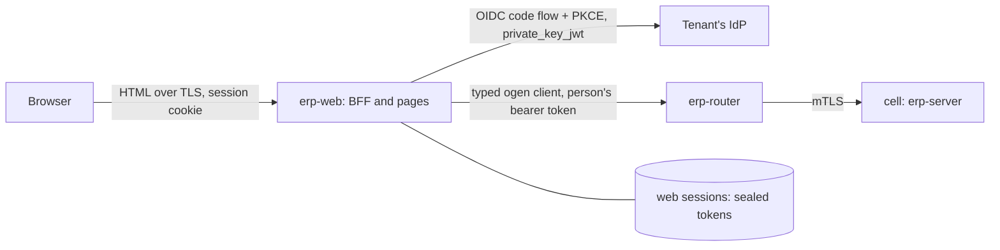

# ADR-0052: Web workspace for pilot finance users

**Status:** accepted (T73, product owner 2026-10-21: P1-P3 and P5-P8 as
recommended, P4 as recommended and accepted by the coordinator, see
"Decisions taken"). The steps T73a-T73m are in the tracker. The tracker's
pilot readiness item T72k ("Web UI for pilot finance users") is built by
T73.

## Context
The product owner decided on 2026-10-21 that **the pilot's finance users
need a web user interface**. The pilots are a Canadian and a UAE company
moving from SAP. People can reach the ERP today in three ways:

- **The API** (`api/openapi.yaml`, 254 operations in 14 tags on this
  branch). It is the product: "the web UI, agents, CLI, SAP connectors and
  partner integrations are all clients of the same public API; there are
  no private endpoints and no direct database access" (04 intro,
  ADR-0013). The API's rules are what a user interface has to respect:
  - every operation declares `x-permission`, and 48 declare
    `x-agent: false` (approval decisions, payment release, posting manual
    entries, user administration);
  - 37 operations are `x-autonomy: propose`, the writes an agent at level 1
    may make for a person to decide, and 5 are `x-autonomy: read`;
  - `ETag`/`If-Match` on every change (412 on a stale version, 428 when
    missing), and an `Idempotency-Key` on every `POST` and `PATCH`, kept
    for 7 days (04 §4.7);
  - RFC 9457 problems with a stable `code` that clients branch on (04 §4.6);
  - cursor pages of at most 500, no total counts, exports above about
    10,000 rows (04 §4.5);
  - 202 `Operation`s for long work such as payment proposals and releases
    (04 §4.8);
  - money as decimal strings (04 §4.4), and 404 for resources of a company
    the caller cannot see (04 §4.9).
- **The `erp` CLI** (`cmd/erp`): `erp call OPERATION` reads the contract
  at run time through `internal/apitools`, which also builds the agents'
  tools. `erp invoices`, `erp migrate` and `erp agent …` cover a few jobs
  end to end. A finance clerk will not use a command line.
- **Agents** (ADR-0036, ADR-0039): sessions, recommendations
  (`listRecommendations`, `decideRecommendation`, `x-agent: false`) and
  domain proposals that a person accepts or rejects, for example
  `proposeBankStatementLine` with `acceptBankStatementLineProposal`.

What the repository already says about a user interface:

- `docs/architecture.md`, under "Planned": "Web UI | Server-rendered Go:
  templ + HTMX | Stays in Go; no TypeScript". It also names an experience
  layer of "role-based web workspaces · on-demand reports and dashboards ·
  approval and review queues · configuration change reviews · chat · CLI".
- The tracker's module "User interface" (SAP "Fiori", phase 1) has the
  planned item "Server-rendered web workspaces (templ + HTMX)" with no
  step. Two more items wait on a workspace: "Dashboards in the web
  workspace" (T59) and "Anomaly alerts in workspaces".
- 01 §1.4 has a product-owner constraint: "Go for all services; no
  scripting languages in the platform".
- `docs/analytics.md`: dashboards are "self-contained HTML with inline SVG
  charts, drawn in Go; no scripts" (`internal/analytics/render.go`,
  `html/template`), and the planned version is "same spec rendered in the
  web workspace".
- 06 §6.3 has the API reviewed by "a consumer (UI or integration)", and the
  end-to-end tier runs "procure-to-pay through the public API, as UI and
  agents use it".

The parts of the platform a browser client meets:

- **Identity** (ADR-0010, ADR-0031). Tenants bring OIDC providers,
  registered per tenant on the control plane (`identity.identity_provider`:
  issuer, audience, tenant claim, `acr`/`amr` values, certificate binding).
  The token's issuer and audience decide its tenant. Multi-factor is proven
  by `acr`/`amr`, and a token that does not prove it gets the RFC 9470
  step-up challenge (401, `insufficient_user_authentication`).
  - Sessions are per authentication (`sid` or subject and `auth_time`).
    The absolute lifetime (default 12 h) and idle timeout (default 30 min)
    are enforced server-side, and an ended session never resumes.
  - The registry holds **no OAuth client** (no client id, redirect URI or
    client credential). The CLI uses bearer tokens obtained elsewhere
    (`erp token` in development). Session revocation through the API was
    deferred (ADR-0031, Alternatives).
  - People are provisioned "via SCIM or just-in-time" (ADR-0010), but
    neither is built. Principals are created through `createPrincipal` by
    an administrator.
- **Router and transport** (ADR-0022, ADR-0033, ADR-0035).
  - One `erp-router` per environment sits behind an internet-facing
    Network Load Balancer that passes TLS through. The router terminates
    TLS with a public CA's certificate, **asks every public client for a
    client certificate** (for agents' RFC 8705 binding), finds the cell by
    the token's issuer and forwards the request.
  - A cell's API accepts only the router's SPIFFE identity.
  - From memory, to verify: when a server requests a client certificate
    and the user has certificates installed (common on managed corporate
    machines), browsers can show a certificate picker. That makes the
    router's hostname a poor place for a browser to land.
- **Images** (ADR-0032). One ko-built, reproducible, distroless, cosign-
  signed image per pure-Go binary (`CGO_ENABLED=0`). The only exception is
  `erp-analytics`, which has a scoped Dockerfile. There is no Node.js
  toolchain anywhere in the build.
- **Tests and gates** (CLAUDE.md, 06). Coverage is 100% of production Go
  statements (`scripts/coverage.sh`, excluding `api/gen` and test
  support). Tests run against real PostgreSQL (`pgtest`) and an in-process
  API (`internal/app/apitest`). `authntest` is a minimal OIDC issuer: it
  serves discovery and keys and mints tokens, but has no authorization
  endpoint. The layout test (`internal/layout`) enforces the import rules.
- **The generated Go client**. ogen writes a typed client
  (`api/gen/oas_client_gen.go`) next to the server interfaces. Production
  code does not use it today: the CLI and agents go through `apitools`.

### What SAP gives these users (the parity target)
The pilot's users work in SAP GUI transactions or Fiori apps today. The app
names below are **from memory, not checked**, and the list has to be
confirmed against the pilot's release and launchpad: My Inbox (approvals);
Manage Supplier Line Items and Supplier Invoices List (AP); Manage Payment
Proposals / Manage Automatic Payments and Approve Bank Payments (payments);
Manage Bank Statements and Reprocess Bank Statement Items (bank
reconciliation); Post General Journal Entries, Manage Journal Entries and
Verify General Journal Entries (manual entries with approval); Manage
Posting Periods (close); Trial Balance, Display Line Items in General Ledger
and GR/IR account monitoring (reports); Manage Business Partner Master Data
and Manage Cost Centers (master data). Fiori runs on SAPUI5 behind the
Fiori launchpad, with role-based catalogs. **Parity means the same jobs,
not the same screens.** What users will expect is a role-based home with
work queues, list-detail views with filters and variants, document
attachments next to the document, and drill-down from figures to line
items.

## Decision

### 1. Scope of T73
In:
- a **web workspace** for the pilot's finance and AP users, served by a
  new binary `erp-web`;
- sign-in through the tenant's own identity provider;
- the pilot jobs of §2 with their screens, and the API additions those
  screens need (§3);
- English, plus French and Arabic as decided (P5); WCAG 2.2 AA;
- the build, image, deployment and quality gates of §§9-11.

Out (where each goes):
- dashboards and follow-up questions: T59, which renders into this
  workspace once it exists;
- a chat with agents: T59 and T67;
- report scheduling, sharing and Excel/PDF export: T63;
- the close checklist: T64. T73i shows periods and their states only;
- procurement buyers' screens (requisitions and orders beyond approving
  them), operators' screens (the control and directory planes stay
  operator tooling and CLI) and tenant administration (roles, SoD,
  principals): after the pilot, unless P6 says otherwise;
- mobile apps, offline use and notifications by e-mail or chat (§12).

**Never in the UI:** anything the API does not offer. There are no private
endpoints, no database access and no service credential of the UI's own
(§7).

### 2. Users and jobs in the pilot, mapped to the API
Roles are the pilot's to confirm (facts at the end). They map to permissions
that already exist. Each row is a job a screen serves, and the operations it
calls. **Gaps** are numbered G1-G9 and described in §3.

| Job (who) | Screens | Operations it uses |
|---|---|---|
| **Approvals inbox**: requisitions, POs, order changes, partner and bank-account changes, invoice exceptions, manual entries, bank clearings, period unlocks, center changes, configuration changes (approvers, controller) | Inbox (pending, decidable by me), request detail with the object's summary and steps, approve/reject with a reason | `listApprovalRequests` (status, object_type), `getApprovalRequest`, `approveApprovalRequest`, `rejectApprovalRequest`, `cancelApprovalRequest` (own requests); per object type its `get…` (`getRequisition`, `getPurchaseOrder`, `getPurchaseOrderChange`, `getPartnerChange`, `getSupplierInvoice`, `getParkedJournalEntry`, `getBankStatement`, `getFiscalPeriod`, `getCenterChange`, `getChangeRequest`). **G1** (decidable by me), **G2** (who am I), **G3** (names) |
| **Payment run release** (treasurer, AP lead; SoD: not the proposer) | Runs list, run detail with payments, exclusions and bank file; release or reject; operation progress | `listPaymentRuns`, `getPaymentRun`, `listPayments`, `listPaymentExclusions`, `releasePaymentRun` (202), `rejectPaymentRun`, `getOperation`, `cancelOperation`, `listBankFiles`, `getBankFile`, `transmitBankFile`; propose: `proposePaymentRun` (202) |
| **Invoice review and the AP exception queue** (AP clerk, AP lead) | Queue by status (`parked`, `on_hold`, exception pending), invoice detail beside its document (PDF), match results, the agent's recommendation; hold/release/post/cancel/reverse; capture by upload | `listSupplierInvoices` (status, supplier, PO, dates, kind), `getSupplierInvoice` (`expand`), `getSupplierInvoiceDocument`, `listMatchResults`, `getMatchResult`, `matchSupplierInvoice`, `holdSupplierInvoice`, `releaseSupplierInvoice`, `postSupplierInvoice`, `cancelSupplierInvoice`, `reverseSupplierInvoice`, `updateSupplierInvoice`, `createUpload`, `getUpload`, `captureSupplierInvoice`, `clearSupplierInvoiceDownPayments`; `listRecommendations` (object), `decideRecommendation`; `getPurchaseOrder`, `listGoodsReceipts` for the match context |
| **Bank statement reconciliation** (treasury, GL accountant; whoever matched cannot approve its clearing) | Statements per house bank, statement detail with lines and status, the agent's proposal per line (accept/reject), manual match, exclude, post; reconciliation report | `listHouseBanks`, `listBankStatements`, `getBankStatement`, `importBankStatements` (upload), `getBankStatementFile`, `matchBankStatement`, `listBankStatementMatches`, `getBankStatementRules`, `matchBankStatementLine`, `excludeBankStatementLine`, `postBankStatementLine`, `acceptBankStatementLineProposal`, `rejectBankStatementLineProposal`, `getBankReconciliation`; `listOpenItems` (clearing accounts) and `listPayments` to choose a match |
| **Manual journal entries** (GL accountant; approval above the company's limit) | Entry form with lines (accounts, centers, partner, tax code), park, post, withdraw; parked list including agents' proposals; journal browse; reverse | `parkJournalEntry`, `updateParkedJournalEntry`, `postParkedJournalEntry`, `cancelParkedJournalEntry`, `listParkedJournalEntries` (`created_by_kind`), `getParkedJournalEntry`, `postJournalEntry` (within the limit), `listJournalEntries`, `getJournalEntry`, `reverseJournalEntry`; pickers: `listAccounts`, `listCostCenters`, `listProfitCenters`, `listBusinessPartners` (`name_prefix`), `listLedgers`, `listLedgerGroups`, `listExchangeRates` |
| **Period close** (GL accountant, controller) | Periods per company and ledger with status; open/close; lock; request unlock; FX revaluation preview and post; pre-close checks: GR/IR, ledger reconciliation, unreconciled statements | `listFiscalPeriods`, `getFiscalPeriod`, `openFiscalPeriod`, `closeFiscalPeriod`, `lockFiscalPeriod`, `unlockFiscalPeriod`, `previewRevaluation`, `postRevaluationRun`, `listRevaluationRuns`, `getRevaluationRun`, `cancelRevaluationRun`, `listGrIrBalances`, `listLedgerReconciliation`, `listLedgerReconciliationEntries`, `listBankStatements` (status) |
| **Master data changes and change requests** (master data steward; bank accounts under dual control) | Supplier list and detail with company data and bank accounts (last four); request a bank account change or end; partner change requests; cost/profit centers and their change requests | `listBusinessPartners`, `getBusinessPartner`, `createBusinessPartner`, `blockBusinessPartner`, `unblockBusinessPartner`, `listBankAccounts`, `getBankAccount`, `requestBankAccountChange`, `requestBankAccountEnd`, `createPartnerChange`, `listPartnerChanges`, `getPartnerChange`; `listCostCenters`, `getCostCenter`, `createCostCenter`, `updateCostCenter`, `moveCostCenter`, `redateCostCenter`, `lockCostCenter`, the profit-center and segment equivalents, `listCenterChanges`, `getCenterChange` |
| **Configuration change requests** (finance owner reviews; implementation team or the configuration agent drafts) | Change requests by status, detail with the document diff, simulation and regression evidence; simulate, submit, withdraw; activate after approval; versions | `listChangeRequests`, `getChangeRequest`, `createChangeRequest`, `updateChangeRequest`, `simulateChangeRequest`, `submitChangeRequest`, `withdrawChangeRequest`, `activateChangeRequest`, `listConfigVersions`, `getConfigVersion`, `listRegressionSuites`, `getRegressionSuite`, `listCountryPacks`, `applyCountryPack` |
| **Reports** (all finance roles, auditors read-only) | Trial balance per company, ledger, year and period; supplier open items; GR/IR; bank reconciliation; ledger reconciliation; a document's audit history; download as CSV | `listBalances`, `listOpenItems`, `listGrIrBalances`, `getBankReconciliation`, `listLedgerReconciliation`, `listAuditEvents` (object), `getJournalEntry` (drill-down), `runAnalyticsQuery`, `getAnalyticsModel`. **G4** (due dates and aging), **G5** (export) |
| **Agents' work, seen by people** (all of the above) | On every object: an "Agent proposal" panel (recommendation, proposal or agent-drafted document), with the agent, its session and tool calls, and accept / override / ignore | `listRecommendations`, `getRecommendation`, `decideRecommendation`, `getAgentSession`, `listAgentToolCalls`; the domain accept/reject operations; agent-drafted parked entries, change requests, partner changes and requisitions are ordinary documents that a person posts or submits |
| **Context everywhere** | Company switcher, document search by number, "who did this" | `listLegalEntities`, the `document_number` filter of each list; **G2**, **G3**, **G6** (search) |

Jobs the API has no operations for yet, so the pilot UI does not have them
either:
- tax returns (T61, ADR-0049 accepted, not built here);
- the cash position and forecast (T53, ADR-0051 accepted);
- the close checklist (T64);
- exports above a page (T63);
- receivables (phase 3).

Each of these gets its screen in the step that builds its API, against
the conventions of this ADR. That is a line in each future step's
acceptance criteria, "screens in the workspace", once T73 exists.

### 3. API gaps a UI needs
Each gap traces to a job in §2 and is a contract-first, additive change in
`/v1` (04 §4.10). Nothing here is a private endpoint: CLI, agents and
partners get the same operations.

- **G1: "decidable by me" on approval requests.** An approval step names a
  role (`ApprovalStep.role_id`), and deciding needs that role plus the
  object type's approval permission (`x-object-permissions`). A person
  cannot list their own role assignments without `identity.access.read`,
  which approvers do not hold. So the inbox cannot tell "waiting for me"
  from "waiting for someone".
  - **Proposal:** `listApprovalRequests?decidable_by=me`. It returns
    pending requests whose current step's role the caller holds, with the
    object type's approval permission, that the caller did not request and
    has not decided.
  - The server computes it, so it never disagrees with what `:approve`
    accepts.
  - An index-backed filter (04 §4.5) on (tenant, status, current step role).
- **G2: who am I, and what may I do.** The UI needs the signed-in person's
  name, kind, companies and effective permissions, to build navigation and
  to hide actions the person can never take. It is **advisory**: the API
  still decides every call (§7).
  - **Proposal:** `getCurrentPrincipal` (`GET /v1/me`), readable by any
    authenticated person (permission `identity.self.read`, granted to
    every role by a migration). It returns the principal, the companies
    with access, the effective permissions (with their companies where
    scoped), the autonomy level for agents, and a locale preference (P5).
  - `x-autonomy: read`.
- **G3: names for ids.** Documents, approvals and decisions carry principal
  ids (`created_by`, `requester_id`, `decisions[].actor_id`,
  `decided_by`). An approver must see who asked, and whether that was an
  agent. Reading principals needs `identity.access.read`.
  - **Proposal:** `listPrincipalNames?ids=…` (at most 100 ids), readable
    with `identity.self.read`. It returns only id, display name and kind
    (`person | agent | service`) of principals in the caller's tenant,
    never e-mail or roles.
  - The UI caches it per session for five minutes.
  - Alternative considered: `expand=created_by` on every document, which
    touches every list operation.
- **G4: due dates on open items.** AP clerks ask "what is due or overdue",
  and close asks for supplier aging. Open items carry their terms
  (`open_item_terms`), but the net due date is computed and not exposed or
  filterable (ADR-0051 §5 found the same).
  - **Proposal:** `net_due_date` and `discount_due_date` on the open item
    representation, and `due_date_to` with an aging bucket list on
    `listOpenItems`, backed by the functional index ADR-0051 T53e may add.
  - If T53e builds the shared due-date helper first, G4 reuses it rather
    than computing the date twice.
- **G5: exports of report pages.** A trial balance or open-item list of
  more than a few pages is downloaded, not paged on screen. Up to 10,000
  rows, the UI streams the pages it reads into a CSV (§8). Above that, the
  export operation of T63 is needed. **No new endpoint in T73.** The UI
  says when a report is over the limit.
- **G6: document search.** "Find 5100000123" spans invoices, journal
  entries, payment runs, goods receipts and orders, each of which has a
  `document_number` filter.
  - **Proposal:** none for the pilot. The UI queries the five lists in
    parallel, within the principal's rate limit (04 §4.11: 50/s).
  - A cross-document search operation is a later question, if the pilot
    asks for free-text search.
- **G7: problem codes in the contract.** The UI shows each problem in the
  user's language by its `code`, and clients "branch on `code`, never on
  `detail`" (04 §4.6). The codes an operation can answer are named only in
  description prose today.
  - **Proposal:** `x-problem-codes` per operation, listing the stable
    codes. A spec test checks that the handlers' registered codes
    (`problem.RegisterConstraint` and the packages' problem constructors)
    are a subset of them. A UI test checks every listed code has a
    message in each shipped language, falling back to the problem's
    English `title` otherwise.
  - This is contract metadata, not an endpoint. It also documents the API
    for partners (T50).
- **G8: a web client per identity provider.** To sign people in, the BFF
  of §5 needs an OAuth client at the tenant's provider: a client id, a
  redirect URI, and a client credential, preferably a key
  (`private_key_jwt`) over a secret. None of these is registered.
  - **Proposal (control plane, `api/control.yaml`):** each identity
    provider registration gains an optional `web_client`:
    - `client_id`;
    - `auth_method` (`private_key_jwt` | `client_secret_basic`);
    - a secret reference to the key or secret (ADR-0017), never the value;
    - `login_code` (§5);
    - the `scope` that yields a token for the registered audience.
  - The router's directory projection (`directory.issuer`) gains the login
    code, so `erp-web` can find the provider before anyone has signed in.
  - `erp:admin`, and audited in the tenant as `updateIdentityProvider`
    changes are today.
- **G9: ending the ERP session at sign-out.** ADR-0031 deferred session
  revocation through the API. A person who signs out on a shared machine
  expects the session to be over, not only the BFF's cookie.
  - **Proposal:** `endCurrentSession` (`POST /v1/sessions/current:end`),
    any authenticated person, which ends the token's `identity.session` as
    `revoked`. A token of that session then gets 401 as an ended session
    does.
  - `erp-web` calls it before the provider's RP-initiated logout.

Not gaps: the approval list already carries `title` and `amount`, so the
inbox needs no per-row fetch. Long-running operations already have
`getOperation`. Optimistic locking and idempotency already make a form safe
to submit twice (§8).

### 4. Rendering: server-rendered Go with templ and htmx (decision P1)
`erp-web` renders HTML on the server in Go, with **templ** components
(type-checked templates compiled to Go). It uses **htmx** for partial page
updates: filters, paging, inline actions, polling an operation. It is a new
pure-Go binary, `cmd/erp-web`, with its code in `internal/web`. It holds no
business logic and no data of its own beyond sessions (§6).

Reasons:
- **It is the plan of record, and it fits the constraint.**
  `docs/architecture.md` and the tracker already say templ + HTMX, and the
  product owner's constraint is Go for all services. A TypeScript SPA
  would bring a second language, a Node.js toolchain and an npm
  dependency tree into the build, which this repository has avoided.
- **The contract stays the single source, checked by the compiler.**
  `erp-web` calls the API only through the ogen-generated Go client
  (`api/gen`). A change to `api/openapi.yaml` that breaks a screen breaks
  `go build`, and the breaking-change check already guards `/v1` for
  partners. A TypeScript client generated from the same spec
  (openapi-typescript or similar) would give the same check in a second
  type system.
- **One quality bar.** Go handlers, view models and templ's generated Go
  are production statements under the existing 100% gate, golangci-lint,
  gosec, govulncheck and `-race`. There is no second coverage tool, linter
  or vulnerability scanner to keep (§10).
- **It is a BFF by construction.** The server already holds the session,
  so tokens never reach the browser (§5).
- **Safe output by default.** templ escapes expressions by context:
  - text is escaped;
  - `href` values must be `templ.SafeURL` and are sanitized of
    `javascript:` URLs;
  - `<script>` and `<style>` blocks cannot hold variables;
  - CSS expressions go through `templ.SanitizeCSS`;
  - inline scripts take a nonce through `templ.WithNonce`.

  This matters because agents' text and suppliers' invoice fields are
  untrusted (§7).
- **Images and deployment are unchanged.** `erp-web` is one more
  `CGO_ENABLED=0` binary in `.ko.yaml`, reproducible, scanned and signed
  like the others (ADR-0032).
- **Accessible by default.** Server-rendered semantic HTML (forms, tables,
  links, buttons) works with assistive technology and the browser's own
  history, where an SPA must rebuild focus management and routing.

Costs, accepted:
- Spreadsheet-like entry (a journal entry with many lines, keyboard-first)
  and a PDF beside a form are harder without a client framework.
  - Lines are rows of a server-rendered form; htmx adds and removes rows.
  - An upload of lines (CSV) covers bulk entry, and the API's 10,000-line
    limit applies.
  - If pilot users find this too slow, a small, separately gated
    component is the escape hatch (a P1 option, needing an ADR amendment),
    not a rewrite.
- htmx is JavaScript. It is a single vendored, version-pinned file
  checked by SHA-256 in a test, served from `erp-web`'s own origin, with
  no build step. **No hand-written JavaScript** is allowed without
  amending this ADR (§10).
- Every interaction is a round trip to `erp-web` and on to the API.
  Budgets are in §10.

**templ rather than `html/template`.** `html/template` (used by
`internal/analytics/render.go`) has the same contextual escaping, but it
checks a template's data only at run time. templ fails the build on a
missing field. That is the same reason the API uses generated types. The
analytics renderer stays as it is, and T59 embeds its output.

Alternatives in P1:
- **(b) A SPA** (React or another framework, TypeScript, generated client)
  served as a static bundle, by `erp-web` or a CDN. It gives richer
  interaction and a large hiring pool. It costs a Node.js toolchain and
  npm supply chain in the build (lockfile, audit, reproducible bundle), a
  second test and coverage stack, and either tokens in the browser or a
  BFF anyway (§5).
- **(c) An admin framework or low-code tool** (React-admin or Refine over
  the OpenAPI, or a hosted builder such as Retool). Generic list-detail
  screens come fast. But finance jobs are workflows (match, hold, release,
  approve with SoD), not tables. Hosted builders keep tokens and data in
  a third party's service, which conflicts with ADR-0003 and residency.
  And it still brings the SPA's toolchain.

### 5. Sign-in: a backend-for-frontend, tokens never in the browser (decision P2)
`erp-web` is a **confidential OAuth client** of the tenant's identity
provider, and the browser holds only a session cookie. RFC 10017 (OAuth
2.0 for Browser-Based Applications, BCP 212, August 2026) ranks the BFF
pattern first of its three architectures. It is "strongly recommended for
business applications, sensitive applications" and applications handling
personal data, because "since tokens are only available to the BFF, there
are no tokens available to extract from the browser". A finance
application that releases payments is that case.

**Flow.**
1. **Login code.** The person opens `https://app.<domain>/login/<code>`, or
   types the code once. The code is the tenant's `login_code` (G8), not a
   secret. `erp-web` remembers it in a cookie so the next visit skips the
   step.
2. **Provider lookup.** `erp-web` resolves the code through the
   directory's projection to the provider's issuer, client id and scope,
   cached for 30 s like the router.
3. **Authorization code flow with PKCE** (RFC 7636; RFC 9700 makes PKCE
   mandatory for public clients and recommended for confidential ones, and
   advises against the implicit grant). `state` and `nonce` are checked,
   and `prompt`/`max_age` are passed when re-authentication is needed. The
   code is exchanged with `private_key_jwt` (OIDC Core §9), with the key
   from the secret store and rotated as ADR-0028 rotates keys. A client
   secret is accepted only where the provider offers nothing else (P2).
4. **Token and session.** The ID token is validated with the same verifier
   and key cache as the API (`internal/platform/authn`, ADR-0031). The
   access token's issuer and audience must be the registered ones. A new
   session is created with a fresh random id (no fixation), and the
   transaction cookie is deleted.
5. **API calls.** Every call to the API carries the person's access token,
   unchanged. The cell checks the token, the session, multi-factor and
   every permission exactly as for the CLI. `erp-web` refreshes the access
   token with the refresh token when the provider issues one. The cell's
   session (by `sid`, or by `auth_time`) is unaffected by a refresh
   (ADR-0031), so the tenant's lifetime and idle timeout still apply.
6. **The API's 401 decides.**
   - When a call is answered 401 as an ended session, `erp-web` ends its
     own session and sends the person to sign in again, keeping the page
     they were on as a relative return path (open-redirect safe: a path,
     never a URL).
   - When the answer is the RFC 9470 step-up challenge, `erp-web` runs the
     code flow again with the challenge's `acr_values`.

   `erp-web` never decides a timeout more generous than the API's. Its own
   limits are the maxima any tenant may set (24 h absolute, 8 h idle), so
   the cell's stricter policy is what people see.
7. **Sign-out.** `endCurrentSession` (G9), then the session is deleted,
   then OIDC RP-Initiated Logout at the provider where it offers it
   (`end_session_endpoint`).

**Cookies** follow RFC 10017 §6.1.3.2:
- the session cookie is `__Host-Http-erp-session`, with `Secure`,
  `HttpOnly`, `Path=/`, no `Domain` and `SameSite=Strict`, holding only a
  random 256-bit id;
- the login transaction cookie (state, nonce, PKCE verifier, return path)
  is `SameSite=Lax`, because the provider's redirect back is a cross-site
  navigation. It lives 10 minutes and is used once;
- a cross-site arrival (a link in an e-mail) carries no Strict cookie, so
  it gets a same-site continue page that navigates again with it.

**CSRF.** RFC 10017 requires a proper CSRF defence from a BFF. There are
three layers:
1. Go's `net/http.CrossOriginProtection` (Go 1.25+) refuses non-safe
   cross-origin requests by `Sec-Fetch-Site`, or by `Origin` against
   `Host`. It allows `GET`, `HEAD` and `OPTIONS`, so no handler changes
   state on those methods, and a test walks the routes to prove it.
2. Every form carries a synchronizer token bound to the session (OWASP:
   "stateful software should use the synchronizer token pattern"). htmx
   sends it as a header, set with `hx-headers` on an element htmx replaces.
3. `SameSite=Strict` is defence in depth, which OWASP says it is and no
   more.

**Rejected: tokens in the browser** (P2 b and c). With a browser-based
public client, or a token-mediating backend, the access token is in
JavaScript's reach. RFC 10017 calls the browser-only architecture
"vulnerable to all attack scenarios discussed earlier", and ranks the
token-mediating backend below the BFF. The router would also ask the
browser for a client certificate (§Context). It would also need CORS on
the router for a SPA on another origin, a surface the API does not have
today.

### 6. Where `erp-web` runs, and its sessions (decision P3)
`erp-web` runs in the **`erp-global` chart next to the router**:
- three replicas, the restricted profile, no service account token, the
  same network policy pattern as the router (T40c5);
- its **own hostname** `app.<domain>`, on a second internet-facing Network
  Load Balancer passing TLS through to `erp-web`;
- a public CA's certificate loaded by operators, as the router's is
  (ADR-0035: no ACME).

It calls the API **through the router's public listener**, as every other
client does. It presents no client certificate and holds no SPIFFE
identity a cell would accept. A cell's API keeps accepting only the router
(ADR-0033), and the router stays the one address that survives a tenant
moving (ADR-0022).

Reasons:
- **The browser never meets the router's certificate request**
  (§Context), and the API's hostname stays an API.
- **Global like the router.** The router is one per environment, so a
  per-cell `erp-web` would need a per-cell hostname and a cell chosen
  before sign-in. It would lose the router's move handling. Its traffic
  already reaches cells through the router, so a global `erp-web` adds no
  new path for business data.
- **Sessions must outlive a replica.** They are stored in a `web` schema
  of the **global directory's database**, with a login of their own that
  sees only that schema. The directory holds no business data (ADR-0022),
  and the web store holds none either:
  - session id hash, tenant id, principal id, created, last seen, expires;
  - the sealed access, refresh and ID tokens (AES-256-GCM under a key
    from the secret store, the field-encryption pattern of ADR-0018);
  - the CSRF secret.
  - Sessions are deleted at their end and swept hourly. Nothing about
    sessions is exported or fingerprinted (ADR-0031's rule for sessions).
- **Rejected for the pilot: stateless sealed cookies.** Tokens from
  enterprise providers (Entra ID with groups, for example) can exceed a
  cookie's 4 KB, so a session would span several cookies. Revocation
  would need a deny-list anyway, so the store comes back.

Residency: the UAE and Canadian tenants' pages are rendered in the
environment's home region, as their API calls are already routed there.
`erp-web` caches no business data: each request reads the API, and
responses carry `Cache-Control: no-store`. If the pilot's residency rules
require the UAE tenant to be served from a UAE region end to end, that
requires a router and a web per region, which goes beyond this ADR (facts).

### 7. Never letting the UI do what the API forbids
- **The API is the only authority.** `erp-web` has no token of its own and
  no service principal. Every read and write is the person's own call,
  under their permissions, company access, SoD, autonomy and audit. The
  audit trail records the person, never `erp-web`.
- **Advisory hiding only.** Actions the person can never take, by G2's
  effective permissions or the object's state, are not offered, so
  screens stay clear. An action offered is still refused by the API when
  it should be (SoD, a stale version, a period closed meanwhile), and the
  UI shows the problem. A test runs each screen as a person without the
  permission and checks the API's 403 is what they see, not a server
  error.
- **Imports.** `internal/web` may import `api/gen`, `internal/platform`
  packages that hold no database or tenant scope (`problem`, `etag`,
  `money` formatting, `tlsconf`, `authn`, `secrets`, `telemetry`), and its
  own session store. It may not import any context, `uow`, `reqctx` or the
  database packages. The layout test (`TestImportRules`) gets these rules,
  so the BFF cannot become a second backend.
- **Forms follow the API's rules.**
  - The resource's `ETag` travels in the form and is sent as `If-Match`,
    and a 412 shows "changed since you opened it", with the new version
    and the user's input kept.
  - Each rendered form carries a fresh `Idempotency-Key`, so a double
    click or a resubmit after "back" replays the first answer
    (`Idempotent-Replayed: true`) instead of acting twice.
  - Money fields stay decimal strings end to end and are validated for
    the currency's minor units before sending. Floats are never used,
    following the linter's ban.
  - Open enumerations show unknown values as they are, never as an error.
- **Agents' proposals are shown, not applied.**
  - Anything an agent made carries an "Agent" badge with the agent's name
    (G3), its session, and its tool calls on request. This covers
    recommendations, bank line proposals, parked entries
    (`created_by_kind=agent`), change requests and partner changes.
  - Accepting is the domain operation the person performs (accept the
    proposal, post the parked entry, submit the change request), followed
    by `decideRecommendation` for a free-text recommendation.
  - Where the two are separate calls and the second fails, the UI shows
    the recommendation as still open and offers the decision again. The
    domain operation's idempotency key makes retrying it safe.
  - Agents' text is **untrusted**: it may carry instructions planted in an
    invoice (ADR-0039's suites test exactly this). It is rendered as
    escaped plain text, with line breaks kept. Links are not made
    clickable, nor is markdown rendered, so a planted link cannot pose as
    the ERP's own.
  - The same holds for supplier-supplied fields and bank statement
    remittance text.
  - `erp-web` calls no model and runs no agent.
- **Approvals.** `x-agent: false` operations are people's anyway. The UI
  asks for a reason on every reject, shows the request's steps and
  decisions, and never pre-fills or batches decisions: one decision, one
  click, one request. A "select several and approve" action is a later
  question for the product owner, since SoD is per request.
- **Documents from outside.** `getSupplierInvoiceDocument` and statement
  files are untrusted bytes. They are served by `erp-web` with their
  stored media type, `X-Content-Type-Options: nosniff`,
  `Content-Disposition: inline` for PDFs and images only (attachment
  otherwise), and `Content-Security-Policy: sandbox`, so a hostile PDF or
  HTML cannot script the workspace's origin. Uploads go through the API's
  signed path variant (ADR-0020), relayed by `erp-web`, not as a browser
  `PUT` to the bucket. That keeps the bucket off the CSP and without CORS.

### 8. Pages, headers and conventions
- **Content Security Policy:** `default-src 'self'; script-src 'self'
  'nonce-…'; style-src 'self'; img-src 'self' data:; object-src 'none';
  base-uri 'none'; form-action 'self'; frame-ancestors 'none'`, plus
  `connect-src 'self'` and a `frame-src 'self'` for document previews.
  - htmx is configured with `allowEval: false` (no `hx-on:` handlers,
    event filters or `js:` values) and `allowScriptTags: false`.
    `selfRequestsOnly` stays true, its default.
  - Untrusted HTML never reaches a page, and fields that hold outside text
    sit inside `hx-disable`, which "cannot be disabled by injecting
    further content" (htmx docs).
  - Other headers: `Strict-Transport-Security`,
    `Referrer-Policy: same-origin`, `Cross-Origin-Opener-Policy:
    same-origin`, `Permissions-Policy` denying what is unused.
- **Progressive enhancement.** Every action is a real form or link that
  works without htmx, and htmx replaces fragments when present. Tests can
  therefore drive the server without a browser (§10), and assistive
  technology sees plain HTML.
- **Lists** map the API's cursor pages one to one. The page token is kept
  in the URL, so back, bookmarks and "open in a new tab" work. Filters are
  query parameters and only the API's own filters are offered.
  "Showing 50, more…" replaces totals (04 §4.5). Saved filter variants per
  person are a later step.
- **Long operations** (proposal, release, transmission, revaluation) show
  the 202 `Operation`, polled every two seconds with `hx-trigger`, stopping
  when final. Cancel is offered where the API offers it.
- **Errors.** A problem is shown by `code` in the user's language (G7),
  with field errors next to their fields (`errors[]`) and the `trace_id`
  for support. A raw `detail` is shown only as the English fallback. A 404
  is "not found or not yours", as the API means it. 429 and 503 honour
  `Retry-After`.
- **Company context.** A person with several companies picks one, kept in
  the URL as `legal_entity_id`, never in the session, so two tabs can show
  two companies. It is a filter, as the API's rule says.
- **CSV download** of a report (G5) streams the API's pages through
  `encoding/csv` up to 10,000 rows, with the filters in a header line, the
  amounts as the API's decimal strings and the person's own call. Above
  that the UI says so and points to T63's export.
- **Observability** (ADR-0043). Request metrics carry bounded labels only
  (route pattern, status class), never a tenant or a person. Traces
  propagate to the API with the request's trace id, and logs carry no
  tokens, cookies or form values.

### 9. Languages and accessibility (decision P5)
**Languages.**
- Every string goes through a message catalog from the first step:
  `golang.org/x/text/message` with CLDR plural rules, catalogs as files in
  the repository and a test that every key exists in every shipped
  language.
- Numbers, amounts and dates are formatted for the person's locale
  (CLDR via `x/text`) from the API's decimal strings, never through
  floats, and parsed back strictly per locale. Business dates stay ISO in
  the API.
- The locale comes from G2's preference, then `Accept-Language`, then the
  company's.
- Problems are translated by `code` (G7).
- Master data texts (account and center names) are shown as the API
  returns them. ADR-0050 already keeps "texts in the tenant's language".

Which languages ship at the pilot is P5:
- **French (Canada).** If the Canadian pilot company has employees in
  Québec, the Charter of the French Language makes French work tools,
  including software installed on computers, the rule there. Under
  s. 52.1 software must be available in French unless no French version
  exists, and bilingual interfaces are allowed. **These are secondary
  sources, not the consolidated text.** Counsel or the pilot must confirm
  whether the company is in scope (facts).
- **Arabic, right to left (UAE).** Arabic is the UAE's official language.
  Whether the UAE pilot's finance staff need an Arabic interface, rather
  than English, is the pilot's to say. From memory, English is the usual
  working language of UAE finance teams, which needs checking.
  - Either way the layout is **RTL-ready from the first step**: CSS
    logical properties only (`margin-inline-start`, never `margin-left`),
    `dir` set from the locale, icons that mirror where direction matters,
    and amounts and codes isolated with `<bdi>`/`dir="ltr"` so an IBAN's
    last four or a document number never reorders.
  - A pseudo-locale (accented, 30% longer) and an RTL pseudo-locale run in
    the end-to-end suite from T73a. Adding Arabic is then translation and
    review, not a rework.

**Accessibility: WCAG 2.2 level AA** (W3C Recommendation, current version
dated 12 December 2024), as a requirement, not a decision. That includes
the criteria new in 2.2 at A and AA:
- 2.4.11 Focus Not Obscured (Minimum): sticky table headers and toolbars
  must not hide the focused row;
- 2.5.7 Dragging Movements: no drag-only reordering of journal lines;
- 2.5.8 Target Size (Minimum);
- 3.2.6 Consistent Help;
- 3.3.7 Redundant Entry: an invoice's supplier is not asked twice in a
  flow;
- 3.3.8 Accessible Authentication (Minimum): the provider's login is the
  provider's, but the login-code step must allow paste and autofill.

Ontario's AODA and the Accessible Canada Act may apply to the pilot
company as an employer or organisation. **From memory, not checked:** both
reference WCAG 2.0/2.1 AA, which 2.2 AA satisfies. Tests are in §10.

### 10. Testing and quality gates (the bar applied to a frontend)
The repository's gates apply unchanged to everything that is Go. The parts
that are not Go get gates of equal force.

| What | Gate |
|---|---|
| Go in `internal/web`, `cmd/erp-web` (handlers, view models, BFF, session store) | 100% statement coverage in `scripts/coverage.sh`, as everywhere; golangci-lint (function length, complexity, the float ban), gosec, govulncheck, `-race` |
| templ's generated `*_templ.go` | **Counted** in the 100%: templates hold the conditions that matter (an action shown only in a state, a column only with a permission), and rendering every component in each state is what covers them. `templ generate` runs in `make generate` and CI fails on a diff, as for `api/gen` |
| Handlers and pages | Tests against a **real API**: `internal/app/apitest` in process, real PostgreSQL through `pgtest`, tokens from `authntest`, never a mocked API or database. Each screen is tested per state and per permission (allowed, refused by the API, hidden), with `pgtest.FailingTx` behind the API for its error paths. Assertions on the rendered HTML go through a parsed DOM (`golang.org/x/net/html`), not string matching |
| Contract drift | Compile-time: the ogen client. A generated inventory (`internal/web/operations.go`, from the routes) lists every operation each screen calls. A test checks that each is in the spec, that the permission the UI uses to hide an action equals the operation's `x-permission`, and that no screen calls an `x-agent: false` operation without a human-only marker on the route. G7's test checks codes and translations. `make lint-all` and the breaking-change check stay as they are |
| The vendored htmx file | Pinned version and SHA-256 checked by a test, excluded from coverage like other third-party code, an upgrade a reviewed change; no other JavaScript: a lint step fails on any `.js` file outside `internal/web/static/vendor`, and a test renders every page and fails on an inline script without the nonce or any `on*=` attribute |
| CSS | Plain CSS files, no preprocessor; a test fails on physical direction properties (`left`, `right`, `margin-left`, …) outside an allow-list, so RTL cannot regress |
| Security | Tests for: • cookie attributes; • session id rotation at sign-in; • CSRF refusal (cross-site `Sec-Fetch-Site`, missing or wrong token); • no state change on safe methods (a walk of the routes); • CSP and the other headers on every route; • open redirect on the return path; • a 401 ending the session; • the step-up challenge restarting the flow; • sign-out ending the API session (G9); • document responses sandboxed; • agent and supplier text escaped (a planted `<script>`, `javascript:` link and markdown link in a recommendation). Weekly OWASP ZAP baseline scan against the staging cell, findings triaged like grype's |
| End to end | Go tests driving headless Chromium with **chromedp** (Go, CDP) against a **real cell**: `erp-server`, `erp-router` and `erp-web`, PostgreSQL, and `authntest` extended with an authorization endpoint (code flow, PKCE, `private_key_jwt`), in CI's integration job. Each pilot job of §2 is one scenario run as the pilot's roles, including SoD refusals and a stale-version conflict, at 1280 px and 390 px widths and in the RTL pseudo-locale |
| Accessibility | axe-core injected by the end-to-end tests into each page and state, **zero violations** at WCAG 2.2 A/AA rules; keyboard-only walk-through of each scenario (focus order, visible focus, no traps); manual screen-reader review (NVDA with Firefox, VoiceOver with Safari) of each pilot screen before its step is done; an external audit before go-live (T73m). axe-core is test tooling run in the test browser, not part of the platform |
| Performance | Budgets in 05's style: server time of a page ≤ the API calls it makes + 30 ms p95; at most 6 API calls per page render (the per-principal limit is 50/s); HTML ≤ 100 KB, htmx the only script; measured in the perf job |
| Review | The `go-reviewer` agent on every step; plus a pilot user's walk-through of each screen against its job before the step is done (the acceptance criteria say which role) |

The end-to-end suite replaces "procure-to-pay through the public API, as UI
and agents use it" in 06 §6.6's table for the UI's part. The CLI's
`TestEndToEnd` stays.

### 11. Build and deployment
- **Build.** `cmd/erp-web` is a fourth ko image in `.ko.yaml`
  (`CGO_ENABLED=0`, distroless static, reproducible double build, SBOM,
  grype, cosign signature and attestations, `verify-image.sh`), with
  static assets embedded by `embed` and served with content-hashed names
  and long caching. `release.json` gains `images.web`. It takes no part in
  the cgo exception.
- **Deployment.** The `erp-global` chart gains the `erp-web` Deployment,
  its TargetGroupBinding, network policy (from the new balancer's subnets
  in; to the router, the directory database, the identity providers on
  443, DNS out) and Kyverno admission, under `helm-checks.sh`.
  - Terraform's global module gains the second balancer, its target
    group and the `erp/global/web-*` secrets: the session sealing key,
    the public certificate and key, and the client keys' references.
- **Startup checks in production**, like the other binaries:
  - the session database URL with `verify-full`;
  - the sealing key present;
  - an https public URL;
  - TLS material;
  - no development login.

  A missing setting fails startup (CLAUDE.md: no silent fallbacks).
- **Releases** go with the platform's, one version for all images.
  `erp-web` is stateless across releases apart from its session table,
  migrated expand-first like any schema (06 §6.4).

### 12. Out of scope, and where it goes
- **Notifications** (an e-mail or Teams message when something waits in
  the inbox). The `ApprovalRequested` event exists, but nothing delivers
  it to people. A later step, with T63's delivery: fact needed on the
  pilot's channel.
- **Bulk decisions, saved variants, personal layouts:** after pilot
  feedback.
- **Tenant administration screens** (principals, roles, SoD, AI policy,
  webhooks, connectors): CLI and API for the pilot, a later step (P6).
- **Operator screens:** never in this workspace. Operators use the control
  and directory planes with operator tokens.
- **Phones:** approvals and the inbox are usable at 390 px. Data entry
  targets laptop and desktop widths (P8).
- **Theming per tenant** (logo, colours): not for the pilot (P7).
- **SCIM provisioning:** ADR-0010's plan, not this ADR's. The pilot's
  people are created by an administrator as today, and a principal without
  roles who signs in sees an "ask your administrator" page, not an error.

## Alternatives
- **A TypeScript SPA with a generated client.** Rejected for the pilot
  (P1 b): a second language and toolchain against the product owner's
  constraint, and a BFF is needed anyway for token safety.
- **An admin framework or hosted low-code builder.** Rejected (P1 c):
  generic CRUD, not workflows, and hosted builders put tokens and data in a
  third party.
- **Tokens in the browser** (a public client with PKCE, or a
  token-mediating backend). Rejected (P2): RFC 10017 ranks both below a
  BFF, and the router would ask browsers for certificates.
- **`erp-web` per cell, or inside `erp-server`.** A route in `erp-server`
  would make the API serve HTML and cookies beside bearer tokens, and
  would need a cell before sign-in. Rejected (P3).
- **The UI reading the analytical store or the replica directly** for
  reports. It would be faster for large reports, but it would go around
  the API's permissions, company access and audit. Rejected: numbers come
  from the API and the semantic layer (ADR-0044) like everyone's.

## Consequences
- A fourth image and binary, a second public balancer and hostname, a
  `web` schema in the directory database, and control-plane fields for
  web clients (G8).
- Six additive API changes (G1-G4, G7 metadata, G9). Each has a T-number,
  a test, and partners can use them too.
- Every later step that adds a user-facing capability (T53, T59, T61,
  T63, T64, phase 3) adds its screens here, under §§7-10. Its acceptance
  criteria gain "screens in the workspace".
- Tenants' identity providers must register a confidential web client
  (redirect URI `https://app.<domain>/callback`), and must put `sid` or
  `auth_time` in tokens, which ADR-0031 already requires.
- Pilot users get the jobs of §2. Agents' work becomes visible to the
  people who decide it, not only to CLI users.
- Amends ADR-0022 and ADR-0035 (a second public entry point in the global
  chart) and ADR-0032 (a fourth image). It adds an exception to 01 §1.4's
  constraint: one vendored JavaScript file, no hand-written scripts.

## Boundaries with the other steps
- **T37 (identity):** T73b reuses the verifier, key cache and session
  semantics; G8 and G9 extend the registry and the session table.
- **T49 (bank statements), T35 and T32 (approvals, period lock), T36 and
  T45 (payment runs):** their screens are T73d-T73i; no rule moves into
  the UI.
- **T42 and T43 (agents):** recommendations and proposals are shown and
  decided here; no agent runs in `erp-web`.
- **T50 (API lifecycle):** G7's `x-problem-codes` is contract metadata
  under the breaking-change check.
- **T53, T61, T64:** their screens follow when their APIs exist.
- **T59 (dashboards):** renders inside this workspace (the analytics HTML
  embedded under the same CSP, no scripts) after T73a.
- **T63 (delivery, export):** exports above 10,000 rows and scheduled
  reports.
- **T67 (MCP, access agent):** none.

## Steps
These steps are ordered so the pilot's must-haves come first (P6). Each
ends green: lint, tests, coverage at 100%, the end-to-end scenarios of its
screens, axe at zero, and the reviewer. Lane A builds the screens. Lane P
builds T73a-T73c's platform parts (the image, the chart, the control
plane). The API gaps go to the lane that owns each context. Sizes: S up to
three days, M about a week, L about two weeks.

| Step | Size | Work | Acceptance criteria |
|---|---|---|---|
| T73a | M | **Skeleton** | `cmd/erp-web` and `internal/web` with templ (`make generate`, CI diff check), the vendored htmx pinned by hash with `allowEval`/`allowScriptTags` off, layout, navigation shell and base CSS (logical properties only), message catalog with English and the two pseudo-locales, security headers and CSP with nonces, health and `/version`, `TestImportRules` entries, ko image in `.ko.yaml` and the release, the `erp-global` chart's Deployment and network policy with `helm-checks.sh`, chromedp + axe harness in CI with one page; ADR-0022/0032/0035 amended |
| T73b | L | **Sign-in (BFF)** (P2, P3, G8, G9) | `web_client` on identity provider registrations in `api/control.yaml` and the directory projection; login code; authorization code flow with PKCE, `state`, `nonce`, `private_key_jwt`; ID token through `authn`; `web` schema and its login in the directory database, sealed tokens, hourly sweep; cookies as §5; CSRF (CrossOriginProtection, synchronizer token); refresh; 401 and RFC 9470 step-up handling; `endCurrentSession` in the API and RP-initiated logout; `authntest` gains the authorization endpoint; production startup checks; the security tests of §10 |
| T73c | M | **API for the workspace** (G1, G2, G3, G7) | Contract first: `decidable_by=me` with its index, `getCurrentPrincipal` with `identity.self.read` granted to every role by migration, `listPrincipalNames`, `x-problem-codes` on every operation with the spec test against the registered codes; each with schema and `FailingTx` tests; the CLI and agent tools pick them up unchanged |
| T73d | M | **Approvals inbox** | Inbox (decidable by me, my requests, all I can see), detail per object type with its summary, steps and decisions, approve/reject with reason, cancel own; SoD and permission refusals shown by code; requester and deciders by name and kind; usable at 390 px; scenarios as approver, requester and a person without the role; walked through by a pilot approver |
| T73e | L | **Invoices and the AP exception queue** | Queue by status and exception, invoice detail with the sandboxed document beside it, match results, hold/release/post/cancel/reverse with ETags and idempotency keys, capture by upload through the API's signed path, the agent's recommendation panel with decide, escaped agent text; scenarios: clean post, price variance held and released, exception approved by someone else, stale version, planted instruction in the recommendation shown inert; walked through by a pilot AP clerk |
| T73f | M | **Payment runs** | Propose (202 with progress), run detail with payments and exclusions, release and reject with SoD (the proposer refused), operation cancel and resume, bank file status and transmit; scenarios as proposer and releaser |
| T73g | L | **Bank statements and reconciliation** | Import by upload, statement and line views by status, agent proposals accepted or rejected, manual match from open items and payments, exclude, post with the clearing approval (the matcher refused as approver), reconciliation report per house bank; masked accounts; a foreign-currency statement where the pilot has one |
| T73h | L | **Manual journal entries** | Entry form with lines (accounts, centers, partner, tax code), add and remove rows with and without htmx, CSV upload of lines into a parked entry, park/post with the approval above the limit, withdraw, agents' parked entries listed and taken on, journal browse and reverse (refused for entries owned elsewhere, as the API says); keyboard-only entry of a ten-line entry within the scenario |
| T73i | M | **Period close** | Periods per company and ledger, open/close/lock, unlock request and its approval, revaluation preview and post, the pre-close checks (GR/IR, ledger reconciliation, statements not reconciled) on one page as links to their reports |
| T73j | M | **Reports** (G4, G5) | Trial balance, supplier open items with due dates and aging (G4's contract change), GR/IR, bank and ledger reconciliation, a document's audit history; drill-down to entries; CSV up to 10,000 rows; budgets of §10 met at the pilot's volumes |
| T73k | L | **Master data and change requests** | Suppliers and bank account change requests (dual control shown: requester cannot approve), partner changes, cost/profit centers and segments with their change requests; configuration change requests with diff, simulation and regression evidence, submit, withdraw, activate |
| T73l | M | **Languages** (P5) | French (Canada) complete and reviewed by a native finance user; Arabic with RTL reviewed by a native finance user if chosen; locale preference; every problem code translated; RTL and long-text scenarios green |
| T73m | M | **Pilot readiness** | Every pilot scenario of §2 green against the staging cell with the pilot's identity provider; external WCAG 2.2 AA audit with no open AA finding; penetration test of `erp-web` with no open high finding; ZAP weekly clean; runbook (sign-in failures, session store, rotating the sealing and client keys); pilot users trained on the staging cell |

The pilot's must-haves, as P6 decided, are T73a-T73j, T73l (if
French is required) and T73m. T73k can follow in the pilot's first month,
with master data and configuration done meanwhile through the CLI by the
implementation team, as today. T73c can run in parallel with T73b, and
T73d-T73k in parallel lanes once T73a-T73c are done, since they touch
different screens.

## Decisions taken (product owner, 2026-10-21)
All eight as recommended:
- **P1** (a): `erp-web` is server-rendered Go with templ and htmx, calling
  the API through the typed ogen client, with no hand-written JavaScript
  (§4).
- **P2** (a): a backend-for-frontend. Tokens stay on the server and the
  browser holds an HttpOnly session cookie (§5).
- **P3** (a): `erp-web` runs in the global chart next to the router, on its
  own hostname and balancer, with sealed server-side sessions in a `web`
  schema of the directory database (§6).
- **P4** (a): a tenant login code in the URL (`/login/<code>`), remembered
  in a cookie. This one was not put to the product owner separately: the
  coordinator accepted the recommendation (§5).
- **P5** (a): English at go-live, plus French if the Canadian company has
  staff in Québec; Arabic when the UAE pilot asks for it. The layout is
  RTL-ready from T73a (§9).
- **P6** (a): at go-live, the approvals inbox, invoices and AP exceptions,
  payment runs, bank statements and reconciliation, manual journal
  entries, period close and reports (T73d-T73j). Master data and
  configuration screens (T73k) follow about a month after go-live, done
  through the CLI meanwhile.
- **P7** (a): our own small set of plain-CSS components on an open,
  accessibility-tested design system's patterns, with the product's brand.
- **P8** (a): desktop browsers, the current and previous versions of Edge,
  Chrome, Firefox and Safari, at 1280 px or wider; the inbox and approvals
  also on phones (390 px or wider).

The options as proposed:

| # | Decision | Options | Recommendation |
|---|---|---|---|
| P1 | How the UI is built | (a) server-rendered Go with templ and htmx, typed ogen client, no hand-written JavaScript; (b) a TypeScript SPA (React or similar) with a client generated from the spec; (c) an admin framework or hosted low-code builder | (a): it is the plan already recorded, it keeps Go-only and the existing gates, the BFF comes with it, and the compiler catches contract drift; (b) stays the path for a screen that proves too slow to use, as one gated component behind an ADR amendment |
| P2 | Where tokens live | (a) a BFF: `erp-web` is a confidential client (`private_key_jwt`), the browser holds an HttpOnly session cookie; (b) a token-mediating backend (tokens handed to the browser); (c) a public client in the browser with PKCE | (a): RFC 10017 ranks it first and recommends it for business applications; a payment-releasing app should not have tokens in JavaScript's reach |
| P3 | Where `erp-web` runs and keeps sessions | (a) in the global chart next to the router, own hostname and balancer, sessions sealed in a `web` schema of the directory database; (b) per cell, with a cell hostname chosen before sign-in; (c) global with stateless sealed cookies | (a): the router is already global, the browser stays away from its certificate request, and server-side sessions can be revoked and fit large tokens |
| P4 | How a person finds their sign-in | (a) a tenant login code in the URL (`/login/acme`), remembered in a cookie; (b) e-mail domain discovery (needs verified domains per tenant); (c) one hostname per tenant | (a): simple and explicit; (b) later if tenants ask; (c) leaks tenant identity into DNS, as ADR-0022 rejected |
| P5 | Languages at the pilot | (a) English and French (Canada) at go-live, Arabic later on an RTL-ready layout; (b) English only; (c) English, French and Arabic at go-live | (a) if the Canadian company has staff in Québec (Charter of the French Language), else (b) with French soon after; Arabic when the UAE pilot asks for it. The layout is RTL-ready from T73a in every option |
| P6 | Pilot must-have screens | (a) approvals, invoices and exceptions, payment runs, bank reconciliation, manual entries, period close and reports (T73d-T73j) at go-live, master data and configuration screens a month after; (b) approvals and invoices only, the rest by CLI; (c) all of §2 including master data and configuration at go-live | (a): these are the daily and month-end jobs of AP, treasury and GL; master data and configuration changes are rare in the pilot's first month and done by the implementation team |
| P7 | Design system and brand | (a) our own small set of components in plain CSS, following an openly licensed, accessibility-tested public design system's patterns (for example the GOV.UK Design System), with the product's name and colours from the product owner; (b) a precompiled CSS framework (for example Bootstrap 5, which ships an RTL build); (c) a commissioned design from an agency | (a): about fifteen components cover §2, no build step, logical properties for RTL, and accessibility patterns that are already tested; (c) can restyle it later, since components are templ |
| P8 | Browsers and devices | (a) the current and previous major versions of Edge, Chrome, Firefox and Safari on desktop and laptop (≥1280 px), the inbox and approvals also on phones (≥390 px); (b) desktop only; (c) full mobile support | (a): finance work is at a desk, approvals are not; (c) multiplies the test matrix for jobs nobody does on a phone |

Information needed from the pilot (not decisions):
- **Users per company and role:** AP clerks, AP leads, treasury,
  GL accountants, controllers, approvers outside finance (budget owners
  approving requisitions and POs), master data stewards, auditors. How
  many of each, and who holds two roles that SoD separates.
- **The identity provider:**
  - which one (Entra ID, Okta, other);
  - whether it can register a confidential web client with
    `private_key_jwt`;
  - whether it issues refresh tokens and puts `sid` or `auth_time` in its
    tokens;
  - how it proves multi-factor (`acr`/`amr`);
  - whether it offers RP-initiated logout.
- **Languages:** whether the Canadian company has employees in Québec, and
  whether French is required at go-live; whether the UAE company's finance
  staff need Arabic, and for which screens.
- **Devices and network:**
  - managed Windows laptops? which browser and version policy?
  - Citrix or VDI, or shared machines?
  - VPN or IP allow-lists to reach SaaS;
  - phones for approvals.
- **Assistive technology:** users with screen readers or magnification, and
  the companies' accessibility obligations (AODA if in Ontario).
- **What they use in SAP today:** GUI or Fiori, and which apps or
  transactions per job, so the screens can match the jobs' vocabulary.
  Whether they rely on Excel downloads, and of which reports.
- **Notifications:** whether approvers expect e-mail or Teams messages for
  waiting items.
- **Residency:** whether the UAE company's rules require its pages to be
  rendered and its sessions kept in a UAE region.
- **Brand:** the product name and visual identity to use.
- **Time zones and working days** (Canada's zones, the UAE's
  Monday-to-Friday week), for dates shown and the inbox's deadlines.

## Sources
- RFC 10017 (BCP 212), OAuth 2.0 for Browser-Based Applications, August
  2026: architecture ranking (§6), BFF cookie requirements (§6.1.3.2), CSRF
  (§6.1.3.3): https://www.rfc-editor.org/rfc/rfc10017.html ; draft
  history: https://datatracker.ietf.org/doc/draft-ietf-oauth-browser-based-apps/
- RFC 9700, Best Current Practice for OAuth 2.0 Security, January 2025
  (PKCE for public and confidential clients, §2.1.1; implicit grant,
  §2.1.2): https://www.rfc-editor.org/rfc/rfc9700.html
- RFC 7636, Proof Key for Code Exchange:
  https://www.rfc-editor.org/rfc/rfc7636.html ; RFC 9470, OAuth 2.0 Step Up
  Authentication Challenge: https://www.rfc-editor.org/rfc/rfc9470.html ;
  OpenID Connect Core 1.0 §9 (client authentication, `private_key_jwt`):
  https://openid.net/specs/openid-connect-core-1_0.html ; OpenID Connect
  RP-Initiated Logout 1.0:
  https://openid.net/specs/openid-connect-rpinitiated-1_0.html
- OWASP Cross-Site Request Forgery Prevention Cheat Sheet (synchronizer
  token, Fetch Metadata, SameSite as defence in depth, `__Host-` prefix):
  https://cheatsheetseries.owasp.org/cheatsheets/Cross-Site_Request_Forgery_Prevention_Cheat_Sheet.html
- Go `net/http.CrossOriginProtection` (Go 1.25; `Sec-Fetch-Site`, then
  `Origin` against `Host`; safe methods allowed):
  https://pkg.go.dev/net/http#CrossOriginProtection
- htmx documentation, Security and configuration (`selfRequestsOnly`
  default true, `allowEval`, `allowScriptTags`, `hx-disable`, CSP, CSRF
  tokens with `hx-headers`): https://htmx.org/docs/#security
- templ documentation, injection attacks (contextual escaping, `SafeURL`,
  `SanitizeCSS`) and content security policy (`templ.WithNonce`):
  https://templ.guide/security/injection-attacks ;
  https://templ.guide/security/content-security-policy
- W3C, Web Content Accessibility Guidelines (WCAG) 2.2, Recommendation
  (version of 12 December 2024), new criteria 2.4.11, 2.5.7, 2.5.8, 3.2.6,
  3.3.7, 3.3.8: https://www.w3.org/TR/WCAG22/
- Charter of the French Language, software and work tools (secondary
  sources; the consolidated text is to be checked):
  https://www.educaloi.qc.ca/en/capsules/language-workplace-quebec ;
  https://www.montrealinternational.com/en/?p=40110 ; the 1997 amendment
  adding s. 52.1:
  https://www.publicationsduquebec.gouv.qc.ca/fileadmin/gazette/pdf_encrypte/lois_reglements/1997A/101438.pdf

**From memory, to verify.** Each is an open item. The step named
verifies it and records the source here, or corrects the text:
- (T73d-T73k, with the pilot) the SAP Fiori app names in "What SAP gives these users";
- (T73b) browsers showing a certificate picker when a server requests an
  optional client certificate;
- (T73l, with the pilot) English as the usual working language of UAE
  finance teams;
- (T73m) AODA and the Accessible Canada Act referencing WCAG 2.0/2.1 AA;
- (T73a) Bootstrap 5 shipping an RTL build (only relevant to the option
  not taken in P7);
- (T73a) the GOV.UK Design System's licence (MIT for its code, as I
  recall);
- (T73b) Entra ID tokens exceeding a cookie's size with group claims;
- (T73a) chromedp and axe-core's licences (MIT and MPL-2.0 as I recall),
  to confirm before T73a adds them;
- (T73l) the Charter of the French Language's consolidated text (ss. 41
  and 52.1), and whether the Canadian company is in scope.
