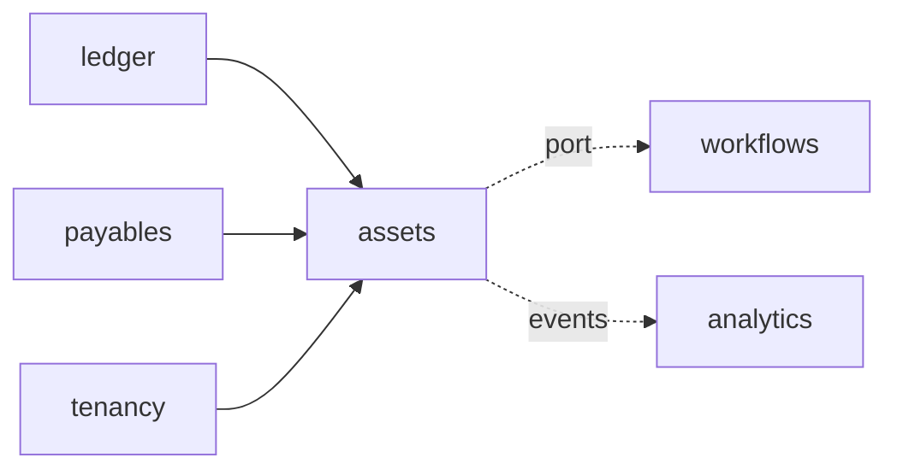

# ADR-0057: Asset accounting

**Status:** accepted (T57 design step, 2026-11-02; decided by default under
ADR-0053 d; `go-reviewer` approved in round 10 with no blocking finding). The
decisions taken by default and the questions for the product owner are
listed at the end; the slices T57a-T57i are in the tracker.

## Context
T57 is "Asset accounting" (07 §7.6): "A new assets context: asset master and
classes, acquisitions from payables, depreciation runs per ledger,
retirements and transfers, the asset history sheet. Lane S; after T52,
T56." The tracker's leaves under Asset accounting (FI-AA) are the same five:
asset master and classes; acquisitions from AP and settlement; depreciation
runs (straight-line, declining balance); retirements and transfers; the
asset history sheet. This ADR details that entry and adds nothing beyond it.
Today the ERP has:

- **The ledger** (ADR-0006, ADR-0045): journal entries posted to every
  ledger a company keeps as linked copies (`posting_group_id`), or to one
  ledger or ledger group (ledger-specific postings, which take no line on a
  supplier or customer reconciliation account, T52d); periods opened,
  closed and locked per ledger (T32); other contexts post through
  `ledger.Postings.Post`, which today always posts to every ledger, and
  their entries are refused by the ledger's own `:reverse` (409
  `ledger.entry_owned_elsewhere`; 04 §4.9 names assets among the contexts
  without a reversal path yet).
- **Accounts**: `ledger.gl_account.reconciliation_kind` already admits
  `asset` (migration 000005), but nothing sets or enforces it: the
  configuration's chart of accounts knows `vendor_reconciliation` and
  `open_items` only. Account determination is per legal entity and key
  (`ledger.account_determination`).
- **Centers** (ADR-0050): cost center, profit center and segment on every
  journal line, derived and validated at posting; an expense
  (`primary_cost`) line needs a cost center; a balance sheet line takes no
  cost center and may carry a profit center. ADR-0050 says "T57 assets take
  a cost center from the asset master through the same derivation".
- **Payables** (ADR-0049 §8 as built): a supplier invoice item without an
  order posts to its `account_id`, its non-recoverable input tax added to
  that line; an order item posts its receipt Dr the order item's account /
  Cr GR/IR (T33) and the invoice clears GR/IR. A line's local amount can be
  kept by the posting context (`PostingLine.LC`), its group amount cannot.
- **Workflows** (ADR-0012): long batches run as Temporal workflows behind
  an `Operation`, each posting one ACID activity, activities idempotent,
  ids from business keys; a cell without an engine runs the activities in
  process (ADR-0056 as built).
- **Revaluation** (ADR-0042, T52f): the one per-ledger run today, posting
  ledger-specific entries in local currency inside the ledger.
- **The pilots** (Canada and the UAE) report under IFRS alone (ADR-0045,
  coordinator 2026-10-21): they keep 0L only, so their assets depreciate in
  one ledger; the design holds for more.

### What SAP does (the parity target)
**From memory, for a specialist to check against the pilot's SAP release;
no source was read for this section.** FI-AA keeps an asset master per
company code (ANLA, general data; ANLZ, time-dependent assignments such as
the cost center), an asset class (ANKA) that gives the account determination
and the default depreciation terms, and a chart of depreciation whose
depreciation areas (T093; area 01 book depreciation, others for local GAAP,
tax or group) each post to a ledger or not at all. Depreciation terms per
area (ANLB: depreciation key, useful life, start date), values per area and
fiscal year (ANLC) and line items (ANEP). An acquisition from a supplier
invoice can name the asset on the invoice line (account assignment A,
"integrated acquisition") or go through an asset clearing account that a
later posting capitalises ("acquisition with automatic offsetting entry").
The depreciation run (AFAB) posts per area and period, with repeat and
catch-up of planned depreciation not yet posted; depreciation keys combine
methods such as straight-line and declining balance with a switch to
straight-line. Retirements post with revenue (with or without a customer)
or as scrapping, full or partial, with gain or loss; transfers move values
between assets of one company code or across company codes. The asset
history sheet shows per class the opening cost, acquisitions, retirements,
transfers, closing cost, accumulated depreciation and book values.

## Decision

### 1. Scope of T57
In: asset classes and their account determination; the asset master with
depreciation terms per ledger and a time-dependent cost and profit center;
acquisitions from a posted line on an asset clearing account (a supplier
invoice's, a goods receipt's or a manual entry's: "acquisitions from AP and
settlement" is that line's settlement onto assets) and by manual entry
against an offset account, full or partial, reversible; depreciation by
straight-line and declining balance (with the switch to straight-line,
flagged in "Decided by default"), per period and per ledger, in a
depreciation run that is a Temporal workflow; retirements by sale with
proceeds and by scrapping, full or partial, reversible; transfers to other
cost and profit centers and to another asset of the same company,
reversible; the asset history sheet per company, ledger and fiscal year.

Out (none built; each is a question for the product owner or a gap, both
listed at the end): transfers between companies; a change of useful life
or method after depreciation has been posted (a change in estimate); a
take-over of existing assets at cutover and the SAP migration of fixed
assets; depreciation areas that post to no ledger (tax depreciation such as
Canada's CCA); assets under construction with their own settlement rules;
units-of-production and other methods; revaluation and impairment of
assets; insurance and leasing data; a group-currency depreciation and
history sheet of their own (depreciation's group amount is its local amount
translated at the run's posting date, §5, §7); screens in the web workspace
(headless first, ADR-0053); an agent (the roadmap names none).

### 2. The `assets` context: a leaf
A new context **`assets`** (schema `assets`, package `internal/assets`)
owns asset classes' use, assets, their movements, acquisitions,
retirements, transfers and depreciation runs. Like `cash` (ADR-0051 §2) it
is a **leaf**: it reaches the other contexts only through ports it declares,
which the composition root (`internal/app`) adapts, and no context imports
it. `internal/layout`'s `leaves` gains `assets`, and `allowed["assets"]`
names `config` only.



Its ports, each run in the request's (or activity's) transaction under RLS
(ADR-0003):
- **`assets.Ledger`** (adapter over `ledger.Postings` and the ledger's
  reads): post an entry for an assets document (to every ledger, or to one
  ledger: §4), reverse one, read one journal line with its entry (account,
  currency, three amounts, posting date, document number, source context and
  document, whether it is reversed), list the leading ledger's lines on
  given accounts in a fiscal year, the ledgers a company keeps, the
  status of a period in a ledger, and a local amount translated to group
  currency on a date as the ledger translates a local-currency document
  (ADR-0042: the posting date's rate, its rate type and its problems, such
  as `ledger.no_exchange_rate`).
- **`assets.Invoices`** (adapter over payables and partner reads): for a
  supplier invoice id, its document number, supplier reference and the
  supplier's id and name, so an acquisition shows what it came from
  (REVIEW.md: an identifier without the name its consumer needs).
- **`assets.Companies`** (adapter over tenancy): the legal entity's code,
  local currency and time zone.
- **`assets.Centers`** (adapter over the ledger's center reads): a cost or
  profit center's code and name, whether it is valid in the company on a
  date, and a cost center's profit center on a date (§8); the posting
  itself derives and validates as every posting does (ADR-0050 §5).
- **`assets.Runs`** (adapter over `operations` and the workflow engine):
  create a run's `Operation` in the request's transaction, and finish or
  fail it from the run's activities; `assets` imports neither `operations`
  nor `platform/workflow` (§7, "Starting a run").

The depreciation run's workflow lives in `internal/workflows`, which may not
import a leaf: it declares the activities it calls as an interface
(`workflows.Depreciation`), which `assets` implements and the composition
root wires, as `partner` asks `cash` about planning groups through a port
of its own. No existing dependency direction changes, so no other ADR is
needed (CLAUDE.md: this ADR records the new arrows).

### 3. Classes and account determination (configuration)
Classes are configuration, not master data: they are few, change rarely and
decide postings, as the chart of accounts and account determination do
(ADR-0050 §4 kept the rules in configuration for the same reason).

```yaml
asset_classes:
  - code: MACHINES                 # [A-Z0-9_]{1,20}, unique
    name: Machinery and equipment
    terms:                         # the defaults per ledger code (ADR-0045 ledgers)
      - ledger: 0L
        method: straight_line      # straight_line | declining_balance
        useful_life_months: 120    # 1..1200
      - ledger: 2L
        method: declining_balance
        useful_life_months: 120
        declining_factor: "2"      # plain decimal, > 1 and ≤ 10; declining_balance only
companies:
  - code: "1000"
    asset_accounts:                # one per class the company uses
      - class: MACHINES
        acquisition_cost: "1600"          # balance sheet, asset type, asset reconciliation
        accumulated_depreciation: "1609"  # balance sheet, asset type, asset reconciliation
        depreciation: "6200"              # expense
        clearing: "1690"                  # balance sheet, asset type, not a reconciliation account
        gain: "4900"                      # revenue
        loss: "6900"                      # expense
        sale_clearing: "1695"             # balance sheet, asset type, not a reconciliation account
chart_of_accounts:
  - number: "1600"
    asset_reconciliation: true     # new: ledger.gl_account.reconciliation_kind = 'asset'
```

- **Validation** (configuration, with the problems on the field as
  validation reports them): a class's terms name ledgers of the document,
  one entry per ledger, and a company using the class keeps no ledger
  without one; accounts exist, are postable in the company and have the
  types above; `acquisition_cost` and `accumulated_depreciation` are
  `asset_reconciliation`, the others are not; `asset_reconciliation` is
  exclusive with `vendor_reconciliation`, and an account becomes one only
  while it has no postings and never stops being one (as `open_items`,
  ADR-0047), checked at activation by `ledger.Setup.Check`. The accounts are
  the company's for every ledger, as revaluation's are (ADR-0045).
- **No open items and no revaluation on them.** `ledger.Setup` makes an
  account open-item managed when it reconciles anything
  (`is_open_item_managed = reconciliation_kind <> 'none'`); T57a narrows
  that to supplier and customer accounts, and validation refuses
  `open_items` and `revalue_foreign_currency` on an asset reconciliation,
  `clearing` or `sale_clearing` account (a test each). A cleared line could
  not be reversed (`ledger.entry_cleared`), which would block reversing an
  acquisition and the supplier invoice behind it (Alternatives).
- **Tiers**: classes' terms and the asset accounts are posting-related (tier
  3); `asset_reconciliation` is structural (tier 4, the chart of accounts);
  a class's name is cosmetic.
- **Number ranges**: `asset` (asset numbers per company and the year an
  asset is created, ADR-0004), `journal_aa` (acquisitions, retirements and
  transfers) and `journal_af` (depreciation): SAP's document types AA and AF
  (from memory). Activation refuses a company with asset accounts and
  without these ranges for the current fiscal year.
- **Asset reconciliation accounts in the ledger.** A line on an `asset`
  reconciliation account posts only in an entry whose source context is
  `assets`, or `integration` (a migration's balances, §11): manual and parked
  entries, templates and every other context's postings are refused (422
  `ledger.asset_reconciliation_account`, naming the line), and the database
  holds it (`ledger.check_line`, a schema test). So, apart from balances
  a migration loaded (§11), the cost and accumulated depreciation on those
  accounts are the sum of the assets' movements, which the history sheet
  shows (§9). A company flags its accounts before it migrates balances onto
  them, since an account with postings cannot be flagged. The T52d rule
  (no ledger-specific line on a reconciliation account) stays for supplier
  and customer accounts only: an asset account has no open items, and
  depreciation differs by ledger by design.

### 4. Changes to the ledger's published API
`assets` needs three things `ledger.Postings` does not offer; each is
additive and built in the slice that first needs it:
- **`Posting.LedgerID`** (T57f): a posting to that one ledger the company
  keeps (422 `ledger.ledger_not_kept` otherwise), as a manual entry's
  `ledger_id` does: a ledger-specific posting, refused on a supplier or
  customer reconciliation account as today. Nil keeps today's behaviour,
  every ledger.
- **`PostingLine.GC`** (T57c): a line's group amount kept as given, beside
  `LC`, so a capitalised line leaves the clearing account at its booked
  amounts in all three currencies (§6), and a retirement, an `asset`
  transfer and a profit center reposting take cost and accumulated
  depreciation off at their booked group amounts (§8). ADR-0042 converts
  every line once at posting, its group amount from the transaction amount
  at the posting date's rate; a kept group amount is that conversion made
  when the value was booked, carried over unchanged, as `LC` carries the
  local one.
- **Reversal routing**: `ledger.entry_owned_elsewhere` on an assets entry
  names the assets path (`asset-acquisitions/{id}:reverse`,
  `asset-retirements/{id}:reverse`, `asset-transfers/{id}:reverse`; a
  depreciation run's entries are never reversed one by one, §7), as it
  names `supplier-invoices/{id}:reverse` today; 04 §4.9's "assets have no
  reversal path yet" is updated.

### 5. Data model
Every table has `tenant_id` leading its keys and RLS (ADR-0003); keys are
UUIDv7 (ADR-0004); amounts are `bigint` minor units of the company's local
currency unless a column says otherwise (ADR-0005); references to other
contexts (legal entity, ledger, accounts, centers, journal entries, invoices)
are ids without foreign keys (02 §2.1).

```
assets.asset              (tenant_id, id, legal_entity_id, asset_number, class_code, description,
                           status, capitalised_on, last_seq, version, created_*, updated_*)
                           UNIQUE (tenant_id, legal_entity_id, asset_number)
assets.asset_terms        (tenant_id, asset_id, ledger_id, method, useful_life_months, declining_factor,
                           residual_value, depreciation_start, booked_through_year,
                           booked_through_period, version)                        PK (tenant_id, asset_id, ledger_id)
assets.asset_assignment   (tenant_id, asset_id, seq, valid_from, cost_center_id, profit_center_id, transfer_id)
                           PK (tenant_id, asset_id, seq)                          insert-only
assets.movement           (tenant_id, id, asset_id, seq, legal_entity_id, ledger_id, class_code, kind,
                           value_date, posting_date, fiscal_year, fiscal_period, cost, accumulated,
                           cost_gc, accumulated_gc, residual, proceeds, share, document_kind, document_id,
                           journal_entry_year, journal_entry_id, reverses_id,
                           booked_through_before_year, booked_through_before_period)  append-only
assets.acquisition        (tenant_id, id, legal_entity_id, asset_id, seq, value_date, posting_date, currency,
                           amount, amount_lc, amount_gc, source_entry_year, source_entry_id,
                           source_line_no, offset_account_id, text, status, version, ...)
assets.clearing_use       (tenant_id, entry_year, entry_id, line_no, legal_entity_id, currency,
                           line_amount, line_lc, line_gc, used, used_lc, used_gc, version)
                           PK (tenant_id, entry_year, entry_id, line_no)
assets.retirement         (tenant_id, id, legal_entity_id, asset_id, seq, kind, value_date, posting_date,
                           share_cost, proceeds, text, status, version, ...)
assets.transfer           (tenant_id, id, legal_entity_id, asset_id, seq, kind, value_date, posting_date,
                           to_asset_id, to_seq, share_cost, cost_center_id, profit_center_id, text, status,
                           version, ...)
assets.document_entry     (tenant_id, document_kind, document_id, ledger_id, part, journal_entry_year,
                           journal_entry_id, reversal_entry_year, reversal_entry_id)
                           PK (tenant_id, document_kind, document_id, ledger_id, part)
assets.depreciation_run   (tenant_id, id, legal_entity_id, ledger_id, fiscal_year, fiscal_period, status,
                           operation_id, assets_planned, assets_posted, assets_skipped, amount, error,
                           version, ...)
assets.depreciation_batch (tenant_id, run_id, batch_no, asset_ids, status, amount, assets_skipped,
                           journal_entry_year, journal_entry_id)                  PK (tenant_id, run_id, batch_no)
assets.year_total         (tenant_id, ledger_id, fiscal_year, asset_id, legal_entity_id, class_code,
                           acquisitions, retired_cost, transferred_cost, depreciation,
                           retired_accumulated, transferred_accumulated)          PK (tenant_id, ledger_id, fiscal_year, asset_id)
assets.class_year_total   (tenant_id, legal_entity_id, ledger_id, fiscal_year, class_code, the same columns)
                           PK (tenant_id, legal_entity_id, ledger_id, fiscal_year, class_code)
```

- **States.** An asset is `planned` (created, no value), `active`,
  `retired` or `cancelled`; `planned` → `cancelled` by `:cancel`, only
  without movements. Status and `capitalised_on` are derived, under the
  asset's lock, from its movements after every posting and reversal that
  touches it, in this order: `planned` while it has no posted, not reversed
  acquisition or transfer in; `retired` when its cost is zero in every
  ledger and its latest movement (by `seq`) that reduced its cost, or that
  took a full share (§8), is a retirement or a `transfer_out`; `active`
  otherwise. `capitalised_on` is
  the earliest value date of its posted, not reversed acquisitions and
  transfers in, null while it has none. So the first acquisition or
  transfer in makes a `planned` asset `active` with its value date;
  reversing the earliest of several moves `capitalised_on` to the earliest
  one left; reversing the last one left returns the asset to `planned`; a
  retirement or `asset` transfer that takes all its cost retires it (the
  sender, for a transfer), and that document's reversal, which can only
  be the asset's latest posting (§8), makes it `active` again; a credit
  memo that brings the cost to zero leaves it `active`, and the asset is
  closed by a full retirement (§8), which takes zero cost and whatever
  accumulated depreciation and residual value are left, writes its
  movements even when every amount is zero, and so retires it. The same rule
  decides a transfer's sender and receiver and every reversal. A `retired`
  or `cancelled` asset takes no acquisition, retirement or transfer, as
  sender or receiver (422 `assets.asset_retired`,
  `assets.asset_cancelled`). Acquisitions,
  retirements and transfers are `posted` → `reversed`. A run is `queued` →
  `running` → `posted` or `failed`. Each transition is a guarded update
  (`WHERE status = $expected`), and a trigger refuses any other (schema
  tests per transition).
- **Posting order.** Each asset counts its postings: under the asset's
  lock every document, reversal and assignment that touches it, and every
  run batch for each asset it processes (posting or not; an asset the
  batch skips under its lock, §7, takes none), takes the next
  `seq` from `asset.last_seq` (a transfer's receiver its
  own, `to_seq`), and the movements and assignment rows it writes carry
  it (a reversal's negated rows its own `seq`, not the original's).
  "Posted after" means a higher `seq`; ids are not used for order, since
  UUIDv7 ids from different replicas are not monotonic.
- **Movements are the subledger.** One row per asset, ledger and effect:
  `acquisition`, `depreciation`, `retirement`, `transfer_out`,
  `transfer_in`, with `cost` and `accumulated` the signed change of
  acquisition cost and accumulated depreciation (depreciation negative, as
  the credit it is) in local currency and `cost_gc` and `accumulated_gc`
  the same changes in group currency as that ledger booked them,
  `proceeds` on a sale, `residual` the residual value a retirement or
  transfer out took and a transfer in brought (the schedule applies these
  recorded amounts, §7), `share` (the fraction of cost it took, a
  `numeric`), the document and the journal entry of that ledger. A
  `center` transfer writes no movement of its own, only its catch-up's
  `depreciation` movement: the transfer changes no cost or accumulated
  depreciation, only the centers they are booked on (§8). A retirement's
  or transfer's catch-up writes its `depreciation` movement in every
  ledger even when its difference is zero (without a journal entry when
  its ledger posts nothing), recording the asset's `booked_through` in that
  ledger before the catch-up (`booked_through_before_*`, null on every
  other movement), so its reversal can restore it (§7). The reversal reads
  these columns only from its own document's catch-up movement in that
  ledger, never from another movement, and a null there means the asset
  was not booked in that ledger before the catch-up, so `booked_through`
  returns to null. Each of a
  document's entries per ledger is its `main` one, or the `catch_up` of a
  `center` transfer posted in the period before (§8): `document_entry`'s
  `part`. A reversal writes the negated rows with `reverses_id`. Rows are
  never updated or deleted (no grant, a trigger), so an asset's values per
  ledger, in local and in group currency, are sums of its movements. The year totals
  per asset and per class (`year_total`, `class_year_total`) are those
  sums by posting year, added to in the transaction that writes each
  movement (an upsert adding the movement's amounts, after the
  movements, in key order: the class rows by class code, then the asset
  rows by asset id, so a batch and a transfer touching the same two
  classes never deadlock; a test runs two such transactions at once), so
  the history sheet
  (§9) reads a few rows per class and year instead of every movement; a
  schema test holds them equal to the movements' sums. They are sums, not
  a plan: nothing in them is computed ahead (Alternatives). The class is copied to the movement because
  the sheet groups by it; an asset's class never changes (a reclassification
  is a transfer to an asset of the other class).
- **Versions** (ADR-0008): an asset's version moves with every change of
  its master, terms, assignment or values (its representation shows the
  values per ledger), so `If-Match` on `PATCH /v1/assets/{id}` refuses a
  stale view; documents and runs carry their own versions.
- **Locking** (ADR-0008): every posting of an asset document reads the
  asset (and a transfer's receiver, in id order) `FOR UPDATE`; a run's
  batch reads its assets `FOR UPDATE` in id order. A capitalised line's
  `clearing_use` row is read `FOR UPDATE` (inserted first with
  `ON CONFLICT DO NOTHING`), so two acquisitions from one line serialise.
- **Database rules with schema tests**: `0 ≤ used ≤ line_amount` for a debit
  line (the mirror for a credit line), likewise in local and group amounts;
  one `queued` or `running` run per company and ledger (partial unique
  index); one terms row per asset and ledger; `declining_factor` only with
  `declining_balance`; `useful_life_months` 1-1200; `residual_value ≥ 0`;
  movement kinds and the sign rule, which binds reversals only, since
  an acquisition from a credit line or a reversal's line is negative and a
  catch-up or a run's difference may have either sign: a reversal row
  (`reverses_id` set) has its original's kind and exactly the negated
  amounts of its original (local, group, proceeds, residual), and an
  original is reversed at most once; a `depreciation` movement changes
  `accumulated` (and `accumulated_gc`) only: its `cost`, `cost_gc`,
  `residual` and `proceeds` are zero; RLS on every
  table; keys lead with `tenant_id`; no foreign key leaves the schema.

### 6. Acquisitions
**From a posted line** (the main path, "acquisitions from AP and
settlement"). A supplier invoice item without an order is posted to the
class's `clearing` account (its non-recoverable input tax added to the line,
ADR-0049 §8); an order item on that account posts its receipt Dr clearing /
Cr GR/IR at the order price (T33), while its invoice's price difference and
non-recovered tax go to the company's `price_difference` account (ADR-0049
§8 as built, `internal/ledger/grir.go`), so an asset bought on an order is
capitalised at the order price only (a question below); a manual entry may
debit the clearing account too. `POST
/v1/asset-acquisitions` names the asset, the source line (`source.entry_id`,
`source.line_no`), the amount in the line's currency (all that is left of
it by default), the value date (default the line's posting date) and the
posting date (default today on the company's day, T72n). It checks that the
line is the leading ledger's, on the asset's class's clearing account in
the asset's company, not reversed, that its entry has a copy in every
ledger the company keeps (a ledger-specific entry, or one posted before
T52b, has not), and that the amount has the line's sign and is at most what
is left of it (422 `assets.not_clearing_line`, `assets.source_reversed`,
`assets.source_not_in_every_ledger`, `assets.amount_exceeds_line`). A
reversal's line R, reversing a line L, is a source too, but only as a
negative acquisition onto an asset that holds unreversed acquisitions from
L (422 `assets.source_reversed` for any other asset), and each asset takes
from R at most its unreversed acquisitions from L less what R already took
from it (its not reversed acquisitions from R; 422
`assets.amount_exceeds_line` above that). So R's total stays within L's net
capitalised amount, and no asset loses more through R than L gave it. Once
R has been capitalised onto an asset (a not reversed acquisition from R),
reversing that asset's acquisitions from L is refused (409
`assets.reversal_line_capitalised`): it would leave R's take above what L
still gives the asset; the acquisition from R is reversed first. The lines
of a reversed entry and of its reversal with nothing capitalised from the
reversed one are refused (`assets.source_reversed`). Cost that left the
asset by an `asset` transfer is not reachable through R (a known limit,
listed for the product owner below). Its posting date
lies on or after the `valid_from` of the asset's latest assignment row
(409 `assets.posting_before_center_transfer`, §8). It posts in the
line's currency, to every ledger the company keeps: Dr `acquisition_cost`
(with the asset's profit center, §8) / Cr `clearing` (with the source
line's profit center), document type `journal_aa`, source context `assets`,
the acquisition as source document. The local and group amounts are the
line's in proportion, rounded half away from zero, and the acquisition that
uses the rest of the line takes the rest of its local and group amounts
(kept through `PostingLine.LC` and `GC`, §4): a line capitalised in full
leaves the clearing account at zero in all three currencies, whatever the
rates since. It writes an `acquisition` movement per ledger (the local
and group amounts as `cost` and `cost_gc`), the `clearing_use`, the audit
record and `AssetMovementPosted`.

- **Partial acquisitions**: an asset may be acquired by several
  acquisitions (invoices over time, each a partial acquisition), and one
  line may be split across several assets (several acquisitions, each a
  part of it). A credit line on the clearing account (a supplier credit
  memo, T34) is capitalised the same way as a negative acquisition, a
  reduction of cost, refused where it would leave the asset's cost below
  zero in a ledger (422 `assets.cost_negative`). So is a reversal's line
  (above): when a supplier invoice capitalised onto an asset is reversed
  (a duplicate, say) and the acquisition can no longer be reversed
  (`assets.later_movements`), the reversal's credit line taken onto that
  asset, within the bound above, takes the cost off it. An asset whose
  cost from the invoice left it by an `asset` transfer cannot be
  corrected this way: the transfer is reversed while it is the latest
  posting on both assets, or the receiver's cost is retired (§8).
- **Value dates.** An acquisition dated after the end of its posting
  date's period is refused (422 `assets.value_date_in_future`); it may be
  dated in any earlier period, and the next run catches its depreciation
  up (§7). A retirement or transfer (either kind) is not backdated: its
  value date lies in its posting date's period, on or before the posting
  date (422 `assets.value_date_outside_period`), for a `center` transfer
  that period's first day (§8). Since several periods may be open at once,
  posting periods do not follow posting order, so a retirement or transfer
  is also refused while the asset (the sender, and for an `asset` transfer
  the receiver too) has a movement or an
  assignment valued in a later period than its own, or is booked through a
  later period in any ledger: a run of a later period (even one that
  posted nothing for it), an acquisition valued later, an earlier transfer
  from a later date (409 `assets.later_value_date`). An `asset` transfer
  whose posting date is before the `valid_from` of the receiver's latest
  assignment row is refused (409 `assets.posting_before_center_transfer`,
  §8), as for the sender, where the value date rules already exclude it.
  A retirement or `asset` transfer
  dated before `capitalised_on` is refused too (422
  `assets.value_date_before_capitalisation`). So a retirement's or
  transfer's share is taken of the asset's balances as posted so far
  (§8), which are what the schedule holds at its position; the only
  movements that can later be valued before it are acquisitions and
  transfers in, which the schedule (§7) applies before it by their value
  dates while the retirement keeps its recorded amounts, and the next run
  catches their depreciation up.
- **The capitalisation date** (`capitalised_on`) is the earliest value
  date of the asset's posted, not reversed acquisitions and transfers in
  (§5); each ledger's depreciation starts at `depreciation_start`, or at
  `capitalised_on` while that is null (so the default follows
  `capitalised_on` when a reversal moves it), and `depreciation_start` may
  be set by `PATCH` (§7) until depreciation is first posted
  in that ledger: depreciation begins when the
  asset is available for use, which may be after it is acquired (IAS 16.55,
  from memory, for a specialist).
- **By manual entry**: an acquisition without a source line names an
  offset account (`offset_account_id`: a G/L account that is no
  reconciliation account of any kind, postable in the company), a currency
  (default local) and an amount, and posts Dr `acquisition_cost` / Cr the
  offset account, converted at the posting date's rate; its movements take
  the cost line's local and group amounts as the ledger posted them (read
  back through `assets.Ledger`). It serves what has no supplier line (own
  work capitalised, a contribution in kind).
- **Worklist**: `GET /v1/asset-clearing-items?legal_entity_id&fiscal_year`
  lists the leading ledger's lines on the company's clearing accounts in
  that year with the amount used and left, the source document (for a
  supplier invoice its number, supplier reference and supplier name, through
  `assets.Invoices`) and the acquisitions made from each; `remaining=true`
  keeps the lines with something left; the lines of a reversed entry and of
  its reversal are both left out while nothing was capitalised from the
  reversed one; a reversed line with acquisitions is shown with
  `source_reversed: true` and its reversal's line beside it, offered per
  asset holding unreversed acquisitions from the reversed line with the
  bounded amount above (that asset's unreversed acquisitions from it less
  what the reversal's line already took from it), so the accountant
  either reverses the acquisitions or, when one can no longer be reversed,
  takes the cost off that asset through the reversal's line.
  Paged by a cursor over (posting date, entry, line); one fiscal year a
  request bounds the read (a clearing account takes asset purchases only,
  far fewer than the journal's lines; the T57c budget measures it).
- **Reversal**: `POST /v1/asset-acquisitions/{id}:reverse` (If-Match, a
  reason) reverses its entries through the ledger's reversal path on the
  original posting date or a given one: on or after the acquisition's
  posting date (422 `assets.reversal_before_original`: a reversal is never
  dated before what it reverses), its period open in every ledger. With
  `assets.later_movements` below, that floor keeps it on or after the
  `valid_from` of the asset's latest assignment row (§8) with no check of
  its own: the acquisition was posted on or after the row then latest,
  and a `center` transfer posted after it must be reversed first, its
  restoring row taking back that row's `valid_from`. It writes negated
  movements and gives the amount back to the line. It is
  refused while a retirement or transfer of any kind posted on the asset
  after it (a higher `seq`, §5) is not reversed (409
  `assets.later_movements`): a retirement's or `asset` transfer's share was
  computed from the values this one set, and a `center` transfer moved its
  cost to another profit center, so the ledger's reversal, which copies the
  original lines' centers (ADR-0050 §5), would take it off the one the
  balances left. Since a retirement or transfer is itself reversible only
  while nothing was posted on the asset after it (§8), the two rules order
  corrections the same way: last posted, first reversed. It is refused
  where it would leave the asset's cost below zero in a ledger (422
  `assets.cost_negative`, as for a credit line: a credit memo capitalised
  after it took off cost this one brought), and, for an acquisition from a
  line L, while a not reversed acquisition from L's reversal line is on
  the asset (409 `assets.reversal_line_capitalised`, above). The asset's
  status and `capitalised_on` then follow §5. Depreciation posted since
  needs no refusal: the next run in each
  ledger posts it back, since a run takes every asset whose booked
  depreciation differs from zero, a `planned` one included (§7). Payables
  is not told: an invoice whose clearing line was
  capitalised can still be reversed there, and the worklist then shows the
  line reversed, as above.

### 7. Depreciation
**Terms per ledger.** Each ledger the company keeps is one depreciation
area, as ADR-0045 foresaw ("depreciation runs per depreciation area, each
posting to its ledger"): an asset has one terms row per ledger, created
from its class's defaults when the asset is created and changeable by
`PATCH` until depreciation is first posted in that ledger (409
`assets.terms_in_use` afterwards; a change in estimate is out of scope, §1).
A ledger assigned to the company later gets terms by `PATCH`; until then
that ledger's runs skip the asset and count it (`assets_skipped`).

**Periods.** Depreciation is per regular posting period (1 to 12; special
periods 13-16 take none, 422 `assets.special_period`), and useful life
counts regular periods, one a month. A period counts in full from its
start: an asset depreciates from the period of its depreciation start, and
a retirement or transfer out takes its share off at the start of the period
of its value date, so the retired share depreciates for none of that
period (decided by default; SAP's period controls vary this per method).

**The planned schedule** of an asset in a ledger through a period P walks
its periods from the depreciation start's (k = 1) to P. It applies each
movement whose value date lies in P or before, at the start of the period
of its value date (one valued before the depreciation start's period at
the start of k = 1), and ignores those valued after P; the movements of
one period are applied in posting order (`seq`, §5), and a reversed
movement and its reversal cancel out. Acquisitions add their cost;
transfers in add the cost, accumulated depreciation and residual value the
sender's `transfer_out` recorded; retirements and transfers out take off
the cost, accumulated depreciation and residual value they recorded
(`depreciation` movements are not applied: the walk computes depreciation,
it does not read it). All of the following count the movements applied by
the start of period k. With B_k the net book value then (the cost applied,
less the accumulated depreciation: the d_j of the periods before, plus
what transfers in brought, less what retirements and transfers out took),
R_k the residual value then (the terms' `residual_value`, plus what
transfers in brought, less what retirements and transfers out took) and n
the useful life in periods:
- **Straight-line**: d_k = (B_k − R_k) / (n − k + 1), the net value over
  the remaining life. With one acquisition this is (cost − residual) / n
  each period; a later acquisition is spread over the life left.
- **Declining balance with the switch to straight-line**: d_k =
  max(B_k × f / n, (B_k − R_k) / (n − k + 1)), with f the declining factor
  (f / n is the annual rate f / (n / 12) per month): the declining amount
  until straight-line over the remaining life gives more, then
  straight-line, so the asset reaches its residual value at the end of its
  life.
- Each d_k is rounded half away from zero to minor units and then held to
  d_k = max(0, min(d_k, B_k − R_k)); from k = n on, d_k = max(0, B_k −
  R_k), so cost arriving after the end of the life is depreciated in the
  period it arrives. Zero wins: when B_k − R_k is below zero (the
  residual value and the cost shared out by retirements are rounded
  separately, or a credit memo reduced the cost by more than the book
  value above the residual), the period takes no depreciation rather than
  a negative one, and the book value may end that many minor units below
  the residual value; writing it back would be a change in estimate (§1).

**Planned and booked are depreciation alone.** planned(P) = Σ d_k for
k ≤ P, the schedule through P; what retirements and transfers took is not
netted off, since it is in their own movements. booked = the sum of the
asset's `depreciation` movements in the ledger (runs' and catch-ups', with
their reversals). **What a run of period P posts** for an asset is
planned(P) − booked: normally one period's d_k, more when an acquisition
was posted late with an earlier value date (catch-up), less or negative
when one was reversed. A run of a period already run posts only what
changed since (a repeat run). **A retirement's or transfer's catch-up**
(§8; both transfer kinds, a `center` transfer's on the previous row's
centers), with V its value date's period, which is its posting period (§6),
and V−1 the regular period before it (the previous fiscal year's last
when V is period 1), posts planned(V−1) − booked: the same definition
through V−1. Nothing on the asset is valued after V (§6), so booked
covers at most V; when V's run is already posted, the catch-up posts
that period's depreciation back (it may be negative) before the share
leaves (the share depreciates for none of V), and a repeat run of V posts
what the part that stays is planned to have. Each asset's terms row keeps
the period its depreciation is booked through in that ledger
(`booked_through`, fiscal year and period), raised by a run to its period
and by a catch-up to V−1, and never lowered by either (after V's run it
stays at V). Only a reversal lowers it: reversing a retirement or
transfer, and so its catch-up, returns `booked_through` in each ledger to
its value before that catch-up, which the catch-up's movement recorded
(`booked_through_before_*`, §5). That is safe because the reversal is
allowed only while the document is the asset's latest posting (§8): no
run batch and no other catch-up processed the asset since, so nothing
else raised it.
A run of period P passes over an asset booked through a later period (a
catch-up to V−1 posted before a run of an earlier period), and one whose
latest assignment row is valid from after P's last day (a `center`
transfer of a later period, §8), so a run of an earlier period never
undoes a catch-up and never posts on centers not yet in force on its
date (the next run of a later period posts that asset's difference, on
its latest centers).
**Group currency**: a run's or catch-up's difference per asset is
translated to group currency at its posting date's rate, as the ledger
translates a local-currency document (`assets.Ledger`, ADR-0042), rounded
half away from zero; that is its movement's `accumulated_gc`, and each
line it is summed into carries the sum of its assets' group amounts
(`PostingLine.GC`), so the entry and the movements agree.
Nothing is stored as a plan: it is
computed from the movements and terms under the asset's lock, so a run, the
preview and the schedule read can never disagree with the movements. IAS 16
requires depreciation to allocate the depreciable amount systematically
over the useful life and names straight-line and diminishing balance among
the methods (IAS 16.50, 16.62, from memory, for a specialist); the methods'
fitness for a ledger's accounting principle is the tenant's choice in the
class terms.

**The run.** `POST /v1/depreciation-runs` (Idempotency-Key; company, ledger
(default the leading), fiscal year, period) checks the period is a regular
one, open in that ledger (422 `ledger.period_not_open`, the ledger's own
problem), not before the latest posted run's period in that ledger (409
`assets.run_out_of_order`), and that no run of the company and ledger is
queued or running (409 `assets.run_in_progress`, naming it, with
`Location`); it writes the run `queued` and its `Operation` (through
`assets.Runs`) in the request's transaction and returns 202 with the
`Operation` (04 §4.8), its `resource` the run.

**Starting a run.** Nothing is started inside the request: the run's
`Operation` (kind `assets.depreciate`, `queued`), committed with the run,
is the hand-off, as for every operation that runs as a workflow. The
workflows dispatcher already starts a workflow for each queued operation
of a kind it knows, reading `platform.operation` as the worker role across
tenants (`internal/workflows/dispatch.go`); it learns the new kind, and
needs no grant on the `assets` schema, since the workflow's activities
read the run in the tenant's scope through `workflows.Depreciation`. The
workflow id comes from the run, so a start repeated by another replica or
round is refused by the engine as a duplicate and changes nothing, and a
start that failed is made again next round: a run never stays `queued`
with nothing to move it, so the one-run-at-a-time index cannot block a
company for good. A cell without a workflow engine runs the same
activities in process, in order, as the payment release and the recurring
entries do (ADR-0056 as built). Workflow
`DepreciationRun`, id `{tenant}-depreciation_run-{run}` (ADR-0012, the run
id as business key), task queue as the other workflows', activities through
`workflows.Depreciation` (§2):
1. **`PlanDepreciationRun`**: run `FOR UPDATE`; if `queued`, selects the
   company's assets with terms in the ledger that are `active` with a
   depreciation start on or before the period's end, or whose accumulated
   depreciation in the ledger (the sum of its movements' `accumulated`) is
   not zero (a `planned` asset whose acquisition was reversed after
   depreciation was posted; a `retired` asset is not selected, since the
   retirement or transfer that took the last of its cost took all its
   accumulated depreciation too, §8), and not booked through a
   later period nor with an assignment row valid from after the period's
   last day (the asset's selectable state), by asset number,
   in batches of 500 asset ids (`depreciation_batch`, `pending`), sets the
   run `running` with `assets_planned`; if already `running`, returns the
   batches it wrote. Run twice, it writes nothing twice.
2. **`PostDepreciationBatch`** (one per batch, in order): batch `FOR
   UPDATE`; if `posted`, returns. Else reads its assets `FOR UPDATE` in id
   order and re-checks each one's selection under its lock (ADR-0008: a
   retirement, transfer, reversal or cancellation may have committed
   between the plan and the batch): an asset now booked through a later
   period than the run's, or no longer selectable as in step 1, is skipped
   and counted (`assets_skipped`), and takes no `seq` (§5). It computes each remaining asset's
   difference (above) and its group amount, and posts one entry in local
   currency to the run's ledger alone (`Posting.LedgerID`, §4), document
   type `journal_af`, dated the period's last day, source the run, with
   each asset's centers (its latest assignment, in force on the period's
   last day since the run passes over any other, §8): per (depreciation
   account, cost center, profit center) the expense lines and per
   (accumulated depreciation account, profit center) the credit lines,
   summed, each line with its
   group amount (`PostingLine.GC`); writes a `depreciation` movement per
   asset with a difference and marks the batch `posted` with its entry,
   amount and skipped count, and raises each remaining asset's
   `booked_through` to the run's period, all in one transaction (ADR-0012:
   a posting is one activity). A batch without differences posts no entry.
   Run twice, the second finds the batch `posted` and posts nothing.
3. **`FinishDepreciationRun`**: run `FOR UPDATE`; if `running`, sets it
   `posted` with its totals, writes the audit record and
   `DepreciationRunCompleted`, and finishes the operation; if already
   `posted`, does nothing.

A business refusal in a batch (the period closed or locked meanwhile, T32;
an account blocked; a center invalid) is not retried: the workflow sets the
run `failed` with the problem (`error`: code and detail, named on the
operation) through a fourth idempotent activity, `FailDepreciationRun`,
and publishes `DepreciationRunCompleted` with status `failed`. Batches
already posted stay posted; a new run of the period posts what is left,
since it posts differences. Infrastructure failures are retried by the
activities' retry policy. Each activity has a run-twice test, and the workflow a replay test
of its first recorded history (07 §7.7 item 4).

**Period lock interplay.** Every assets posting needs its period open in
each ledger it posts to (ledger.period_not_open): an acquisition, a
retirement or a transfer in every ledger the company keeps, a run in its
ledger only, so a parallel ledger kept open after the leading ledger's lock
can still take its depreciation (ADR-0045). A period locked before its run
posted stays without that run: the next period's run catches the
depreciation up, in the next period, which the history sheet shows as that
period's (the same holds for movements posted late with an earlier value
date). Close (T64) can check that every company and ledger has a posted run
for the period before signing it off; that check is T64's.

**Reads.** `POST /v1/depreciation-runs/preview` (same body, no effect,
paged by asset number) returns per asset the planned, booked and difference
amounts and the totals per account and center; `GET
/v1/assets/{id}/schedule?ledger_id&fiscal_year` returns the planned and
booked depreciation per period of that year with the net book value and the
year's totals. A run (`GET /v1/depreciation-runs/{id}`) lists its batches'
entries with their document numbers.

### 8. Retirements and transfers
**The asset's centers.** `assets.asset_assignment` holds the asset's cost
center (optional) and profit center, insert-only, each row with the
asset's next `seq` (§5) and the date it took effect (`valid_from`): the
first given at creation (`-infinity`), each later one from a `center`
transfer (its value date) or its reversal (a row restoring the reversed
row's previous centers with that previous row's `valid_from`, so once the
transfer is reversed the asset is as if it never happened: a run of the
period before is no longer passed over and an acquisition dated there is
no longer refused). The asset's centers are always those of
its latest row (highest `seq`, a schema test), and every posting for the
asset takes them. No posting is dated before that row's `valid_from`, so
the latest row is always the one in force on the posting date (the
latest row whose `valid_from` is on or before it, a reversed transfer's
row and the row restoring it left out): a `center` transfer
first catches up the depreciation through the period before it on the
previous row's centers (below), a run of a period that ends before the
latest row's `valid_from` passes over the asset (§7), and an acquisition
dated before it is refused (409
`assets.posting_before_center_transfer`; it can be posted on or after
that date with its earlier value date, §6). A reversal never lies before
it: every reversal is dated on or after its original's posting date (422
`assets.reversal_before_original`) and reverses nothing a later
transfer still follows (`assets.later_movements`, §6 and below).
Refusing is decided by
default over posting on the row in force on the earlier date, which
would be as simple to resolve but would leave cost on a profit center
the asset's balances have left. Retirements and transfers are valued in
their posting period and not before anything valued later (§6), so they
always lie on or after the sender's latest row's `valid_from`; an `asset`
transfer checks the receiver's too (§6). A `center` transfer's row is
never inserted out of date order, since the transfer is refused while
the asset has anything valued in a later period (§6); a restoring row
takes an earlier `valid_from` only together with the reversal of the
asset's latest posting, so the rows left after setting aside reversed
ones and their restorers are still in date order.
- **The profit center follows the cost center.** When the asset has a
  cost center, its profit center is that cost center's on the row's date
  (the company's today at creation, the value date for a transfer), read
  through `assets.Centers`; a different one given is refused (422
  `ledger.profit_center_mismatch`, as ADR-0050 §5 refuses it on a line).
  Without a cost center the profit center is as given (optional, as on a
  balance sheet line). The asset's balances do not follow later changes to
  a cost center's own profit-center periods (ADR-0050 §3): they stay on
  the asset's profit center until a `center` transfer moves them.
- **Lines.** Balance sheet lines (acquisition cost, accumulated
  depreciation, `sale_clearing`) take the asset's profit center and no
  cost center (ADR-0050 §5's table); the clearing line of an acquisition
  keeps its source line's (§6). Expense lines (depreciation, a catch-up,
  loss) take the asset's cost center, or without one the account's
  default assignment (ADR-0050 §4), and the profit center the ledger
  derives from it on the posting date, which is the asset's unless the
  cost center's own periods were changed since; an expense account that
  takes no cost center (`cost_element` `none`) gets the asset's profit
  center. The gain line (a revenue account) takes the asset's profit
  center and no cost center (ADR-0050 §4: a cost center on revenue is
  statistical and only for a revenue-allowed category).
- Creating an asset whose class's depreciation account needs a cost
  center (`primary_cost`) without one, and without a default for that
  account (`default_assignments`), is refused (422
  `assets.cost_center_required`), so a run never fails on it for want of
  a center.

**The base of a share.** A retirement or transfer out takes its share of
the asset's balances in the ledger as posted so far, its own catch-up
included: the sums of its movements' cost and accumulated depreciation,
and its residual value (the terms' `residual_value`, plus what transfers
in brought, less what retirements and transfers out took). Since nothing
on the asset is valued in a later period (§6), these are what the
schedule (§7) holds at the movement's position. A share given as `cost`
is that cost over the base cost, one given as `percent` that fraction of
it; a share whose cost is the whole base cost, or 100 %, is a full share.
The cost, accumulated depreciation and residual value taken are the
share of the base, rounded half away from zero, all of it for a full
share. A cost above the base cost is refused (422 `assets.share_exceeds`).
When the base cost is zero in a ledger (a credit memo took it all, §5),
a share given as `cost` has no fraction and only a full share (the
default, or 100 %) is accepted (422 `assets.share_of_zero_cost`); a full
retirement then takes zero cost and the accumulated depreciation and
residual value left, and retires the asset (§5).

**Group currency of what a share takes.** For the cost and for the
accumulated depreciation, with the asset's booked amounts in the ledger
(the sums of its movements' local and group amounts, after the
catch-up), the first rule that applies gives the group amount taken: all
of the booked group amount when the local amount left after the share is
zero, so the accounts clear in group currency when an asset leaves; the
local amount taken translated at the posting date's rate (§7) when the
booked local amount is zero or its group amount has the other sign;
otherwise the local amount taken times booked group over booked local,
rounded half away from zero. These are posted as the lines' group
amounts (`PostingLine.GC`, §4).

**Retirements.** `POST /v1/asset-retirements`: the asset, `kind` `sale`
(with `proceeds`, local currency, ≥ 0) or `scrapping` (none), the value
date, posting date, and the share of cost retired as `percent` or as
`cost` (default all: a full retirement), with the value date rules of §6
(`assets.value_date_outside_period`, `assets.later_value_date`). Per
ledger the company keeps, under the asset's lock, it first catches up the
depreciation through the period before its posting period (§7:
planned(V−1) − booked, posting V's depreciation back when V's run is
already posted, with
`booked_through` raised to V−1 unless it is V), then takes off the share
of the base, and posts one ledger-specific entry
(`journal_aa`, source the retirement): Dr depreciation / Cr accumulated
depreciation for the catch-up (the other way round when it is negative),
Dr accumulated depreciation for the share taken, Cr acquisition cost for
the cost taken, Dr `sale_clearing` for the proceeds, and the difference,
the gain (Cr `gain`) or loss (Dr `loss`) on derecognition (IAS 16.68,
16.71: a gain is not revenue, measured as proceeds less carrying amount;
from memory, for a specialist). The lines take the centers above. In
group currency the catch-up and the proceeds are translated at the
posting date's rate (§7), the cost and accumulated depreciation taken
have the group amounts above, and the gain or loss line takes the group
difference, so the entry balances in both currencies. Proceeds are the
same in every ledger; the gain or loss differs as the book values do. A
full retirement retires the asset (§5). The buyer's invoice and any output tax on the sale are not the
assets context's: until receivables (phase 3) the accountant posts the
billing as a manual entry that clears `sale_clearing` (whether and how a
sale of capital property is taxed in Canada and the UAE is for a tax
specialist). `POST /v1/asset-retirements/{id}:reverse` reverses every
ledger's entry and movement, catch-up included, on a given date on or
after the retirement's posting date (422 `assets.reversal_before_original`),
its period open in every ledger, by default the retirement's original
posting date, and returns
`booked_through` to its value before the catch-up (§7). It is refused (409
`assets.later_movements`) while anything was posted on the asset after
it: any document, reversal, assignment or run batch with a higher `seq`
(§5), depreciation runs and acquisitions included, whether reversed or
not. The two rules together keep the reversal on or after the `valid_from`
of the asset's latest assignment row with no check of its own: the
retirement was posted on or after it (§6), and no row has been added
since. So only the asset's latest posting is reversed, its base and
catch-up are exactly what it took, and the asset's status follows §5.
Once a later run has processed the asset, a retirement is no longer
reversible (runs are never reversed one by one, §7); a `retired` asset
is not selected by runs and takes no other document (§5, §7), so a full
retirement stays reversible.

**Transfers.** `POST /v1/asset-transfers` with `kind`:
- `center`: a new cost center (its profit center derived from it, above)
  or, for an asset without a cost center, a new profit center, valued on
  the first day of its posting period (422 `assets.transfer_mid_period`
  for another day, `assets.value_date_outside_period` for another period,
  `assets.later_value_date` as §6). Per ledger the company keeps, under
  the asset's lock, it first catches up the depreciation through V−1, the
  period before its posting period, on the previous row's centers,
  exactly as a retirement does (§7: planned(V−1) − booked, posting V's
  depreciation back when V's run is already posted, with `booked_through`
  raised to V−1 unless it is V), so a run of V−1 posted later finds no
  difference for the asset (and passes over it, §7) and posts nothing on
  it. The catch-up is its own entry dated V−1's last day (`part`
  `catch_up`, §5) only when all three hold: V−1 is open in that ledger,
  the asset is not booked through V, and the previous row's `valid_from`
  is on or before V−1's last day (so that row is in force on the
  entry's date); the old centers are then charged in the period the
  depreciation belongs to, while a cost center closed from V is still
  valid. Otherwise it is posted in the transfer's entry in V, where the
  previous row is in force: when V−1 is closed or locked, the old centers
  must still be valid in V (a known limit, `ledger.cost_center_invalid`
  from the posting otherwise: a cost center is closed only from the
  period after its assets' transfers); when V's run is already posted it
  charged the old centers in V, which were then valid; when the previous
  row is itself valid from V (a second `center` transfer in the same
  period, whose catch-up is not zero when, say, an acquisition valued
  earlier was capitalised between the two), its centers were never in
  force in V−1. It then adds an assignment row. When the profit center changes,
  given or derived from a new cost center, it is a profit center change:
  it moves all the asset's booked balances in that ledger after the
  catch-up, cost and accumulated depreciation at their local and group
  amounts (the sums of its movements, through `PostingLine.GC`), from the
  previous row's profit center to the new one on the same accounts, so
  the balances are always on the profit center the latest row names. The
  move, and the catch-up when it is not dated in V−1, are one
  ledger-specific entry per ledger (`journal_aa`, source the transfer,
  `part` `main`); a ledger with neither posts nothing. Besides its catch-up's `depreciation` movement it writes no
  movement (§5) and so is not in the history sheet's transfers column,
  which shows `asset` transfers (§9): the transfer itself changes no
  cost or accumulated depreciation. Depreciation expense already posted
  stays on the old centers.
- `asset`: to another asset of the same company (422
  `assets.transfer_other_company`; between companies is out of scope, §1),
  not the asset itself, neither asset cancelled or retired; the value date
  rules of §6 for the sender and, for `assets.later_value_date`, the
  receiver too; its posting date on or after the `valid_from` of each
  asset's latest assignment row (409 `assets.posting_before_center_transfer`
  for the receiver's, §6), so the receiver's lines take the centers in
  force on the posting date; a share of cost as for a retirement (default
  all). Per ledger, after the sender's catch-up as for a retirement, it
  posts one entry, each side's lines on its own asset's profit center: Cr the sender's class's
  acquisition cost and Dr the receiver's for the cost taken, Dr the
  sender's accumulated depreciation and Cr the receiver's for the
  accumulated taken, at their local and group amounts (above)
  (`transfer_out` and `transfer_in` movements, the `transfer_in` bringing
  the cost, accumulated depreciation, group amounts and residual value the
  `transfer_out` took, so the receiver's residual value grows by
  what the sender's lost, §7). The receiver depreciates the net value it
  received over its own remaining life (§7); a `planned` receiver becomes
  `active` with the transfer's value date as its capitalisation date, and
  so its depreciation start where none was set (§5, §6). A full transfer
  retires the sender (§5). A reclassification is a transfer to an asset of
  the other class.

`POST /v1/asset-transfers/{id}:reverse` reverses as for a retirement, for
both kinds: an `asset` transfer's entry on a given date on or after the
transfer's posting date (422 `assets.reversal_before_original`), its
period open in every ledger, by default its original posting date;
refused (409 `assets.later_movements`) while anything was
posted after it on the sender (a higher `seq`) or, for an `asset`
transfer, on the receiver (a higher `seq` than its `to_seq`), runs and
acquisitions included; both assets' status and `capitalised_on` then
follow §5. The two rules together keep the reversal on or after the
`valid_from` of both assets' latest assignment rows with no check of its
own: the transfer was posted on or after each (§6), and neither asset has
had a row added since. A `center` transfer's reversal reverses its entry and
movements, catch-up included (`booked_through` returned to its value
before it, §7), which moves the balances back, and inserts
a row restoring the previous centers with the previous row's `valid_from`
(not the reversed row's), so the latest row names the profit center the
balances are on again and is in force from where the previous one was.
Each part is reversed per ledger on its own date: the `main` part on a
given date on or after the transfer's posting date (422
`assets.reversal_before_original`), its period open in every ledger, by
default its original posting date, so in V or later; that date lies on or
after the previous row's `valid_from` too (on or before V's first day),
so the restoring row is in force on it. The `catch_up` part keeps its own
rule: on its original date, V−1's last day, while V−1 is still open in
that ledger, and once V−1 has closed on the `main` part's reversal date,
in V or later, on the same old centers (the previous row's, in force
again from its `valid_from`).

### 9. The asset history sheet
`GET /v1/asset-history-sheet?legal_entity_id&ledger_id&fiscal_year` (ledger
default the leading), grouped by class (default) or by asset
(`group_by=asset`, paged by asset number, `class` filter), each row with
the class code and name (and the asset number and description by asset),
in the company's local currency (`currency` on the report):
opening cost; acquisitions; retirements; transfers (`asset` transfers in
less out; a `center` transfer changes none but depreciation of the year, by its catch-up, §8); closing
cost; opening accumulated depreciation; depreciation of the year;
accumulated depreciation taken by retirements; by transfers; closing
accumulated depreciation; opening and closing net book value. The totals of
every column for the company come with every page (REVIEW.md: a report
without its totals). Read from the year totals (§5): by class, the
company's `class_year_total` rows of the year (the year's columns) and of
the years before (summed into the opening values), at most classes ×
years rows; by asset, the page's assets' `year_total` rows likewise. Exact
at the read, as the totals are written with the movements. Its budget is
the trial balance's (1 s p95, 3 s p99, for one company, ledger and year;
the row this ADR adds to 01 §1.3), measured at 100,000 assets with ten
years of movements. Because asset reconciliation accounts are posted only
by assets and the migration (§3), the closing cost and accumulated
depreciation per account equal the ledger's balances of those accounts
where no migration loaded balances on them; a test proves it on the
walkthrough's data, whose asset accounts carry none. The
sheet is IAS 16.73(e)'s reconciliation of carrying amounts in shape (from
memory, for a specialist: the disclosure's exact lines).

### 10. API and events (contract first)
Paths, in `api/openapi.yaml` (problem codes as `x-problem-codes`; writes
with `Idempotency-Key`, changes of one resource with `If-Match`; lists
cursor-paged with filters, 04 §4.5):

| Operation | Method and path | Permission | Agents |
|---|---|---|---|
| listAssetClasses | `GET /v1/asset-classes` (classes, terms, and per company the accounts with numbers and names) | `assets.asset.read` | read |
| createAsset, listAssets, getAsset, updateAsset, cancelAsset | `/v1/assets` (filters: company, class, status, cost center, number); `PATCH` description, terms, depreciation start; `:cancel` | `assets.asset.change`; reads `assets.asset.read` | `x-agent: false` for writes |
| getAssetSchedule, listAssetMovements | `GET /v1/assets/{id}/schedule`, `GET /v1/assets/{id}/movements` (ledger, year, kind) | `assets.asset.read` | read |
| listAssetClearingItems | `GET /v1/asset-clearing-items` | `assets.asset.read` and `ledger.entry.read` | read |
| create/list/get/reverse AssetAcquisition | `/v1/asset-acquisitions` (filters: company, asset, source entry, posting dates, status) | `assets.asset.post` | `x-agent: false` |
| create/list/get/reverse AssetRetirement | `/v1/asset-retirements` | `assets.asset.post` | `x-agent: false` |
| create/list/get/reverse AssetTransfer | `/v1/asset-transfers` | `assets.asset.post` | `x-agent: false` |
| startDepreciationRun, listDepreciationRuns, getDepreciationRun, previewDepreciationRun | `/v1/depreciation-runs`, `/preview` | `assets.depreciation.run`; reads `assets.asset.read` | preview and reads only |
| getAssetHistorySheet | `GET /v1/asset-history-sheet` | `assets.asset.read` | read |

- Every operation is limited to the caller's companies (ADR-0010), as the
  ledger's are. Posting stays human-only (ADR-0036, ADR-0045 "agents keep
  proposing only"): agents read, and preview a run.
- Representations carry names beside ids (class code and name, legal
  entity code, center codes and names, ledger code, the entry's document
  number, a supplier invoice's number and supplier name), every amount its
  currency, and each action's response the document it created with its
  journal entries' ids and numbers per ledger (REVIEW.md's API-consumer
  classes).
- Problem codes (all `assets.*` new, registered with their constraint
  mappings): `assets.class_unknown`, `assets.class_not_in_company`,
  `assets.cost_center_required`, `assets.asset_not_planned`,
  `assets.asset_retired`, `assets.asset_cancelled`,
  `assets.asset_not_capitalised`, `assets.terms_in_use`,
  `assets.ledger_terms_missing`, `assets.not_clearing_line`,
  `assets.source_reversed`, `assets.amount_exceeds_line`,
  `assets.offset_account_invalid`, `assets.cost_negative`,
  `assets.share_exceeds`, `assets.share_of_zero_cost`,
  `assets.posting_before_center_transfer`,
  `assets.reversal_before_original`,
  `assets.reversal_line_capitalised`, `assets.transfer_other_company`,
  `assets.transfer_same_asset`, `assets.transfer_mid_period`,
  `assets.later_movements`, `assets.later_value_date`,
  `assets.special_period`, `assets.source_not_in_every_ledger`,
  `assets.value_date_before_capitalisation`, `assets.value_date_in_future`,
  `assets.value_date_outside_period`,
  `assets.run_in_progress`, `assets.run_out_of_order`; and the ledger's
  `ledger.period_not_open`, `ledger.ledger_not_kept`,
  `ledger.profit_center_mismatch`,
  `ledger.asset_reconciliation_account` (new) and
  `ledger.entry_owned_elsewhere`, passed through.
- Events, in `api/asyncapi.yaml`, a new `assets` channel (CloudEvents
  through the outbox, ADR-0007): `AssetChanged` (created, changed,
  cancelled, retired, reactivated), `AssetMovementPosted` and
  `AssetMovementReversed` (acquisition, retirement or transfer, with the
  asset, amounts per ledger and the entries), `DepreciationRunCompleted`
  (posted or failed, with the run's ledger, period, counts, amount and
  entries). Every write writes an audit record (ADR-0011).
- New permissions in identity's catalog: `assets.asset.read`,
  `assets.asset.change`, `assets.asset.post`, `assets.depreciation.run`.

### 11. SAP migration
No migration ADR or tracker item asks for fixed assets (the SAP extract
reads T001, SKB1, LFA1/LFB1/LFBK, EKKO/EKPO, MSEG, RBKP/RSEG and ACDOCA),
so T57 builds none. The migration's balances mode keeps loading balances on
asset accounts as G/L balances, which §3 allows (`integration`); the
history sheet does not show them until a take-over gives them assets. A
take-over of existing assets at cutover (cost, accumulated depreciation and
terms per ledger at the cutover date) and its SAP extract (ANLA, ANLZ,
ANLB, ANLC, ANKA and T093, **table names from memory**, for a specialist)
are a question for the product owner (below), not a slice here.

## Alternatives
- **The asset on the invoice item (SAP's integrated acquisition).** One
  step for the clerk, no clearing account; but payables would call assets
  while posting (a new arrow from payables, against the leaf), invoice
  reversal and GR/IR would have to carry assets along, and order items
  would need an asset account assignment. The clearing account keeps
  payables unchanged and covers invoices, receipts and manual entries
  alike. Rejected.
- **Clearing the clearing account as open items** (ADR-0047's
  open-item-managed accounts). The ledger would know what is left, but it
  clears whole lines only (no partial acquisition of a line) and an entry
  with cleared lines cannot be reversed (`ledger.entry_cleared`), neither
  the acquisition nor the supplier invoice. Rejected for amounts tracked by
  assets (`clearing_use`).
- **A stored plan per asset and year (ANLC-like).** Faster reads, but a
  second truth to keep in step with every movement, reversal and terms
  change. Rejected: the plan is computed from movements under the asset's
  lock; budgets measure it.
- **Depreciation areas separate from ledgers.** SAP's areas allow
  non-posting areas (tax, CCA) and several areas per ledger; nothing in the
  roadmap entry asks for them, and ADR-0045 already says areas post to their
  ledgers. A non-posting area can be added later as terms without a ledger.
- **One transaction per run** (as revaluation, ADR-0042). Simple, but a
  company's assets at the design scale make one transaction long and the
  run invisible until done; ADR-0012 puts batches in workflows.
- **Assets inside the ledger.** No new context, but the ledger would gain a
  subledger with its own lifecycle and runs; 01 §1.2 names
  assets a context of its own.
- **Workflow and activities in `assets`, workflows importing it.** Would
  make assets a normal context; the leaf keeps the direction fixed for the
  later contexts (maintenance, phase 6) that will read assets.

## Consequences
- A new context, schema and channel; a leaf with five ports; `workflows`
  declares one more port. Nothing else changes direction.
- The ledger gains a ledger-specific posting for contexts, a kept group
  amount, and enforcement of asset reconciliation accounts (until now in the
  schema only), each additive; manual entries on those accounts become
  refused once an account is flagged, which only happens while it has no
  postings.
- Depreciation posted late (a period locked before its run, a late
  acquisition) lands in a later period, as a catch-up; the history sheet
  shows it in the period posted. No prior period is ever re-posted.
- Group currency amounts of assets are kept on the movements as booked:
  an acquisition's are its source line's (or the ledger's translation of a
  manual one), depreciation's are its local amount translated at the
  run's or catch-up's posting date (ADR-0042), and retirements, transfers
  and repostings take off booked group amounts, so the asset accounts clear
  in group currency when an asset leaves. A group-currency book value is
  not re-translated (consolidation's translation is T68's).
- Retirements and transfers are not backdated, and are reversed only while
  they are the asset's latest posting: a retirement or transfer found wrong
  after the next run (or any other posting on the asset) can no longer be
  reversed, and T57 builds no other correction for it. This is the price
  of a schedule whose shares and catch-ups need no rules for earlier
  positions (decided by default 13 and 20, for the product owner to
  overrule).
- **For the product owner** (review rounds 6 and 7), each decided by
  default and open to overrule:
  - No reversal of a retirement or transfer once anything else is posted
    on the asset (decided by default 20); duplicated cost (a supplier
    invoice capitalised and then reversed in payables) is corrected by
    capitalising the reversal's line as a negative acquisition onto an
    asset that still holds cost from the reversed line, at most that cost
    (§6, decided by default 23).
  - Known limit: cost from a reversed invoice that reached another asset
    by an `asset` transfer cannot be taken off through the reversal's
    line; the correction is reversing the transfer while it is the latest
    posting on both assets, or a retirement of the receiver's cost (§6).
  - No backdating of sales: a sale, scrapping or transfer found late is
    booked in an open period, on or before its posting date, and not
    before anything valued later on the asset (decided by default 13).
  - A centre transfer is effective from the first day of its posting
    period (decided by default 17). Acquisitions and acquisition
    reversals dated before it are refused (they can be posted on or after
    it with their earlier value date), and a run of an earlier period
    passes over the asset, whose depreciation the transfer's catch-up
    already posted (§7, §8).
  - A centre transfer's catch-up is dated in the period before the
    transfer while that period is open, the asset is not booked through
    the transfer's period and the old centres were already in force in
    the period before; otherwise (that period closed, the transfer's
    period already run, or a second centre transfer in the same period)
    the catch-up is posted in the transfer's period on the old centres,
    which must still be valid then, so a cost centre is closed only from
    the period after its assets' transfers (§8).
  - An asset whose cost a credit memo brought to zero stays `active`
    until a full retirement, which takes zero cost and whatever
    accumulated depreciation and residual value are left (decided by
    default 21).
  - The balance sheet profit centre of an asset and the profit centre of
    its expense lines may differ after its cost centre's own profit
    centre changes, until a centre transfer moves the balances (§8,
    decided by default 17).
- Assets that existed before go-live have no values until a take-over is
  decided (§11).

## Boundaries with the other steps
- **T52 (parallel ledgers)**: terms and runs per ledger; acquisitions to
  every ledger; retirements, transfers and runs ledger-specific (§4).
- **T56 (centers)**: the asset's centers feed ADR-0050's derivation; no new
  center logic.
- **T32 (period lock)** and **T64 (close)**: §7; T64's close checklist may
  read whether a period's run is posted.
- **T61 (tax)**: input tax on an acquisition is payables' (ADR-0049 §8):
  on an item without an order, what is not recovered lands on the clearing
  line and is capitalised; on an order item it goes to `price_difference`
  (§6, a question below).
  Which input tax on capital assets is recoverable is the country packs'
  and their specialist's (ADR-0048).
- **T55 (analytics)**: no dataset change in T57; asset datasets are a later
  leaf if analytics asks.
- **T68 (consolidation)**: transfers between companies wait for it (§1).
- **Phase 3 (receivables)**: billing an asset sale clears `sale_clearing`.

## Steps (slices)
Each is a slice (ADR-0053): one capability a named user can use end to
end through the public API, its contract, migration, domain code, tests
(real PostgreSQL, `FailingTx` on every database path, 100% coverage),
docs and an extended walkthrough step `step_assets` in
`scripts/walkthrough.sh` as its evidence. Lane S, in this order; about half
a day each. The asset accountant is the named user throughout.

| Step | Work | Acceptance criteria and walkthrough evidence |
|---|---|---|
| T57a | **Classes and asset accounts in configuration; asset reconciliation enforced** | `asset_classes`, `companies[].asset_accounts`, `chart_of_accounts[].asset_reconciliation`, number ranges `asset`, `journal_aa`, `journal_af`, validated as §3 with tiers; `ledger.Setup` writes `reconciliation_kind = 'asset'` (only on an account without postings); `ledger.check_line` and the posting paths refuse an asset reconciliation line outside source contexts `assets` and `integration` (422 `ledger.asset_reconciliation_account`, schema test); `is_open_item_managed` for supplier and customer accounts only, and `open_items`/`revalue_foreign_currency` refused on asset reconciliation, clearing and sale clearing accounts; `GET /v1/asset-classes`. Walkthrough: a change request adds a class and its accounts and is activated; a manual entry on the cost account is refused with `ledger.asset_reconciliation_account` |
| T57b | **Asset master** | Schema `assets` (`asset`, `asset_terms`, `asset_assignment`, RLS, `tenant_id` first, state trigger, schema tests, one of them that the assignment row with the highest `seq` names the asset's centers); `asset.last_seq` and the posting order of §5; the profit center derived from the cost center on the creation date (`ledger.profit_center_mismatch` for another, through `assets.Centers`); the `assets` leaf and its ports, `assets.Runs` included (`internal/layout`); `/v1/assets` create, list, get, `PATCH` (description, terms, depreciation start), `:cancel`; numbers from the `asset` range; terms from the class per kept ledger; `assets.cost_center_required`; permissions; `AssetChanged`; audit. Walkthrough: the accountant creates an asset with a cost center, reads it with its class name and terms per ledger, and cancels a second one |
| T57c | **Acquisition from a posted line** | `PostingLine.GC` in the ledger; `assets.acquisition`, `assets.clearing_use`, `assets.movement`, `assets.document_entry`; `POST/GET /v1/asset-acquisitions` from a source line (full and partial, split across assets, credit lines), capitalisation date, the rest-of-line rounding, all problems of §6 (`assets.source_not_in_every_ledger` and `assets.value_date_in_future` included; `assets.value_date_before_capitalisation`, which guards retirements and transfers, comes with T57g and T57h; `assets.posting_before_center_transfer`, refusing an acquisition dated before the asset's latest assignment row, is built here and tested with T57h); movements with their group amounts; schema tests of the movement rules of §5 (a reversal row with its original's kind and negated amounts, an original reversed at most once, a `depreciation` movement with a non-zero `cost`, `cost_gc`, `residual` or `proceeds`, each refused; a negative acquisition from a credit line, accepted); `GET /v1/asset-clearing-items` with its budget; `AssetMovementPosted`. Walkthrough: a supplier invoice item posted on the clearing account is split onto two assets; the clearing account's balance is zero in all three currencies and the worklist shows nothing left |
| T57d | **Manual acquisition and acquisition reversal** | Acquisition against an offset account (`assets.offset_account_invalid`); `:reverse` with `assets.later_movements` (a retirement or transfer of any kind posted after it, by `seq`, not reversed; tested with T57g and T57h when those exist) and `assets.reversal_before_original` (test: a reversal dated before the acquisition's posting date refused; no separate assignment-row check, §6), the line given back, `assets.cost_negative` (a reversal after a credit memo took the cost it brought); a reversed source line's reversal line offered on the worklist beside it per asset with its bounded amount, and capitalised as a negative acquisition only onto an asset holding unreversed acquisitions from the reversed line, at most those less what the reversal's line already took from it (`assets.source_reversed` for another asset or the reversal of a line with no acquisitions, `assets.amount_exceeds_line` above the bound, `assets.cost_negative`), tests: (a) a line partly capitalised, the reversal's line refused above the part the asset holds, (b) a second take-off from the same reversal's line refused beyond what is left of the bound, and the asset's acquisition from the reversed line refused while the negative one stands (`assets.reversal_line_capitalised`); the correction when the acquisition can no longer be reversed; status and `capitalised_on` derived as in §5 (reversing the earliest of several acquisitions, and the only one: back to `planned`) and the depreciation posted back by the next run; `AssetMovementReversed`; the ledger's `entry_owned_elsewhere` names the path. Walkthrough: an acquisition against an offset account, then one reversed; the asset's values and the worklist show it; a capitalised supplier invoice reversed in payables, its reversal's line taken off the asset as a negative acquisition |
| T57e | **Depreciation schedule and preview** | The schedule walk of §7 (straight-line; declining balance with the switch), pure Go with table tests per method, rounding, late acquisitions, partial retirement shares applied by their recorded amounts, an acquisition valued before a retirement posted earlier, a transfer in's residual value, end of life, the clamp d_k = max(0, …) when rounding leaves B_k − R_k below zero, planned − booked for a run and for a catch-up (negative when the period's own run is posted); among them two retirements in one period (cost 1200, 12 periods straight-line, runs January to March: 50 % sold valued March, catch-up −100, then the rest scrapped valued March, catch-up 0, loss 500); `GET /v1/assets/{id}/schedule`; `POST /v1/depreciation-runs/preview` with totals per account and center. Walkthrough: the preview for the asset's first period shows the expected amount in each ledger |
| T57f | **Depreciation run** | `Posting.LedgerID` in the ledger; `depreciation_run`, `depreciation_batch`; `POST/GET /v1/depreciation-runs` (202 `Operation`); workflow `DepreciationRun` with `PlanDepreciationRun`, `PostDepreciationBatch`, `FinishDepreciationRun`, `FailDepreciationRun` (run-twice test each, replay test), started by the workflows dispatcher from its queued `assets.depreciate` operation (or in process without an engine); `booked_through` and the selection of §7 (an asset with an assignment row valid from after the period's last day passed over), re-checked under each asset's lock in the batch (`assets_skipped`, no `seq` taken); group amounts per asset and line (`PostingLine.GC`); each asset's lines on its latest assignment's centers (the profit center derived from the cost center) and a `seq` for each asset a batch processes; one run at a time, order, special periods, a locked period failing the run and the next run catching up; `DepreciationRunCompleted`; the 01 §1.3 budget for 100,000 assets in the performance suite. Walkthrough: the period's run posts one entry per batch in the leading ledger; a repeat run posts nothing |
| T57g | **Retirements** | `assets.retirement`; sale and scrapping, full and partial, catch-up through the period before the posting period (negative after that period's run), the share of the asset's balances in `seq` order, gain (profit center only) and loss (cost and profit center) per ledger, residual share, group amounts by §8's three rules (the accounts at zero in group currency after a full retirement; a test where the catch-up reverses the period's run at another rate, leaving accumulated depreciation zero locally and not in group currency, and a partial retirement takes all of that group amount); `retired` derived from the balances (§5); `:reverse`, refused with `assets.later_movements` once a run or any other posting followed (test), returning `booked_through` to its value before the catch-up (test: the next run of the period before posts it); tests: a retirement reversed on a given date later than its posting date, every ledger's reversal entries dated on that date, and a reversal dated before the retirement's posting date refused with `assets.reversal_before_original`; refusals tested: a retirement valued in the previous period (`assets.value_date_outside_period`), one after the asset has an acquisition valued in a later period (`assets.later_value_date`), `assets.share_exceeds`, `assets.share_of_zero_cost`, `assets.asset_retired`, `assets.value_date_before_capitalisation`; an asset whose cost a credit memo brought to zero retired by a full retirement with zero cost; `assets.later_value_date` for an asset booked through a later period by a run that posted nothing for it. Walkthrough: half an asset is sold with proceeds, the gain posted, the rest scrapped; the asset is retired; a retirement valued in the previous period is refused with `assets.value_date_outside_period` |
| T57h | **Transfers** | `assets.transfer`; `center` (valued on the posting period's first day; per ledger a catch-up through the period before on the previous row's centers, `booked_through` raised to it, as for a retirement; a new cost center's profit center derived, `ledger.profit_center_mismatch` for another; a profit center change reposting all booked balances after the catch-up at local and group amounts, no movement but the catch-up's; later postings on the latest assignment's centers; a test with March open: a transfer valued 1 April posts March's depreciation on the old centers in an entry dated 31 March, then the March run posts nothing for the asset (passed over), an acquisition dated in March is refused with `assets.posting_before_center_transfer` (an acquisition reversal dated in March with `assets.reversal_before_original`, or `assets.later_movements` for one posted before the transfer), and the April run posts the asset's April depreciation on the new centers; with March closed the catch-up is posted in April on the old centers; two `center` transfers valued 1 April in one period with an acquisition valued in February capitalised between them, the second transfer's catch-up (the February acquisition's February and March depreciation) posted in its April entry on the first transfer's centers, not dated 31 March; the transfer's reversal reverses the catch-up, returns `booked_through`, and its restoring row takes the previous row's `valid_from`, so a March run and a March-dated acquisition are accepted again; a transfer whose catch-up was dated 31 March, reversed after March closed: the catch-up's reversal is posted in April on the old centers and `booked_through` comes back) and `asset` (share, residual value carried to the receiver, receiver activation, sender retired by a full transfer, reclassification across classes; the receiver checked: `assets.later_value_date` for a receiver with a movement valued or a run booked in a later period, `assets.posting_before_center_transfer` for a posting date before the receiver's latest assignment row; a reversed invoice's reversal line refused onto the receiver of cost from the reversed line with `assets.source_reversed`); `:reverse` for both kinds, refused with `assets.later_movements` once anything followed on the sender or receiver, with both assets' status, and refused with `assets.reversal_before_original` for an `asset` transfer's reversal and a `center` transfer's `main` part dated before the transfer's posting date (tests); the transfer problems of §8, `assets.value_date_outside_period`, `assets.later_value_date` and `assets.value_date_before_capitalisation`. Walkthrough: an asset moves to a cost center of another profit center from this period, its balances reposted; part of it moves to another asset of another class |; a test of a `center` transfer's `main` part reversed on a later date, its lines on the restoring row's centers (review round 10)
| T57i | **Asset history sheet** | `year_total` and `class_year_total` maintained with every movement (backfilled from the movements, schema test of their sums); `GET /v1/asset-history-sheet` by class and by asset with every column and the totals; the test that closing values equal the asset accounts' ledger balances; the budget of §9. Walkthrough: the year's sheet shows the acquisitions, depreciation, retirement and transfers of the steps before, its totals matching the trial balance's asset accounts |

Each slice updates 02 §2.2 (T57b adds the context's row), 03 (a §3.x for
the `assets` schema), 04 §4.9 (T57d) and this ADR's "As built".

## Decided by default (ADR-0053 d), for the product owner to overrule
1. `assets` is a leaf context with ports, the workflow behind a
   `workflows` port, runs started by the workflows dispatcher (§2, §7).
2. Classes and their accounts are configuration (tiers 3 and 4), not master
   data (§3).
3. Acquisitions go through an asset clearing account, never an asset on the
   invoice item; assets tracks what is used of each line (§6, Alternatives).
4. A depreciation area is a ledger the company keeps; no non-posting areas
   (§7).
5. The declining balance method always switches to straight-line when that
   gives more, so the asset reaches its residual value at the end of its
   life (§7). The tracker names "declining balance"; the switch is how it
   ends.
6. A period counts in full from its start, for depreciation start,
   retirements and transfers (§7).
7. Depreciation is posted as the difference between planned and booked,
   with catch-up and repeat runs; no run is cancelled or reversed, and a
   wrong run is corrected by fixing the asset's movements and running
   again (§7); wrong terms after a run wait for the change-in-estimate
   question below.
8. Terms are fixed once depreciation is posted in a ledger (§7).
9. Acquisition cost is the same in every ledger; retirements, transfers and
   depreciation are posted per ledger (§4, §8).
10. Proceeds go to a sale clearing account; billing the buyer is a manual
    entry until receivables (§8).
11. Asset documents are posted by people only; agents read and preview
    (§10).
12. Batches of 500 assets per entry; the targets added to 01 §1.3: a run
    over 100,000 assets of one company and ledger async in 120 s at p95
    (240 s p99; twice the payment proposal's bound over as many items, since
    a run also posts 200 entries), and the history sheet in 1 s (3 s), the
    trial balance's.
13. **No backdating of retirements and transfers** (coordinator
    2026-11-02, simplifying after review round 5). An acquisition may be
    valued in any period up to the end of its posting period, earlier ones
    caught up by the next run. A retirement or transfer (either kind) is
    valued in its posting period, on or before its posting date (422
    `assets.value_date_outside_period`), and not while the asset (and an
    `asset` transfer's receiver) has a movement or assignment valued in a
    later period or is booked through a later period in any ledger (409
    `assets.later_value_date`, added because several periods may be open
    at once); an `asset` transfer is not posted before the receiver's
    latest assignment row's `valid_from` either
    (`assets.posting_before_center_transfer`). So its catch-up runs through the period before its posting
    period, and its share is of the asset's balances in posting (`seq`)
    order; the schedule applies retirements and transfers by their
    recorded amounts, and posting order is a per-asset `seq` (§5, §6, §7,
    §8).
14. A source line is capitalised only if its entry is in every ledger the
    company keeps (§6).
15. The history sheet reads year totals per asset and class kept with the
    movements, upserted in key order; the class row serialises a company's
    postings of one class for the length of a transaction, accepted as
    those transactions are short (§5, §9).
16. A retirement's or transfer's catch-up is planned through the period
    before its posting period less booked, posted even when negative (the
    run of its own period already posted); `booked_through` is never
    lowered by a run or catch-up, and a catch-up's reversal returns it to
    the value the catch-up's movement recorded, safe because only the
    asset's latest posting is reversed (§5, §7).
17. **The profit center always follows the cost center** (coordinator
    2026-11-02). An asset with a cost center has that cost center's
    profit center on the date of its creation or `center` transfer
    (`ledger.profit_center_mismatch` otherwise); a cost center change that
    changes it is a profit center change and reposts all the asset's
    booked balances, local and group; the asset's centers are always its
    latest assignment's, which every posting takes, so the balances are
    always on that profit center, and a run of an earlier period posted
    after a transfer charges the new centers; the balances do not follow
    later edits of a cost center's own profit-center periods. Balance
    sheet lines take the asset's profit center, expense lines its cost
    center with the derived profit center, the gain line (revenue) its
    profit center and no cost center (ADR-0050 §4, §5). A `center`
    transfer is valued on its posting period's first day and first
    catches up the depreciation through the period before, per ledger, on
    the previous row's centers, as a retirement does (`booked_through`
    raised to V−1), dated V−1's last day when V−1 is open, the asset is
    not booked through V and the previous row's `valid_from` is on or
    before V−1's last day, else in V's main entry, where the previous row
    is in force and the old centers must still be valid; it writes no movement but that catch-up's (§8). Its reversal
    restores the previous centers with the previous row's `valid_from`. No
    posting is dated before the latest row's `valid_from`, so that row is
    always the one in force on the posting date: a run of a period ending
    before it passes over the asset, and an acquisition dated before it
    is refused (409 `assets.posting_before_center_transfer`), which is
    safer than posting on the earlier row's centers, whose profit center
    the balances have left; a reversal never lies before it (decision 20)
    (§6, §7, §8).
18. Movements keep group amounts as booked; depreciation is translated at
    its posting date (§5, §7). What a share takes in group currency
    (coordinator 2026-11-02): all of the booked group amount when the
    local amount left is zero; the local amount translated at the posting
    date's rate when the booked local amount is zero or its group amount
    has the other sign; otherwise the proportional ratio, which with
    balances in posting order is well defined (§8).
19. A full `asset` transfer retires the sender, as a full retirement does
    (§5, §8).
20. **Reversal of a retirement or transfer** (all kinds, `center`
    included) is refused while anything was posted on the asset after it,
    depreciation runs and acquisitions included (409
    `assets.later_movements`, by `seq`); an acquisition's reversal keeps
    its own rule, refused while a retirement or transfer of any kind
    posted after it is not reversed. Since runs are never reversed, a
    partial retirement or a transfer is no longer reversible once a later
    run processed the asset (coordinator 2026-11-02; §6, §8). **Every
    reversal** of an acquisition, a retirement, an `asset` transfer or a
    `center` transfer's `main` part is dated on or after its original's
    posting date (422 `assets.reversal_before_original`; review round
    9), its period open in every ledger; a `center`
    transfer's `catch_up` part keeps its own rule (§8). This floor with
    `assets.later_movements` implies that the reversal lies on or after
    the `valid_from` of the latest assignment row of the asset (and of an
    `asset` transfer's receiver), so no reversal checks it separately
    (§6, §8).
21. **Retired is derived from the balances** (coordinator 2026-11-02): an
    asset is `retired` when its cost is zero in every ledger and its
    latest movement that reduced its cost or took a full share is a
    retirement or `transfer_out`; the same for a transfer's sender and
    after every reversal. An asset whose cost a credit memo brought to
    zero stays `active` and is closed by a full retirement with zero cost
    (a share given as `cost` is refused there,
    `assets.share_of_zero_cost`) (§5, §8).
22. Depreciation per period is never negative: d_k = max(0, min(d_k,
    B_k − R_k)), so when rounding of shares (or a credit memo) leaves the
    book value below the residual value, the period takes none (§7).
23. **A reversed line's reversal line is bounded per asset** (coordinator
    2026-11-02, review round 7). It is capitalised as a negative
    acquisition only onto an asset holding unreversed acquisitions from
    the reversed line, each asset taking at most those less what the
    reversal's line already took from it, so its total stays within the
    reversed line's net capitalised amount; once taken onto an asset, that
    asset's acquisitions from the reversed line are not reversed (409
    `assets.reversal_line_capitalised`) until the negative acquisition is.
    Cost passed on by an `asset` transfer is out of its reach (§6).

## Questions for the product owner (new scope, not built)
- **Transfers between companies** (SAP's intercompany asset transfer): the
  roadmap's "transfers" is read as within one company. Recommendation:
  after T68's intercompany accounts, as its own leaf.
- **A change in estimate** (useful life, residual value or method after
  depreciation has started, applied prospectively). IFRS requires a review
  of useful life and residual value at least at each year end (IAS 16.51,
  from memory, for a specialist). Recommendation: a leaf before the pilot's
  first year end.
- **Take-over of existing assets at cutover and their SAP migration**
  (§11). The pilots' SAP companies will have fixed assets. Recommendation:
  a migration leaf after T57i, sourced by this decision.
- **Price differences and non-recovered tax of assets bought on an
  order** (§6): today they are expensed on `price_difference`, so such an
  asset is capitalised at the order price only (IAS 16.16, from memory,
  counts non-refundable purchase taxes in cost). Recommendation: a ledger
  change posting an order item's price difference to the item's account
  when that is a class's clearing account, as its own leaf after T57c.
- **Tax depreciation (Canada's capital cost allowance)**: a tax schedule,
  not a ledger. Recommendation: not in T57; with the Canadian corporate
  income tax work if the pilot asks.

## Gaps (out of scope, not built, no question asked)
Neither the roadmap entry nor a PO decision asks for these; each becomes a
tracker item only when one does (07 §7.5).
- Assets under construction with their own settlement rules.
- Units-of-production and other depreciation methods.
- Revaluation and impairment of assets.
- Insurance and leasing data on the asset master.
- A group-currency depreciation and history sheet of their own (§1, §7:
  depreciation's group amount is its local amount translated at posting).
- Screens in the web workspace (headless first, ADR-0053) and an agent
  (the roadmap names none).

## Facts for a specialist (stated from memory, not verified here)
- IAS 16: cost including non-refundable purchase taxes (16.16); depreciation
  begins when available for use (16.55); depreciable amount over useful
  life, methods including straight-line and diminishing balance (16.50,
  16.62); review of useful life and residual value at least at each year
  end (16.51); gain or loss on derecognition, not revenue (16.68, 16.71);
  the reconciliation of carrying amounts disclosed (16.73(e)). IAS 8 on
  changes in estimates. Paragraph numbers from memory.
- Canada: the capital cost allowance (classes, declining balance, the
  half-year rule) and input tax credits on capital property; whether the
  sale of capital property is a taxable supply for GST/HST. UAE: input VAT
  recovery on capital assets (blocked categories such as certain motor
  vehicles) and VAT on the sale of assets; corporate tax treatment of
  depreciation. None of these is asserted by this design; each is the
  country pack's or a later leaf's.
- SAP: the FI-AA tables (ANLA, ANLB, ANLC, ANLZ, ANEP, ANKA, T093), the
  document types AA and AF, the transactions named (AFAB) and the
  behaviours described in "What SAP does".

## Sources
- The repository: 07-transition §7.6 (T57's entry), the tracker's Asset
  accounting leaves, ADR-0005, ADR-0006, ADR-0010, ADR-0012, ADR-0036,
  ADR-0042, ADR-0045, ADR-0047, ADR-0049, ADR-0050, ADR-0051, ADR-0053,
  ADR-0056, migration 000005 (`reconciliation_kind` admits `asset`),
  `internal/ledger/ports.go` (`Postings`, `PostingLine.LC`),
  `internal/layout` (leaves).
- No external source was read for this ADR (no internet access in the
  lane); every statement about IFRS, tax law and SAP is flagged above for a
  specialist.

## As built
(Filled in by the slices T57a-T57i.)

**T57a (classes and asset accounts; asset reconciliation enforced).**
Built as §3: `asset_classes` (code, name, terms per ledger),
`companies[].asset_accounts` (per class: acquisition cost, accumulated
depreciation, depreciation, clearing, gain, loss, sale clearing) and
`chart_of_accounts[].asset_reconciliation` in `internal/config`
(`assets.go`), validated with the problems on their fields; tiers: a
class's name 1, its terms and the asset accounts 3, the flag 4 (the
chart's rule). `ledger.Setup` inserts a new account flagged
`asset_reconciliation` with `reconciliation_kind = 'asset'`, refuses the
flag on an account the chart already has on submission
(`chart_of_accounts[n].asset_reconciliation`) and at activation (409
`ledger.asset_reconciliation_not_new`), and refuses removing the flag; `company_account.is_open_item_managed` starts
true for supplier and customer reconciliation accounts only. Migration
000190 adds the asset rule to `ledger.check_line`
(`journal_line_asset_reconciliation`, schema test
`TestAssetReconciliationAccounts`) and the permission `assets.asset.read`.
`GET /v1/asset-classes` (`listAssetClasses`) is the `assets` leaf's first
operation. Decided by default, for the product owner to overrule:
- The `assets` package and its `internal/layout` entry (a leaf, `config`
  only) start with T57a, since `listAssetClasses` is the context's (§10);
  so does 02 §2.2's row. Its ports so far: `assets.Settings` (the active
  document, as `cash.Settings`) and `assets.Companies.ByCode` (the legal
  entity of a company code, with its name), the first part of §2's
  `assets.Companies`; T57b adds the rest. `assets.asset.read` comes with
  T57a, as the operation needs it; T57b adds the others.
- `listAssetClasses` is cursor-paged by class code with a
  `legal_entity_id` filter (only the classes that company uses, its
  accounts alone); a company the caller may not act in is left out of a
  class's companies (ADR-0010). Terms name the ledger by code and name, as
  the configuration does; accounts by number and name (§10), their ids
  from `GET /v1/accounts?number=`.
- A declining factor is required with `declining_balance`, refused
  otherwise, and has at most four decimals; a class has terms in at least
  one ledger, each a ledger of the document once (a ledger no company using
  the class keeps is allowed). Within one company's class the acquisition
  cost and accumulated depreciation accounts differ, and so do the clearing
  and sale clearing accounts; accounts may be shared across classes.
- An asset reconciliation account is refused wherever the document names
  an account the system posts to automatically (`AutomaticAccounts`:
  account determination, tax codes, withholding taxes, foreign-currency
  valuation, house banks, statement posting rules): only assets post to it
  (review round 1).
- §3's "an account becomes one only while it has no postings" is narrowed
  to "only an account the activation creates" (review round 1): turning an
  existing account, even an unposted one, could race a posting in flight
  that read it as reconciling nothing, and no check before the commit sees
  that posting's line, which would then stay on the account for good
  (ADR-0008). A new account has no lines until the activation commits. A
  company flags new accounts before it migrates balances onto them, as §3
  already asks.
- The number ranges `asset`, `journal_aa` and `journal_af` are required
  for the fiscal year the company's date falls in, when a change is
  submitted (`ledger.Setup.Check`, which knows the company's date); a
  document activated later in the year keeps them, as every range check
  is made on submission.
- An account the chart gained between submission and activation (by
  another change) and that the document flags fails the activation with
  409 `ledger.asset_reconciliation_not_new` (a new code beside §10's).
- The posting paths that take lines from a caller (manual and parked
  entries, templates, other contexts through `ledger.Postings.Post`)
  refuse a line on an asset reconciliation account outside `assets` and
  `integration` naming it (`lines[i].account_id`); the ledger's own
  postings (bank statements, clearings, settlements, revaluation,
  reversals, which keep their original's source) are held by the database
  rule, whose problem is the same with the field `lines.account_id`.

**T57b (the asset master).** Built as §2, §5, §7 and §8 for the asset
itself: migration 000191 creates the `assets` schema with its outbox,
`assets.asset`, `assets.asset_terms` and `assets.asset_assignment` (RLS,
`tenant_id` leading every key; schema tests `TestAssetRules`,
`TestAssetAssignmentsInSeqOrder`, `TestAssetTermsInUse`) and the permission
`assets.asset.change`. The state trigger (`asset_transition`) admits
planned -> active -> retired, retired -> active, active -> planned and
planned -> cancelled, a cancelled asset being final; an asset's company,
number, class and creation never change and `last_seq` never goes back. An
assignment row takes the asset's current `last_seq`, which its writer
raises first under the asset's lock (`asset_assignment_seq`), so the row
with the highest `seq` is the latest and names the asset's centers; the
first is valid from `-infinity`, no later one is. `POST`, `GET`, `PATCH
/v1/assets`, `GET /v1/assets/{id}` and `:cancel` (`createAsset`,
`listAssets`, `getAsset`, `updateAsset`, `cancelAsset`), audited and
published as AssetChanged (`created`, `changed`, `cancelled`) on the new
`assets` channel. Decided by default, for the product owner to overrule:
- **Ports so far.** `assets.Companies` gains the legal entity by id with its
  local currency; `assets.Ledger` has its reads of the ledgers (all, or
  those a company keeps) and of the fiscal year of a date (its posting and
  line reads come with T57c and T57f, their first users); `assets.Centers`
  derives and checks an asset's centers and names them, both through a new
  published read of the ledger, `ledger.AssetReads`; `assets.Numbers` is
  the configuration's number issuer; `assets.Runs` (Start, Succeed, Fail of
  an `assets.depreciate` Operation, over `operations`) is wired and tested
  now, as the tracker leaf asks, and first used by T57f. `assets.Invoices`
  comes with T57c, its first user. No dependency direction changes.
- **The creation date** is the company's date today in its configured time
  zone (`config.CompanyDay`; a zone that does not load fails the request);
  its fiscal year (422 `ledger.no_fiscal_period` outside every one) chooses
  the `asset` number range, and its day is the one the centers are checked
  and derived on.
- **Centers are checked as a posting on the class's depreciation account
  on that day would check them** (ADR-0050 §5): a cost center of the
  company, active, valid and not locked for actual costs, on an account
  that takes a cost object (422 `ledger.cost_center_invalid` with the
  reason); its profit center then is the asset's (a different one given:
  422 `ledger.profit_center_mismatch`); a cost center without a profit
  center keeps the profit center given; without a cost center the profit
  center is as given and checked as a posting checks it (422
  `ledger.profit_center_invalid`). Refusals name `cost_center_id` and
  `profit_center_id`.
- **`assets.cost_center_required`** applies when the depreciation account
  is a primary cost account, cost center accounting applies to the company
  in the creation date's fiscal year, and the account has no active
  default cost center in the company, which is when a posting would refuse
  the line (`ledger.cost_center_required`). A company that turns cost
  center accounting on after creating assets without cost centers gives
  them one by a center transfer (T57h) or the account a default before
  their depreciation runs; that case is not refused ahead.
- **Terms at creation**: the class's terms in each ledger the company keeps
  that the class has terms in (validation keeps every kept ledger covered
  at activation; a ledger assigned later gets terms by `PATCH`), with a
  residual value of zero and no depreciation start.
- **`PATCH`**: `description`; `depreciation_start` (merge patch, `null`
  clears) sets it in every ledger the asset has terms in; each `terms`
  entry changes one ledger's terms, or gives terms in a ledger the company
  keeps that the asset has none in (`method` and `useful_life_months` then
  required; 422 `ledger.ledger_not_kept` for a ledger it does not keep). A
  change to `straight_line` drops the declining factor; `declining_balance`
  needs one (above 1, at most 10, up to four decimals). The residual value
  is in the company's local currency, zero or more. A cancelled asset is
  refused (422 `assets.asset_cancelled`, §5's status); a ledger's terms
  once booked through a period are refused (409 `assets.terms_in_use`),
  checked under the asset's lock; the database refuses it too
  (`asset_terms_in_use`), whose problem is not registered since no writer
  reaches it unchecked. A patch that changes nothing writes and publishes
  nothing.
- **`:cancel`** cancels a `planned` asset (409 `assets.asset_not_planned`
  otherwise); the "only without movements" of §5 is checked with the
  movements, from T57c.
- **Representations** name the class (from the active configuration), the
  company code, the ledgers by code and name, the residual value with its
  currency, and the centers by code and name only to a caller who may read
  cost centers (`ledger.cost_center.read`, `authz.MayUse`, as an expansion
  would; their ids always). The list is ordered by asset number as text
  (default) or creation, ties by id, filtered by company, class, status,
  current cost center and number.
- Audit records of an asset (`assets.asset.create`, `.change`, `.cancel`)
  carry its master, centers and terms per ledger as they are after the
  change (review round 1).
- An asset's description is required, not spaces alone (422
  `request.validation_failed`), at most 200 characters. Asset
  numbers are unique per company, as other documents' are; the
  configuration keeps a range from repeating another year's numbers.

**T57c (acquisition from a posted line).** Built as §4 (`PostingLine.GC`),
§5 and §6 for acquisitions from a line: migration 000192 creates
`assets.acquisition` (`acquisition_transition`, `acquisition_fixed`,
`acquisition_source`, `acquisition_seq_once`), `assets.clearing_use`
(`clearing_use_within_line`, `clearing_use_line_fixed`), `assets.movement`
(append-only; `movement_reversal`, `movement_reversed_once`,
`movement_depreciation`) and `assets.document_entry`, and the permission
`assets.asset.post` (schema tests `TestAssetMovementRules`,
`TestAssetAcquisitionRules`, `TestClearingUseRules`,
`TestDocumentEntryRules`). `POST`, `GET /v1/asset-acquisitions`, `GET
/v1/asset-acquisitions/{id}` and `GET /v1/asset-clearing-items`
(`createAssetAcquisition`, `listAssetAcquisitions`, `getAssetAcquisition`,
`listAssetClearingItems`), audited (`assets.acquisition.post`) and
published as AssetMovementPosted; `:cancel` now also refuses a planned
asset with movements (409 `assets.asset_not_planned`, the code it already
had). The worklist's budget is 01 §1.3's list budget (p95 150 ms),
measured at 20,000 clearing lines of a company's year, half capitalised
(`TestClearingItemsBudget`). Decided by default, for the product owner to
overrule:
- **Ports.** `assets.Ledger` gains `Period` (the regular period of a date,
  `ledger.Calendar.Period`), `Accounts` (a company's accounts by number),
  `Line`, `ClearingLines` and `Post` (through `ledger.Postings.Post`, source
  context `assets`, every line keeping its local and group amounts, the
  posting group's entries read back per ledger by
  `ledger.AssetReads.Entries`); `assets.Invoices` reads a supplier
  invoice's number, reference and supplier (a new published read,
  `payables.Invoices.Sources`, with `partner.Payees.Names`). No dependency
  direction changes.
- **`PostingLine.GC`** is kept only beside `LC`; a group amount without a
  local one is refused as a programming error.
- **The proportion is cumulative**: what is used of a line after an
  acquisition is the line's local (group) amount times the share of its
  amount then used, rounded half away from zero, and the acquisition takes
  the difference from what was used before. So what is used never exceeds
  the line in any currency (a database rule) and the acquisition taking
  the rest takes the rest of its local and group amounts, as §6 asks;
  rounding each part on its own could exceed the line after several small
  parts.
- **Sources.** A line of an `assets` entry (an acquisition's own credit on
  the clearing account) is no source (`assets.not_clearing_line`), and the
  worklist leaves those lines out. The acquisition keeps its source line's
  entry number, origin and document as posted, so reads need no ledger
  call. A reversal's line is `assets.source_reversed` until T57d; on the
  worklist, a reversed line with posted acquisitions shows
  `source_reversed`, and with `remaining=true` only lines that are not
  reversed and have something left are listed.
- **Amounts and dates.** The amount is in the line's currency (another is
  `request.validation_failed` on `amount.currency`); zero or the other sign
  is `assets.amount_exceeds_line`. The posting and document dates are the
  same; the entries' header text is the acquisition's text, or "Asset
  <number> <description>". The value date is checked against the end of
  the posting date's regular period.
- **`assets.cost_negative`** refuses a negative acquisition onto an asset
  without movements, or one that would bring the sum of its movements'
  cost in a ledger below zero.
- **Status.** An acquisition sets the asset's `last_seq` to its `seq` and
  derives its status and `capitalised_on` from its posted acquisitions
  that add cost (`planned` without any, else `active` with the earliest
  value date): a reduction from a credit line capitalises nothing, so one
  valued earlier does not move the capitalisation date or the default
  depreciation start (review round 1); transfers in and retirements join
  the rule with T57g and T57h.
- **Values per ledger** (§5 "Versions", review round 1): the asset's
  representation gains `values`, per ledger it has terms or movements in,
  its cost, accumulated depreciation and net book value in local and group
  currency, the sums of its movements; `assets.Companies` gains the
  tenant's group currency for them. `GET /v1/assets/{id}/movements` stays
  with §10's table for a later slice.
- **Permissions**: listing and reading acquisitions need
  `assets.asset.read`, as every read of the context does; posting them
  `assets.asset.post` (§10's table names `assets.asset.post` for the row,
  read here as the writes').
- **`document_entry`** keeps each entry's document number and is
  insert-only; the reversal columns are written by T57d, which grants the
  update.
- **No totals on the worklist**: it is a worklist of lines, not a report;
  each line carries its amount, what is used and what is left in its
  currency, local and group currency, each signed as the line.

**T57d (manual acquisition and acquisition reversal).** Built as §4
(reversal routing) and §6 for manual acquisitions and reversals:
migration 000193 adds the acquisition's reversal (`reversal_posting_date`,
`reversal_reason`; `acquisition_reversal`, `acquisition_reversal_date`,
the reversal kept by `acquisition_fixed`), the line a reversal's line
reverses on its `clearing_use` row (`clearing_use_reverses`, kept by
`clearing_use_line_fixed`) and each document entry's reversal entry with
its number, the one update granted on `document_entry`
(`document_entry_reversal_number`, `document_entry_reversed_once`); schema
test `TestAcquisitionReversalRules`. `POST /v1/asset-acquisitions` takes
`offset_account_id` instead of `source`, and `POST
/v1/asset-acquisitions/{id}:reverse` (`reverseAssetAcquisition`, If-Match,
`assets.asset.post`, human-only) is audited (`assets.acquisition.reverse`)
and published as AssetMovementReversed. The ledger's
`ledger.entry_owned_elsewhere` names the acquisition's path for an assets
entry (04 §4.9). Decided by default, for the product owner to overrule:
- **Manual acquisitions.** One of `source` and `offset_account_id` is given
  (422 `request.validation_failed` on `source` otherwise). The amount is
  required and positive, in any currency (a `Money` always names its
  currency, so §6's "default local" has nothing to default); a reduction
  is a reversal or a credit line, not a negative manual acquisition. The
  offset account is set up in the company, active and not blocked, no
  reconciliation account of any kind and not the GR/IR account (the
  accounts `ledger.Accounts.IsPostable` admits, read with their number and
  name through `ledger.AssetReads.OffsetAccount`), and no asset clearing
  account of the company, whose credit the worklist would never see (422
  `assets.offset_account_invalid`). The offset line takes the asset's
  profit center, as the cost line does. The value date defaults to the
  posting date. The cost line's local and group amounts are read back from
  the leading ledger's entry (`assets.Ledger.Line`, line 1); the copies in
  the other ledgers carry the same amounts (ADR-0045's linked copies), so
  every ledger's movement takes them. The representation names the offset
  account by number and name (`offset_account`).
- **Reversal.** The body is a reason (required, as for a supplier
  invoice's reversal) and an optional posting date, by default the
  acquisition's own. An acquisition already reversed is 409
  `assets.acquisition_not_posted`, a code beside §10's list (as T57b added
  none for it). The ledger reverses the acquisition's posting group through
  its leading ledger's entry (`ledger.Postings.Reverse`, with the ledger's
  own header text); a period not open in a ledger is the ledger's 409
  `ledger.period_not_open`. The asset is read FOR UPDATE before the
  acquisition, as every posting locks the asset first. The negated
  movements take the asset's next `seq`, the reversal's posting date and
  period and the original's value date, so the schedule (§7) sees the two
  cancel out; the amount is given back to the source line's
  `clearing_use`. The acquisition and each entry show the reversal
  (`reversal`, and `reversal_journal_entry_id`,
  `reversal_document_number` per entry). `assets.later_movements` reads the
  asset's movements of retirement and transfer documents with a higher
  `seq` and no reversal row (each such document writes a movement on every
  asset it touches, a `center` transfer its catch-up's, §5); it is tested
  with a movement written as a retirement writes it until T57g and T57h
  exist. `assets.cost_negative` sums each ledger's cost without the
  acquisition's movements. Depreciation posted since is posted back by the
  asset's next run (§7), tested with T57f.
- **A reversal's line.** The ledger's line read gives the entry a line
  reverses and the entry that reversed it (`ledger.AssetLine.Reverses`,
  `ReversedBy`); a reversal keeps its original's lines in order, so line n
  of a reversal reverses line n of its original. The take-off's bound per
  asset is computed in the assets schema: the reversal line's
  `clearing_use` row names the line it reverses. The rule is read for
  either sign: a reversal's line takes amounts of its own sign, so a
  reversed supplier credit memo's reversal line gives back cost the memo
  took off, within the same bound; §6's "negative acquisition" is the
  debit line's case. Its default amount is the asset's whole bound. Its
  local and group amounts are the reversal line's in proportion, as for
  any line (§6), so a reversal's line taken off in full in the order the
  reversed line was capitalised leaves each asset's cost at zero; in
  another order an asset's cost may be left a minor unit away from zero.
- **Worklist.** A reversed line with acquisitions shows its reversal's
  line beside it (`reversal`: its entry, line, document number and posting
  date, the acquisitions made from it, and per asset holding acquisitions
  from the reversed line, by asset number, what it may still take, an
  asset with nothing left omitted); a reversal's line is never listed on
  its own. With `remaining=true` a reversed line is kept while its
  reversal's line offers something. The ledger's worklist query
  (`ledger.ClearingQuery`) now binds `Skip` to lines neither reversed nor
  reversals and `Keep` to those alone, so a reversed line used in full is
  kept while it offers something.
- **Ledger routing.** An assets entry does not record its document's kind,
  so `ledger.entry_owned_elsewhere` names the acquisition's path with the
  document's id and says a retirement or transfer is reversed through its
  own `:reverse` and a run's entries never one by one.
- **Tracker.** The leaf "Acquisitions from AP and settlement" (T57c, T57d)
  is done with T57d.

**T57e (depreciation schedule and preview).** Built as §7's planned
schedule and reads, without a migration: `assets.Walk` is the walk, pure Go
over minor units (`money.Scale`, no float), with table tests per method and
for each case of the leaf (`TestScheduleWalk`, `TestCatchUps`: the two
retirements in one period, catch-up −100 then 0, loss 500); `GET
/v1/assets/{id}/schedule` (`getAssetSchedule`), `GET
/v1/assets/{id}/movements` (`listAssetMovements`, §10's table, assigned to
this slice at batch 47's integration) and `POST
/v1/depreciation-runs/preview` (`previewDepreciationRun`), all
`assets.asset.read`, the preview `x-autonomy: read` (§10: agents read and
preview a run). The ledger gains one published read,
`ledger.Calendar.Periods` (a fiscal year's regular periods in order; 422
`ledger.no_fiscal_period` for a year not set up), the port's
`assets.Ledger.Periods`; T57f's run reads its period's dates the same way.
Decided by default, for the product owner to overrule:
- **Periods are months.** The ledger's calendars give every fiscal year
  twelve regular periods, one per calendar month from its start month
  (`internal/ledger/setup.go`), so the walk counts periods as months
  (`assets.Month`): a value date's or depreciation start's period is its
  month, k is the months since the start's plus one, and only the period
  a request names is read from the calendar (`Periods`). A walk across a
  fiscal year end needs no lookup, and a value date in a year whose
  calendar is not set up needs none either.
- **Rounding.** By declining balance the declining amount B × f / n and
  the straight-line amount (B − R) / (n − k + 1) are each rounded half away
  from zero to minor units and the greater taken, then held to
  max(0, min(d, B − R)); rounding is monotone, so this is the rounded
  greater amount §7 names.
- **`residual` on a movement is a signed change**, as `cost` and
  `accumulated` are: negative when a retirement or transfer out took
  residual value, positive when a transfer in brought it. The walk adds it
  to the terms' residual value; T57g and T57h write it so.
- **Moves.** The walk applies every movement but depreciation at its value
  date's month, a reversal row with its original's value date (T57d), so
  the two cancel; booked is minus the sum of the depreciation movements'
  `accumulated`, all of them, whatever their period (§7: nothing is valued
  or booked after the run's period on a selectable asset).
- **The schedule** takes a required `fiscal_year` and a `ledger_id`
  defaulting to the leading ledger (the first the company keeps); a ledger
  the asset has no terms in, kept or not, is 422
  `assets.ledger_terms_missing`. Per regular period it shows the planned
  d_k, the depreciation booked in that period (the depreciation movements
  by posting period: a catch-up shows where it was posted, as the history
  sheet will) and the planned net book value at the period's end; a period
  before the walk's first (no movement valued and depreciation not
  started) shows zeros. The totals are the year's planned and booked.
- **The preview** selects as `PlanDepreciationRun` will (§7: active with
  its depreciation start by the period's last day, or accumulated
  depreciation not zero in the ledger; not booked through a later period;
  latest assignment valid from on or before the period's last day),
  shows every selected asset, a difference of zero included, by asset
  number (cursor over number and id), and the totals of all of them on
  every page: the count, planned, booked and difference, and the lines a
  run would post per (depreciation account, cost center, profit center)
  and (accumulated depreciation account, profit center) on each asset's
  latest assignment's centers, a line summing to zero left out. The
  ledger's own derivation at posting (an account's default cost center
  for an asset without one, a cost center's profit center on the posting
  date, ADR-0050 §5) is not repeated in the preview; its description says
  so. It refuses a special period (422 `assets.special_period`), a ledger
  the company does not keep (422 `ledger.ledger_not_kept`) and a year not
  set up (422 `ledger.no_fiscal_period`); whether the period is open and
  the runs' order are the run's checks (T57f). An asset of a class the
  active document no longer gives the company fails it with
  `assets.class_unknown` or `assets.class_not_in_company`, as it will fail
  the run. A depreciation out of the range of minor units (an asset of
  ~10^18) fails the read as an internal error rather than wrapping.
  Every page reads all the selected assets and their movements, as the
  totals need them: linear in the company's assets, as the run is; a
  budget for the preview at the scale of 01 §1.3's run would come with
  T57f's (review round 1).
- **Movements** are listed in posting order (`order_by=seq`, ascending by
  default), filtered by ledger, posting fiscal year and kind, each with its
  ledger's code and name, its amounts in local and group currency, its
  document and journal entry with the entry's document number (from
  `assets.document_entry`; a depreciation run's entries are named by T57f,
  which records them), and the movement it reverses or that reverses it.

**T57f (the depreciation run).** Built as §4 (`Posting.LedgerID`) and §7's
run: migration 000194 creates `assets.depreciation_run`
(`depreciation_run_transition`, `depreciation_run_fixed`,
`depreciation_run_planned`, `depreciation_run_totals`,
`depreciation_run_error`; `depreciation_run_one_at_a_time`, the partial
unique index, registered as 409 `assets.run_in_progress`) and
`assets.depreciation_batch` (`depreciation_batch_transition`,
`depreciation_batch_posted`, `depreciation_batch_entry`), and the
permission `assets.depreciation.run` (schema test
`TestDepreciationRunRules`). `POST /v1/depreciation-runs`
(`startDepreciationRun`, 202 with the Operation, human-only), `GET
/v1/depreciation-runs` and `GET /v1/depreciation-runs/{id}`
(`listDepreciationRuns`, `getDepreciationRun`, `assets.asset.read`); the
start is audited (`assets.depreciation_run.start`), the plan
(`assets.depreciation_run.plan`: the assets and batches), each batch
(`assets.depreciation_run.post_batch`) and the end
(`assets.depreciation_run.post`, `.fail`), which publishes
DepreciationRunCompleted. The workflow `DepreciationRun`
(`internal/workflows/depreciation.go`) calls the assets context through
the port `workflows.Depreciation`, which `*assets.Endpoints` implements
and the composition root wires (`cmd/erp-server`); the dispatcher starts
it from the queued `assets.depreciate` Operation
(`operations.QueuedOf`), and a cell without an engine runs the same steps
in process (`workflows.Depreciator`). The ledger publishes two reads,
`ledger.AssetReads.PeriodOpen` (the ledger's own 409
`ledger.period_not_open`) and `ledger.AssetReads.GroupAmounts` (the
average rate of the posting date, as a posting translates; 422
`ledger.no_exchange_rate`), the ports `assets.Ledger.PeriodOpen` and
`GroupAmounts`; `assets.Runs` gains `Report` (the batches posted of all, on
the Operation). The movements list names a run's depreciation movements
by their batch's entry's document number (T57e asked for it). The 01 §1.3
budget of a run over 100,000 assets and the preview's at that scale are
split to T57f2 (`split:T57f`): the slice is the run itself, end to end.
Decided by default, for the product owner to overrule:
- **The selection is the preview's** (`selectDepreciable`, T57e), shared by
  the plan, each batch's re-check under its assets' locks (an asset no
  longer selected is skipped, counted and takes no `seq`) and the preview,
  and so is the difference (planned through the period less booked), so a
  run posts what its preview showed while nothing changed between.
- **Lines.** The expense per depreciation account, cost center and profit
  center, the credit per accumulated depreciation account and profit
  center (§7), with a key's debits and credits on separate lines: an asset
  whose depreciation is posted back (negative, after an acquisition's
  reversal) is a credit of expense and a debit of accumulated depreciation
  beside the others' lines. Netting them could leave a line at zero in
  local currency that keeps a group amount (each asset's translation
  rounded on its own), which the ledger refuses (`ledger.zero_amount`). The
  preview shows the same lines (`runLines`); its description says so. Each
  line keeps its local amount and the sum of its assets' group amounts
  (`PostingLine.LC`, `GC`), and the cost center goes on the expense line
  alone, the profit center on both, as §8's assignment gives them; the
  ledger derives and checks them at posting as always (ADR-0050 §5).
- **A batch posts what changed and books every asset it processes**: an
  asset whose difference is zero gets no movement but takes its `seq` and
  is booked through the period (so its terms are fixed in that ledger,
  decided by default 8), and a batch whose assets have no difference posts
  no entry (the batch shows none). A run whose assets all had nothing to
  post is `posted` with an amount of zero.
- **Cancelling a run's Operation stops the run at its next step**
  (review round 2 replaced round 1's "carried to its end", under which
  `:cancel` answered `cancelled` while the run went on posting). The plan,
  each batch and the finish read the Operation after the run's lock
  (`assets.Runs.Cancelled`, `operations.IsCancelled`). The plan and each
  batch read it without its row lock (review round 3: under the lock, a
  `:cancel` during a long plan or a 500-asset batch met the 5 s lock
  timeout and answered 409 `request.in_progress`), so a `:cancel` during
  them returns at once and takes effect at the next step; their closing
  progress report leaves a cancelled Operation alone, and the step under
  way commits as a whole. The finish, which succeeds the Operation, and
  the fail read it under the lock, so a `:cancel` cannot slip in between
  the read and the finish. Once it is cancelled the next step refuses
  with 409 `assets.run_cancelled`, a business problem, and
  the workflow's fail path sets the run `failed` with it, freeing
  `depreciation_run_one_at_a_time`. Batches already posted stay posted and
  a new run of the period posts what is left; the Operation stays
  `cancelled` (the fail leaves a cancelled Operation alone rather than
  answering `platform.operation_finished`). The engine's cancellation,
  which `:cancel` also sends, does not cut a step off: the activities run
  on a context it does not reach, so a batch commits as a whole and the
  failing step still runs. The dispatcher still starts a run whose
  Operation was cancelled before any workflow took it
  (`operations.QueuedOf`), and the in-process runner still takes up a
  `queued` or `running` run with a cancelled Operation
  (`operations.TenantsOf`, then `UnfinishedDepreciationRuns`): their first
  step fails it, so it does not hold its company and ledger.
- **Retries are bounded** as the other workflows' (ADR-0012: five
  attempts, backoff from a second to a minute; a business problem is not
  retried). An error of the machinery that outlasts them fails the run and
  its Operation with `platform.internal` and fails the workflow with the
  error, for the operators; a run whose fail itself fails five times stays
  `running`, its workflow failed, as a release does. The in-process runner
  tries a failing step again every round; cancelling the Operation ends
  such a run at its next step.
- **Who a run acts as**: the person who started it (the Operation's
  requester, as a migration run, `workflows.requester`), so its entries,
  movements and audit records name that person.
- **Order and conflicts** (§7): the start refuses a period before the
  latest posted run's in the ledger (409 `assets.run_out_of_order`; a
  failed run does not count, so its period may be run again) and a run of
  the company and ledger queued or running (409 `assets.run_in_progress`,
  whose detail names the run by its path; a problem response carries no
  `Location`, so the path is in the detail). The period must be open in the
  run's ledger alone, checked at the start and again by each batch's
  posting; a period closed between them fails the run with
  `ledger.period_not_open`, its posted batches staying posted, and the next
  run catches up (tested: July closed after its plan, August's run posting
  July's and August's depreciation).
- **A batch's entry** has the header text "Depreciation YYYY/MM, batch n",
  the run as its source document and document type AF; the run's posting
  date is the period's last day, recorded on the run (`posting_date`).
- **The run's representation** shows its batches with their entries and
  document numbers, its counts once known and its problem (code and
  detail) once failed; a failed run shows what its posted batches posted
  (amount, assets posted and skipped), as DepreciationRunCompleted does,
  from one helper (review round 1); the database keeps a run's own totals
  for a posted run alone. The batch size is 500 (decided by default 12),
  a field of the endpoints (`BatchSize`) that tests set lower.

**T57g (retirements).** Built as §5, §6, §7 and §8 for retirements:
migration 000195 creates `assets.retirement` (`retirement_transition`,
`retirement_fixed`, `retirement_seq_once`, `retirement_share`,
`retirement_proceeds`, `retirement_value_date`, `retirement_reversal`,
`retirement_reversal_date`) and adds `movement_share` (a share above 0 and
at most 1) to `assets.movement` (schema test `TestAssetRetirementRules`).
`POST`, `GET /v1/asset-retirements`, `GET /v1/asset-retirements/{id}` and
`POST /v1/asset-retirements/{id}:reverse` (`createAssetRetirement`,
`listAssetRetirements`, `getAssetRetirement`, `reverseAssetRetirement`;
`assets.asset.post` for the writes, human-only, `assets.asset.read` for the
reads), audited (`assets.retirement.post`, `.reverse`) and published as
AssetMovementPosted and AssetMovementReversed (`document_kind`
`retirement`) and, when a retirement retires the asset or its reversal makes
it active again, AssetChanged (`retired`, `reactivated`, §10). The asset's
status follows §5 from now on (`derive`): retired when its cost is zero in
every ledger and its latest movement that reduced its cost or took a full
share, a reversed one and its reversal set aside, is a retirement or
transfer out. The ledger's `ledger.entry_owned_elsewhere` names the
retirement's path. Decided by default, for the product owner to overrule:
- **The request.** `kind` `sale` requires `proceeds` (zero or more, in the
  company's local currency); `scrapping` takes none (422
  `request.validation_failed` on `proceeds` otherwise). `share` is a
  `percent` (above 0, at most 100, up to four decimals) or a `cost` (above
  zero, local currency), one of the two; no share is all of it. The value
  date defaults to the posting date, the posting date to the company's date
  today. A `planned` asset is 422 `assets.asset_not_capitalised` (§10's
  code: it holds no acquisition, so there is nothing to retire), and an
  asset without terms in a ledger its company keeps 422
  `assets.ledger_terms_missing` (a ledger assigned later gets its terms by
  `PATCH` first, §7), so every ledger's catch-up is planned. A retirement
  already reversed is 409 `assets.retirement_not_posted`, a code beside
  §10's list (as T57d added `assets.acquisition_not_posted`).
- **Periods are months** (T57e as built), so V−1 is the period before V in
  its fiscal year, the previous year's period 12 for period 1, without a
  calendar read; `booked_through` is raised to it whether or not that
  year is set up. The database holds the value date in its posting date's
  calendar month (`retirement_value_date`).
- **`assets.later_value_date`** reads the asset's movements valued after
  V's last day, a reversed movement and its reversal set aside (they cancel
  out in the schedule, §7), its assignment rows valid from after it, and its
  `booked_through` in every ledger after V.
- **Shares per ledger.** A `cost` share is that cost over each ledger's base
  cost (the same in every ledger, decided by default 9) and a `percent` that
  fraction; the cost, accumulated depreciation and residual value taken are
  rounded half away from zero (`proportion`, T57c), all of them for a full
  share; the movement records the fraction (`share`, twelve decimals).
- **Group amounts.** One translation of the posting date (the average rate,
  as T57f's `GroupAmounts`) gives the proceeds', each catch-up's and, for
  §8's second rule, the taken amounts' group amounts. The first rule (all
  of the booked group amount when nothing is left locally) also covers a
  zero booked local amount, since any share of zero leaves zero; so the
  second applies when the booked group amount has the other sign.
- **A line with a group amount and no local one.** The leaf's case (the
  catch-up posting the period's run back at another rate, so accumulated
  depreciation is zero locally and not in group currency) needs a line
  taking off that group amount alone. The ledger's posting API now accepts
  a line of zero amount that keeps a non-zero group amount
  (`PostingLine.GC`, §4; before, `ledger.zero_amount`); the database already
  held such lines (exchange differences). Lines with neither amount are left
  out, and the gain or loss line, which takes the difference in both
  currencies, is a loss when its local amount is a debit, or with no local
  amount when its group amount is.
- **Entries.** One ledger-specific entry per ledger the company keeps,
  posted in the order `Ledger.Ledgers` gives (the leading ledger first,
  then by code), so two retirements take the ledgers' number ranges in the
  same order after the asset's lock (`TestRetirementsAtOnce`), with the
  header text "Retirement of asset <number> <description>" or the
  retirement's text. A ledger in which every amount is zero (a full
  retirement of an asset at zero cost) gets no entry; its two movements
  (the catch-up's and the retirement's) are written without one, and the
  response's `entries` and the events' `ledgers` leave it out. The catch-up
  is a `depreciation` movement of the retirement in every ledger, recording
  `booked_through` before it; the retirement's movement records the cost,
  accumulated depreciation and residual value taken and the proceeds.
- **Lines and centers** as §8: the depreciation (catch-up) and loss lines on
  the asset's cost center and profit center, as a run's expense lines are;
  accumulated depreciation, acquisition cost, sale clearing and gain on its
  profit center.
- **Reversal.** The body is a reason and an optional posting date, by
  default the retirement's own. It is refused once the asset's `last_seq`
  is beyond the retirement's (anything posted after it, §8), reverses each
  ledger's entry through the ledger's reversal path in ledger order, negates
  both movements per ledger with the asset's next `seq` (in the reversal
  entry's period, or the date's for a ledger without an entry), and returns
  `booked_through` in each ledger to what the catch-up's movement recorded.
  A ledger without an entry posts nothing, so its period is not checked.
- **Representation.** Per ledger in ledger order: the share, the catch-up,
  the cost, accumulated depreciation (negative, as the asset's values show
  it) and residual value taken, the book value taken and the gain (positive)
  or loss (negative), each in local and group currency; `full` when every
  ledger's share is all of it; the proceeds in both currencies (the group
  amount is kept on the retirement, `proceeds_gc`, as it is the same in every
  ledger). The list is filtered by company, asset, kind, posting dates and
  status, ordered by posting date (default) or creation.
- **Gain and loss accounting** follows §8 as designed; whether and how the
  sale is taxed stays with the manual billing entry that clears the sale
  clearing account (§8), so nothing about tax is built here.

**T57h (transfers).** Built as §5, §6, §7 and §8 for transfers: migration
000196 creates `assets.transfer` (`transfer_transition`, `transfer_fixed`,
`transfer_seq_once`, `transfer_to_seq_once`, `transfer_kind`,
`transfer_same_asset`, `transfer_share`, `transfer_value_date`,
`transfer_reversal`, `transfer_reversal_date`) and adds `restores_seq` to
`assets.asset_assignment` (`asset_assignment_restores`; schema test
`TestAssetTransferRules`). `POST`, `GET /v1/asset-transfers`, `GET
/v1/asset-transfers/{id}` and `POST /v1/asset-transfers/{id}:reverse`
(`createAssetTransfer`, `listAssetTransfers`, `getAssetTransfer`,
`reverseAssetTransfer`; `assets.asset.post` for the writes, human-only,
`assets.asset.read` for the reads), audited (`assets.transfer.post`,
`.reverse`) and published as AssetMovementPosted and AssetMovementReversed
(`document_kind` `transfer`) and, when a full asset transfer retires the
asset or its reversal makes it active again, AssetChanged (`retired`,
`reactivated`). An asset is capitalised from its earliest posted
acquisition or asset transfer in (`derive`). The ledger's
`ledger.entry_owned_elsewhere` names the transfer's path. No new port: the
catch-up, its group amounts and the share are the retirement's
(`catchUps`, `sharedGroupAmounts`, `take`, `postingDates`), the new
centers are derived and checked as at an asset's creation
(`assets.Centers.Assignment` on the value date), and whether the period
before is open is `assets.Ledger.PeriodOpen`. Decided by default, for the
product owner to overrule:
- **The request.** `kind` `center` names `cost_center_id` (required for an
  asset with a cost center) or, for an asset without one, `profit_center_id`
  or a cost center to take; a profit center given beside a cost center
  must be the one it derives (422 `ledger.profit_center_mismatch`). New
  centers equal to the asset's, the derived profit center included, are 422
  `request.validation_failed`; the same cost center whose own profit center
  changed since (ADR-0050 §3) is accepted, and is a profit center change.
  `kind` `asset` names `to_asset_id` and a `share` as a retirement's; a
  center transfer takes no receiver or share, an asset transfer no centers
  (422 `request.validation_failed`). A center transfer's value date
  defaults to its posting period's first day, an asset transfer's to its
  posting date; another day of the period is 422
  `assets.transfer_mid_period`, another period
  `assets.value_date_outside_period`. A center transfer of a `planned`
  asset is accepted (§8 restricts the capitalisation date to retirements
  and asset transfers; T57b's "gives them one by a center transfer"); an
  asset transfer of one is 422 `assets.asset_not_capitalised`, as a
  retirement. A transfer already reversed is 409
  `assets.transfer_not_posted`, a code beside §10's list (as T57g added
  `assets.retirement_not_posted`).
- **Order of the checks and locks.** Both assets of an asset transfer are
  read FOR UPDATE in id order (`TestTransfersAtOnce`: transfers between
  the same two assets in both directions at once serialise, one posts),
  then the ledgers' number ranges in ledger order, as a retirement's. The
  receiver's `assets.posting_before_center_transfer` is checked before
  `assets.later_value_date`, since a receiver's row valid from a later
  period would meet both and the first names the cause.
- **Where a catch-up is posted** (§8): its own entry (`part`
  `catch_up`, dated the period before's last day, its group amount
  translated at that day's rate) only when it is not zero, the asset is
  not booked through the transfer's period in that ledger, the previous
  row's `valid_from` is on or before that day and that period is open in
  the ledger (`ledger.AssetReads.PeriodOpen`; a period of a fiscal year not
  set up counts as not open); otherwise in the `main` entry on the
  previous centers. The catch-up's movement takes the posting date and
  period of the entry its lines are in, so the schedule shows it in the
  period before.
- **What a profit center change moves.** All of the asset's cost and
  accumulated depreciation in each ledger after the catch-up, at the sums
  of its movements in local and group currency (§8; no translation), from
  the previous profit center to the new one on the same accounts, four
  lines, a line with neither amount left out. The representation shows
  them per ledger (`cost`, `accumulated`, read back as the sums of the
  asset's movements up to the transfer's `seq`, no column of their own),
  zero without a profit center change; a ledger with nothing to post gets
  no entry.
- **An asset transfer** catches up the sender only (§8); the receiver
  takes its `transfer_in` valued at the transfer's value date and its next
  run posts what that changes. The receiver's movements carry its own
  class; `transfer_out` records the fraction of cost (`share`),
  `transfer_in` none.
- **Reversal.** The body is a reason and an optional posting date for the
  main entries, by default the transfer's own. A catch-up entry is
  reversed on its own date while its period is open in its ledger, else on
  the main reversal date (§8); every movement's reversal takes the date
  and period of its entry's reversal, or the reversal's date without an
  entry. Each asset's movements are negated with that asset's next `seq`;
  a center transfer's reversal then writes a row restoring the previous
  row's centers and `valid_from` (`restores_seq`), so the asset is on its
  previous centers from where they were in force, and a run or an
  acquisition of the period before is accepted again. Since a reversal
  takes a new `seq`, after reversing a transfer an earlier transfer of the
  same asset is no longer its latest posting and is not reversed
  (decided by default 20, as for retirements).
- **`assets.later_value_date` reads the latest assignment row only**
  (review round 1): T57g's "its assignment rows valid from after it" would
  count a reversed center transfer's row, which the row restoring the
  previous one follows, so a retirement or transfer of the period before
  would stay refused after the reversal; the rows left after setting
  reversed ones aside are in date order (§8), so the latest row is the one
  to compare.
- **Entries' parts.** `AssetDocumentEntry` gains `part` (`main`,
  `catch_up`) on every assets document, a center transfer's catch-up
  listed before its main entry in each ledger.
- **Events.** AssetMovementPosted and AssetMovementReversed of a transfer
  carry its kind, a center transfer's centers before and after, an asset
  transfer's receiver with its status and version after it, and per
  ledger the main entry (the catch-up entry when there is no main one) with
  a catch-up entry of its own named beside it (`catch_up_journal_entry_id`).
- **Walkthrough.** Step 19's configuration gains a second class, TOOLS,
  sharing the machinery accounts, so step 26 shows a reclassification.
- **Tracker.** The leaf "Retirements and transfers" (T57g, T57h) is done
  with T57h, as T57d closed its leaf.

**T57i (the asset history sheet).** Built as §5's year totals and §9:
migration 000197 creates `assets.year_total` and
`assets.class_year_total` (RLS, `tenant_id` leading their keys; the
application may add to their sums only, with no update of a key column
and no delete) and totals the movements written before it; schema tests
`TestAssetYearTotalsBackfilled`, `TestAssetYearTotalRules`. Every posting
that writes movements (an acquisition and its reversal, a run's batch, a
retirement and its reversal, a transfer of either kind and its reversal)
adds them to the totals in its own transaction (`keepTotals`), so the
totals equal the movements' sums (`TestAssetHistorySheet` compares them
for every kind; `TestYearTotalsInKeyOrder` runs a batch and an asset
transfer touching the same two classes in opposite orders at once). `GET
/v1/asset-history-sheet` (`getAssetHistorySheet`, `assets.asset.read`,
`x-slo-class: report`, reads only) reads them by class or by asset. The
closing values of a company's classes equal the ledger's balances of their
acquisition cost and accumulated depreciation accounts, read through the
ledger's own API (`GET /v1/balances`), in both ledgers and both years of
`TestAssetHistorySheet` and in walkthrough step 27. The 01 §1.3 budget
(p95 1 s) is `TestAssetHistorySheetBudget`: 100,000 assets with ten years
of totals each (a million rows), read by class, by asset (first and a later
page) and by asset of one class. Decided by default, for the product owner
to overrule:
- **Totals kept by the posting, not by a trigger.** A trigger on the
  movements would add each one as it is written, in the order a posting
  writes them (a batch by asset id, a transfer sender first), so a batch
  and a transfer touching two classes in opposite orders could deadlock,
  which §5 rules out. `keepTotals` runs once per transaction after the
  posting's movements and the assets' `last_seq` are written, reads the
  movements of each asset's latest posting (its `seq` is the asset's
  `last_seq`, §5) and upserts the class rows in one statement and then the
  asset rows in another, each in key order. Nothing after it in the
  transaction waits for a row another posting may hold. §5's "class rows by
  class code, then asset rows by asset id" is read as the whole keys'
  order, since a posting's movements may span ledgers (a retirement) and
  fiscal years (a center transfer's catch-up dated the period before).
- **Keys.** `class_year_total` is keyed as §5 has it; `year_total` is keyed
  (tenant, ledger, asset, fiscal year) rather than (tenant, ledger, fiscal
  year, asset), so the sheet by asset reads an asset's years up to the
  year in one index range of the key.
- **The backfill** runs in the migration under a SHARE lock on the
  movements (their writers wait; the lock not had within 5 s fails the
  migration, which the next start retries) with row-level security off,
  failing under a role that does not bypass it, as 000042. A replica of
  the release before that posted after it would write movements the totals
  miss; no release that posts assets has been deployed (PO 2026-11-02:
  deployment last), so none can.
- **A movement counts in the fiscal year it was posted in** (the movement's
  `fiscal_year`), whatever its value date: depreciation caught up late is
  the year's it was posted in (§7's period lock interplay).
- **Signs and columns.** Amounts are in local currency (§9). Accumulated
  depreciation is negative, the credit it is, as an asset's `values` show
  it, so retirements are a negative cost and a positive accumulated
  depreciation, every closing value is its opening value plus the year's
  columns, the net book value is cost plus accumulated depreciation, and
  the closing values equal the accounts' debit-less-credit balances. A
  retirement's and a transfer's catch-up is depreciation of the year;
  `transfers` is asset transfers in less out (§9).
- **Rows.** A class or asset with neither a movement posted in the year
  nor an opening value has no row (an asset retired in an earlier year,
  one planned without a posting); its sums are zero, so the totals are
  unchanged. By class every class comes in one answer (classes are
  configuration, few), by class code; by asset the assets are paged by
  asset number (as text, as the assets list orders them; page size 50 by
  default) and a page token is issued only there. `class` keeps one
  class's rows, and the totals are then that class's. The totals, the same
  on every page, are read from the class rows. A row by asset names the
  asset (id, number, description, its status now) and its class; a class
  is named from the active configuration, its name absent when the
  configuration no longer has it. The head names the company (code and
  name), the ledger (code and name) and the fiscal year with its first and
  last day, from the ledger's periods (422 `ledger.no_fiscal_period` for a
  year not set up); a ledger the company does not keep is 422
  `ledger.ledger_not_kept`, a company the caller may not act in 404.
- **The ledger comparison** sums `GET /v1/balances` over the fiscal years
  so far, since the ledger carries no balance into a new year; the
  walkthrough adds last year's, where a catch-up dated the period before
  may fall.
- **Walkthrough.** Step 27 reads the year's sheet of steps 21 to 26 by
  class and by asset and checks its closing values against the trial
  balance's acquisition cost and accumulated depreciation accounts.
- **Tracker.** The leaf "Asset history sheet" (T57i) is done with T57i.
