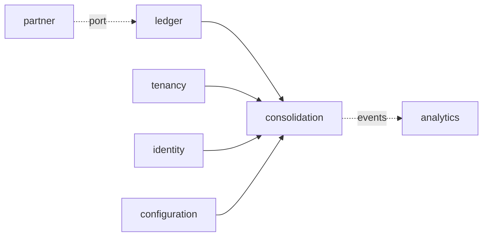

# ADR-0059: Group reporting and consolidation

**Status:** accepted (T68 design step, 2026-11-04; decided by default under
ADR-0053 d; `go-reviewer` approved in round 3 with no blocking finding; the
five questions for the product owner answered as recommended,
po:2026-11-05). The decisions taken by default and the questions for the
product owner are listed at the end; the slices T68a-T68h are in the
tracker.

## Context
T68 is "Group reporting and consolidation" (07 §7.6): "Intercompany
matching, eliminations, currency translation and consolidated statements;
full consolidation only. Lane F." The phase 2 decisions add "Group
reporting does full consolidation only" (product owner, 2026-10-18), and 01
§1.2 puts consolidation in phase 2 on "ledger dimensions, fiscal calendar,
currencies". The tracker's leaves under Group reporting and consolidation
are the same four: intercompany matching, eliminations, currency
translation, consolidated statements. This ADR details that entry and adds
nothing beyond it. Today the ERP has:

- **Companies and the group currency** (tenancy, 03 §3.3): a tenant has
  many legal entities, each with its local currency and fiscal calendar,
  and one group currency (`tenancy.tenant.group_currency`), the third
  currency of every journal line (ADR-0005).
- **Three amounts per line** (ADR-0005, 03 §3.7): `amount_tc`, `amount_lc`
  and `amount_gc`; the group amount is the local amount converted at the
  posting date's `average` rate from local into group currency
  (`ledger.postingRates`, internal/ledger/journal.go), stored once and
  never recomputed. A revaluation values group currency on its own
  (ADR-0042, product owner 2026-10-19). ADR-0042 leaves "translation for
  consolidation (group currency financial statements)" out of its scope,
  and ADR-0057 says "a group-currency book value is not re-translated
  (consolidation's translation is T68's)". ADR-0050 sums across companies
  in group currency only (`amount_gc`).
- **Rates** (`ledger.exchange_rate`, insert-only): rate types `average`,
  `bank_buying`, `bank_selling`, `planning`; the valuation rule of ADR-0042
  ("the latest of that type valid on the key date; one whose `valid_from`
  lies before the key date's period is stale and refused"), which ADR-0042
  bases on IAS 21.23 (monetary items at the closing rate).
- **Charts per company** (configuration, `companies[].chart_of_accounts`):
  each company has its own chart, with account types `asset`, `liability`,
  `equity`, `revenue`, `expense` (`ledger.gl_account.is_balance_sheet`).
  There is no group chart and no mapping between charts.
- **Balances** (`ledger.period_balance`, per ledger, company, account,
  year, period and transaction currency, in all three currencies), read
  exactly by adding the lines the projector has not reached
  (`balanceRows`, internal/ledger/reads.go). No year-end carry-forward
  exists (ADR-0058, a question for the product owner): a balance sheet
  account's balance is the sum over every fiscal year, and prior years'
  results stay on the profit and loss accounts.
- **Partners on lines**: `journal_line.partner_id` names the business
  partner of a line on a reconciliation account; the ledger already asks
  the partner context about it before posting (`ledger.Partners`,
  `PostingBlock`). Nothing says that a partner is one of the tenant's own
  companies, and no line names a partner company (a trading partner).
- **Ledgers** (ADR-0045): the leading ledger 0L; the pilots (Canada and
  the UAE) report under IFRS alone (ADR-0045, ADR-0057).
- **Periods and the close** (T32, ADR-0058): a period moves open, closed,
  locked; a close's sign-off locks each covered period through T32's
  `LockPeriod`; `closing` is a leaf that no context reads. ADR-0058 leaves
  "a group close across companies, intercompany reconciliation and
  consolidation" to T68.
- **Across companies** (ADR-0051 §9, T53e5): the group liquidity forecast
  reads every company the caller may act in (`authz.Companies`) and
  converts into the group currency; a company outside the caller's access
  reaches no figure.
- **Runs as workflows** (ADR-0012, ADR-0057 §7): a run over many objects is
  a Temporal workflow behind an `Operation`, its activities idempotent, the
  dispatcher starting it from the queued operation, in process where a
  cell has no engine.
- **Agents** (ADR-0036, ADR-0039): agents call the public API within their
  autonomy level; a write marked `x-agent: false` is refused to them.
- **Leaves** (ADR-0051 §2, ADR-0057 §2, ADR-0058 §2): a context that reads
  several others and that none reads is a leaf with ports the composition
  root adapts.

### What SAP does (the parity target)
**From memory, for a specialist to check against the pilot's SAP release;
no source was read for this section.** SAP S/4HANA Group Reporting keeps
consolidation units (company codes) in a consolidation group with a parent
unit and ownership; reported data is read from the Universal Journal
(ACDOCA) in local currency and mapped from G/L accounts to financial
statement items (the group chart), each line keeping its trading partner
(the company of the partner, from the business partner's trading partner
field); currency translation applies a method per item (closing rate,
average rate, historical rate) and posts translation differences to
equity; intercompany reconciliation matches the partners' items, and
eliminations post to the consolidation journal (ACDOCU), apart from the
companies' ledgers; the investment of the parent is eliminated against the
subsidiary's equity at first consolidation, with goodwill and
non-controlling interests; consolidated statements are reported per
version and period.

## Decision

### 1. Scope of T68
In: a group chart of accounts and the mapping of each company's accounts
to it; consolidation groups (a parent company and the subsidiaries it
holds directly, each with its ownership and the period it is first
consolidated in); the trading partner of every journal line that has one,
derived from business partners that are the tenant's companies or entered
on manual lines; a consolidation run per group and regular period, in the
group currency, as a workflow: each company's leading-ledger balances
translated, intercompany balances matched and eliminated with tolerances,
differences above tolerance accepted by a person, the parent's investment
eliminated against the subsidiary's equity with goodwill and
non-controlling interests; the consolidated balance sheet and profit and
loss of a run, with the companies' reported figures, the eliminations and
the consolidated figures; finalization of a run once every member's
period is locked; versions of runs and their audit.

Out (none built; each is a question for the product owner or a gap,
listed at the end): the equity method and proportional consolidation
(product owner 2026-10-18: full consolidation only); intercompany profit
in inventory and in assets (no inventory before phase 4, and asset
transfers between companies wait for this step's accounts, ADR-0057 §1);
holdings through another subsidiary (multi-level groups); changes in
ownership or in the investment after first consolidation, disposals and
deconsolidation; acquisitions during a period; fair value adjustments of
acquired net assets and goodwill impairment; members on another fiscal
calendar; a group in a currency other than the tenant's group currency;
parallel ledgers in consolidation (only the leading ledger is read); a
financial statement layout beyond the group chart's accounts (notes,
reporting lines, segment notes, cash flow statement, statement of changes
in equity); an intercompany agent; screens in the web workspace (headless
first, ADR-0053).

### 2. The `consolidation` context: a leaf
A new context **`consolidation`** (schema `consolidation`, package
`internal/consolidation`) owns consolidation runs, their translated
balances, eliminations and intercompany differences, and the frozen
acquisition figures of each subsidiary. Like `cash`, `assets` and
`closing` it is a **leaf**: it reaches the other contexts only through
ports it declares, which the composition root (`internal/app`) adapts, and
no context imports it. `internal/layout`'s `leaves` gains `consolidation`,
and `allowed["consolidation"]` names `config` only. The workflow's
activities reach it through a port the `workflows` package declares
(`workflows.Consolidation`), adapted in `internal/app`, as
`workflows.Depreciation` is (ADR-0057 §7).



Its ports, each run in the request's or activity's transaction under RLS
(ADR-0003):
- **`consolidation.Ledger`** (adapter over the ledger's published reads,
  §4a): a company's leading-ledger fiscal period by year and number (id,
  dates, status, version); its accounts (id, number, name, type); its balances per
  account and per account and trading partner, in local and booked group
  currency, through a period (balance sheet accounts over every fiscal
  year up to it, profit and loss accounts per fiscal year); and the rate
  of a rate type from one currency to another valid on a date, with its
  `valid_from`.
- **`consolidation.Companies`** (adapter over tenancy): a legal entity's
  code, name, local currency and fiscal calendar; the group currency.
- **`consolidation.People`** (adapter over identity): a principal's name,
  for finalizers and the people who accepted differences.

The ledger in turn reads one more thing from partner through its existing
`ledger.Partners` port (§4): the company a business partner is. No other
dependency direction changes: the ledger already asks partner about the
partners it posts (`PostingBlock`), and this ADR records the new arrows
(CLAUDE.md).

### 3. The group chart, the mapping and the groups (configuration)
The group chart, the mapping and the groups are configuration, not master
data: they are short, change rarely, decide what the consolidated
statements say, and so go through the change approval loop with their
evidence (SOX change management, 01 §1.3), as ADR-0057 §3 kept asset
classes and ADR-0058 §3 the close template in configuration.

```yaml
consolidation:
  rate_type: average                # closing rate's type (§7); default average, as ADR-0042's valuation
  accounts:                         # the group chart: at most 5,000
    - number: "G1200"               # [0-9A-Z]{1,10}, unique
      name: Trade receivables
      type: asset                   # asset | liability | equity | revenue | expense
    - number: "G3900"
      name: Currency translation reserve
      type: equity
      role: cta                     # optional; cta, retained_earnings, nci, goodwill: each once, on an account of
                                    # the type its role needs (cta, retained_earnings, nci: equity; goodwill: asset)
  eliminations:                     # at most 50
    - code: IC_BALANCES             # [A-Z0-9_]{1,30}, unique
      name: Intercompany receivables and payables
      accounts: ["G1250", "G2250"]  # group accounts; each account in at most one elimination
      difference_account: "G6950"   # a group account outside every elimination
      tolerance: "10.00"            # group currency, decimal string, >= 0
  groups:                           # at most 50
    - code: MAPLE                   # [A-Z0-9_]{1,30}, unique
      name: Maple group
      parent: "3000"                # a company of the document
      members:                      # each company once, never the parent, in no other group
        - company: "1000"
          ownership_percent: "80"   # decimal string, 0 < p <= 100, at most 4 decimals
          first_period: "2026-11"   # fiscal year and regular period of first consolidation
          investment_account: "1700"  # the parent's account holding this investment: balance sheet, asset
companies:
  - code: "3000"
    chart_of_accounts:
      - number: "1200"
        group_account: "G1200"      # new; required on every account of a company in any group
```

- **Validation** (configuration, problems on the field): group account
  numbers unique; a role at most once and on an account of its type, and
  each of the four present once a group exists; an elimination's accounts
  in the group chart, in no other elimination, and its difference account
  in none; every account of a company that is a parent or a member of a
  group names a `group_account` of the group chart of a compatible type
  (a balance sheet account maps to a balance sheet group account, a
  profit and loss account to a profit and loss one), and no company
  account maps to a role account (the run computes those); a group's
  parent and members are companies of the document, a company is in one
  group at most, as parent or member; `first_period` is a regular period
  (1-12) of a fiscal year; the investment account is in the parent's
  chart, of type asset, maps to a group account in no elimination, and is
  named by one member of the group only (each member's investment is that
  account's whole balance, §9).
- **Tiers**: the group chart's accounts, roles and the mapping, the groups
  and their members are structural (tier 4), since they decide what the
  statements say; the eliminations' accounts and difference accounts
  posting-related (tier 3); tolerances and `rate_type` operational (tier
  2); names cosmetic (tier 1).
- **Members.** Each member is held directly by its group's parent
  (multi-level holdings are out, §1, a question below), and the parent's
  local currency is the group currency (a run refuses another parent, 422
  `consolidation.parent_currency`): the investment is eliminated at its
  booked group amount (§9), which equals its translated amount only when
  the parent is in the group currency, so a parent in another currency
  would leave a residual investment on the consolidated balance sheet (a
  question below); `first_period` is
  the period from whose first day the member is consolidated (an
  acquisition during a period is out, §1). Changing a member's ownership,
  first period or investment account after a final run used them is
  refused by the next run (§9), not by validation, since the
  configuration does not read runs.
- **Reads.** `GET /v1/consolidation-groups` (cursor-paged by code) and
  `GET /v1/consolidation-groups/{code}` answer the active configuration's
  groups: the parent and each member by company id, code, name and local
  currency, the ownership, first period and investment account (number
  and name), and the frozen acquisition figures once a final run made
  them (§9). `GET /v1/group-accounts` (cursor-paged by number; filters
  `type`, `role`, `elimination`) answers the group chart with each
  account's elimination, if any, and the number of company accounts
  mapped to it. A group with a member the caller may not act in is not
  in the caller's lists and is unknown to the caller (§12).

### 4. The trading partner on journal lines (ledger and partner)
A line's **trading partner** is the tenant's company its partner is: the
legal entity on the other side of an intercompany transaction.
- **On the business partner** (T68c): `partner.business_partner` gains
  `group_company_id` (a legal entity of the tenant, nullable; tenancy
  reference by id, 02 §2.1), set and changed through the partner API
  (`createBusinessPartner`, `updateBusinessPartner`, the partner's own
  permission and audit; `BusinessPartnerChanged` carries it); an unknown
  company is 422 `partner.group_company_unknown`. A change applies to
  postings from then on; posted lines keep theirs (ADR-0006).
- **On the line** (T68b): `ledger.journal_line` gains `trading_partner_id`
  (nullable uuid, a legal entity of the tenant other than the posting
  company), and the posting port's `Posting` and `PostingLine` an
  optional `TradingPartner`. Manual, parked and template entry lines take
  an optional `trading_partner_id` in the API. The ledger refuses one that
  is not a legal entity of the tenant or is the posting company (422
  `ledger.trading_partner_invalid`, on the line's field).
- **Derived in one place** (T68c): before posting, the ledger asks
  partner, through `ledger.Partners` (new method `GroupCompany`), for the
  group company of each partner its lines name. A line whose partner is a
  group company takes it; if the entry's partner lines all name the same
  group company, every other line of the entry that names no trading
  partner takes it too, so an intercompany invoice's expense and tax lines
  carry it as its supplier line does (SAP's propagation, from memory); a
  line naming a trading partner other than its own partner's group company
  is refused (422 `ledger.trading_partner_conflict`). Because this is the
  ledger's posting path, every context that posts partner lines (payables,
  payments, bank statements, down payments, the migration) gets it without
  a change of its own; a migration run loading a business partner already
  linked to a group company gives its lines the trading partner too. A
  reversal copies each line's trading partner; a clearing's difference
  lines take the cleared items'.
- **Balances** (T68b): `ledger.trading_partner_balance` (per ledger,
  company, account, trading partner, fiscal year, period and transaction
  currency, in all three currencies) is maintained for lines with a
  trading partner, exactly as `assignment_balance` is (T56f, migration
  000163), and read exactly as the trial balance reads (projected plus
  pending lines). Reads of journal entries return each line's
  `trading_partner` (id, code, name); `listJournalEntries` filters by
  `trading_partner_id`; the ledger's events carry it.
- **Lines posted before T68b** carry none, nor do migrated lines whose
  business partner was not linked before the load, nor G/L lines SAP gave a
  trading partner without a partner (the migration does not read SAP's
  trading partner, a question below): such intercompany balances show as
  `no_trading_partner` (§8) until their companies repost them or the
  product owner asks for a migration leaf.

### 4a. Changes to the ledger's published API
Each is additive and built in the slice that first needs it, as ADR-0058
§4 did for the close:
- **T68b**: `Posting.TradingPartner` and `PostingLine.TradingPartner`;
  `trading_partner_id` on manual, parked and template entry lines; the
  `trading_partner_balance` projection.
- **T68c**: `ledger.Partners.GroupCompany(ctx, partnerID)` (the port's new
  method, adapted over partner's published read).
- **T68d**: `ledger.PeriodOf(ctx, company, ledger, year, period)` (id,
  dates, status and version, which moves with every change of the period,
  a lock, an unlock request and an unlock among them, so an unlock and a
  relock never leave the version a run recorded); `ledger.Accounts`
  of a company (id, number, name, type); `ledger.BalancesThrough(ctx,
  company, ledger, year, period)`: per account and per account and trading
  partner, the local and booked group amounts of the balance sheet
  accounts over every fiscal year through the period and of the profit and
  loss accounts per fiscal year through it, exact as `balanceRows` (the
  projection plus pending lines, now over several years and with the
  trading partner balances); `ledger.RateOn(ctx, rateType, from, to,
  date)` (the latest rate valid on the date with its `valid_from`; today
  `rateOfType` is unexported).
- **T68g**: no new read: `stale` and finalization compare `PeriodOf`'s
  status and version with those the run recorded.

### 5. Data model
Every table has `tenant_id` leading its keys and RLS (ADR-0003); keys are
UUIDv7 (ADR-0004); amounts are `bigint` minor units with their currency
beside them (ADR-0005); references to other contexts (legal entities,
accounts, periods, principals, operations) are ids without foreign keys
(02 §2.1). Group accounts and elimination codes are the configuration's
numbers and codes, recorded with the configuration version the run read.

```
consolidation.run              (tenant_id, id, group_code, parent_id, fiscal_year, fiscal_period, period_end,
                                config_version, group_currency, rate_type, status, problem jsonb, operation_id,
                                computed_at, finalized_by, finalized_at, superseded_by, version, created_*)
consolidation.run_member       (tenant_id, run_id, legal_entity_id, role parent|member, ownership_percent numeric(7,4),
                                first_fiscal_year, first_fiscal_period, local_currency, closing_rate numeric(28,12),
                                rate_valid_from, period_status, period_version, translated_at)
                                PK (tenant_id, run_id, legal_entity_id)
consolidation.run_balance      (tenant_id, run_id, legal_entity_id, line_no, group_account, account_id, trading_partner_id,
                                kind, amount_lc, amount_gc_booked, amount_gc)        PK (tenant_id, run_id, legal_entity_id, line_no)
consolidation.run_entry        (tenant_id, run_id, entry_no, kind intercompany|investment|nci, legal_entity_id,
                                partner_id, elimination_code)                         PK (tenant_id, run_id, entry_no)
consolidation.run_entry_line   (tenant_id, run_id, entry_no, line_no, group_account, legal_entity_id, account_id,
                                trading_partner_id, component, amount_gc)                                 PK (tenant_id, run_id, entry_no, line_no)
consolidation.run_difference   (tenant_id, id, run_id, elimination_code, legal_entity_id, partner_id, amount, partner_amount,
                                difference, tolerance, status, accepted_by, accepted_at, reason, version)
                                UNIQUE (tenant_id, run_id, elimination_code, legal_entity_id, partner_id) NULLS NOT DISTINCT
consolidation.run_acquisition  (tenant_id, run_id, legal_entity_id, net_assets_lc, closing_rate, net_assets_gc, investment_gc,
                                goodwill_gc, nci_gc, frozen)                          PK (tenant_id, run_id, legal_entity_id)
consolidation.acquisition      (tenant_id, group_code, legal_entity_id, first_fiscal_year, first_fiscal_period,
                                ownership_percent, investment_account_id, net_assets_lc, closing_rate, net_assets_gc,
                                investment_gc, goodwill_gc, nci_gc, run_id, created_*)   PK (tenant_id, group_code, legal_entity_id)
consolidation.acquisition_equity (tenant_id, group_code, legal_entity_id, group_account, amount_gc)
                                PK (tenant_id, group_code, legal_entity_id, group_account)
```

- **States.** A run is `queued`, `running`, `computed`, `failed`, `final`,
  `superseded` or `discarded`: queued -> running -> computed; queued or
  running -> failed; computed -> final or discarded; failed -> discarded;
  final -> superseded. A difference is `matched`, `within_tolerance`,
  `open`, `accepted`, `outside_group` or `no_trading_partner`, and moves
  only open -> accepted. Each
  transition is a guarded update (`WHERE status = $expected`), and a
  trigger refuses any other (a schema test per transition).
- **Database rules with schema tests**: a regular period only
  (`fiscal_period BETWEEN 1 AND 12`); one run of a group queued or running
  at a time and one final per group and period (partial unique indexes);
  `problem` set exactly when failed, `finalized_*` exactly when final or
  superseded, `superseded_by` exactly when superseded; a run's balances,
  entries, entry lines and acquisitions are inserted while it is running
  and never updated or deleted (no grant, a trigger); each entry's lines
  sum to zero (a deferred constraint trigger at commit, as the ledger's
  entries); `acquisition` and `acquisition_equity` are insert-only (one
  per group and member); `accepted_*` and `reason` set exactly when a
  difference is accepted; RLS on every table; keys lead with `tenant_id`;
  no foreign key leaves the schema.
- **Order** (REVIEW.md: never database read order). A member's
  `run_balance.line_no` follows group account number, company account
  number, trading partner code (none first), kind (`balance`,
  `prior_results`, `cta`); `run_entry.entry_no` follows kind
  (`intercompany`, `investment`, `nci`), then elimination code and the
  pair's two company codes for intercompany entries, the member's code for
  the others; `run_entry_line.line_no` follows group account number,
  company code, company account number (none, for a role account's line,
  first), trading partner code (none first), component, so each line it
  reverses keeps the company account of its `run_balance` row and no two
  lines tie. The balances list pages by (company code, `line_no`), the
  entries list by (`entry_no`, `line_no`), and the differences list by
  (elimination code, company code, partner code, `no_trading_partner`
  rows, which have no partner, first within their company), so two runs
  of the same figures number and list them alike.
- **Versions and locks** (ADR-0008): a run's version moves with every
  change to it or its differences, so `If-Match` on `:finalize`,
  `:discard` and a difference's `:accept` refuses a stale view; every write
  on a run first reads it `FOR UPDATE`, so the workflow's activities, an
  acceptance and a finalization serialise on the run. Finalizing reads
  every run of the group and period that is not discarded `FOR UPDATE`, in
  the order of their ids, and only then reads which one is final, so two
  finalizations of one period serialise and the second sees the first's
  final (a test of two at once); it supersedes the old final before it
  makes its own final, so the one-final index holds at every statement,
  and the index is mapped to 409 `consolidation.final_exists` should a
  path ever reach it.

### 6. The consolidation run
**Creating a run.** `POST /v1/consolidation-runs` (Idempotency-Key; group
code, fiscal year, period) checks the group is known to the caller (404
`consolidation.group_unknown`, §12), the period is regular (422
`consolidation.special_period`) and exists for the parent's leading
ledger (422 `consolidation.period_unknown`), every member included (first
period on or before the run's) uses the parent's fiscal calendar (422
`consolidation.calendar_mismatch`, naming the company), every included
company's currency other than the group's has a closing rate for the
run's period and, for a member whose acquisition is not yet frozen, for
the period before its first (§7, §9; 422 `consolidation.rate_missing` or
`consolidation.rate_stale`, naming the pair and the date), the parent is
in the group currency (422 `consolidation.parent_currency`, §3),
and no run of the group is queued or running (409
`consolidation.run_in_progress`, naming it, with `Location`). It writes
the run `queued` with the active configuration's version and its
`Operation` (kind `consolidation.run`) in the request's transaction and
returns 202 with the `Operation` (04 §4.8), its `resource` the run. A run
may be created for any period, open or not: a draft shows the figures as
they stand, and only finalization needs the periods locked (§10).

**The workflow.** The workflows dispatcher starts workflow
`ConsolidationRun`, id `{tenant}-consolidation_run-{run}` (ADR-0012, the
run id as business key), from the queued operation, as for depreciation
runs; a cell without a workflow engine runs the same activities in
process, in order. Its activities, through `workflows.Consolidation`:
1. **`PrepareConsolidationRun`**: run `FOR UPDATE`; if `queued`, reads the
   configuration version the run recorded, the members included, their
   currencies, calendars and closing rates, writes `run_member`, and sets the run
   `running`; if already `running`, returns its members. Run twice, it
   writes nothing twice.
2. **`TranslateMember`** (one per member, in company code order): run
   `FOR UPDATE`; returns if the member's `translated_at` is set; else reads
   the status and version of the run's period in the member's leading
   ledger and its balances through `consolidation.Ledger` in the same
   transaction (so the recorded status and version are those of the
   figures read), writes its translated balances and translation
   difference (§7) and, for a member, its acquisition for this run (§9),
   and sets `period_status`, `period_version` and `translated_at`, in one
   transaction.
3. **`EliminateConsolidationRun`**: run `FOR UPDATE`; returns if the run
   has entries or differences; else matches and eliminates intercompany
   balances (§8) and writes the investment and non-controlling interest
   entries (§9), in one transaction.
4. **`CompleteConsolidationRun`**: running -> computed, with `computed_at`;
   a no-op if computed.

A failed activity's refusal (a rate gone stale, a member's account
without a group account, §9's changed acquisition) ends the workflow in
**`FailConsolidationRun`**: running or queued -> failed with the problem,
a no-op if already failed. Every activity has a run-twice test, including
after a commit whose completion was lost. `ConsolidationRunChanged` is
published at each status change, and each writes an audit record
(ADR-0011).

**Reads.** `GET /v1/consolidation-runs/{id}` (the run with its group code
and name, period and its dates, status, problem, configuration version,
group currency, rate type, its members by code and name with their
currency, closing rate and its validity, role, ownership and the status
of its period when the run read its figures, the count of differences per status, `stale` (§10), and
who finalized it by name) and `GET /v1/consolidation-runs` (cursor-paged
newest first; filters group, fiscal year, period, status).
`POST /v1/consolidation-runs/{id}:discard` (If-Match) discards a computed
or failed run (409 `consolidation.run_not_discardable` otherwise).

### 7. Currency translation
**The method** (to confirm with an accounting specialist; a question for
the product owner below). Each member is translated from its
leading-ledger local-currency figures into the group currency:
- **Assets and liabilities** at the **closing rate**: the latest rate of
  the configured `rate_type` from the member's local currency into the
  group currency valid on the run's period's last day, refused when it is
  missing or its `valid_from` lies before the period's first day (the
  rate selection and staleness rule of ADR-0042, which ADR-0042 bases on
  IAS 21.23 for monetary items; translating non-monetary assets and
  liabilities, such as fixed assets, at that rate too is part of the
  method for the specialist; `consolidation.rate_missing`,
  `consolidation.rate_stale`); rate 1 when the local currency is the
  group's. Each balance is the member's balance through the period over
  every fiscal year (no carry-forward exists, §Context), translated per
  account and trading partner as `round(amount_lc × rate)`, half away from
  zero, once.
- **Income and expenses** at their **booked group amounts**: the
  fiscal year's group amounts through the period (for a member in the
  fiscal year of its first period, from that period on), each converted at its
  posting date's rate when it was posted (ADR-0005), as ADR-0050 sums
  across companies. No period average rate is introduced: the booked
  amounts are already each transaction's own date's rate.
- **Equity** at its **booked group amounts**: each equity posting at its
  posting date's rate, so historical by construction; prior fiscal years'
  results (the profit and loss accounts' booked group amounts of every
  earlier year) are one row on the group chart's `retained_earnings`
  account, and for a member in the fiscal year of its first period so are
  the results of that year's periods before it, which were earned before
  the group held it (§9). A member's rows stay as booked; §9's investment
  entry reverses its acquisition equity.
- **The translation difference** is one row per member on the `cta`
  account: minus the sum of the member's other translated rows, so each
  member's translated figures sum to zero. A member in the group currency
  whose booked group amounts equal its local ones has none.

The translated rows are `run_balance` rows of kind `balance` (one per
account and trading partner, with the local, booked group and translated
amounts), `prior_results` and `cta`. `GET
/v1/consolidation-runs/{id}/balances` lists them (cursor-paged; filters
company, group account, account, trading partner, kind), each with its
company's code and name, the company account's number and name, the group
account's number and name, the trading partner's code and name, every
amount with its currency, and the closing rate where one applied; and
totals over the filter per currency (local amounts per local currency,
group amounts in the group currency).

### 8. Intercompany matching and eliminations
**Matching.** For each elimination of the configuration and each pair of
members {A, B} of the run (A's code before B's), the run sums A's
translated rows on the elimination's group accounts whose trading partner
is B (`amount`) and B's whose trading partner is A (`partner_amount`), in
group currency, debit positive. Their sum is the **difference**: zero
`matched`, at most the elimination's tolerance in absolute value
`within_tolerance`, otherwise `open`. Rows on an elimination's accounts
whose trading partner is not a member of the run (a company outside the
group, or a member before its first period) are listed per company and
partner as `outside_group`, and rows on them with no trading partner per
company as `no_trading_partner` (lines posted before T68b, or not linked
to a group company); neither is eliminated, both are listed with their
totals so the accountant sees what the consolidated figures still
carry. Balance sheet balances
compare at closing rates on both sides; income and expenses at their
booked group amounts, so a difference from rates, timing or a missing
posting shows as a difference.

**Eliminations.** For each pair with rows, one `intercompany` entry: a
line reversing each of the pair's rows on the elimination's accounts, on
its group account with its company and trading partner, and the
difference on the elimination's difference account, so the entry sums to
zero and the consolidated figures show no intercompany balance between
members. An open difference is eliminated the same way; it stops only
finalization (§10).

**Who resolves a difference.** The accountants of the two companies,
by correcting the postings in their ledgers (a missing invoice, a wrong
trading partner, which is reversed and reposted since lines are immutable,
a revaluation not run), after which a new run shows the pair matched; or
the group's accountant, by accepting it: `POST
/v1/consolidation-runs/{id}/differences/{id}:accept` (If-Match, a reason;
people only) moves an open difference to `accepted` with who and when
(409 `consolidation.difference_not_open` otherwise;
`IntercompanyDifferenceAccepted`; audit). `GET
/v1/consolidation-runs/{id}/differences` lists them (cursor-paged by
elimination, company and partner code; filters status, elimination,
company), each with the elimination's code and name, both companies' codes
and names, the amounts, difference and tolerance with their currency, who
accepted it by name and why; with totals of the amounts and differences
per status. `GET /v1/consolidation-runs/{id}/entries` lists the run's
entries with their lines (cursor-paged by entry number; filters kind,
company, elimination), each line with the group account's number and name
and the company's and partner's code and name; with totals per kind of
the debits (each entry's credits equal them).

### 9. Investment, equity and non-controlling interests
**The method** (to confirm with an accounting specialist; questions for
the product owner below). For each member M held at ownership q (a
fraction, `ownership_percent / 100`) and first consolidated in period F,
with F−1 the regular period before F (the previous fiscal year's last
when F is period 1):
- **Acquisition figures**, computed by each run that includes M until a
  final run freezes them (`consolidation.acquisition`): M translated as §7
  translates it at F−1, at F−1's closing rate r (§7's rule on F−1's last
  day); the net assets N = the sum of M's asset and liability balances in
  local currency through F−1, and their group amount A = the sum of those
  balances' translated rows (each rounded once, so A is exact against
  them); the acquisition equity, every other translated row of M at F−1
  (its equity rows; all its results through F−1 on `retained_earnings`,
  that fiscal year's income and expenses included, also when F is period
  1; its `cta` row), which sum to −A by construction since each member's
  rows sum to zero, kept per group account (`acquisition_equity`: its
  equity accounts, `retained_earnings`, `cta`); the investment I = the
  parent's booked group balance on M's investment account through the run's
  period, which equals its translated row since the parent is in the
  group currency (§3); the non-controlling interest at acquisition n = `round((1 − q) ×
  A)`; goodwill G = I − A + n. A negative G fails the run (422
  `consolidation.negative_goodwill`, naming the member) until the product
  owner decides its treatment (a question below). For M in its
  acquisition year, the results of the periods before F belong to the
  acquisition equity: they are in M's `prior_results` row, not its income
  and expenses (§7). Goodwill and the interest at acquisition are kept at
  these group amounts, never retranslated (a question below).
- **The investment entry** (kind `investment`, each run from F on): the
  acquisition equity reversed on its group accounts (which removes A of
  equity), the investment's group account credited I, the `nci` account
  credited n, the `goodwill` account debited G. It sums to zero.
- **The non-controlling interest entry** (kind `nci`, q < 1): of M's
  translated rows at the run's period, three components, each rounded
  once and each credit positive: the profit share `round((1 − q) × P)`
  with P minus the sum of M's income and expense rows (a profit,
  positive); the translation share `round((1 − q) × C)` with C minus the
  change of M's `cta` row since the acquisition equity's `cta` part; the
  other share `round((1 − q) × E)` with E minus the change of M's equity
  and `prior_results` rows since the acquisition equity's equity and
  `retained_earnings` parts (its `cta` part not included, which C
  covers). P + C + E is then M's translated net assets at the period less
  A, its post-acquisition equity, exactly; a test computes it by hand for
  a member with a non-zero acquisition `cta` and one first consolidated in
  period 1. The `nci` account is
  credited their sum, `retained_earnings` debited the profit and other
  shares, `cta` debited the translation share. Each line records its
  component, which the profit and loss statement reads for its
  attribution (§11).
- **After a final run.** The first final run including M inserts its
  acquisition figures into `consolidation.acquisition` and
  `acquisition_equity` (§10). Every later run reads them instead of
  recomputing; it fails (422 `consolidation.acquisition_changed`) when
  M's configured ownership, first period or investment account differs
  from the frozen one, and (422 `consolidation.investment_changed`) when
  the parent's investment balance differs from the frozen I: changes after
  first consolidation are out of scope (§1), and a run refuses rather
  than consolidate them silently wrong.

### 10. Finalization, versions and staleness
`POST /v1/consolidation-runs/{id}:finalize` (If-Match; people only) makes
a computed run the group's consolidated figures for its period. It is
refused while a difference is open (409 `consolidation.differences_open`,
naming the count), when the run is not computed (409
`consolidation.run_not_computed`), when a member's period was not locked
when the run read its figures or is not locked now (409
`consolidation.period_not_locked`, naming the companies; run again after
the lock), and when the run is stale (409 `consolidation.run_stale`,
below). Locked is what each company's close sign-off leaves (ADR-0058
§7, T32), read through the ledger, so consolidation follows the companies'
closes without reading the `closing` leaf. In one transaction it sets the
run `final`, sets the group's previous final run of the period, if any,
`superseded` by it, freezes the acquisition figures of members finalized
for the first time (§9), writes the audit record and publishes
`ConsolidationRunChanged`.

**Versions.** A period's runs are its versions: drafts may be discarded,
a final run is never changed or discarded, and a later final run
supersedes it, so the history of what was finalized, by whom and on which
figures stays readable (`listConsolidationRuns?status=superseded`).
**Staleness.** A run is `stale` when a member's period's version now
differs from the `period_version` the run recorded with its figures
(`PeriodOf`, §4a): an unlock, a posting and a relock leave the period
locked but at another version, so the period changed since the figures
were read and they may no longer be the ledger's (the version also moves
on an unlock request and its rejection, which post nothing: stale then
errs on the safe side, and `consolidation.run_stale`'s detail names a
pending unlock request when there is one). A stale run cannot be finalized, and a stale final run says so
on every read; a new run after the relock supersedes it.

### 11. Consolidated statements
`GET /v1/consolidation-runs/{id}/statements/{statement}` with statement
`balance_sheet` or `profit_and_loss`, of a computed, final or superseded
run (409 `consolidation.run_not_computed` otherwise; the response carries
the run's status and `stale`), one row per group account of the
statement's types (asset, liability, equity; revenue, expense), in
number order, cursor-paged by number:
the account's number, name, type and role, the members' translated figures
summed (`reported`), the eliminations (`eliminations`, the run's entry
lines on it) and their sum (`consolidated`), each in the group currency,
debit positive as the trial balance shows them. Totals over the whole
statement: for the balance sheet, assets, liabilities, equity (the
`cta`, `retained_earnings` and `nci` accounts included) and the fiscal
year's profit through the period (the profit and loss statement's), which
together sum to zero; for
the profit and loss, revenue, expenses, the profit, its share
attributable to non-controlling interests (the sum of the `nci` entries'
profit components) and to the owners of the parent; each with the
reported, eliminations and consolidated columns. Drill-down is the
balances, entries and differences lists filtered by group account (§7,
§8). The statement's presentation beyond the group chart (reporting lines,
notes, comparatives) is out of scope (§1).

### 12. Access and agents
- **Company access** (ADR-0010). A group's figures are only meaningful
  whole, so a caller sees a group only when it may act in the parent and
  every member (`authz.Companies`, or `all_companies`): every operation on
  a group or its runs answers a group outside that as unknown (404
  `consolidation.group_unknown`; lists leave it out), never partial
  figures, and so names none of its companies. Unlike the group liquidity
  forecast (ADR-0051 §9), which sums the companies the caller has,
  leaving a company out of a consolidation would change every
  elimination.
- **Permissions** (new in identity's catalog): `consolidation.read`
  (groups, group accounts, runs and their figures), `consolidation.run.manage`
  (create, discard), `consolidation.difference.accept`,
  `consolidation.run.finalize`. Every operation that returns figures also
  needs `ledger.entry.read` (`x-also-permissions`, 403
  `identity.permission_missing`), so no consolidation read gives what the
  ledger's own would refuse (ADR-0058 §13's rule).
- **Agents** (ADR-0036, ADR-0039). Reads are agent tools (`x-autonomy:
  read`), so an agent may explain a run's differences to a person; every
  write is `x-agent: false` (create, discard, accept, finalize). No
  consolidation agent is built in T68 (a gap); one would propose only, as
  ADR-0039's agents do, for people to decide.

### 13. API and events (contract first)
Paths, in `api/openapi.yaml` (problem codes as `x-problem-codes`; writes
with `Idempotency-Key`; changes of one resource with `If-Match`; lists
cursor-paged with filters, 04 §4.5):

| Operation | Method and path | Permission | Agents |
|---|---|---|---|
| listConsolidationGroups, getConsolidationGroup | `GET /v1/consolidation-groups`, `/{code}` | `consolidation.read` and `ledger.entry.read` | read |
| listGroupAccounts | `GET /v1/group-accounts` | `consolidation.read` | read |
| createConsolidationRun, listConsolidationRuns, getConsolidationRun | `/v1/consolidation-runs` | `consolidation.run.manage`; reads `consolidation.read` and `ledger.entry.read` | `x-agent: false` for create |
| discardConsolidationRun | `POST /v1/consolidation-runs/{id}:discard` | `consolidation.run.manage` | `x-agent: false` |
| listConsolidationBalances | `GET /v1/consolidation-runs/{id}/balances` | `consolidation.read` and `ledger.entry.read` | read |
| listConsolidationEntries | `GET /v1/consolidation-runs/{id}/entries` | `consolidation.read` and `ledger.entry.read` | read |
| listIntercompanyDifferences, acceptIntercompanyDifference | `/v1/consolidation-runs/{id}/differences`, `/{id}:accept` | reads `consolidation.read`; `:accept` `consolidation.difference.accept`; both also `ledger.entry.read` | read; `x-agent: false` |
| getConsolidatedStatement | `GET /v1/consolidation-runs/{id}/statements/{statement}` | `consolidation.read` and `ledger.entry.read` | read |
| finalizeConsolidationRun | `POST /v1/consolidation-runs/{id}:finalize` | `consolidation.run.finalize` and `ledger.entry.read` | `x-agent: false` |

- Changed: the journal entry, parked entry and entry template lines gain
  `trading_partner_id` (requests) and `trading_partner` (responses: id,
  code, name); `listJournalEntries` gains the filter; the business partner
  gains `group_company_id` and `group_company` (id, code, name). Additive,
  so no entry in `api/breaking-accepted.txt`.
- Representations carry names beside ids (group code and name, company
  codes and names, account numbers and names, trading partners' codes and
  names, principals' names), every amount its currency, each list its
  totals, and each action's response the object it created or changed (the
  run with its `Operation`, the accepted difference, the finalized run with
  the run it superseded) (REVIEW.md's API-consumer classes).
- Problem codes (all `consolidation.*` new, registered with their
  constraint mappings): `consolidation.group_unknown`,
  `consolidation.special_period`, `consolidation.period_unknown`,
  `consolidation.calendar_mismatch`, `consolidation.rate_missing`,
  `consolidation.rate_stale`, `consolidation.run_in_progress`,
  `consolidation.run_not_discardable`, `consolidation.run_not_computed`,
  `consolidation.difference_not_open`, `consolidation.differences_open`,
  `consolidation.period_not_locked`, `consolidation.negative_goodwill`,
  `consolidation.acquisition_changed`, `consolidation.investment_changed`,
  `consolidation.parent_currency`, `consolidation.final_exists`,
  `consolidation.run_stale`,
  `consolidation.account_unmapped` (a member's account with a balance and
  no group account, a run's failure for a configuration activated before
  the rule); and `ledger.trading_partner_invalid`,
  `ledger.trading_partner_conflict`, `partner.group_company_unknown`;
  passed through: `identity.permission_missing`,
  `request.version_mismatch`, `config.not_bootstrapped`.
- Events, in `api/asyncapi.yaml`, a new `consolidation` channel
  (CloudEvents through the outbox, ADR-0007): `ConsolidationRunChanged`
  (the run, its group and period, the status and the one before) and
  `IntercompanyDifferenceAccepted`. The ledger's line payloads carry
  `trading_partner_id`, `BusinessPartnerChanged` the `group_company_id`
  (additive). Every write writes an audit record (ADR-0011).

### 14. Performance budgets (01 §1.3)
- **A consolidation run** of a group of 100 companies, each with 1,000
  accounts with balances and 1,000 trading partner balances: async, p95
  < 120 s, p99 < 240 s (as a depreciation run's, ADR-0057). Each member's
  translation reads its balances once (per account and per account and
  trading partner, through the period) and writes them in one statement;
  matching works on the run's own rows.
- **A consolidated statement** of one run, every page: p95 1 s, p99 3 s
  (the trial balance's). It reads the run's stored rows only; no ledger
  read is made for a statement but the period statuses for `stale`.

## Alternatives
- **Eliminations posted into the companies' ledgers** (or into a
  consolidation company's ledger). One journal for everything; but a
  company's ledger is its statutory record, eliminations belong to no
  company, and a ledger posting needs open periods that the companies'
  sign-offs have locked. Rejected for the run's own insert-only entries,
  as SAP keeps its consolidation journal apart (from memory).
- **Translating income and expenses at a period average rate.** A new
  rate type, one rate per currency and period for operators to load, and
  the companies' own group amounts would no longer match the group's; the
  booked group amounts are each transaction's own date's rate, already
  stored. Rejected by default, with the method a question below.
- **Retranslating every line instead of reading balances.** Exact per
  line, but a run would read every journal line of every member through
  the period (up to 500 million lines a year, 01 §1.3). Rejected for
  balances (`period_balance`, `trading_partner_balance`).
- **Trading partners derived in each posting context** (payables,
  payments, bank statements). Each would ask partner and pass it; one
  forgotten path leaves an intercompany payable cleared by a line without
  its partner company, so the pair never matches. Rejected for the
  ledger's one derivation through its existing partner port.
- **Consolidation inside the ledger.** The ledger has balances and rates;
  but consolidation reads tenancy's structure and configuration's groups
  across companies, and its runs and eliminations are not postings.
  Rejected for a leaf.
- **Recomputing eliminations by carrying forward the previous period's
  entries** (SAP's balance carry-forward of consolidation entries, from
  memory). Each run here computes every entry from the cumulative
  position at its period end, so no run depends on another's except
  through the frozen acquisition figures.
- **Partial figures for a caller without access to every member**, as
  the group forecast does. Rejected (§12).

## Consequences
- A new context, schema and channel; a leaf with three ports and a
  workflow. The ledger's posting path reads one more fact from partner
  through its existing port; nothing else changes direction.
- Every journal line posted after T68b can carry a trading partner; the
  ledger derives it for partner lines on every posting path, so no
  posting context changes. Lines posted before carry none.
- The configuration gains a group chart, a mapping on every account of a
  company in a group (required once the company joins one), eliminations
  and groups; adding a company to a group is a structural change.
- Consolidated figures are never posted to a company's ledger and never
  change a company's figures; they are reproducible from the run's rows
  and the frozen acquisition figures.
- A consolidation is final only after every member's period is locked, so
  it follows the companies' closes (ADR-0058) without reading `closing`.
- The translation and the investment elimination use methods to be
  confirmed by an accounting specialist; the product owner's answers
  below may change §7 and §9 before T68d and T68h are built.

## Boundaries with the other steps
- **T32 (period lock)** and **T64 (close, ADR-0058)**: finalization needs
  the members' periods locked; an intercompany reconciliation stays a
  manual task of the close template until a check for it is asked for
  (ADR-0058).
- **T48 (revaluation, ADR-0042)**: a company's revaluation of its
  intercompany items changes its local balances, and so its translated
  balance sheet rows; group currency revaluation is unchanged.
- **T52 (parallel ledgers, ADR-0045)**: only the leading ledger is read.
- **T56 (controlling, ADR-0050)**: intercompany by partner profit center
  and segment notes stay out (ADR-0050's T68 boundary is a gap here).
- **T57 (assets, ADR-0057)**: asset transfers between companies may follow
  as their own leaf, now that trading partners exist.
- **T72 (migration)**: the trading partner of migrated lines (a question
  below).
- **Phase 3 (receivables) and phase 4 (inventory)**: customer lines carry
  trading partners through the same derivation; intercompany profit in
  inventory is out of scope.

## Steps (slices)
Each is a slice (ADR-0053): one capability a named user can use end to
end through the public API, its contract, migration, domain code, tests
(real PostgreSQL, `FailingTx` on every database path, 100% coverage),
docs and an extended walkthrough step as its evidence. Lane F, in this
order; about half a day each. Carla, the controller, is the group's
accountant; Ada, the administrator, configures; Tom, the treasurer, posts
the US company's invoice.

**The walkthrough's group.** A new step `step_consolidation` goes after
`step_cash_forecast_analytics` (step 38; Acme Corp US, 1000 in USD, is
created in step 36) and before `step_close` (the story's last, ADR-0058).
It consolidates the group MAPLE: the walkthrough's company, Maple (3000,
Maple Industries Canada in CAD, the tenant's group currency), as parent
holding 80% of Acme Corp US, first consolidated in the period of today
(F). Its dates and rates are fixed so that the step passes on any day of
the year:
- **Rates.** Step 9 loads USD/CAD 1.35 from 1 January and 1.40 from the
  month's end. The step loads 1.35 valid from F−1's last day (the previous
  fiscal year's 31 December in January), which changes no earlier figure
  (the rate in force is 1.35 already) and gives F−1 a closing rate that is
  not stale, as §9 needs; the run's period closes at 1.40.
- **Postings.** Acme Corp US's share capital is posted on F−1's last day,
  after Acme Corp US's period F−1 is opened (in January, in the previous
  fiscal year, whose periods exist only if T68a's configuration gives Acme
  Corp US number ranges for the previous fiscal year as well as this one,
  `ledger.Setup`'s calendar); Maple's investment in Acme Corp US and every intercompany
  posting are dated the month's first day, as step 9 dates its posting,
  so they book at 1.35 even when the walkthrough runs on the month's last
  day, and none is dated in a period step 11 locked.
- **Finalization.** Drafts need no lock. T68g's finalization comes at the
  end of `step_close`, after its sign-off locks Maple's period: Carla
  closes and locks Acme Corp US's period through T32, runs the group again
  and finalizes it. `step_close` stays last; nothing posts in Maple's
  period after its sign-off.
- **People.** Cory (step 36, Maple alone) is given `consolidation.read`
  and `ledger.entry.read` in T68a's part, so he reads an empty list of
  groups rather than a 403.

| Step | Work | Acceptance criteria and walkthrough evidence |
|---|---|---|
| T68a | **Group chart, mapping and groups in configuration** | `consolidation.accounts` (roles), `eliminations`, `groups` and `companies[].chart_of_accounts[].group_account`, validated as §3 with tiers; the `consolidation` leaf (`internal/layout`), `consolidation.Companies`; `GET /v1/consolidation-groups` (and `/{code}`) and `GET /v1/group-accounts` from the active configuration, filtered by company access (§12); `consolidation.read`. Walkthrough: Ada adds Acme Corp US to the configuration (its chart mapped, its ledger), an investment account to Maple's chart, the group chart, the eliminations and the group MAPLE (Acme Corp US at 80% from today's period); the change request is approved and activated; Carla reads the group with its companies' names and the group chart; Cory (Maple alone, given `consolidation.read`) reads no group |
| T68b | **Trading partner on journal lines** | `journal_line.trading_partner_id`; `Posting`/`PostingLine.TradingPartner`; manual, parked and template lines with `trading_partner_id`; `ledger.trading_partner_invalid`; reversal and clearing copy; `ledger.trading_partner_balance` maintained as `assignment_balance` and read exactly; responses with `trading_partner` (id, code, name), `listJournalEntries?trading_partner_id`; events. Walkthrough: Carla posts at Maple a USD invoice to Acme Corp US, dated the month's first day, as a manual entry (intercompany receivable against revenue) with trading partner 1000, reads it back with the partner's name; a line naming Maple itself is refused with `ledger.trading_partner_invalid` |
| T68c | **Trading partner from the business partner** | `partner.business_partner.group_company_id` (create, update, `BusinessPartnerChanged`, audit; `partner.group_company_unknown`); `ledger.Partners.GroupCompany`; the derivation and propagation of §4 on the ledger's posting path, `ledger.trading_partner_conflict`; a test per posting path (supplier invoice, payment, bank statement clearing, down payment, reversal). Walkthrough: Ada creates the business partner Maple Industries Canada, a supplier of Acme Corp US, linked to company 3000; Tom posts its USD invoice at Acme Corp US, dated the month's first day; every line of its entry carries trading partner 3000 |
| T68d | **The consolidation run and currency translation** | Schema `consolidation` (`run`, `run_member`, `run_balance`; RLS, `tenant_id` first, state triggers, schema tests of §5's rules); `POST/GET/list /v1/consolidation-runs` (202 with the `Operation`), `:discard`; workflow `ConsolidationRun` with Prepare, Translate and Complete (Eliminate writes nothing yet) and Fail, the dispatcher's new kind, in process without an engine, run-twice tests; §7's translation through `consolidation.Ledger` over §4a's T68d reads (`PeriodOf`, `Accounts`, `BalancesThrough`, `RateOn`); the period's status and version recorded with the figures; `consolidation.parent_currency`; `GET .../balances` with totals; `consolidation.run.manage`; `ConsolidationRunChanged`; audit; the run's budget (§14). Walkthrough: Carla runs MAPLE for today's period; the run is computed; Acme Corp US's payable and other balance sheet rows at the closing 1.40, its expenses at the booked 1.35, its translation difference on the reserve; Maple at rate 1 with none |
| T68e | **Consolidated statements** | `GET .../statements/{statement}` (§11: rows by number with reported, eliminations, consolidated; totals; paging); the statement's budget (§14). Walkthrough: Carla reads the balance sheet and profit and loss of the run; the balance sheet's totals and the fiscal year's profit through the period sum to zero; each row's reported figure equals the balances list's total for its group account |
| T68f | **Intercompany matching and eliminations** | `run_entry`, `run_entry_line`, `run_difference`; Eliminate's matching and `intercompany` entries (§8), with `outside_group` and `no_trading_partner` rows listed; `GET .../differences` and `GET .../entries` with names and totals; the entry balance trigger. Walkthrough: a new run matches Maple's revenue with Acme Corp US's expense (both booked at 1.35); the receivable and payable pair differs by more than its tolerance (Maple's USD receivable at its booked 1.35, Acme Corp US's payable at the closing 1.40) and is `open`; the consolidated statements show no intercompany balance and the difference on its account |
| T68g | **Accepting differences and finalizing runs** | `:accept` (`consolidation.difference.accept`, people only, `IntercompanyDifferenceAccepted`); `:finalize` (§10; `consolidation.run.finalize`, people only) under a lock of the period's runs in id order (a test of two finalizations at once), superseding, `consolidation.final_exists`, `stale` and `consolidation.run_stale` by the period's version (test: final, unlock, posting, relock, stale, a new final supersedes; a run translated before such an unlock refused); `consolidation.People`. Walkthrough: in `step_consolidation` Carla accepts the open difference with a reason and finalizing is refused with `consolidation.period_not_locked`; at the end of `step_close`, after the sign-off, Carla locks Acme Corp US's period, runs the group again, accepts and finalizes; the earlier draft is discarded |
| T68h | **Investment and equity elimination with non-controlling interests** | `run_acquisition`, `acquisition`, `acquisition_equity`; §9's investment and NCI entries, frozen at the first final run, `consolidation.negative_goodwill`, `consolidation.acquisition_changed`, `consolidation.investment_changed`; the statements' NCI attribution; tests with hand-computed figures for a member at 80% with a profit and a translation difference (a non-zero acquisition `cta` among them), one first consolidated in period 1, and one at 100%; distinct investment accounts per member (§3); Walkthrough: Acme Corp US's share capital posted on F−1's last day and Maple's investment on the month's first day (above); the run eliminates the investment against Acme Corp US's equity at acquisition, shows goodwill and the 20% interest, and the profit attributable to the non-controlling interest is 20% of Acme Corp US's |

Each slice updates 02 §2.2 (T68a: the context's row moves from planned to
built), 03 §3.24, 04 §4.14 (T68a), 01 §1.3 (T68d, T68e: the budgets'
evidence) and this ADR's "As built".

## Decided by default (ADR-0053 d), for the product owner to overrule
1. `consolidation` is a leaf context with ports; no context imports it
   (§2).
2. The group chart, the mapping (a `group_account` on each company
   account), the eliminations and the groups are configuration, with
   tiers; the mapping is required on every account of a company in a
   group (§3).
3. One group currency, the tenant's (ADR-0005, as ADR-0051's group
   forecast), and one closing rate type, default `average` as ADR-0042's
   valuation, with ADR-0042's staleness rule (§3, §7).
4. Only the leading ledger is consolidated (ADR-0045: the pilots report
   under IFRS alone) (§1).
5. Runs are per group and regular period, as a Temporal workflow with
   idempotent activities (ADR-0012, ADR-0057 §7), computed from
   cumulative balances, never carrying forward another run's entries
   (§6, Alternatives).
6. The trading partner is a legal entity id on the journal line, derived
   by the ledger from the business partner's group company and
   propagated to the entry's other lines, or entered on manual lines
   (§4).
7. A trading partner balance projection beside `period_balance`, read
   exactly as the trial balance (§4).
8. Eliminations are the run's own insert-only entries, never ledger
   postings (§5, Alternatives).
9. Matching per elimination and pair of members in group currency after
   translation, with a tolerance per elimination; a difference within it
   is eliminated to the difference account without a person; one above it
   is eliminated the same way but stops finalization until accepted or
   corrected (§8).
10. Finalization needs every member's period locked when its figures were
    read and now, at the version recorded with them; consolidation follows
    the closes through the ledger's period status and version, not the
    `closing` leaf; finalizations of one period serialise on its runs
    (§5, §10).
11. Runs are versions: a final run is never changed; a later final
    supersedes it; a run is `stale` once a member's period version moved
    since its figures were read (§10).
12. A group is visible only to a caller with access to the parent and
    every member (§12).
13. Reads are agent tools; every write is `x-agent: false`; no
    consolidation agent in T68 (§12).
14. Statement rows are the group chart's accounts, debit positive as the
    trial balance, with reported, eliminations and consolidated columns and
    totals (§11).
15. The budgets of §14.
16. Each member's investment is the whole balance of an account no other
    member names (§3, §9).
17. Intercompany rows without a trading partner, or with one outside the
    run, are listed and not eliminated (§8).

## Questions for the product owner
1. **The translation method** (an accounting rule beyond what the
   repository records). Designed: assets and liabilities at the closing
   rate (non-monetary ones included); income and expenses at their booked
   group amounts (each at its
   posting date's rate, ADR-0005); equity at booked group amounts
   (historical), a member's acquisition equity at the closing rate before
   its first period; the difference to a translation reserve in equity;
   group-currency revaluation differences (ADR-0042) stay in income as
   booked. Recommendation: build as designed, and have the pilots'
   accounting specialist confirm it against IAS 21 (named from memory; the
   repository records only IAS 21.23 and 21.16, through ADR-0042) before
   T68d; a period
   average rate would be a new rate type and a change to §7 only.
   **Answered po:2026-11-05:** as recommended: build as designed; an
   accounting specialist confirms the method against IAS 21 before T68d
   ships (a tracker leaf).
2. **Non-controlling interests and goodwill** (accounting rules).
   Designed: the interest measured at its proportionate share of the
   subsidiary's book net assets; no fair value adjustments of acquired
   assets; goodwill the residual, never amortised and not tested for
   impairment by the system; goodwill and the interest at acquisition kept
   at their group amounts at acquisition, never retranslated at later
   closing rates; a negative residual fails the run. Should goodwill of a
   foreign subsidiary be retranslated each period, and what should a
   negative residual do (a gain in profit or loss, or a reassessment
   first)? Recommendation: keep the design for the pilot and have the
   specialist confirm it against IFRS 3 and IFRS 10 (named from memory,
   not recorded in the repository) before T68h;
   treat a negative residual as an error for the pilot unless its group
   has one.
   **Answered po:2026-11-05:** as recommended; a specialist confirms against
   IFRS 3 and IFRS 10 before T68h ships.
3. **Group structures beyond the design** (new scope): holdings through
   another subsidiary, changes in ownership or capital after first
   consolidation, disposals, acquisitions during a period, members on
   another fiscal calendar, groups in another currency, a parent whose
   local currency is not the group currency (refused, §3). Recommendation:
   none for the pilot unless its group needs one; each its own design
   leaf when asked. This needs the pilot's group structure (a pilot fact:
   which companies, who holds whom, at what percentage).
   **Answered po:2026-11-05:** as recommended: none now.
4. **Opening consolidation at go-live** (scope and migration): migrated
   equity's group amounts are at the migration date's rate, so the
   translation reserve starts at zero at go-live, and a migrated line
   carries a trading partner only when its business partner was linked to
   a group company before the load (§4), never from SAP's own trading
   partner field. Recommendation: first consolidation from go-live as
   designed; a migration leaf mapping SAP's trading partner of migrated
   lines (and, if the pilot's auditors need continuity, its historical
   equity amounts) once an SAP specialist confirms the extract carries
   them.
   **Answered po:2026-11-05:** as recommended.
5. **Segregation of duties on finalization** (security posture). Built:
   any person holding `consolidation.run.finalize` finalizes, including
   one who accepted the run's differences. Recommendation: keep it for the
   pilot, as ADR-0058's sign-off; add the rule if the pilot's auditors ask.
   **Answered po:2026-11-05:** as recommended for the pilot, the finalizer
   recorded; "finalizer is not the preparer" is added before go-live with
   the close sign-off's rule (T64l).

## Gaps (out of scope, not built, no question asked)
Neither the roadmap entry nor a PO decision asks for these; each becomes a
tracker item only when one does (07 §7.5).
- The equity method and proportional consolidation (excluded, product
  owner 2026-10-18).
- Intercompany profit in inventory (no inventory before phase 4) and in
  transferred assets.
- Intercompany by partner profit center, segment notes, a cash flow
  statement, a statement of changes in equity, reporting lines and notes.
- An intercompany reconciliation check in the close (ADR-0058) and an
  agent that explains or proposes resolutions of differences.
- A live intercompany report before a run (a draft run serves it).
- Screens in the web workspace (headless first, ADR-0053).

## Facts for a specialist (stated from memory, not verified here)
- SAP: Group Reporting's consolidation units and groups, FS items,
  translation methods, the intercompany matching and reconciliation app,
  the consolidation journal ACDOCU, the trading partner on the business
  partner and the journal line (VBUND, RASSC), and the propagation of a
  document's trading partner to its lines, as "What SAP does" and §4 say.
- Accounting (IFRS, for the pilots; IAS 21, IFRS 3 and IFRS 10 named
  from memory): the translation of a foreign operation's statements,
  non-monetary items and goodwill of a foreign subsidiary included
  (closing rate for assets and liabilities, the
  transactions' rates or an average for income and expenses, the
  difference in other comprehensive income), the elimination of the
  parent's investment, the measurement of non-controlling interests and
  goodwill, a bargain purchase, and the attribution of profit to owners
  and non-controlling interests: this ADR cites none of them as a source;
  §7 and §9 are designed for the specialist to confirm (questions 1, 2).
- Which companies of the pilots form a group and how they hold each other
  (question 3).

## Sources
- The repository: 07-transition §7.6 (T68's entry and the phase 2
  decisions), the tracker's Group reporting and consolidation leaves, 01
  §1.2 and §1.3, 02 §2.1 and §2.2, 03 §3.3, §3.6 and §3.7, ADR-0003,
  ADR-0005 (and its As built), ADR-0006, ADR-0007, ADR-0008, ADR-0010,
  ADR-0011, ADR-0012, ADR-0036, ADR-0039, ADR-0042 (IAS 21.23 and 21.16 as
  it records them), ADR-0045, ADR-0050, ADR-0051 §9 and T53e5, ADR-0053,
  ADR-0057 §1, §2 and §7, ADR-0058; `internal/ledger/journal.go`
  (`postingRates`), `internal/ledger/reads.go` (`balanceRows`),
  `internal/ledger/ledger.go` (`Partners`), `internal/config/config.go`
  (`Company`, `Account`), `db/migrations/000005_ledger.up.sql`
  (`exchange_rate`, `period_balance`, `gl_account`), `internal/layout`
  (leaves), `scripts/walkthrough.sh` (steps 9 and 36).
- No external source was read for this ADR (no internet access in the
  lane); every statement about SAP and IFRS is flagged above for a
  specialist.

## As built
(Filled in by the slices T68a-T68h.)

**T68a (group chart, mapping and groups in configuration).** Built as §3:
`consolidation.rate_type`, `consolidation.accounts` (number, name, type,
role), `consolidation.eliminations` (code, name, accounts, difference
account, tolerance) and `consolidation.groups` (code, name, parent,
members with company, ownership, first period and investment account) and
`companies[].chart_of_accounts[].group_account`, in `internal/config`
(`consolidation.go`), validated with the problems on their fields as §3
lists the rules, with the tiers of §3 (names 1; `rate_type` and
tolerances 2; the eliminations' accounts and difference accounts 3; the
group chart, its roles, the groups, their members and the mapping 4). The
leaf `consolidation` (`internal/consolidation`; `internal/layout` lists it
among the leaves, `config` alone allowed) answers
`GET /v1/consolidation-groups`, `GET /v1/consolidation-groups/{code}`
(`listConsolidationGroups`, `getConsolidationGroup`: `consolidation.read`
and, by `x-also-permissions`, `ledger.entry.read`) and
`GET /v1/group-accounts` (`listGroupAccounts`, `consolidation.read`)
from the active document through the ports `consolidation.Settings` and
`consolidation.Companies` (the tenant's legal entities with code, name,
local currency and fiscal calendar, and its group currency, adapted over
tenancy in `internal/app`). Migration 000220 adds `consolidation.read`
(000216 on its branch, the next after its base's 000215; renumbered when
merged after T68b-T68c's 000216-000219). The slice keeps no table. The walkthrough's
`step_consolidation` (step 39, after step 38 and before `step_close`):
Ada adds Acme Corp US (1000, USD, leading ledger alone, number ranges of
this and the previous fiscal year) to the configuration, Maple's
intercompany receivables and revenue accounts and its investment account
1700, the group chart of fifteen accounts, the eliminations IC_BALANCES
(10.00) and IC_RESULTS (1.00), every account of both companies mapped,
and the group MAPLE (Maple holding 80% of Acme Corp US from today's
period), a tier 4 change simulated against a new regression suite,
approved by Sam and Carla and activated; Carla reads the group and the
group chart; Cory, given `consolidation.read` and `ledger.entry.read` and
acting in Maple alone, lists no group and is answered 404
`consolidation.group_unknown` for MAPLE. Decided by default, for the
product owner to overrule:
- The two rules that need the tenant's data are checked when a change is
  submitted, by the context's configuration section `consolidation.Setup`
  (config validation has no group currency): a group's parent is in the
  group currency (the run's own refusal, 422
  `consolidation.parent_currency`, stays T68d's, for a document activated
  before), and an elimination's tolerance has at most the group
  currency's decimals.
- A group has at least one member; an elimination at least one account,
  each named once; `group_account` is checked wherever it is given, on a
  company in no group too (in the group chart, of a compatible type, no
  role account); `first_period` is written `YYYY-PP` and read back as
  `first_fiscal_year` and `first_fiscal_period`; `ownership_percent` is
  answered as configured.
- A group read carries `group_currency` (the tenant's) beside the
  parent's and members' local currencies, members sorted by company code.
  `mapped_accounts` counts the company accounts mapped in the companies
  the caller may act in only (ADR-0010), so a company outside access
  reaches no figure. The groups' list has no filter: at most 50 groups
  exist. The 404 for a group outside the caller's access names only the
  code asked for.
- In the walkthrough, Acme Corp US's chart is the SAP extract's company
  1000 chart (its house bank the extract's), with an intercompany
  payables reconciliation account 225000 and intercompany services
  525000, so that T68c can give the supplier Maple its own
  reconciliation account; Maple gains 1250 intercompany receivables and
  4250 intercompany revenue. Later slices may change these through the
  same approval loop.

**T68b (trading partner on journal lines).** Built as §4 and §4a say, in
`internal/ledger/tradingpartner.go` and migrations 000216-000218 (the
column and projection, the check's validation, the index). Decided by
default, for the product owner to overrule:
- **The check.** A line's trading partner must be a legal entity tenancy
  knows in the request's tenant (`LegalEntities.Entity`, whatever its
  status, and without the caller's company access: the trading partner is
  a fact of the line, not a company the caller acts in) and not the
  entry's company: 422 `ledger.trading_partner_invalid` on
  `lines[i].trading_partner_id`, the field error's code `own_company` or
  `unknown` (another tenant's company is unknown under row-level
  security). It runs where an entry's lines are checked
  (`prepareFor`: manual, parked and template entries and the posting
  port; and the GR/IR posting path). The database holds the second half
  (`journal_line_trading_partner`, `trading_partner_id <>
  legal_entity_id`), added `NOT VALID` and validated partition by
  partition in the next migration, as 000155-000156 did; the first half
  has no foreign key (02 §2.1). Its constraint maps to the same problem.
- **The posting port.** `PostingLine.TradingPartner` is a line's own;
  `Posting.TradingPartner` is that of each of the posting's `Lines` that
  names none (not the GR/IR lines the ledger adds). No posting context sets
  either yet: T68c derives them from business partners.
- **Copies.** A reversal copies each line's trading partner; a clearing's,
  a settlement's, a bank statement line's and a down payment transfer's
  lines offsetting items take each item's. Their difference lines (a
  settlement's and a bank posting's exchange differences, a settlement's
  cash discount lines) take the items' when every item names the same
  one, else none; a settlement's bank and withholding lines and a
  transfer's tax and payables lines take none (T68c's propagation from
  partner lines gives them theirs).
- **Reads.** Journal and parked lines (templates share the parked lines'
  representation) show `trading_partner` with the company's code and its
  name as tenancy has them now, each company read once per response,
  whatever the caller's access to that company (the line is a record of
  the entry's company, which the caller may read; §13 names the
  representation). A
  journal entry's ETag is taken before the names are added, as the
  business partners' expansion is, so renaming a company changes no
  entry's ETag (`JournalEntry`'s contract). `listJournalEntries` filters
  by `trading_partner_id` with an `EXISTS` of its own, added only when
  asked, as the `account_id` filter is, over the partial index
  `journal_line_by_trading_partner` (company, trading partner, year,
  period).
- **Balances.** `ledger.trading_partner_balance` has a plain primary key
  (every part of its key is set) and a check that the trading partner is
  never the company; the trigger `balance_projection_trading_partner`
  writes it in the projector's statement. No line carried a trading
  partner before 000216, so nothing was backfilled. Its exact read (the
  projection plus pending lines) is T68d's `BalancesThrough` (§4a): T68b
  has no reader of it, and its tests compare it with the lines projected.
- **Events.** JournalEntryPosted's lines carry `trading_partner_id` when
  set (additive).
- **Walkthrough.** `step_consolidation` is T68a's and not on T68b's base,
  and Acme Corp US (step 36) does not exist at the manual entries of the
  earlier steps, so T68b's evidence is its own step,
  `step_trading_partner` (step 39, before `step_close`), for integration
  to fold into `step_consolidation`: Ada adds 1250 Intercompany
  receivable to Maple's chart through a governed change; Carla posts
  Maple's USD 2,000.00 invoice to Acme Corp US on the month's first day,
  both lines naming company 1000; reads it back with the company's code
  and name; lists Maple's entries by trading partner; and a line naming
  Maple is refused with `ledger.trading_partner_invalid`.
- **Not built (a tracker leaf, src review:T68b, before T68f):** a
  revaluation's lines of a foreign currency intercompany item (ADR-0042)
  do not carry the item's trading partner (the run groups its totals per
  account, currency and direction), so they would show as
  `no_trading_partner` until that leaf groups them by trading partner too.

**T68c (trading partner from the business partner).** Built as §4 and
§4a say, in `internal/partner` (the group company) and
`internal/ledger/tradingpartner.go` (`deriveTradingPartners`), migration
000219 (`partner.business_partner.group_company_id`, a nullable legal
entity id without a foreign key, 02 §2.1). Decided by default, for the
product owner to overrule:
- **Setting it.** `createBusinessPartner` takes `group_company_id`, and an
  `update` partner change (`createPartnerChange`, the API's update path;
  there is no `updateBusinessPartner`) sets it or, with null, unlinks it,
  applied on the change's approval as every master data change is (the
  partner's own permissions, `partner.supplier.create` and
  `partner.supplier.change`, and its approval and audit). It must be a
  legal entity tenancy knows in the tenant, whatever its status and the
  caller's access to it, as T68b's trading partner check: 422
  `partner.group_company_unknown` on `group_company_id` or
  `payload.group_company_id`. The partner shows `group_company_id` and
  `group_company` (id, company code and name as they are now, each company
  read once per response, whatever the caller's access, as T68b names
  trading partners; the open question on names stays open); the partner's
  ETag is its version, so renaming a company changes none.
  `BusinessPartnerCreated` carries it when set, `BusinessPartnerUpdated`
  when changed (`changed_fields` names `group_company_id`, null when
  unlinked): §13's `BusinessPartnerChanged` is these two events, the
  partner context's own. The create's audit record names it; an update's
  is the change's request and apply records, as for every field.
- **Deriving it, in one place.** `ledger.Partners.GroupCompany` (adapted
  by `partner.Postings`, as `PostingBlock` is) is asked once per partner
  per posting, in `postAll`, beside the centers' derivation, for every
  posting but a reversal (which copies its original's): manual, parked
  (when posted, not when parked, as the centers are), template and
  recurring entries, the posting port (supplier invoices, GR/IR invoices,
  down payments, the migration), clearings, settlements (payments), bank
  postings, down payment transfers and revaluations. A line naming a
  partner linked to a company takes it; a partner linked to the posting
  company itself gives none (not an intercompany line); a line naming one
  of its own keeps it when it is the partner's or the partner is linked to
  none, and is refused otherwise (422 `ledger.trading_partner_conflict`
  on `lines[i].trading_partner_id`, code `conflict`). Lines offsetting
  open items (a clearing's, a settlement's, a bank posting's, a down
  payment transfer's) keep their items' trading partner, none included,
  and are not asked about: a clearing nets each item's even when its
  partner was linked or unlinked since (ADR-0006).
- **Propagation.** When every line naming a partner names the same trading
  partner, the entry's other lines that name none, and offset no item,
  take it: an invoice's expense, tax and GR/IR lines (§4 says every
  other line, so T68b's exclusion of the GR/IR lines from
  `Posting.TradingPartner` does not hold for the propagation), a
  settlement's bank and withholding lines, a down payment's tax and bank
  lines. When partner lines name different ones, or one names none,
  nothing propagates. What this leaves for T68f's matching: a goods
  receipt names no partner, so its GR/IR line carries no trading partner
  while the invoice's GR/IR line carries its supplier's, and the GR/IR
  account's balance per trading partner does not net even when the
  account does; likewise a down payment transfer after its partner was
  linked or unlinked keeps the item's on the offset and derives the
  current one on the payables line.
- **Cost.** One primary key read per distinct partner per posting, only
  for lines naming a partner that offset no item; GR/IR receipts,
  depreciation, revaluations and bank postings ask nothing.
- **Walkthrough.** `step_trading_partner` goes on (still step 39, for
  integration to fold into `step_consolidation`): Ben creates Maple's
  business partner record of Acme Corp US, a supplier of Maple's linked
  to company 1000; Carla approves it; Alex posts its USD 1,500.00 invoice
  dated the month's first day through payables, naming no trading
  partner, and both lines of its entry carry 1000 Acme Corp US. The
  leaf as first written (Maple Industries Canada as a supplier of Acme Corp US,
  posted at Acme Corp US) needs Acme Corp US's chart, payables set-up and
  number ranges, which no step has yet; the coordinator's brief chose the
  direction built.

**Merging T68a with T68b-T68c (on T68d's branch).** T68a's migration
000216 became 000220, after T68b-T68c's 000216-000219, which kept their
numbers. `step_trading_partner` was folded into `step_consolidation` as
its part `consolidation_trading_partner`, after the group's reads: the
governed change adding 1250 was dropped, since T68a's change adds Maple's
1250 Intercompany receivables and 4250 Intercompany revenue, and Carla's
manual invoice to Acme Corp US now credits 4250 rather than 4000.

**T68d (the consolidation run and currency translation).** Built as §5,
§6 and §7 say, with the method of §7 as designed (question 1, answered
po:2026-11-05: to confirm against IAS 21 with an accounting specialist
before T68d ships, a tracker leaf). Migration 000221 creates the schema `consolidation` with its
outbox, `run`, `run_member` and `run_balance` with §5's rules and their
schema tests (`db/consolidation_test.go`), and `consolidation.run.manage`.
The ledger publishes `ConsolidationReads` (§4a): `LeadingLedger`,
`PeriodOf`, `AccountsOf` (§4a's `Accounts`; `ledger.Accounts` names
another type), `BalancesThrough` (the period and trading partner
balances plus the lines not projected yet, in one statement, as
`balanceRows`) and `RateOn` (`rateOfType`). The context answers
`createConsolidationRun`, `getConsolidationRun`, `listConsolidationRuns`,
`discardConsolidationRun` and `listConsolidationBalances`; the workflow
`ConsolidationRun` (`internal/workflows/consolidation.go`) runs
`PrepareConsolidationRun`, `TranslateMember`, `EliminateConsolidationRun`,
`CompleteConsolidationRun` and `FailConsolidationRun` through
`workflows.Consolidation`, the dispatcher starting it from the queued
`consolidation.run` Operation and the `Consolidator` running the same
steps in a cell without an engine; each step has a run-twice test.
Decided by default, for the product owner to overrule:
- **Visibility.** A run records `companies`, its group's parent and every
  member in the configuration version it read, so the reads filter it in
  SQL; a run whose companies the caller may not all act in is answered
  404 `request.not_found`, as a run that does not exist, so its existence
  and its group's code do not leak (§12's rule; `consolidation.group_unknown`
  names a code the caller gave, at creation).
- **Cancellation.** A cancelled Operation fails the run at its next step
  with `consolidation.run_cancelled` (a run's failure, not a response),
  its Operation staying `cancelled`, and a requester blocked since the
  start fails it with `identity.principal_blocked` (PO 2026-11-03), as a
  depreciation run does (ADR-0057 §7); a step's error outlasting five
  tries fails it with `platform.internal`, the failure itself retried
  until it is recorded (ADR-0012 As built), so the group is always freed.
- **The steps.** Preparation checks again, under the configuration
  version the run recorded, everything creation checked (group, period,
  calendars, closing rates), so a run queued before a rate went stale
  fails with the problem. Every company of the run is translated by
  `TranslateMember`, the parent included, in company code order; it
  reads the period's status and version before the balances, so the
  version recorded is never newer than the figures read.
  `EliminateConsolidationRun` is in the workflow already and writes
  nothing until T68f, so T68f adds no command to the workflow's history.
  The Operation reports the companies translated of all.
- **The closing rate** is recorded and applied in the 12-decimal form a
  journal entry records rates, the reciprocal's rounding when only the
  other direction is maintained, so a run's figures follow from its rows;
  one whose 12-decimal form is zero is `consolidation.rate_missing`. The
  check of the period before a member's first (§6, §9) is T68h's, which
  needs it.
- **Balances through the period.** In the run's fiscal year a balance is
  of its periods up to the run's: the special periods (13-16) of that
  year are not included; those of earlier years are. `BalancesThrough`
  gives the profit and loss accounts of the run's year per period (§4a
  says per fiscal year) so that a member's results of the periods before
  its first one go to `prior_results`. The lines naming no trading
  partner are an account's total less its trading partner balances.
  Rows that are zero in both local and booked group amounts are not
  written; `prior_results` and `cta` only when not zero.
- **Reads.** A run shows its members (the parent first, then by code)
  with the closing rate as a plain decimal, its problem, the
  configuration version and the rate type; `stale`, the difference counts
  and the finalizer come with T68f and T68g. The balances list gives the
  closing rate on asset and liability rows (the company account's type),
  and its totals the local amounts only for the currencies of rows that
  have one. `:discard` takes no body. Each status change is audited as
  `consolidation.run.<status>` and published as `ConsolidationRunChanged`
  with the status before.
- **Budget (§14, 01 §1.3).** `TestConsolidationRunBudget` (workflows,
  run with `ERP_MEASURE_BUDGETS=1`) seeds 100 companies with 1,000
  accounts with balances and 1,000 trading partner balances each and a
  configuration naming them, and measures a run from its start to
  computed, carried out in process: 14.2 s at ERP_BUDGET_SCALE=1 and
  13.4 s at 2 (load averages 9-50, 2026-11-05). Its first measurement,
  4 min 9 s, found the cost: each step parsed the run's configuration
  version, a 9 MB document of 100,000 accounts taking about 5 s to parse.
  The context therefore keeps the parsed documents of the last four
  (tenant, version) pairs its runs read in the process, each keyed by its
  tenant (`versionCache`):
  an activated version never changes (`config_version` is insert-only),
  and the first read of each goes through `Settings.Version` in the
  request's transaction under row-level security.
- **Walkthrough.** `step_consolidation` gains `consolidation_run`: Carla
  opens Acme Corp US's period of today; Ben records Maple Industries
  Canada as a supplier of Acme Corp US on 225000, linked to company 3000,
  and Carla approves it; Alex posts its USD 2,000.00 invoice at Acme Corp
  US on the month's first day (at 1.35); Carla runs MAPLE for today's
  period: computed, Acme Corp US's payable at the closing 1.40
  (-2,800.00 CAD), its expense at the booked 1.35 (2,700.00 CAD), 100.00
  on the reserve; Maple at rate 1 with no translation difference.
