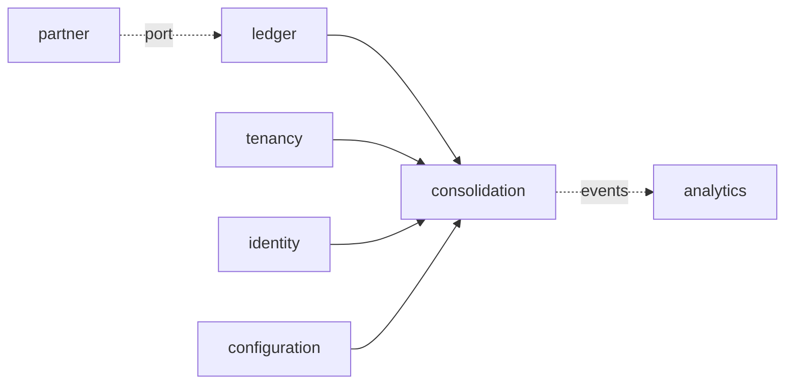

# ADR-0059: Group reporting and consolidation

**Status:** accepted (T68 design step, 2026-11-04; decided by default under
ADR-0053 d; `go-reviewer` approved in round 3 with no blocking finding; the
five questions for the product owner answered as recommended,
po:2026-11-05). The decisions taken by default and the questions for the
product owner are listed at the end; the slices T68a-T68h are in the
tracker.

## Context
T68 is "Group reporting and consolidation" (07 §7.6): "Intercompany
matching, eliminations, currency translation and consolidated statements;
full consolidation only. Lane F." The phase 2 decisions add "Group
reporting does full consolidation only" (product owner, 2026-10-18), and 01
§1.2 puts consolidation in phase 2 on "ledger dimensions, fiscal calendar,
currencies". The tracker's leaves under Group reporting and consolidation
are the same four: intercompany matching, eliminations, currency
translation, consolidated statements. This ADR details that entry and adds
nothing beyond it. Today the ERP has:

- **Companies and the group currency** (tenancy, 03 §3.3): a tenant has
  many legal entities, each with its local currency and fiscal calendar,
  and one group currency (`tenancy.tenant.group_currency`), the third
  currency of every journal line (ADR-0005).
- **Three amounts per line** (ADR-0005, 03 §3.7): `amount_tc`, `amount_lc`
  and `amount_gc`; the group amount is the local amount converted at the
  posting date's `average` rate from local into group currency
  (`ledger.postingRates`, internal/ledger/journal.go), stored once and
  never recomputed. A revaluation values group currency on its own
  (ADR-0042, product owner 2026-10-19). ADR-0042 leaves "translation for
  consolidation (group currency financial statements)" out of its scope,
  and ADR-0057 says "a group-currency book value is not re-translated
  (consolidation's translation is T68's)". ADR-0050 sums across companies
  in group currency only (`amount_gc`).
- **Rates** (`ledger.exchange_rate`, insert-only): rate types `average`,
  `bank_buying`, `bank_selling`, `planning`; the valuation rule of ADR-0042
  ("the latest of that type valid on the key date; one whose `valid_from`
  lies before the key date's period is stale and refused"), which ADR-0042
  bases on IAS 21.23 (monetary items at the closing rate).
- **Charts per company** (configuration, `companies[].chart_of_accounts`):
  each company has its own chart, with account types `asset`, `liability`,
  `equity`, `revenue`, `expense` (`ledger.gl_account.is_balance_sheet`).
  There is no group chart and no mapping between charts.
- **Balances** (`ledger.period_balance`, per ledger, company, account,
  year, period and transaction currency, in all three currencies), read
  exactly by adding the lines the projector has not reached
  (`balanceRows`, internal/ledger/reads.go). No year-end carry-forward
  exists (ADR-0058, a question for the product owner): a balance sheet
  account's balance is the sum over every fiscal year, and prior years'
  results stay on the profit and loss accounts.
- **Partners on lines**: `journal_line.partner_id` names the business
  partner of a line on a reconciliation account; the ledger already asks
  the partner context about it before posting (`ledger.Partners`,
  `PostingBlock`). Nothing says that a partner is one of the tenant's own
  companies, and no line names a partner company (a trading partner).
- **Ledgers** (ADR-0045): the leading ledger 0L; the pilots (Canada and
  the UAE) report under IFRS alone (ADR-0045, ADR-0057).
- **Periods and the close** (T32, ADR-0058): a period moves open, closed,
  locked; a close's sign-off locks each covered period through T32's
  `LockPeriod`; `closing` is a leaf that no context reads. ADR-0058 leaves
  "a group close across companies, intercompany reconciliation and
  consolidation" to T68.
- **Across companies** (ADR-0051 §9, T53e5): the group liquidity forecast
  reads every company the caller may act in (`authz.Companies`) and
  converts into the group currency; a company outside the caller's access
  reaches no figure.
- **Runs as workflows** (ADR-0012, ADR-0057 §7): a run over many objects is
  a Temporal workflow behind an `Operation`, its activities idempotent, the
  dispatcher starting it from the queued operation, in process where a
  cell has no engine.
- **Agents** (ADR-0036, ADR-0039): agents call the public API within their
  autonomy level; a write marked `x-agent: false` is refused to them.
- **Leaves** (ADR-0051 §2, ADR-0057 §2, ADR-0058 §2): a context that reads
  several others and that none reads is a leaf with ports the composition
  root adapts.

### What SAP does (the parity target)
**From memory, for a specialist to check against the pilot's SAP release;
no source was read for this section.** SAP S/4HANA Group Reporting keeps
consolidation units (company codes) in a consolidation group with a parent
unit and ownership; reported data is read from the Universal Journal
(ACDOCA) in local currency and mapped from G/L accounts to financial
statement items (the group chart), each line keeping its trading partner
(the company of the partner, from the business partner's trading partner
field); currency translation applies a method per item (closing rate,
average rate, historical rate) and posts translation differences to
equity; intercompany reconciliation matches the partners' items, and
eliminations post to the consolidation journal (ACDOCU), apart from the
companies' ledgers; the investment of the parent is eliminated against the
subsidiary's equity at first consolidation, with goodwill and
non-controlling interests; consolidated statements are reported per
version and period.

## Decision

### 1. Scope of T68
In: a group chart of accounts and the mapping of each company's accounts
to it; consolidation groups (a parent company and the subsidiaries it
holds directly, each with its ownership and the period it is first
consolidated in); the trading partner of every journal line that has one,
derived from business partners that are the tenant's companies or entered
on manual lines; a consolidation run per group and regular period, in the
group currency, as a workflow: each company's leading-ledger balances
translated, intercompany balances matched and eliminated with tolerances,
differences above tolerance accepted by a person, the parent's investment
eliminated against the subsidiary's equity with goodwill and
non-controlling interests; the consolidated balance sheet and profit and
loss of a run, with the companies' reported figures, the eliminations and
the consolidated figures; finalization of a run once every member's
period is locked; versions of runs and their audit.

Out (none built; each is a question for the product owner or a gap,
listed at the end): the equity method and proportional consolidation
(product owner 2026-10-18: full consolidation only); intercompany profit
in inventory and in assets (no inventory before phase 4, and asset
transfers between companies wait for this step's accounts, ADR-0057 §1);
holdings through another subsidiary (multi-level groups); changes in
ownership or in the investment after first consolidation, disposals and
deconsolidation; acquisitions during a period; fair value adjustments of
acquired net assets and goodwill impairment; members on another fiscal
calendar; a group in a currency other than the tenant's group currency;
parallel ledgers in consolidation (only the leading ledger is read); a
financial statement layout beyond the group chart's accounts (notes,
reporting lines, segment notes, cash flow statement, statement of changes
in equity); an intercompany agent; screens in the web workspace (headless
first, ADR-0053).

### 2. The `consolidation` context: a leaf
A new context **`consolidation`** (schema `consolidation`, package
`internal/consolidation`) owns consolidation runs, their translated
balances, eliminations and intercompany differences, and the frozen
acquisition figures of each subsidiary. Like `cash`, `assets` and
`closing` it is a **leaf**: it reaches the other contexts only through
ports it declares, which the composition root (`internal/app`) adapts, and
no context imports it. `internal/layout`'s `leaves` gains `consolidation`,
and `allowed["consolidation"]` names `config` only. The workflow's
activities reach it through a port the `workflows` package declares
(`workflows.Consolidation`), adapted in `internal/app`, as
`workflows.Depreciation` is (ADR-0057 §7).



Its ports, each run in the request's or activity's transaction under RLS
(ADR-0003):
- **`consolidation.Ledger`** (adapter over the ledger's published reads,
  §4a): a company's leading-ledger fiscal period by year and number (id,
  dates, status, version); its accounts (id, number, name, type); its balances per
  account and per account and trading partner, in local and booked group
  currency, through a period (balance sheet accounts over every fiscal
  year up to it, profit and loss accounts per fiscal year); and the rate
  of a rate type from one currency to another valid on a date, with its
  `valid_from`.
- **`consolidation.Companies`** (adapter over tenancy): a legal entity's
  code, name, local currency and fiscal calendar; the group currency.
- **`consolidation.People`** (adapter over identity): a principal's name,
  for finalizers and the people who accepted differences.

The ledger in turn reads one more thing from partner through its existing
`ledger.Partners` port (§4): the company a business partner is. No other
dependency direction changes: the ledger already asks partner about the
partners it posts (`PostingBlock`), and this ADR records the new arrows
(CLAUDE.md).

### 3. The group chart, the mapping and the groups (configuration)
The group chart, the mapping and the groups are configuration, not master
data: they are short, change rarely, decide what the consolidated
statements say, and so go through the change approval loop with their
evidence (SOX change management, 01 §1.3), as ADR-0057 §3 kept asset
classes and ADR-0058 §3 the close template in configuration.

```yaml
consolidation:
  rate_type: average                # closing rate's type (§7); default average, as ADR-0042's valuation
  accounts:                         # the group chart: at most 5,000
    - number: "G1200"               # [0-9A-Z]{1,10}, unique
      name: Trade receivables
      type: asset                   # asset | liability | equity | revenue | expense
    - number: "G3900"
      name: Currency translation reserve
      type: equity
      role: cta                     # optional; cta, retained_earnings, nci, goodwill: each once, on an account of
                                    # the type its role needs (cta, retained_earnings, nci: equity; goodwill: asset)
  eliminations:                     # at most 50
    - code: IC_BALANCES             # [A-Z0-9_]{1,30}, unique
      name: Intercompany receivables and payables
      accounts: ["G1250", "G2250"]  # group accounts; each account in at most one elimination
      difference_account: "G6950"   # a group account outside every elimination
      tolerance: "10.00"            # group currency, decimal string, >= 0
  groups:                           # at most 50
    - code: MAPLE                   # [A-Z0-9_]{1,30}, unique
      name: Maple group
      parent: "3000"                # a company of the document
      members:                      # each company once, never the parent, in no other group
        - company: "1000"
          ownership_percent: "80"   # decimal string, 0 < p <= 100, at most 4 decimals
          first_period: "2026-11"   # fiscal year and regular period of first consolidation
          investment_account: "1700"  # the parent's account holding this investment: balance sheet, asset
      net_investments:              # at most 200 (po:2026-11-10; As built: a net investment's exchange differences)
        - company: "3000"           # the parent or a member: whose ledger carries the item
          account: "1310"           # an asset or liability of that company's chart
          partner: "1000"           # the trading partner: another company of the group
companies:
  - code: "3000"
    chart_of_accounts:
      - number: "1200"
        group_account: "G1200"      # new; required on every account of a company in any group
```

- **Validation** (configuration, problems on the field): group account
  numbers unique; a role at most once and on an account of its type, and
  each of the four present once a group exists; an elimination's accounts
  in the group chart, in no other elimination, and its difference account
  in none; every account of a company that is a parent or a member of a
  group names a `group_account` of the group chart of a compatible type
  (a balance sheet account maps to a balance sheet group account, a
  profit and loss account to a profit and loss one), and no company
  account maps to a role account (the run computes those); a group's
  parent and members are companies of the document, a company is in one
  group at most, as parent or member; `first_period` is a regular period
  (1-12) of a fiscal year; the investment account is in the parent's
  chart, of type asset, maps to a group account in no elimination, and is
  named by one member of the group only (each member's investment is that
  account's whole balance, §9); a net investment designation names a
  company of the group, an asset or liability account of that company's
  chart and another company of the group, once.
- **Tiers**: the group chart's accounts, roles and the mapping, the groups,
  their members and their net investment designations are structural (tier 4), since they decide what the
  statements say; the eliminations' accounts and difference accounts
  posting-related (tier 3); tolerances and `rate_type` operational (tier
  2); names cosmetic (tier 1).
- **Members.** Each member is held directly by its group's parent
  (multi-level holdings are out, §1, a question below), and the parent's
  local currency is the group currency (a run refuses another parent, 422
  `consolidation.parent_currency`): the investment is eliminated at its
  booked group amount (§9), which equals its translated amount only when
  the parent is in the group currency, so a parent in another currency
  would leave a residual investment on the consolidated balance sheet (a
  question below); `first_period` is
  the period from whose first day the member is consolidated (an
  acquisition during a period is out, §1). Changing a member's ownership,
  first period or investment account after a final run used them is
  refused by the next run (§9), not by validation, since the
  configuration does not read runs.
- **Reads.** `GET /v1/consolidation-groups` (cursor-paged by code) and
  `GET /v1/consolidation-groups/{code}` answer the active configuration's
  groups: the parent and each member by company id, code, name and local
  currency, the ownership, first period and investment account (number
  and name), and the frozen acquisition figures once a final run made
  them (§9). `GET /v1/group-accounts` (cursor-paged by number; filters
  `type`, `role`, `elimination`) answers the group chart with each
  account's elimination, if any, and the number of company accounts
  mapped to it. A group with a member the caller may not act in is not
  in the caller's lists and is unknown to the caller (§12).

### 4. The trading partner on journal lines (ledger and partner)
A line's **trading partner** is the tenant's company its partner is: the
legal entity on the other side of an intercompany transaction.
- **On the business partner** (T68c): `partner.business_partner` gains
  `group_company_id` (a legal entity of the tenant, nullable; tenancy
  reference by id, 02 §2.1), set and changed through the partner API
  (`createBusinessPartner`, `updateBusinessPartner`, the partner's own
  permission and audit; `BusinessPartnerChanged` carries it); an unknown
  company is 422 `partner.group_company_unknown`. A change applies to
  postings from then on; posted lines keep theirs (ADR-0006).
- **On the line** (T68b): `ledger.journal_line` gains `trading_partner_id`
  (nullable uuid, a legal entity of the tenant other than the posting
  company), and the posting port's `Posting` and `PostingLine` an
  optional `TradingPartner`. Manual, parked and template entry lines take
  an optional `trading_partner_id` in the API. The ledger refuses one that
  is not a legal entity of the tenant or is the posting company (422
  `ledger.trading_partner_invalid`, on the line's field).
- **Derived in one place** (T68c): before posting, the ledger asks
  partner, through `ledger.Partners` (new method `GroupCompany`), for the
  group company of each partner its lines name. A line whose partner is a
  group company takes it; if the entry's partner lines all name the same
  group company, every other line of the entry that names no trading
  partner takes it too, so an intercompany invoice's expense and tax lines
  carry it as its supplier line does (SAP's propagation, from memory); a
  line naming a trading partner other than its own partner's group company
  is refused (422 `ledger.trading_partner_conflict`). Because this is the
  ledger's posting path, every context that posts partner lines (payables,
  payments, bank statements, down payments, the migration) gets it without
  a change of its own; a migration run loading a business partner already
  linked to a group company gives its lines the trading partner too. A
  reversal copies each line's trading partner; a clearing's difference
  lines take the cleared items'.
- **Balances** (T68b): `ledger.trading_partner_balance` (per ledger,
  company, account, trading partner, fiscal year, period and transaction
  currency, in all three currencies) is maintained for lines with a
  trading partner, exactly as `assignment_balance` is (T56f, migration
  000163), and read exactly as the trial balance reads (projected plus
  pending lines). Reads of journal entries return each line's
  `trading_partner` (id, code, name); `listJournalEntries` filters by
  `trading_partner_id`; the ledger's events carry it.
- **Lines posted before T68b** carry none, nor do migrated lines whose
  business partner was not linked before the load, nor G/L lines SAP gave a
  trading partner without a partner: such intercompany balances show as
  `no_trading_partner` (§8) until their companies repost them. (SAP's
  propagation is not guaranteed, the SAP specialist answered on
  2026-11-09: question 4. The migration leaf it led to links a migrated
  supplier to its group company from SAP's vendor master, so its
  documents carry the trading partner; As built, "SAP's trading partner
  on migrated intercompany documents".)

### 4a. Changes to the ledger's published API
Each is additive and built in the slice that first needs it, as ADR-0058
§4 did for the close:
- **T68b**: `Posting.TradingPartner` and `PostingLine.TradingPartner`;
  `trading_partner_id` on manual, parked and template entry lines; the
  `trading_partner_balance` projection.
- **T68c**: `ledger.Partners.GroupCompany(ctx, partnerID)` (the port's new
  method, adapted over partner's published read).
- **T68d**: `ledger.PeriodOf(ctx, company, ledger, year, period)` (id,
  dates, status and version, which moves with every change of the period,
  a lock, an unlock request and an unlock among them, so an unlock and a
  relock never leave the version a run recorded); `ledger.Accounts`
  of a company (id, number, name, type); `ledger.BalancesThrough(ctx,
  company, ledger, year, period)`: per account and per account and trading
  partner, the local and booked group amounts of the balance sheet
  accounts over every fiscal year through the period and of the profit and
  loss accounts per fiscal year through it, exact as `balanceRows` (the
  projection plus pending lines, now over several years and with the
  trading partner balances); `ledger.RateOn(ctx, rateType, from, to,
  date)` (the latest rate valid on the date with its `valid_from`; today
  `rateOfType` is unexported).
- **T68g**: no new read: `stale` and finalization compare `PeriodOf`'s
  status and version with those the run recorded.
- **B4 correction 1** (po:2026-11-09): `ledger.BalancesThrough` also
  returns, from the same statement and so the same database state, the
  lines on profit and loss accounts of the company's revaluation runs'
  entries through the period, each with its entry's recorded
  local-to-group rate (As built: the group-currency revaluation's
  translation part).
- **B4 correction 2** (po:2026-11-09, po:2026-11-10):
  `ledger.BalancesThrough` takes the accounts whose revaluation
  differences consolidation treats apart and names, on each such line,
  the account whose difference it offsets (As built: a net investment's
  exchange differences).

### 5. Data model
Every table has `tenant_id` leading its keys and RLS (ADR-0003); keys are
UUIDv7 (ADR-0004); amounts are `bigint` minor units with their currency
beside them (ADR-0005); references to other contexts (legal entities,
accounts, periods, principals, operations) are ids without foreign keys
(02 §2.1). Group accounts and elimination codes are the configuration's
numbers and codes, recorded with the configuration version the run read.

```
consolidation.run              (tenant_id, id, group_code, parent_id, fiscal_year, fiscal_period, period_end,
                                config_version, group_currency, rate_type, status, problem jsonb, operation_id,
                                computed_at, finalized_by, finalized_at, superseded_by, version, created_*)
consolidation.run_member       (tenant_id, run_id, legal_entity_id, role parent|member, ownership_percent numeric(7,4),
                                first_fiscal_year, first_fiscal_period, local_currency, closing_rate numeric(28,12),
                                rate_valid_from, period_status, period_version, translated_at)
                                PK (tenant_id, run_id, legal_entity_id)
consolidation.run_balance      (tenant_id, run_id, legal_entity_id, line_no, group_account, account_id, trading_partner_id,
                                kind, amount_lc, amount_gc_booked, amount_gc)        PK (tenant_id, run_id, legal_entity_id, line_no)
consolidation.run_entry        (tenant_id, run_id, entry_no, kind intercompany|investment|nci, legal_entity_id,
                                partner_id, elimination_code)                         PK (tenant_id, run_id, entry_no)
consolidation.run_entry_line   (tenant_id, run_id, entry_no, line_no, group_account, legal_entity_id, account_id,
                                trading_partner_id, component, amount_gc)                                 PK (tenant_id, run_id, entry_no, line_no)
consolidation.run_difference   (tenant_id, id, run_id, elimination_code, legal_entity_id, partner_id, amount, partner_amount,
                                difference, tolerance, status, accepted_by, accepted_at, reason, version)
                                UNIQUE (tenant_id, run_id, elimination_code, legal_entity_id, partner_id) NULLS NOT DISTINCT
consolidation.run_acquisition  (tenant_id, run_id, legal_entity_id, net_assets_lc, closing_rate, net_assets_gc, investment_gc,
                                goodwill_gc, nci_gc, frozen)                          PK (tenant_id, run_id, legal_entity_id)
consolidation.acquisition      (tenant_id, group_code, legal_entity_id, first_fiscal_year, first_fiscal_period,
                                ownership_percent, investment_account_id, net_assets_lc, closing_rate, net_assets_gc,
                                investment_gc, goodwill_gc, nci_gc, run_id, created_*)   PK (tenant_id, group_code, legal_entity_id)
consolidation.acquisition_equity (tenant_id, group_code, legal_entity_id, group_account, amount_gc)
                                PK (tenant_id, group_code, legal_entity_id, group_account)
```

- **States.** A run is `queued`, `running`, `computed`, `failed`, `final`,
  `superseded` or `discarded`: queued -> running -> computed; queued or
  running -> failed; computed -> final or discarded; failed -> discarded;
  final -> superseded. A difference is `matched`, `within_tolerance`,
  `open`, `accepted`, `outside_group` or `no_trading_partner`, and moves
  only open -> accepted. Each
  transition is a guarded update (`WHERE status = $expected`), and a
  trigger refuses any other (a schema test per transition).
- **Database rules with schema tests**: a regular period only
  (`fiscal_period BETWEEN 1 AND 12`); one run of a group queued or running
  at a time and one final per group and period (partial unique indexes);
  `problem` set exactly when failed, `finalized_*` exactly when final or
  superseded, `superseded_by` exactly when superseded; a run's balances,
  entries, entry lines and acquisitions are inserted while it is running
  and never updated or deleted (no grant, a trigger); each entry's lines
  sum to zero (a deferred constraint trigger at commit, as the ledger's
  entries); `acquisition` and `acquisition_equity` are insert-only (one
  per group and member); `accepted_*` and `reason` set exactly when a
  difference is accepted; RLS on every table; keys lead with `tenant_id`;
  no foreign key leaves the schema.
- **Order** (REVIEW.md: never database read order). A member's
  `run_balance.line_no` follows group account number, company account
  number, trading partner code (none first), kind (`balance`,
  `prior_results`, `cta`); `run_entry.entry_no` follows kind
  (`intercompany`, `investment`, `nci`), then elimination code and the
  pair's two company codes for intercompany entries, the member's code for
  the others; `run_entry_line.line_no` follows group account number,
  company code, company account number (none, for a role account's line,
  first), trading partner code (none first), component, so each line it
  reverses keeps the company account of its `run_balance` row and no two
  lines tie. The balances list pages by (company code, `line_no`), the
  entries list by (`entry_no`, `line_no`), and the differences list by
  (elimination code, company code, partner code, `no_trading_partner`
  rows, which have no partner, first within their company), so two runs
  of the same figures number and list them alike.
- **Versions and locks** (ADR-0008): a run's version moves with every
  change to it or its differences, so `If-Match` on `:finalize`,
  `:discard` and a difference's `:accept` refuses a stale view; every write
  on a run first reads it `FOR UPDATE`, so the workflow's activities, an
  acceptance and a finalization serialise on the run. Finalizing reads
  every run of the group and period that is not discarded `FOR UPDATE`, in
  the order of their ids, and only then reads which one is final, so two
  finalizations of one period serialise and the second sees the first's
  final (a test of two at once); it supersedes the old final before it
  makes its own final, so the one-final index holds at every statement,
  and the index is mapped to 409 `consolidation.final_exists` should a
  path ever reach it.

### 6. The consolidation run
**Creating a run.** `POST /v1/consolidation-runs` (Idempotency-Key; group
code, fiscal year, period) checks the group is known to the caller (404
`consolidation.group_unknown`, §12), the period is regular (422
`consolidation.special_period`) and exists for the parent's leading
ledger (422 `consolidation.period_unknown`), every member included (first
period on or before the run's) uses the parent's fiscal calendar (422
`consolidation.calendar_mismatch`, naming the company), every included
company's currency other than the group's has a closing rate for the
run's period and, for a member whose acquisition is not yet frozen, for
the period before its first (§7, §9; 422 `consolidation.rate_missing` or
`consolidation.rate_stale`, naming the pair and the date), the parent is
in the group currency (422 `consolidation.parent_currency`, §3),
and no run of the group is queued or running (409
`consolidation.run_in_progress`, naming it, with `Location`). It writes
the run `queued` with the active configuration's version and its
`Operation` (kind `consolidation.run`) in the request's transaction and
returns 202 with the `Operation` (04 §4.8), its `resource` the run. A run
may be created for any period, open or not: a draft shows the figures as
they stand, and only finalization needs the periods locked (§10).

**The workflow.** The workflows dispatcher starts workflow
`ConsolidationRun`, id `{tenant}-consolidation_run-{run}` (ADR-0012, the
run id as business key), from the queued operation, as for depreciation
runs; a cell without a workflow engine runs the same activities in
process, in order. Its activities, through `workflows.Consolidation`:
1. **`PrepareConsolidationRun`**: run `FOR UPDATE`; if `queued`, reads the
   configuration version the run recorded, the members included, their
   currencies, calendars and closing rates, writes `run_member`, and sets the run
   `running`; if already `running`, returns its members. Run twice, it
   writes nothing twice.
2. **`TranslateMember`** (one per member, in company code order): run
   `FOR UPDATE`; returns if the member's `translated_at` is set; else reads
   the status and version of the run's period in the member's leading
   ledger and its balances through `consolidation.Ledger` in the same
   transaction (so the recorded status and version are those of the
   figures read), writes its translated balances and translation
   difference (§7) and, for a member, its acquisition for this run (§9),
   and sets `period_status`, `period_version` and `translated_at`, in one
   transaction.
3. **`EliminateConsolidationRun`**: run `FOR UPDATE`; returns if the run
   has entries or differences; else matches and eliminates intercompany
   balances (§8) and writes the investment and non-controlling interest
   entries (§9), in one transaction.
4. **`CompleteConsolidationRun`**: running -> computed, with `computed_at`;
   a no-op if computed.

A failed activity's refusal (a rate gone stale, a member's account
without a group account, §9's changed acquisition) ends the workflow in
**`FailConsolidationRun`**: running or queued -> failed with the problem,
a no-op if already failed. Every activity has a run-twice test, including
after a commit whose completion was lost. `ConsolidationRunChanged` is
published at each status change, and each writes an audit record
(ADR-0011).

**Reads.** `GET /v1/consolidation-runs/{id}` (the run with its group code
and name, period and its dates, status, problem, configuration version,
group currency, rate type, its members by code and name with their
currency, closing rate and its validity, role, ownership and the status
of its period when the run read its figures, the count of differences per status, `stale` (§10), and
who finalized it by name) and `GET /v1/consolidation-runs` (cursor-paged
newest first; filters group, fiscal year, period, status).
`POST /v1/consolidation-runs/{id}:discard` (If-Match) discards a computed
or failed run (409 `consolidation.run_not_discardable` otherwise).

### 7. Currency translation
**The method** (to confirm with an accounting specialist; a question for
the product owner below; confirmed by the specialist on 2026-11-09 with
additions, question 1: the difference is other comprehensive income; the
part of a group-currency revaluation beyond the functional-currency
difference translated moves there, and so does the whole exchange
difference on a monetary item forming part of a net investment in a
foreign operation, IAS 21.32). Each member is translated from its
leading-ledger local-currency figures into the group currency:
- **Assets and liabilities** at the **closing rate**: the latest rate of
  the configured `rate_type` from the member's local currency into the
  group currency valid on the run's period's last day, refused when it is
  missing or its `valid_from` lies before the period's first day (the
  rate selection and staleness rule of ADR-0042, which ADR-0042 bases on
  IAS 21.23 for monetary items; translating non-monetary assets and
  liabilities, such as fixed assets, at that rate too is part of the
  method for the specialist; `consolidation.rate_missing`,
  `consolidation.rate_stale`); rate 1 when the local currency is the
  group's. Each balance is the member's balance through the period over
  every fiscal year (no carry-forward exists, §Context), translated per
  account and trading partner as `round(amount_lc × rate)`, half away from
  zero, once.
- **Income and expenses** at their **booked group amounts** (less the
  translation part of a group-currency revaluation, which goes to the
  translation difference; As built: the group-currency revaluation's
  translation part): the
  fiscal year's group amounts through the period (for a member in the
  fiscal year of its first period, from that period on), each converted at its
  posting date's rate when it was posted (ADR-0005), as ADR-0050 sums
  across companies. No period average rate is introduced: the booked
  amounts are already each transaction's own date's rate.
- **Equity** at its **booked group amounts**: each equity posting at its
  posting date's rate, so historical by construction; prior fiscal years'
  results (the profit and loss accounts' booked group amounts of every
  earlier year) are one row on the group chart's `retained_earnings`
  account, and for a member in the fiscal year of its first period so are
  the results of that year's periods before it, which were earned before
  the group held it (§9). A member's rows stay as booked; §9's investment
  entry reverses its acquisition equity.
- **The translation difference** is one row per member on the `cta`
  account: minus the sum of the member's other translated rows, so each
  member's translated figures sum to zero. A member in the group currency
  whose booked group amounts equal its local ones has none.

The translated rows are `run_balance` rows of kind `balance` (one per
account and trading partner, with the local, booked group and translated
amounts), `prior_results` and `cta`. `GET
/v1/consolidation-runs/{id}/balances` lists them (cursor-paged; filters
company, group account, account, trading partner, kind), each with its
company's code and name, the company account's number and name, the group
account's number and name, the trading partner's code and name, every
amount with its currency, and the closing rate where one applied; and
totals over the filter per currency (local amounts per local currency,
group amounts in the group currency).

### 8. Intercompany matching and eliminations
**Matching.** For each elimination of the configuration and each pair of
members {A, B} of the run (A's code before B's), the run sums A's
translated rows on the elimination's group accounts whose trading partner
is B (`amount`) and B's whose trading partner is A (`partner_amount`), in
group currency, debit positive. Their sum is the **difference**: zero
`matched`, at most the elimination's tolerance in absolute value
`within_tolerance`, otherwise `open`. Rows on an elimination's accounts
whose trading partner is not a member of the run (a company outside the
group, or a member before its first period) are listed per company and
partner as `outside_group`, and rows on them with no trading partner per
company as `no_trading_partner` (lines posted before T68b, or not linked
to a group company); neither is eliminated, both are listed with their
totals so the accountant sees what the consolidated figures still
carry. Balance sheet balances
compare at closing rates on both sides; income and expenses at their
booked group amounts, so a difference from rates, timing or a missing
posting shows as a difference.

**Eliminations.** For each pair with rows, one `intercompany` entry: a
line reversing each of the pair's rows on the elimination's accounts, on
its group account with its company and trading partner, and the
difference on the elimination's difference account, so the entry sums to
zero and the consolidated figures show no intercompany balance between
members. An open difference is eliminated the same way; it stops only
finalization (§10).

**Who resolves a difference.** The accountants of the two companies,
by correcting the postings in their ledgers (a missing invoice, a wrong
trading partner, which is reversed and reposted since lines are immutable,
a revaluation not run), after which a new run shows the pair matched; or
the group's accountant, by accepting it: `POST
/v1/consolidation-runs/{id}/differences/{id}:accept` (If-Match, a reason;
people only) moves an open difference to `accepted` with who and when
(409 `consolidation.difference_not_open` otherwise;
`IntercompanyDifferenceAccepted`; audit). `GET
/v1/consolidation-runs/{id}/differences` lists them (cursor-paged by
elimination, company and partner code; filters status, elimination,
company), each with the elimination's code and name, both companies' codes
and names, the amounts, difference and tolerance with their currency, who
accepted it by name and why; with totals of the amounts and differences
per status. `GET /v1/consolidation-runs/{id}/entries` lists the run's
entries with their lines (cursor-paged by entry number; filters kind,
company, elimination), each line with the group account's number and name
and the company's and partner's code and name; with totals per kind of
the debits (each entry's credits equal them).

### 9. Investment, equity and non-controlling interests
**The method** (to confirm with an accounting specialist; questions for
the product owner below; answered by the specialist on 2026-11-09,
question 2: fair values unless the subsidiary was incorporated or under
common control, goodwill retranslated, a bargain purchase gain posted after
confirmation, dividends to the interest; As built T68h2: a member the
parent incorporated has its investment eliminated against its share
capital alone, its results and reserve staying the group's). For each member M held at ownership q (a
fraction, `ownership_percent / 100`) and first consolidated in period F,
with F−1 the regular period before F (the previous fiscal year's last
when F is period 1):
- **Acquisition figures**, computed by each run that includes M until a
  final run freezes them (`consolidation.acquisition`): M translated as §7
  translates it at F−1, at F−1's closing rate r (§7's rule on F−1's last
  day); the net assets N = the sum of M's asset and liability balances in
  local currency through F−1, and their group amount A = the sum of those
  balances' translated rows (each rounded once, so A is exact against
  them); the acquisition equity, every other translated row of M at F−1
  (its equity rows; all its results through F−1 on `retained_earnings`,
  that fiscal year's income and expenses included, also when F is period
  1; its `cta` row), which sum to −A by construction since each member's
  rows sum to zero, kept per group account (`acquisition_equity`: its
  equity accounts, `retained_earnings`, `cta`); the investment I = the
  parent's booked group balance on M's investment account through the run's
  period, which equals its translated row since the parent is in the
  group currency (§3); the non-controlling interest at acquisition n = `round((1 − q) ×
  A)`; goodwill G = I − A + n. A negative G fails the run (422
  `consolidation.negative_goodwill`, naming the member) until the product
  owner decides its treatment (a question below). For M in its
  acquisition year, the results of the periods before F belong to the
  acquisition equity: they are in M's `prior_results` row, not its income
  and expenses (§7). Goodwill and the interest at acquisition are kept at
  these group amounts, never retranslated (a question below).
- **The investment entry** (kind `investment`, each run from F on): the
  acquisition equity reversed on its group accounts (which removes A of
  equity), the investment's group account credited I, the `nci` account
  credited n, the `goodwill` account debited G. It sums to zero.
- **The non-controlling interest entry** (kind `nci`, q < 1): of M's
  translated rows at the run's period, three components, each rounded
  once and each credit positive: the profit share `round((1 − q) × P)`
  with P minus the sum of M's income and expense rows (a profit,
  positive); the translation share `round((1 − q) × C)` with C minus the
  change of M's `cta` row since the acquisition equity's `cta` part; the
  other share `round((1 − q) × E)` with E minus the change of M's equity
  and `prior_results` rows since the acquisition equity's equity and
  `retained_earnings` parts (its `cta` part not included, which C
  covers). P + C + E is then M's translated net assets at the period less
  A, its post-acquisition equity, exactly; a test computes it by hand for
  a member with a non-zero acquisition `cta` and one first consolidated in
  period 1. The `nci` account is
  credited their sum, `retained_earnings` debited the profit and other
  shares, `cta` debited the translation share. Each line records its
  component, which the profit and loss statement reads for its
  attribution (§11).
- **After a final run.** The first final run including M inserts its
  acquisition figures into `consolidation.acquisition` and
  `acquisition_equity` (§10). Every later run reads them instead of
  recomputing; it fails (422 `consolidation.acquisition_changed`) when
  M's configured ownership, first period or investment account differs
  from the frozen one, and (422 `consolidation.investment_changed`) when
  the parent's investment balance differs from the frozen I: changes after
  first consolidation are out of scope (§1), and a run refuses rather
  than consolidate them silently wrong.

### 10. Finalization, versions and staleness
`POST /v1/consolidation-runs/{id}:finalize` (If-Match; people only) makes
a computed run the group's consolidated figures for its period. It is
refused while a difference is open (409 `consolidation.differences_open`,
naming the count), when the run is not computed (409
`consolidation.run_not_computed`), when a member's period was not locked
when the run read its figures or is not locked now (409
`consolidation.period_not_locked`, naming the companies; run again after
the lock), and when the run is stale (409 `consolidation.run_stale`,
below). Locked is what each company's close sign-off leaves (ADR-0058
§7, T32), read through the ledger, so consolidation follows the companies'
closes without reading the `closing` leaf. In one transaction it sets the
run `final`, sets the group's previous final run of the period, if any,
`superseded` by it, freezes the acquisition figures of members finalized
for the first time (§9), writes the audit record and publishes
`ConsolidationRunChanged`.

**Versions.** A period's runs are its versions: drafts may be discarded,
a final run is never changed or discarded, and a later final run
supersedes it, so the history of what was finalized, by whom and on which
figures stays readable (`listConsolidationRuns?status=superseded`).
**Staleness.** A run is `stale` when a member's period's version now
differs from the `period_version` the run recorded with its figures
(`PeriodOf`, §4a): an unlock, a posting and a relock leave the period
locked but at another version, so the period changed since the figures
were read and they may no longer be the ledger's (the version also moves
on an unlock request and its rejection, which post nothing: stale then
errs on the safe side, and `consolidation.run_stale`'s detail names a
pending unlock request when there is one); and when the group's final
run of the previous fiscal year's period 12 is no longer the one its
translation reserve opens from (As built: other comprehensive income).
A stale run cannot be finalized, and a stale final run says so
on every read; a new run after the relock supersedes it.

### 11. Consolidated statements
`GET /v1/consolidation-runs/{id}/statements/{statement}` with statement
`balance_sheet` or `profit_and_loss`, of a computed, final or superseded
run (409 `consolidation.run_not_computed` otherwise; the response carries
the run's status and `stale`), one row per group account of the
statement's types (asset, liability, equity; revenue, expense), in
number order, cursor-paged by number:
the account's number, name, type and role, the members' translated figures
summed (`reported`), the eliminations (`eliminations`, the run's entry
lines on it) and their sum (`consolidated`), each in the group currency,
debit positive as the trial balance shows them. Totals over the whole
statement: for the balance sheet, assets, liabilities, equity (the
`cta`, `retained_earnings` and `nci` accounts included) and the fiscal
year's profit through the period (the profit and loss statement's), which
together sum to zero; for
the profit and loss, revenue, expenses, the profit, its share
attributable to non-controlling interests (the sum of the `nci` entries'
profit components) and to the owners of the parent; each with the
reported, eliminations and consolidated columns; and, below the profit,
other comprehensive income (the fiscal year's translation differences
through the period), total comprehensive income and its attribution, with
the translation reserve per company (the accounting specialist's B3; As
built: other comprehensive income). Drill-down is the
balances, entries and differences lists filtered by group account (§7,
§8). The statement's presentation beyond the group chart (reporting lines,
notes, comparatives) is out of scope (§1).

### 12. Access and agents
- **Company access** (ADR-0010). A group's figures are only meaningful
  whole, so a caller sees a group only when it may act in the parent and
  every member (`authz.Companies`, or `all_companies`): every operation on
  a group or its runs answers a group outside that as unknown (404
  `consolidation.group_unknown`; lists leave it out), never partial
  figures, and so names none of its companies. Unlike the group liquidity
  forecast (ADR-0051 §9), which sums the companies the caller has,
  leaving a company out of a consolidation would change every
  elimination.
- **Permissions** (new in identity's catalog): `consolidation.read`
  (groups, group accounts, runs and their figures), `consolidation.run.manage`
  (create, discard), `consolidation.difference.accept`,
  `consolidation.run.finalize`. Every operation that returns figures also
  needs `ledger.entry.read` (`x-also-permissions`, 403
  `identity.permission_missing`), so no consolidation read gives what the
  ledger's own would refuse (ADR-0058 §13's rule).
- **Agents** (ADR-0036, ADR-0039). Reads are agent tools (`x-autonomy:
  read`), so an agent may explain a run's differences to a person; every
  write is `x-agent: false` (create, discard, accept, finalize). No
  consolidation agent is built in T68 (a gap); one would propose only, as
  ADR-0039's agents do, for people to decide.

### 13. API and events (contract first)
Paths, in `api/openapi.yaml` (problem codes as `x-problem-codes`; writes
with `Idempotency-Key`; changes of one resource with `If-Match`; lists
cursor-paged with filters, 04 §4.5):

| Operation | Method and path | Permission | Agents |
|---|---|---|---|
| listConsolidationGroups, getConsolidationGroup | `GET /v1/consolidation-groups`, `/{code}` | `consolidation.read` and `ledger.entry.read` | read |
| listGroupAccounts | `GET /v1/group-accounts` | `consolidation.read` | read |
| createConsolidationRun, listConsolidationRuns, getConsolidationRun | `/v1/consolidation-runs` | `consolidation.run.manage`; reads `consolidation.read` and `ledger.entry.read` | `x-agent: false` for create |
| discardConsolidationRun | `POST /v1/consolidation-runs/{id}:discard` | `consolidation.run.manage` | `x-agent: false` |
| listConsolidationBalances | `GET /v1/consolidation-runs/{id}/balances` | `consolidation.read` and `ledger.entry.read` | read |
| listConsolidationEntries | `GET /v1/consolidation-runs/{id}/entries` | `consolidation.read` and `ledger.entry.read` | read |
| listIntercompanyDifferences, acceptIntercompanyDifference | `/v1/consolidation-runs/{id}/differences`, `/{id}:accept` | reads `consolidation.read`; `:accept` `consolidation.difference.accept`; both also `ledger.entry.read` | read; `x-agent: false` |
| getConsolidatedStatement | `GET /v1/consolidation-runs/{id}/statements/{statement}` | `consolidation.read` and `ledger.entry.read` | read |
| finalizeConsolidationRun | `POST /v1/consolidation-runs/{id}:finalize` | `consolidation.run.finalize` and `ledger.entry.read` | `x-agent: false` |

- Changed: the journal entry, parked entry and entry template lines gain
  `trading_partner_id` (requests) and `trading_partner` (responses: id,
  code, name); `listJournalEntries` gains the filter; the business partner
  gains `group_company_id` and `group_company` (id, code, name). Additive,
  so no entry in `api/breaking-accepted.txt`.
- Representations carry names beside ids (group code and name, company
  codes and names, account numbers and names, trading partners' codes and
  names (to a caller who may act in that company, its id alone otherwise:
  product owner 2026-11-05, As built), principals' names), every amount its currency, each list its
  totals, and each action's response the object it created or changed (the
  run with its `Operation`, the accepted difference, the finalized run with
  the run it superseded) (REVIEW.md's API-consumer classes).
- Problem codes (all `consolidation.*` new, registered with their
  constraint mappings): `consolidation.group_unknown`,
  `consolidation.special_period`, `consolidation.period_unknown`,
  `consolidation.calendar_mismatch`, `consolidation.rate_missing`,
  `consolidation.rate_stale`, `consolidation.run_in_progress`,
  `consolidation.run_not_discardable`, `consolidation.run_not_computed`,
  `consolidation.difference_not_open`, `consolidation.differences_open`,
  `consolidation.period_not_locked`, `consolidation.negative_goodwill`,
  `consolidation.acquisition_changed`, `consolidation.investment_changed`,
  `consolidation.parent_currency`, `consolidation.final_exists`,
  `consolidation.run_stale`, `consolidation.structure_unsupported` and
  `consolidation.investment_mismatch` (As built T68h),
  `consolidation.account_unmapped` (a member's account with a balance and
  no group account, a run's failure for a configuration activated before
  the rule); and `ledger.trading_partner_invalid`,
  `ledger.trading_partner_conflict`, `partner.group_company_unknown`;
  passed through: `identity.permission_missing`,
  `request.version_mismatch`, `config.not_bootstrapped`.
- Events, in `api/asyncapi.yaml`, a new `consolidation` channel
  (CloudEvents through the outbox, ADR-0007): `ConsolidationRunChanged`
  (the run, its group and period, the status and the one before) and
  `IntercompanyDifferenceAccepted`. The ledger's line payloads carry
  `trading_partner_id`, `BusinessPartnerChanged` the `group_company_id`
  (additive). Every write writes an audit record (ADR-0011).

### 14. Performance budgets (01 §1.3)
- **A consolidation run** of a group of 100 companies, each with 1,000
  accounts with balances and 1,000 trading partner balances: async, p95
  < 120 s, p99 < 240 s (as a depreciation run's, ADR-0057). Each member's
  translation reads its balances once (per account and per account and
  trading partner, through the period) and writes them in one statement;
  matching works on the run's own rows.
- **A consolidated statement** of one run, every page: p95 1 s, p99 3 s
  (the trial balance's). It reads the run's stored rows only; no ledger
  read is made for a statement but the period statuses for `stale`.

## Alternatives
- **Eliminations posted into the companies' ledgers** (or into a
  consolidation company's ledger). One journal for everything; but a
  company's ledger is its statutory record, eliminations belong to no
  company, and a ledger posting needs open periods that the companies'
  sign-offs have locked. Rejected for the run's own insert-only entries,
  as SAP keeps its consolidation journal apart (from memory).
- **Translating income and expenses at a period average rate.** A new
  rate type, one rate per currency and period for operators to load, and
  the companies' own group amounts would no longer match the group's; the
  booked group amounts are each transaction's own date's rate, already
  stored. Rejected by default, with the method a question below.
- **Retranslating every line instead of reading balances.** Exact per
  line, but a run would read every journal line of every member through
  the period (up to 500 million lines a year, 01 §1.3). Rejected for
  balances (`period_balance`, `trading_partner_balance`).
- **Trading partners derived in each posting context** (payables,
  payments, bank statements). Each would ask partner and pass it; one
  forgotten path leaves an intercompany payable cleared by a line without
  its partner company, so the pair never matches. Rejected for the
  ledger's one derivation through its existing partner port.
- **Consolidation inside the ledger.** The ledger has balances and rates;
  but consolidation reads tenancy's structure and configuration's groups
  across companies, and its runs and eliminations are not postings.
  Rejected for a leaf.
- **Recomputing eliminations by carrying forward the previous period's
  entries** (SAP's balance carry-forward of consolidation entries, from
  memory). Each run here computes every entry from the cumulative
  position at its period end, so no run depends on another's except
  through the frozen acquisition figures.
- **Partial figures for a caller without access to every member**, as
  the group forecast does. Rejected (§12).

## Consequences
- A new context, schema and channel; a leaf with three ports and a
  workflow. The ledger's posting path reads one more fact from partner
  through its existing port; nothing else changes direction.
- Every journal line posted after T68b can carry a trading partner; the
  ledger derives it for partner lines on every posting path, so no
  posting context changes. Lines posted before carry none.
- The configuration gains a group chart, a mapping on every account of a
  company in a group (required once the company joins one), eliminations
  and groups; adding a company to a group is a structural change.
- Consolidated figures are never posted to a company's ledger and never
  change a company's figures; they are reproducible from the run's rows
  and the frozen acquisition figures.
- A consolidation is final only after every member's period is locked, so
  it follows the companies' closes (ADR-0058) without reading `closing`.
- The translation and the investment elimination use methods to be
  confirmed by an accounting specialist; the product owner's answers
  below may change §7 and §9 before T68d and T68h are built.

## Boundaries with the other steps
- **T32 (period lock)** and **T64 (close, ADR-0058)**: finalization needs
  the members' periods locked; an intercompany reconciliation stays a
  manual task of the close template until a check for it is asked for
  (ADR-0058).
- **T48 (revaluation, ADR-0042)**: a company's revaluation of its
  intercompany items changes its local balances, and so its translated
  balance sheet rows; group currency revaluation is unchanged.
- **T52 (parallel ledgers, ADR-0045)**: only the leading ledger is read.
- **T56 (controlling, ADR-0050)**: intercompany by partner profit center
  and segment notes stay out (ADR-0050's T68 boundary is a gap here).
- **T57 (assets, ADR-0057)**: asset transfers between companies may follow
  as their own leaf, now that trading partners exist.
- **T72 (migration)**: the trading partner of migrated lines (question 4,
  answered; As built, "SAP's trading partner on migrated intercompany
  documents").
- **Phase 3 (receivables) and phase 4 (inventory)**: customer lines carry
  trading partners through the same derivation; intercompany profit in
  inventory is out of scope.

## Steps (slices)
Each is a slice (ADR-0053): one capability a named user can use end to
end through the public API, its contract, migration, domain code, tests
(real PostgreSQL, `FailingTx` on every database path, 100% coverage),
docs and an extended walkthrough step as its evidence. Lane F, in this
order; about half a day each. Carla, the controller, is the group's
accountant; Ada, the administrator, configures; Tom, the treasurer, posts
the US company's invoice.

**The walkthrough's group.** A new step `step_consolidation` goes after
`step_cash_forecast_analytics` (step 38; Acme Corp US, 1000 in USD, is
created in step 36) and before `step_close` (the story's last, ADR-0058).
It consolidates the group MAPLE: the walkthrough's company, Maple (3000,
Maple Industries Canada in CAD, the tenant's group currency), as parent
holding 80% of Acme Corp US, first consolidated in the period of today
(F). Its dates and rates are fixed so that the step passes on any day of
the year:
- **Rates.** Step 9 loads USD/CAD 1.35 from 1 January and 1.40 from the
  month's end. The step loads 1.35 valid from F−1's last day (the previous
  fiscal year's 31 December in January), which changes no earlier figure
  (the rate in force is 1.35 already) and gives F−1 a closing rate that is
  not stale, as §9 needs; the run's period closes at 1.40.
- **Postings.** Acme Corp US's share capital is posted on F−1's last day,
  after Acme Corp US's period F−1 is opened (in January, in the previous
  fiscal year, whose periods exist only if T68a's configuration gives Acme
  Corp US number ranges for the previous fiscal year as well as this one,
  `ledger.Setup`'s calendar); Maple's investment in Acme Corp US and every intercompany
  posting are dated the month's first day, as step 9 dates its posting,
  so they book at 1.35 even when the walkthrough runs on the month's last
  day, and none is dated in a period step 11 locked.
- **Finalization.** Drafts need no lock. T68g's finalization comes at the
  end of `step_close`, after its sign-off locks Maple's period: Carla
  closes and locks Acme Corp US's period through T32, runs the group again
  and finalizes it. `step_close` stays last; nothing posts in Maple's
  period after its sign-off.
- **People.** Cory (step 36, Maple alone) is given `consolidation.read`
  and `ledger.entry.read` in T68a's part, so he reads an empty list of
  groups rather than a 403.

| Step | Work | Acceptance criteria and walkthrough evidence |
|---|---|---|
| T68a | **Group chart, mapping and groups in configuration** | `consolidation.accounts` (roles), `eliminations`, `groups` and `companies[].chart_of_accounts[].group_account`, validated as §3 with tiers; the `consolidation` leaf (`internal/layout`), `consolidation.Companies`; `GET /v1/consolidation-groups` (and `/{code}`) and `GET /v1/group-accounts` from the active configuration, filtered by company access (§12); `consolidation.read`. Walkthrough: Ada adds Acme Corp US to the configuration (its chart mapped, its ledger), an investment account to Maple's chart, the group chart, the eliminations and the group MAPLE (Acme Corp US at 80% from today's period); the change request is approved and activated; Carla reads the group with its companies' names and the group chart; Cory (Maple alone, given `consolidation.read`) reads no group |
| T68b | **Trading partner on journal lines** | `journal_line.trading_partner_id`; `Posting`/`PostingLine.TradingPartner`; manual, parked and template lines with `trading_partner_id`; `ledger.trading_partner_invalid`; reversal and clearing copy; `ledger.trading_partner_balance` maintained as `assignment_balance` and read exactly; responses with `trading_partner` (id, code, name), `listJournalEntries?trading_partner_id`; events. Walkthrough: Carla posts at Maple a USD invoice to Acme Corp US, dated the month's first day, as a manual entry (intercompany receivable against revenue) with trading partner 1000, reads it back with the partner's name; a line naming Maple itself is refused with `ledger.trading_partner_invalid` |
| T68c | **Trading partner from the business partner** | `partner.business_partner.group_company_id` (create, update, `BusinessPartnerChanged`, audit; `partner.group_company_unknown`); `ledger.Partners.GroupCompany`; the derivation and propagation of §4 on the ledger's posting path, `ledger.trading_partner_conflict`; a test per posting path (supplier invoice, payment, bank statement clearing, down payment, reversal). Walkthrough: Ada creates the business partner Maple Industries Canada, a supplier of Acme Corp US, linked to company 3000; Tom posts its USD invoice at Acme Corp US, dated the month's first day; every line of its entry carries trading partner 3000 |
| T68d | **The consolidation run and currency translation** | Schema `consolidation` (`run`, `run_member`, `run_balance`; RLS, `tenant_id` first, state triggers, schema tests of §5's rules); `POST/GET/list /v1/consolidation-runs` (202 with the `Operation`), `:discard`; workflow `ConsolidationRun` with Prepare, Translate and Complete (Eliminate writes nothing yet) and Fail, the dispatcher's new kind, in process without an engine, run-twice tests; §7's translation through `consolidation.Ledger` over §4a's T68d reads (`PeriodOf`, `Accounts`, `BalancesThrough`, `RateOn`); the period's status and version recorded with the figures; `consolidation.parent_currency`; `GET .../balances` with totals; `consolidation.run.manage`; `ConsolidationRunChanged`; audit; the run's budget (§14). Walkthrough: Carla runs MAPLE for today's period; the run is computed; Acme Corp US's payable and other balance sheet rows at the closing 1.40, its expenses at the booked 1.35, its translation difference on the reserve; Maple at rate 1 with none |
| T68e | **Consolidated statements** | `GET .../statements/{statement}` (§11: rows by number with reported, eliminations, consolidated; totals; paging); the statement's budget (§14). Walkthrough: Carla reads the balance sheet and profit and loss of the run; the balance sheet's totals and the fiscal year's profit through the period sum to zero; each row's reported figure equals the balances list's total for its group account |
| T68f | **Intercompany matching and eliminations** | `run_entry`, `run_entry_line`, `run_difference`; Eliminate's matching and `intercompany` entries (§8), with `outside_group` and `no_trading_partner` rows listed; `GET .../differences` and `GET .../entries` with names and totals; the entry balance trigger. Walkthrough: a new run matches Maple's revenue with Acme Corp US's expense (both booked at 1.35); the receivable and payable pair differs by more than its tolerance (Maple's USD receivable at its booked 1.35, Acme Corp US's payable at the closing 1.40) and is `open`; the consolidated statements show no intercompany balance and the difference on its account |
| T68g | **Accepting differences and finalizing runs** | `:accept` (`consolidation.difference.accept`, people only, `IntercompanyDifferenceAccepted`); `:finalize` (§10; `consolidation.run.finalize`, people only) under a lock of the period's runs in id order (a test of two finalizations at once), superseding, `consolidation.final_exists`, `stale` and `consolidation.run_stale` by the period's version (test: final, unlock, posting, relock, stale, a new final supersedes; a run translated before such an unlock refused); `consolidation.People`. Walkthrough: in `step_consolidation` Carla accepts the open difference with a reason and finalizing is refused with `consolidation.period_not_locked`; at the end of `step_close`, after the sign-off, Carla locks Acme Corp US's period, runs the group again, accepts and finalizes; the earlier draft is discarded |
| T68h | **Investment and equity elimination with non-controlling interests** | `run_acquisition`, `acquisition`, `acquisition_equity`; §9's investment and NCI entries, frozen at the first final run, `consolidation.negative_goodwill`, `consolidation.acquisition_changed`, `consolidation.investment_changed`; the statements' NCI attribution; tests with hand-computed figures for a member at 80% with a profit and a translation difference (a non-zero acquisition `cta` among them), one first consolidated in period 1, and one at 100%; distinct investment accounts per member (§3); Walkthrough: Acme Corp US's share capital posted on F−1's last day and Maple's investment on the month's first day (above); the run eliminates the investment against Acme Corp US's equity at acquisition, shows goodwill and the 20% interest, and the profit attributable to the non-controlling interest is 20% of Acme Corp US's |

Each slice updates 02 §2.2 (T68a: the context's row moves from planned to
built), 03 §3.24, 04 §4.14 (T68a), 01 §1.3 (T68d, T68e: the budgets'
evidence) and this ADR's "As built".

## Decided by default (ADR-0053 d), for the product owner to overrule
1. `consolidation` is a leaf context with ports; no context imports it
   (§2).
2. The group chart, the mapping (a `group_account` on each company
   account), the eliminations and the groups are configuration, with
   tiers; the mapping is required on every account of a company in a
   group (§3).
3. One group currency, the tenant's (ADR-0005, as ADR-0051's group
   forecast), and one closing rate type, default `average` as ADR-0042's
   valuation, with ADR-0042's staleness rule (§3, §7).
4. Only the leading ledger is consolidated (ADR-0045: the pilots report
   under IFRS alone) (§1).
5. Runs are per group and regular period, as a Temporal workflow with
   idempotent activities (ADR-0012, ADR-0057 §7), computed from
   cumulative balances, never carrying forward another run's entries
   (§6, Alternatives).
6. The trading partner is a legal entity id on the journal line, derived
   by the ledger from the business partner's group company and
   propagated to the entry's other lines, or entered on manual lines
   (§4).
7. A trading partner balance projection beside `period_balance`, read
   exactly as the trial balance (§4).
8. Eliminations are the run's own insert-only entries, never ledger
   postings (§5, Alternatives).
9. Matching per elimination and pair of members in group currency after
   translation, with a tolerance per elimination; a difference within it
   is eliminated to the difference account without a person; one above it
   is eliminated the same way but stops finalization until accepted or
   corrected (§8).
10. Finalization needs every member's period locked when its figures were
    read and now, at the version recorded with them; consolidation follows
    the closes through the ledger's period status and version, not the
    `closing` leaf; finalizations of one period serialise on its runs
    (§5, §10).
11. Runs are versions: a final run is never changed; a later final
    supersedes it; a run is `stale` once a member's period version moved
    since its figures were read (§10).
12. A group is visible only to a caller with access to the parent and
    every member (§12).
13. Reads are agent tools; every write is `x-agent: false`; no
    consolidation agent in T68 (§12).
14. Statement rows are the group chart's accounts, debit positive as the
    trial balance, with reported, eliminations and consolidated columns and
    totals (§11).
15. The budgets of §14.
16. Each member's investment is the whole balance of an account no other
    member names (§3, §9).
17. Intercompany rows without a trading partner, or with one outside the
    run, are listed and not eliminated (§8).

## Questions for the product owner
1. **The translation method** (an accounting rule beyond what the
   repository records). Designed: assets and liabilities at the closing
   rate (non-monetary ones included); income and expenses at their booked
   group amounts (each at its
   posting date's rate, ADR-0005); equity at booked group amounts
   (historical), a member's acquisition equity at the closing rate before
   its first period; the difference to a translation reserve in equity;
   group-currency revaluation differences (ADR-0042) stay in income as
   booked. Recommendation: build as designed, and have the pilots'
   accounting specialist confirm it against IAS 21 (named from memory; the
   repository records only IAS 21.23 and 21.16, through ADR-0042) before
   T68d; a period
   average rate would be a new rate type and a change to §7 only.
   **Answered po:2026-11-05:** as recommended: build as designed; an
   accounting specialist confirms the method against IAS 21 before T68d
   ships (a tracker leaf).
   **The accounting specialist's answer (po:2026-11-09, B1-B4; a technical
   review, not a signed opinion; the auditor confirms the policy choice
   marked):** B1, assets and liabilities at the closing rate, non-monetary
   ones included: confirmed (IAS 21.39(a); 21.47 adds goodwill and fair
   value adjustments). B2, income and expenses at each transaction's rate:
   confirmed (IAS 21.39(b)); an average rate is only a permitted
   approximation (IAS 21.40), so no new rate type. B3: equity at historical
   rates confirmed as a policy choice (IAS 21 prescribes none; **policy**,
   for the auditor); prior results in retained earnings at their historical
   group amounts confirmed; the difference to a reserve per subsidiary
   confirmed with two additions: it is recognised in **other comprehensive
   income** (IAS 21.39(c), 21.41) and accumulated in equity (IAS
   21.52(b)), so the statements must show it there, and the part
   attributable to the non-controlling interest goes to the interest (IAS
   21.41; §9's translation share), kept per subsidiary for reclassification
   on disposal (IAS 21.48). B4: a subsidiary's exchange differences on items
   in other currencies than its functional currency stay in profit or loss
   (IAS 21.28), confirmed, with two corrections: a group-currency
   revaluation (ADR-0042's group difference) beyond the functional-currency
   difference translated is a translation effect and belongs in other
   comprehensive income (IAS 21.39(c)); and exchange differences on a
   monetary item forming part of the net investment in a foreign operation
   (a long-term intercompany loan not expected to be settled) go to other
   comprehensive income in the consolidated statements (IAS 21.32), while
   other intragroup items keep theirs in profit or loss (IAS 21.45). The
   tracker leaf for the confirmation is done; each addition and correction
   is a tracker leaf (src po:2026-11-09).
2. **Non-controlling interests and goodwill** (accounting rules).
   Designed: the interest measured at its proportionate share of the
   subsidiary's book net assets; no fair value adjustments of acquired
   assets; goodwill the residual, never amortised and not tested for
   impairment by the system; goodwill and the interest at acquisition kept
   at their group amounts at acquisition, never retranslated at later
   closing rates; a negative residual fails the run. Should goodwill of a
   foreign subsidiary be retranslated each period, and what should a
   negative residual do (a gain in profit or loss, or a reassessment
   first)? Recommendation: keep the design for the pilot and have the
   specialist confirm it against IFRS 3 and IFRS 10 (named from memory,
   not recorded in the repository) before T68h;
   treat a negative residual as an error for the pilot unless its group
   has one.
   **Answered po:2026-11-05:** as recommended; a specialist confirms against
   IFRS 3 and IFRS 10 before T68h ships.
   **The accounting specialist's answer (po:2026-11-09, B5-B9; a technical
   review, not a signed opinion):**
   - B5, partly confirmed: the proportionate share of net assets is an
     allowed measure of the interest (IFRS 3.19), but the acquired net
     assets must be at acquisition-date fair value (IFRS 3.18), so book
     values without fair value adjustments do not comply in general. They
     are acceptable for the pilot when the subsidiary was incorporated by
     the parent (IFRS 3 does not apply: no goodwill, the investment
     eliminated against share capital), when the combination was under
     common control (IFRS 3.2(c)), or when book values approximate fair
     values immaterially (IAS 8.8); which applies waits for the pilot
     customer's group structure (D11). Otherwise a fair value adjustment
     layer, with its deferred tax, is needed (a tracker leaf).
   - B6: the residual is confirmed (IFRS 3.32), plus the fair value of a
     previously held interest in a step acquisition (out of scope,
     question 3); goodwill is not amortised (IAS 36.10(b), 36.90), tested
     outside the system, but the system must be able to post its
     impairment. **Goodwill of a foreign subsidiary must be retranslated at
     each closing rate: yes** (IAS 21.47): it is held in the subsidiary's
     functional currency, and its translation difference goes to the
     translation reserve (shared with the interest only when that is
     measured at fair value). The interest at acquisition is not
     retranslated as such; it changes through its share of profit, other
     comprehensive income and other equity changes (B9). A tracker leaf.
   - B7: reassess that every asset, liability, the interest and the
     consideration are identified and measured right, then recognise a
     remaining gain in profit or loss at the acquisition date, attributed
     to the acquirer (IFRS 3.34-36): keep the stop as a gate needing
     explicit confirmation, then post the gain (a tracker leaf).
   - B8, confirmed: results count only from when control is obtained
     (IFRS 10.B88, 10.20), earlier ones are part of the net assets acquired;
     the monthly granularity is acceptable when the days before the
     acquisition in its month are immaterial.
   - B9, confirmed (IFRS 10.B94, B89; presentation IFRS 10.22, IAS
     1.54(q), 1.81B), with two additions: dividends paid to the interest
     reduce it, and changes in ownership without loss of control are
     equity transactions (IFRS 10.23, B96). A tracker leaf.
3. **Group structures beyond the design** (new scope): holdings through
   another subsidiary, changes in ownership or capital after first
   consolidation, disposals, acquisitions during a period, members on
   another fiscal calendar, groups in another currency, a parent whose
   local currency is not the group currency (refused, §3). Recommendation:
   none for the pilot unless its group needs one; each its own design
   leaf when asked. This needs the pilot's group structure (a pilot fact:
   which companies, who holds whom, at what percentage).
   **Answered po:2026-11-05:** as recommended: none now.
4. **Opening consolidation at go-live** (scope and migration): migrated
   equity's group amounts are at the migration date's rate, so the
   translation reserve starts at zero at go-live, and a migrated line
   carries a trading partner only when its business partner was linked to
   a group company before the load (§4), never from SAP's own trading
   partner field. Recommendation: first consolidation from go-live as
   designed; a migration leaf mapping SAP's trading partner of migrated
   lines (and, if the pilot's auditors need continuity, its historical
   equity amounts) once an SAP specialist confirms the extract carries
   them.
   **Answered po:2026-11-05:** as recommended.
   **The SAP specialist's answer (po:2026-11-09, A2):** the vendor's
   trading partner is LFA1-VBUND (KNA1-VBUND for a customer) [H], the
   line's ACDOCA-RASSC [H] (BSEG-VBUND on the entry view). SAP does not
   guarantee it on every line of a document [M, to verify on the pilot
   system]: the vendor or customer line always has it, document entry
   usually proposes it on the G/L lines, but lines from materials
   management (MIRO, GR/IR), generated lines (tax, exchange and price
   differences, cash discount), documents with several vendors and lines a
   user cleared often lack it. The specialist recommends deriving the
   trading partner of a whole intercompany document from its vendor line
   at migration. The migration leaf is in the tracker (src po:2026-11-09)
   and built (As built, "SAP's trading partner on migrated intercompany
   documents").
5. **Segregation of duties on finalization** (security posture). Built:
   any person holding `consolidation.run.finalize` finalizes, including
   one who accepted the run's differences. Recommendation: keep it for the
   pilot, as ADR-0058's sign-off; add the rule if the pilot's auditors ask.
   **Answered po:2026-11-05:** as recommended for the pilot, the finalizer
   recorded; "finalizer is not the preparer" is added before go-live with
   the close sign-off's rule (T64l).

## Gaps (out of scope, not built, no question asked)
Neither the roadmap entry nor a PO decision asks for these; each becomes a
tracker item only when one does (07 §7.5).
- The equity method and proportional consolidation (excluded, product
  owner 2026-10-18).
- Intercompany profit in inventory (no inventory before phase 4) and in
  transferred assets.
- Intercompany by partner profit center, segment notes, a cash flow
  statement, a statement of changes in equity, reporting lines and notes.
- An intercompany reconciliation check in the close (ADR-0058) and an
  agent that explains or proposes resolutions of differences.
- A live intercompany report before a run (a draft run serves it).
- Screens in the web workspace (headless first, ADR-0053).

## Facts for a specialist (stated from memory, not verified here)
Answered on 2026-11-09 (po:2026-11-09): the trading partner fields and
their propagation (SAP specialist, A2, question 4) and the accounting
rules of §7 and §9 (accounting specialist, B1-B9, questions 1 and 2, with
their paragraphs of IAS 21, IFRS 3, IFRS 10, IAS 36, IAS 1 and IAS 8).
Still open: SAP Group Reporting's own objects, and the pilot's group
structure (the pilot customer's D11). Its **planning default, to be
confirmed by the customer before go-live (⚠)** (questionnaire defaults,
po:2026-11-09): the Canadian company holds 100% of the UAE company, which it
incorporated, from the first migrated period, with CAD the group currency.
Under it no non-controlling interest, goodwill or fair value adjustment
arises (IFRS 3 does not apply, B5), and the investment is eliminated
against share capital; so the B5, B6 and B7 leaves are not pilot items
(after the pilot unless the customer's answer differs: if the UAE company
is the parent, held below 100% or acquired, they are needed before the
first consolidation).
- SAP: Group Reporting's consolidation units and groups, FS items,
  translation methods, the intercompany matching and reconciliation app,
  the consolidation journal ACDOCU, the trading partner on the business
  partner and the journal line (VBUND, RASSC), and the propagation of a
  document's trading partner to its lines, as "What SAP does" and §4 say.
- Accounting (IFRS, for the pilots; IAS 21, IFRS 3 and IFRS 10 named
  from memory): the translation of a foreign operation's statements,
  non-monetary items and goodwill of a foreign subsidiary included
  (closing rate for assets and liabilities, the
  transactions' rates or an average for income and expenses, the
  difference in other comprehensive income), the elimination of the
  parent's investment, the measurement of non-controlling interests and
  goodwill, a bargain purchase, and the attribution of profit to owners
  and non-controlling interests: this ADR cites none of them as a source;
  §7 and §9 are designed for the specialist to confirm (questions 1, 2).
- Which companies of the pilots form a group and how they hold each other
  (question 3).

## Sources
- The repository: 07-transition §7.6 (T68's entry and the phase 2
  decisions), the tracker's Group reporting and consolidation leaves, 01
  §1.2 and §1.3, 02 §2.1 and §2.2, 03 §3.3, §3.6 and §3.7, ADR-0003,
  ADR-0005 (and its As built), ADR-0006, ADR-0007, ADR-0008, ADR-0010,
  ADR-0011, ADR-0012, ADR-0036, ADR-0039, ADR-0042 (IAS 21.23 and 21.16 as
  it records them), ADR-0045, ADR-0050, ADR-0051 §9 and T53e5, ADR-0053,
  ADR-0057 §1, §2 and §7, ADR-0058; `internal/ledger/journal.go`
  (`postingRates`), `internal/ledger/reads.go` (`balanceRows`),
  `internal/ledger/ledger.go` (`Partners`), `internal/config/config.go`
  (`Company`, `Account`), `db/migrations/000005_ledger.up.sql`
  (`exchange_rate`, `period_balance`, `gl_account`), `internal/layout`
  (leaves), `scripts/walkthrough.sh` (steps 9 and 36).
- No external source was read for this ADR (no internet access in the
  lane); every statement about SAP and IFRS is flagged above for a
  specialist.

## As built
(Filled in by the slices T68a-T68h; T68h's part on goodwill and the
non-controlling interest is split off, below.)

**T68a (group chart, mapping and groups in configuration).** Built as §3:
`consolidation.rate_type`, `consolidation.accounts` (number, name, type,
role), `consolidation.eliminations` (code, name, accounts, difference
account, tolerance) and `consolidation.groups` (code, name, parent,
members with company, ownership, first period and investment account) and
`companies[].chart_of_accounts[].group_account`, in `internal/config`
(`consolidation.go`), validated with the problems on their fields as §3
lists the rules, with the tiers of §3 (names 1; `rate_type` and
tolerances 2; the eliminations' accounts and difference accounts 3; the
group chart, its roles, the groups, their members and the mapping 4). The
leaf `consolidation` (`internal/consolidation`; `internal/layout` lists it
among the leaves, `config` alone allowed) answers
`GET /v1/consolidation-groups`, `GET /v1/consolidation-groups/{code}`
(`listConsolidationGroups`, `getConsolidationGroup`: `consolidation.read`
and, by `x-also-permissions`, `ledger.entry.read`) and
`GET /v1/group-accounts` (`listGroupAccounts`, `consolidation.read`)
from the active document through the ports `consolidation.Settings` and
`consolidation.Companies` (the tenant's legal entities with code, name,
local currency and fiscal calendar, and its group currency, adapted over
tenancy in `internal/app`). Migration 000223 adds `consolidation.read`
(000216 on its branch, the next after its base's 000215; renumbered when
merged after T68b-T68c's, and again at batch58's integration). The slice keeps no table. The walkthrough's
`step_consolidation` (step 40, after step 39 and before `step_close`):
Ada adds Acme Corp US (1000, USD, leading ledger alone, number ranges of
this and the previous fiscal year) to the configuration, Maple's
intercompany receivables and revenue accounts and its investment account
1700, the group chart of fifteen accounts, the eliminations IC_BALANCES
(10.00) and IC_RESULTS (1.00), every account of both companies mapped,
and the group MAPLE (Maple holding 80% of Acme Corp US from today's
period), a tier 4 change simulated against a new regression suite,
approved by Sam and Carla and activated; Carla reads the group and the
group chart; Cory, given `consolidation.read` and `ledger.entry.read` and
acting in Maple alone, lists no group and is answered 404
`consolidation.group_unknown` for MAPLE. Decided by default, for the
product owner to overrule:
- The two rules that need the tenant's data are checked when a change is
  submitted, by the context's configuration section `consolidation.Setup`
  (config validation has no group currency): a group's parent is in the
  group currency (the run's own refusal, 422
  `consolidation.parent_currency`, stays T68d's, for a document activated
  before), and an elimination's tolerance has at most the group
  currency's decimals.
- A group has at least one member; an elimination at least one account,
  each named once; `group_account` is checked wherever it is given, on a
  company in no group too (in the group chart, of a compatible type, no
  role account); `first_period` is written `YYYY-PP` and read back as
  `first_fiscal_year` and `first_fiscal_period`; `ownership_percent` is
  answered as configured.
- A group read carries `group_currency` (the tenant's) beside the
  parent's and members' local currencies, members sorted by company code.
  `mapped_accounts` counts the company accounts mapped in the companies
  the caller may act in only (ADR-0010), so a company outside access
  reaches no figure. The groups' list has no filter: at most 50 groups
  exist. The 404 for a group outside the caller's access names only the
  code asked for.
- In the walkthrough, Acme Corp US's chart is the SAP extract's company
  1000 chart (its house bank the extract's), with an intercompany
  payables reconciliation account 225000 and intercompany services
  525000, so that T68c can give the supplier Maple its own
  reconciliation account; Maple gains 1250 intercompany receivables and
  4250 intercompany revenue. Later slices may change these through the
  same approval loop.

**T68b (trading partner on journal lines).** Built as §4 and §4a say, in
`internal/ledger/tradingpartner.go` and migrations 000219-000221 (the
column and projection, the check's validation, the index). Decided by
default, for the product owner to overrule:
- **The check.** A line's trading partner must be a legal entity tenancy
  knows in the request's tenant (`LegalEntities.Entity`, whatever its
  status, and without the caller's company access: the trading partner is
  a fact of the line, not a company the caller acts in) and not the
  entry's company: 422 `ledger.trading_partner_invalid` on
  `lines[i].trading_partner_id`, the field error's code `own_company` or
  `unknown` (another tenant's company is unknown under row-level
  security). It runs where an entry's lines are checked
  (`prepareFor`: manual, parked and template entries and the posting
  port; and the GR/IR posting path). The database holds the second half
  (`journal_line_trading_partner`, `trading_partner_id <>
  legal_entity_id`), added `NOT VALID` and validated partition by
  partition in the next migration, as 000155-000156 did; the first half
  has no foreign key (02 §2.1). Its constraint maps to the same problem.
- **The posting port.** `PostingLine.TradingPartner` is a line's own;
  `Posting.TradingPartner` is that of each of the posting's `Lines` that
  names none (not the GR/IR lines the ledger adds). No posting context sets
  either yet: T68c derives them from business partners.
- **Copies.** A reversal copies each line's trading partner; a clearing's,
  a settlement's, a bank statement line's and a down payment transfer's
  lines offsetting items take each item's. Their difference lines (a
  settlement's and a bank posting's exchange differences, a settlement's
  cash discount lines) take the items' when every item names the same
  one, else none; a settlement's bank and withholding lines and a
  transfer's tax and payables lines take none (T68c's propagation from
  partner lines gives them theirs).
- **Reads.** Journal and parked lines (templates share the parked lines'
  representation) show `trading_partner` with the company's code and its
  name as tenancy has them now, each company read once per response.
  As first built this was whatever the caller's access to that company,
  an open question for the product owner; answered po:2026-11-05: the code
  and name only to a caller with access to that company, the id alone
  otherwise ("Names by company access" below). A
  journal entry's ETag is taken before the names are added, as the
  business partners' expansion is, so renaming a company changes no
  entry's ETag (`JournalEntry`'s contract). `listJournalEntries` filters
  by `trading_partner_id` with an `EXISTS` of its own, added only when
  asked, as the `account_id` filter is, over the partial index
  `journal_line_by_trading_partner` (company, trading partner, year,
  period).
- **Balances.** `ledger.trading_partner_balance` has a plain primary key
  (every part of its key is set) and a check that the trading partner is
  never the company; the trigger `balance_projection_trading_partner`
  writes it in the projector's statement. No line carried a trading
  partner before 000219, so nothing was backfilled. Its exact read (the
  projection plus pending lines) is T68d's `BalancesThrough` (§4a): T68b
  has no reader of it, and its tests compare it with the lines projected.
- **Events.** JournalEntryPosted's lines carry `trading_partner_id` when
  set (additive).
- **Walkthrough.** `step_consolidation` is T68a's and not on T68b's base,
  and Acme Corp US (step 36) does not exist at the manual entries of the
  earlier steps, so T68b's evidence is its own step,
  `step_trading_partner` (step 39, before `step_close`), for integration
  to fold into `step_consolidation`: Ada adds 1250 Intercompany
  receivable to Maple's chart through a governed change; Carla posts
  Maple's USD 2,000.00 invoice to Acme Corp US on the month's first day,
  both lines naming company 1000; reads it back with the company's code
  and name; lists Maple's entries by trading partner; and a line naming
  Maple is refused with `ledger.trading_partner_invalid`.
- **Revaluation (built in T68b2, below):** a revaluation's lines of a
  foreign currency intercompany item (ADR-0042) carry the item's trading
  partner.

**T68c (trading partner from the business partner).** Built as §4 and
§4a say, in `internal/partner` (the group company) and
`internal/ledger/tradingpartner.go` (`deriveTradingPartners`), migration
000222 (`partner.business_partner.group_company_id`, a nullable legal
entity id without a foreign key, 02 §2.1). Decided by default, for the
product owner to overrule:
- **Setting it.** `createBusinessPartner` takes `group_company_id`, and an
  `update` partner change (`createPartnerChange`, the API's update path;
  there is no `updateBusinessPartner`) sets it or, with null, unlinks it,
  applied on the change's approval as every master data change is (the
  partner's own permissions, `partner.supplier.create` and
  `partner.supplier.change`, and its approval and audit). It must be a
  legal entity tenancy knows in the tenant, whatever its status and the
  caller's access to it, as T68b's trading partner check: 422
  `partner.group_company_unknown` on `group_company_id` or
  `payload.group_company_id`. The partner shows `group_company_id` and
  `group_company` (id, company code and name as they are now, each company
  read once per response, the code and name only to a caller with access
  to that company since po:2026-11-05, as T68b's trading partners); the partner's
  ETag is its version, so renaming a company changes none.
  `BusinessPartnerCreated` carries it when set, `BusinessPartnerUpdated`
  when changed (`changed_fields` names `group_company_id`, null when
  unlinked): §13's `BusinessPartnerChanged` is these two events, the
  partner context's own. The create's audit record names it; an update's
  is the change's request and apply records, as for every field.
- **Deriving it, in one place.** `ledger.Partners.GroupCompany` (adapted
  by `partner.Postings`, as `PostingBlock` is) is asked once per partner
  per posting, in `postAll`, beside the centers' derivation, for every
  posting but a reversal (which copies its original's): manual, parked
  (when posted, not when parked, as the centers are), template and
  recurring entries, the posting port (supplier invoices, GR/IR invoices,
  down payments, the migration), clearings, settlements (payments), bank
  postings, down payment transfers and revaluations. A line naming a
  partner linked to a company takes it; a partner linked to the posting
  company itself gives none (not an intercompany line); a line naming one
  of its own keeps it when it is the partner's or the partner is linked to
  none, and is refused otherwise (422 `ledger.trading_partner_conflict`
  on `lines[i].trading_partner_id`, code `conflict`). Lines offsetting
  open items (a clearing's, a settlement's, a bank posting's, a down
  payment transfer's) keep their items' trading partner, none included,
  and are not asked about: a clearing nets each item's even when its
  partner was linked or unlinked since (ADR-0006).
- **Propagation.** When every line naming a partner names the same trading
  partner, the entry's other lines that name none, and offset no item,
  take it: an invoice's expense, tax and GR/IR lines (§4 says every
  other line, so T68b's exclusion of the GR/IR lines from
  `Posting.TradingPartner` does not hold for the propagation), a
  settlement's bank and withholding lines, a down payment's tax and bank
  lines. When partner lines name different ones, or one names none,
  nothing propagates. What this leaves for T68f's matching: a goods
  receipt names no partner, so its GR/IR line carries no trading partner
  while the invoice's GR/IR line carries its supplier's, and the GR/IR
  account's balance per trading partner does not net even when the
  account does; likewise a down payment transfer after its partner was
  linked or unlinked keeps the item's on the offset and derives the
  current one on the payables line.
- **Cost.** One primary key read per distinct partner per posting, only
  for lines naming a partner that offset no item; GR/IR receipts,
  depreciation, revaluations and bank postings ask nothing.
- **Walkthrough.** `step_trading_partner` goes on (still step 39, for
  integration to fold into `step_consolidation`): Ben creates Maple's
  business partner record of Acme Corp US, a supplier of Maple's linked
  to company 1000; Carla approves it; Alex posts its USD 1,500.00 invoice
  dated the month's first day through payables, naming no trading
  partner, and both lines of its entry carry 1000 Acme Corp US. The
  leaf as first written (Maple Industries Canada as a supplier of Acme Corp US,
  posted at Acme Corp US) needs Acme Corp US's chart, payables set-up and
  number ranges, which no step has yet; the coordinator's brief chose the
  direction built.

**Merging T68a with T68b-T68c (on T68d's branch).** T68a's migration
000216 became 000220, after T68b-T68c's 000216-000219, which kept their
numbers. At batch58's integration main's T64e, T64f and T53i held 000216-000218,
so the chain's 000216-000221 became 000219-000224 (integration owns migration numbers);
this record names the numbers as merged. `step_trading_partner` was folded into `step_consolidation` as
its part `consolidation_trading_partner`, after the group's reads: the
governed change adding 1250 was dropped, since T68a's change adds Maple's
1250 Intercompany receivables and 4250 Intercompany revenue, and Carla's
manual invoice to Acme Corp US now credits 4250 rather than 4000.

**T68d (the consolidation run and currency translation).** Built as §5,
§6 and §7 say, with the method of §7 as designed (question 1, answered
po:2026-11-05: to confirm against IAS 21 with an accounting specialist
before T68d ships, a tracker leaf). Migration 000224 creates the schema `consolidation` with its
outbox, `run`, `run_member` and `run_balance` with §5's rules and their
schema tests (`db/consolidation_test.go`), and `consolidation.run.manage`.
The ledger publishes `ConsolidationReads` (§4a): `LeadingLedger`,
`PeriodOf`, `AccountsOf` (§4a's `Accounts`; `ledger.Accounts` names
another type), `BalancesThrough` (the period and trading partner
balances plus the lines not projected yet, in one statement, as
`balanceRows`) and `RateOn` (`rateOfType`). The context answers
`createConsolidationRun`, `getConsolidationRun`, `listConsolidationRuns`,
`discardConsolidationRun` and `listConsolidationBalances`; the workflow
`ConsolidationRun` (`internal/workflows/consolidation.go`) runs
`PrepareConsolidationRun`, `TranslateMember`, `EliminateConsolidationRun`,
`CompleteConsolidationRun` and `FailConsolidationRun` through
`workflows.Consolidation`, the dispatcher starting it from the queued
`consolidation.run` Operation and the `Consolidator` running the same
steps in a cell without an engine; each step has a run-twice test.
Decided by default, for the product owner to overrule:
- **Visibility.** A run records `companies`, its group's parent and every
  member in the configuration version it read, so the reads filter it in
  SQL; a run whose companies the caller may not all act in is answered
  404 `request.not_found`, as a run that does not exist, so its existence
  and its group's code do not leak (§12's rule; `consolidation.group_unknown`
  names a code the caller gave, at creation).
- **Cancellation.** A cancelled Operation fails the run at its next step
  with `consolidation.run_cancelled` (a run's failure, not a response),
  its Operation staying `cancelled`, and a requester blocked since the
  start fails it with `identity.principal_blocked` (PO 2026-11-03), as a
  depreciation run does (ADR-0057 §7); a step's error outlasting five
  tries fails it with `platform.internal`, the failure itself retried
  until it is recorded (ADR-0012 As built), so the group is always freed.
- **The steps.** Preparation checks again, under the configuration
  version the run recorded, everything creation checked (group, period,
  calendars, closing rates), so a run queued before a rate went stale
  fails with the problem. Every company of the run is translated by
  `TranslateMember`, the parent included, in company code order; it
  reads the period's status and version before the balances, so the
  version recorded is never newer than the figures read.
  `EliminateConsolidationRun` is in the workflow already and writes
  nothing until T68f, so T68f adds no command to the workflow's history.
  The Operation reports the companies translated of all.
- **The closing rate** is recorded and applied in the 12-decimal form a
  journal entry records rates, the reciprocal's rounding when only the
  other direction is maintained, so a run's figures follow from its rows;
  one whose 12-decimal form is zero is `consolidation.rate_missing`. The
  check of the period before a member's first (§6, §9) is T68h's, which
  needs it.
- **Balances through the period.** In the run's fiscal year a balance is
  of its periods up to the run's: the special periods (13-16) of that
  year are not included; those of earlier years are. `BalancesThrough`
  gives the profit and loss accounts of the run's year per period (§4a
  says per fiscal year) so that a member's results of the periods before
  its first one go to `prior_results`. The lines naming no trading
  partner are an account's total less its trading partner balances.
  Rows that are zero in both local and booked group amounts are not
  written; `prior_results` and `cta` only when not zero.
- **Reads.** A run shows its members (the parent first, then by code)
  with the closing rate as a plain decimal, its problem, the
  configuration version and the rate type; `stale`, the difference counts
  and the finalizer come with T68f and T68g. The balances list gives the
  closing rate on asset and liability rows (the company account's type),
  and its totals the local amounts only for the currencies of rows that
  have one. `:discard` takes no body. Each status change is audited as
  `consolidation.run.<status>` and published as `ConsolidationRunChanged`
  with the status before.
- **Budget (§14, 01 §1.3).** `TestConsolidationRunBudget` (workflows,
  run with `ERP_MEASURE_BUDGETS=1`) seeds 100 companies with 1,000
  accounts with balances and 1,000 trading partner balances each and a
  configuration naming them, and measures a run from its start to
  computed, carried out in process: 14.2 s at ERP_BUDGET_SCALE=1 and
  13.4 s at 2 (load averages 9-50, 2026-11-05). Its first measurement,
  4 min 9 s, found the cost: each step parsed the run's configuration
  version, a 9 MB document of 100,000 accounts taking about 5 s to parse.
  The context therefore keeps the parsed documents of the last four
  (tenant, version) pairs its runs read in the process, each keyed by its
  tenant (`versionCache`):
  an activated version never changes (`config_version` is insert-only),
  and the first read of each goes through `Settings.Version` in the
  request's transaction under row-level security.
- **Walkthrough.** `step_consolidation` gains `consolidation_run`: Carla
  opens Acme Corp US's period of today; Ben records Maple Industries
  Canada as a supplier of Acme Corp US on 225000, linked to company 3000,
  and Carla approves it; Alex posts its USD 2,000.00 invoice at Acme Corp
  US on the month's first day (at 1.35); Carla runs MAPLE for today's
  period: computed, Acme Corp US's payable at the closing 1.40
  (-2,800.00 CAD), its expense at the booked 1.35 (2,700.00 CAD), 100.00
  on the reserve; Maple at rate 1 with no translation difference.

**Names by company access (fix step, po:2026-11-05).** The product owner
answered T68b's and T68c's open question: a trading partner's or group
company's company code and name are shown only to a caller who may act in
that company (ADR-0010, `authz.Companies`); any other caller gets its id
alone, without `code` and `name` (both now optional in `TradingPartner` and
`GroupCompany`). Applied to every response T68b-T68d added that names
one: journal entry lines (`postJournalEntry`, `getJournalEntry`,
`listJournalEntries`, `reverseJournalEntry`), parked entry and entry
template lines (their reads, lists and the answers of their writes), the
business partner's `group_company` (`createBusinessPartner`,
`getBusinessPartner` and `listBusinessPartners`), and a consolidation run's translated
balances (`listConsolidationBalances`, whose trading partner may be a
company outside the run's group; the run's own companies are all in the
access a run's reader has, §12). Decided by default, for the product
owner to overrule:
- The ledger reads the caller's access only when a response has a
  trading partner to name, and names no company outside it, so a
  response reads tenancy for no company the caller may not see.
- ETags stay independent of the caller: a journal entry's is taken before
  the names are added (T68b), parked entries', templates' and partners'
  are their versions, and the balances list has none; a caller without
  access holds the same ETag and its If-Match succeeds.
- No list echoes a filter's trading partner or group company (the
  `trading_partner_id` filters of `listJournalEntries` and
  `listConsolidationBalances` take an id and answer rows), so there is
  nothing more to hide. Problems name no company: `ledger.trading_partner_invalid`,
  `ledger.trading_partner_conflict` and `partner.group_company_unknown`
  give line numbers and fields only.
- Events are unchanged: JournalEntryPosted's `trading_partner_id`,
  BusinessPartnerCreated's and BusinessPartnerUpdated's
  `group_company_id` and ConsolidationRunChanged's `group_code` are ids or
  a group's code, never a company's code or name, so the rule for events
  offered to webhooks (po:2026-11-05, ADR-0041) needs nothing here.
- Walkthrough: `consolidation_trading_partner` (step 40) has Cory, who may
  act in Maple alone, read Carla's intercompany entry and see company
  1000's id alone on its lines.

**T68e (consolidated statements).** Built as §11 and §14 say:
`getConsolidatedStatement` (`GET
/v1/consolidation-runs/{id}/statements/{statement}`, `consolidation.read`
and, by `x-also-permissions`, `ledger.entry.read`; read from one database
state) in `internal/consolidation/statements.go`, with no migration and no
table: a statement is computed from the run's `run_balance` rows, summed
per group account in one statement, and the group chart of the
configuration version the run read. Decided by default, for the product
owner to overrule:
- **Rows.** One per group account of the statement's types in the run's
  version, those without figures as zeros, so every run of a version has
  the same rows; `number`, `name`, `type`, `role` and the three columns
  `reported`, `eliminations` and `consolidated`, each a `Money` in the
  group currency. Cursor-paged by number (page size as every list, 50 by
  default, at most 500); the totals are over the whole statement on every
  page.
- **Signs.** Debit positive throughout, totals included, as the trial
  balance and the balances list show them, so a profit is negative and
  the balance sheet's `assets`, `liabilities`, `equity` and `profit` sum to
  zero in each column without a sign to flip; the profit and loss has
  `revenue`, `expenses` and `profit`.
- **What later slices add.** A run has no entries before T68f, so
  `eliminations` is zero and `consolidated` equals `reported`; T68f and
  T68h fill the column from the entry lines on each account without a
  contract change. The response carries the run's status as `run_status`;
  `stale` comes with T68g (§10, as the run's own read), and the profit and
  loss's attribution to owners and non-controlling interests with T68h,
  which builds the `nci` entries it is read from, rather than a zero share
  that would read as a fact.
- **Refusals.** A run that is queued, running, failed or discarded is 409
  `consolidation.run_not_computed`; a statement other than the two is 404
  `request.not_found` (the path names no resource), as an unknown custom
  field entity is; a run outside the caller's companies 404 as every run
  read (As built T68d).
- **Budget (§14, 01 §1.3).** `TestConsolidatedStatementBudget` (workflows,
  run with `ERP_MEASURE_BUDGETS=1`) computes `TestConsolidationRunBudget`'s
  run of 100 companies (200,000 translated rows) on a group chart of
  5,000 accounts, the most §3 allows, each budget account on a group
  account of its own, and reads each statement ten times by its first page
  of 50 and its first, a middle and its last page of 500: p95 0.20-0.32 s
  at ERP_BUDGET_SCALE=1 and 0.18-0.31 s at 2 (load averages 13-19,
  2026-11-08), against 1 s.
- **Walkthrough.** `step_consolidation` gains `consolidation_statements`
  after `consolidation_run`: Carla reads the run's balance sheet and profit
  and loss; the balance sheet's totals and the profit sum to zero in the
  reported and consolidated columns, the profit is the profit and loss's,
  revenue and expenses make it, and every row's reported figure equals the
  balances list's group total for its group account.

**T68f (intercompany matching and eliminations).** Built as §5 and §8
say, in `internal/consolidation/eliminate.go` (the matching and the
entries, `EliminateConsolidationRun`) and `differences.go` (the reads),
migration 000238: `run_difference`, `run_entry` and `run_entry_line`,
written while the run runs and never changed or removed (no update
grant, the insert-while-running trigger), each entry's lines summing to
zero at commit with two lines or more (`run_entry_balanced`, a deferred
constraint trigger, as the ledger's), with their schema tests
(`TestConsolidationEliminationRules`). The workflow is unchanged: its
`EliminateConsolidationRun` step, which wrote nothing in T68d, now
matches and eliminates in one transaction. The context answers
`listIntercompanyDifferences` and `listConsolidationEntries`
(`consolidation.read` and, by `x-also-permissions`, `ledger.entry.read`;
read from one database state), and a run's read gains
`difference_counts`; the statements' `eliminations` column (T68e) is now
the entry lines on each group account. Decided by default, for the
product owner to overrule:
- **Pairs.** Every two companies of the run, the parent included, are a
  pair; a difference is recorded only for a pair with translated rows on
  an elimination's accounts naming each other, its company the one with
  the lower code. `outside_group` is per company and partner (a trading
  partner that is not a company of the run, a member before its first
  period included) and `no_trading_partner` per company, each with its
  amount alone (`partner_amount`, `difference` and `tolerance` absent);
  neither is eliminated. A pair's status is its difference's against
  the tolerance in the configuration version the run read, converted to
  the group currency's minor units.
- **Entries.** One `intercompany` entry per pair whose lines are not all
  zero: each translated row reversed on its group account with its
  company, company account and trading partner, and the difference, when
  not zero, on the elimination's difference account as a line of no
  company, account or trading partner (the entry names the pair). Lines
  of zero are not written (`run_entry_line.amount_gc <> 0`), so a pair
  whose rows are all zero has its `matched` difference and no entry.
  Entries are numbered by elimination code and the pair's codes, lines by
  group account, company code (none first) and the reversed row's line
  number, which follows the company account's number and the trading
  partner's code (§5).
- **Columns left to later slices.** `run_difference` has `line_no`, its
  place in §5's list order, so the list pages by one key; the `accepted`
  status with `accepted_by`, `accepted_at`, `reason` and a difference's
  `version` are T68g's, which adds its transition, and
  `run_entry_line.component` T68h's, with its entries (the kinds
  `investment` and `nci` are already allowed by `run_entry`'s check).
- **The step.** It is a no-op on a run that has differences or entries
  already, or is no longer running, so run again after a lost completion
  it writes nothing twice; it is refused (an error, retried and then
  `platform.internal`) while a company of the run is not translated, so
  figures are matched only whole. A tolerance finer than the group
  currency, which `consolidation.Setup` refuses when a change is
  submitted, is the step's error too.
- **Reads.** `listIntercompanyDifferences` pages by `line_no`, filters by
  status, elimination and company (the differences whose company or
  partner it is), and totals per status present: the count, the amounts,
  the partners' amounts and the differences. `listConsolidationEntries`
  answers entries, each with its lines and its debits, paged by entry
  number (the page size counts entries), filters by kind, elimination and
  company (the entry's company or partner), and totals per kind present:
  the count and the debits. Names as the balances list's: a partner or a
  line's trading partner by code and name only to a caller who may act in
  that company (po:2026-11-05), so a partner outside the group may show
  its id alone; the run's own companies are all in a reader's access.
- **Budget (§14).** `TestConsolidationRunBudget` and
  `TestConsolidatedStatementBudget` now put the group accounts of the
  budget's asset and liability accounts in the elimination, so a run
  matches 99 pairs and eliminates 400 rows with a trading partner per
  company: the run 16.9 s at ERP_BUDGET_SCALE=1 and
  16.9 s at 2 (T68d's 13-14 s), against 120 s; each statement page p95
  0.12-0.34 s at 1 and 0.14-0.25 s at 2, against 1 s (load averages
  9-75, 2026-11-09).
- **Walkthrough.** `step_consolidation` gains `consolidation_eliminations`
  between `consolidation_run` and `consolidation_statements`: the run has
  one difference matched and one open; IC_RESULTS matches Maple's
  intercompany revenue with Acme Corp US's intercompany expense (2,700.00
  CAD each, booked at 1.35); IC_BALANCES is open, Acme Corp US's payable
  at the closing 1.40 (-2,800.00) against Maple's receivable as booked
  (2,700.00), a difference of -100.00 above its 10.00; the two entries
  reverse the pairs' rows, the difference on G6950. The statements then
  show G1250, G2250, G4250 and G5250 consolidated at zero and -100.00 on
  G6950.
- **Revaluation differences** carry their items' trading partners since
  T68b2 (below), so a revalued intercompany balance matches by trading
  partner.

**T68b2 (revaluation of intercompany items by trading partner, review:T68b).**
A foreign currency revaluation (ADR-0042) of a company's intercompany
items posts their differences with their trading partners, so a
consolidation run reads them on the trading partner of the item they
adjust, not as `no_trading_partner`. Built in `internal/ledger`
(`revaluation.go`, `revaluation_run.go`), migrations 000240
(`revaluation_item.trading_partner_id`), 000241 and 000242 (a run's
balances unique per account, currency and trading partner, nulls not
distinct, replacing `revaluation_item_balance`). Decided by default, for
the product owner to overrule:
- **What carries it.** An open item carries its journal line's trading
  partner; a flagged account's balance is one per currency and trading
  partner, none being one of them, so the account's lines naming no
  trading partner are one balance as before. A total is per account,
  currency, direction and trading partner, and both lines it posts, the
  difference on the account (or its adjustment account) and its offset on
  the unrealised gain or loss, carry the total's trading partner, as §4
  propagates a partner line's to the entry's other lines; the reset
  copies them, and cancelling reverses them through the reversal path,
  which copies them too.
- **Amounts.** Items and totals naming no trading partner are valued and
  posted exactly as before; an account's balance that has intercompany
  lines is valued in two parts, each rounded once (ADR-0042), so its
  rounding may differ from the undivided balance's by a minor unit per
  part. Each total's two lines still sum to zero in both currencies.
- **API.** `RevaluationItem` and `RevaluationTotal` gain an optional
  `trading_partner` (id, and code and name to a caller who may act in
  that company, as a journal line's); events are unchanged (ids only).
- **Walkthrough.** `consolidation_revaluation`, the end of step 40:
  Maple's 1250 Intercompany receivables is flagged for revaluation in the
  group reporting change; Carla revalues Maple at the month's end, the
  receivable's USD 2,000.00 booked at 1.35 worth 1.40, a gain of CAD
  100.00 posted on 1250 and 4900 with trading partner 1000; a second run
  is refused; a new run of MAPLE finds IC_BALANCES matched (-2,800.00
  against 2,800.00); she then discards that run and cancels the
  revaluation, so later steps see the month as booked. In December the
  reset's period is in the next fiscal year, which `next_year_open` sets
  up first.

**T68g (accepting differences and finalizing runs).** Built as §5, §8 and
§10 say, in `internal/consolidation/finalize.go`, migration 000239: a
difference's `accepted` status with `accepted_by`, `accepted_at`,
`reason` and `version` (the columns T68f left), its one transition open
-> accepted kept by the trigger `run_difference_transition` with its
schema tests (`TestConsolidationDifferenceAcceptance`), and the
permissions `consolidation.difference.accept` and
`consolidation.run.finalize`. Finalization uses the run's columns,
transitions and one-final index of 000224. The context answers
`acceptIntercompanyDifference` (`POST
/v1/consolidation-runs/{id}/differences/{difference_id}:accept`) and
`finalizeConsolidationRun` (`POST /v1/consolidation-runs/{id}:finalize`),
both `x-agent: false`, which authz enforces from the contract (403
`identity.agent_not_allowed`), as every people-only operation is, and
both also needing `ledger.entry.read`; `consolidation.People` names
finalizers and acceptors (adapted over identity's `People`). Decided by
default, for the product owner to overrule:
- **Accepting.** `If-Match` is the difference's own `version`, now on
  every difference read (its ETag); the run's version moves with it in
  the same transaction (§5), so a `:finalize` or `:discard` on a view of
  the run read before the acceptance is refused (412). Only a computed
  run's differences are accepted (409 `consolidation.run_not_computed`,
  checked before 409 `consolidation.difference_not_open`), which the
  trigger also holds: a draft is accepted before it is finalized, and a
  final run has none open. The reason is `ReasonInput`'s (1-2000
  characters), refused blank with 422 `request.validation_failed` before
  the column's check would. An accepted difference stays eliminated as
  it was; it is counted and totalled as `accepted`, after `open`.
  `IntercompanyDifferenceAccepted` names the run, group, period,
  elimination, the pair by legal entity id and company code, the
  difference and tolerance in the group currency, the reason and both
  versions (no company names; offered to webhooks); its audit record is
  `consolidation.difference.accepted`. A difference written `accepted` is
  refused but by an import (000230's `platform.importing`).
- **Finalizing, in this order.** 409 `consolidation.run_not_computed`;
  409 `consolidation.differences_open` with the count; 409
  `consolidation.period_not_locked` naming each company whose period was
  not `locked` when the run read it or is not now, with both statuses
  ("none" for a period the ledger no longer has); 409
  `consolidation.run_stale` naming each company whose period's version
  moved, both versions and a pending unlock request. The period's pending
  unlock request is read from the same `period_status` row
  (`unlock_request_id`). §4a says T68g adds no read; it adds one,
  `ConsolidationReads.PeriodsOf` (the port's `PeriodsOf`): `PeriodOf`
  for many companies in one statement, since reading each company's
  period apart cost a 100-company run's statement 200 round trips (p95
  above 1 s at ERP_BUDGET_SCALE=1, load 53).
- **Locks.** The run is read first without a lock (its visibility, group
  and period), then every run of the group's period that is not
  discarded is locked `FOR UPDATE` in id order and the run read again, so
  a finalization never holds one run while it waits for another that a
  single-run writer (a step, an acceptance, a discard) holds: no
  deadlock. The previous final run is set `superseded` (with
  `superseded_by`) before the run is set `final` (with `finalized_by`
  and `finalized_at`); each change is audited and published as
  `ConsolidationRunChanged`. `consolidation_run_one_final` maps to 409
  `consolidation.final_exists`. A run's `stale` (§10) is shown on its
  reads once every company of it is translated (absent before) and on
  its statements; reading it costs one `PeriodsOf` per fiscal year and
  period of the page. `TestConsolidatedStatementBudget` with it: p95
  0.23-0.28 s at ERP_BUDGET_SCALE=1 and 0.23-0.42 s at 2 (load averages
  19-24, 2026-11-09), against 1 s. The run also shows `finalized_by` with its name,
  `finalized_at`, `superseded_by` and `supersedes` (the final run it
  superseded), so `:finalize`'s answer names the run it superseded.
- **Not in T68g.** Freezing a member's acquisition figures at its first
  final run is T68h's, which builds them (§9); a finalization writes no
  acquisition. Segregation of duties stays as question 5's answer: anyone
  holding `consolidation.run.finalize` finalizes, the acceptor included.
- **Walkthrough.** `step_consolidation` gains `consolidation_accept`
  after `consolidation_revaluation` (T68b2's, which discards its own run
  and cancels its revaluation, so the first run's difference is still
  open; integration, batch 61): Carla accepts the open IC_BALANCES
  difference (-100.00 CAD, the rates' 1.35 against 1.40) with her reason,
  and finalizing the run is refused with `consolidation.period_not_locked`
  (both periods open when it read them). `step_close` ends with
  `close_consolidation`: after the sign-off locked Maple's period, Carla
  closes and locks Acme Corp US's, runs MAPLE again (both companies read
  from locked periods), discards step 40's draft, accepts the new run's
  open difference and finalizes it: final, by Carla Controller, not
  stale; its balance sheet reads `final`.

**T68h (investment and equity elimination, for a subsidiary the parent
incorporated and holds whole).** Built as §5, §9 and §10 say for the
pilot's structure, as the specialist's answers shape it (po:2026-11-09,
question 2: B5(a), B8; the pilot customer's planning default D11, to be
confirmed before go-live: the Canadian parent holds 100% of the UAE
company, which it incorporated, so IFRS 3 does not apply, there is no
goodwill and no non-controlling interest, and the investment is
eliminated against the subsidiary's equity at historical amounts), in
`internal/consolidation/acquisition.go` and `investment.go`, migration
000243: `run_acquisition`, `acquisition`, `acquisition_equity` and
`run_entry_line.component`, with their schema tests
(`TestConsolidationAcquisitionRules`). Goodwill, the interest and the
`nci` entry are not computed: their part of the leaf is split off
(src split:T68h), beside B5-B7 and B9's leaves. Decided by default, for
the product owner to overrule:
- **How the parent came to hold a member.** A member gains `origin`,
  `incorporated` or `acquired`, required (a structural change, tier 4),
  shown on the group's read, since §3's members cannot tell an
  incorporated subsidiary from an acquired one and B5 needs it. A run
  refuses, at creation and again when it starts, a member it includes
  that is held below 100% or not incorporated (422
  `consolidation.structure_unsupported`, naming the member and the leaves
  it waits for), rather than consolidate it without goodwill, fair values
  or the interest.
- **No goodwill.** A member whose investment differs from its net assets
  at acquisition (its share capital since T68h2) fails the run (`consolidation.investment_mismatch`,
  naming both): an incorporated subsidiary has no goodwill (B5(a)), so
  the run does not explain a difference; `consolidation.negative_goodwill`
  stays B7's. `run_acquisition` and `acquisition` keep `goodwill_gc` and
  `nci_gc` (zero), goodwill held to §9's residual by a check.
- **Where it is measured.** §6 has `TranslateMember` write the
  acquisition; it is measured in `EliminateConsolidationRun` instead,
  since the investment is the parent's translated row and companies are
  translated in code order (Acme Corp US, 1000, before its parent). The
  member is translated through F-1 as §7 translates it, at F-1's closing
  rate (checked when the run is created and started, §6, and read again
  when measured; a member in the group currency needs neither the rate
  nor F-1 in its ledger, 422 `consolidation.period_unknown` otherwise);
  the net assets are its asset and liability rows, and every other row
  its acquisition equity per group account, its results on retained
  earnings, also those of F-1's fiscal year when F is period 1 (B8: the
  results before control are part of the net assets acquired).
- **The entry.** One `investment` entry per member with lines (no
  elimination, no partner), after the intercompany ones: the acquisition
  equity reversed per group account (the member, no company account,
  component `acquisition_equity`) and the parent's rows on the member's
  investment account reversed (component `investment`), lines of zero
  left out.
- **Freezing.** Finalizing a run inserts, for each member it measured,
  the acquisition with the run's origin, ownership, first period and
  investment account, and its equity from the investment entry, each
  audited as `consolidation.acquisition.frozen` (no event: §13 names
  none), and only once each member's period F-1 is locked now (409
  `consolidation.period_not_locked`, naming it: a frozen acquisition is
  never changed, so it comes from locked figures, as §10 asks of the run's
  own period; F-1's version is not recorded, so a change while it was open
  after the run measured it is not detected); a trigger lets only a final run of the group insert one (an
  import excepted, 000230's `platform.importing`). Finalizing a run that
  measured a member whose acquisition another final run froze since,
  differently, is refused (409 `consolidation.acquisition_changed`: run
  the group again). Later runs read the frozen figures and fail with
  `consolidation.acquisition_changed` (origin, ownership, first period or
  investment account) or `consolidation.investment_changed`. A run's
  staleness (§10) reads its own period only, so a posting into F-1 after
  a draft measured it and before the first final run is not seen; the
  first final run freezes what it measured.
- **Reads.** A run's member shows its `acquisition` (the period measured,
  closing rate and validity, net assets in both currencies, investment,
  goodwill, interest, `frozen` and `frozen_by_run_id`, the run that froze
  it, the run itself once finalized) once eliminated; an entry line its
  `component`; the profit and loss's totals `non_controlling_interests`
  (minus the profit components of the run's `nci` entries, none written,
  so zero) and `owners_of_the_parent` (the profit less it).
- **Walkthrough.** MAPLE holds 100% of Acme Corp US, `incorporated`. In
  `consolidation_run`, Tom records the USD rate from the last day of the
  period before today's (1.35; in January PREV's 31 December at 1.38,
  which `step_year_end` records too, through the same helper, so that
  `step_close`'s final run measures at the same rate), Carla opens Acme
  Corp US's period there and posts its USD 5,000.00 share capital on that
  day, and Maple's investment of its CAD amount on the month's first day;
  the run shows the acquisition (no goodwill, no interest) and
  `consolidation_eliminations` the investment entry against the share
  capital; the statements show G1700 eliminated and the profit the
  owners'; `close_consolidation`'s final run freezes the acquisition, and
  a later run, discarded, reads it frozen.
- **For the pilot** and the **open accounting question (review:T68h)**:
  decided in As built T68h2 below, which replaces the elimination of the
  whole equity at F-1 with that of the share capital alone.

**T68h2 (an incorporated subsidiary's investment eliminated against its
share capital alone; a correction of T68h).** The open question of
As built T68h is settled by the sources, not decided here: the
accounting specialist's answers (po:2026-11-09) B5(a), "incorporated by
the parent: IFRS 3 does not apply, no goodwill, and the investment is
simply eliminated against share capital"; B3, prior results sit in
retained earnings at their group-currency amounts; B8, results count
from when control is obtained, which for a subsidiary the parent
incorporated is its incorporation, so none of its results is
pre-acquisition; and the product owner's answer to open question 4
(po:2026-11-05): migrated equity's group amounts are at the migration
date's rate, and the translation reserve starts at zero at go-live.
Built in `internal/consolidation/investment.go` and migration 000246:
- **What is eliminated.** For an `incorporated` member the investment
  entry reverses its share capital only, per group account (component
  `acquisition_equity`, kept as the name of the frozen part), against the
  parent's investment. Its retained earnings, every result through F-1
  (§7's `prior_results` row and its own retained earnings account) and
  its translation reserve stay in the group's equity; §9's "every other
  translated row" and its pre-acquisition results apply to an `acquired`
  member, which a run still refuses (`consolidation.structure_unsupported`,
  as below 100%).
- **Share capital, decided by default.** The member's rows on its equity
  accounts other than its retained earnings account (ADR-0060 §4,
  `year_end.retained_earnings_account`), at their booked group amounts:
  §7 already translates equity so, at each posting's rate (B3's historical
  rates; po:2026-11-05 for a migrated opening entry, at its date's rate).
  A member without a retained earnings account configured has every equity
  account counted, so earnings booked to one show as a difference and the
  run refuses rather than eliminate them, its detail naming the missing
  setting. Reserves appropriated from
  earnings on an account of their own (a statutory reserve, for instance;
  from memory, not checked against a source) would count as share capital
  and be refused alike: listed for the specialist, not built.
- **When it is measured, decided by default.** Through the run's period,
  from the run's own translated rows, as §9 measures the investment I;
  both are frozen by the first final run (`acquisition_equity` then holds
  the share capital), and a later run reads them. So an opening entry
  migrated into the first consolidated period F, carrying share capital
  and retained earnings, is eliminated by its share capital and the
  pilot's `first_period` need not follow it. The acquisition at F-1 (net
  assets, closing rate) is still measured and shown, as the steps that
  compute goodwill need it; for an incorporated member it no longer
  equals the investment. F-1 must still be in the member's ledger and
  locked before the first final run (§9, As built T68h), its closing rate
  recorded for a member in another currency.
- **The refusal.** `consolidation.investment_mismatch` compares the
  investment with the share capital and names both; there is no goodwill
  for an incorporated member.
- **Goodwill held to zero.** Migration 000246 replaces both goodwill
  checks: an `incorporated` member's goodwill is zero whatever its net
  assets, an `acquired` member's §9's residual (investment - net assets +
  the interest). Expand only: the previous version wrote an incorporated
  member's investment equal to its net assets, so its rows hold both.
- **Contract.** Descriptions only: `ConsolidationAcquisition` (the
  investment is the member's share capital, goodwill zero, the net assets
  not what the entry reverses), the `acquisition_equity` component and
  `createConsolidationRun`; no field changes.
- **Walkthrough.** In `consolidation_investment` Acme Corp US also sells
  USD 800.00 on F-1's last day; step 40's run shows it as its
  `prior_results` row on G3800, its net assets at F-1 USD 5,800.00 with
  Maple's investment still its share capital, the investment entry
  against G3000 alone, and the consolidated retained earnings keeping
  the 800.00 at its booked rate, uneliminated; `close_consolidation`'s
  later run reads the investment frozen.
- **Tests.** `TestInvestmentOpeningEntry` is the pilot's case: an opening
  entry dated in November, the first period, with share capital and
  retained earnings on the member's retained earnings account; the
  elimination step run twice writes its entry and acquisition once, the
  final run freezes the share capital alone. The fixture's investment is
  its member's share capital (400.00 EUR); the statements keep its
  results before November on retained earnings and its whole reserve.

**Other comprehensive income (the accounting specialist's B3; the tracker
leaf of po:2026-11-09).** The specialist confirmed §7's translation
reserve per subsidiary with two additions (po:2026-11-09, B3): the
difference is recognised in other comprehensive income (IAS 21.39(c),
21.41) and accumulated in a separate component of equity (IAS 21.52(b)),
"so the statement of comprehensive income must show it, not only the
balance sheet"; and the part attributable to the non-controlling interest
goes to it, not to the group's reserve (IAS 21.41), the reserve staying
per subsidiary for its reclassification on a disposal (IAS 21.48); B9:
profit and total comprehensive income are each attributed to the owners
of the parent and to the interest (IAS 1.81B). Built in
`internal/consolidation/comprehensive.go` and migration 000260. Profit or
loss never carried the difference (§7 puts it on the `cta` account, an
equity account, and the profit is the revenue and expense accounts
alone), and the balance sheet is unchanged: it keeps the accumulated
reserve and still sums to zero. Decided by default, for the product owner
to overrule:
- **Where it is shown.** On the profit and loss (`profit_and_loss`),
  below the profit, rather than as a third statement: its totals gain
  `other_comprehensive_income`, `total_comprehensive_income` (the profit
  and it) and the latter's attribution,
  `comprehensive_income_non_controlling_interests` and
  `comprehensive_income_owners_of_the_parent`, each with the three
  columns, and the response `translation_reserve`, one row per company
  of the run by company code (its `opening`, `difference` and `closing`
  and the difference's two shares), on every page. Additions only; the
  balance sheet has none of them.
- **The period.** The fiscal year through the run's period, the span of
  the statement's profit (§11): a company's difference is its `cta` row
  of the run (the reserve, cumulative, §7) less its opening.
- **The opening.** The company's `cta` row in the group's final run of
  the previous fiscal year's period 12, which the run names when it
  starts running (`run.opening_run_id`, set by `PrepareConsolidationRun`
  with the status, so preparing twice names it once; read FOR SHARE, so
  it is final when named) and the statement shows (`opening_run_id`).
  Recorded rather than looked up at each read, so a run's statement never
  changes when that period is finalized again or its final run
  superseded: the statement reads stored rows alone (§11, §14). It says
  so instead: a run is stale (§10) when the group's final run of that
  period now is not the one it opened from (finalized after the run
  started, as when January is run before December is final; finalized
  again, superseding it; or missed by a finalization racing the run's
  start), on the run's reads and its statements, and its finalization is
  refused (409 `consolidation.run_stale`, naming both runs) until the
  group is run again. Without
  such a run the reserve opens at zero and the year's difference is the
  whole reserve: the first fiscal year a group is consolidated in, as the
  product owner decided for go-live (po:2026-11-05, question 4: the
  reserve starts at zero). A group whose previous year's period 12 was
  never finalized (finalized only through an earlier period, say) opens
  at zero too and shows its whole reserve as the year's; nothing settles
  another opening for it, and the response says which run it opened from,
  or none. A company the opening run did not include opens at zero; one
  it included that the run does not has no row (disposals are out of
  scope, §1).
- **A run started before this change** has no opening run recorded: its
  profit and loss shows its whole reserve as the year's other
  comprehensive income, as a first year's does, and the same reserve on
  the balance sheet as before. No group has a final run of an earlier
  fiscal year yet (consolidation starts at go-live), so no statement of
  such a run differs from what the rule gives.
- **Eliminations.** The column holds the year's change of the run's
  elimination lines on the `cta` account (the run's less the opening
  run's, each by its own configuration version's account), the `nci`
  entries' lines left out since they attribute the reserve and do not
  change it: an elimination's difference account may be the `cta`
  account (§3, §8), and an acquired member's reserve at acquisition is
  reversed there (§9). The consolidated figure is then the year's change
  of the group's reserve: the balance sheet's `cta` row, consolidated, is
  the opening run's and it.
- **The non-controlling interest's share (ADR-0005).** Per member, the
  difference times (100 - ownership) / 100, in exact rational arithmetic,
  rounded once to the group currency's minor unit, half away from zero
  (`money.ConvertAt`); the owners of the parent have the difference less
  it, so the two shares sum to the difference and the rounding remainder
  is the owners'. The parent has none. Group-level eliminations on the
  reserve are the owners'. `TestInterestShare` has the rounding cases,
  `TestComprehensiveTotals` a member at 80%.
- **What it waits for.** A run still refuses a member held below 100%
  (`consolidation.structure_unsupported`, As built T68h), so every share
  a run shows today is zero. The step that writes the `nci` entries (the
  leaf split from T68h) admits such a member and moves the interest's
  accumulated share from the `cta` account to the `nci` account on the
  balance sheet (§9's translation share, rounded on the accumulated
  difference since acquisition, which can differ from the year's shares
  summed by a minor unit); it then reads the statement's share from its
  entries, as the profit's share is read. B3 as the leaf states it is
  built in the statements; the equity side of the split is that entry.
  B4's two corrections (a group-currency revaluation's translation part,
  a net investment's exchange differences) are their own leaves: the
  first is built (below: the group-currency revaluation's translation
  part) and so is the second (below: a net investment's exchange
  differences); the profit holds a net investment's exchange differences
  as §7 translates them only where no designation names the item.
- **Database.** `run.opening_run_id`, nullable, no foreign key (as
  `superseded_by`: a run is never deleted, and an import restores runs in
  any order); the trigger `run_opening` lets it be named only as the run
  goes from queued to running, once, and only the group's final run of
  the previous fiscal year's period 12 (`run_opening_fixed`,
  `run_opening_final`), an import excepted (000230's
  `platform.importing`); `TestConsolidationRunOpeningRules`.
- **Walkthrough.** In step 40, `consolidation_comprehensive_income`
  reads the run's profit and loss through the public API: no opening run
  (MAPLE's first year), Acme Corp US's difference its whole reserve and
  not zero, each reserve's opening and difference its closing, the two
  shares the difference, other comprehensive income the companies'
  differences, the balance sheet's reserve the opening and it, total
  comprehensive income the profit and it in each column, all of it the
  owners'. A later year's opening is `TestOtherComprehensiveIncome`'s (a
  final December 2025 run, November 2026 opening from it in another
  configuration version, the opening run then superseded), since the
  walkthrough's group has one fiscal year.
- **For the specialist** (not built, stated here only as open): whether
  the single statement suffices for the pilots' reporting or a separate
  statement of comprehensive income is wanted (a presentation choice;
  the standard's paragraph on it is not cited here, from memory only),
  and the opening of a group consolidated here from a year after its
  members' first, should one arise.

**The group-currency revaluation's translation part (the accounting
specialist's B4 correction 1; the tracker leaf of po:2026-11-09).** The
specialist confirmed that a subsidiary's exchange differences on items in
other currencies than its functional currency stay in profit or loss in
consolidation (IAS 21.28) and corrected one case (po:2026-11-09, B4
correction 1): "if ADR-0042 revalues amounts *in group currency* … that
part is a **translation** effect and belongs in OCI / the translation
reserve (IAS 21.39(c)), not profit or loss. Only the functional-currency
difference, translated, stays in P&L." ADR-0042 does: "group currency is
valued on its own", so the group amount a revaluation run's entries book
on the unrealised gain or loss account is not their local amount
translated, and §7 took income and expenses at their booked group
amounts. Built in `internal/consolidation/translate.go`
(`revaluationPart`) and migration 000261; the member's ledger is only
read. Decided by default, for the product owner to overrule:
- **What is moved.** Per line of a company's revaluation runs' entries on
  a profit and loss account, in its leading ledger: its booked group
  amount less its local amount translated. The run keeps the second in
  the profit and takes the first's remainder, the translation part, to
  the company's translation difference.
- **"Translated" is at the entry's local-to-group rate.** §7 takes income
  and expenses at each posting date's rate (B2: IAS 21.39(b)), and a
  revaluation entry records its posting date's local-to-group rate
  (ADR-0042: "for the record only", since its lines' group amounts are
  valued on their own): the rate a posting of that date in local currency
  converts at. So the profit holds what it would hold had the difference
  been posted as any local-currency entry is. The rate is applied in the
  12-decimal form the entry records, as the closing rate is (As built
  T68d), so the figure can be reproduced from the entry.
- **Rounding (ADR-0005).** Each line's local amount is converted once, in
  exact rational arithmetic, rounded to the group currency's minor unit,
  half away from zero (`money.ConvertAt`), as a posting rounds each line;
  the part is the booked group amount less it, an exact subtraction, and
  parts are summed, never rounded again.
- **Which entries.** Every entry whose source is a revaluation run of the
  company in the ledger: the valuation entry, its reset on the next day
  and, of a cancelled run, both reversals, which keep the run as their
  source and the rates of the entries they reverse (ADR-0042), so a
  cancelled run moves nothing. The reset is a posting of its own date and
  is translated at its own entry's rate: where the rate moved between the
  key date and the next day, the profit keeps the local difference at the
  two rates' difference, as translating two local-currency postings at
  their dates' rates gives (§7).
- **Where it goes.** A fiscal year's lines through the run's period come
  off the row of their account and trading partner (a revaluation's
  lines carry their items' trading partner, T68b2, so intercompany
  matching reads the amounts the profit keeps); earlier fiscal years'
  lines, and for a member in the fiscal year of its first period those of
  the periods before it, come off `prior_results`, since those results
  are in retained earnings. The `cta` row is minus the sum of the other
  rows (§7), so it takes both: each company's rows still sum to zero and
  the balance sheet to zero. Lines of an account and trading partner
  without a balance (a valuation and its reset in one year) make a row of
  their own, with zero local and booked amounts, unless their parts
  cancel.
- **What the statements show.** `run_member.revaluation_translation_gc`
  (000261) records, with the company's translation, the year's part
  through the period, debit positive. The profit and loss shows it per
  company (`translation_reserve[].revaluation_translation`, part of
  `closing`) and summed (`totals.revaluation_translation`, reported by
  the companies, no elimination): the revenue and expense rows are their
  booked group amounts less it, and other comprehensive income, the
  year's change of the reserve, holds it. On a row of the balances list,
  `amount_gc_booked` less `amount_gc` is the part moved off it; no column
  was added to `run_balance`, whose rows already show both amounts. The
  non-controlling interest's share of other comprehensive income is taken
  on the reserve's whole difference (above), so it follows.
- **A company in the group currency** is not special: its entries' rate is
  1, so a line's part is its group amount less its local one, zero where
  they are booked alike.
- **The acquisition** (§9) is measured through the same translation, so
  the periods before a member's first hold the parts of their own
  revaluation entries; its net assets (the asset and liability rows) and
  share capital rows are not profit and loss rows and do not change.
- **A run started before this change** keeps its stored rows, which hold
  the booked group amounts, and shows zero moved; a company it translated
  before the change, should it finish after, likewise. Run again, the
  period shows the amounts moved. A run whose opening run (other
  comprehensive income, above) was translated before the change would
  show the earlier years' parts in the year's difference; no group has a
  final run of an earlier fiscal year yet.
- **Ledger (§4a).** `ledger.ConsolidationReads.BalancesThrough` returns
  them with the balances, in one statement, so both are of one database
  state: read apart in the run's read-committed transaction, a
  revaluation posted or cancelled between the two reads would give lines
  whose amounts the balances do not hold, or the reverse (review round
  1). They are the lines on profit and loss accounts
  of the entries whose source is a revaluation run of the company and
  ledger, through the period, each with its local and booked group
  amounts, its trading partner, its fiscal year and period as
  `BalancesThrough` gives a profit and loss balance's, and its entry's
  recorded local-to-group rate; read through the index
  `journal_entry_source`.
  Additive; no ledger table or posting changes, so a company's own
  ledger, reports and revaluation runs are as they were
  (`TestRevaluationTranslationPart` compares its lines and balances
  before and after a run).
- **Walkthrough.** Step 40, `consolidation_revaluation_translation`: Acme
  Corp US (USD) sells EUR 1,000.00 on the last day of the period before
  the group's first and revalues its euros at that day's bank selling
  rates (a gain of USD 20.00; in group currency CAD 1,500.00 against the
  booked amount); a new run of the group keeps the reset's USD 20.00 at
  1.35, CAD 27.00, in the year's profit, shows the rest of its booked
  group amount as `revaluation_translation` on Acme Corp US's reserve and
  in the totals, the profit CAD 27.00 above the first run's, the
  valuation's part off the earlier results, and the balance sheet at
  zero; then the run is discarded, the revaluation cancelled and the sale
  reversed.
- **Tests.** `TestRevaluationTranslationPart` computes October's run by
  hand (a gain of USD 312.50 before the first period and one of USD
  750.00 in it, with no group amount: the profit 175.00 EUR where none
  was booked, 175.00 moved, the reserve 525.00, each step run twice, then
  the revaluation run cancelled); `TestRevaluationParts` has the rounding,
  the trading partner, the rows without a balance and the refusals;
  `TestConsolidationRevaluationTranslationRules` the column's rule.
- **For the specialist** (built as stated above, listed so it is
  reviewed): that "the functional-currency difference, translated" is
  each revaluation entry's local amount at that entry's posting date's
  rate, the reset on the next day at its own, rather than at the closing
  rate or an average; the answer names no rate, and §7's rule for income
  and expenses (B2) was applied.

**A net investment's exchange differences (the accounting specialist's B4
correction 2; the tracker leaf of po:2026-11-09, identification decided
po:2026-11-10).** The specialist's second correction (po:2026-11-09, B4):
"exchange differences on a monetary item forming part of the net
investment in a foreign operation (e.g. a long-term intercompany loan not
expected to be settled) are reclassified to OCI in the consolidated
statements (IAS 21.32). Intragroup monetary items otherwise keep their
exchange differences in P&L (IAS 21.45)." Nothing in the ledger says
which item is one. The product owner decided how it is identified
(po:2026-11-10, option b of three): a designation per account and trading
partner in the group's consolidation configuration ("company X's account
1310 with partner Y is part of the net investment in Y"); no flag on the
company's account, no designation per open item, and no change to posting
or to any member's ledger, which a run only reads. Built in
`internal/config/consolidation.go` (`NetInvestment`),
`internal/consolidation/translate.go` (`netInvestment`),
`internal/ledger/consolidationreads.go` and migration 000262.
- **The designation (§3).** `consolidation.groups[].net_investments[]`:
  `company`, `account`, `partner`, at most 200 per group. Validation: the
  company and the partner are the group's parent or members and differ;
  the account is in the company's chart and is an asset or a liability
  (a monetary item is a receivable or a payable; equity is non-monetary,
  as ADR-0042's validation says of revalued accounts); none twice. It is
  configuration, as the group and its members are (§3 settles it): it
  decides what the consolidated statements say, so it is structural (tier
  4, `consolidation.groups[G].net_investments[company/account/partner]`)
  and goes through the change approval loop with its evidence, approvals,
  audit record and version, as every setting does (ADR-0053 d: decided,
  not asked). There is no endpoint of its own to write it.
  `getConsolidationGroup` and `listConsolidationGroups` return a group's
  `net_investments` (required, empty without any): the company and the
  partner by legal entity, code, name and currency, the account by number
  and name, by company code, account number and partner code.
- **A run reads the designations of the configuration version it
  recorded** (§6), so a change applies to runs started after its
  activation and a computed or final run never changes.
- **Which differences.** Those the company's revaluation runs book
  (ADR-0042): the lines on profit and loss accounts of a run's valuation
  entry, its reset and, of a cancelled run, their reversals, that offset
  a difference on the designated account's balance or open items with
  the designated trading partner. For an account revalued as a balance
  (a loan account, the usual case) these are all its exchange
  differences: no posting books a realised one on it, and a run values
  what a repayment leaves in local currency. **Not moved**: the realised
  difference a settlement or a bank posting books when it clears open
  items of a reconciliation account (the account determination's
  `fx_gain` or `fx_loss`). Such an entry has one difference line over all
  its items, with their trading partner when they share one and no
  account of theirs, so it cannot be told apart per designated account
  without a posting change, which the decision excludes. Whether a
  designated item that is settled after all should have them moved is a
  question for the specialist below.
- **Where it arises, and nothing else (decided by default, for the
  specialist).** The difference moves for the company whose ledger books
  it on the designated account and trading partner, and only that. Its
  counterparty's differences on the same loan move only when the
  counterparty's own account with this company is designated too: a
  group designates the lender's receivable, the borrower's payable, or
  both, as the loan's currency puts the difference in one ledger, the
  other or (a third currency) both.
- **Into the designating company's translation reserve**, by the
  treatment the first correction uses: the line's amount comes off the
  row of its account and trading partner, or off `prior_results` for an
  earlier fiscal year's line and for a member's periods before its
  first, and the company's `cta` row, minus the sum of its other rows,
  takes it. So the parent has a reserve row when it designates an item,
  each company's rows and the balance sheet still sum to zero, other
  comprehensive income (the year's change of the reserve) holds it, and
  the non-controlling interest's share follows the reserve's whole
  difference (above).
- **The whole booked group amount leaves the profit.** The first
  correction already takes a revaluation line's translation part (its
  booked group amount less its local amount at the entry's local-to-group
  rate) to the reserve; of a line on a designated item the rest goes too:
  the local amount at the entry's rate, rounded once per line, half away
  from zero (ADR-0005, `money.ConvertAt`; the same figure the first
  correction computes, so the two parts are an exact split of the booked
  group amount). A valuation and its reset therefore cancel exactly, and
  a period run before its own valuation moves the previous one's reset
  out of its profit.
- **In a run that includes the trading partner.** A designation counts
  in a run only when its trading partner is a company the run includes
  (the parent, or a member whose first period has come, §6): a run of an
  earlier period consolidates no foreign operation the item could be an
  investment in, and the difference stays in its profit as any other.
  Once a run includes the partner the designation applies to every line
  it reads, those of the year's earlier periods and of earlier years
  (off `prior_results`) among them (review round 1).
- **What the statements show.** `run_member.net_investment_gc` (000262)
  records, with the company's translation, the year's amount through the
  period, debit positive, beside `revaluation_translation_gc` and
  disjoint from it. The profit and loss shows it per company
  (`translation_reserve[].net_investment`, part of `closing`) and summed
  (`totals.net_investment`, reported by the companies, no elimination),
  as the first correction's amount is shown. On a row of the balances
  list `amount_gc_booked` less `amount_gc` is what the run moved off it,
  both parts.
- **How a line is known to be the designated account's (ledger, §4a).**
  A revaluation entry's line on the gain or loss account carries its
  total's trading partner (T68b2) but not the account valued. The ledger
  derives it and publishes it on the line (`RevaluationLine.ValuedAccountID`,
  for the accounts `BalancesThrough` is asked to name): a run's entries
  have two lines per total in the totals' order, the difference on the
  valued account (or its adjustment account) and then its offset; a
  reversal keeps its entry's line numbers; and a run's totals are its
  items with a difference per account, currency, trading partner and
  direction in the order of each one's first item
  (`Revaluation.Totals`), the items being insert-only. So total n's
  offset is line 2n of each of the run's entries, computed in the same
  statement as the balances and lines (one database state), only when a
  company has designations. No ledger table, posting or entry changes;
  `TestRevaluationLinesNameTheirValuedAccount` proves it over a flagged
  account, a reconciliation account's adjustment account, the reset and
  a cancelled run's reversals.
- **A run started before this change**, or before a designation, shows
  zero and keeps the differences in its profit; run again, the period
  shows them moved. A run whose opening run was computed without the
  designation shows the earlier years' differences in the year's other
  comprehensive income (they come off `prior_results` in it and not in
  the opening run), as the first correction notes of itself.
- **Walkthrough.** Step 40: the group MAPLE designates Maple's account
  1250 with company 1000; `getConsolidationGroup` shows it; in
  `consolidation_revaluation` the receivable's gain of CAD 100.00 is
  booked on its row and translated 0.00, Maple's reserve and the totals
  show `net_investment` -100.00, the profit differs from the first run's
  by the revaluation's other differences alone, other comprehensive
  income by the gain, and the balance sheet sums to zero.
- **Tests.** `TestNetInvestmentExchangeDifferences` computes October's
  run by hand under no designation, the lender's, and both sides' (a
  loan in the lender's currency and one in the borrower's, a third
  party's loan on the same account, each step run twice, total
  comprehensive income the same throughout, both companies' ledger lines
  and balances the same before and after); `TestNetInvestmentParts` the
  rows, `TestNetInvestmentsOfARun` which designations count,
  `TestConsolidationNetInvestmentRules` the column's rule, the
  configuration's cases in `internal/config`.
- **Not built** (out of scope, po:2026-11-10): the reclassification of
  the accumulated differences to profit or loss on a disposal of the
  foreign operation (IAS 21.48); disposals are out of T68 (§1).
- **For the specialist** (built as stated above, listed so it is
  reviewed, none of it settled fact): (1) whether both the lender's and
  the borrower's differences move, and into whose reserve: here each
  moves only under its own designation and into the reserve of the
  company that books it, the parent's included, where the reclassification
  on a disposal (IAS 21.48) may want them kept by foreign operation;
  (2) whether realised differences on a designated item that is settled
  after all, in part or whole, move too, which needs the posting to say
  which account a settlement's difference belongs to; (3) the rate, as
  for the first correction: each entry's local amount at that entry's
  posting date's rate.

**SAP's trading partner on migrated intercompany documents (the migration
leaf of question 4; the SAP specialist's A2, po:2026-11-09).** Built in
`internal/sap` (the fields), `internal/integration/tradingpartner.go` (the
link, the quality gate and the reconciliation) and
`ledger.Reports.OpenPayablesByTradingPartner`; no migration. The ledger's
posting port gains one option, `Posting.Collective` (below).
- **What is read.** LFA1-VBUND, the vendor's trading partner [H], and
  ACDOCA-RASSC, the line's [H], as the answer names them. Customers are
  not migrated, so KNA1-VBUND is not read. One field is not in the answer
  and is stated from memory, for the specialist (docs/migration.md, "What
  to check on a real SAP system"): T001-RCOMP, the company a company code
  is assigned to, without which a VBUND, a company ID, names no company
  code.
- **How a document gets its trading partner.** Not line by line: SAP does
  not guarantee RASSC beyond the vendor line [M]. The load creates the
  vendor's supplier with `group_company_id`, the legal entity its VBUND
  is, and §4's derivation does the rest on the ledger's posting path, as
  for every posting: each line naming the supplier takes the company,
  and when a document's vendor lines all name the same one its other
  lines take it too (an invoice's expense and tax lines, a payment's bank
  line); a clearing's lines keep their items'. RASSC is not posted.
- **The opening entry is collective (review, round 1).** In balances mode
  the open vendor items carry their supplier's trading partner and the
  account balances none. §4's propagation would have given every balance
  of the entry (bank, equity, results) the one company its open vendor
  items name whenever they all name the same, making a whole balance
  sheet intercompany. The posting port therefore takes
  `Posting.Collective`: an entry that gathers lines of unrelated
  documents derives each partner line's trading partner and gives its
  other lines none. Only the migration's opening entry sets it; a
  document that posts on its own in balances mode (a down payment's, an
  item in a foreign currency) is one document and propagates as in
  documents mode.
- **How a VBUND names a legal entity, decided by default.** By the one
  company code T001 assigns to that company ID (RCOMP, compared without
  leading zeros and blanks, read from every company code of the extract
  file, since the trading partner is usually outside the run's scope),
  and the tenant's legal entity of that code, whatever its status and the
  caller's access to it, as T68c takes a group company. Matching a VBUND
  to a company code of the same number was rejected: SAP's two keys are
  different things, and a coincidence would link the wrong company
  without a word.
- **A trading partner that is no legal entity, decided by default: a
  warning, never a refusal.** A company ID assigned to no company code of
  the extract or to several, or a company code that is no legal entity
  of the tenant, leaves the supplier unlinked and its documents without
  a trading partner; the quality gate warns per vendor with the reason.
  A group has companies that are not on the platform, nothing in SAP is
  wrong, and §8 already lists such rows (`no_trading_partner`) rather
  than failing; creating the legal entity before the run links it. A
  vendor whose trading partner is its own company loads linked and its
  lines there carry none (T68c's rule).
- **Where SAP's lines say something else, decided by default: warnings.**
  Vendor lines whose RASSC is not their vendor's VBUND (a vendor linked,
  relinked or unlinked since the posting) load with the master's, since
  the ledger refuses a line naming another trading partner than its
  partner's (`ledger.trading_partner_conflict`); the gate counts them per
  company and vendor. Lines carrying RASSC in documents without a vendor
  line load without a trading partner, as §4 said they would; the gate
  counts them per company. So it does the other lines of a document with
  vendor lines that carry another trading partner than the load gives
  them: the one its vendor lines' suppliers share, or none where they
  name different ones, none, a company that is no legal entity, or in an
  opening entry. A line SAP left without one is not reported: giving it
  its document's is the purpose. An extract whose lines carry no RASSC at
  all reports none of these.
- **An earlier run's supplier, decided by default.** It keeps the group
  company it has: a later run does not link it, since a supplier's group
  company changes through a partner change with its approval (T68c) and
  posted lines keep theirs (ADR-0006). The reconciliation shows the
  difference.
- **Reconciliation.** Where either side has any, the open payables per
  trading partner (ordinary items and down payments): SAP's open vendor
  items under their vendor's trading partner, the platform's open
  supplier items as their lines carry one, in total and per trading
  partner (`Open payables by trading partner total`, `...: trading
  partners with differences`; differences keyed `trading partner
  <company code>`). The key is SAP's company code, never the platform's
  code or name of the company, and a legal entity no vendor of the
  extract names is keyed by its id alone (product owner 2026-11-05: the
  other company's master data is not every caller's to read).
- **OData.** The mapping carries none of the three fields: the answer
  names no property for VBUND or RCOMP, and `PartnerCompany` for RASSC
  only at low confidence (A7 [L]). An OData extract says so
  (`sap.Extract.NoTradingPartners`), the gate warns once per run, and no
  supplier is linked.
- **Contract.** A description only: `MigrationDiff.key` names the new
  keys; no field changes.
- **Mock and walkthrough.** The mock's company codes have company IDs
  (001000, 002000, 003000), and Muskoka Office Supply, a vendor of
  company 3000, names 002000; its vendor lines carry it, no other line
  does. No row or amount was added. In step 3 Ada records the legal
  entity of the group's German company (2000, not migrated, inactive)
  before the run; the supplier shows its group company, the journal
  lists its seven migrated documents and the credit memo Alex posts by
  trading partner, every line carrying it, and both checks pass.
- **Tests.** `TestTradingPartnerMigrated` (the documents carry it, the
  reconciliation agrees, a consolidation run matches the migrated
  payable with the other company's receivable and eliminates both, the
  same extract again changes nothing), `TestTradingPartnerInBalancesMode`,
  `TestTradingPartnerInAnOpeningEntryOfIntercompanyItemsAlone`,
  `TestCollectiveEntryGivesItsOtherLinesNoTradingPartner` (ledger),
  `TestTradingPartnerNotOnThePlatform`,
  `TestTradingPartnerOfAnEarlierRunsSupplier`, the gate's and the
  reconciliation's cases in `tradingpartner_internal_test.go`, and
  `TestOpenPayablesByTradingPartner` in the ledger.
- **Not built, for the product owner.** Intercompany documents without a
  vendor line (loans, recharges between G/L accounts) and, in balances
  mode, the balances of intercompany G/L accounts load without a trading
  partner; a run that links a supplier loaded earlier; the OData mapping.
  The first was approved on 2026-11-10 and is built (next paragraph); the
  second is approved and open.

**A migrated line's own trading partner, documents mode (po:2026-11-10;
step a2b).** The product owner approved the first case the migration leaf
left: an intercompany document without a vendor line carries its
partner. Built in `internal/integration` (`tradingpartner.go`,
`partnerbalances.go`, `load.go`) and `ledger.Reports.BalancesByTradingPartner`;
no migration, and the ledger's posting port is unchanged (the load fills
`PostingLine.TradingPartner`, T68b's field).
- **What changes.** In documents mode a line the load posts without a
  supplier (any line not on a supplier reconciliation account) is posted
  with the trading partner it names itself, ACDOCA-RASSC [H] (A2(b)),
  when its company ID names a legal entity of the tenant other than the
  line's own company. It supersedes "RASSC is not posted" and "lines
  carrying RASSC in documents without a vendor line load without a
  trading partner" above, for documents mode.
- **What stays, decided by default.** A2's recommendation holds where
  SAP's lines are silent: a line SAP left without RASSC still takes its
  document's vendor lines' through §4's propagation, which fills only
  lines naming none, so a line's own wins over its document's. A vendor
  line keeps its supplier's group company, whatever its RASSC: §4
  derives a partner line's trading partner from its business partner
  and refuses another (`ledger.trading_partner_conflict`), and the gate
  warns of the difference as before. The partner is given only to the
  lines that name it, not to the rest of a document without a vendor
  line: nothing says which of them are balances with the other company
  (the bank line of an intercompany sale is not).
- **How a RASSC names a legal entity.** As a VBUND does, through the
  company code T001-RCOMP assigns to the company ID. RCOMP is still
  stated from memory and unconfirmed; this step resolves a second field
  through it and builds no further on it.
- **A RASSC the load cannot give, decided by default: a warning.** One
  that names no legal entity, or the line's own company (the ledger
  refuses a line naming its own company, `ledger.trading_partner_invalid`):
  the line loads without a trading partner of its own, and the gate warns
  per company code and trading partner (`<BUKRS>/<RASSC>`) with the
  reason, lines and documents.
- **Reconciliation.** A second control beside the open payables, shown
  where either side has any: the balances per account and trading
  partner of the lines posted without a supplier (`Account balances by
  trading partner total`, `...: balances with differences`; differences
  keyed `account <number> trading partner <company code>` or `...
  <id>`). SAP's side takes each line under the trading partner the load
  gives it, its own or else the one its document's vendor masters give
  it; the platform's side is its journal lines of the fiscal year, read
  from the lines, not from `ledger.trading_partner_balance`, which holds
  projected entries only. It also proves, for the first time, the
  expense and tax lines the vendor's documents gave their trading
  partner.
- **Balances mode** is unchanged in this step: the opening entry's
  balances take none and the gate reports its lines as before.
- **Mock and walkthrough.** The revenue line of company 3000's sales
  document of January names 002000 (a sale to the German company posted
  between G/L accounts); no row or amount was added. Step 3 shows SAP's
  two lines, the migrated entry's revenue line with trading partner 2000
  and its bank line with none, and the new checks.
- **Tests.** `TestTradingPartnerFromTheLine` (with RASSC, and the same
  extract without it loading as before), `TestOwnPartner`,
  `TestPartnerBalancesReconciliation`, `TestPartnerBalancesOfABalancesRun`,
  the gate's cases in `TestTradingPartnersReported`, and
  `TestBalancesByTradingPartner` in the ledger.

**The budgets' seeding and guard (fix forward, main's run 43007697247,
ci:batch64).** `TestConsolidatedStatementBudget` failed on main with its
run cut off after 480 s ("share capital of C077 … context deadline
exceeded"), though no page was over its budget. The run was not slow: it
takes 19 s (22 s on the 5,000 group accounts) of which 1.6 s prepare,
11-12 s translate the 100 companies (0.12 s each) and 6-8 s eliminate
(each member's acquisition measured: its balances through the period
before its first), and batch 64's work (the opening run, the
revaluation's translation part, net investments) added 0.6 s to it
(21.2 s before, 21.8 s after; measured step by step, 2026-11-11). The
time went into the test's seeding. The test is the second of its package
to seed a group, so the tables and their statistics held the first
test's tenant alone; the planner expected one row of the new tenant
where there were 100,000, joined by nested loops, and a join on an id
without the tenant walked the whole `(tenant_id, id)` index per row: the
company accounts' statement took 16 s and the balances' 270 s, against
1.4 s and 0.9 s in the first test (329 s for the test locally, 451 s on
the runner after batch 63 and over 480 s after batch 64). The 8-minute
limit, meant to end a run that hangs, was started before the seeding and
so counted it.
- **Seeding.** `seedBudgetGroup` analyzes each table once it is written,
  before a statement reads it, and every join between tables names the
  tenant; it seeds
  in 5 s whichever test runs first, and `TestConsolidatedStatementBudget`
  takes 42 s (329 s before) and the package's budgets 156 s (about 434 s
  before), alike at ERP_BUDGET_SCALE=1 and 2 (load averages 4-7,
  2026-11-11); the pages' p95 0.09-0.27 s at both, against 1 s.
- **Guard.** `budgetRunLimit`, 8 minutes, now bounds the run alone, from
  after the seeding: twice the run's budget at the gates' scale 2
  (2 x 120 s), so `TestConsolidationRunBudget`'s slow run fails on its
  budget with its time first (the statement test measures its pages and
  only logs its run's time), and over twenty times what the run takes. Both tests log their seeding
  and run times, so a slow seeding shows. The seeding is bounded by the
  package limit of `scripts/budgets.sh` (30 minutes).
- **No budget changed**: the run's 120 s and the pages' 1 s stand.
- **Not caught earlier** because the layer that measures budgets
  (`make ci-local`, 06 §6.5) passed with the test at 5-7 minutes: nothing
  looks at a budget test's total time, only at what it measures.
